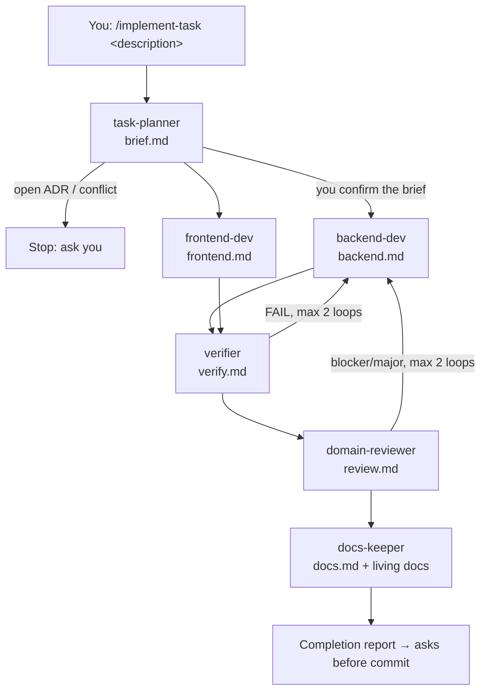

# Staywise agent setup (Antigravity)

This folder holds the multi-agent orchestration for Antigravity. The design lives in plain markdown, so other tools (for example Claude Code) can reuse the same role files.

```
.agent/
├── README.md               ← this file
├── rules/
│   └── orchestration.md    always-on rule: use the workflows, respect role boundaries
├── workflows/
│   ├── implement-task.md   /implement-task  full pipeline
│   └── quick-fix.md        /quick-fix       small bug-fix pipeline
├── roles/                  one file per specialist agent
│   ├── task-planner.md     request → brief.md (stops on open ADRs)
│   ├── backend-dev.md      apps/api only
│   ├── frontend-dev.md     apps/admin-web only (uses skills/ui-architect)
│   ├── verifier.md         builds/tests → verify.md with evidence
│   ├── domain-reviewer.md  AGENT.md §4 checklist → review.md
│   └── docs-keeper.md      updates 08/07/19/20/22 in the same change
├── skills/
│   └── ui-architect/       existing UI skill
└── work/<task-id>/         handoff files, created per task
    brief.md → backend.md / frontend.md → verify.md → review.md → docs.md
```

## Pipeline



## Two ways to run it

**1. One agent, sequential (simplest).** In the editor's agent panel, type `/implement-task <what you want>`. One agent plays each role in turn, reading that role's file at each stage. You get the fixed order, the review step and the required docs update. All stages share one context.

**2. Agent Manager, one agent per stage (clean context per role).**
1. Start agent A with: `Act as .agent/roles/task-planner.md for task: <description>`. Wait for `brief.md` and confirm it.
2. If the brief says *Parallel safe: yes*, start agents B and C at the same time:
   - `Act as .agent/roles/backend-dev.md for .agent/work/<task-id>/brief.md`
   - `Act as .agent/roles/frontend-dev.md for .agent/work/<task-id>/brief.md`

   Otherwise run B first, then C.
3. Start agent D with: `Act as .agent/roles/verifier.md for .agent/work/<task-id>/`.
4. Start agent E with: `Act as .agent/roles/domain-reviewer.md for .agent/work/<task-id>/`.
5. Start agent F with: `Act as .agent/roles/docs-keeper.md for .agent/work/<task-id>/`.

Each agent reads only its role file and the handoff files, so no stage depends on chat history.

## Notes
- **Folder name:** this repo uses `.agent/` (singular), and the ui-architect skill already loads from here. If your Antigravity version expects `.agents/`, rename the folder.
- **Rule frontmatter:** `rules/orchestration.md` uses `trigger: always_on`. If your version ignores it, set the rule to "Always On" in Antigravity's Customizations → Rules panel.
- **Folder limits are instructions only.** No tool enforces "backend-dev edits only `apps/api`". The domain-reviewer checks scope in the diff.
- **Git:** decide whether to commit `.agent/work/` as an audit trail or add it to `.gitignore`.
- The project rules still apply: ask before deleting files and before any commit or push.
