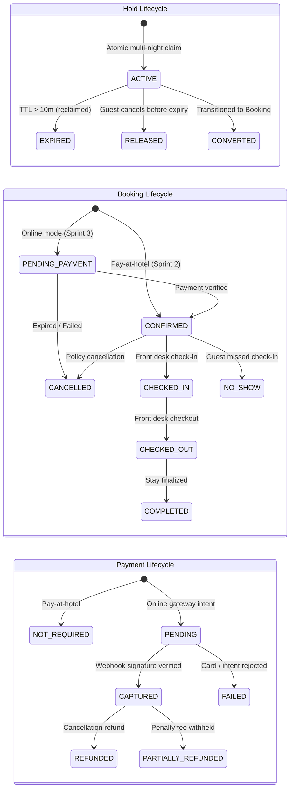

# Sprint 2 Technical Specification: Availability Holds & Booking Lifecycle Engine

> **Status: not implemented.** No holds, bookings or guest-auth code exists yet. Before building, reconcile it with ADR-005 (guest checkout without an account) and ADR-007 (tax is still open) in [20-decision-log.md](../04-planning-and-tracking/20-decision-log.md). See [DOCUMENTATION-REPORT.md](../DOCUMENTATION-REPORT.md) §8.

> **Document ID:** `DOC-024`  
> **Status:** Approved Architecture Plan — Ready for Future Implementation  
> **Target Release:** Sprint 2 (Phase 4 Milestone)  
> **Dependency:** MongoDB 6+ Replica Set Multi-Document Transactions  

---

## 1. Executive Summary & Design Alignment

This document details the architectural blueprint, data schemas, transactional algorithms, API contracts, and concurrency test suites for **Sprint 2: Availability Holds & Booking Lifecycle Engine**.

All design branches were systematically resolved and aligned through architectural review:

1. **Mandatory Guest User Accounts:**
   * Every inventory hold and reservation is strictly associated with a verified guest identity (`guestId`).
   * Guest authentication uses isolated server-managed sessions in a secure HttpOnly cookie (`staywise_guest_sid`), completely separated from the staff cookie audience (`staywise_staff_sid`).
2. **Dual-Protection Hold Expiry:**
   * All inventory holds carry a strict 10-minute time-to-live (`expiresAt = createdAt + 10m`).
   * Expired holds are reclaimed **on-demand** inside any hold transaction for that room type, complemented by a **1-minute periodic background worker** that sweeps stale holds across all properties.
3. **Sprint 2 Booking Transition Mode:**
   * Supports `PAY_AT_HOTEL` for immediate booking confirmation during Sprint 2.
   * State machines remain decoupled so that `PAY_ONLINE` and gateway webhooks can be introduced in Sprint 3 without altering the inventory or booking state transitions.
4. **Server-Authoritative Tax & Price Quoting:**
   * Base nightly rates are combined into a subtotal; taxes are computed server-side using a basis-point tax rate (default: `1200 bps` / 12% GST).
   * All prices, taxes, and fees are stored immutably in integer minor currency units (e.g., paise/cents) with explicit ISO 4217 currency.

---

## 2. Invariants & State Machine Architecture

### A. The Core Inventory Invariant
For every room type and local stay date $d \in [\text{checkIn}, \text{checkOut})$:
$$\text{heldRooms} + \text{confirmedRooms} + \text{blockedRooms} \le \text{totalRooms}$$

### B. Decoupled State Machines

The platform strictly decouples the state of an inventory hold, the state of a reservation, and the state of payment:



---

## 3. Database Schemas & Data Contracts

### A. Guest User (`guest_users` collection)
Stores authenticated guest accounts:

```typescript
export interface GuestUserDocument {
  _id: ObjectId;
  email: string;             // Lowercase, trimmed, unique index
  passwordHash: string;      // bcrypt (cost factor 12)
  name: string;
  phone: string;
  status: 'ACTIVE' | 'SUSPENDED';
  createdAt: Date;
  updatedAt: Date;
}
```

### B. Inventory Hold (`holds` collection)
Stores temporary 10-minute claims:

```typescript
export interface HoldDocument {
  _id: ObjectId;
  guestId: ObjectId;         // Ref: GuestUser
  hotelId: ObjectId;         // Ref: Hotel
  roomTypeId: ObjectId;      // Ref: RoomType
  roomsCount: number;        // Integer >= 1
  stayDates: {
    checkIn: string;         // YYYY-MM-DD (inclusive)
    checkOut: string;        // YYYY-MM-DD (exclusive)
  };
  stayNights: string[];      // Array of stay dates
  status: 'ACTIVE' | 'CONVERTED' | 'EXPIRED' | 'RELEASED';
  expiresAt: Date;           // createdAt + 10 minutes (indexed)
  idempotencyKey: string;    // Unique index per hold attempt
  quote: {
    currency: string;        // e.g. 'INR'
    subtotalMinorUnits: number;
    taxRateBps: number;      // e.g. 1200 (12%)
    taxMinorUnits: number;
    totalMinorUnits: number;
    nightlyBreakdown: Array<{
      stayDate: string;
      amountMinorUnits: number;
    }>;
  };
  createdAt: Date;
  updatedAt: Date;
}
```

**Indexes for `holds`:**
* `{ idempotencyKey: 1 }` (unique)
* `{ guestId: 1, status: 1 }`
* `{ expiresAt: 1, status: 1 }` (optimized for background reaper)
* `{ roomTypeId: 1, status: 1, expiresAt: 1 }` (optimized for on-demand reclaim)

### C. Booking (`bookings` collection)
Stores immutable confirmed reservations:

```typescript
export interface BookingDocument {
  _id: ObjectId;
  reference: string;         // Unguessable alphanumeric (e.g. SW-7K2M9P), unique index
  holdId: ObjectId;          // Traceability link to Hold
  guestId: ObjectId;         // Ref: GuestUser
  hotelId: ObjectId;         // Ref: Hotel
  roomTypeId: ObjectId;      // Ref: RoomType
  roomsCount: number;
  stayDates: {
    checkIn: string;
    checkOut: string;
  };
  stayNights: string[];
  occupancy: {
    adults: number;
    children: number;
  };
  status: 'CONFIRMED' | 'PENDING_PAYMENT' | 'CHECKED_IN' | 'CHECKED_OUT' | 'COMPLETED' | 'CANCELLED' | 'NO_SHOW' | 'PAYMENT_REVIEW';
  paymentStatus: 'NOT_REQUIRED' | 'PENDING' | 'CAPTURED' | 'REFUNDED' | 'PARTIALLY_REFUNDED';
  paymentMode: 'PAY_AT_HOTEL' | 'PAY_ONLINE';
  pricingSnapshot: {
    currency: string;
    subtotalMinorUnits: number;
    taxRateBps: number;
    taxMinorUnits: number;
    totalMinorUnits: number;
    nightlyBreakdown: Array<{ stayDate: string; amountMinorUnits: number }>;
  };
  guestSnapshot: {
    name: string;
    email: string;
    phone: string;
  };
  policySnapshot: {
    cancellationPolicy: any;
    freeCancellationHoursBeforeCheckIn: number;
  };
  history: Array<{
    fromStatus: string;
    toStatus: string;
    actorId: string;
    actorType: 'GUEST' | 'STAFF' | 'SYSTEM';
    timestamp: Date;
    reason?: string;
  }>;
  idempotencyKey: string;    // Unique index
  createdAt: Date;
  updatedAt: Date;
}
```

---

## 4. Transactional Workflows & Algorithms

### A. Atomic Multi-Night Hold Acquisition

```typescript
async function acquireHold(dto: CreateHoldDto, guest: GuestPrincipal): Promise<HoldResponse> {
  // 1. Validate stay dates: checkIn < checkOut, max 30 nights, in property time zone
  const stayNights = computeStayNights(dto.checkIn, dto.checkOut);

  // 2. Fetch room type and base rates for all nights
  const hotel = await getPublishedHotel(dto.hotelId);
  const roomType = await getActiveRoomType(dto.roomTypeId);
  const baseRates = await getBaseRatesForNights(dto.roomTypeId, stayNights);

  // 3. Compute immutable server-authoritative quote
  const quote = computeQuote(baseRates, dto.roomsCount, hotel.taxRateBps ?? 1200);

  // 4. Multi-document transaction with bounded retries
  return transactionService.executeInTransaction(async (session) => {
    // 4a. On-demand reclaim: Expire stale holds for this room type
    const staleHolds = await HoldModel.find({
      roomTypeId: dto.roomTypeId,
      status: 'ACTIVE',
      expiresAt: { $lt: new Date() }
    }, null, { session });

    for (const stale of staleHolds) {
      await HoldModel.updateOne({ _id: stale._id }, { status: 'EXPIRED' }, { session });
      for (const night of stale.stayNights) {
        await NightInventoryModel.updateOne(
          { roomTypeId: stale.roomTypeId, stayDate: night },
          { $inc: { heldRooms: -stale.roomsCount } },
          { session }
        );
      }
    }

    // 4b. Conditional atomic claim for every stay night
    for (const stayDate of stayNights) {
      const claimResult = await NightInventoryModel.updateOne(
        {
          roomTypeId: dto.roomTypeId,
          stayDate,
          $expr: {
            $gte: [
              { $subtract: ["$totalRooms", { $add: ["$heldRooms", "$confirmedRooms", "$blockedRooms"] }] },
              dto.roomsCount
            ]
          }
        },
        { $inc: { heldRooms: dto.roomsCount } },
        { session }
      );

      if (claimResult.modifiedCount === 0) {
        throw new ConflictException(`INVENTORY_UNAVAILABLE for night: ${stayDate}`);
      }
    }

    // 4c. Persist Hold document
    const [hold] = await HoldModel.create([{
      guestId: guest.id,
      hotelId: dto.hotelId,
      roomTypeId: dto.roomTypeId,
      roomsCount: dto.roomsCount,
      stayDates: { checkIn: dto.checkIn, checkOut: dto.checkOut },
      stayNights,
      status: 'ACTIVE',
      expiresAt: new Date(Date.now() + 10 * 60 * 1000), // 10 minutes TTL
      idempotencyKey: dto.idempotencyKey,
      quote
    }], { session });

    await auditService.log({
      action: 'hold.created',
      actorId: guest.id,
      actorType: 'GUEST',
      targetId: hold._id.toString(),
      metadata: { hotelId: dto.hotelId, roomTypeId: dto.roomTypeId, roomsCount: dto.roomsCount }
    }, session);

    return formatHoldResponse(hold);
  });
}
```

### B. Hold-to-Booking Conversion (Zero Inventory Loss)

```typescript
async function convertHoldToBooking(dto: CreateBookingDto, guest: GuestPrincipal): Promise<BookingResponse> {
  return transactionService.executeInTransaction(async (session) => {
    // 1. Verify hold is active and not expired
    const hold = await HoldModel.findOne({
      _id: dto.holdId,
      guestId: guest.id,
      status: 'ACTIVE',
      expiresAt: { $gt: new Date() }
    }, null, { session });

    if (!hold) {
      throw new BadRequestException('HOLD_EXPIRED_OR_INVALID');
    }

    // 2. Mark hold as CONVERTED
    await HoldModel.updateOne({ _id: hold._id }, { status: 'CONVERTED' }, { session });

    // 3. Atomically transfer inventory from held to confirmed for all nights
    // Net occupied rooms remain IDENTICAL (heldRooms decreases, confirmedRooms increases)
    for (const stayDate of hold.stayNights) {
      await NightInventoryModel.updateOne(
        { roomTypeId: hold.roomTypeId, stayDate },
        {
          $inc: {
            heldRooms: -hold.roomsCount,
            confirmedRooms: hold.roomsCount
          }
        },
        { session }
      );
    }

    // 4. Snapshot hotel policies and guest details
    const hotel = await HotelModel.findById(hold.hotelId, null, { session });
    const reference = generateUnguessableReference(); // e.g. "SW-K8M3P7"

    // 5. Create immutable Booking record
    const [booking] = await BookingModel.create([{
      reference,
      holdId: hold._id,
      guestId: guest.id,
      hotelId: hold.hotelId,
      roomTypeId: hold.roomTypeId,
      roomsCount: hold.roomsCount,
      stayDates: hold.stayDates,
      stayNights: hold.stayNights,
      occupancy: dto.occupancy,
      status: 'CONFIRMED', // Immediate confirmation for PAY_AT_HOTEL
      paymentStatus: 'NOT_REQUIRED',
      paymentMode: 'PAY_AT_HOTEL',
      pricingSnapshot: hold.quote,
      guestSnapshot: { name: dto.guestName, email: dto.guestEmail, phone: dto.guestPhone },
      policySnapshot: {
        cancellationPolicy: hotel.cancellationPolicy,
        freeCancellationHoursBeforeCheckIn: hotel.cancellationPolicy?.freeCancellationHoursBeforeCheckIn ?? 24
      },
      history: [{
        fromStatus: 'NONE',
        toStatus: 'CONFIRMED',
        actorId: guest.id,
        actorType: 'GUEST',
        timestamp: new Date(),
        reason: 'Reservation created via pay at hotel'
      }],
      idempotencyKey: dto.idempotencyKey
    }], { session });

    await auditService.log({
      action: 'booking.confirmed',
      actorId: guest.id,
      actorType: 'GUEST',
      targetId: booking._id.toString(),
      metadata: { reference, totalMinorUnits: hold.quote.totalMinorUnits }
    }, session);

    return formatBookingResponse(booking);
  });
}
```

### C. Booking Cancellation & Inventory Release

```typescript
async function cancelBooking(reference: string, actor: UserPrincipal, reason?: string): Promise<void> {
  return transactionService.executeInTransaction(async (session) => {
    const booking = await BookingModel.findOne({ reference }, null, { session });
    if (!booking) throw new NotFoundException('BOOKING_NOT_FOUND');
    if (booking.status !== 'CONFIRMED') throw new BadRequestException(`Cannot cancel booking in ${booking.status} status`);

    // 1. Mark booking CANCELLED
    await BookingModel.updateOne(
      { _id: booking._id },
      {
        status: 'CANCELLED',
        $push: {
          history: {
            fromStatus: 'CONFIRMED',
            toStatus: 'CANCELLED',
            actorId: actor.id,
            actorType: actor.role === 'GUEST' ? 'GUEST' : 'STAFF',
            timestamp: new Date(),
            reason: reason || 'Guest requested cancellation'
          }
        }
      },
      { session }
    );

    // 2. Release confirmed rooms back to available inventory
    for (const stayDate of booking.stayNights) {
      await NightInventoryModel.updateOne(
        { roomTypeId: booking.roomTypeId, stayDate },
        { $inc: { confirmedRooms: -booking.roomsCount } },
        { session }
      );
    }

    await auditService.log({
      action: 'booking.cancelled',
      actorId: actor.id,
      actorType: actor.role === 'GUEST' ? 'GUEST' : 'STAFF',
      targetId: booking._id.toString(),
      metadata: { reference, reason }
    }, session);
  });
}
```

---

## 5. Background Hold Expiry Sweeper (Cron Job)

* **Trigger:** `@Cron(CronExpression.EVERY_MINUTE)`
* **Function:** Queries `HoldModel` for documents where `status == 'ACTIVE'` and `expiresAt < now`.
* **Execution:** Sweeps in batches of 50. For each batch, runs a multi-document transaction to transition holds to `EXPIRED` and decrement `heldRooms` on affected `NightInventory` records.
* **Resilience:** If the cron is delayed or process restarts, the on-demand transaction reclaimer in `acquireHold` guarantees no stale hold blocks concurrent inventory.

---

## 6. Versioned REST API Contracts

### A. Guest Authentication (`/api/v1/auth/guest`)
| Method | Endpoint | Description | Auth Required |
| :--- | :--- | :--- | :--- |
| `POST` | `/api/v1/auth/guest/register` | Register guest with email, phone, name, password | No |
| `POST` | `/api/v1/auth/guest/login` | Authenticate and issue HttpOnly `staywise_guest_sid` | No |
| `GET` | `/api/v1/auth/guest/me` | Fetch authenticated guest profile | Guest Session |
| `POST` | `/api/v1/auth/guest/logout` | Revoke guest session and clear cookie | Guest Session |

### B. Holds Management (`/api/v1/holds`)
| Method | Endpoint | Description | Auth Required |
| :--- | :--- | :--- | :--- |
| `POST` | `/api/v1/holds` | Acquire 10-minute hold across date range with quote snapshot | Guest Session |
| `GET` | `/api/v1/holds/:id` | Check hold status and remaining seconds | Guest Session |
| `POST` | `/api/v1/holds/:id/release` | Manually release an active hold before TTL expiry | Guest Session |

### C. Guest Bookings (`/api/v1/bookings`)
| Method | Endpoint | Description | Auth Required |
| :--- | :--- | :--- | :--- |
| `POST` | `/api/v1/bookings` | Convert active hold into confirmed reservation | Guest Session |
| `GET` | `/api/v1/bookings` | List all bookings belonging to current guest | Guest Session |
| `GET` | `/api/v1/bookings/:reference` | View full booking details, quote, and cancellation policy | Guest Session |
| `POST` | `/api/v1/bookings/:reference/cancel` | Cancel booking according to policy and release inventory | Guest Session |

### D. Admin Bookings Operations (`/api/v1/admin/bookings`)
| Method | Endpoint | Description | Permission Required |
| :--- | :--- | :--- | :--- |
| `GET` | `/api/v1/admin/bookings` | List all bookings with hotel, status, and date filters | `bookings.view` |
| `GET` | `/api/v1/admin/bookings/:id` | View booking details, transition history, and audit log | `bookings.view` |
| `POST` | `/api/v1/admin/bookings/:id/check-in` | Mark guest checked-in (`CONFIRMED -> CHECKED_IN`) | `bookings.checkin` |
| `POST` | `/api/v1/admin/bookings/:id/check-out` | Mark guest checked-out (`CHECKED_IN -> CHECKED_OUT`) | `bookings.checkout` |
| `POST` | `/api/v1/admin/bookings/:id/cancel` | Privileged staff cancellation with audited reason | `bookings.cancel` |

---

## 7. Integration & Concurrency Test Matrix

To be verified against a replica-set instance (`mongodb-memory-server`):

| Test ID | Scenario | Expected Behavior | Invariant Verified |
| :---: | :--- | :--- | :--- |
| **TC-01** | **Race Condition on Final Room**<br>Total rooms = 1. Two concurrent requests simultaneously attempt to hold the room for overlapping dates. | Exactly 1 request succeeds with active hold.<br>Exactly 1 request throws `INVENTORY_UNAVAILABLE`. | $\text{held} + \text{confirmed} + \text{blocked} \le \text{total}$ strictly maintained. |
| **TC-02** | **Partial Multi-Night Rollback**<br>Stay covers 5 nights. Nights 1, 2, 4, 5 have availability; Night 3 has 0 available rooms. | Transaction throws `ConflictException`.<br>All 5 nights roll back. 0 rooms held. | All-or-nothing hold claim across stay range. |
| **TC-03** | **Hold Expiry and Auto-Reclaim**<br>Hold is created. Time advances past 10 minutes. Second guest requests same room. | On-demand reaper reclaims stale hold.<br>Second guest successfully acquires hold. | Stale holds never permanently lock inventory. |
| **TC-04** | **Hold Conversion Counter Invariant**<br>Active hold for 2 rooms is converted to booking. | `heldRooms` decreases by 2.<br>`confirmedRooms` increases by 2. | Total occupied inventory remains constant during conversion. |
| **TC-05** | **Booking Cancellation Release**<br>Confirmed booking for 2 rooms is cancelled. | `confirmedRooms` decreases by 2.<br>Rooms become immediately available. | Released rooms re-enter available inventory pool. |
| **TC-06** | **Idempotent Hold Submission**<br>Identical hold payload submitted twice with same `idempotencyKey`. | First creates hold.<br>Second returns existing hold without double-incrementing. | Idempotency key guarantees single execution. |

---

## 8. Phased Implementation Roadmap (For Future Execution)

When ready to implement, follow this exact dependency sequence:

1. **Step 1: Guest Authentication Foundation (`apps/api/src/modules/auth`)**
   * Create `GuestUser` schema and Mongoose model.
   * Implement `POST /api/v1/auth/guest/register` and `POST /api/v1/auth/guest/login`.
   * Implement `GuestSessionGuard` validating `staywise_guest_sid` cookie.
2. **Step 2: Inventory Hold Engine (`apps/api/src/modules/holds`)**
   * Create `Hold` schema with composite indexes.
   * Implement atomic multi-night `acquireHold` transaction with on-demand reap.
   * Implement 1-minute NestJS scheduled expiry sweeper.
   * Expose `POST /api/v1/holds`, `GET /api/v1/holds/:id`, and `POST /api/v1/holds/:id/release`.
3. **Step 3: Booking Engine (`apps/api/src/modules/bookings`)**
   * Create `Booking` schema with immutable snapshot models.
   * Implement `convertHoldToBooking` transaction (transferring held to confirmed inventory).
   * Implement `cancelBooking` transaction.
   * Expose guest booking endpoints (`POST /bookings`, `GET /bookings`, `GET /bookings/:reference`, `POST /bookings/:reference/cancel`).
4. **Step 4: Admin Operations Controller**
   * Implement `AdminBookingsController` (`/api/v1/admin/bookings`) with check-in, check-out, and cancellation.
5. **Step 5: Concurrency Test Verification**
   * Execute integration tests using `mongodb-memory-server` to prove race-condition safety.
