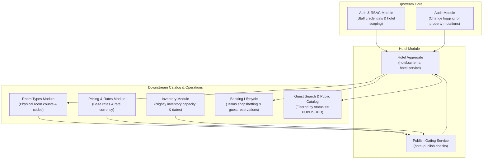

# Business Module Analysis: Hotel Module

**Platform:** Staywise Hotel Operations Platform (`apps/api` & `apps/admin-web`)  
**Module:** Hotel Management & Property Lifecycle  
**Author:** Pair Programming Agent  
**Date:** October 13, 2026  
**Scope:** Property directory, publication gating, policies, lifecycle state machine, content, and tenant authorization.

---

## Sources Reviewed

### 1. Product & Architecture Documentation
* [Documentation/01-product-requirements.md](../01-product/01-product-requirements.md) (Product Requirements Document: Core Tenants & Hotel Entities)
* [Documentation/07-database-design.md](../02-architecture/07-database-design.md) (Data Model & Schema Specifications: Hotel Collection)
* [Documentation/08-api-specification.md](../02-architecture/08-api-specification.md) (REST API Contract: Admin & Public Hotel Endpoints)
* [Documentation/11-auth-rbac.md](../03-guidelines/11-auth-rbac.md) & [Documentation/modules/rbac-permissions.md](../modules/rbac-permissions.md) (Staff RBAC & Property Scoping)
* [Documentation/12-business-rules.md](../01-product/12-business-rules.md) (Platform Business Rules & Lifecycle Invariants)
* [Documentation/modules/hotel-management.md](../modules/hotel-management.md) (Hotel Module Specification: Statuses & Publication)
* [Documentation/modules/cancellation-policies.md](../modules/cancellation-policies.md) (Cancellation Policy Specifications)
* [Documentation/modules/media-management.md](../modules/media-management.md) (Media Assets & Gallery Specifications)
* [Documentation/modules/room-type-management.md](../modules/room-type-management.md) (Room Type Relationship Specifications)
* [Documentation/24-sprint-2-availability-and-booking-plan.md](../05-sprints-and-progress/24-sprint-2-availability-and-booking-plan.md) (Sprint 2 Architecture Plan)

### 2. Backend Code (`apps/api`)
* [hotel.schema.ts](../../apps/api/src/modules/hotels/schemas/hotel.schema.ts) (Hotel Mongoose Schema, Indexes, & Subdocuments)
* [hotel.dto.ts](../../apps/api/src/modules/hotels/dto/hotel.dto.ts) (Validation DTOs, Query Filters, & Policy Payloads)
* [hotels.controller.ts](../../apps/api/src/modules/hotels/hotels.controller.ts) (REST Endpoints — admin and public controllers live in the same file)
* [hotel.service.ts](../../apps/api/src/modules/hotels/hotel.service.ts) (Core Business Logic, Optimistic Locking, Scoping)
* [hotel.policies.ts](../../apps/api/src/modules/hotels/hotel.policies.ts) (Validation Policies, Coordinates, Timezone & Currency Invariants)
* [hotel-status.rules.ts](../../apps/api/src/modules/hotels/hotel-status.rules.ts) (Lifecycle State Machine & Transition Rules)
* [hotel-publish.checks.ts](../../apps/api/src/modules/hotels/hotel-publish.checks.ts) (7 Publication Gating Invariants)
* Calling / Called Modules: [room.schema.ts](../../apps/api/src/modules/rooms/schemas/room.schema.ts), [pricing.service.ts](../../apps/api/src/modules/pricing/pricing.service.ts), [inventory.service.ts](../../apps/api/src/modules/inventory/inventory.service.ts), [booking.schema.ts](../../apps/api/src/modules/bookings/schemas/booking.schema.ts), [audit.service.ts](../../apps/api/src/modules/audit/audit.service.ts), [auth.service.ts](../../apps/api/src/modules/auth/auth.service.ts)

### 3. Frontend Code (`apps/admin-web`)
* [HotelsPage.tsx](../../apps/admin-web/src/pages/hotels/HotelsPage.tsx) (Property Directory Table, Search/Filter URL Sync, Pagination)
* [HotelBulkActionsBar.tsx](../../apps/admin-web/src/pages/hotels/components/HotelBulkActionsBar.tsx) (Permission-Gated Bulk Status Transitions)
* [HotelCreateModal.tsx](../../apps/admin-web/src/features/hotels/HotelCreateModal.tsx) (Property Quick-Create Dialog with Server Field Error Mapping)
* [HotelWorkspace.tsx](../../apps/admin-web/src/features/hotels/HotelWorkspace.tsx) (Single Hotel Editor, Publication Gating Banner, Lifecycle Actions)
* [hotels.api.ts](../../apps/admin-web/src/features/hotels/hotels.api.ts) (Centralized API Client Methods for Hotel Operations)

---

## Part 1: Module Scope

The **Hotel** module represents the primary tenant and operational root of the Staywise platform. It is responsible for managing public property metadata (display name, unique slug, geographic address, coordinates, and marketing descriptions), operational configurations (IANA timezone, contact channels, and cancellation policies), publication lifecycle states (`DRAFT`, `PUBLISHED`, `SUSPENDED`, `ARCHIVED`), and staff authorization boundaries. It acts as the anchor aggregate for room configurations, inventory management, nightly pricing, and guest reservation snapshots.

### Entities, Fields, and States Owned

The module owns the `Hotel` collection in MongoDB ([hotel.schema.ts:120-164](../../apps/api/src/modules/hotels/schemas/hotel.schema.ts#L120-L164)):

* **Root Schema:** `Hotel` ([hotel.schema.ts:120](../../apps/api/src/modules/hotels/schemas/hotel.schema.ts#L120))
  * `_id`: `Types.ObjectId` — Primary internal document identifier.
  * `name`: `string` (max 140 chars) — Legal/display title of the hotel.
  * `slug`: `string` (max 160 chars, unique) — URL-safe slug for public catalog routes.
  * `address`: `HotelAddress` ([hotel.schema.ts:14-32](../../apps/api/src/modules/hotels/schemas/hotel.schema.ts#L14-L32)) — `line1`, optional `line2`, `city`, optional `region`, `postalCode`, `countryCode` (2-letter ISO).
  * `timezone`: `string` (max 100 chars) — Valid IANA timezone identifier (e.g., `Asia/Kolkata`).
  * `contact`: `HotelContact` ([hotel.schema.ts:37-43](../../apps/api/src/modules/hotels/schemas/hotel.schema.ts#L37-L43)) — Operational `email` and/or international `phone`.
  * `coordinates`: `HotelCoordinates` ([hotel.schema.ts:48-54](../../apps/api/src/modules/hotels/schemas/hotel.schema.ts#L48-L54)) — Optional pair of `latitude` ([-90, 90]) and `longitude` ([-180, 180]).
  * `description`: `string` (optional, max 5000 chars) — Public description of the property.
  * `amenities`: `string[]` (default `[]`) — Normalized list of hotel-level facility tags.
  * `primaryImage`: `string` (optional, max 1000 chars) — Direct CDN URL to the hero image.
  * `media`: `HotelMedia[]` ([hotel.schema.ts:103-115](../../apps/api/src/modules/hotels/schemas/hotel.schema.ts#L103-L115)) — Photo gallery with `url`, `isPrimary`, `caption`, and integer `displayOrder`.
  * `cancellationPolicy`: `HotelCancellationPolicy` ([hotel.schema.ts:83-98](../../apps/api/src/modules/hotels/schemas/hotel.schema.ts#L83-L98)) — Effective cutoff, fee schedules for `afterCutoff` and `noShow`, and policy version.
  * `status`: `HotelStatus` ([hotel.schema.ts:6-11](../../apps/api/src/modules/hotels/schemas/hotel.schema.ts#L6-L11)) — Finite lifecycle states: `DRAFT`, `PUBLISHED`, `SUSPENDED`, `ARCHIVED`.
  * `version`: `number` (default `0`) — Monotonically increasing counter for optimistic concurrency control.
  * `createdAt`, `updatedAt`: `Date` — Audit timestamps.

### Module Dependencies



* **Inward Dependencies (What Hotel depends on):**
  * `Auth & RBAC`: Validates staff sessions, enforces permission keys (`hotels.view`, `hotels.create`, `hotels.edit`, `hotels.publish`, `hotels.archive`), and restricts managers to their assigned `hotelIds`.
  * `Audit Service`: Records structured audit logs for property creation, metadata edits, status transitions, and gallery updates.
  * `Room Types Service`: Used by `HotelPublishChecks` to verify that at least one `ACTIVE` room type with `totalRooms > 0` exists before publication.
  * `Pricing Service`: Used by `HotelPublishChecks` to ensure every active room type has an established `BaseRate` with identical currency matching policy fixed fees.
  * `Inventory Service`: Used by `HotelPublishChecks` to verify that future sellable nights (`available > 0`) exist relative to property local time.
* **Outward Dependencies (What depends on Hotel):**
  * `Public Catalog & Search`: Reads published hotel records by slug or location; completely ignores `DRAFT`, `SUSPENDED`, or `ARCHIVED` hotels.
  * `Room Types`: Every room type requires a valid parent `hotelId`.
  * `Inventory Engine`: Local stay dates (`YYYY-MM-DD`) are interpreted in the parent hotel's IANA `timezone`.
  * `Booking & Hold Lifecycle`: Copies the hotel's timezone, address, contact channel, and cancellation terms directly into immutable booking snapshots.
  * `Admin Web Dashboard`: Aggregates property status counts across draft, published, suspended, and archived records.

---

## Part 2: Requirement Traceability Matrix

| ID | Requirement Statement | Origin | Source Reference | Backend Status | Frontend Status | Notes |
|---|---|---|---|---|---|---|
| **HOTEL-01** | Support 4 finite lifecycle states: `DRAFT`, `PUBLISHED`, `SUSPENDED`, `ARCHIVED`. | DOC | [hotel-management.md:5](../modules/hotel-management.md#L5) | **Implemented** | **Implemented** | [hotel.schema.ts:6-11](../../apps/api/src/modules/hotels/schemas/hotel.schema.ts#L6-L11); UI pills in [HotelWorkspace.tsx:135](../../apps/admin-web/src/features/hotels/HotelWorkspace.tsx#L135). |
| **HOTEL-02** | Unique slug for each hotel; normalized lowercase string. | DOC | [hotel-management.md:9](../modules/hotel-management.md#L9) | **Implemented** | **Implemented** | Index in [hotel.schema.ts:167](../../apps/api/src/modules/hotels/schemas/hotel.schema.ts#L167); normalized in [hotel.policies.ts:11-15](../../apps/api/src/modules/hotels/hotel.policies.ts#L11-L15). |
| **HOTEL-03** | Only published properties appear in guest search and public routes (`/hotels/:slug`). | DOC | [hotel-management.md:5, 26](../modules/hotel-management.md#L5) | **Implemented** | **Implemented** | Backend check in [hotel.service.ts:271](../../apps/api/src/modules/hotels/hotel.service.ts#L271). |
| **HOTEL-04** | Timezone must be a valid IANA identifier. | DOC | [hotel-management.md:9](../modules/hotel-management.md#L9) | **Implemented** | **Implemented** | Verified via `Intl.DateTimeFormat` in [hotel.policies.ts:99-105](../../apps/api/src/modules/hotels/hotel.policies.ts#L99-L105). |
| **HOTEL-05** | Timezone cannot be changed while future bookings exist without an explicit migration plan. | DOC | [hotel-management.md:13](../modules/hotel-management.md#L13) | **Missing** | **Missing** | **Contradiction:** Code allows patching `timezone` on any hotel without verifying booking status. |
| **HOTEL-06** | Optional coordinates must validate latitude ([-90, 90]) and longitude ([-180, 180]). | DOC | [hotel-management.md:9](../modules/hotel-management.md#L9) | **Implemented** | **Partial** | Enforced in [hotel.dto.ts:64-65](../../apps/api/src/modules/hotels/dto/hotel.dto.ts#L64-L65); omitted from quick create modal. |
| **HOTEL-07** | Support star classification / hotel star rating. | DOC | [hotel-management.md:9](../modules/hotel-management.md#L9); [07-database-design.md:11](../02-architecture/07-database-design.md#L11) | **Missing** | **Missing** | Not present on `Hotel` schema, DTOs, or frontend UI. |
| **HOTEL-08** | Support check-in and check-out local times. | DOC | [hotel-management.md:9](../modules/hotel-management.md#L9) | **Missing** | **Missing** | Not in schema; booking calculations assume standard noon/3PM defaults. |
| **HOTEL-09** | Support market-appropriate tax registration (e.g., GSTIN / VAT ID) and tax configuration. | DOC | [hotel-management.md:9, 14](../modules/hotel-management.md#L9) | **Missing** | **Missing** | Not modeled in schema or property settings. |
| **HOTEL-10** | Property publication gated on explicit cancellation and no-show policy. | DOC | [hotel-management.md:18](../modules/hotel-management.md#L18) | **Implemented** | **Implemented** | [hotel-publish.checks.ts:32-55](../../apps/api/src/modules/hotels/hotel-publish.checks.ts#L32-L55); error banner in [HotelWorkspace.tsx:185](../../apps/admin-web/src/features/hotels/HotelWorkspace.tsx#L185). |
| **HOTEL-11** | Cancellation policy start date (`effectiveFrom`) must not be in the future at publication time. | CODE | [hotel-publish.checks.ts:48-54](../../apps/api/src/modules/hotels/hotel-publish.checks.ts#L48-L54) | **Implemented** | **Implemented** | Checks local date against `hotel.timezone`; returns `HOTEL_POLICY_NOT_YET_EFFECTIVE`. |
| **HOTEL-12** | Publication gated on at least 1 ACTIVE room type with `totalRooms >= 1`. | DOC | [hotel-management.md:18](../modules/hotel-management.md#L18) | **Implemented** | **Implemented** | [hotel-publish.checks.ts:58-74](../../apps/api/src/modules/hotels/hotel-publish.checks.ts#L58-L74). |
| **HOTEL-13** | Publication gated on established base rates with identical currency for all active room types. | DOC | [hotel-management.md:18](../modules/hotel-management.md#L18) | **Implemented** | **Implemented** | [hotel-publish.checks.ts:79-97](../../apps/api/src/modules/hotels/hotel-publish.checks.ts#L79-L97). |
| **HOTEL-14** | Fixed cancellation policy fees must match the property's base-rate currency. | DOC | [hotel-management.md:18](../modules/hotel-management.md#L18) | **Implemented** | **Implemented** | [hotel.policies.ts:87-93](../../apps/api/src/modules/hotels/hotel.policies.ts#L87-L93); returns `HOTEL_POLICY_CURRENCY_MISMATCH`. |
| **HOTEL-15** | Publication gated on future inventory with available rooms (`available > 0`) per active room type. | DOC | [hotel-management.md:18](../modules/hotel-management.md#L18) | **Implemented** | **Implemented** | Evaluated in [hotel-publish.checks.ts:110-126](../../apps/api/src/modules/hotels/hotel-publish.checks.ts#L110-L126). |
| **HOTEL-16** | Optimistic concurrency control (`version` counter) on all property updates. | DOC | [hotel-management.md:22](../modules/hotel-management.md#L22); [08-api-specification.md:58](../02-architecture/08-api-specification.md#L58) | **Implemented** | **Implemented** | Returns `409 VERSION_CONFLICT` on stale payload ([hotel.service.ts:348](../../apps/api/src/modules/hotels/hotel.service.ts#L348)). |
| **HOTEL-17** | Hotel scoping for managers (non-super admins cannot view/mutate outside assigned IDs). | DOC | [hotel-management.md:17](../modules/hotel-management.md#L17) | **Implemented** | **Implemented** | Enforced in [hotel.policies.ts:128-132](../../apps/api/src/modules/hotels/hotel.policies.ts#L128-L132) and [hotel.service.ts:85, 102](../../apps/api/src/modules/hotels/hotel.service.ts#L85). |
| **HOTEL-18** | Suspension halts new holds immediately while preserving existing confirmed bookings. | DOC | [hotel-management.md:5, 28](../modules/hotel-management.md#L5) | **Implemented** | **Implemented** | Public route hides suspended hotel; admin bookings remain accessible. |
| **HOTEL-19** | Archiving a property is permanent and does not delete rooms or bookings. | DOC | [hotel-management.md:15](../modules/hotel-management.md#L15) | **Implemented** | **Implemented** | Terminal state in [hotel-status.rules.ts:7](../../apps/api/src/modules/hotels/hotel-status.rules.ts#L7); confirmation dialog requires typing "ARCHIVE". |
| **HOTEL-20** | Bulk status updates (`PATCH /admin/hotels/bulk-status`) with individual failure reporting. | DOC | [08-api-specification.md:34](../02-architecture/08-api-specification.md#L34) | **Implemented** | **Implemented** | Returns `updated[]` and itemized `skipped[]` ([hotel.service.ts:213-218](../../apps/api/src/modules/hotels/hotel.service.ts#L213-L218)). |
| **HOTEL-21** | Bulk updates must block `DRAFT -> PUBLISHED` (must use workspace publish check). | CODE | [hotel-status.rules.ts:4](../../apps/api/src/modules/hotels/hotel-status.rules.ts#L4) | **Implemented** | **Implemented** | Blocked with `INVALID_TRANSITION`; bulk bar disables button if draft is selected. |
| **HOTEL-22** | Audit logging on property creation, updates, media changes, and status transitions. | DOC | [hotel-management.md:14](../modules/hotel-management.md#L14) | **Implemented** | **Partial** | Audit records written in backend; no audit history view in admin frontend. |
| **HOTEL-23** | Media management: image URLs, primary image designation, display ordering, captions. | DOC | [media-management.md:9-14](../modules/media-management.md#L9) | **Partial** | **Implemented** | Metadata stored; binary scanning and quarantine storage pipeline are absent. |
| **HOTEL-24** | Bulk CSV/JSON property import (`POST /admin/hotels/import`). | DOC | [08-api-specification.md:32](../02-architecture/08-api-specification.md#L32) | **Missing** | **Missing** | Planned Phase 4; button in UI triggers informational toast. |
| **HOTEL-25** | CSV export of property directory and setup status (`GET /admin/hotels/export`). | DOC | [08-api-specification.md:33](../02-architecture/08-api-specification.md#L33) | **Missing** | **Missing** | Planned Phase 4. |
| **HOTEL-26** | Setup status filter (`setupStatus=COMPLETED|IN_PROGRESS`) in hotel directory. | CODE | [hotel.service.ts:80-84](../../apps/api/src/modules/hotels/hotel.service.ts#L80-L84) | **Implemented** | **Implemented** | Present in backend filter and frontend filter bar; undocumented in root PRD. |
| **HOTEL-27** | Top-level property currency field (`currency`). | INFERRED | Standard hotel operations | **Missing** | **Missing** | Suggested: Hotel currency is currently derived indirectly from room rates rather than declared on the hotel itself. |
| **HOTEL-28** | Maximum advance booking window / booking horizon (e.g., 365 days). | INFERRED | [12-business-rules.md:6](../01-product/12-business-rules.md#L6) | **Missing** | **Missing** | Mentioned in business rules ("define maximum stay and booking horizon"), but unmodeled. |

---

## Part 3: Business Rules Inventory

| Business Rule | Where Enforced | Implementation Source | Gaps & Weaknesses |
|---|---|---|---|
| **Property Name & Slug Validation** | Backend DTO + Policy | [hotel.dto.ts:56-57](../../apps/api/src/modules/hotels/dto/hotel.dto.ts#L56-L57)<br>[hotel.policies.ts:11-15](../../apps/api/src/modules/hotels/hotel.policies.ts#L11-L15) | Slug uniqueness enforced by DB unique index (`hotel_slug_unique`). Slug normalization strips non-alphanumeric characters. |
| **Contact Requirement** | Backend Service + DB Schema | [hotel.service.ts:228-230](../../apps/api/src/modules/hotels/hotel.service.ts#L228-L230) | Requires at least email or phone. However, [hotel.schema.ts:135](../../apps/api/src/modules/hotels/schemas/hotel.schema.ts#L135) marks `contact` object as required, but individual fields are optional in schema. |
| **Coordinate Coupling** | Backend Service | [hotel.service.ts:225-227](../../apps/api/src/modules/hotels/hotel.service.ts#L225-L227) | Validates that latitude and longitude must either both be provided or both be omitted. |
| **IANA Timezone Validity** | Backend Policy | [hotel.policies.ts:99-105](../../apps/api/src/modules/hotels/hotel.policies.ts#L99-L105) | Validated using Node `Intl.DateTimeFormat`. Rejects non-IANA strings. |
| **Timezone Mutation Restriction** | **Nowhere** | None | **Critical Gap:** Doc states timezone cannot be changed if future bookings exist. Backend allows unrestricted PATCH of `timezone`. |
| **Lifecycle State Machine** | Backend Service + Rules | [hotel-status.rules.ts:3-8](../../apps/api/src/modules/hotels/hotel-status.rules.ts#L3-L8)<br>[hotel.service.ts:389-391](../../apps/api/src/modules/hotels/hotel.service.ts#L389-L391) | `ARCHIVED` is terminal. `DRAFT -> PUBLISHED` requires publication check. `PUBLISHED <-> SUSPENDED` is permitted. |
| **Publication Prerequisites (7 Gating Checks)** | Backend Service | [hotel-publish.checks.ts:27-130](../../apps/api/src/modules/hotels/hotel-publish.checks.ts#L27-L130) | Gating runs inside MongoDB transaction; verifies policy validity, effective date, active room types, sellable inventory, rates, currency match, and future inventory. |
| **Cancellation Fee Basis Rules** | Backend Policy + DTO | [hotel.policies.ts:45-70](../../apps/api/src/modules/hotels/hotel.policies.ts#L45-L70)<br>[hotel.dto.ts:24-32](../../apps/api/src/modules/hotels/dto/hotel.dto.ts#L24-L32) | `FIXED_MINOR_UNITS` requires integer amount and ISO currency. `PERCENTAGE_BPS` requires basis points in range `[0, 10000]`. Other bases forbid amount/currency/bps. |
| **Currency Uniformity Invariant** | Backend Publish Check | [hotel-publish.checks.ts:92-108](../../apps/api/src/modules/hotels/hotel-publish.checks.ts#L92-L108) | All room types must share the exact same currency code, and fixed policy cancellation fees must match it. |
| **Optimistic Concurrency Control** | Backend Service + Mongoose query | [hotel.service.ts:134, 344, 373, 395](../../apps/api/src/modules/hotels/hotel.service.ts#L134) | Queries match `{ _id, version }` and increment `{ $inc: { version: 1 } }`. Throws `409 VERSION_CONFLICT` on mismatch. |
| **Staff Property Scoping** | Backend Guard + Policy | [hotel.policies.ts:128-132](../../apps/api/src/modules/hotels/hotel.policies.ts#L128-L132) | Non-`SUPER_ADMIN` actors are restricted to `actor.hotelIds`. Enforced on GET, PATCH, and status mutations. |
| **Bounded Pagination & Search** | Backend Service + Query DTO | [hotel.service.ts:87](../../apps/api/src/modules/hotels/hotel.service.ts#L87)<br>[hotel.dto.ts:101-106](../../apps/api/src/modules/hotels/dto/hotel.dto.ts#L101-L106) | Limits bounded to `[1, 100]`, offset `>= 0`. Default limit 20. Case-insensitive regex on city; full text search on name/slug/city. |
| **Media Display Order Invariant** | Backend Service | [hotel.service.ts:123-131](../../apps/api/src/modules/hotels/hotel.service.ts#L123-L131) | Ensures `primaryImage` string on hotel root is synced with the item marked `isPrimary` or defaults to item 0. |

---

## Part 4: Missing Requirements

### a. Documented But Not Built (DOC $\rightarrow$ Missing / Partial)

1. **Timezone Lock When Future Bookings Exist ([hotel-management.md:13](../modules/hotel-management.md#L13)):**
   * *Documentation:* "Hotel timezone is set before publication and cannot be changed while future bookings exist without an explicit migration plan."
   * *Actual Code:* `update()` in [hotel.service.ts:316-324](../../apps/api/src/modules/hotels/hotel.service.ts#L316-L324) accepts a new `timezone` string and updates it directly. It never checks the `bookings` collection or checks whether the hotel is already published.
   * *Impact:* Changing the timezone of an active hotel shifts nightly date boundaries (`YYYY-MM-DD`), potentially misaligning inventory calendars and cutoff deadlines for existing confirmed guests.
2. **Check-in and Check-out Times ([hotel-management.md:9](../modules/hotel-management.md#L9)):**
   * *Documentation:* "check-in/out local times" are listed as standard property fields.
   * *Actual Code:* Omitted from `Hotel` schema and DTOs.
   * *Impact:* The cancellation policy cutoff calculation relies on "hours before check-in", but because check-in time is not stored on the hotel, calculations must assume an arbitrary default (e.g., 14:00 or 15:00) rather than property-specific check-in terms.
3. **Star Classification / Tier ([hotel-management.md:9](../modules/hotel-management.md#L9); [07-database-design.md:11](../02-architecture/07-database-design.md#L11)):**
   * *Documentation:* Specifies star category / rating on Hotel entity.
   * *Actual Code:* Completely missing in schema, DTOs, and admin forms.
4. **Tax Registration / Configuration ([hotel-management.md:9, 14](../modules/hotel-management.md#L9)):**
   * *Documentation:* "tax registration/configuration appropriate to market", with changes audited.
   * *Actual Code:* No field for legal business entity, tax identifier (GSTIN, VAT, EIN), or tax regime.
5. **Bulk Property Import & Export ([08-api-specification.md:32-33](../02-architecture/08-api-specification.md#L32-L33)):**
   * *Documentation:* `POST /admin/hotels/import` and `GET /admin/hotels/export`.
   * *Actual Code:* Neither endpoint exists in `AdminHotelsController`. The frontend "Import" button shows a placeholder toast ([HotelsPage.tsx:301](../../apps/admin-web/src/pages/hotels/HotelsPage.tsx#L301)).
6. **Policy Version Repository / Approved Policy Selection ([cancellation-policies.md:5](../modules/cancellation-policies.md#L5)):**
   * *Documentation:* "Property may select an approved policy... Keep policy configuration deterministic and versioned."
   * *Actual Code:* Policy is embedded in the hotel document; there is no standalone `policies` collection or reusable templates. Editing the policy directly mutates the embedded subdocument.

### b. Built But Undocumented (CODE Only)

1. **Setup Status Filter (`setupStatus=COMPLETED|IN_PROGRESS`):**
   * *Code:* [hotel.service.ts:80-84](../../apps/api/src/modules/hotels/hotel.service.ts#L80-L84) maps `COMPLETED` to `status === PUBLISHED` and `IN_PROGRESS` to `status !== PUBLISHED`.
   * *Assessment:* Useful heuristic in the admin UI, but should be documented in [08-api-specification.md](../02-architecture/08-api-specification.md) as an accepted query parameter on `GET /admin/hotels`.
2. **Text Index Weights on Hotel Search:**
   * *Code:* [hotel.schema.ts:169-172](../../apps/api/src/modules/hotels/schemas/hotel.schema.ts#L169-L172) creates a text index with specific weights (`name: 10, slug: 5, address.city: 3`).
   * *Assessment:* Good practice; should be formally noted in the database index inventory.
3. **Dedicated Single-Hotel Suspend and Archive Endpoints:**
   * *Code:* `POST /admin/hotels/:id/suspend` ([hotels.controller.ts:73](../../apps/api/src/modules/hotels/hotels.controller.ts#L73)) and `POST /admin/hotels/:id/archive` ([hotels.controller.ts:79](../../apps/api/src/modules/hotels/hotels.controller.ts#L79)).
   * *Assessment:* Correct REST endpoints matching the lifecycle rules; documented in modules spec but omitted from some table summaries in `08-api-specification.md`.

### c. Expected for a Hotel Business But Absent (INFERRED)

1. **Explicit Property Base Currency (`currency`):**
   * *Business Situation:* Hotels operate in a primary accounting currency (e.g., INR, AED, USD) in which local bank deposits, merchant accounts, and night-audits operate.
   * *Current Gap:* The `Hotel` schema has no currency attribute. Currency is only established when a staff member creates a `BaseRate` on a room type. This creates a chicken-and-egg problem where the cancellation policy fixed fee currency must match the room rate currency, but neither is bound to a root property currency.
2. **Standard Check-In and Check-Out Deadlines:**
   * *Business Situation:* Standard hotel check-in (e.g., 14:00 or 15:00) and check-out (e.g., 11:00 or 12:00) times are essential for guest communication, same-day turnover windows, and computing the exact minute when a 24-hour cancellation cutoff expires.
   * *Current Gap:* Cutoffs are computed relative to date midnight rather than actual property check-in hour.
3. **Child Age and Occupancy Policy Definition:**
   * *Business Situation:* A hotel defines whether children stay free under age 6, or whether guests age 12+ are billed as adults.
   * *Current Gap:* Room types have `maxAdults` and `maxChildren`, but the age boundary defining an adult vs child is unmodeled at the hotel level.
4. **Booking Horizon / Advance Reservation Window:**
   * *Business Situation:* Properties generally restrict bookings to a maximum horizon (e.g., 365 or 730 days ahead) to prevent guests from booking beyond planned rate schedules.
   * *Current Gap:* No validation prevents reservations 5 years into the future if inventory exists.

---

## Part 5: Edge Cases and Failure Scenarios

### 1. Timezone and Date Boundary Failures

* **Midnight Rollover During Inventory Gating:**
  * *Code Citation:* [hotel-publish.checks.ts:111-115](../../apps/api/src/modules/hotels/hotel-publish.checks.ts#L111-L115) computes `localToday = dateInTimezone(new Date(), hotel.timezone)` and checks `stayDate >= localToday`.
  * *Scenario:* If a property is located in Tokyo (`UTC+9`) and the publishing staff member is located in London (`UTC+0`) at 20:00 UTC on Oct 13, local date in Tokyo is already Oct 14. If the staff configured inventory only for Oct 13, the check correctly evaluates in Tokyo time and flags Oct 13 as in the past.
  * *Edge Case:* If the hotel has an invalid timezone string in legacy data, `dateInTimezone` throws an unhandled error inside `new Intl.DateTimeFormat`, resulting in an unformatted HTTP 500 rather than a clean 422 validation error.
* **Daylight Saving Time (DST) Transitions:**
  * *Scenario:* When a hotel in `America/New_York` enters or leaves DST, a 24-hour cancellation cutoff must not accidentally calculate as 23 or 25 physical hours if using wall-clock time.
  * *Current Code:* `dateInTimezone` uses `Intl.DateTimeFormat` with `en-CA` formatting, which accurately resolves calendar dates across DST switches.

### 2. Concurrent Administrative Edits

* **Two Staff Members Modifying Property Content Simultaneously:**
  * *Code Citation:* [hotel.service.ts:344-348](../../apps/api/src/modules/hotels/hotel.service.ts#L344-L348)
  * *Behavior:* Staff A and Staff B load Hotel version 3. Staff A updates the address and increments version to 4. Staff B submits an update with version 3.
  * *Result:* The atomic query `{ _id, version: 3 }` fails to match. The server aborts the transaction and throws `ConflictException({ error: 'VERSION_CONFLICT', message: 'Hotel was changed by another request' })`.
  * *Frontend Handling:* [HotelWorkspace.tsx:61](../../apps/admin-web/src/features/hotels/HotelWorkspace.tsx#L61) and [handleFormError.ts:19](../../apps/admin-web/src/hooks/handleFormError.ts#L19) catch this error and display an inline warning advising the user that another session modified the record.

### 3. Partial Failures in Multi-Hotel Bulk Operations

* **Scenario:** An admin selects 50 hotels and issues a bulk `SUSPEND`. 48 hotels succeed, 1 is already `ARCHIVED`, and 1 was modified concurrently (`VERSION_CONFLICT`).
  * *Code Citation:* [hotel.service.ts:161-219](../../apps/api/src/modules/hotels/hotel.service.ts#L161-L219)
  * *Behavior:* The operation executes inside a MongoDB transaction (`TransactionService.executeInTransaction`). Rather than failing the entire batch, the loop appends failures to the `skipped[]` array ([hotel.service.ts:165](../../apps/api/src/modules/hotels/hotel.service.ts#L165)) with specific reason codes (`INVALID_TRANSITION`, `VERSION_CONFLICT`, `FORBIDDEN`). The 48 valid hotels update and increment their versions atomically.
  * *Result:* Returns HTTP 200 with `{ modifiedCount: 48, status: 'SUSPENDED', updated: [...], skipped: [...] }`.

### 4. Cascade and Dependency Integrity on Archival

* **Scenario:** An admin permanently archives a hotel that has 12 room types and 50 upcoming bookings.
  * *Code Citation:* [hotel.service.ts:383-403](../../apps/api/src/modules/hotels/hotel.service.ts#L383-L403)
  * *Behavior:* Archiving only updates `hotel.status = 'ARCHIVED'`. It does NOT cascade-delete room types, nightly inventory documents, base rates, or bookings.
  * *Impact:* Historical bookings remain readable by staff; guest search immediately hides the hotel because public query checks `status: HotelStatus.PUBLISHED` ([hotel.service.ts:271](../../apps/api/src/modules/hotels/hotel.service.ts#L271)). No orphan foreign key errors occur.

### 5. Monetary Basis Points and Currency Mismatch

* **Scenario:** Hotel sets a fixed cancellation fee in `EUR` on `cancellationPolicy.afterCutoff`, while room rates are priced in `INR`.
  * *Code Citation:* [hotel-publish.checks.ts:98-107](../../apps/api/src/modules/hotels/hotel-publish.checks.ts#L98-L107)
  * *Behavior:* When attempting to publish, `validatePolicyCurrency` throws a mismatch conflict. The publication gate halts and outputs `HOTEL_POLICY_CURRENCY_MISMATCH`.
  * *Result:* The property remains in `DRAFT` or `SUSPENDED` state until the currencies match.

---

## Part 6: Improvement Proposals

### 1. Correctness Fixes

#### PROP-01: Freeze Timezone When Future Bookings Exist
* **Problem:** [hotel-management.md:13](../modules/hotel-management.md#L13) explicitly mandates that timezone cannot be changed if future bookings exist. Currently, PATCH `/admin/hotels/:id` allows altering `timezone` without checking bookings.
* **Business Value:** Prevents silent corruption of guest check-in schedules, reservation dates, and cancellation cutoff hours.
* **Proposed Rule:** If `updateHotelDto.timezone` differs from `hotel.timezone`, query `Booking` collection for bookings where `hotelId === id` and `status in ['CONFIRMED', 'PENDING_PAYMENT', 'CHECKED_IN']` and `checkOutDate >= localToday`. If count $> 0$, reject with `409 HOTEL_TIMEZONE_LOCKED`.
* **Data Model Change:** None.
* **API Change:** `PATCH /admin/hotels/:id` returns `409 Conflict` (`errorCode: 'HOTEL_TIMEZONE_LOCKED'`).
* **Admin UI Change:** In `HotelWorkspace.tsx`, display the timezone field as disabled/read-only with an informative tooltip if the property is published with active bookings.
* **Cross-Module Effect:** Directly safeguards the `Booking` and `Inventory` modules.
* **Priority:** **Must** | **Effort:** Small (S)

#### PROP-02: Enforce Contact Channel Consistency in Mongoose Schema
* **Problem:** [hotel.service.ts:228-230](../../apps/api/src/modules/hotels/hotel.service.ts#L228-L230) validates that either email or phone is present during `create()`, but `update()` bypasses this check if `contact` is partially cleared, and the Mongoose schema marks both sub-properties as optional.
* **Business Value:** Guarantees that every active hotel always retains a direct communication channel for guests and operational alerts.
* **Proposed Rule:** Add a custom schema-level validator on `HotelContactSchema` asserting `this.email || this.phone`.
* **Data Model Change:** Update `HotelContactSchema` in `hotel.schema.ts`.
* **API Change:** Throws `422 UNPROCESSABLE_ENTITY` (`errorCode: 'VALIDATION_FAILED'`).
* **Admin UI Change:** None (UI already requires email).
* **Cross-Module Effect:** Protects guest notifications and reservation confirmation dispatchers.
* **Priority:** **Should** | **Effort:** Small (S)

---

### 2. Missing Features

#### PROP-03: Add First-Class Property Currency and Check-in/Check-out Times
* **Problem:** Lack of root `currency`, `checkInTime`, and `checkOutTime` requires awkward downstream inference and prevents deterministic cutoff calculations.
* **Business Value:** Provides clarity on legal check-in hours, avoids rate currency confusion, and sets expectations for guests and night-audits.
* **Proposed Rule:**
  1. Add `currency` (`string`, ISO 4217, default from platform config e.g. `INR`) to `Hotel`. When creating room rates or fixed cancellation policies, auto-bind to this currency.
  2. Add `checkInTime` (e.g., `'14:00'`) and `checkOutTime` (e.g., `'11:00'`) with regex format `/^([01]\d|2[0-3]):([0-5]\d)$/`.
* **Data Model Change:**
  ```typescript
  @Prop({ required: true, uppercase: true, match: /^[A-Z]{3}$/, default: 'INR' })
  currency: string;

  @Prop({ required: true, default: '14:00', match: /^([01]\d|2[0-3]):([0-5]\d)$/ })
  checkInTime: string;

  @Prop({ required: true, default: '11:00', match: /^([01]\d|2[0-3]):([0-5]\d)$/ })
  checkOutTime: string;
  ```
* **API Change:** Expose `currency`, `checkInTime`, `checkOutTime` on `CreateHotelDto`, `UpdateHotelDto`, and public responses.
* **Admin UI Change:** Add check-in/out inputs to `HotelCreateModal.tsx` and property settings in `HotelWorkspace.tsx`.
* **Cross-Module Effect:** Unlocks deterministic cancellation cutoff calculations in `cancellation-policies.service.ts` and simplifies currency locks in `BaseRatesView.tsx`.
* **Priority:** **Must** | **Effort:** Medium (M)

#### PROP-04: Support Property Tax Configuration (GSTIN / Tax Registration)
* **Problem:** Doc specifies market-appropriate tax registration ([hotel-management.md:9](../modules/hotel-management.md#L9)), but no legal tax registration field exists.
* **Business Value:** Enables legally compliant B2B invoicing, GST invoices in India, and accurate tax reporting.
* **Proposed Rule:** Model `taxConfiguration`: `{ registrationNumber?: string, taxScheme?: string, invoiceLegalName?: string }`.
* **Data Model Change:** Add `taxConfiguration` subdocument to `Hotel` schema.
* **API Change:** Include `taxConfiguration` in DTOs and admin responses.
* **Admin UI Change:** Add a "Tax & Legal Registration" section to `HotelWorkspace.tsx`.
* **Cross-Module Effect:** Directly required for Phase 3 Billing and Invoicing.
* **Priority:** **Should** | **Effort:** Medium (M)

---

### 3. Usability of Business Flow

#### PROP-05: Pre-Flight Publication Checklist API
* **Problem:** Currently, admins only discover why a property cannot be published by clicking "Publish" and catching a `409 HOTEL_NOT_READY` error.
* **Business Value:** Provides immediate visibility into what setup steps remain (e.g., "Missing inventory for Deluxe Room", "Base rate not set for Suite") before attempting to publish.
* **Proposed Rule:** Add `GET /admin/hotels/:id/publish-readiness` endpoint that runs `HotelPublishChecks.collect(hotel)` in a read-only query and returns `{ ready: boolean, problems: PublishProblem[] }`.
* **Data Model Change:** None.
* **API Change:** New endpoint `GET /admin/hotels/:id/publish-readiness`.
* **Admin UI Change:** In `HotelWorkspace.tsx`, display a dynamic "Setup Readiness" stepper that updates in real time as rooms, rates, and inventory are added.
* **Cross-Module Effect:** Improves cross-module onboarding UX across Room Types, Rates, and Availability.
* **Priority:** **Should** | **Effort:** Small (S)

---

## Part 7: Cross-Module Impacts

| Hotel Module Gap / Behavior | Affected Downstream Module | Concrete Failure or Architectural Consequence |
|---|---|---|
| **No Check-in Hour on Property** | `Cancellation & Booking` | `freeCancellationHoursBeforeCheckIn` is forced to calculate cutoff against 00:00 midnight local time or an arbitrary hardcoded 14:00 default, leading to incorrect guest fee charges. |
| **No Top-Level Hotel Currency** | `Pricing & Base Rates` | Room types are created without an assigned currency. If two staff members price different room types in different currencies (e.g., INR vs USD), the conflict is only detected later during publication gating. |
| **Timezone Not Locked Against Bookings** | `Inventory Engine` | If a published hotel's timezone is shifted from `Asia/Kolkata` (UTC+5:30) to `Europe/London` (UTC+0), nightly calendar keys (`YYYY-MM-DD`) shift by one day for all existing bookings and holds. |
| **Missing Star Rating & Description Taxonomy** | `Guest Search & Catalog` | Search API cannot filter by star category (3-star, 5-star) or amenity taxonomies, limiting guest search experience to bare keyword matches. |
| **No Soft Delete / Restore Mechanism** | `Audit & Operations` | Once a hotel is moved to `ARCHIVED`, it can never be reopened or restored, even if archived by staff error. A restore workflow with supervisor approval is absent. |

---

## Part 8: Open Questions for Product

### Question 1: Should Property Currency be Immutable Post-Publication?
* **Context:** Once room rates, inventory holds, and bookings are processed in a given currency (e.g., `INR`), changing the hotel's currency causes financial discrepancies across historical reports and open bookings.
* **Options:**
  1. **Option A (Strict Immutability):** Currency is set at hotel creation and locked permanently once the hotel is published or has recorded any base rate.
  2. **Option B (Re-denomination Migration):** Allow currency changes only if zero future bookings and zero active rate plans exist, requiring archival of previous rates.
* **Trade-off:** Option A is clean, mathematically safe, and prevents multi-currency accounting bugs. Option B provides flexibility for properties changing operating models, but requires complex financial migration scripts.
* **Recommendation:** Option A. Properties changing operating currency should archive and re-create catalog items.

### Question 2: How Should Cancellation Cutoff Hours Interpret Check-In Time?
* **Context:** A cancellation policy specifies "Free cancellation up to 48 hours before check-in".
* **Options:**
  1. **Option A:** Relative to standard property check-in hour (e.g., check-in at 14:00 on Oct 20 $\rightarrow$ cutoff is 14:00 on Oct 18).
  2. **Option B:** Relative to calendar midnight of check-in date (00:00 on Oct 20 $\rightarrow$ cutoff is 00:00 on Oct 18).
* **Trade-off:** Option A matches standard industry hospitality expectations (Marriott, Booking.com). Option B is simpler to compute but deprives guests of 14 hours of free cancellation window.
* **Recommendation:** Option A; model `checkInTime` on `Hotel` and calculate cutoff from `LocalDateTime(stayDate, hotel.checkInTime)`.

### Question 3: Should Archived Hotels Support Reactivation by Super Admins?
* **Context:** Currently, `ARCHIVED` is a one-way terminal state in both backend code ([hotel-status.rules.ts:7](../../apps/api/src/modules/hotels/hotel-status.rules.ts#L7)) and database state.
* **Options:**
  1. **Option A:** Maintain `ARCHIVED` as permanently terminal. Accidental archives require creating a new draft hotel.
  2. **Option B:** Provide a two-man rule / Super-Admin override endpoint (`POST /admin/hotels/:id/unarchive`) that returns the hotel to `DRAFT` status and logs a critical audit event.
* **Trade-off:** Option A ensures historical stability and prevents unexpected reactivation of obsolete properties. Option B provides an operational escape hatch for accidental clicks in production.
* **Recommendation:** Option B restricted strictly to `SUPER_ADMIN` with a mandatory reason note.

---

### Analysis Summary & Verification Status
* **Document Location:** `docs/analysis/hotel-business-analysis.md`
* **Coverage:** Parts 1 through 8 complete. All findings cite code files (`apps/api/src/modules/hotels/*`, `apps/admin-web/src/*`) and product documentation (`Documentation/*`).
