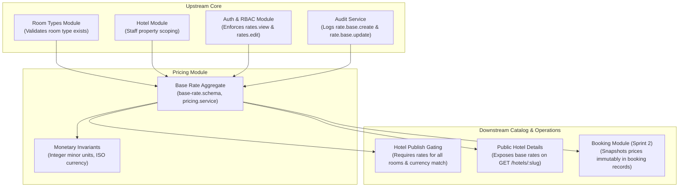

# Business Module Analysis: Pricing Module

**Platform:** Staywise Hotel Operations Platform (`apps/api` & `apps/admin-web`)  
**Module:** Pricing, Base Rates & Monetary Calculations  
**Author:** Pair Programming Agent  
**Date:** October 13, 2026  
**Scope:** Room type base rates, integer minor unit monetary conventions, currency validation, publication rate gating, audit trails, optimistic locking, and planned quote/tax engine.

---

## Sources Reviewed

### 1. Product & Architecture Documentation
* [Documentation/modules/pricing-tax.md](../modules/pricing-tax.md) (Pricing and Tax Module Specification)
* [Documentation/01-product-requirements.md](../01-product/01-product-requirements.md) (Core Business Pricing Requirements)
* [Documentation/07-database-design.md](../02-architecture/07-database-design.md) (Data Model: BaseRate, RatePlan, Monetary Minor Units)
* [Documentation/08-api-specification.md](../02-architecture/08-api-specification.md) (REST API Specifications: Base Rate Endpoints & ADR-007 Notes)
* [Documentation/12-business-rules.md](../01-product/12-business-rules.md) (Money, Currency, and Minor Unit Invariants)
* [Documentation/20-decision-log.md](../04-planning-and-tracking/20-decision-log.md) (ADR-007: Tax Engine Status & Review Requirements)
* [Documentation/24-sprint-2-availability-and-booking-plan.md](../05-sprints-and-progress/24-sprint-2-availability-and-booking-plan.md) (Sprint 2 Architecture Plan: Pricing Snapshots on Bookings)
* [Documentation/modules/hotel-management.md](../modules/hotel-management.md) (Hotel Publication Prerequisites on Base Rates)
* [Documentation/EXECUTION-ORDER.md](../EXECUTION-ORDER.md) (Tax Gating Order & Guest Quote Guardrails)

### 2. Backend Code (`apps/api`)
* [base-rate.schema.ts](../../apps/api/src/modules/pricing/schemas/base-rate.schema.ts) (Mongoose Schema, Unique Room Type Index, Concurrency Version)
* [base-rate.dto.ts](../../apps/api/src/modules/pricing/dto/base-rate.dto.ts) (Validation DTO: Integer Minor Units, Currency, Reason)
* [pricing.controller.ts](../../apps/api/src/modules/pricing/pricing.controller.ts) (Admin REST Controller: `GET/PUT /admin/room-types/:roomTypeId/base-rate`)
* [pricing.service.ts](../../apps/api/src/modules/pricing/pricing.service.ts) (Core Business Logic, Optimistic Locking, Audit Trail, Scoping)
* [hotel-publish.checks.ts](../../apps/api/src/modules/hotels/hotel-publish.checks.ts) (Publication Gating: Room Rate Coverage & Currency Uniformity Invariants)
* [hotel.service.ts](../../apps/api/src/modules/hotels/hotel.service.ts) (`getPublicBySlug` Rate Exposure)
* Associated Dependencies: [room-type.schema.ts](../../apps/api/src/modules/hotels/schemas/room-type.schema.ts), [audit.service.ts](../../apps/api/src/modules/audit/audit.service.ts).

### 3. Frontend Code (`apps/admin-web`)
* [RatesPage.tsx](../../apps/admin-web/src/pages/catalog/RatesPage.tsx) (Base Rates Page, Coverage Metrics, Hotel Currency Lock, Picker)
* [BaseRatesView.tsx](../../apps/admin-web/src/pages/catalog/views/BaseRatesView.tsx) (Rate Editor Form, Currency Lock Indicator, Minor Unit Guide)
* [rates.api.ts](../../apps/admin-web/src/features/rates/rates.api.ts) (Centralized API Client for Rates)

---

## Part 1: Module Scope

The **Pricing** module is responsible for establishing, auditing, and enforcing authoritative nightly accommodation rates across the platform. Per the documentation ([pricing-tax.md:3-5](../modules/pricing-tax.md#L3-L5)), its ultimate responsibility is to resolve nightly rates, occupancy surcharges, taxes, fees, promotional discounts, and immutable quote/booking snapshots. In the current implementation ([pricing-tax.md:13-14](../modules/pricing-tax.md#L13-L14)), it operates as the baseline catalog pricing engine, maintaining one audited base rate per room type stored in integer minor units (e.g. paise/cents) with explicit ISO 4217 currency and optimistic concurrency control, while guest quote calculations and tax treatments remain deferred under ADR-007.

### Entities, Fields, and States Owned

The module owns the `BaseRate` collection in MongoDB ([base-rate.schema.ts:6-24](../../apps/api/src/modules/pricing/schemas/base-rate.schema.ts#L6-L24)):

* **Root Schema:** `BaseRate` ([base-rate.schema.ts:6](../../apps/api/src/modules/pricing/schemas/base-rate.schema.ts#L6))
  * `_id`: `Types.ObjectId` — Primary internal document identifier.
  * `roomTypeId`: `Types.ObjectId` (ref `RoomType`, required, indexed) — The parent room type anchor.
  * `amountMinorUnits`: `number` (required, min 0, max 9,000,000,000,000) — Rate in integer minor currency units (e.g., 500000 = ₹5,000.00). Floating-point values are rejected.
  * `currency`: `string` (required, uppercase, 3-letter ISO 4217, regex `/^[A-Z]{3}$/`) — The currency code of the rate.
  * `version`: `number` (required, default 0, min 0) — Monotonically increasing version counter for optimistic concurrency control.
  * `createdAt`, `updatedAt`: `Date` — Audit timestamps.
  * **Database Index:** Unique compound index on `{ roomTypeId: 1 }` (`base_rate_room_type_unique`), guaranteeing that each room type possesses exactly one base rate document.

### Module Dependencies



* **Inward Dependencies (What Pricing depends on):**
  * `Room Types Module`: A base rate cannot exist without a valid parent `roomTypeId` ([pricing.service.ts:80-86](../../apps/api/src/modules/pricing/pricing.service.ts#L80-L86)).
  * `Hotel Module`: Scoping assertions verify the staff actor has access to the room's parent `hotelId` ([pricing.service.ts:94-98](../../apps/api/src/modules/pricing/pricing.service.ts#L94-L98)).
  * `Auth & RBAC`: Permissions `rates.view` and `rates.edit` guard the controller endpoints ([pricing.controller.ts:18, 25](../../apps/api/src/modules/pricing/pricing.controller.ts#L18)).
  * `Audit Service`: Mandatory audit logging on every create and update mutation ([pricing.service.ts:57-72](../../apps/api/src/modules/pricing/pricing.service.ts#L57-L72)).
  * `Transaction Service`: Replica-set multi-document transactions for atomic creation and audit writing.
* **Outward Dependencies (What depends on Pricing):**
  * `Hotel Publication Gating`: Blocks hotel publication unless every active room type has a base rate, all room rates share the exact same currency, and fixed policy cancellation fees match this currency ([hotel-publish.checks.ts:79-107](../../apps/api/src/modules/hotels/hotel-publish.checks.ts#L79-L107)).
  * `Public Catalog`: `GET /hotels/:slug` returns room type base rate amounts and currency ([hotel.service.ts:272-295](../../apps/api/src/modules/hotels/hotel.service.ts#L272-L295)).
  * `Booking Lifecycle Engine (Sprint 2)`: Reservations compute nightly subtotal and snapshot rate terms into `pricingSnapshot` ([24-sprint-2-availability-and-booking-plan.md:158-165](../05-sprints-and-progress/24-sprint-2-availability-and-booking-plan.md#L158-L165)).

---

## Part 2: Requirement Traceability Matrix

| ID | Requirement Statement | Origin | Source Reference | Backend Status | Frontend Status | Notes |
|---|---|---|---|---|---|---|
| **RATE-01** | All monetary amounts must be stored in integer minor units (never binary floats). | DOC | [pricing-tax.md:9](../modules/pricing-tax.md#L9); [07-database-design.md:3](../02-architecture/07-database-design.md#L3) | **Implemented** | **Implemented** | [base-rate.dto.ts:4](../../apps/api/src/modules/pricing/dto/base-rate.dto.ts#L4) validates `IsInt()`; [BaseRatesView.tsx:66](../../apps/admin-web/src/pages/catalog/views/BaseRatesView.tsx#L66) enforces `step="1"`. |
| **RATE-02** | Explicit 3-letter ISO 4217 currency code on every rate record. | DOC | [pricing-tax.md:9](../modules/pricing-tax.md#L9) | **Implemented** | **Implemented** | [base-rate.dto.ts:5](../../apps/api/src/modules/pricing/dto/base-rate.dto.ts#L5) enforces uppercase 3 letters; UI displays locked badge. |
| **RATE-03** | Exactly one base rate per room type. | DOC | [pricing-tax.md:13](../modules/pricing-tax.md#L13) | **Implemented** | **Implemented** | Unique compound index in [base-rate.schema.ts:22](../../apps/api/src/modules/pricing/schemas/base-rate.schema.ts#L22); frontend handles idempotent load/save. |
| **RATE-04** | Mandatory audit reason when creating or updating a base rate (min 3 chars). | CODE | [base-rate.dto.ts:7](../../apps/api/src/modules/pricing/dto/base-rate.dto.ts#L7); [pricing.service.ts:65](../../apps/api/src/modules/pricing/pricing.service.ts#L65) | **Implemented** | **Implemented** | Enforced by DTO and [BaseRatesView.tsx:104-110](../../apps/admin-web/src/pages/catalog/views/BaseRatesView.tsx#L104-L110). |
| **RATE-05** | Optimistic concurrency control (`version` counter) on base rate updates. | DOC | [pricing-tax.md:13](../modules/pricing-tax.md#L13) | **Implemented** | **Implemented** | Throws `409 VERSION_CONFLICT` on mismatch ([pricing.service.ts:100](../../apps/api/src/modules/pricing/pricing.service.ts#L100)); UI invalidates and shows conflict toast. |
| **RATE-06** | Publication gating: every active room type must have an established base rate. | DOC | [pricing-tax.md:21](../modules/pricing-tax.md#L21); [hotel-management.md:18](../modules/hotel-management.md#L18) | **Implemented** | **Implemented** | Evaluated in [hotel-publish.checks.ts:79-88](../../apps/api/src/modules/hotels/hotel-publish.checks.ts#L79-L88); KPI card in [RatesPage.tsx:178](../../apps/admin-web/src/pages/catalog/RatesPage.tsx#L178). |
| **RATE-07** | Publication gating: all room types within a property must share the exact same currency. | DOC | [pricing-tax.md:21](../modules/pricing-tax.md#L21) | **Implemented** | **Implemented** | Gated in [hotel-publish.checks.ts:92-97](../../apps/api/src/modules/hotels/hotel-publish.checks.ts#L92-L97); frontend auto-locks currency on first price. |
| **RATE-08** | Publication gating: fixed policy cancellation fees must match the property rate currency. | DOC | [pricing-tax.md:21](../modules/pricing-tax.md#L21) | **Implemented** | **Implemented** | Gated in [hotel-publish.checks.ts:98-107](../../apps/api/src/modules/hotels/hotel-publish.checks.ts#L98-L107); returns `HOTEL_POLICY_CURRENCY_MISMATCH`. |
| **RATE-09** | Prevent currency divergence at rate creation time (Hotel Currency Lock). | CODE / INFERRED | Administrative safety | **Missing** | **Implemented** | **Contradiction:** Frontend locks currency input to match other rooms; Backend `PUT /admin/room-types/:id/base-rate` allows any currency, only failing later at publish! |
| **RATE-10** | Upper bound validation on minor unit amounts (safe integer limit). | CODE | [base-rate.dto.ts:4](../../apps/api/src/modules/pricing/dto/base-rate.dto.ts#L4); [pricing.service.ts:31](../../apps/api/src/modules/pricing/pricing.service.ts#L31) | **Implemented** | **Implemented** | `max: 9000000000000` minor units (prevents 64-bit integer overflow in JS). |
| **RATE-11** | Date-specific rate rules and seasonal price overrides. | DOC | [pricing-tax.md:9, 13](../modules/pricing-tax.md#L9) | **Missing** | **Missing** | Explicitly documented as not yet implemented; only static base rate exists. |
| **RATE-12** | Day-of-week rate multipliers (weekend vs weekday pricing). | INFERRED | Hospitality industry standard | **Missing** | **Missing** | Common hotel requirement; cannot set weekend rate without manual adjustment. |
| **RATE-13** | Occupancy-based guest surcharges (extra adult or extra bed charges). | DOC | [pricing-tax.md:5](../modules/pricing-tax.md#L5) | **Missing** | **Missing** | Documented responsibility; unmodeled in current rate schemas. |
| **RATE-14** | Server-authoritative tax calculation and slab thresholds (ADR-007). | DOC | [pricing-tax.md:19-21](../modules/pricing-tax.md#L19-L21); [20-decision-log.md:13](../04-planning-and-tracking/20-decision-log.md#L13) | **Missing** | **Missing** | Explicitly open decision; tax rules disabled in production until legal approval. |
| **RATE-15** | Tax-inclusive vs tax-exclusive rate display mode. | DOC | [pricing-tax.md:9, 19](../modules/pricing-tax.md#L9) | **Missing** | **Missing** | UI displays "Tax is not included" ([RatesPage.tsx:125](../../apps/admin-web/src/pages/catalog/RatesPage.tsx#L125)); no toggle exists in data model. |
| **RATE-16** | Deterministic rounding policy (per-line vs per-invoice and residual allocation). | DOC | [pricing-tax.md:9, 19](../modules/pricing-tax.md#L9) | **Missing** | **Missing** | Not implemented; awaiting ADR-007 quote engine. |
| **RATE-17** | Advisory guest quote generation endpoint (`POST /quotes`). | DOC | [pricing-tax.md:29](../modules/pricing-tax.md#L29); [08-api-specification.md:61](../02-architecture/08-api-specification.md#L61) | **Missing** | **Missing** | Planned for Sprint 2 / Phase 4; guest totals disabled until quote API exists. |
| **RATE-18** | Promotional coupons and discount redemption rules. | DOC | [pricing-tax.md:25](../modules/pricing-tax.md#L25) | **Missing** | **Missing** | Phase 3 planned extension. |
| **RATE-19** | Immutable rate and tax snapshot on confirmed bookings (`pricingSnapshot`). | DOC | [pricing-tax.md:5, 36](../modules/pricing-tax.md#L5); [24-sprint-2-availability-and-booking-plan.md:158-165](../05-sprints-and-progress/24-sprint-2-availability-and-booking-plan.md#L158-L165) | **Partial** | **Missing** | Architecture fully planned in Sprint 2 specification; awaiting implementation. |
| **RATE-20** | Material price change revalidation between search and hold. | DOC | [pricing-tax.md:15](../modules/pricing-tax.md#L15) | **Missing** | **Missing** | Requires quote ID and hold validation engine. |
| **RATE-21** | Currency conversion / multi-currency display for foreign visitors. | INFERRED | International hospitality | **Missing** | **Missing** | Property rates are single-currency only; no foreign exchange conversion. |
| **RATE-22** | Non-negative amount rejection (`amountMinorUnits >= 0`). | DOC | [pricing-tax.md:34](../modules/pricing-tax.md#L34) | **Implemented** | **Implemented** | Rejects negative values; permits `0` for promotional/complimentary room rates. |

---

## Part 3: Business Rules Inventory

| Business Rule | Where Enforced | Implementation Source | Gaps & Weaknesses |
|---|---|---|---|
| **Integer Minor Units Invariant** | Backend DTO + Service + Frontend Form | [base-rate.dto.ts:4](../../apps/api/src/modules/pricing/dto/base-rate.dto.ts#L4)<br>[pricing.service.ts:31-33](../../apps/api/src/modules/pricing/pricing.service.ts#L31-L33)<br>[BaseRatesView.tsx:66](../../apps/admin-web/src/pages/catalog/views/BaseRatesView.tsx#L66) | Strictly enforces integer values. Rejects floating point decimals with `422 UNPROCESSABLE_ENTITY ('amountMinorUnits must be a safe integer')`. Validates maximum range up to $9 \times 10^{12}$ minor units. |
| **ISO 4217 Currency Standard** | Backend DTO + Schema | [base-rate.dto.ts:5](../../apps/api/src/modules/pricing/dto/base-rate.dto.ts#L5)<br>[base-rate.schema.ts:14](../../apps/api/src/modules/pricing/schemas/base-rate.schema.ts#L14) | Regular expression `/^[A-Za-z]{3}$/` enforced on DTO; upper-cased in service before persistence. |
| **Single Base Rate per Room Type** | DB Unique Index | [base-rate.schema.ts:22](../../apps/api/src/modules/pricing/schemas/base-rate.schema.ts#L22) | Unique compound index on `{ roomTypeId: 1 }`. Prevents duplicate pricing documents for the same category. Duplicate key errors (`E11000`) map to `409 BASE_RATE_CONFLICT`. |
| **Mandatory Rate Modification Reason** | Backend DTO + Service | [base-rate.dto.ts:7](../../apps/api/src/modules/pricing/dto/base-rate.dto.ts#L7)<br>[pricing.service.ts:65](../../apps/api/src/modules/pricing/pricing.service.ts#L65) | Requires a non-empty string between 3 and 500 characters explaining the pricing change (e.g., "Seasonal rate increase"). Included in audit event payload. |
| **Optimistic Concurrency Control** | Backend Service + Query Filter | [pricing.service.ts:40, 48-56](../../apps/api/src/modules/pricing/pricing.service.ts#L40) | For creation, expects `version === 0` or undefined. For updates, matches `{ _id, version }` and atomically increments `{ $inc: { version: 1 } }`. Throws `409 VERSION_CONFLICT` on mismatch. |
| **Property Currency Uniformity Invariant** | Backend Publish Checks + Frontend Form | [hotel-publish.checks.ts:93-97](../../apps/api/src/modules/hotels/hotel-publish.checks.ts#L93-L97)<br>[BaseRatesView.tsx:81-93](../../apps/admin-web/src/pages/catalog/views/BaseRatesView.tsx#L81-L93) | **Gap:** Backend `pricing.service.ts` allows saving a rate with *any* currency on a room type. Currency conflicts are only caught later when attempting to publish the hotel (`HOTEL_RATE_CURRENCY_MISMATCH`). The frontend locks the input to prevent this in the UI. |
| **Cancellation Fee Currency Alignment** | Backend Publish Checks | [hotel-publish.checks.ts:98-107](../../apps/api/src/modules/hotels/hotel-publish.checks.ts#L98-L107) | If fixed fee cancellation rules exist, their currency must strictly match the base rate currency. Throws `HOTEL_POLICY_CURRENCY_MISMATCH` if they diverge. |
| **Staff Property Scoping** | Backend Guard + Service | [pricing.controller.ts:13](../../apps/api/src/modules/pricing/pricing.controller.ts#L13)<br>[pricing.service.ts:22, 36, 94-98](../../apps/api/src/modules/pricing/pricing.service.ts#L22) | Resolves parent `hotelId` via room type and verifies `actor.hotelIds.includes(hotelId)`. Non-super admins receive `403 FORBIDDEN` on unauthorized properties. |
| **Historical Price Immutability** | Architecture Blueprint (Sprint 2) | [24-sprint-2-availability-and-booking-plan.md:158-165](../05-sprints-and-progress/24-sprint-2-availability-and-booking-plan.md#L158-L165) | Bookings store frozen `pricingSnapshot` with exact nightly rates at booking time, guaranteeing future rate changes never mutate past invoices. |

---

## Part 4: Missing Requirements

### a. Documented But Not Built (DOC $\rightarrow$ Missing / Partial)

1. **Date-Specific Rate Rules & Seasonal Overrides ([pricing-tax.md:9, 13](../modules/pricing-tax.md#L9)):**
   * *Documentation:* "Rate rules include roomTypeId, date/effective interval, amount, currency, priority, status, restrictions... For each night, select the highest-priority active applicable rule under an explicit tie-breaker; otherwise use base rate."
   * *Actual Code:* Only `BaseRate` exists. There is no `NightlyRate`, `RatePlan`, or seasonal override schema in `apps/api/src/modules/pricing`.
   * *Impact:* A hotel cannot set Christmas/New Year holiday pricing, summer peak rates, or discounted weekday rates without manual day-by-day intervention.
2. **Authoritative Server Tax Engine (ADR-007) ([pricing-tax.md:19-21](../modules/pricing-tax.md#L19-L21); [20-decision-log.md:13](../04-planning-and-tracking/20-decision-log.md#L13)):**
   * *Documentation:* "Implement approved tax policy as deterministic server logic. Define tax basis, whether fees are taxable, tax-inclusive/exclusive behavior, slab threshold basis, rounding per line or invoice... Persist tax components in booking snapshot."
   * *Actual Code:* No tax configuration, tax slab evaluator, or tax calculation service exists in the codebase.
   * *Status:* Documented as deliberately open under ADR-007 awaiting finance/legal sign-off.
3. **Advisory Guest Quote API (`POST /quotes`) ([pricing-tax.md:29](../modules/pricing-tax.md#L29); [08-api-specification.md:61](../02-architecture/08-api-specification.md#L61)):**
   * *Documentation:* Quote response includes currency, room type, stay dates, nightly breakdown, subtotal, tax components, fees, discount, grand total, validUntil, and quote ID.
   * *Actual Code:* Omitted from backend controllers. The search endpoint only exposes the raw base rate amount on room types.
4. **Extra Guest / Occupancy Surcharges ([pricing-tax.md:5](../modules/pricing-tax.md#L5)):**
   * *Documentation:* "Resolve nightly rate, quantity, occupancy surcharge if configured..."
   * *Actual Code:* Base rate is a flat scalar per room category, ignoring adult/child counts.

### b. Built But Undocumented (CODE Only)

1. **Max Monetary Safe Integer Upper Bound (`9,000,000,000,000` minor units):**
   * *Code:* [base-rate.dto.ts:4](../../apps/api/src/modules/pricing/dto/base-rate.dto.ts#L4) validates `@Max(9000000000000)` and [pricing.service.ts:31](../../apps/api/src/modules/pricing/pricing.service.ts#L31) calls `Number.isSafeInteger()`.
   * *Assessment:* Sound engineering practice preventing IEEE 754 precision loss in JavaScript runtimes; should be formally documented in database guidelines.
2. **Mandatory Audit Reason Constraint (`[3, 500]` characters):**
   * *Code:* [base-rate.dto.ts:7](../../apps/api/src/modules/pricing/dto/base-rate.dto.ts#L7) enforces `@MinLength(3) @MaxLength(500) reason: string`.
   * *Assessment:* Essential for regulatory compliance; missing from API specification tables in `08-api-specification.md`.
3. **Frontend Currency Auto-Locking Mechanism:**
   * *Code:* [RatesPage.tsx:51-76](../../apps/admin-web/src/pages/catalog/RatesPage.tsx#L51-L76) scans all room types in the property and locks the currency input in [BaseRatesView.tsx:81-93](../../apps/admin-web/src/pages/catalog/views/BaseRatesView.tsx#L81-L93) to the first configured rate currency.
   * *Assessment:* Excellent proactive UX preventing publication failures, but unmentioned in product requirements.

### c. Expected for a Hotel Business But Absent (INFERRED)

1. **Weekend vs. Weekday Differential Pricing (Day-of-Week Multipliers):**
   * *Business Situation:* Hotels universally experience higher demand on Friday and Saturday nights (leisure properties) or Tuesday and Wednesday nights (business hotels). Hoteliers require setting a baseline differential (e.g. "+25% on weekends") without updating base rates every Friday morning.
   * *Current Gap:* Pricing model is completely static; room rate is identical on every day of the week.
2. **Non-Refundable vs. Flexible Rate Plans:**
   * *Business Situation:* Hotels offer guests a choice: standard rate with flexible 48-hour cancellation, or a 10% discounted non-refundable rate.
   * *Current Gap:* Rate is coupled 1-to-1 with room type. There is no concept of rate plan codes (e.g., `BAR_FLEX`, `BAR_NONREF`).
3. **Minimum Length of Stay (MLOS) Pricing Restrictions:**
   * *Business Situation:* During peak festival periods (e.g., New Year's), hotels require a 3-night minimum stay at the booked rate.
   * *Current Gap:* No rate restriction modeling exists.

---

## Part 5: Edge Cases and Failure Scenarios

### 1. Currency Mismatch Injected Via Direct API Calls

* **Code Citation:** [pricing.service.ts:28-56](../../apps/api/src/modules/pricing/pricing.service.ts#L28-L56) vs. [hotel-publish.checks.ts:93-97](../../apps/api/src/modules/hotels/hotel-publish.checks.ts#L93-L97)
* **The Scenario:**
  1. A hotel has 2 room types: "Standard Queen" and "Deluxe King".
  2. Staff sets "Standard Queen" base rate in `INR` (500000).
  3. Via an automated script or direct API client, a staff member submits `PUT /admin/room-types/:deluxeId/base-rate` with currency `USD` (10000).
* **Behavior Today:**
  * `PricingService.setBaseRate` executes inside a transaction, passes all schema/DTO validations, and successfully commits the `USD` rate!
  * The backend has **zero check** comparing the new rate's currency against sister room types of the same hotel.
  * Later, when the manager attempts to publish the hotel or perform health checks, `HotelPublishChecks` evaluates `currencies.size > 1` and throws `HOTEL_RATE_CURRENCY_MISMATCH`.
* **Consequence:** The property is placed in an invalid publication state because currency validation was deferred to publication rather than checked at write time.

### 2. Base Rate Mutation with Existing Confirmed Bookings

* **Code Citation:** [pricing.service.ts:49-56](../../apps/api/src/modules/pricing/pricing.service.ts#L49-L56)
* **The Scenario:** A room type is priced at ₹4,000/night. 20 guests hold confirmed bookings for November 2026. Staff updates the base rate to ₹6,500/night.
* **Behavior:**
  * Base rate updates to ₹6,500 and version increments from 1 to 2. An audit log is recorded.
  * In Sprint 2 architecture ([24-sprint-2-availability-and-booking-plan.md:158-165](../05-sprints-and-progress/24-sprint-2-availability-and-booking-plan.md#L158-L165)), confirmed bookings store an immutable `pricingSnapshot`. Confirmed reservations remain at ₹4,000.
  * Active holds that have not yet converted to bookings will evaluate rate rules upon conversion. If price changed materially between search and hold, the booking must show an updated quote before confirming payment ([pricing-tax.md:15](../modules/pricing-tax.md#L15)).

### 3. Concurrent Rate Updates by Two Revenue Managers

* **Code Citation:** [pricing.service.ts:48, 50, 100-102](../../apps/api/src/modules/pricing/pricing.service.ts#L48)
* **The Scenario:**
  * Manager A and Manager B both view Deluxe King rate at version 3 (₹5,000).
  * Manager A updates rate to ₹5,500 with `version: 3`. Succeeded; document updates to version 4.
  * Manager B updates rate to ₹6,000 with `version: 3`.
* **Behavior:**
  * Query `{ _id: before._id, version: 3 }` finds 0 documents.
  * Server throws `ConflictException` with `error: 'VERSION_CONFLICT', message: 'Base rate was changed by another request'`.
  * In the Admin Web frontend ([RatesPage.tsx:130-134](../../apps/admin-web/src/pages/catalog/RatesPage.tsx#L130-L134)), `handleFormError` detects the conflict, automatically invalidates the rate cache, reloads version 4, and alerts the user: *"Someone else modified this rate. Latest data has been reloaded."*

### 4. Setting Rate for a Room Under an Archived Hotel

* **Code Citation:** [pricing.service.ts:80-86](../../apps/api/src/modules/pricing/pricing.service.ts#L80-L86)
* **Behavior:** `getRoomType` verifies the room type exists, and `assertHotelScope` verifies actor permissions.
* **Edge Case:** Unlike `RoomTypeService.create()` which explicitly checks `hotel.status !== ARCHIVED`, `PricingService.setBaseRate` does **not** check whether the parent hotel is `ARCHIVED`. Staff with permissions could mutate base rates on archived properties.

### 5. Monetary Overflow and Precision Protection

* **Code Citation:** [pricing.service.ts:31-33](../../apps/api/src/modules/pricing/pricing.service.ts#L31-L33)
* **The Scenario:** Client sends a floating-point payload `{ amountMinorUnits: 5000.50 }` or JavaScript `MAX_SAFE_INTEGER + 1`.
* **Behavior:** Caught by `!Number.isSafeInteger(dto.amountMinorUnits)`, throwing `422 UnprocessableEntityException`. No float corruption or rounding errors can penetrate the database.

---

## Part 6: Improvement Proposals

### 1. Correctness Fixes

#### PROP-01: Validate Rate Currency Against Hotel / Sister Rates at Write Time
* **Problem:** [pricing.service.ts:28-56](../../apps/api/src/modules/pricing/pricing.service.ts#L28-L56) allows saving any currency on a base rate without checking sister room types in the same property. The conflict is only detected later during hotel publication ([hotel-publish.checks.ts:93-97](../../apps/api/src/modules/hotels/hotel-publish.checks.ts#L93-L97)).
* **Business Value:** Prevents silent corruption of property currency uniformity at write time.
* **Proposed Rule:** When setting a base rate, query existing base rates for the parent hotel. If any exist and their currency differs from `dto.currency`, reject immediately with `422 UNPROCESSABLE_ENTITY` (`errorCode: 'HOTEL_RATE_CURRENCY_MISMATCH'`).
* **Data Model Change:** None.
* **API Change:** `PUT /admin/room-types/:id/base-rate` throws `422` if currency contradicts existing property rates.
* **Admin UI Change:** None (UI already locks currency).
* **Effect on Other Modules:** Protects Hotel Publish Gating and Base Rate coverage integrity.
* **Priority:** **Must** | **Effort:** Small (S)

#### PROP-02: Block Rate Mutations on Archived Properties
* **Problem:** `PricingService.setBaseRate` does not verify if the parent hotel is `ARCHIVED`.
* **Business Value:** Upholds strict immutability of archived properties.
* **Proposed Rule:** In `setBaseRate`, load parent hotel and verify `hotel.status !== 'ARCHIVED'`. If archived, reject with `409 HOTEL_ARCHIVED`.
* **Data Model Change:** None.
* **API Change:** Returns `409 Conflict` on archived hotel room rates.
* **Admin UI Change:** None.
* **Effect on Other Modules:** Enforces uniform lifecycle rules.
* **Priority:** **Should** | **Effort:** Small (S)

---

### 2. Missing Features

#### PROP-03: Implement Date-Specific Nightly Rate Overrides
* **Problem:** Currently, rates are 100% static. Hoteliers cannot configure seasonal surges, holiday pricing, or off-peak discounts without manually editing base rates.
* **Business Value:** Maximizes revenue per available room (RevPAR) and fulfills [pricing-tax.md:9](../modules/pricing-tax.md#L9).
* **Proposed Rule:** Introduce a `NightlyRateOverride` collection:
  ```typescript
  @Schema({ collection: 'nightly_rate_overrides' })
  export class NightlyRateOverride {
    @Prop({ type: Types.ObjectId, ref: 'RoomType', required: true })
    roomTypeId: Types.ObjectId;

    @Prop({ required: true, match: /^\d{4}-\d{2}-\d{2}$/ })
    stayDate: string;

    @Prop({ required: true, min: 0 })
    amountMinorUnits: number;

    @Prop({ required: true })
    currency: string;
  }
  ```
* **Data Model Change:** New collection `nightly_rate_overrides` with unique compound index `{ roomTypeId: 1, stayDate: 1 }`.
* **API Change:** Add `GET/PUT /admin/room-types/:id/rates?from=YYYY-MM-DD&to=YYYY-MM-DD` and `POST /admin/room-types/:id/rates/batch-override`.
* **Admin UI Change:** Add calendar rate override grid in `/admin/rates`.
* **Effect on Other Modules:** Integrated into Sprint 2 availability quoting engine.
* **Priority:** **Must** | **Effort:** Medium (M)

#### PROP-04: Implement Server-Authoritative Quote Engine with ADR-007 Tax Slabs
* **Problem:** Tax treatment is disabled and guest totals cannot be generated because ADR-007 remains open.
* **Business Value:** Unlocks public guest search checkout, bookings, and legal Indian GST invoice compliance.
* **Proposed Rule:** Implement `QuoteService.generateQuote({ hotelId, roomTypeId, stayDates, roomsCount, occupancy })`. Compute subtotal; apply GST slab logic (e.g. ₹0-₹7,500/night = 12% GST, >₹7,500 = 18% GST); output deterministic quote ID valid for 15 minutes.
* **Data Model Change:** Add `quotes` temporary collection or stateless signed quote tokens.
* **API Change:** Expose `POST /api/v1/quotes` endpoint.
* **Admin UI Change:** Add Tax & Fee Settings tab to Hotel Workspace.
* **Effect on Other Modules:** Unblocks the entire guest booking and checkout flow.
* **Priority:** **Must** | **Effort:** Large (L)

---

### 3. Usability of Business Flow

#### PROP-05: Multi-Room Rate Matrix Grid in Admin Web
* **Problem:** In `/admin/rates`, staff must pick one room at a time using the combobox to view or edit rates. For a hotel with 10 room types, auditing prices requires 10 separate roundtrips.
* **Business Value:** Saves significant administrative time for revenue managers.
* **Proposed Rule:** Add a "Property Rate Matrix" table view displaying all room categories of the selected hotel side-by-side with their current base rates, last updated timestamp, and quick-edit inputs.
* **Data Model Change:** None.
* **API Change:** None (already supported via batch queries).
* **Admin UI Change:** Add table mode toggle in `RatesPage.tsx`.
* **Effect on Other Modules:** None.
* **Priority:** **Should** | **Effort:** Medium (M)

---

## Part 7: Cross-Module Impacts

| Pricing Module Gap / Behavior | Affected Downstream Module | Concrete Failure or Architectural Consequence |
|---|---|---|
| **No Write-Time Currency Check** | `Hotel Publication Module` | A staff member can price Room A in INR and Room B in USD without errors. The entire hotel is silently blocked from publication later (`HOTEL_RATE_CURRENCY_MISMATCH`). |
| **No Date-Specific Override Engine** | `Availability & Booking Engine` | Sprint 2 booking engine is forced to calculate reservation totals using a single flat base rate for all 365 nights of the year, preventing dynamic hotel revenue management. |
| **Open ADR-007 (Unimplemented Tax Engine)** | `Guest Search & Checkout` | Public checkout cannot legally charge guests or show gross totals, blocking Phase 2 guest booking launch. |
| **No Room Surcharge Modeling** | `Occupancy & Room Types` | Rooms with extra adults or children must either be undercharged (billed at flat room rate) or overcharged, creating guest booking disputes. |
| **Rate Changes During Active Holds** | `Hold Expiry & Conversion` | If base rate changes while a guest is on the payment screen, lack of a material change quote check could charge the guest a different total than originally presented. |

---

## Part 8: Open Questions for Product

### Question 1: Should Rates be Tax-Inclusive or Tax-Exclusive by Default? (ADR-007)
* **Context:** In Indian hospitality (GST regime), luxury hotels quote room rates exclusive of taxes on booking engines (e.g., "₹6,000 + 12% GST"), while budget hotels frequently advertise tax-inclusive pricing.
* **Options:**
  1. **Option A (Strict Tax-Exclusive):** All catalog rates are base rates before tax. Taxes are dynamically added at checkout based on government slab rules.
  2. **Option B (Configurable per Property):** Add a `taxInclusive: boolean` flag to `Hotel` or `BaseRate`.
* **Trade-off:** Option A ensures uniform accounting calculations across all invoice generation engines. Option B accommodates different market tiers (budget vs luxury) but adds substantial complexity to the tax quote engine.
* **Recommendation:** Option A. All stored rates in minor units are base net rates; the server-side quote engine appends tax lines deterministically.

### Question 2: Is a Rate of 0 Minor Units Permissible in Production?
* **Context:** The current DTO allows `@Min(0)`. A rate of 0 minor units means free rooms.
* **Options:**
  1. **Option A:** Allow 0 minor units (permits complimentary/rewards rooms).
  2. **Option B:** Require positive rates (`@Min(1)`) on base rates, handling comps via promotional discount coupons.
* **Trade-off:** Option A risks accidental publication of free rooms due to clerical errors. Option B enforces financial safety.
* **Recommendation:** Option B for `BaseRate` (`min: 100` minor units / at least ₹1.00); handle complimentary stays via explicit zero-dollar coupon vouchers.

### Question 3: How Should Currency Re-denomination Be Handled?
* **Context:** If a property in Nepal or Dubai wishes to change its rate currency from `USD` to `AED`:
* **Options:**
  1. **Option A (Lock Forever):** Once any room type has a rate, the property's currency is permanently locked. To change currency, all room types must be archived.
  2. **Option B (Admin Currency Migration):** Allow Super Admins to change currency only if zero future bookings and zero active holds exist, requiring all room base rates to be updated simultaneously.
* **Trade-off:** Option A eliminates multi-currency bugs with zero code overhead. Option B provides operational flexibility.
* **Recommendation:** Option A for initial launch; re-evaluate Option B if multi-market franchise operations demand it.

---

### Analysis Summary & Verification Status
* **Document Location:** `docs/analysis/pricing-business-analysis.md`
* **Coverage:** Parts 1 through 8 complete. All findings cite code files (`apps/api/src/modules/pricing/*`, `apps/api/src/modules/hotels/*`, `apps/admin-web/src/*`) and product documentation (`Documentation/*`).
