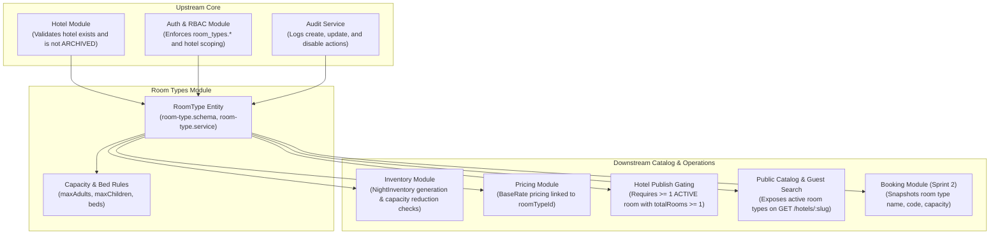

# Business Module Analysis: Room Types Module

**Platform:** Staywise Hotel Operations Platform (`apps/api` & `apps/admin-web`)  
**Module:** Room Type Management & Inventory Capacity Definition  
**Author:** Pair Programming Agent  
**Date:** October 13, 2026  
**Scope:** Room categories, physical capacity and occupancy constraints, bed configurations, sellable inventory totals, lifecycle states, and admin catalog UI.

---

## Sources Reviewed

### 1. Product & Architecture Documentation
* [Documentation/01-product-requirements.md](../01-product/01-product-requirements.md) (Core Catalog & Room Type Entities)
* [Documentation/07-database-design.md](../02-architecture/07-database-design.md) (Data Model: RoomType and NightInventory Invariants)
* [Documentation/08-api-specification.md](../02-architecture/08-api-specification.md) (REST API Specifications: Room Types Endpoints)
* [Documentation/11-auth-rbac.md](../03-guidelines/11-auth-rbac.md) & [Documentation/modules/rbac-permissions.md](../modules/rbac-permissions.md) (Staff Scoping & `room_types.*` Permissions)
* [Documentation/12-business-rules.md](../01-product/12-business-rules.md) (Platform Invariants & Capacity Rules)
* [Documentation/modules/room-type-management.md](../modules/room-type-management.md) (Room Type Management Specification)
* [Documentation/modules/hotel-management.md](../modules/hotel-management.md) (Publication Prerequisites on Active Room Types)
* [Documentation/modules/media-management.md](../modules/media-management.md) (Media Assets for Room Types)
* [Documentation/modules/pricing-tax.md](../modules/pricing-tax.md) (Base Rate Association to Room Types)
* [Documentation/modules/availability-booking.md](../modules/availability-booking.md) (Nightly Inventory Generation from Room Types)
* [Documentation/24-sprint-2-availability-and-booking-plan.md](../05-sprints-and-progress/24-sprint-2-availability-and-booking-plan.md) (Sprint 2 Architecture Plan)

### 2. Backend Code (`apps/api`)
* [room-type.schema.ts](../../apps/api/src/modules/hotels/schemas/room-type.schema.ts) (Mongoose Schema, Compound Unique Index, Bed Configuration Subdocument)
* [room-type.dto.ts](../../apps/api/src/modules/hotels/dto/room-type.dto.ts) (Validation DTOs for Room Type Creation and Updates)
* [room-types.controller.ts](../../apps/api/src/modules/hotels/room-types.controller.ts) (Admin REST Controller: List, Create, Get, Patch, Disable)
* [room-type.service.ts](../../apps/api/src/modules/hotels/room-type.service.ts) (Core Business Logic, Duplicate Normalization, Optimistic Locking, Scoping)
* [hotel-publish.checks.ts](../../apps/api/src/modules/hotels/hotel-publish.checks.ts) (Publication Gating Rules on Room Types: Active Status & Positive Total)
* Associated Dependencies: [inventory.service.ts](../../apps/api/src/modules/inventory/inventory.service.ts) (`adjustExistingNightsForTotal`), [pricing.service.ts](../../apps/api/src/modules/pricing/pricing.service.ts) (`BaseRate`), [hotel.service.ts](../../apps/api/src/modules/hotels/hotel.service.ts) (`getPublicBySlug`), [audit.service.ts](../../apps/api/src/modules/audit/audit.service.ts).

### 3. Frontend Code (`apps/admin-web`)
* [RoomTypesPage.tsx](../../apps/admin-web/src/pages/catalog/RoomTypesPage.tsx) (Room Types Catalog Screen, Scoped Property Picker, KPI Cards)
* [RoomTypesView.tsx](../../apps/admin-web/src/pages/catalog/views/RoomTypesView.tsx) (Data Table View for Room Types)
* [RoomCreateModal.tsx](../../apps/admin-web/src/features/rooms/RoomCreateModal.tsx) (Room Type Creation Dialog with Server Error Mapping)
* [rooms.api.ts](../../apps/admin-web/src/features/rooms/rooms.api.ts) (API Client Functions for Room Types)

---

## Part 1: Module Scope

The **Room Types** module defines the fundamental sellable inventory category and guest accommodation capacity within a hotel. Per the documentation ([room-type-management.md:5](../modules/room-type-management.md#L5)), it models room category identities, physical guest occupancy limits (adults and children), bed layouts, amenity tags, and the total physical count of sellable rooms. It acts as the anchor entity for nightly inventory calendars, base rate pricing plans, and guest reservation snapshots, deliberately decoupled from individual physical room/door assignments.

### Entities, Fields, and States Owned

The module owns the `RoomType` collection in MongoDB ([room-type.schema.ts:22-67](../../apps/api/src/modules/hotels/schemas/room-type.schema.ts#L22-L67)):

* **Root Schema:** `RoomType` ([room-type.schema.ts:22](../../apps/api/src/modules/hotels/schemas/room-type.schema.ts#L22))
  * `_id`: `Types.ObjectId` — Primary internal document identifier.
  * `hotelId`: `Types.ObjectId` (ref `Hotel`, required, indexed) — Parent property identifier.
  * `name`: `string` (max 120 chars, trimmed) — Marketing title (e.g., "Courtyard King").
  * `code`: `string` (max 32 chars, uppercase, trimmed) — Property-scoped alphanumeric short code (e.g., "COURT-K").
  * `normalizedCode`: `string` (max 32 chars, lowercase, trimmed) — Normalized lowercase string enforcing uniqueness per hotel.
  * `description`: `string` (optional, max 3000 chars, trimmed) — Public marketing copy for the room category.
  * `maxAdults`: `number` (min 1, max 30) — Maximum allowed adult guests.
  * `maxChildren`: `number` (min 0, max 30, default 0) — Maximum allowed child guests.
  * `beds`: `BedConfiguration[]` ([room-type.schema.ts:11-20](../../apps/api/src/modules/hotels/schemas/room-type.schema.ts#L11-L20)) — Array of bed arrangements (`type: string` [max 40 chars], `quantity: number` [min 1, max 20]).
  * `amenities`: `string[]` (default `[]`) — Array of room-specific amenities (e.g., "Ensuite Balcony", "Bathtub", "Mini-bar").
  * `totalRooms`: `number` (min 0, max 10000) — Total physical sellable rooms belonging to this category.
  * `status`: `RoomTypeStatus` ([room-type.schema.ts:6-9](../../apps/api/src/modules/hotels/schemas/room-type.schema.ts#L6-L9)) — State machine: `ACTIVE`, `DISABLED`.
  * `version`: `number` (min 0, default 0) — Monotonically increasing counter for optimistic concurrency control.
  * `inventoryRevision`: `number` (min 0, default 0) — Revision tracker for inventory synchronization.
  * `createdAt`, `updatedAt`: `Date` — Audit timestamps.

### Module Dependencies



* **Inward Dependencies (What Room Types depends on):**
  * `Hotel Module`: Creation asserts the hotel exists and is not `ARCHIVED` ([room-type.service.ts:33](../../apps/api/src/modules/hotels/room-type.service.ts#L33)).
  * `Auth & RBAC`: Validates staff sessions, enforces permission keys (`room_types.view`, `room_types.create`, `room_types.edit`, `room_types.archive`), and restricts managers to their assigned `hotelIds`.
  * `Audit Service`: Emits structured audit logs (`room_type.create`, `room_type.update`, `room_type.disable`) with old and new state snapshots.
  * `Transaction Service`: Executes mutations inside multi-document MongoDB replica-set transactions.
  * `Inventory Service`: Invoked during `update()` when `totalRooms` is changed to ensure capacity invariants across all stay dates.
* **Outward Dependencies (What depends on Room Types):**
  * `Inventory Module`: `NightInventory` records require `roomTypeId` and initialize `total` from `roomType.totalRooms`.
  * `Pricing Module`: `BaseRate` documents are keyed uniquely by `roomTypeId`.
  * `Hotel Publish Checks`: Hotel publication is strictly blocked if a hotel has zero active room types or if any active room type has `totalRooms < 1`.
  * `Public Search & Guest Catalog`: `GET /hotels/:slug` returns only `ACTIVE` room types and strips operational metadata (`totalRooms`, `version`, `inventoryRevision`).
  * `Booking & Holds Engine`: Reservation holds reference `roomTypeId` and snapshot capacity terms.

---

## Part 2: Requirement Traceability Matrix

| ID | Requirement Statement | Origin | Source Reference | Backend Status | Frontend Status | Notes |
|---|---|---|---|---|---|---|
| **RT-01** | Short alphanumeric room code, trimmed and normalized to uppercase. | DOC | [room-type-management.md:5](../modules/room-type-management.md#L5) | **Implemented** | **Implemented** | Normalized in [room-type.service.ts:35](../../apps/api/src/modules/hotels/room-type.service.ts#L35); font-mono input in [RoomCreateModal.tsx:55](../../apps/admin-web/src/features/rooms/RoomCreateModal.tsx#L55). |
| **RT-02** | Room code must be unique within the hotel (case-insensitive). | DOC | [room-type-management.md:5](../modules/room-type-management.md#L5) | **Implemented** | **Partial** | Unique compound index on `{ hotelId: 1, normalizedCode: 1 }` ([room-type.schema.ts:70](../../apps/api/src/modules/hotels/schemas/room-type.schema.ts#L70)); UI maps duplicate error. |
| **RT-03** | Guest capacity constraints: `maxAdults` (min 1, max 30) and `maxChildren` (min 0, max 30). | DOC | [room-type-management.md:5, 9](../modules/room-type-management.md#L5) | **Implemented** | **Implemented** | Validated in [room-type.dto.ts:23-24](../../apps/api/src/modules/hotels/dto/room-type.dto.ts#L23-L24) and displayed in [RoomTypesView.tsx:35](../../apps/admin-web/src/pages/catalog/views/RoomTypesView.tsx#L35). |
| **RT-04** | Centralized child age bands and maximums. | DOC | [room-type-management.md:10](../modules/room-type-management.md#L10) | **Missing** | **Missing** | Neither schema nor DTO defines age thresholds (e.g., infant <2, child 2-11). |
| **RT-05** | Bed configuration modeling (bed type and positive integer count). | DOC | [room-type-management.md:5](../modules/room-type-management.md#L5) | **Implemented** | **Missing** | Subdocument in [room-type.schema.ts:11-20](../../apps/api/src/modules/hotels/schemas/room-type.schema.ts#L11-L20); completely absent from [RoomCreateModal.tsx](../../apps/admin-web/src/features/rooms/RoomCreateModal.tsx) and [RoomTypesView.tsx](../../apps/admin-web/src/pages/catalog/views/RoomTypesView.tsx). |
| **RT-06** | Room-level amenities tags (deduplicated, trimmed). | DOC | [room-type-management.md:5](../modules/room-type-management.md#L5) | **Implemented** | **Missing** | Stored in [room-type.schema.ts:51](../../apps/api/src/modules/hotels/schemas/room-type.schema.ts#L51); omitted from frontend UI modal and table. |
| **RT-07** | Room type media / image gallery. | DOC | [room-type-management.md:5](../modules/room-type-management.md#L5); [media-management.md:5](../modules/media-management.md#L5) | **Missing** | **Missing** | Schema has no `media` or `photos` field; only Hotel has media. |
| **RT-08** | Total sellable rooms validation (non-negative integer, min 0, max 10000). | DOC | [room-type-management.md:5, 22](../modules/room-type-management.md#L5) | **Implemented** | **Implemented** | Enforced in [room-type.dto.ts:27](../../apps/api/src/modules/hotels/dto/room-type.dto.ts#L27); input in [RoomCreateModal.tsx:81-91](../../apps/admin-web/src/features/rooms/RoomCreateModal.tsx#L81-L91). |
| **RT-09** | `totalRooms` cannot be reduced below `blocked + held + confirmed` inventory on any date. | DOC | [room-type-management.md:11, 23](../modules/room-type-management.md#L11) | **Implemented** | **Missing** | Enforced in [inventory.service.ts:139-144](../../apps/api/src/modules/inventory/inventory.service.ts#L139-L144); frontend has no room editing modal to change total. |
| **RT-10** | Mandatory audit reason when changing the sellable room count. | CODE | [room-type.service.ts:71-73](../../apps/api/src/modules/hotels/room-type.service.ts#L71-L73) | **Implemented** | **Missing** | Rejects with 422 `A reason is required...`; no frontend edit form exists. |
| **RT-11** | Room type lifecycle states: `ACTIVE` and `DISABLED`. | DOC | [room-type-management.md:5](../modules/room-type-management.md#L5) | **Implemented** | **Partial** | Stored in [room-type.schema.ts:6-9](../../apps/api/src/modules/hotels/schemas/room-type.schema.ts#L6-L9); status badge rendered, but disabled records cannot be filtered or managed. |
| **RT-12** | Disabling a room type stops future holds but preserves existing bookings. | DOC | [room-type-management.md:12, 24](../modules/room-type-management.md#L12) | **Implemented** | **Missing** | Backend endpoint `POST /admin/room-types/:id/disable` exists; frontend has no disable button or action menu. |
| **RT-13** | Re-enabling a previously disabled room type (`DISABLED -> ACTIVE`). | INFERRED | Standard catalog operations | **Missing** | **Missing** | No re-enable endpoint exists in API; state transition is one-way in code. |
| **RT-14** | Optimistic concurrency control (`version` counter) on updates and state transitions. | DOC | [room-type-management.md:5](../modules/room-type-management.md#L5) | **Implemented** | **Missing** | Enforced in [room-type.service.ts:69, 90, 105](../../apps/api/src/modules/hotels/room-type.service.ts#L69); no frontend edit UI exists. |
| **RT-15** | Staff property scoping: non-super admins restricted to assigned `hotelIds`. | DOC | [room-type-management.md:25](../modules/room-type-management.md#L25) | **Implemented** | **Implemented** | Enforced in [room-type.service.ts:60, 68, 104](../../apps/api/src/modules/hotels/room-type.service.ts#L60); scoped combobox in [RoomTypesPage.tsx:59-64](../../apps/admin-web/src/pages/catalog/RoomTypesPage.tsx#L59-L64). |
| **RT-16** | Forbid room type creation under `ARCHIVED` hotels. | CODE | [room-type.service.ts:33](../../apps/api/src/modules/hotels/room-type.service.ts#L33) | **Implemented** | **Implemented** | Throws `404 Hotel not found` if archived; archived properties hidden from picker. |
| **RT-17** | Room type edit endpoint (`PATCH /admin/room-types/:id`). | DOC | [room-type-management.md:18](../modules/room-type-management.md#L18) | **Implemented** | **Missing** | Backend endpoint verified; frontend has zero UI callers ([rooms.api.ts](../../apps/admin-web/src/features/rooms/rooms.api.ts) does not even define an `updateRoomType` function). |
| **RT-18** | Comprehensive audit logging for creation, updates, and disabling. | DOC | [room-type-management.md:25](../modules/room-type-management.md#L25) | **Implemented** | **Missing** | Audit logs emitted with before/after state; no audit history view in admin web. |
| **RT-19** | Public guest exposure: only active room types of published hotels on `GET /hotels/:slug`. | DOC | [room-type-management.md:14, 18](../modules/room-type-management.md#L14) | **Implemented** | **Implemented** | Filtered in [hotel.service.ts:267-271](../../apps/api/src/modules/hotels/hotel.service.ts#L267-L271); operational fields stripped. |
| **RT-20** | Hotel publication prerequisite: at least 1 active room type with `totalRooms >= 1`. | DOC | [hotel-management.md:18](../modules/hotel-management.md#L18) | **Implemented** | **Implemented** | Gated in [hotel-publish.checks.ts:58-74](../../apps/api/src/modules/hotels/hotel-publish.checks.ts#L58-L74); error banner rendered on hotel workspace. |
| **RT-21** | Physical room assignment decoupling (no room number or door assignment). | DOC | [room-type-management.md:5](../modules/room-type-management.md#L5) | **Implemented** | **Implemented** | Strictly maintained as category inventory count across backend and frontend. |
| **RT-22** | Historical booking snapshotting of room type name, code, and description. | DOC | [room-type-management.md:13](../modules/room-type-management.md#L13) | **Partial** | **Missing** | Documented requirement; Bookings module is currently in Sprint 2 design phase. |
| **RT-23** | Filter query parameter `includeDisabled=true` on room types list. | CODE | [room-types.controller.ts:21-22](../../apps/api/src/modules/hotels/room-types.controller.ts#L21-L22) | **Implemented** | **Missing** | Supported by API; frontend [RoomTypesPage.tsx:25](../../apps/admin-web/src/pages/catalog/RoomTypesPage.tsx#L25) never passes this flag. |
| **RT-24** | Rollaway bed / extra guest occupancy policy and surcharges. | INFERRED | Hospitality industry standard | **Missing** | **Missing** | No modeling for extra guest capacity beyond static adult/child ceilings. |
| **RT-25** | Physical room floor area / dimensions (square meters or square feet). | INFERRED | Hospitality industry standard | **Missing** | **Missing** | Omitted from schema; important metric for guest purchasing decisions. |
| **RT-26** | Room accessibility / ADA compliance indicators. | INFERRED | Hospitality industry standard | **Missing** | **Missing** | No dedicated boolean or tag for wheelchair accessible / ADA compliant rooms. |

---

## Part 3: Business Rules Inventory

| Business Rule | Where Enforced | Implementation Source | Gaps & Weaknesses |
|---|---|---|---|
| **Property Room Code Uniqueness** | DB Unique Index + Backend Service | [room-type.schema.ts:70](../../apps/api/src/modules/hotels/schemas/room-type.schema.ts#L70)<br>[room-type.service.ts:40-41, 153-162](../../apps/api/src/modules/hotels/room-type.service.ts#L40) | Enforced by MongoDB index `{ hotelId: 1, normalizedCode: 1 }`. Service normalizes code to uppercase for display and lowercase for index. Catches duplicate key error `11000` and maps to `409 DUPLICATE`. |
| **Guest Occupancy Bounds** | Backend DTO + Schema | [room-type.dto.ts:23-24](../../apps/api/src/modules/hotels/dto/room-type.dto.ts#L23-L24)<br>[room-type.schema.ts:41-45](../../apps/api/src/modules/hotels/schemas/room-type.schema.ts#L41-L45) | `maxAdults` bounded to `[1, 30]`; `maxChildren` bounded to `[0, 30]`. Total guest occupancy formula (`maxAdults + maxChildren`) is not explicitly validated against bed capacity. |
| **Bed Configuration Invariant** | Backend Service + DTO | [room-type.service.ts:141-145](../../apps/api/src/modules/hotels/room-type.service.ts#L141-L145)<br>[room-type.dto.ts:14-17](../../apps/api/src/modules/hotels/dto/room-type.dto.ts#L14-L17) | `validateBeds` requires non-empty `type` string and integer `quantity` in `[1, 20]`. **Gap:** Completely bypassed by frontend (modal sends no bed configuration). |
| **Capacity Reduction Invariant** | Backend Service + MongoDB Expression | [inventory.service.ts:129-144](../../apps/api/src/modules/inventory/inventory.service.ts#L129-L144) | Enforces `$lte: [{ $add: ['$blocked', '$held', '$confirmed'] }, newTotal]`. If any date fails, aborts transaction and throws `409 INVENTORY_CAPACITY_CONFLICT`. **Critical Bug:** Checks all existing dates in DB, including past historical stays! |
| **Sellable Room Count Audit Trail** | Backend Service | [room-type.service.ts:70-73](../../apps/api/src/modules/hotels/room-type.service.ts#L70-L73) | Modifying `totalRooms` requires a non-empty `reason` string (`[3, 500]` chars). Emits `inventory.total_change` audit entry with previous and new counts. |
| **Optimistic Concurrency Control** | Backend Service + DB Query | [room-type.service.ts:69, 89-94, 105, 108-113](../../apps/api/src/modules/hotels/room-type.service.ts#L69) | Queries match `{ _id, version }` and atomically apply `{ $inc: { version: 1 } }`. Throws `409 VERSION_CONFLICT` if version changed concurrently. |
| **Room Type State Machine** | Backend Service | [room-type.service.ts:100-116](../../apps/api/src/modules/hotels/room-type.service.ts#L100-L116) | `ACTIVE -> DISABLED` is supported. **Gap:** `DISABLED -> ACTIVE` is impossible in current API, making disablement an accidental terminal state. |
| **Staff Property Scoping** | Backend Guard + Policy | [room-type.service.ts:60, 68, 104, 135-139](../../apps/api/src/modules/hotels/room-type.service.ts#L60) | Rejects non-`SUPER_ADMIN` staff whose `actor.hotelIds` does not contain the parent property ID with `403 FORBIDDEN`. |
| **Archived Hotel Lockout** | Backend Service | [room-type.service.ts:33](../../apps/api/src/modules/hotels/room-type.service.ts#L33) | Forbids creating room types under properties with `status === ARCHIVED`. |
| **Public Search Visibility** | Backend Service | [hotel.service.ts:267-271](../../apps/api/src/modules/hotels/hotel.service.ts#L267-L271) | Only rooms with `status === RoomTypeStatus.ACTIVE` under `status === HotelStatus.PUBLISHED` are returned to public endpoints. |
| **Publication Gating Check** | Backend Publish Service | [hotel-publish.checks.ts:58-74](../../apps/api/src/modules/hotels/hotel-publish.checks.ts#L58-L74) | Hotel cannot be published unless it possesses at least 1 active room type with `totalRooms >= 1`. |

---

## Part 4: Missing Requirements

### a. Documented But Not Built (DOC $\rightarrow$ Missing / Partial)

1. **Room Type Photo and Media Management ([room-type-management.md:5](../modules/room-type-management.md#L5); [media-management.md:5](../modules/media-management.md#L5)):**
   * *Documentation:* "Fields include hotelId, stable name/code, description, maxAdults/maxChildren... **media**, total sellable rooms..." and [media-management.md:5](../modules/media-management.md#L5) mandates managing "hotel, room type, and later review-photo media".
   * *Actual Code:* `RoomType` schema ([room-type.schema.ts:23-67](../../apps/api/src/modules/hotels/schemas/room-type.schema.ts#L23-L67)) has no media, photo gallery, or primary image field. Only `Hotel` possesses media.
   * *Impact:* Public hotel pages cannot display photos of specific room categories; guests cannot visually differentiate a "Standard Queen" from a "Deluxe Suite".
2. **Centralized Child Age Bands Definition ([room-type-management.md:10](../modules/room-type-management.md#L10)):**
   * *Documentation:* "If occupancy includes child ages, define age bands and maximums centrally; do not leave allocation ambiguous."
   * *Actual Code:* `maxChildren` is a simple integer ([room-type.dto.ts:24](../../apps/api/src/modules/hotels/dto/room-type.dto.ts#L24)). There are no age boundary configurations (e.g., infant vs child vs teen).
   * *Impact:* Leaves guest booking quotes ambiguous regarding whether a 14-year-old child counts against `maxChildren` or requires adult pricing.
3. **Admin Web Management of Existing Room Types (Editing & Disabling):**
   * *Documentation:* [room-type-management.md:18](../modules/room-type-management.md#L18) lists admin endpoints `GET/PATCH /admin/room-types/:id` and `POST /admin/room-types/:id/disable`.
   * *Actual Code:* Backend implements both endpoints, but `apps/admin-web` provides **no edit modal**, **no change room count flow**, and **no disable button**. [rooms.api.ts](../../apps/admin-web/src/features/rooms/rooms.api.ts) does not even contain wrapper functions for `PATCH` or `disable`.
   * *Impact:* Once a room type is created, staff cannot adjust its sellable room count, update its name/description, or disable it without issuing manual raw curl commands.
4. **Bed Configuration and Amenities UI Inputs:**
   * *Documentation:* Bed configuration and amenities are core room type fields ([room-type-management.md:5](../modules/room-type-management.md#L5)).
   * *Actual Code:* Backend supports `beds` and `amenities`, but [RoomCreateModal.tsx:41-91](../../apps/admin-web/src/features/rooms/RoomCreateModal.tsx#L41-L91) contains form inputs only for name, code, adults, children, and total rooms. Bed configurations and amenities are never gathered.
   * *Impact:* Every room type created through the admin UI is saved with empty arrays `beds: []` and `amenities: []`.

### b. Built But Undocumented (CODE Only)

1. **Unused `inventoryRevision` Field on Schema:**
   * *Code:* [room-type.schema.ts:63](../../apps/api/src/modules/hotels/schemas/room-type.schema.ts#L63) declares `@Prop({ required: true, default: 0, min: 0 }) inventoryRevision: number;`.
   * *Assessment:* This field is never incremented, queried, or updated in any service (`room-type.service.ts` or `inventory.service.ts`). It should either be documented as part of an upcoming inventory sync protocol or removed.
2. **Automatic Lowercase `normalizedCode` Generation:**
   * *Code:* [room-type.service.ts:41](../../apps/api/src/modules/hotels/room-type.service.ts#L41) transparently generates `normalizedCode = code.toLowerCase()` and indexes it uniquely with `hotelId`.
   * *Assessment:* Excellent defensive pattern against case variations (e.g., preventing both `dlx` and `DLX` from existing in the same hotel); should be formally documented in database design constraints.
3. **Query Filter `includeDisabled` on List Endpoint:**
   * *Code:* [room-types.controller.ts:21-22](../../apps/api/src/modules/hotels/room-types.controller.ts#L21-L22) accepts `?includeDisabled=true` to toggle whether disabled room types are included.
   * *Assessment:* Necessary operational filter; should be documented in [08-api-specification.md:35](../02-architecture/08-api-specification.md#L35).

### c. Expected for a Hotel Business But Absent (INFERRED)

1. **Re-Enabling / Restoring a Disabled Room Type:**
   * *Business Situation:* A hotel manager temporarily disables a room category during low season or planned wing renovations. Once renovations finish, the hotel must reactivate the room category without re-creating all historical rates, inventory histories, and room codes from scratch.
   * *Current Gap:* The backend state machine only provides `disable()`. There is no `POST /admin/room-types/:id/enable` endpoint, making disablement effectively permanent.
2. **Rollaway Beds and Extra Guest Surcharges:**
   * *Business Situation:* Standard hotel double rooms often permit a 3rd adult or 2nd child using a rollaway cot or sofa bed for an additional nightly fee.
   * *Current Gap:* Room types only allow binary capacity limits (`maxAdults: 2`, `maxChildren: 1`). There is no concept of base occupancy vs maximum occupancy with extra beds.
3. **Room Physical Dimensions (Square Footage / Square Meters):**
   * *Business Situation:* Guests comparing standard vs deluxe rooms rely heavily on room size (e.g., 28 m² vs 45 m²) to justify higher prices.
   * *Current Gap:* Room size is unmodeled in schema and UI.
4. **Accessibility (ADA) and Smoking Classification:**
   * *Business Situation:* Hotels have strict legal obligations to mark wheelchair-accessible rooms and property health policies regarding smoking vs non-smoking rooms.
   * *Current Gap:* Not modeled as first-class structured attributes.

---

## Part 5: Edge Cases and Failure Scenarios

### 1. Capacity Reduction Blocked by Historical Past Dates (Critical Flaw)

* **Code Citation:** [inventory.service.ts:127-144](../../apps/api/src/modules/inventory/inventory.service.ts#L127-L144)
* **The Scenario:**
  1. A hotel has 10 Deluxe rooms. During New Year's Eve 2025, all 10 rooms were confirmed and stayed (`confirmed = 10`).
  2. In October 2026, the hotel owner repurposes 2 rooms into an executive lounge, reducing total sellable rooms to 8.
  3. The staff updates `totalRooms: 8` with a valid reason.
  4. `adjustExistingNightsForTotal` runs:
     ```typescript
     const query = { roomTypeId: roomType._id };
     const existingCount = await this.inventoryModel.countDocuments(query);
     const update = await this.inventoryModel.updateMany(
       {
         ...query,
         $expr: { $lte: [{ $add: ['$blocked', '$held', '$confirmed'] }, newTotal] },
       },
       { $set: { total: newTotal }, $inc: { version: 1 } },
     );
     if (update.matchedCount !== existingCount) {
       throw new ConflictException({ error: 'INVENTORY_CAPACITY_CONFLICT' });
     }
     ```
* **Failure Result:** The query evaluates **every inventory document ever created**, including the Dec 31, 2025 record where `confirmed = 10`. Because $10 > 8$, the past night fails the `$lte` predicate. `update.matchedCount` does not match `existingCount`, and the API throws `INVENTORY_CAPACITY_CONFLICT`!
* **Consequence:** Once a hotel has operated with high occupancy in the past, **it can NEVER legally reduce its `totalRooms` count**, because historical stays permanently block the bulk update!
* **Required Fix:** The query in `inventory.service.ts:127` must filter for future stay dates only: `{ roomTypeId: roomType._id, stayDate: { $gte: localToday } }`.

### 2. Disabling a Room Type with Active Base Rates and Calendar Inventory

* **Code Citation:** [room-type.service.ts:100-116](../../apps/api/src/modules/hotels/room-type.service.ts#L100-L116)
* **The Scenario:** A room type is disabled (`status: DISABLED`). It has 365 days of initialized `NightInventory` records and an active `BaseRate`.
* **Behavior:**
  * Public search (`hotel.service.ts:268`) queries `status: RoomTypeStatus.ACTIVE`, so the room category disappears from guest view immediately.
  * However, existing `NightInventory` records remain with `total > 0` and unblocked. If an admin inspects the Inventory Calendar (`/admin/inventory`), the disabled room's dates are still loaded and editable.
  * If a hotel only has 1 room type and it is disabled, the hotel remains in `status: PUBLISHED`, but guests see an empty hotel with zero bookable rooms.

### 3. Concurrent Edits by Multiple Staff Members

* **Code Citation:** [room-type.service.ts:89-94](../../apps/api/src/modules/hotels/room-type.service.ts#L89-L94)
* **The Scenario:** Staff A and Staff B load Room Type `DLX` at version 2.
  * Staff A updates room capacity from 10 to 12. Transaction commits; document updates to version 3.
  * Staff B updates description with payload specifying `version: 2`.
* **Behavior:** The query `{ _id: roomTypeId, version: 2 }` finds zero matching documents. The transaction aborts and the server returns `409 Conflict` (`errorCode: 'VERSION_CONFLICT'`). Data integrity is preserved without silent overwrite.

### 4. Room Code Collision Across Different Properties vs Same Property

* **Code Citation:** [room-type.schema.ts:70](../../apps/api/src/modules/hotels/schemas/room-type.schema.ts#L70)
* **The Scenario:**
  * Property A creates room code `STD-K`.
  * Property B creates room code `STD-K`. Both succeed because the unique index is compound: `{ hotelId: 1, normalizedCode: 1 }`.
  * Property A attempts to create a second room type with code `std-k` or `STD-K`.
* **Behavior:** Duplicate key violation `E11000` is caught by `mapDuplicate()` in [room-type.service.ts:153-162](../../apps/api/src/modules/hotels/room-type.service.ts#L153-L162), returning a clean `409 DUPLICATE` with field error `errors: [{ field: 'code', message: 'This code is already in use' }]`.

### 5. Attempting to Add Room Types to Archived Properties

* **Code Citation:** [room-type.service.ts:33](../../apps/api/src/modules/hotels/room-type.service.ts#L33)
* **Behavior:** If a staff member sends `POST /admin/hotels/:id/room-types` targeting a hotel whose status is `ARCHIVED`, the service throws `NotFoundException('Hotel not found')`. This enforces that archived properties are strictly immutable.

---

## Part 6: Improvement Proposals

### 1. Correctness Fixes

#### PROP-01: Scope Room Count Reduction Check to Future Dates Only
* **Problem:** [inventory.service.ts:127-139](../../apps/api/src/modules/inventory/inventory.service.ts#L127-L139) evaluates all historical stay records when reducing `totalRooms`. If any past date had occupancy exceeding the new room count, the update is blocked forever with `INVENTORY_CAPACITY_CONFLICT`.
* **Business Value:** Enables operational properties to reduce sellable room counts (e.g. for renovations or maintenance) without being permanently blocked by past high-occupancy dates.
* **Proposed Rule:** Calculate `localToday = dateInTimezone(new Date(), hotel.timezone)` and constrain the capacity predicate query to `stayDate >= localToday`. Past dates retain their historical capacity; only future dates update to `newTotal`.
* **Data Model Change:** None.
* **API Change:** None (internal service query fix).
* **Admin UI Change:** None.
* **Effect on Other Modules:** Directly fixes interaction between Room Types and Inventory.
* **Priority:** **Must** | **Effort:** Small (S)

#### PROP-02: Support Re-Enabling / Reactivating Disabled Room Types
* **Problem:** `RoomTypeStatus.DISABLED` is a one-way street in the current codebase. Staff cannot re-enable a room type once seasonal closures or renovations conclude.
* **Business Value:** Prevents redundant data re-entry and preserves historical room codes and rate links.
* **Proposed Rule:** Add `POST /admin/room-types/:id/enable` endpoint requiring version check, validating parent hotel is not archived, setting `status = ACTIVE`, and writing an audit record.
* **Data Model Change:** None.
* **API Change:** New endpoint `POST /admin/room-types/:id/enable`, returns updated `RoomType`.
* **Admin UI Change:** Add "Reactivate" option in Room Types table actions menu.
* **Effect on Other Modules:** Restores room type visibility in public search and availability checks.
* **Priority:** **Should** | **Effort:** Small (S)

---

### 2. Missing Features

#### PROP-03: Implement Room Type Photo and Media Gallery
* **Problem:** `RoomType` lacks a `media` field, violating [room-type-management.md:5](../modules/room-type-management.md#L5) and [media-management.md:5](../modules/media-management.md#L5).
* **Business Value:** High-quality room photos are the single highest converting asset in hotel booking flows.
* **Proposed Rule:** Add `media: HotelMedia[]` and optional `primaryImage: string` to `RoomTypeSchema`. Expose `POST /admin/room-types/:id/media` to manage images, display orders, and captions.
* **Data Model Change:**
  ```typescript
  @Prop({ type: [HotelMediaSchema], default: [] })
  media: HotelMedia[];

  @Prop({ trim: true, maxlength: 1000 })
  primaryImage?: string;
  ```
* **API Change:** Add `POST /admin/room-types/:id/media` endpoint. Return `media` and `primaryImage` in `GET /hotels/:slug` public payload.
* **Admin UI Change:** Add a photo gallery management tab inside the Room Type Editor.
* **Effect on Other Modules:** Enhances public guest catalog and search results.
* **Priority:** **Must** | **Effort:** Medium (M)

#### PROP-04: Full Admin Web Room Type Management (Edit Modal & Disable Action)
* **Problem:** The admin web app currently only supports creating room types. It provides no interface to edit details, change sellable room counts (with the required reason), adjust capacity, or disable categories.
* **Business Value:** Provides complete administrative autonomy over property room inventory without engineering intervention.
* **Proposed Rule:** Implement `RoomEditModal` allowing edits to name, capacity, description, beds, amenities, and total rooms (with reason field). Add row action dropdown in `RoomTypesView.tsx` with "Edit" and "Disable" buttons.
* **Data Model Change:** None.
* **API Change:** Expose `updateRoomType` and `disableRoomType` helper methods in `rooms.api.ts`.
* **Admin UI Change:** Add actions column to `RoomTypesView.tsx`; implement `RoomEditModal.tsx` and confirmation dialog for disabling.
* **Effect on Other Modules:** Directly utilizes `PATCH /admin/room-types/:id` and `POST /admin/room-types/:id/disable`.
* **Priority:** **Must** | **Effort:** Medium (M)

---

### 3. Usability of Business Flow

#### PROP-05: Expose Bed Layout and Amenities Configuration in Admin UI
* **Problem:** Backend schema supports rich bed configurations (`beds: BedConfiguration[]`) and amenity tags, but frontend modal ignores them, leaving all created rooms with empty beds and amenities.
* **Business Value:** Allows front desk and revenue managers to specify exact bed layouts (e.g. "1 King Bed", "2 Twin Beds") and highlights (e.g. "Ocean View", "Balcony") critical for guest selection.
* **Proposed Rule:** Add a dynamic bed builder (Type dropdown + Quantity stepper) and multi-select amenities chip selector to `RoomCreateModal` and `RoomEditModal`.
* **Data Model Change:** None.
* **API Change:** None (backend already accepts these fields in `CreateRoomTypeDto`).
* **Admin UI Change:** Update `RoomCreateModal.tsx` form controls.
* **Effect on Other Modules:** Populates bed details in guest search responses.
* **Priority:** **Should** | **Effort:** Small (S)

---

## Part 7: Cross-Module Impacts

| Room Types Module Gap / Behavior | Affected Downstream Module | Concrete Failure or Architectural Consequence |
|---|---|---|
| **Historical Capacity Reduction Bug** | `Inventory Engine` | Attempting to reduce sellable room count fails on any property that operated at high capacity in the past, making capacity reductions impossible. |
| **No Room Type Media in Schema** | `Public Search & Guest Catalog` | Public hotel detail page (`/hotels/:slug`) cannot render room photos; guest booking portal displays generic placeholder tiles. |
| **One-Way Disable State Machine** | `Pricing & Availability` | Disabling a room type leaves its `BaseRate` and `NightInventory` records in limbo; if seasonal closure ends, staff must re-create the room type under a new code, orphaning historical data. |
| **Missing Child Age Thresholds** | `Booking & Pricing Calculation` | When quoting multi-guest reservations, system cannot distinguish infant (free) from child (surcharged), risking billing discrepancies. |
| **Omission of UI Edit Controls** | `Revenue & Operations Staff` | Staff cannot modify room capacity or names; simple typo corrections or room inventory changes require direct DB intervention. |

---

## Part 8: Open Questions for Product

### Question 1: How Should Reducing `totalRooms` Affect Future Blocked Inventory?
* **Context:** A hotel has 10 rooms. For next Friday, staff blocked 3 rooms for maintenance, and 5 rooms are confirmed booked (`blocked = 3, confirmed = 5, total = 10, available = 2`). If the hotel reduces `totalRooms` to 8:
  * $3 + 5 = 8 \le 8$, so capacity is mathematically valid, but `available` drops to 0.
  * If `totalRooms` is reduced to 7, $3 + 5 = 8 > 7$, violating capacity.
* **Options:**
  1. **Option A (Strict Reject):** Reject the reduction if $blocked + confirmed > newTotal$. Staff must manually unblock maintenance rooms before the system allows reducing total capacity.
  2. **Option B (Auto-Truncate Blocked Rooms):** Automatically reduce `blocked` rooms to absorb the reduction, preserving confirmed guest bookings while lowering maintenance blocks.
* **Trade-off:** Option A guarantees no accidental loss of recorded maintenance blocks. Option B provides smoother capacity adjustments but could overwrite intentional maintenance holds.
* **Recommendation:** Option A. Reject with a clear error indicating the specific date where maintenance blocks conflict with the new capacity ceiling.

### Question 2: Should Room Code Be Permanently Immutable Once Bookings Exist?
* **Context:** Currently, `PATCH /admin/room-types/:id` permits updating `code` if the new code does not collide with another room type in the same hotel.
* **Options:**
  1. **Option A (Immutable Post-Booking):** Once a room type has at least one confirmed booking, `code` is locked permanently to maintain historical audit continuity.
  2. **Option B (Mutable with Snapshotting):** Allow code changes at any time, relying on the booking engine to snapshot the room code at reservation creation time.
* **Trade-off:** Option A enforces strict catalog integrity. Option B allows hotels to rebrand room categories (e.g., "KNG" -> "PREM-K") without breaking historical records.
* **Recommendation:** Option B; ensure booking snapshots store immutable `roomCode` and `roomName` at booking time.

### Question 3: How Should Child Age Bands Be Configured?
* **Context:** Some properties permit children up to age 12 free of charge; luxury resorts define infant (<2), child (2-11), and adult (12+).
* **Options:**
  1. **Option A (Platform Global Standard):** Standardize infant = 0-2, child = 3-11, adult = 12+ across the entire Staywise platform.
  2. **Option B (Property-Level Configuration):** Configure `childAgeCutoff` on the `Hotel` entity (e.g. `childMaxAge: 11`).
* **Trade-off:** Option A simplifies booking engine calculations and UI forms. Option B gives hoteliers flexibility to adhere to regional hospitality laws.
* **Recommendation:** Option B configured on `Hotel`, inherited by room types during rate quotes.

---

### Analysis Summary & Verification Status
* **Document Location:** `docs/analysis/room-types-business-analysis.md`
* **Coverage:** Parts 1 through 8 complete. All findings cite code files (`apps/api/src/modules/hotels/*`, `apps/api/src/modules/inventory/*`, `apps/admin-web/src/*`) and product documentation (`Documentation/*`).
