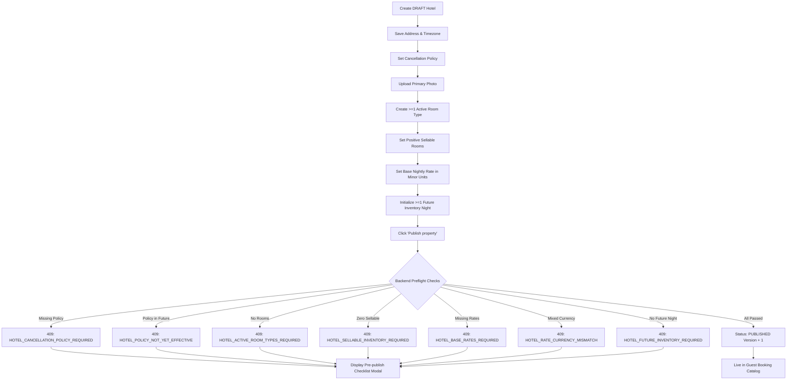
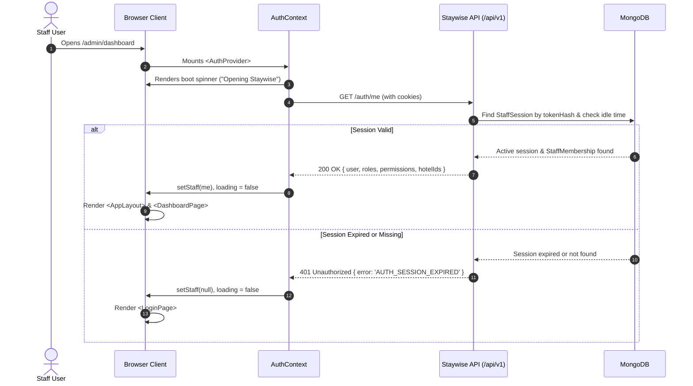
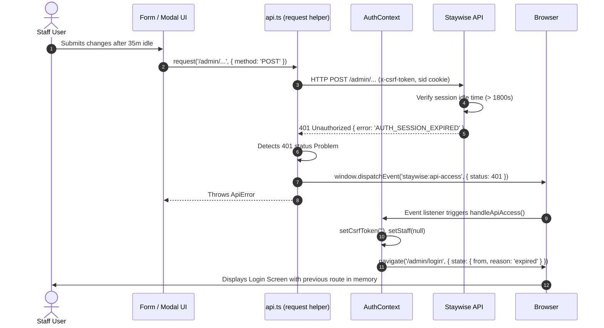

# End-to-End Navigation & User Flow Guide — apps/admin-web

> **Scope:** This guide documents the runtime behavior, user interactions, routing, authorization, and API contracts of the Staywise Admin Web application (`apps/admin-web`) as of Sprint 2 (after the full-stack fix plan).  
> Every section is layered into **For users** (plain language: visual elements, clicks, forms, feedback) and **Technical** (routes, components, API calls, request/response bodies, permissions, state management, cache invalidation, and errors).

---

## Part 1: Route Map

### 1.1 Complete Route Table

| Path | Page Component | Layout | Public / Protected | Required Permission | URL / Query Params | Sidebar Entry | Lazy-Loaded? | Notes |
| :--- | :--- | :--- | :--- | :--- | :--- | :--- | :--- | :--- |
| `/admin/login` | `LoginPage` | None (Split banner layout) | Public (Auth gate) | None | None | None | No (static import in `App.tsx`) | Unauthenticated users land here. Authenticated users are redirected to `homePath(staff)`. |
| `/` | Redirect | None | Redirect | None | None | None | No | Redirects immediately to `homePath(staff)`. |
| `/admin` | Redirect | None | Redirect | None | None | None | No | Redirects immediately to `homePath(staff)`. |
| `/admin/unauthorized` | `AccessPage` (`kind="unauthorized"`) | `AppLayout` | Protected | None | None | None | No | Displays `403 · NO ACCESS`. Primary landing for staff without any navigation permissions. |
| `/admin/dashboard` | `DashboardPage` | `AppLayout` | Protected | `hotels.view` | None | **Dashboard** | No | KPI overview cards, recent hotels table, and quick navigation shortcuts. |
| `/admin/hotels` | `HotelsPage` | `AppLayout` | Protected | `hotels.view` | `?search=` (from Topbar search) | **Property setup > Hotels** | No | Property directory, search/filters, pagination, bulk status changes. Archived hotels are hidden by default (Status filter default "All (excluding archived)"); choose **Archived** in the Status filter to see them. The "Active Hotels" card counts draft + published + suspended. |
| `/admin/hotels/new` | `HotelCreatePage` | `AppLayout` | Protected | `hotels.create` | None | (from **Add a hotel**) | No | Add-hotel form (shared `HotelDetailsFields`: Basics, Contact, Location) plus optional photos. Creates a `DRAFT` and opens the edit page. |
| `/admin/hotels/:id/edit` | `HotelEditPage` | `AppLayout` | Protected | `hotels.view` | `?tab=photos|rooms|policy` | (from hotel row) | No | Hotel workspace: status actions (Publish / Suspend / Reactivate / Archive) and tabs Details, Photos, Rooms, Cancellation policy. Archived hotels are read-only. |
| `/admin/room-types` | `RoomTypesPage` | `AppLayout` | Protected | `room_types.view` | `?hotel=<hotelId>` | **Property setup > Room types** | No | Room category listing, total sellable inventory counts, and category creation modal. |
| `/admin/inventory` | `InventoryPage` | `AppLayout` | Protected | `inventory.view` | `?hotel=<hotelId>&room=<roomId>` | **Operations > Availability** | No | 14-day rolling availability calendar, night initialization, and block/unblock modal. |
| `/admin/rates` | `RatesPage` | `AppLayout` | Protected | `rates.view` | `?hotel=<hotelId>&room=<roomId>` | **Operations > Base rates** | No | Base nightly pricing. Staff type rupees; the UI sends integer minor units (paise). Currency rules and rate coverage. |
| `*` (Catch-all) | `AccessPage` (`kind="not-found"`) | `AppLayout` | Protected | None | None | None | No | Displays `404 · NOT FOUND` with a button returning to `homePath(staff)`. |

### 1.2 Routing Rules & Fallbacks
1. **Unauthenticated Access:** If session state in `AuthContext` has `staff === null`, any route accessed renders `<Navigate to="/admin/login" replace />` (`App.tsx:28`).
2. **Dynamic Landing (`homePath`):** Implemented in `route-config.ts:38`. Iterates through `[dashboardNav, ...navGroups.flatMap(group => group.items)]` and finds the first route whose permission is included in `staff.permissions`. If no navigation items match, it returns `/admin/unauthorized`.
3. **Lazy-Loading Status:** None of the pages use `React.lazy()` or `<Suspense>` splits. All page components and layout primitives are statically bundled into `index-[hash].js`.

---

## Part 2: How Navigation Works

### 2.1 Application Boot Sequence
```
Browser loads /
  │
  ├─ index.html ──> main.tsx
  │                   │
  │                   └─ <BrowserRouter>
  │                        └─ <AuthProvider>
  │                             └─ <App>
```
- **For users:** You see a centered screen showing the green Staywise compass logo, a smooth circular spinner, and the message *"Opening Staywise"*.
- **Technical:**
  1. `AuthProvider` initializes with `loading = true`.
  2. `App.tsx:12-22` renders the `.boot-screen` loading placeholder.
  3. `useEffect` triggers `checkSession()`, which performs `GET /api/v1/auth/me` with `credentials: 'include'`.
  4. **Outcome A (Valid Session):** API returns `200 OK` with payload `StaffMe` (`{ user, roles, permissions, hotelIds }`). `setStaff(me)` runs, `loading` becomes `false`, and `<AppLayout>` mounts with `<AppRoutes>`.
  5. **Outcome B (No Session / Expired):** API returns `401 Unauthorized`. Caught in `checkSession()`. `setStaff(null)` runs, `loading` becomes `false`. `App.tsx:24-30` mounts `LoginPage`.
  6. **Outcome C (API Down / Network Error):** `checkSession()` catches non-401 error, sets `apiError = "The Staywise API could not be reached. Check that it is running and try again."`, and renders `LoginPage` with a red alert banner.

### 2.2 Login Flow & Error Codes
- **For users:** Enter your work email and password, then click **Sign in**. The button shows a spinner and *"Signing in…"*. On success, a green notification appears (*"Welcome back. You are signed in."*) and you are automatically taken to your dashboard or first accessible operations page. If sign-in fails, a banner explains why.
- **Technical:**
  1. Form submission calls `POST /api/v1/auth/staff/login` with body `{ email, password }`.
  2. On success, the response returns `{ csrfToken: string }`, while Express sets the session cookie `staywise_staff_sid` (HttpOnly, SameSite=Lax) and `staywise_staff_csrf`.
  3. Client stores CSRF token via `setCsrfToken(login.csrfToken)` (`api.ts:4`).
  4. Client immediately performs `GET /api/v1/auth/me` to retrieve permissions and invokes `onLogin(me)`.
  5. `App.tsx` re-renders into `<AppLayout>` and routes through `<AppRoutes>`.
  6. **Error Mapping (`LoginPage.tsx:29-35`):**
     - `AUTH_MFA_REQUIRED`: *"Multi-factor sign-in is required for this account."*
     - `ACCOUNT_LOCKED`: *"Too many failed attempts. This account is locked for a few minutes."*
     - `TOO_MANY_ATTEMPTS`: Message from backend or *"Too many attempts. Please wait and try again."*
     - `AUTH_INVALID_CREDENTIALS`: *"Email or password is incorrect."*
     - Fallback / Unknown: Raw `err.message` or *"Email or password is incorrect."*

### 2.3 Layout, Shell & Navigation Items
- **Sidebar (`Sidebar.tsx`):**
  - Displays brand header with collapse toggle (persisted in `localStorage.staywise-admin-sidebar-collapsed`).
  - Items are gated against `staff.permissions`:
    - `hotels.view` -> **Dashboard** (`/admin/dashboard`)
    - `hotels.view` -> Group **Property setup** > **Hotels** (`/admin/hotels`)
    - `room_types.view` -> Group **Property setup** > **Room types** (`/admin/room-types`)
    - `inventory.view` -> Group **Operations** > **Availability** (`/admin/inventory`)
    - `rates.view` -> Group **Operations** > **Base rates** (`/admin/rates`)
  - Collapsible section headers remember toggle state in local memory.
  - Footer contains help card and disabled *"Settings (Upcoming)"* action.
- **Topbar (`Topbar.tsx`):**
  - **Search:** Global input. Submitting `Enter` navigates to `/admin/hotels?search=<query>`.
  - **Notifications:** Bell button triggers informational toast (*"Notifications are coming soon."*).
  - **Profile Menu:** Shows staff email, initial badge, and role name. Clicking opens a dropdown menu with **Sign out**.
- **Logout Execution:**
  - Clicking **Sign out** calls `POST /api/v1/auth/logout`.
  - Backend revokes session in `StaffSession` collection and clears cookies `staywise_staff_sid` and `staywise_staff_csrf`.
  - Frontend clears local CSRF token, sets `staff = null`, and routes to `/admin/login`.

### 2.4 Moving Between Pages & State Persistence
- **Catalog Navigation & `HotelRoomPicker`:**
  - Room Types, Inventory, and Rates pages share the unified `HotelRoomPicker` header.
  - Selecting a hotel updates the URL search query param `?hotel=<hotelId>`.
  - Selecting a room updates `?room=<roomId>`.
  - Both params are synced via `useSearchParams()`.
  - **Page Refresh:** Survives full page reload. On mount, `HotelRoomPicker` reads `searchParams.get('hotel')` and fetches hotel details via `getHotel(urlHotelId)`.
  - **Back/Forward Navigation:** Changes push into browser history, allowing seamless forward and back traversal.
  - **Stale / Deleted Deep-Links:** If `?hotel=invalidId` is opened, `getHotel()` fails, triggering `hotelNotFound = true`. The component displays `<NotFound title="Property not found" description="The property specified in the URL does not exist or has been removed." action={<Button>Choose another property</Button>} />`. Clicking clears the invalid params from the URL.

### 2.5 Route Guards & Access Denials
- **`PermissionRoute`:** Evaluates `routePermissions[path]`. If `staff.permissions` lacks the key, it does not mount the page; instead, it renders `<AccessPage kind="unauthorized" home={homePath(staff)} />` (`403 · NO ACCESS`).
- **Inline API 403:** If a user accesses `/admin/hotels` but their backend request returns `403 FORBIDDEN` (e.g. hotel outside tenant scope), `HotelsPage:77` immediately catches `isApiError(hotelsQuery.error, 403)` and renders `<AccessPage kind="unauthorized" />`.

### 2.6 Session Expiration & Idle Timeout
- Backend sessions expire after **30 minutes (1,800 seconds)** of inactivity (`staff-session.service.ts:35`).
- When an idle staff member triggers an action (e.g. saving rates, creating a room, publishing):
  1. API returns `401 Unauthorized` with `{ error: 'AUTH_SESSION_EXPIRED' }`.
  2. `api.ts:31-37` intercepts the 401 response and dispatches `window.dispatchEvent(new CustomEvent('staywise:api-access', { detail: { status: 401 } }))`.
  3. `AuthContext:72-85` receives the event, clears `staff = null`, clears `csrfToken`, and redirects to `/admin/login` with `state: { from: location.pathname, reason: 'expired' }`.
  4. **Unsaved Form Data:** Because React unmounts the active page component, any unsaved inputs in forms or modals are cleared from memory.

---

## Part 3: Roles and What Each One Sees

### 3.1 Backend Seeded Roles and Permissions
Staywise defines stable, code-owned permissions versioned in the database (`seed-super-admin.ts:12-17`):

- **Hotels:** `hotels.view`, `hotels.create`, `hotels.edit`, `hotels.publish`, `hotels.archive`
- **Room Types:** `room_types.view`, `room_types.create`, `room_types.edit`, `room_types.archive`
- **Inventory:** `inventory.view`, `inventory.block`, `inventory.adjust`
- **Rates:** `rates.view`, `rates.edit`

#### Seeded Roles:
1. `SUPER_ADMIN`:
   - System administrator with platform-wide scope (`hotelIds: []`).
   - Grants all 14 permissions.
   - `AuthContext:63` explicitly evaluates `if (staff.roles.includes('SUPER_ADMIN')) return true;`, bypassing any missing client-side permission keys.
2. `HOTEL_MANAGER`:
   - Scope is explicitly constrained to assigned `hotelIds`.
   - Granted operational permissions for catalog and inventory; cannot archive or create properties unless assigned platform permissions.
3. `FRONT_DESK` / `OPERATIONS` (Custom Role):
   - Scope is constrained to assigned properties.
   - Typically granted `hotels.view`, `room_types.view`, `inventory.view`, `inventory.block`, and `rates.view`.

---

### 3.2 UI Actions & Permission Matrix

| UI Action | `SUPER_ADMIN` | `HOTEL_MANAGER` | `FRONT_DESK` | Controlling Code Gate |
| :--- | :--- | :--- | :--- | :--- |
| **View Dashboard** | Visible | Visible | Visible (if `hotels.view`) | `<PermissionRoute path="/admin/dashboard">` |
| **View Hotels List** | Visible | Visible | Visible | `<PermissionRoute path="/admin/hotels">` |
| **Add a Hotel Button** | Visible | Hidden | Hidden | `<Can permission="hotels.create">` in `HotelsPage:305` |
| **Open Hotel Workspace** | Visible | Visible | Visible | Always visible on table row in `HotelsPage:280` |
| **Save Cancellation Policy** | Visible | Visible | Hidden | `<Can permission="hotels.edit">` in `HotelWorkspace:280` |
| **Publish Hotel** | Visible | Visible (if granted) | Hidden | `<Can permission="hotels.publish">` in `HotelWorkspace:148` |
| **Archive Hotel (Single)** | Visible | Hidden | Hidden | `<Can permission="hotels.archive">` in `HotelWorkspace:133` |
| **Bulk Status Action Bar** | Visible | Visible | Visible | Appears when rows checked in `HotelsPage:316` |
| **Bulk Publish Button** | Visible | Visible | Visible | Disabled if any checked row is `DRAFT` (`HotelBulkActionsBar:34`) |
| **View Room Types** | Visible | Visible | Visible | `<PermissionRoute path="/admin/room-types">` |
| **Add Room Type** | Visible | Visible | Hidden | `<Can permission="room_types.create">` in `RoomTypesPage:44` |
| **View Availability Calendar**| Visible | Visible | Visible | `<PermissionRoute path="/admin/inventory">` |
| **Initialize 14 Nights** | Visible | Visible | Visible | Button in `InventoryCalendarView:53` |
| **Block / Unblock Night** | Visible | Visible | Visible (if `inventory.block`)| Clicking date cell opens `InventoryAdjustModal` |
| **View Base Rates** | Visible | Visible | Visible | `<PermissionRoute path="/admin/rates">` |
| **Edit / Save Base Rate** | Enabled | Enabled | Disabled (Read-only) | `canEditRates = can('rates.edit')` controls form button in `BaseRatesView:78` |

---

## Part 4: End-to-End User Journeys

---

### Journey A: First Login and Landing on the Dashboard
1. **Navigate to App:**
   - **For users:** Open `http://localhost:5173/`. You are shown the branded sign-in screen.
   - **Technical:** Unauthenticated routing catches `/` and replaces path with `/admin/login`.
2. **Authenticate:**
   - **For users:** Enter email `test12345@gmail.com`, password, and click **Sign in**.
   - **Technical:** `POST /api/v1/auth/staff/login` returns `{ csrfToken }`. Sets HttpOnly cookie. Followed by `GET /api/v1/auth/me`. Toast: *"Welcome back. You are signed in."*
3. **Landing on Dashboard:**
   - **For users:** You land on the Staywise Operations Dashboard. You see four top KPI cards (*Total properties*, *Published*, *In setup*, *Paused or archived*), a table of recent properties, and a right-hand panel of quick shortcuts.
   - **Technical:** `DashboardPage` fires parallel queries via `Promise.all`:
     - `GET /api/v1/admin/hotels?limit=8&offset=0`
     - `GET /api/v1/admin/hotels/metrics`
   - Refresh button in top-right triggers `DashboardPage:24` to reload both endpoints simultaneously.

---

### Journey B: Onboard a New Hotel from DRAFT to PUBLISHED

```
1. Add Property ──> 2. Cancellation Terms ──> 3. Photo Gallery
        │                      │                     │
        └──────────────────────┼─────────────────────┘
                               ▼
4. Add Room Types ──> 5. Set Base Rates ──> 6. Initialize Inventory
                                                         │
                                                         ▼
                                               7. Publish Property
                                               (Pass Pre-flight Checks)
```

#### Step 1: Create Draft Property
- **For users:** On `/admin/hotels`, click the green **Add a hotel** button. The **Add a hotel** page (`/admin/hotels/new`) opens. Under **Basics** type the Name (*"The Grand Palace"*); the **Web address** fills itself (*"the-grand-palace"*) and can be changed. Under **Contact** enter Email (*"desk@grandpalace.com"*) and optionally Phone. Under **Location** enter Street address, City, Postal code, and pick Country (default *India*) and Time zone (default *India (IST)*) from the dropdowns. Optionally add photos. Click **Create hotel**.
- **Technical:**
  - Page / components: `HotelCreatePage` → `HotelCreateForm` → shared `HotelDetailsFields` (same fields block as the edit page)
  - API: `POST /api/v1/admin/hotels`
  - Body:
    ```json
    {
      "name": "The Grand Palace",
      "slug": "grand-palace",
      "timezone": "Asia/Kolkata",
      "address": { "line1": "12 Residency Rd", "city": "Bengaluru", "postalCode": "560001", "countryCode": "IN" },
      "contact": { "email": "desk@grandpalace.com" }
    }
    ```
  - State: Creates hotel with `status: "DRAFT"`, `version: 0`.
  - If photos were added, a second call `POST /api/v1/admin/hotels/:id/media` saves them. If that call fails the hotel is still created and a toast tells the user to add the photos again in the **Photos** tab.
  - Cache: Invalidates tag `hotels`. Navigates to `/admin/hotels/:id/edit` (the hotel workspace).

#### Step 2: Configure Cancellation Terms
- **For users:** On the edit page (`/admin/hotels/:id/edit`) open the **Cancellation policy** tab. Choose **Applies from** (today or earlier), **Free cancellation until** (*"24"* hours before check-in), and the **Fee for late cancellation** and **Fee for no-show** (No fee / Full stay amount / Fixed amount / Percentage of stay). A fixed amount is typed in rupees (e.g. *"1500.50"*); the UI sends paise (`150050`) with currency `INR` (or the currency already saved on the policy). Click **Save policy**.
- **Technical:**
  - Components: `HotelWorkspace` (tab `?tab=policy`) → `CancellationPolicyFields` (uses shared `MoneyInput`)
  - API: `PATCH /api/v1/admin/hotels/:id`
  - Body:
    ```json
    {
      "version": 0,
      "cancellationPolicy": {
        "effectiveFrom": "2026-10-13",
        "freeCancellationHoursBeforeCheckIn": 24,
        "afterCutoff": { "basis": "PERCENTAGE_BPS", "percentageBps": 10000 },
        "noShow": { "basis": "PERCENTAGE_BPS", "percentageBps": 10000 }
      }
    }
    ```
  - Success Toast: *"Cancellation policy saved."* Version increments to `1`.

#### Step 3: Add Property Photos
- **For users:** On the edit page open the **Photos** tab (badge shows the photo count). Upload or add photos, set captions, mark one as Primary, and click **Save photos**.
- **Technical:**
  - Components: `HotelWorkspace` (tab `?tab=photos`) → `HotelMediaGalleryManager`
  - API: `POST /api/v1/admin/hotels/:id/media`
  - Body: `{ "version": 1, "media": [{ "url": "https://images.unsplash.com/...", "isPrimary": true, "caption": "Facade", "displayOrder": 0 }] }`
  - Cache: Invalidates tag `hotels`. Version increments to `2`.

#### Step 4: Add Room Types
- **For users:** Navigate to `/admin/room-types` (or click **Add room** in the workspace modal). Select *"The Grand Palace"* in the property picker. Click **Add room type**. Fill in Room name (*"Deluxe King"*), Room code (*"DLX-K"*), Adults (*2*), Children (*1*), and Sellable rooms (*10*). Click **Add room type**.
- **Technical:**
  - Component: `RoomCreateModal`
  - API: `POST /api/v1/admin/hotels/:hotelId/room-types`
  - Body: `{ "name": "Deluxe King", "code": "DLX-K", "maxAdults": 2, "maxChildren": 1, "totalRooms": 10 }`
  - Cache: Invalidates `room-types:<hotelId>`. Toast: *"Room type added."*

#### Step 5: Set Base Nightly Rates
- **For users:** Navigate to `/admin/rates`. The property and room type are pre-selected in the URL (`?hotel=...&room=...`). Enter **Price per night** in rupees (*"4500"* or *"4500.50"*; the ₹ sign is shown in the box), keep Currency *INR* (locked once the hotel has a rate), and enter Reason for change (*"Initial launch rate"*). Click **Set base rate** / **Save base rate**. The current rate is shown formatted, e.g. *₹4,500.00 per night, before tax*.
- **Technical:**
  - Components: `RatesPage.handleSaveRate` → `BaseRatesView` (shared `MoneyInput` converts rupees to paise: 4500 → 450000)
  - API: `PUT /api/v1/admin/room-types/:roomTypeId/base-rate`
  - Body: `{ "amountMinorUnits": 450000, "currency": "INR", "reason": "Initial launch rate" }`
  - Cache: Invalidates `rate:<roomTypeId>`. Toast: *"Base rate saved. Tax is not included."*

#### Step 6: Initialize Inventory Range
- **For users:** Navigate to `/admin/inventory`. The property and room type remain selected. An amber banner appears: *"14 dates have not been initialized yet"*. Click the green **Initialize dates** button.
- **Technical:**
  - Component: `InventoryPage:74-85`
  - API: `POST /api/v1/admin/room-types/:roomTypeId/inventory/initialize`
  - Body: `{ "from": "2026-10-13", "to": "2026-10-27" }`
  - Response: `{ "createdNights": 14 }`
  - Cache: Invalidates `inventory:<roomTypeId>`. The 14-day grid populates showing Total: 10, Available: 10.

#### Step 7: Publish Property & Pre-Flight Validation
- **For users:** Return to `/admin/hotels` and click **Open workspace** on *"The Grand Palace"*. Click **Publish property** in the top right.
- **Pre-Flight Failure Case:** If any required step was skipped (e.g. no base rate set, or cancellation policy effective date is in the future), the modal does not publish. Instead, a red alert box appears listing the exact blocking issues:
  - *Pre-publish requirements missing (1)*
  - *• Set a base rate for every active room type before publication*
- **Success Case:** When all criteria are satisfied, the button shows *"Publishing property…"*. The status badge updates to green **PUBLISHED**, and a toast confirms: *"Property published and visible in the catalog."*
- **Technical:**
  - API: `POST /api/v1/admin/hotels/:id/publish`
  - Body: `{ "version": <currentVersion> }`
  - Errors: If incomplete, backend returns HTTP 409 `{ error: "HOTEL_NOT_READY", message: "...", details: [{ code, message }] }`. Handled by `handleFormError:22`.

---

### Journey C: Daily Operations — Changing Rates and Blocking Rooms

#### Scenario 1: Update Base Rate
1. Navigate to `/admin/rates?hotel=<id>&room=<id>`.
2. Enter new price per night: `5000` (sent as `500000` paise), Reason: *"Weekend surge pricing"*.
3. Click **Save base rate**.
4. **Technical:** Sends `PUT /api/v1/admin/room-types/:id/base-rate` with `{ version: <currentRateVersion>, amountMinorUnits: 500000, currency: "INR", reason: "Weekend surge pricing" }`.

#### Scenario 2: Block Rooms for Maintenance
1. Navigate to `/admin/inventory?hotel=<id>&room=<id>`.
2. Locate the target date on the calendar (e.g. `2026-10-15`) and click the day card.
3. The **Adjust Room Availability** modal opens (`InventoryAdjustModal.tsx`).
4. Select Action: **Block rooms for maintenance**. Enter Quantity: `2`. Enter Reason: *"AC unit repair in rooms 101 & 102"*.
5. Click **Confirm Block**.
6. **Technical:**
   - API: `POST /api/v1/admin/room-types/:roomTypeId/inventory/2026-10-15/block`
   - Body: `{ "version": 0, "quantity": 2, "reason": "AC unit repair in rooms 101 & 102" }`
   - Response: Updated `NightInventory` object (`total: 10, available: 8, blocked: 2, version: 1`).
   - Cache: Invalidates `inventory:<roomTypeId>`. Grid card immediately updates to reflect Available: 8, Blocked: 2.

---

### Journey D: Find Hotels — Search, Filter, and Paging
1. **Search Bar:**
   - Type *"Palace"* into the table search input.
   - `useDebouncedValue` waits 300ms, resets `currentPage = 1`, and triggers `GET /api/v1/admin/hotels?limit=10&offset=0&search=Palace`.
2. **Filter by Status & City:**
   - Select Status: **Published**, City: **Bengaluru**.
   - Query updates to `GET /api/v1/admin/hotels?limit=10&offset=0&status=PUBLISHED&city=Bengaluru`.
3. **Paging:**
   - Change page size to **25** or click next page **2**.
   - Query updates offset: `offset=25`.

---

### Journey E: Suspend, Reactivate, and Archive Properties

```
[ DRAFT ] ───────────► [ PUBLISHED ] ◄──────────┐
    │                        │                  │
    │                        ▼                  │
    │                 [ SUSPENDED ] ────────────┘
    │                        │
    ▼                        ▼
[ ARCHIVED (Permanent Terminal State) ]
```

#### Scenario 1: Suspend a Hotel
- **For users:** In the hotel list, check one or more published hotels. The dark floating bar appears at the top. Click **Suspend Selected**. A confirmation modal prompts for a reason (e.g. *"Off-season renovation"*). Click **Confirm SUSPENDED**.
- **Technical:**
  - Component: `BulkStatusConfirmModal`
  - API: `PATCH /api/v1/admin/hotels/bulk-status`
  - Body: `{ "hotelIds": ["<id>"], "status": "SUSPENDED", "reason": "Off-season renovation" }`
  - Response: `{ "modifiedCount": 1, "status": "SUSPENDED" }`
  - State: Hotel is immediately hidden from public guests. Bookings cannot be made.

#### Scenario 2: Reactivate a Suspended Hotel
- **For users:** Check the suspended hotel in the list. Click **Publish Selected**. Confirm in the dialog.
- **Technical:** Calls `PATCH /api/v1/admin/hotels/bulk-status` with `status: "PUBLISHED"`. Backend transitions status back to `PUBLISHED`.

#### Scenario 3: Archive a Hotel (Irreversible)
- **For users:**
  - *Single:* In `HotelWorkspace`, click **Archive**. A browser prompt demands typing **ARCHIVE**.
  - *Bulk:* Check hotels and click **Archive Selected**. In `BulkStatusConfirmModal`, an explicit text input requires typing **ARCHIVE** before the submit button unlocks.
- **Technical:**
  - API: `POST /api/v1/admin/hotels/:id/archive` with `{ "version": <version>, "reason": "..." }`
  - Backend enforces terminal state: archived hotels can **never** be re-published, un-archived, or reactivated.

#### Scenario 4: Partial Results with Skipped Hotels
- If a user selects 3 hotels (1 Suspended, 2 Drafts) and attempts to bulk publish:
  - Frontend `HotelBulkActionsBar:34` disables the button with tooltip *"Drafts must be published individually from their workspace"*.
  - If executed via API, backend skips drafts and returns:
    ```json
    {
      "modifiedCount": 1,
      "status": "PUBLISHED",
      "updated": ["<suspendedId>"],
      "skipped": [{ "hotelId": "<draftId>", "code": "INVALID_TRANSITION", "message": "Draft hotels cannot be bulk published" }]
    }
    ```
  - Frontend toast displays: *"1 updated. 2 skipped (Draft hotels cannot be bulk published)."*

---

### Journey F: Concurrency Conflict (`VERSION_CONFLICT`)
1. **User A and User B open the same room rate concurrently:** Both receive `version: 3`.
2. **User A submits:** `PUT /api/v1/admin/room-types/:id/base-rate` with `version: 3`. Succeeded! Database updates rate to `version: 4`.
3. **User B submits:** Sends `version: 3`.
4. **Backend Rejection:** Detects mismatch (`3 !== 4`), throws `ConflictException` with code `VERSION_CONFLICT`.
5. **Frontend Reaction (`RatesPage:118-123`):**
   - Intercepted by `onConflict` callback in `handleFormError`.
   - Automatically triggers `invalidate("rate:<roomTypeId>")`.
   - Toast alerts User B: *"Someone else modified this rate. Latest data has been reloaded."*
   - Form reloads latest values and version `4` without overwriting User A's changes.

---

### Journey G: Unauthorized Access Attempt
1. **Direct URL Navigation:** A front desk user without `rates.view` pastes `http://localhost:5173/admin/rates` into their address bar.
2. **Permission Guard:** `PermissionRoute:8` evaluates `staff.permissions.includes('rates.view')` -> `false`.
3. **Rendering:** Instead of mounting `RatesPage`, renders `<AccessPage kind="unauthorized" />`:
   - Eyebrow: `403 · NO ACCESS`
   - Title: *"No access to this section"*
   - Body: *"Your staff account lacks permission or scope to access this property or action. If you believe this is an error, request access from your Staywise administrator."*
   - Button: **Return to dashboard** (links to `homePath(staff)`).

---

### Journey H: Session Expiration Mid-Task
1. A staff member leaves the **Add room type** modal open for 35 minutes.
2. Returning to the screen, they click **Add room type**.
3. Browser sends `POST /api/v1/admin/hotels/:id/room-types`.
4. Backend checks session `lastSeenAt`: idle time exceeds 1,800s. Throws `401 Unauthorized` with `{ error: 'AUTH_SESSION_EXPIRED' }`.
5. `api.ts:35` dispatches `staywise:api-access`.
6. `AuthContext:77-80` catches event, navigates to `/admin/login` with `state: { from: '/admin/room-types', reason: 'expired' }`.
7. Staff member re-authenticates.

---

## Part 5: System Architecture & Flow Diagrams

### 5.1 Overall Navigation & Permission Flow
```mermaid
flowchart TD
    Start([Open Web App]) --> Boot{Auth Loaded?}
    Boot -- No --> Spinner[Display 'Opening Staywise']
    Boot -- Yes --> AuthCheck{Staff Logged In?}
    
    AuthCheck -- No --> Login[/admin/login]
    Login --> SubmitLogin[POST /auth/staff/login]
    SubmitLogin --> GetMe[GET /auth/me]
    GetMe --> HomeRedirect[Redirect to homePath]
    
    AuthCheck -- Yes --> MatchRoute{Requested Route}
    MatchRoute -- / or /admin --> HomeRedirect
    MatchRoute -- Unknown path --> Page404[404 · NOT FOUND]
    MatchRoute -- Valid Route --> Guard{PermissionRoute Check}
    
    Guard -- Missing Permission --> Page403[403 · NO ACCESS]
    Guard -- Permitted --> RenderPage[Mount Page in AppLayout]
    
    RenderPage --> D[Dashboard /admin/dashboard]
    RenderPage --> H[Hotels Directory /admin/hotels]
    RenderPage --> R[Room Types /admin/room-types]
    RenderPage --> I[Availability Calendar /admin/inventory]
    RenderPage --> P[Base Rates /admin/rates]
```

---

### 5.2 Hotel Onboarding & Pre-flight Publish Checklist


---

### 5.3 Sequence: App Boot & Session Verification


---

### 5.4 Sequence: Mid-Task Session Expiry & Auto-Ejection


---

## Part 6: Comprehensive Message & Error Reference

| errorCode / Status | Where It Can Appear | Exact Text User Sees | What the User Should Do |
| :--- | :--- | :--- | :--- |
| `AUTH_INVALID_CREDENTIALS` (401) | Login Page | `Email or password is incorrect.` | Check caps lock and verify credentials with hotel administrator. |
| `ACCOUNT_LOCKED` (401) | Login Page | `Too many failed attempts. This account is locked for a few minutes.` | Wait 5 to 15 minutes before re-attempting sign-in. |
| `AUTH_MFA_REQUIRED` (401) | Login Page | `Multi-factor sign-in is required for this account.` | Provide second factor authentication token (when MFA enabled). |
| `AUTH_SESSION_EXPIRED` (401) | Any API call after 30m idle | Page ejects to login screen | Sign in again to re-establish authenticated cookies. |
| `CSRF_REJECTED` (401/403) | Mutating POST/PATCH/PUT | Page ejects to login screen | Re-login to generate a fresh CSRF cookie pair. |
| `FORBIDDEN` (403) | Direct route or property action | `403 · NO ACCESS` / `No access to this section` | Request explicit role or property tenant scope assignment. |
| `NOT_FOUND` (404) | Invalid route or stale query | `404 · NOT FOUND` / `Property not found` | Click "Choose another property" or return to dashboard. |
| `VERSION_CONFLICT` (409) | Rates, Inventory, Hotels | `Someone else changed this record. Please reload to see the latest version.` | Reopen the modal or refresh to fetch the updated entity version. |
| `HOTEL_NOT_READY` (409) | Hotel Workspace (Publish) | `Property is not ready to publish. Review the checklist below.` | Address all pre-publish requirements listed in the checklist modal. |
| `HOTEL_CANCELLATION_POLICY_REQUIRED` (409) | Pre-flight Publish Check | `Set explicit cancellation and no-show terms before publication` | In Hotel Workspace, complete and save the Cancellation Policy section. |
| `HOTEL_POLICY_NOT_YET_EFFECTIVE` (409) | Pre-flight Publish Check | `Cancellation policy starts in the future and is not yet effective` | Update policy `effectiveFrom` date to today or a past date. |
| `HOTEL_ACTIVE_ROOM_TYPES_REQUIRED` (409) | Pre-flight Publish Check | `Add at least one active room type before publication` | Navigate to Room Types and add at least one room category. |
| `HOTEL_SELLABLE_INVENTORY_REQUIRED` (409) | Pre-flight Publish Check | `Every active room type needs a positive sellable room total` | Ensure `totalRooms` is at least 1 in Room Types. |
| `HOTEL_BASE_RATES_REQUIRED` (409) | Pre-flight Publish Check | `Set a base rate for every active room type before publication` | Navigate to Base Rates and set nightly prices for all categories. |
| `HOTEL_RATE_CURRENCY_MISMATCH` (409) | Pre-flight Publish Check | `All active room type base rates must use one hotel currency` | Re-save all room base rates under the same ISO currency code (e.g. INR). |
| `HOTEL_POLICY_CURRENCY_MISMATCH` (409) | Pre-flight Publish Check | `Fixed policy fees must use the hotel base-rate currency` | Match fixed cancellation penalty currency with room rate currency. |
| `HOTEL_FUTURE_INVENTORY_REQUIRED` (409) | Pre-flight Publish Check | `Every active room type needs at least one future night with available rooms` | Open Availability calendar and click "Initialize dates" for upcoming days. |
| `DUPLICATE_HOTEL_SLUG` (409) | Hotel Creation Modal | `A hotel with this slug already exists` | Choose a unique property slug (e.g. `palace-resort-blr`). |
| `HOTEL_TIMEZONE_HAS_FUTURE_BOOKINGS` (409) | Hotel Workspace | `Timezone cannot change while future bookings exist` | Timezone changes are locked once future guest reservations exist. |
| `VALIDATION_FAILED` (400) | Forms | Field-level error messages below inputs | Correct the highlighted fields (e.g. valid email, integer minor units). |

---

## Part 7: Business Rules Users Need to Know

### 7.1 Hotel Lifecycle & Allowed Transitions
- **`DRAFT`:** Editable setup state. Invisible to public guests. Can only transition to `PUBLISHED` (via individual workspace pre-flight verification) or `ARCHIVED`. **Cannot be bulk published.**
- **`PUBLISHED`:** Publicly visible and bookable. Can transition to `SUSPENDED` (temporary pause) or `ARCHIVED` (permanent decommissioning).
- **`SUSPENDED`:** Hidden from public catalog; existing bookings honored, but new reservations blocked. Can be reactivated to `PUBLISHED` or permanently transitioned to `ARCHIVED`.
- **`ARCHIVED`:** Terminal state. **Irreversible.** Archived properties can never be reactivated, re-published, or edited.

### 7.2 Pre-Flight Publishing Requirements
To publish a hotel, all 7 backend criteria must be strictly satisfied:
1. Valid cancellation and no-show policy configured.
2. Cancellation policy `effectiveFrom` date $\le$ today (in property local timezone).
3. At least one room type in `ACTIVE` status.
4. Every active room type has `totalRooms > 0`.
5. Every active room type has an active Base Rate configured.
6. All base rates and fixed cancellation fees use the **same single ISO currency code**.
7. Every active room type has at least one upcoming stay date with `available > 0` initialized in the inventory calendar.

### 7.3 Inventory Invariants
For any room type on any stay date:
$$\text{available} = \text{total} - (\text{blocked} + \text{held} + \text{confirmed})$$
- $\text{total}$: Physical sellable capacity for that room category.
- $\text{blocked}$: Rooms taken out of service for maintenance or property hold.
- $\text{held}$: Temporary checkout holds (hold state machine).
- $\text{confirmed}$: Completed guest reservations.
- $\text{available}$: Remaining inventory open for booking. Cannot drop below 0.

### 7.4 Pricing & Minor Units Rule
- All pricing is calculated and stored in **integer minor units** (e.g. ₹500.00 = `50000` paise; $100.00 = `10000` cents).
- Decimal inputs are strictly disallowed to prevent floating-point rounding errors.
- Base rates do not include taxes or supplemental fees.

### 7.5 Optimistic Concurrency Control (Version Locking)
- Every mutable resource (`Hotel`, `RoomType`, `BaseRate`, `NightInventory`) carries an integer `version` field starting at `0`.
- Every mutation sends the expected version. The database only updates if `version === expectedVersion`, incrementing the version atomically.
- Stale saves are rejected with HTTP 409 `VERSION_CONFLICT`.

---

## Part 8: Problems Found While Tracing

During this comprehensive code trace, the following inconsistencies, gaps, and usability limitations were identified in the codebase:

| Issue | Location | Severity | Description |
| :--- | :--- | :--- | :--- |
| **`state.from` Return Ignored After Login** | `LoginPage.tsx:25` & `App.tsx:28` | **Medium** | When a session expires, `AuthContext:79` saves the previous route into `state: { from: location.pathname }`. However, `LoginPage.tsx` never reads `location.state.from`. Instead, `App.tsx` unconditionally navigates to `homePath(staff)`, always sending the user to the dashboard rather than returning them to their interrupted task. |
| **`logoutAll` Function Not Exposed in UI** | `AuthContext.tsx:51` & `Topbar.tsx:113` | **Low** | The backend and `AuthContext` provide a full `logoutAll()` API (`POST /auth/logout-all`) that terminates all active sessions across devices, but the Topbar profile dropdown only wires single session `logout()`. |
| **Bulk Actions Bar Missing Permission Gate** | `HotelsPage.tsx:316` | **Medium** | The bulk action bar (`HotelBulkActionsBar.tsx`) appears whenever rows are checked, regardless of whether the user possesses `hotels.publish` or `hotels.archive`. While the backend API rejects unauthorized calls, the buttons remain active in the UI instead of being gated by `<Can>`. |
| **Search Filter State Not Synced to URL in HotelsPage** | `HotelsPage.tsx:29-35` | **Low** | In `HotelsPage`, `statusFilter`, `locationFilter`, and pagination are kept in local React state rather than URL search params. Refreshing the browser resets the filters back to `ALL` and page `1`. |
| **Single Hotel Suspend Action Missing in HotelWorkspace** | `HotelWorkspace.tsx:132-161` | **Medium** | In `HotelWorkspace`, staff can click **Publish property** and **Archive**, but there is no button to **Suspend** a single published hotel. Staff are forced to exit to the table and use the bulk actions bar to suspend a single property. |
| **Window Prompt Used for Single Hotel Archive** | `HotelWorkspace.tsx:69` | **Low** | While bulk archive uses a custom styled modal (`BulkStatusConfirmModal.tsx`), single hotel archive in the workspace uses native browser `window.prompt()`, breaking design consistency. |

---

## Part 9: Open Questions

1. **Post-Login Redirection (`state.from`):** Should `LoginPage.tsx` be updated to check `location.state?.from` and navigate directly back to the user's previous deep-link (e.g. `/admin/rates?hotel=...`) after successful authentication?
2. **Hotel Workspace URL Deep-Linking:** Currently, opening a hotel's workspace is driven by modal state (`selected: Hotel | null`). Would product prefer workspace URLs to be shareable deep-links (e.g. `/admin/hotels/:id/workspace`)?
3. **Session Heartbeat / Idle Warning:** Would operations benefit from a proactive session renewal or warning popup at 25 minutes of inactivity before the 30-minute hard ejection occurs?
