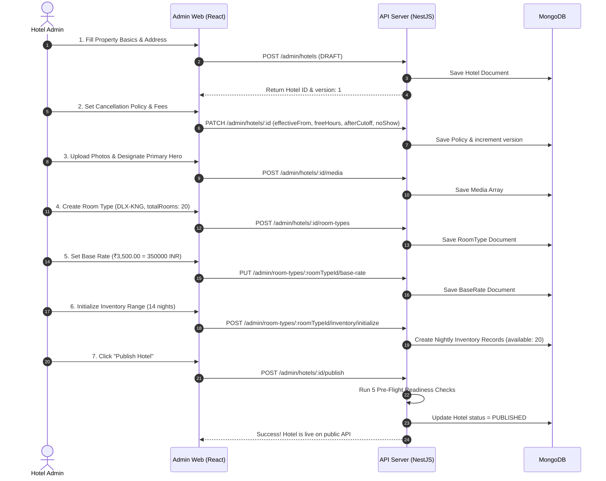

# Staywise Platform — Modules, Features & Configuration Guide

> **Document ID:** `28-platform-modules-features-and-configuration-guide.md`  
> **Target Audience:** Hotel Operators, System Administrators, Product Managers, and Full-Stack Developers  
> **Source Verification:** Verified against NestJS API (`apps/api`) and React Admin UI (`apps/admin-web`)  

---

## 1. Executive Summary & System Overview

Staywise is a server-authoritative hotel booking and operations management platform. The core platform architecture separates responsibility cleanly:
- **Server Authority**: Inventory availability, pricing calculations, payment handling, and state transitions are strictly governed server-side.
- **Financial Precision**: All monetary values (room base rates, fixed cancellation fees, deposits) are represented exclusively as **integer minor units** (e.g., paise, cents) to prevent floating-point calculation errors.
- **State Machine Decoupling**: Hotel lifecycle status (`DRAFT`, `PUBLISHED`, `SUSPENDED`, `ARCHIVED`), inventory reservations, and cancellation policies operate independently with optimistic concurrency protection (`version`).

---

## 2. Platform Module Matrix

| Module | Core Purpose | Primary Frontend Pages / Components | Primary Backend Controllers & Schemas |
|---|---|---|---|
| **Hotel Management** | Property catalog, metadata, addresses, contacts, photo gallery, cancellation terms, and lifecycle publishing. | [`HotelsPage.tsx`](file:///c:/Users/Pradeep%20Kumar%20S/Downloads/Project/Hotel%20Management/hotel-Management/apps/admin-web/src/pages/hotels/HotelsPage.tsx) [`HotelDetailPage.tsx`](file:///c:/Users/Pradeep%20Kumar%20S/Downloads/Project/Hotel%20Management/hotel-Management/apps/admin-web/src/pages/hotels/HotelDetailPage.tsx) [`HotelCreatePage.tsx`](file:///c:/Users/Pradeep%20Kumar%20S/Downloads/Project/Hotel%20Management/hotel-Management/apps/admin-web/src/pages/hotels/HotelCreatePage.tsx) [`HotelEditPage.tsx`](file:///c:/Users/Pradeep%20Kumar%20S/Downloads/Project/Hotel%20Management/hotel-Management/apps/admin-web/src/pages/hotels/HotelEditPage.tsx) [`HotelWorkspace.tsx`](file:///c:/Users/Pradeep%20Kumar%20S/Downloads/Project/Hotel%20Management/hotel-Management/apps/admin-web/src/features/hotels/HotelWorkspace.tsx) | [`AdminHotelsController`](file:///c:/Users/Pradeep%20Kumar%20S/Downloads/Project/Hotel%20Management/hotel-Management/apps/api/src/modules/hotels/hotels.controller.ts) [`HotelService`](file:///c:/Users/Pradeep%20Kumar%20S/Downloads/Project/Hotel%20Management/hotel-Management/apps/api/src/modules/hotels/hotel.service.ts) [`HotelSchema`](file:///c:/Users/Pradeep%20Kumar%20S/Downloads/Project/Hotel%20Management/hotel-Management/apps/api/src/modules/hotels/schemas/hotel.schema.ts) |
| **Room Type Catalog** | Physical room classifications, occupant capacity, bed configurations, and physical inventory ceiling. | [`RoomTypesPage.tsx`](file:///c:/Users/Pradeep%20Kumar%20S/Downloads/Project/Hotel%20Management/hotel-Management/apps/admin-web/src/pages/catalog/RoomTypesPage.tsx) [`RoomTypeCreatePage.tsx`](file:///c:/Users/Pradeep%20Kumar%20S/Downloads/Project/Hotel%20Management/hotel-Management/apps/admin-web/src/pages/catalog/RoomTypeCreatePage.tsx) [`RoomTypeEditPage.tsx`](file:///c:/Users/Pradeep%20Kumar%20S/Downloads/Project/Hotel%20Management/hotel-Management/apps/admin-web/src/pages/catalog/RoomTypeEditPage.tsx) | [`AdminRoomTypesController`](file:///c:/Users/Pradeep%20Kumar%20S/Downloads/Project/Hotel%20Management/hotel-Management/apps/api/src/modules/hotels/room-types.controller.ts) [`RoomTypeService`](file:///c:/Users/Pradeep%20Kumar%20S/Downloads/Project/Hotel%20Management/hotel-Management/apps/api/src/modules/hotels/room-type.service.ts) [`RoomTypeSchema`](file:///c:/Users/Pradeep%20Kumar%20S/Downloads/Project/Hotel%20Management/hotel-Management/apps/api/src/modules/hotels/schemas/room-type.schema.ts) |
| **Pricing & Base Rates** | Base nightly pricing management in minor currency units per room type. | [`RatesPage.tsx`](file:///c:/Users/Pradeep%20Kumar%20S/Downloads/Project/Hotel%20Management/hotel-Management/apps/admin-web/src/pages/catalog/RatesPage.tsx) [`BaseRatesView.tsx`](file:///c:/Users/Pradeep%20Kumar%20S/Downloads/Project/Hotel%20Management/hotel-Management/apps/admin-web/src/pages/catalog/views/BaseRatesView.tsx) | [`PricingController`](file:///c:/Users/Pradeep%20Kumar%20S/Downloads/Project/Hotel%20Management/hotel-Management/apps/api/src/modules/pricing/pricing.controller.ts) [`PricingService`](file:///c:/Users/Pradeep%20Kumar%20S/Downloads/Project/Hotel%20Management/hotel-Management/apps/api/src/modules/pricing/pricing.service.ts) [`BaseRateSchema`](file:///c:/Users/Pradeep%20Kumar%20S/Downloads/Project/Hotel%20Management/hotel-Management/apps/api/src/modules/pricing/schemas/base-rate.schema.ts) |
| **Nightly Inventory** | Date-specific availability tracking, calendar initialization, manual room blocks, and allocation adjustments. | [`InventoryPage.tsx`](file:///c:/Users/Pradeep%20Kumar%20S/Downloads/Project/Hotel%20Management/hotel-Management/apps/admin-web/src/pages/catalog/InventoryPage.tsx) [`InventoryCalendarView.tsx`](file:///c:/Users/Pradeep%20Kumar%20S/Downloads/Project/Hotel%20Management/hotel-Management/apps/admin-web/src/pages/catalog/views/InventoryCalendarView.tsx) | [`InventoryController`](file:///c:/Users/Pradeep%20Kumar%20S/Downloads/Project/Hotel%20Management/hotel-Management/apps/api/src/modules/inventory/inventory.controller.ts) [`InventoryService`](file:///c:/Users/Pradeep%20Kumar%20S/Downloads/Project/Hotel%20Management/hotel-Management/apps/api/src/modules/inventory/inventory.service.ts) [`NightlyInventorySchema`](file:///c:/Users/Pradeep%20Kumar%20S/Downloads/Project/Hotel%20Management/hotel-Management/apps/api/src/modules/inventory/schemas/nightly-inventory.schema.ts) |
| **Staff Auth & RBAC** | Session management via secure cookies, granular role permissions, and access guards. | [`PermissionRoute.tsx`](file:///c:/Users/Pradeep%20Kumar%20S/Downloads/Project/Hotel%20Management/hotel-Management/apps/admin-web/src/routes/PermissionRoute.tsx) [`Can.tsx`](file:///c:/Users/Pradeep%20Kumar%20S/Downloads/Project/Hotel%20Management/hotel-Management/apps/admin-web/src/features/auth/Can.tsx) | [`AuthController`](file:///c:/Users/Pradeep%20Kumar%20S/Downloads/Project/Hotel%20Management/hotel-Management/apps/api/src/modules/auth/auth.controller.ts) [`StaffPermissionGuard`](file:///c:/Users/Pradeep%20Kumar%20S/Downloads/Project/Hotel%20Management/hotel-Management/apps/api/src/common/auth/staff-permission.guard.ts) |
| **Audit Logging** | Immutable ledger recording staff actions, entity mutations, and operational audit trails. | Internal Admin instrumentation | [`AuditModule`](file:///c:/Users/Pradeep%20Kumar%20S/Downloads/Project/Hotel%20Management/hotel-Management/apps/api/src/modules/audit/audit.module.ts) [`AuditService`](file:///c:/Users/Pradeep%20Kumar%20S/Downloads/Project/Hotel%20Management/hotel-Management/apps/api/src/modules/audit/audit.service.ts) [`AuditEventSchema`](file:///c:/Users/Pradeep%20Kumar%20S/Downloads/Project/Hotel%20Management/hotel-Management/apps/api/src/modules/audit/schemas/audit-event.schema.ts) |

---

## 3. Module Details & Feature Specifications

### Module 1: Hotel Management (`hotels`)

#### Why it helps
Serves as the foundation of the platform. It centralizes all identity, location, and operational policies for properties. It guarantees that incomplete or misconfigured properties cannot be booked by the public.

#### Key Features & Actions

* **List Hotels & Operational Metrics**
  * **Feature**: Real-time listing with metrics breakdown and fast text-search over hotel names, web slugs, and cities.
  * **Actions**:
    * View metric cards: Total, Published, Draft, Suspended, Archived.
    * Debounced search bar with instant URL sync.
    * Filter by status (`ALL`, `DRAFT`, `PUBLISHED`, `SUSPENDED`, `ARCHIVED`).
    * Filter by city (dynamically populated from active database records).
    * Filter by update recency (`TODAY`, `THIS_WEEK`, `THIS_MONTH`).
    * Bounded pagination (10, 25, 50 per page).
    * Bulk status update modal: change status of selected properties with mandatory reason logging.
  * **Code Verification**:
    * Frontend: [`HotelsPage.tsx`](file:///c:/Users/Pradeep%20Kumar%20S/Downloads/Project/Hotel%20Management/hotel-Management/apps/admin-web/src/pages/hotels/HotelsPage.tsx), [`HotelSummaryCards.tsx`](file:///c:/Users/Pradeep%20Kumar%20S/Downloads/Project/Hotel%20Management/hotel-Management/apps/admin-web/src/pages/hotels/components/HotelSummaryCards.tsx)
    * Backend: `GET /api/v1/admin/hotels`, `GET /api/v1/admin/hotels/metrics`, `PATCH /api/v1/admin/hotels/bulk-status`

* **Add Hotel (Create Property Draft)**
  * **Feature**: Standardized draft onboarding form capturing baseline identity, location, and contact information.
  * **Configuration Fields**:
    * `name`: Property name (2–140 chars).
    * `slug`: Web slug for guest URL `/hotels/:slug` (lowercase alphanumeric and hyphens).
    * `description`: Overview text (up to 5,000 chars).
    * `contact.email`: Operations/reservation email (RFC-compliant format).
    * `contact.phone`: Telephone number (7–32 chars, international dialing format supported).
    * `address.line1`: Street address (max 240 chars).
    * `address.line2`: Building, suite, or landmark (optional).
    * `address.city`: Municipality name.
    * `address.postalCode`: PIN/Postal code (validated against country postal patterns, e.g. 6-digit regex for India).
    * `address.region`: State or administrative district.
    * `address.countryCode`: ISO 3166-1 alpha-2 uppercase code (e.g. `IN`, `US`, `GB`).
    * `timezone`: IANA time zone string (e.g., `Asia/Kolkata`). Controls check-in cut-offs and inventory dates.
  * **Code Verification**:
    * Frontend: [`HotelCreatePage.tsx`](file:///c:/Users/Pradeep%20Kumar%20S/Downloads/Project/Hotel%20Management/hotel-Management/apps/admin-web/src/pages/hotels/HotelCreatePage.tsx), [`HotelDetailsFields.tsx`](file:///c:/Users/Pradeep%20Kumar%20S/Downloads/Project/Hotel%20Management/hotel-Management/apps/admin-web/src/features/hotels/HotelDetailsFields.tsx)
    * Backend: `POST /api/v1/admin/hotels` ([`hotels.controller.ts:60`](file:///c:/Users/Pradeep%20Kumar%20S/Downloads/Project/Hotel%20Management/hotel-Management/apps/api/src/modules/hotels/hotels.controller.ts#L60))

* **Edit Hotel & Hotel Workspace (4 Dedicated Tabs)**
  * **Feature**: Unified 4-tab property operations cockpit with tab persistence (`?tab=hotel|rooms|rates|cancellation`), interactive readiness progress checklist, and optimistic concurrency locking.
  * **The 4 Workspace Tabs**:
    1. **Tab 1: Hotel & Photos** (`hotel`): Property basics (Name, slug, address, timezone, contact lines, description) combined with property-wide media and hero photo gallery management (`HotelMediaGalleryManager`).
    2. **Tab 2: Room Types** (`rooms`): Bookable room categories list, add room type modal, and dedicated room-specific photo management (`RoomMediaModal`) with thumbnail badges.
    3. **Tab 3: Rates** (`rates`): Direct inline pricing configuration for all room types under the property, coverage status tracking, and base rate modal editor without leaving the hotel workspace.
    4. **Tab 4: Cancellation Policy** (`cancellation`): Cut-off windows and late/no-show penalty fee rules.
  * **Code Verification**:
    * Frontend: [`HotelEditPage.tsx`](file:///c:/Users/Pradeep%20Kumar%20S/Downloads/Project/Hotel%20Management/hotel-Management/apps/admin-web/src/pages/hotels/HotelEditPage.tsx), [`HotelWorkspace.tsx`](file:///c:/Users/Pradeep%20Kumar%20S/Downloads/Project/Hotel%20Management/hotel-Management/apps/admin-web/src/features/hotels/HotelWorkspace.tsx), [`RoomMediaModal.tsx`](file:///c:/Users/Pradeep%20Kumar%20S/Downloads/Project/Hotel%20Management/hotel-Management/apps/admin-web/src/features/rooms/RoomMediaModal.tsx), [`HotelRatesTab.tsx`](file:///c:/Users/Pradeep%20Kumar%20S/Downloads/Project/Hotel%20Management/hotel-Management/apps/admin-web/src/features/rates/HotelRatesTab.tsx)
    * Backend: `PATCH /api/v1/admin/hotels/:id`, `PATCH /api/v1/admin/room-types/:id`, `PUT /api/v1/admin/room-types/:roomTypeId/base-rate`
    * Backend: `POST /api/v1/admin/hotels/media/upload`, `POST /api/v1/admin/hotels/:id/media`

* **Cancellation & Refund Policy Configuration**
  * **Feature**: Structured cancellation penalty rules that drive automated refund calculations.
  * **Configuration Fields**:
    * `effectiveFrom`: ISO date (`YYYY-MM-DD`). The start date when new reservations become subject to this policy.
    * `freeCancellationHoursBeforeCheckIn`: Integer hours (0 to 8760). E.g., `24` or `48` hours prior to standard check-in.
    * `afterCutoff` (Penalty rule applied for late cancellations):
      * `basis`:
        * `NO_FEE`: 100% refund.
        * `FULL_STAY`: 0% refund (entire reservation fee retained).
        * `FIXED_MINOR_UNITS`: Fixed penalty amount (e.g., ₹500.00 entered as `50000`).
        * `PERCENTAGE_BPS`: Percentage penalty in basis points (`100` = 1.00%, `5000` = 50.00%).
      * `amountMinorUnits`: Integer amount when `FIXED_MINOR_UNITS` is chosen.
      * `currency`: Currency code (e.g. `INR`).
      * `percentageBps`: Integer between 0 and 10000 when `PERCENTAGE_BPS` is chosen.
    * `noShow` (Penalty rule applied when guest does not arrive):
      * Same structure as `afterCutoff`.
  * **Code Verification**:
    * Frontend: [`CancellationPolicyFields.tsx`](file:///c:/Users/Pradeep%20Kumar%20S/Downloads/Project/Hotel%20Management/hotel-Management/apps/admin-web/src/features/hotels/CancellationPolicyFields.tsx)
    * Backend: [`HotelCancellationPolicySchema`](file:///c:/Users/Pradeep%20Kumar%20S/Downloads/Project/Hotel%20Management/hotel-Management/apps/api/src/modules/hotels/schemas/hotel.schema.ts#L83-L100)

* **Publish Pre-Flight Checks & Lifecycle Transitions**
  * **Feature**: Automated readiness audit preventing broken listings from going live.
  * **Actions**:
    * **Publish** (`POST /admin/hotels/:id/publish`): Validates:
      1. Complete address, contact, and valid timezone.
      2. Valid cancellation policy with effective date `<= today`.
      3. At least one enabled room type.
      4. Room types have a configured base rate.
      5. Room types have inventory initialized for upcoming stay dates.
    * **Suspend** (`POST /admin/hotels/:id/suspend`): Temporarily hides property from public search (requires reason).
    * **Archive** (`POST /admin/hotels/:id/archive`): Permanently closes property (read-only, immutable).

---

### Module 2: Room Type Management (`room-types`)

#### Why it helps
Enables hotels to organize physical accommodations into distinct inventory groups with defined capacities, bed types, and amenities.

#### Key Features & Actions
* **List Room Types**: View all room types for a hotel; includes an optional filter to display archived/disabled types.
* **Add Room Type**:
  * `code`: Unique alphanumeric identifier per hotel (e.g., `DLX-KNG`, `STD-TWN`).
  * `name`: Customer-facing title (e.g., `Deluxe King Room with Sea View`).
  * `maxAdults`: Maximum allowed adult guests.
  * `maxChildren`: Maximum allowed child guests.
  * `totalRooms`: Total physical room count (serves as the default daily capacity cap).
  * `bedConfiguration`: King, Queen, Twin, or Double.
  * `amenities`: Array of tags (Wi-Fi, Balcony, Minibar, etc.).
* **Edit Room Type**: Modify details or increase/decrease physical room limits.
* **Disable Room Type**: Soft-deletes the room type (`POST /admin/room-types/:id/disable`) with an audit reason, blocking future bookings while preserving past reservations.
* **Code Verification**:
  * Frontend: [`RoomTypesPage.tsx`](file:///c:/Users/Pradeep%20Kumar%20S/Downloads/Project/Hotel%20Management/hotel-Management/apps/admin-web/src/pages/catalog/RoomTypesPage.tsx), [`RoomTypeCreatePage.tsx`](file:///c:/Users/Pradeep%20Kumar%20S/Downloads/Project/Hotel%20Management/hotel-Management/apps/admin-web/src/pages/catalog/RoomTypeCreatePage.tsx)
  * Backend: [`AdminRoomTypesController`](file:///c:/Users/Pradeep%20Kumar%20S/Downloads/Project/Hotel%20Management/hotel-Management/apps/api/src/modules/hotels/room-types.controller.ts), [`RoomTypeService`](file:///c:/Users/Pradeep%20Kumar%20S/Downloads/Project/Hotel%20Management/hotel-Management/apps/api/src/modules/hotels/room-type.service.ts)

---

### Module 3: Pricing & Base Rates (`pricing`)

#### Why it helps
Eliminates pricing calculation ambiguity. Establishes a server-controlled base nightly rate for each room type that forms the root for taxes, fees, and discounts.

#### Key Features & Actions
* **View Base Rate & Coverage**: Staff dashboard inspects whether room types have valid pricing configured.
* **Configure Base Rate**:
  * `amountMinorUnits`: Nightly rate before taxes stored in minor units (e.g., ₹3,500.00 entered as `350000`).
  * `currency`: 3-letter ISO currency code (e.g., `INR`).
* **Optimistic Locking**: Base rate updates check current version numbers to prevent race conditions.
* **Code Verification**:
  * Frontend: [`RatesPage.tsx`](file:///c:/Users/Pradeep%20Kumar%20S/Downloads/Project/Hotel%20Management/hotel-Management/apps/admin-web/src/pages/catalog/RatesPage.tsx), [`BaseRatesView.tsx`](file:///c:/Users/Pradeep%20Kumar%20S/Downloads/Project/Hotel%20Management/hotel-Management/apps/admin-web/src/pages/catalog/views/BaseRatesView.tsx)
  * Backend: [`PricingController`](file:///c:/Users/Pradeep%20Kumar%20S/Downloads/Project/Hotel%20Management/hotel-Management/apps/api/src/modules/pricing/pricing.controller.ts), [`BaseRateSchema`](file:///c:/Users/Pradeep%20Kumar%20S/Downloads/Project/Hotel%20Management/hotel-Management/apps/api/src/modules/pricing/schemas/base-rate.schema.ts)

---

### Module 4: Nightly Inventory Management (`inventory`)

#### Why it helps
Guarantees inventory integrity. Tracks availability at a daily granular level per room type to prevent overbooking and enable physical maintenance blocks.

#### Key Features & Actions
* **Rolling Calendar View**: 14-day interactive availability calendar showing daily breakdown:
  $$\text{Available} = \max(0, \text{totalRooms} - \text{blocked} - \text{booked})$$
* **Initialize Inventory Calendar**: Generates daily records for date intervals `[from, to)` using the room type's capacity ceiling.
* **Block & Unblock Nightly Rooms**:
  * Staff can block rooms for maintenance or special allocations on a specific date.
  * Single-day block / unblock endpoints: `POST :stayDate/block` and `POST :stayDate/unblock`.
* **Batch Adjustments**: Atomically blocks or unblocks rooms across an entire multi-day date range.
* **Code Verification**:
  * Frontend: [`InventoryPage.tsx`](file:///c:/Users/Pradeep%20Kumar%20S/Downloads/Project/Hotel%20Management/hotel-Management/apps/admin-web/src/pages/catalog/InventoryPage.tsx), [`InventoryCalendarView.tsx`](file:///c:/Users/Pradeep%20Kumar%20S/Downloads/Project/Hotel%20Management/hotel-Management/apps/admin-web/src/pages/catalog/views/InventoryCalendarView.tsx)
  * Backend: [`InventoryController`](file:///c:/Users/Pradeep%20Kumar%20S/Downloads/Project/Hotel%20Management/hotel-Management/apps/api/src/modules/inventory/inventory.controller.ts), [`NightlyInventorySchema`](file:///c:/Users/Pradeep%20Kumar%20S/Downloads/Project/Hotel%20Management/hotel-Management/apps/api/src/modules/inventory/schemas/nightly-inventory.schema.ts)

---

### Module 5: Staff Authentication & RBAC (`auth`)

#### Why it helps
Secures administrative operations by restricting sensitive business actions (rate changes, inventory blocking, hotel publishing) to verified staff roles.

#### Key Features & Actions
* **Cookie-Based Sessions**: Secure, HTTP-only session cookie (`staywise_staff_sid`).
* **Role-Based Access Control (RBAC)**:
  * Route-level permission guards enforce granular rights:
    * `hotels.view`, `hotels.create`, `hotels.edit`, `hotels.publish`, `hotels.archive`
    * `room_types.view`, `room_types.create`, `room_types.edit`, `room_types.archive`
    * `rates.view`, `rates.edit`
    * `inventory.view`, `inventory.adjust`, `inventory.block`
* **Frontend Permission Gates**: UI conditionally renders action buttons (`<Can permission="...">`) and protects routes with `<PermissionRoute>`.
* **Code Verification**:
  * Frontend: [`PermissionRoute.tsx`](file:///c:/Users/Pradeep%20Kumar%20S/Downloads/Project/Hotel%20Management/hotel-Management/apps/admin-web/src/routes/PermissionRoute.tsx), [`Can.tsx`](file:///c:/Users/Pradeep%20Kumar%20S/Downloads/Project/Hotel%20Management/hotel-Management/apps/admin-web/src/features/auth/Can.tsx)
  * Backend: [`AuthController`](file:///c:/Users/Pradeep%20Kumar%20S/Downloads/Project/Hotel%20Management/hotel-Management/apps/api/src/modules/auth/auth.controller.ts), [`StaffPermissionGuard`](file:///c:/Users/Pradeep%20Kumar%20S/Downloads/Project/Hotel%20Management/hotel-Management/apps/api/src/common/auth/staff-permission.guard.ts)

---

### Module 6: Audit Logging (`audit`)

#### Why it helps
Creates an immutable audit trail for governance, compliance, and dispute resolution.

#### Key Features & Actions
* Automatically logs administrative mutations, capturing:
  * Actor ID (Staff member performing the operation).
  * Action type (e.g., `HOTEL_CREATE`, `HOTEL_PUBLISH`, `RATE_SET`, `INVENTORY_BLOCK`).
  * Target entity name and MongoDB ObjectId.
  * Metadata diffs and contextual notes.
  * ISO timestamp.
* **Code Verification**:
  * Backend: [`AuditService`](file:///c:/Users/Pradeep%20Kumar%20S/Downloads/Project/Hotel%20Management/hotel-Management/apps/api/src/modules/audit/audit.service.ts), [`AuditEventSchema`](file:///c:/Users/Pradeep%20Kumar%20S/Downloads/Project/Hotel%20Management/hotel-Management/apps/api/src/modules/audit/schemas/audit-event.schema.ts)

---

## 4. End-to-End Hotel Configuration Walkthrough

Follow this step-by-step procedure to create, configure, and publish a new property:

### Detailed Execution Steps:
1. **Create Draft Hotel**:
   * Navigate to **Hotels** → **Add Hotel**.
   * Enter the Property Name, unique Web Slug, Description, Front Desk Email, Phone, Street Address, City, PIN Code, State, Country Code, and Time Zone.
   * Click **Save Draft**.
2. **Configure Cancellation Terms & Penalty Fees**:
   * Open the **Policy** tab in the Hotel Workspace.
   * Set **Applies from** to the current date or your operational launch date.
   * Set **Free cancellation until** (e.g., `24` hours before check-in).
   * Set **Fee for late cancellation**:
     * If charging a fixed penalty, pick `Fixed amount`, specify the currency, and enter the price (e.g., `500.00`).
     * If retaining a percentage of the reservation, pick `Percentage of stay` and enter the basis points (e.g., `5000` for 50%).
     * If retaining the entire booking cost, pick `Full stay amount`.
   * Configure the **Fee for no-show** using the same options.
   * Click **Save Policy**.
3. **Upload Media**:
   * Open the **Photos** tab.
   * Upload JPEG/PNG/WebP photos. Toggle **Primary Hero** on your main exterior image. Click **Save Photos**.
4. **Define Room Types**:
   * Open the **Rooms** tab (or navigate to **Room Types** in the sidebar).
   * Click **Add Room Type**. Enter Code (`DLX-KNG`), Name (`Deluxe King`), Max Adults (`2`), Max Children (`1`), and Total Physical Rooms (`20`).
5. **Configure Pricing (Base Rate)**:
   * Navigate to **Rates** in the navigation bar.
   * Select your property and the room type.
   * Enter the nightly base rate in major currency (the UI automatically converts to integer minor units, e.g. `₹3,500.00` → `350000`). Click **Save Rate**.
6. **Initialize Inventory**:
   * Navigate to **Inventory** in the navigation bar.
   * Select your property and room type.
   * Set the start date and click **Initialize Inventory** to populate availability records for upcoming stay dates.
7. **Publish**:
   * Return to the **Hotels** workspace and click **Publish Hotel**.
   * The platform executes its pre-flight validation checks. Once validated, status becomes `PUBLISHED`.
   * The hotel and its room types are now available for booking via the public guest endpoint: `GET /api/v1/hotels/:slug`.
