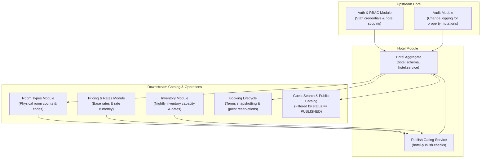
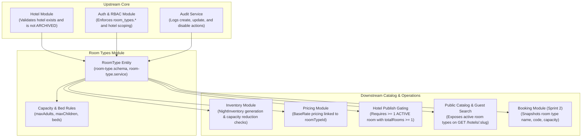
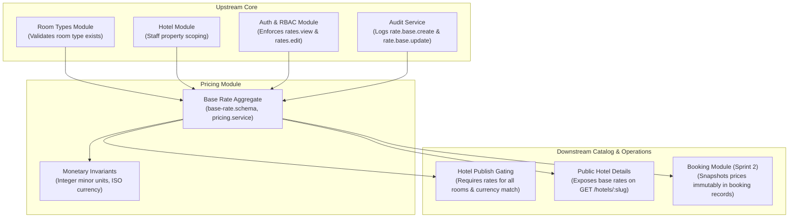

# Analysis Reports

- **Purpose** — This file collects the five analysis reports that used to live in `06-analysis/`. Each report keeps its original content, rewritten as bullets; every finding, score, priority, effort, file:line reference, option list, open question and status update is kept.
- **Order** — The three business-module analyses come first, then the form field-type analysis, then the hotel-module UX review, then the UI theme consistency audit (added later).
- **Link convention** — Links to code are relative to this folder (`../apps/...`). Links to other docs point to their new home; line numbers from the old files are kept in the link text (e.g. `hotel-management.md:13`).

## Index

- **[Business Module Analysis: Hotel Module](#hotel-business-analysis)** (October 13, 2026) — Traces hotel requirements, business rules, gaps, edge cases and improvement proposals for the property directory, publication gating, policies, lifecycle and tenant authorization.
- **[Business Module Analysis: Room Types Module](#room-types-business-analysis)** (October 13, 2026) — Traces room-type requirements, capacity and bed rules, gaps (including the historical capacity-reduction bug), edge cases and proposals.
- **[Business Module Analysis: Pricing Module](#pricing-business-analysis)** (October 13, 2026) — Traces base-rate requirements, minor-unit and currency invariants, publication rate gating, gaps, edge cases and the planned quote/tax engine.
- **[Form Field Type Analysis: Admin Web](#form-field-type-analysis)** (October 19, 2026) — Reviews every admin form field against backend DTO/schema validation and recommends input types, shared controls, backend changes and option lists; includes status updates for the fixes made.
- **[Hotel Module UX Review: Admin Web](#hotel-module-ux-review)** (October 20, 2026) — Scores the usability of the hotel setup and operations screens, walks the setup journey, lists findings with priority and effort, and records the top-4 fixes.
- **[UI Theme Consistency Audit](#ui-theme-consistency-audit)** (October 20, 2026) — Derives the "hotel theme" from the Hotel pages and shared UI, then compares every routed admin page against it: scores per area, 77 findings by impact with file:line, reference cleanup, cross-cutting issues and a fix plan.

---

<a id="hotel-business-analysis"></a>
## Business Module Analysis: Hotel Module

- **Platform:** Staywise Hotel Operations Platform (`apps/api` & `apps/admin-web`)
- **Module:** Hotel Management & Property Lifecycle
- **Author:** Pair Programming Agent
- **Date:** October 13, 2026
- **Scope:** Property directory, publication gating, policies, lifecycle state machine, content, and tenant authorization.

### Sources Reviewed

#### 1. Product & Architecture Documentation
- **[Documentation/01-product-requirements.md](PRODUCT.md#01-product-requirements)** — Product Requirements Document: Core Tenants & Hotel Entities.
- **[Documentation/07-database-design.md](DATA_MODEL.md#07-database-design)** — Data Model & Schema Specifications: Hotel Collection.
- **[Documentation/08-api-specification.md](API.md#08-api-specification)** — REST API Contract: Admin & Public Hotel Endpoints.
- **[Documentation/11-auth-rbac.md](guidelines/backend.md#11-auth-rbac) & [Documentation/modules/rbac-permissions.md](modules/rbac.md#rbac-permissions)** — Staff RBAC & Property Scoping.
- **[Documentation/12-business-rules.md](PRODUCT.md#12-business-rules)** — Platform Business Rules & Lifecycle Invariants.
- **[Documentation/modules/hotel-management.md](modules/hotels.md#hotel-management)** — Hotel Module Specification: Statuses & Publication.
- **[Documentation/modules/cancellation-policies.md](modules/cancellation-policies.md#cancellation-policies)** — Cancellation Policy Specifications.
- **[Documentation/modules/media-management.md](modules/media.md#media-management)** — Media Assets & Gallery Specifications.
- **[Documentation/modules/room-type-management.md](modules/room-types.md#room-type-management)** — Room Type Relationship Specifications.
- **[Documentation/24-sprint-2-availability-and-booking-plan.md](HISTORY.md#24-sprint-2-availability-and-booking-plan)** — Sprint 2 Architecture Plan.

#### 2. Backend Code (`apps/api`)
- **[hotel.schema.ts](../apps/api/src/modules/hotels/schemas/hotel.schema.ts)** — Hotel Mongoose Schema, Indexes, & Subdocuments.
- **[hotel.dto.ts](../apps/api/src/modules/hotels/dto/hotel.dto.ts)** — Validation DTOs, Query Filters, & Policy Payloads.
- **[hotels.controller.ts](../apps/api/src/modules/hotels/hotels.controller.ts)** — REST Endpoints; admin and public controllers live in the same file.
- **[hotel.service.ts](../apps/api/src/modules/hotels/hotel.service.ts)** — Core Business Logic, Optimistic Locking, Scoping.
- **[hotel.policies.ts](../apps/api/src/modules/hotels/hotel.policies.ts)** — Validation Policies, Coordinates, Timezone & Currency Invariants.
- **[hotel-status.rules.ts](../apps/api/src/modules/hotels/hotel-status.rules.ts)** — Lifecycle State Machine & Transition Rules.
- **[hotel-publish.checks.ts](../apps/api/src/modules/hotels/hotel-publish.checks.ts)** — 7 Publication Gating Invariants.
- **Calling / Called Modules** — `rooms/schemas/room.schema.ts` (file not present in the codebase), [pricing.service.ts](../apps/api/src/modules/pricing/pricing.service.ts), [inventory.service.ts](../apps/api/src/modules/inventory/inventory.service.ts), `bookings/schemas/booking.schema.ts` (file not present in the codebase), [audit.service.ts](../apps/api/src/modules/audit/audit.service.ts), [auth.service.ts](../apps/api/src/modules/auth/auth.service.ts).

#### 3. Frontend Code (`apps/admin-web`)
- **[HotelsPage.tsx](../apps/admin-web/src/pages/hotels/HotelsPage.tsx)** — Property Directory Table, Search/Filter URL Sync, Pagination.
- **[HotelBulkActionsBar.tsx](../apps/admin-web/src/pages/hotels/components/HotelBulkActionsBar.tsx)** — Permission-Gated Bulk Status Transitions.
- **[HotelCreateModal.tsx](../apps/admin-web/src/features/hotels/HotelCreateModal.tsx)** — Property Quick-Create Dialog with Server Field Error Mapping.
- **[HotelWorkspace.tsx](../apps/admin-web/src/features/hotels/HotelWorkspace.tsx)** — Single Hotel Editor, Publication Gating Banner, Lifecycle Actions.
- **[hotels.api.ts](../apps/admin-web/src/features/hotels/hotels.api.ts)** — Centralized API Client Methods for Hotel Operations.

### Part 1: Module Scope

- **Role of the module** — The **Hotel** module represents the primary tenant and operational root of the Staywise platform.
  - It manages public property metadata: display name, unique slug, geographic address, coordinates, and marketing descriptions.
  - It manages operational configurations: IANA timezone, contact channels, and cancellation policies.
  - It manages publication lifecycle states: `DRAFT`, `PUBLISHED`, `SUSPENDED`, `ARCHIVED`.
  - It manages staff authorization boundaries.
  - It acts as the anchor aggregate for room configurations, inventory management, nightly pricing, and guest reservation snapshots.

#### Entities, Fields, and States Owned

- **Collection owned** — The module owns the `Hotel` collection in MongoDB ([hotel.schema.ts:120-164](../apps/api/src/modules/hotels/schemas/hotel.schema.ts#L120-L164)).
- **Root Schema:** `Hotel` ([hotel.schema.ts:120](../apps/api/src/modules/hotels/schemas/hotel.schema.ts#L120))
  - **`_id`** — `Types.ObjectId`; primary internal document identifier.
  - **`name`** — `string` (max 140 chars); legal/display title of the hotel.
  - **`slug`** — `string` (max 160 chars, unique); URL-safe slug for public catalog routes.
  - **`address`** — `HotelAddress` ([hotel.schema.ts:14-32](../apps/api/src/modules/hotels/schemas/hotel.schema.ts#L14-L32)); `line1`, optional `line2`, `city`, optional `region`, `postalCode`, `countryCode` (2-letter ISO).
  - **`timezone`** — `string` (max 100 chars); valid IANA timezone identifier (e.g., `Asia/Kolkata`).
  - **`contact`** — `HotelContact` ([hotel.schema.ts:37-43](../apps/api/src/modules/hotels/schemas/hotel.schema.ts#L37-L43)); operational `email` and/or international `phone`.
  - **`coordinates`** — `HotelCoordinates` ([hotel.schema.ts:48-54](../apps/api/src/modules/hotels/schemas/hotel.schema.ts#L48-L54)); optional pair of `latitude` ([-90, 90]) and `longitude` ([-180, 180]).
  - **`description`** — `string` (optional, max 5000 chars); public description of the property.
  - **`amenities`** — `string[]` (default `[]`); normalized list of hotel-level facility tags.
  - **`primaryImage`** — `string` (optional, max 1000 chars); direct CDN URL to the hero image.
  - **`media`** — `HotelMedia[]` ([hotel.schema.ts:103-115](../apps/api/src/modules/hotels/schemas/hotel.schema.ts#L103-L115)); photo gallery with `url`, `isPrimary`, `caption`, and integer `displayOrder`.
  - **`cancellationPolicy`** — `HotelCancellationPolicy` ([hotel.schema.ts:83-98](../apps/api/src/modules/hotels/schemas/hotel.schema.ts#L83-L98)); effective cutoff, fee schedules for `afterCutoff` and `noShow`, and policy version.
  - **`status`** — `HotelStatus` ([hotel.schema.ts:6-11](../apps/api/src/modules/hotels/schemas/hotel.schema.ts#L6-L11)); finite lifecycle states `DRAFT`, `PUBLISHED`, `SUSPENDED`, `ARCHIVED`.
  - **`version`** — `number` (default `0`); monotonically increasing counter for optimistic concurrency control.
  - **`createdAt`, `updatedAt`** — `Date`; audit timestamps.

#### Module Dependencies

- **Dependency diagram** — kept as the original Mermaid flowchart:



- **Inward Dependencies (What Hotel depends on):**
  - **`Auth & RBAC`** — Validates staff sessions, enforces permission keys (`hotels.view`, `hotels.create`, `hotels.edit`, `hotels.publish`, `hotels.archive`), and restricts managers to their assigned `hotelIds`.
  - **`Audit Service`** — Records structured audit logs for property creation, metadata edits, status transitions, and gallery updates.
  - **`Room Types Service`** — Used by `HotelPublishChecks` to verify that at least one `ACTIVE` room type with `totalRooms > 0` exists before publication.
  - **`Pricing Service`** — Used by `HotelPublishChecks` to ensure every active room type has an established `BaseRate` with identical currency matching policy fixed fees.
  - **`Inventory Service`** — Used by `HotelPublishChecks` to verify that future sellable nights (`available > 0`) exist relative to property local time.
- **Outward Dependencies (What depends on Hotel):**
  - **`Public Catalog & Search`** — Reads published hotel records by slug or location; completely ignores `DRAFT`, `SUSPENDED`, or `ARCHIVED` hotels.
  - **`Room Types`** — Every room type requires a valid parent `hotelId`.
  - **`Inventory Engine`** — Local stay dates (`YYYY-MM-DD`) are interpreted in the parent hotel's IANA `timezone`.
  - **`Booking & Hold Lifecycle`** — Copies the hotel's timezone, address, contact channel, and cancellation terms directly into immutable booking snapshots.
  - **`Admin Web Dashboard`** — Aggregates property status counts across draft, published, suspended, and archived records.

### Part 2: Requirement Traceability Matrix

- **Format** — Each bullet is one requirement: ID and statement, then Origin · Source · Backend status · Frontend status · Notes.
- **HOTEL-01** — Support 4 finite lifecycle states: `DRAFT`, `PUBLISHED`, `SUSPENDED`, `ARCHIVED`. Origin: DOC · Source: [hotel-management.md:5](modules/hotels.md#hotel-management) · Backend: **Implemented** · Frontend: **Implemented** · Notes: [hotel.schema.ts:6-11](../apps/api/src/modules/hotels/schemas/hotel.schema.ts#L6-L11); UI pills in [HotelWorkspace.tsx:135](../apps/admin-web/src/features/hotels/HotelWorkspace.tsx#L135).
- **HOTEL-02** — Unique slug for each hotel; normalized lowercase string. Origin: DOC · Source: [hotel-management.md:9](modules/hotels.md#hotel-management) · Backend: **Implemented** · Frontend: **Implemented** · Notes: Index in [hotel.schema.ts:167](../apps/api/src/modules/hotels/schemas/hotel.schema.ts#L167); normalized in [hotel.policies.ts:11-15](../apps/api/src/modules/hotels/hotel.policies.ts#L11-L15).
- **HOTEL-03** — Only published properties appear in guest search and public routes (`/hotels/:slug`). Origin: DOC · Source: [hotel-management.md:5, 26](modules/hotels.md#hotel-management) · Backend: **Implemented** · Frontend: **Implemented** · Notes: Backend check in [hotel.service.ts:271](../apps/api/src/modules/hotels/hotel.service.ts#L271).
- **HOTEL-04** — Timezone must be a valid IANA identifier. Origin: DOC · Source: [hotel-management.md:9](modules/hotels.md#hotel-management) · Backend: **Implemented** · Frontend: **Implemented** · Notes: Verified via `Intl.DateTimeFormat` in [hotel.policies.ts:99-105](../apps/api/src/modules/hotels/hotel.policies.ts#L99-L105).
- **HOTEL-05** — Timezone cannot be changed while future bookings exist without an explicit migration plan. Origin: DOC · Source: [hotel-management.md:13](modules/hotels.md#hotel-management) · Backend: **Missing** · Frontend: **Missing** · Notes: **Contradiction:** Code allows patching `timezone` on any hotel without verifying booking status.
- **HOTEL-06** — Optional coordinates must validate latitude ([-90, 90]) and longitude ([-180, 180]). Origin: DOC · Source: [hotel-management.md:9](modules/hotels.md#hotel-management) · Backend: **Implemented** · Frontend: **Partial** · Notes: Enforced in [hotel.dto.ts:64-65](../apps/api/src/modules/hotels/dto/hotel.dto.ts#L64-L65); omitted from quick create modal.
- **HOTEL-07** — Support star classification / hotel star rating. Origin: DOC · Source: [hotel-management.md:9](modules/hotels.md#hotel-management); [07-database-design.md:11](DATA_MODEL.md#07-database-design) · Backend: **Missing** · Frontend: **Missing** · Notes: Not present on `Hotel` schema, DTOs, or frontend UI.
- **HOTEL-08** — Support check-in and check-out local times. Origin: DOC · Source: [hotel-management.md:9](modules/hotels.md#hotel-management) · Backend: **Missing** · Frontend: **Missing** · Notes: Not in schema; booking calculations assume standard noon/3PM defaults.
- **HOTEL-09** — Support market-appropriate tax registration (e.g., GSTIN / VAT ID) and tax configuration. Origin: DOC · Source: [hotel-management.md:9, 14](modules/hotels.md#hotel-management) · Backend: **Missing** · Frontend: **Missing** · Notes: Not modeled in schema or property settings.
- **HOTEL-10** — Property publication gated on explicit cancellation and no-show policy. Origin: DOC · Source: [hotel-management.md:18](modules/hotels.md#hotel-management) · Backend: **Implemented** · Frontend: **Implemented** · Notes: [hotel-publish.checks.ts:32-55](../apps/api/src/modules/hotels/hotel-publish.checks.ts#L32-L55); error banner in [HotelWorkspace.tsx:185](../apps/admin-web/src/features/hotels/HotelWorkspace.tsx#L185).
- **HOTEL-11** — Cancellation policy start date (`effectiveFrom`) must not be in the future at publication time. Origin: CODE · Source: [hotel-publish.checks.ts:48-54](../apps/api/src/modules/hotels/hotel-publish.checks.ts#L48-L54) · Backend: **Implemented** · Frontend: **Implemented** · Notes: Checks local date against `hotel.timezone`; returns `HOTEL_POLICY_NOT_YET_EFFECTIVE`.
- **HOTEL-12** — Publication gated on at least 1 ACTIVE room type with `totalRooms >= 1`. Origin: DOC · Source: [hotel-management.md:18](modules/hotels.md#hotel-management) · Backend: **Implemented** · Frontend: **Implemented** · Notes: [hotel-publish.checks.ts:58-74](../apps/api/src/modules/hotels/hotel-publish.checks.ts#L58-L74).
- **HOTEL-13** — Publication gated on established base rates with identical currency for all active room types. Origin: DOC · Source: [hotel-management.md:18](modules/hotels.md#hotel-management) · Backend: **Implemented** · Frontend: **Implemented** · Notes: [hotel-publish.checks.ts:79-97](../apps/api/src/modules/hotels/hotel-publish.checks.ts#L79-L97).
- **HOTEL-14** — Fixed cancellation policy fees must match the property's base-rate currency. Origin: DOC · Source: [hotel-management.md:18](modules/hotels.md#hotel-management) · Backend: **Implemented** · Frontend: **Implemented** · Notes: [hotel.policies.ts:87-93](../apps/api/src/modules/hotels/hotel.policies.ts#L87-L93); returns `HOTEL_POLICY_CURRENCY_MISMATCH`.
- **HOTEL-15** — Publication gated on future inventory with available rooms (`available > 0`) per active room type. Origin: DOC · Source: [hotel-management.md:18](modules/hotels.md#hotel-management) · Backend: **Implemented** · Frontend: **Implemented** · Notes: Evaluated in [hotel-publish.checks.ts:110-126](../apps/api/src/modules/hotels/hotel-publish.checks.ts#L110-L126).
- **HOTEL-16** — Optimistic concurrency control (`version` counter) on all property updates. Origin: DOC · Source: [hotel-management.md:22](modules/hotels.md#hotel-management); [08-api-specification.md:58](API.md#08-api-specification) · Backend: **Implemented** · Frontend: **Implemented** · Notes: Returns `409 VERSION_CONFLICT` on stale payload ([hotel.service.ts:348](../apps/api/src/modules/hotels/hotel.service.ts#L348)).
- **HOTEL-17** — Hotel scoping for managers (non-super admins cannot view/mutate outside assigned IDs). Origin: DOC · Source: [hotel-management.md:17](modules/hotels.md#hotel-management) · Backend: **Implemented** · Frontend: **Implemented** · Notes: Enforced in [hotel.policies.ts:128-132](../apps/api/src/modules/hotels/hotel.policies.ts#L128-L132) and [hotel.service.ts:85, 102](../apps/api/src/modules/hotels/hotel.service.ts#L85).
- **HOTEL-18** — Suspension halts new holds immediately while preserving existing confirmed bookings. Origin: DOC · Source: [hotel-management.md:5, 28](modules/hotels.md#hotel-management) · Backend: **Implemented** · Frontend: **Implemented** · Notes: Public route hides suspended hotel; admin bookings remain accessible.
- **HOTEL-19** — Archiving a property is permanent and does not delete rooms or bookings. Origin: DOC · Source: [hotel-management.md:15](modules/hotels.md#hotel-management) · Backend: **Implemented** · Frontend: **Implemented** · Notes: Terminal state in [hotel-status.rules.ts:7](../apps/api/src/modules/hotels/hotel-status.rules.ts#L7); confirmation dialog requires typing "ARCHIVE".
- **HOTEL-20** — Bulk status updates (`PATCH /admin/hotels/bulk-status`) with individual failure reporting. Origin: DOC · Source: [08-api-specification.md:34](API.md#08-api-specification) · Backend: **Implemented** · Frontend: **Implemented** · Notes: Returns `updated[]` and itemized `skipped[]` ([hotel.service.ts:213-218](../apps/api/src/modules/hotels/hotel.service.ts#L213-L218)).
- **HOTEL-21** — Bulk updates must block `DRAFT -> PUBLISHED` (must use workspace publish check). Origin: CODE · Source: [hotel-status.rules.ts:4](../apps/api/src/modules/hotels/hotel-status.rules.ts#L4) · Backend: **Implemented** · Frontend: **Implemented** · Notes: Blocked with `INVALID_TRANSITION`; bulk bar disables button if draft is selected.
- **HOTEL-22** — Audit logging on property creation, updates, media changes, and status transitions. Origin: DOC · Source: [hotel-management.md:14](modules/hotels.md#hotel-management) · Backend: **Implemented** · Frontend: **Partial** · Notes: Audit records written in backend; no audit history view in admin frontend.
- **HOTEL-23** — Media management: image URLs, primary image designation, display ordering, captions. Origin: DOC · Source: [media-management.md:9-14](modules/media.md#media-management) · Backend: **Partial** · Frontend: **Implemented** · Notes: Metadata stored; binary scanning and quarantine storage pipeline are absent.
- **HOTEL-24** — Bulk CSV/JSON property import (`POST /admin/hotels/import`). Origin: DOC · Source: [08-api-specification.md:32](API.md#08-api-specification) · Backend: **Missing** · Frontend: **Missing** · Notes: Planned Phase 4; button in UI triggers informational toast.
- **HOTEL-25** — CSV export of property directory and setup status (`GET /admin/hotels/export`). Origin: DOC · Source: [08-api-specification.md:33](API.md#08-api-specification) · Backend: **Missing** · Frontend: **Missing** · Notes: Planned Phase 4.
- **HOTEL-26** — Setup status filter (`setupStatus=COMPLETED|IN_PROGRESS`) in hotel directory. Origin: CODE · Source: [hotel.service.ts:80-84](../apps/api/src/modules/hotels/hotel.service.ts#L80-L84) · Backend: **Implemented** · Frontend: **Implemented** · Notes: Present in backend filter and frontend filter bar; undocumented in root PRD.
- **HOTEL-27** — Top-level property currency field (`currency`). Origin: INFERRED · Source: Standard hotel operations · Backend: **Missing** · Frontend: **Missing** · Notes: Suggested: Hotel currency is currently derived indirectly from room rates rather than declared on the hotel itself.
- **HOTEL-28** — Maximum advance booking window / booking horizon (e.g., 365 days). Origin: INFERRED · Source: [12-business-rules.md:6](PRODUCT.md#12-business-rules) · Backend: **Missing** · Frontend: **Missing** · Notes: Mentioned in business rules ("define maximum stay and booking horizon"), but unmodeled.

### Part 3: Business Rules Inventory

- **Format** — Each bullet is one rule: Where enforced · Implementation source · Gaps & weaknesses.
- **Property Name & Slug Validation** — Where: Backend DTO + Policy · Source: [hotel.dto.ts:56-57](../apps/api/src/modules/hotels/dto/hotel.dto.ts#L56-L57), [hotel.policies.ts:11-15](../apps/api/src/modules/hotels/hotel.policies.ts#L11-L15) · Gaps: Slug uniqueness enforced by DB unique index (`hotel_slug_unique`). Slug normalization strips non-alphanumeric characters.
- **Contact Requirement** — Where: Backend Service + DB Schema · Source: [hotel.service.ts:228-230](../apps/api/src/modules/hotels/hotel.service.ts#L228-L230) · Gaps: Requires at least email or phone. However, [hotel.schema.ts:135](../apps/api/src/modules/hotels/schemas/hotel.schema.ts#L135) marks `contact` object as required, but individual fields are optional in schema.
- **Coordinate Coupling** — Where: Backend Service · Source: [hotel.service.ts:225-227](../apps/api/src/modules/hotels/hotel.service.ts#L225-L227) · Gaps: Validates that latitude and longitude must either both be provided or both be omitted.
- **IANA Timezone Validity** — Where: Backend Policy · Source: [hotel.policies.ts:99-105](../apps/api/src/modules/hotels/hotel.policies.ts#L99-L105) · Gaps: Validated using Node `Intl.DateTimeFormat`. Rejects non-IANA strings.
- **Timezone Mutation Restriction** — Where: **Nowhere** · Source: None · Gaps: **Critical Gap:** Doc states timezone cannot be changed if future bookings exist. Backend allows unrestricted PATCH of `timezone`.
- **Lifecycle State Machine** — Where: Backend Service + Rules · Source: [hotel-status.rules.ts:3-8](../apps/api/src/modules/hotels/hotel-status.rules.ts#L3-L8), [hotel.service.ts:389-391](../apps/api/src/modules/hotels/hotel.service.ts#L389-L391) · Gaps: `ARCHIVED` is terminal. `DRAFT -> PUBLISHED` requires publication check. `PUBLISHED <-> SUSPENDED` is permitted.
- **Publication Prerequisites (7 Gating Checks)** — Where: Backend Service · Source: [hotel-publish.checks.ts:27-130](../apps/api/src/modules/hotels/hotel-publish.checks.ts#L27-L130) · Gaps: Gating runs inside MongoDB transaction; verifies policy validity, effective date, active room types, sellable inventory, rates, currency match, and future inventory.
- **Cancellation Fee Basis Rules** — Where: Backend Policy + DTO · Source: [hotel.policies.ts:45-70](../apps/api/src/modules/hotels/hotel.policies.ts#L45-L70), [hotel.dto.ts:24-32](../apps/api/src/modules/hotels/dto/hotel.dto.ts#L24-L32) · Gaps: `FIXED_MINOR_UNITS` requires integer amount and ISO currency. `PERCENTAGE_BPS` requires basis points in range `[0, 10000]`. Other bases forbid amount/currency/bps.
- **Currency Uniformity Invariant** — Where: Backend Publish Check · Source: [hotel-publish.checks.ts:92-108](../apps/api/src/modules/hotels/hotel-publish.checks.ts#L92-L108) · Gaps: All room types must share the exact same currency code, and fixed policy cancellation fees must match it.
- **Optimistic Concurrency Control** — Where: Backend Service + Mongoose query · Source: [hotel.service.ts:134, 344, 373, 395](../apps/api/src/modules/hotels/hotel.service.ts#L134) · Gaps: Queries match `{ _id, version }` and increment `{ $inc: { version: 1 } }`. Throws `409 VERSION_CONFLICT` on mismatch.
- **Staff Property Scoping** — Where: Backend Guard + Policy · Source: [hotel.policies.ts:128-132](../apps/api/src/modules/hotels/hotel.policies.ts#L128-L132) · Gaps: Non-`SUPER_ADMIN` actors are restricted to `actor.hotelIds`. Enforced on GET, PATCH, and status mutations.
- **Bounded Pagination & Search** — Where: Backend Service + Query DTO · Source: [hotel.service.ts:87](../apps/api/src/modules/hotels/hotel.service.ts#L87), [hotel.dto.ts:101-106](../apps/api/src/modules/hotels/dto/hotel.dto.ts#L101-L106) · Gaps: Limits bounded to `[1, 100]`, offset `>= 0`. Default limit 20. Case-insensitive regex on city; full text search on name/slug/city.
- **Media Display Order Invariant** — Where: Backend Service · Source: [hotel.service.ts:123-131](../apps/api/src/modules/hotels/hotel.service.ts#L123-L131) · Gaps: Ensures `primaryImage` string on hotel root is synced with the item marked `isPrimary` or defaults to item 0.

### Part 4: Missing Requirements

#### a. Documented But Not Built (DOC → Missing / Partial)

1. **Timezone Lock When Future Bookings Exist ([hotel-management.md:13](modules/hotels.md#hotel-management))**
   - **Documentation:** "Hotel timezone is set before publication and cannot be changed while future bookings exist without an explicit migration plan."
   - **Actual Code:** `update()` in [hotel.service.ts:316-324](../apps/api/src/modules/hotels/hotel.service.ts#L316-L324) accepts a new `timezone` string and updates it directly. It never checks the `bookings` collection or checks whether the hotel is already published.
   - **Impact:** Changing the timezone of an active hotel shifts nightly date boundaries (`YYYY-MM-DD`), potentially misaligning inventory calendars and cutoff deadlines for existing confirmed guests.
2. **Check-in and Check-out Times ([hotel-management.md:9](modules/hotels.md#hotel-management))**
   - **Documentation:** "check-in/out local times" are listed as standard property fields.
   - **Actual Code:** Omitted from `Hotel` schema and DTOs.
   - **Impact:** The cancellation policy cutoff calculation relies on "hours before check-in", but because check-in time is not stored on the hotel, calculations must assume an arbitrary default (e.g., 14:00 or 15:00) rather than property-specific check-in terms.
3. **Star Classification / Tier ([hotel-management.md:9](modules/hotels.md#hotel-management); [07-database-design.md:11](DATA_MODEL.md#07-database-design))**
   - **Documentation:** Specifies star category / rating on Hotel entity.
   - **Actual Code:** Completely missing in schema, DTOs, and admin forms.
4. **Tax Registration / Configuration ([hotel-management.md:9, 14](modules/hotels.md#hotel-management))**
   - **Documentation:** "tax registration/configuration appropriate to market", with changes audited.
   - **Actual Code:** No field for legal business entity, tax identifier (GSTIN, VAT, EIN), or tax regime.
5. **Bulk Property Import & Export ([08-api-specification.md:32-33](API.md#08-api-specification))**
   - **Documentation:** `POST /admin/hotels/import` and `GET /admin/hotels/export`.
   - **Actual Code:** Neither endpoint exists in `AdminHotelsController`. The frontend "Import" button shows a placeholder toast ([HotelsPage.tsx:301](../apps/admin-web/src/pages/hotels/HotelsPage.tsx#L301)).
6. **Policy Version Repository / Approved Policy Selection ([cancellation-policies.md:5](modules/cancellation-policies.md#cancellation-policies))**
   - **Documentation:** "Property may select an approved policy... Keep policy configuration deterministic and versioned."
   - **Actual Code:** Policy is embedded in the hotel document; there is no standalone `policies` collection or reusable templates. Editing the policy directly mutates the embedded subdocument.

#### b. Built But Undocumented (CODE Only)

1. **Setup Status Filter (`setupStatus=COMPLETED|IN_PROGRESS`)**
   - **Code:** [hotel.service.ts:80-84](../apps/api/src/modules/hotels/hotel.service.ts#L80-L84) maps `COMPLETED` to `status === PUBLISHED` and `IN_PROGRESS` to `status !== PUBLISHED`.
   - **Assessment:** Useful heuristic in the admin UI, but should be documented in [08-api-specification.md](API.md#08-api-specification) as an accepted query parameter on `GET /admin/hotels`.
2. **Text Index Weights on Hotel Search**
   - **Code:** [hotel.schema.ts:169-172](../apps/api/src/modules/hotels/schemas/hotel.schema.ts#L169-L172) creates a text index with specific weights (`name: 10, slug: 5, address.city: 3`).
   - **Assessment:** Good practice; should be formally noted in the database index inventory.
3. **Dedicated Single-Hotel Suspend and Archive Endpoints**
   - **Code:** `POST /admin/hotels/:id/suspend` ([hotels.controller.ts:73](../apps/api/src/modules/hotels/hotels.controller.ts#L73)) and `POST /admin/hotels/:id/archive` ([hotels.controller.ts:79](../apps/api/src/modules/hotels/hotels.controller.ts#L79)).
   - **Assessment:** Correct REST endpoints matching the lifecycle rules; documented in modules spec but omitted from some table summaries in `08-api-specification.md`.

#### c. Expected for a Hotel Business But Absent (INFERRED)

1. **Explicit Property Base Currency (`currency`)**
   - **Business Situation:** Hotels operate in a primary accounting currency (e.g., INR, AED, USD) in which local bank deposits, merchant accounts, and night-audits operate.
   - **Current Gap:** The `Hotel` schema has no currency attribute. Currency is only established when a staff member creates a `BaseRate` on a room type. This creates a chicken-and-egg problem where the cancellation policy fixed fee currency must match the room rate currency, but neither is bound to a root property currency.
2. **Standard Check-In and Check-Out Deadlines**
   - **Business Situation:** Standard hotel check-in (e.g., 14:00 or 15:00) and check-out (e.g., 11:00 or 12:00) times are essential for guest communication, same-day turnover windows, and computing the exact minute when a 24-hour cancellation cutoff expires.
   - **Current Gap:** Cutoffs are computed relative to date midnight rather than actual property check-in hour.
3. **Child Age and Occupancy Policy Definition**
   - **Business Situation:** A hotel defines whether children stay free under age 6, or whether guests age 12+ are billed as adults.
   - **Current Gap:** Room types have `maxAdults` and `maxChildren`, but the age boundary defining an adult vs child is unmodeled at the hotel level.
4. **Booking Horizon / Advance Reservation Window**
   - **Business Situation:** Properties generally restrict bookings to a maximum horizon (e.g., 365 or 730 days ahead) to prevent guests from booking beyond planned rate schedules.
   - **Current Gap:** No validation prevents reservations 5 years into the future if inventory exists.

### Part 5: Edge Cases and Failure Scenarios

#### 1. Timezone and Date Boundary Failures

- **Midnight Rollover During Inventory Gating**
  - **Code Citation:** [hotel-publish.checks.ts:111-115](../apps/api/src/modules/hotels/hotel-publish.checks.ts#L111-L115) computes `localToday = dateInTimezone(new Date(), hotel.timezone)` and checks `stayDate >= localToday`.
  - **Scenario:** If a property is located in Tokyo (`UTC+9`) and the publishing staff member is located in London (`UTC+0`) at 20:00 UTC on Oct 13, local date in Tokyo is already Oct 14. If the staff configured inventory only for Oct 13, the check correctly evaluates in Tokyo time and flags Oct 13 as in the past.
  - **Edge Case:** If the hotel has an invalid timezone string in legacy data, `dateInTimezone` throws an unhandled error inside `new Intl.DateTimeFormat`, resulting in an unformatted HTTP 500 rather than a clean 422 validation error.
- **Daylight Saving Time (DST) Transitions**
  - **Scenario:** When a hotel in `America/New_York` enters or leaves DST, a 24-hour cancellation cutoff must not accidentally calculate as 23 or 25 physical hours if using wall-clock time.
  - **Current Code:** `dateInTimezone` uses `Intl.DateTimeFormat` with `en-CA` formatting, which accurately resolves calendar dates across DST switches.

#### 2. Concurrent Administrative Edits

- **Two Staff Members Modifying Property Content Simultaneously**
  - **Code Citation:** [hotel.service.ts:344-348](../apps/api/src/modules/hotels/hotel.service.ts#L344-L348)
  - **Behavior:** Staff A and Staff B load Hotel version 3. Staff A updates the address and increments version to 4. Staff B submits an update with version 3.
  - **Result:** The atomic query `{ _id, version: 3 }` fails to match. The server aborts the transaction and throws `ConflictException({ error: 'VERSION_CONFLICT', message: 'Hotel was changed by another request' })`.
  - **Frontend Handling:** [HotelWorkspace.tsx:61](../apps/admin-web/src/features/hotels/HotelWorkspace.tsx#L61) and [handleFormError.ts:19](../apps/admin-web/src/hooks/handleFormError.ts#L19) catch this error and display an inline warning advising the user that another session modified the record.

#### 3. Partial Failures in Multi-Hotel Bulk Operations

- **Scenario:** An admin selects 50 hotels and issues a bulk `SUSPEND`. 48 hotels succeed, 1 is already `ARCHIVED`, and 1 was modified concurrently (`VERSION_CONFLICT`).
  - **Code Citation:** [hotel.service.ts:161-219](../apps/api/src/modules/hotels/hotel.service.ts#L161-L219)
  - **Behavior:** The operation executes inside a MongoDB transaction (`TransactionService.executeInTransaction`). Rather than failing the entire batch, the loop appends failures to the `skipped[]` array ([hotel.service.ts:165](../apps/api/src/modules/hotels/hotel.service.ts#L165)) with specific reason codes (`INVALID_TRANSITION`, `VERSION_CONFLICT`, `FORBIDDEN`). The 48 valid hotels update and increment their versions atomically.
  - **Result:** Returns HTTP 200 with `{ modifiedCount: 48, status: 'SUSPENDED', updated: [...], skipped: [...] }`.

#### 4. Cascade and Dependency Integrity on Archival

- **Scenario:** An admin permanently archives a hotel that has 12 room types and 50 upcoming bookings.
  - **Code Citation:** [hotel.service.ts:383-403](../apps/api/src/modules/hotels/hotel.service.ts#L383-L403)
  - **Behavior:** Archiving only updates `hotel.status = 'ARCHIVED'`. It does NOT cascade-delete room types, nightly inventory documents, base rates, or bookings.
  - **Impact:** Historical bookings remain readable by staff; guest search immediately hides the hotel because public query checks `status: HotelStatus.PUBLISHED` ([hotel.service.ts:271](../apps/api/src/modules/hotels/hotel.service.ts#L271)). No orphan foreign key errors occur.

#### 5. Monetary Basis Points and Currency Mismatch

- **Scenario:** Hotel sets a fixed cancellation fee in `EUR` on `cancellationPolicy.afterCutoff`, while room rates are priced in `INR`.
  - **Code Citation:** [hotel-publish.checks.ts:98-107](../apps/api/src/modules/hotels/hotel-publish.checks.ts#L98-L107)
  - **Behavior:** When attempting to publish, `validatePolicyCurrency` throws a mismatch conflict. The publication gate halts and outputs `HOTEL_POLICY_CURRENCY_MISMATCH`.
  - **Result:** The property remains in `DRAFT` or `SUSPENDED` state until the currencies match.

### Part 6: Improvement Proposals

#### 1. Correctness Fixes

##### PROP-01: Freeze Timezone When Future Bookings Exist
- **Problem:** [hotel-management.md:13](modules/hotels.md#hotel-management) explicitly mandates that timezone cannot be changed if future bookings exist. Currently, PATCH `/admin/hotels/:id` allows altering `timezone` without checking bookings.
- **Business Value:** Prevents silent corruption of guest check-in schedules, reservation dates, and cancellation cutoff hours.
- **Proposed Rule:** If `updateHotelDto.timezone` differs from `hotel.timezone`, query `Booking` collection for bookings where `hotelId === id` and `status in ['CONFIRMED', 'PENDING_PAYMENT', 'CHECKED_IN']` and `checkOutDate >= localToday`. If count > 0, reject with `409 HOTEL_TIMEZONE_LOCKED`.
- **Data Model Change:** None.
- **API Change:** `PATCH /admin/hotels/:id` returns `409 Conflict` (`errorCode: 'HOTEL_TIMEZONE_LOCKED'`).
- **Admin UI Change:** In `HotelWorkspace.tsx`, display the timezone field as disabled/read-only with an informative tooltip if the property is published with active bookings.
- **Cross-Module Effect:** Directly safeguards the `Booking` and `Inventory` modules.
- **Priority:** **Must** | **Effort:** Small (S)

##### PROP-02: Enforce Contact Channel Consistency in Mongoose Schema
- **Problem:** [hotel.service.ts:228-230](../apps/api/src/modules/hotels/hotel.service.ts#L228-L230) validates that either email or phone is present during `create()`, but `update()` bypasses this check if `contact` is partially cleared, and the Mongoose schema marks both sub-properties as optional.
- **Business Value:** Guarantees that every active hotel always retains a direct communication channel for guests and operational alerts.
- **Proposed Rule:** Add a custom schema-level validator on `HotelContactSchema` asserting `this.email || this.phone`.
- **Data Model Change:** Update `HotelContactSchema` in `hotel.schema.ts`.
- **API Change:** Throws `422 UNPROCESSABLE_ENTITY` (`errorCode: 'VALIDATION_FAILED'`).
- **Admin UI Change:** None (UI already requires email).
- **Cross-Module Effect:** Protects guest notifications and reservation confirmation dispatchers.
- **Priority:** **Should** | **Effort:** Small (S)

#### 2. Missing Features

##### PROP-03: Add First-Class Property Currency and Check-in/Check-out Times
- **Problem:** Lack of root `currency`, `checkInTime`, and `checkOutTime` requires awkward downstream inference and prevents deterministic cutoff calculations.
- **Business Value:** Provides clarity on legal check-in hours, avoids rate currency confusion, and sets expectations for guests and night-audits.
- **Proposed Rule:**
  1. Add `currency` (`string`, ISO 4217, default from platform config e.g. `INR`) to `Hotel`. When creating room rates or fixed cancellation policies, auto-bind to this currency.
  2. Add `checkInTime` (e.g., `'14:00'`) and `checkOutTime` (e.g., `'11:00'`) with regex format `/^([01]\d|2[0-3]):([0-5]\d)$/`.
- **Data Model Change:**
  ```typescript
  @Prop({ required: true, uppercase: true, match: /^[A-Z]{3}$/, default: 'INR' })
  currency: string;

  @Prop({ required: true, default: '14:00', match: /^([01]\d|2[0-3]):([0-5]\d)$/ })
  checkInTime: string;

  @Prop({ required: true, default: '11:00', match: /^([01]\d|2[0-3]):([0-5]\d)$/ })
  checkOutTime: string;
  ```
- **API Change:** Expose `currency`, `checkInTime`, `checkOutTime` on `CreateHotelDto`, `UpdateHotelDto`, and public responses.
- **Admin UI Change:** Add check-in/out inputs to `HotelCreateModal.tsx` and property settings in `HotelWorkspace.tsx`.
- **Cross-Module Effect:** Unlocks deterministic cancellation cutoff calculations in `cancellation-policies.service.ts` and simplifies currency locks in `BaseRatesView.tsx`.
- **Priority:** **Must** | **Effort:** Medium (M)

##### PROP-04: Support Property Tax Configuration (GSTIN / Tax Registration)
- **Problem:** Doc specifies market-appropriate tax registration ([hotel-management.md:9](modules/hotels.md#hotel-management)), but no legal tax registration field exists.
- **Business Value:** Enables legally compliant B2B invoicing, GST invoices in India, and accurate tax reporting.
- **Proposed Rule:** Model `taxConfiguration`: `{ registrationNumber?: string, taxScheme?: string, invoiceLegalName?: string }`.
- **Data Model Change:** Add `taxConfiguration` subdocument to `Hotel` schema.
- **API Change:** Include `taxConfiguration` in DTOs and admin responses.
- **Admin UI Change:** Add a "Tax & Legal Registration" section to `HotelWorkspace.tsx`.
- **Cross-Module Effect:** Directly required for Phase 3 Billing and Invoicing.
- **Priority:** **Should** | **Effort:** Medium (M)

#### 3. Usability of Business Flow

##### PROP-05: Pre-Flight Publication Checklist API
- **Problem:** Currently, admins only discover why a property cannot be published by clicking "Publish" and catching a `409 HOTEL_NOT_READY` error.
- **Business Value:** Provides immediate visibility into what setup steps remain (e.g., "Missing inventory for Deluxe Room", "Base rate not set for Suite") before attempting to publish.
- **Proposed Rule:** Add `GET /admin/hotels/:id/publish-readiness` endpoint that runs `HotelPublishChecks.collect(hotel)` in a read-only query and returns `{ ready: boolean, problems: PublishProblem[] }`.
- **Data Model Change:** None.
- **API Change:** New endpoint `GET /admin/hotels/:id/publish-readiness`.
- **Admin UI Change:** In `HotelWorkspace.tsx`, display a dynamic "Setup Readiness" stepper that updates in real time as rooms, rates, and inventory are added.
- **Cross-Module Effect:** Improves cross-module onboarding UX across Room Types, Rates, and Availability.
- **Priority:** **Should** | **Effort:** Small (S)

### Part 7: Cross-Module Impacts

- **No Check-in Hour on Property** — Affects: `Cancellation & Booking` · Consequence: `freeCancellationHoursBeforeCheckIn` is forced to calculate cutoff against 00:00 midnight local time or an arbitrary hardcoded 14:00 default, leading to incorrect guest fee charges.
- **No Top-Level Hotel Currency** — Affects: `Pricing & Base Rates` · Consequence: Room types are created without an assigned currency. If two staff members price different room types in different currencies (e.g., INR vs USD), the conflict is only detected later during publication gating.
- **Timezone Not Locked Against Bookings** — Affects: `Inventory Engine` · Consequence: If a published hotel's timezone is shifted from `Asia/Kolkata` (UTC+5:30) to `Europe/London` (UTC+0), nightly calendar keys (`YYYY-MM-DD`) shift by one day for all existing bookings and holds.
- **Missing Star Rating & Description Taxonomy** — Affects: `Guest Search & Catalog` · Consequence: Search API cannot filter by star category (3-star, 5-star) or amenity taxonomies, limiting guest search experience to bare keyword matches.
- **No Soft Delete / Restore Mechanism** — Affects: `Audit & Operations` · Consequence: Once a hotel is moved to `ARCHIVED`, it can never be reopened or restored, even if archived by staff error. A restore workflow with supervisor approval is absent.

### Part 8: Open Questions for Product

#### Question 1: Should Property Currency be Immutable Post-Publication?
- **Context:** Once room rates, inventory holds, and bookings are processed in a given currency (e.g., `INR`), changing the hotel's currency causes financial discrepancies across historical reports and open bookings.
- **Options:**
  1. **Option A (Strict Immutability):** Currency is set at hotel creation and locked permanently once the hotel is published or has recorded any base rate.
  2. **Option B (Re-denomination Migration):** Allow currency changes only if zero future bookings and zero active rate plans exist, requiring archival of previous rates.
- **Trade-off:** Option A is clean, mathematically safe, and prevents multi-currency accounting bugs. Option B provides flexibility for properties changing operating models, but requires complex financial migration scripts.
- **Recommendation:** Option A. Properties changing operating currency should archive and re-create catalog items.

#### Question 2: How Should Cancellation Cutoff Hours Interpret Check-In Time?
- **Context:** A cancellation policy specifies "Free cancellation up to 48 hours before check-in".
- **Options:**
  1. **Option A:** Relative to standard property check-in hour (e.g., check-in at 14:00 on Oct 20 → cutoff is 14:00 on Oct 18).
  2. **Option B:** Relative to calendar midnight of check-in date (00:00 on Oct 20 → cutoff is 00:00 on Oct 18).
- **Trade-off:** Option A matches standard industry hospitality expectations (Marriott, Booking.com). Option B is simpler to compute but deprives guests of 14 hours of free cancellation window.
- **Recommendation:** Option A; model `checkInTime` on `Hotel` and calculate cutoff from `LocalDateTime(stayDate, hotel.checkInTime)`.

#### Question 3: Should Archived Hotels Support Reactivation by Super Admins?
- **Context:** Currently, `ARCHIVED` is a one-way terminal state in both backend code ([hotel-status.rules.ts:7](../apps/api/src/modules/hotels/hotel-status.rules.ts#L7)) and database state.
- **Options:**
  1. **Option A:** Maintain `ARCHIVED` as permanently terminal. Accidental archives require creating a new draft hotel.
  2. **Option B:** Provide a two-man rule / Super-Admin override endpoint (`POST /admin/hotels/:id/unarchive`) that returns the hotel to `DRAFT` status and logs a critical audit event.
- **Trade-off:** Option A ensures historical stability and prevents unexpected reactivation of obsolete properties. Option B provides an operational escape hatch for accidental clicks in production.
- **Recommendation:** Option B restricted strictly to `SUPER_ADMIN` with a mandatory reason note.

### Analysis Summary & Verification Status
- **Document Location:** `docs/analysis/hotel-business-analysis.md` (as recorded in the original; later held in `Documentation/06-analysis/`, now merged here).
- **Coverage:** Parts 1 through 8 complete. All findings cite code files (`apps/api/src/modules/hotels/*`, `apps/admin-web/src/*`) and product documentation (`Documentation/*`).

---

<a id="room-types-business-analysis"></a>
## Business Module Analysis: Room Types Module

- **Platform:** Staywise Hotel Operations Platform (`apps/api` & `apps/admin-web`)
- **Module:** Room Type Management & Inventory Capacity Definition
- **Author:** Pair Programming Agent
- **Date:** October 13, 2026
- **Scope:** Room categories, physical capacity and occupancy constraints, bed configurations, sellable inventory totals, lifecycle states, and admin catalog UI.

### Sources Reviewed

#### 1. Product & Architecture Documentation
- **[Documentation/01-product-requirements.md](PRODUCT.md#01-product-requirements)** — Core Catalog & Room Type Entities.
- **[Documentation/07-database-design.md](DATA_MODEL.md#07-database-design)** — Data Model: RoomType and NightInventory Invariants.
- **[Documentation/08-api-specification.md](API.md#08-api-specification)** — REST API Specifications: Room Types Endpoints.
- **[Documentation/11-auth-rbac.md](guidelines/backend.md#11-auth-rbac) & [Documentation/modules/rbac-permissions.md](modules/rbac.md#rbac-permissions)** — Staff Scoping & `room_types.*` Permissions.
- **[Documentation/12-business-rules.md](PRODUCT.md#12-business-rules)** — Platform Invariants & Capacity Rules.
- **[Documentation/modules/room-type-management.md](modules/room-types.md#room-type-management)** — Room Type Management Specification.
- **[Documentation/modules/hotel-management.md](modules/hotels.md#hotel-management)** — Publication Prerequisites on Active Room Types.
- **[Documentation/modules/media-management.md](modules/media.md#media-management)** — Media Assets for Room Types.
- **[Documentation/modules/pricing-tax.md](modules/pricing.md#pricing-tax)** — Base Rate Association to Room Types.
- **[Documentation/modules/availability-booking.md](modules/bookings.md#availability-booking)** — Nightly Inventory Generation from Room Types.
- **[Documentation/24-sprint-2-availability-and-booking-plan.md](HISTORY.md#24-sprint-2-availability-and-booking-plan)** — Sprint 2 Architecture Plan.

#### 2. Backend Code (`apps/api`)
- **[room-type.schema.ts](../apps/api/src/modules/hotels/schemas/room-type.schema.ts)** — Mongoose Schema, Compound Unique Index, Bed Configuration Subdocument.
- **[room-type.dto.ts](../apps/api/src/modules/hotels/dto/room-type.dto.ts)** — Validation DTOs for Room Type Creation and Updates.
- **[room-types.controller.ts](../apps/api/src/modules/hotels/room-types.controller.ts)** — Admin REST Controller: List, Create, Get, Patch, Disable.
- **[room-type.service.ts](../apps/api/src/modules/hotels/room-type.service.ts)** — Core Business Logic, Duplicate Normalization, Optimistic Locking, Scoping.
- **[hotel-publish.checks.ts](../apps/api/src/modules/hotels/hotel-publish.checks.ts)** — Publication Gating Rules on Room Types: Active Status & Positive Total.
- **Associated Dependencies** — [inventory.service.ts](../apps/api/src/modules/inventory/inventory.service.ts) (`adjustExistingNightsForTotal`), [pricing.service.ts](../apps/api/src/modules/pricing/pricing.service.ts) (`BaseRate`), [hotel.service.ts](../apps/api/src/modules/hotels/hotel.service.ts) (`getPublicBySlug`), [audit.service.ts](../apps/api/src/modules/audit/audit.service.ts).

#### 3. Frontend Code (`apps/admin-web`)
- **[RoomTypesPage.tsx](../apps/admin-web/src/pages/catalog/RoomTypesPage.tsx)** — Room Types Catalog Screen, Scoped Property Picker, KPI Cards.
- **[RoomTypesView.tsx](../apps/admin-web/src/pages/catalog/views/RoomTypesView.tsx)** — Data Table View for Room Types.
- **[RoomCreateModal.tsx](../apps/admin-web/src/features/rooms/RoomCreateModal.tsx)** — Room Type Creation Dialog with Server Error Mapping.
- **[rooms.api.ts](../apps/admin-web/src/features/rooms/rooms.api.ts)** — API Client Functions for Room Types.

### Part 1: Module Scope

- **Role of the module** — The **Room Types** module defines the fundamental sellable inventory category and guest accommodation capacity within a hotel.
  - Per the documentation ([room-type-management.md:5](modules/room-types.md#room-type-management)), it models room category identities, physical guest occupancy limits (adults and children), bed layouts, amenity tags, and the total physical count of sellable rooms.
  - It acts as the anchor entity for nightly inventory calendars, base rate pricing plans, and guest reservation snapshots.
  - It is deliberately decoupled from individual physical room/door assignments.

#### Entities, Fields, and States Owned

- **Collection owned** — The module owns the `RoomType` collection in MongoDB ([room-type.schema.ts:22-67](../apps/api/src/modules/hotels/schemas/room-type.schema.ts#L22-L67)).
- **Root Schema:** `RoomType` ([room-type.schema.ts:22](../apps/api/src/modules/hotels/schemas/room-type.schema.ts#L22))
  - **`_id`** — `Types.ObjectId`; primary internal document identifier.
  - **`hotelId`** — `Types.ObjectId` (ref `Hotel`, required, indexed); parent property identifier.
  - **`name`** — `string` (max 120 chars, trimmed); marketing title (e.g., "Courtyard King").
  - **`code`** — `string` (max 32 chars, uppercase, trimmed); property-scoped alphanumeric short code (e.g., "COURT-K").
  - **`normalizedCode`** — `string` (max 32 chars, lowercase, trimmed); normalized lowercase string enforcing uniqueness per hotel.
  - **`description`** — `string` (optional, max 3000 chars, trimmed); public marketing copy for the room category.
  - **`maxAdults`** — `number` (min 1, max 30); maximum allowed adult guests.
  - **`maxChildren`** — `number` (min 0, max 30, default 0); maximum allowed child guests.
  - **`beds`** — `BedConfiguration[]` ([room-type.schema.ts:11-20](../apps/api/src/modules/hotels/schemas/room-type.schema.ts#L11-L20)); array of bed arrangements (`type: string` [max 40 chars], `quantity: number` [min 1, max 20]).
  - **`amenities`** — `string[]` (default `[]`); array of room-specific amenities (e.g., "Ensuite Balcony", "Bathtub", "Mini-bar").
  - **`totalRooms`** — `number` (min 0, max 10000); total physical sellable rooms belonging to this category.
  - **`status`** — `RoomTypeStatus` ([room-type.schema.ts:6-9](../apps/api/src/modules/hotels/schemas/room-type.schema.ts#L6-L9)); state machine `ACTIVE`, `DISABLED`.
  - **`version`** — `number` (min 0, default 0); monotonically increasing counter for optimistic concurrency control.
  - **`inventoryRevision`** — `number` (min 0, default 0); revision tracker for inventory synchronization.
  - **`createdAt`, `updatedAt`** — `Date`; audit timestamps.

#### Module Dependencies

- **Dependency diagram** — kept as the original Mermaid flowchart:



- **Inward Dependencies (What Room Types depends on):**
  - **`Hotel Module`** — Creation asserts the hotel exists and is not `ARCHIVED` ([room-type.service.ts:33](../apps/api/src/modules/hotels/room-type.service.ts#L33)).
  - **`Auth & RBAC`** — Validates staff sessions, enforces permission keys (`room_types.view`, `room_types.create`, `room_types.edit`, `room_types.archive`), and restricts managers to their assigned `hotelIds`.
  - **`Audit Service`** — Emits structured audit logs (`room_type.create`, `room_type.update`, `room_type.disable`) with old and new state snapshots.
  - **`Transaction Service`** — Executes mutations inside multi-document MongoDB replica-set transactions.
  - **`Inventory Service`** — Invoked during `update()` when `totalRooms` is changed to ensure capacity invariants across all stay dates.
- **Outward Dependencies (What depends on Room Types):**
  - **`Inventory Module`** — `NightInventory` records require `roomTypeId` and initialize `total` from `roomType.totalRooms`.
  - **`Pricing Module`** — `BaseRate` documents are keyed uniquely by `roomTypeId`.
  - **`Hotel Publish Checks`** — Hotel publication is strictly blocked if a hotel has zero active room types or if any active room type has `totalRooms < 1`.
  - **`Public Search & Guest Catalog`** — `GET /hotels/:slug` returns only `ACTIVE` room types and strips operational metadata (`totalRooms`, `version`, `inventoryRevision`).
  - **`Booking & Holds Engine`** — Reservation holds reference `roomTypeId` and snapshot capacity terms.

### Part 2: Requirement Traceability Matrix

- **Format** — Each bullet is one requirement: ID and statement, then Origin · Source · Backend status · Frontend status · Notes.
- **RT-01** — Short alphanumeric room code, trimmed and normalized to uppercase. Origin: DOC · Source: [room-type-management.md:5](modules/room-types.md#room-type-management) · Backend: **Implemented** · Frontend: **Implemented** · Notes: Normalized in [room-type.service.ts:35](../apps/api/src/modules/hotels/room-type.service.ts#L35); font-mono input in [RoomCreateModal.tsx:55](../apps/admin-web/src/features/rooms/RoomCreateModal.tsx#L55).
- **RT-02** — Room code must be unique within the hotel (case-insensitive). Origin: DOC · Source: [room-type-management.md:5](modules/room-types.md#room-type-management) · Backend: **Implemented** · Frontend: **Partial** · Notes: Unique compound index on `{ hotelId: 1, normalizedCode: 1 }` ([room-type.schema.ts:70](../apps/api/src/modules/hotels/schemas/room-type.schema.ts#L70)); UI maps duplicate error.
- **RT-03** — Guest capacity constraints: `maxAdults` (min 1, max 30) and `maxChildren` (min 0, max 30). Origin: DOC · Source: [room-type-management.md:5, 9](modules/room-types.md#room-type-management) · Backend: **Implemented** · Frontend: **Implemented** · Notes: Validated in [room-type.dto.ts:23-24](../apps/api/src/modules/hotels/dto/room-type.dto.ts#L23-L24) and displayed in [RoomTypesView.tsx:35](../apps/admin-web/src/pages/catalog/views/RoomTypesView.tsx#L35).
- **RT-04** — Centralized child age bands and maximums. Origin: DOC · Source: [room-type-management.md:10](modules/room-types.md#room-type-management) · Backend: **Missing** · Frontend: **Missing** · Notes: Neither schema nor DTO defines age thresholds (e.g., infant <2, child 2-11).
- **RT-05** — Bed configuration modeling (bed type and positive integer count). Origin: DOC · Source: [room-type-management.md:5](modules/room-types.md#room-type-management) · Backend: **Implemented** · Frontend: **Missing** · Notes: Subdocument in [room-type.schema.ts:11-20](../apps/api/src/modules/hotels/schemas/room-type.schema.ts#L11-L20); completely absent from [RoomCreateModal.tsx](../apps/admin-web/src/features/rooms/RoomCreateModal.tsx) and [RoomTypesView.tsx](../apps/admin-web/src/pages/catalog/views/RoomTypesView.tsx).
- **RT-06** — Room-level amenities tags (deduplicated, trimmed). Origin: DOC · Source: [room-type-management.md:5](modules/room-types.md#room-type-management) · Backend: **Implemented** · Frontend: **Missing** · Notes: Stored in [room-type.schema.ts:51](../apps/api/src/modules/hotels/schemas/room-type.schema.ts#L51); omitted from frontend UI modal and table.
- **RT-07** — Room type media / image gallery. Origin: DOC · Source: [room-type-management.md:5](modules/room-types.md#room-type-management); [media-management.md:5](modules/media.md#media-management) · Backend: **Missing** · Frontend: **Missing** · Notes: Schema has no `media` or `photos` field; only Hotel has media.
- **RT-08** — Total sellable rooms validation (non-negative integer, min 0, max 10000). Origin: DOC · Source: [room-type-management.md:5, 22](modules/room-types.md#room-type-management) · Backend: **Implemented** · Frontend: **Implemented** · Notes: Enforced in [room-type.dto.ts:27](../apps/api/src/modules/hotels/dto/room-type.dto.ts#L27); input in [RoomCreateModal.tsx:81-91](../apps/admin-web/src/features/rooms/RoomCreateModal.tsx#L81-L91).
- **RT-09** — `totalRooms` cannot be reduced below `blocked + held + confirmed` inventory on any date. Origin: DOC · Source: [room-type-management.md:11, 23](modules/room-types.md#room-type-management) · Backend: **Implemented** · Frontend: **Missing** · Notes: Enforced in [inventory.service.ts:139-144](../apps/api/src/modules/inventory/inventory.service.ts#L139-L144); frontend has no room editing modal to change total.
- **RT-10** — Mandatory audit reason when changing the sellable room count. Origin: CODE · Source: [room-type.service.ts:71-73](../apps/api/src/modules/hotels/room-type.service.ts#L71-L73) · Backend: **Implemented** · Frontend: **Missing** · Notes: Rejects with 422 `A reason is required...`; no frontend edit form exists.
- **RT-11** — Room type lifecycle states: `ACTIVE` and `DISABLED`. Origin: DOC · Source: [room-type-management.md:5](modules/room-types.md#room-type-management) · Backend: **Implemented** · Frontend: **Partial** · Notes: Stored in [room-type.schema.ts:6-9](../apps/api/src/modules/hotels/schemas/room-type.schema.ts#L6-L9); status badge rendered, but disabled records cannot be filtered or managed.
- **RT-12** — Disabling a room type stops future holds but preserves existing bookings. Origin: DOC · Source: [room-type-management.md:12, 24](modules/room-types.md#room-type-management) · Backend: **Implemented** · Frontend: **Missing** · Notes: Backend endpoint `POST /admin/room-types/:id/disable` exists; frontend has no disable button or action menu.
- **RT-13** — Re-enabling a previously disabled room type (`DISABLED -> ACTIVE`). Origin: INFERRED · Source: Standard catalog operations · Backend: **Missing** · Frontend: **Missing** · Notes: No re-enable endpoint exists in API; state transition is one-way in code.
- **RT-14** — Optimistic concurrency control (`version` counter) on updates and state transitions. Origin: DOC · Source: [room-type-management.md:5](modules/room-types.md#room-type-management) · Backend: **Implemented** · Frontend: **Missing** · Notes: Enforced in [room-type.service.ts:69, 90, 105](../apps/api/src/modules/hotels/room-type.service.ts#L69); no frontend edit UI exists.
- **RT-15** — Staff property scoping: non-super admins restricted to assigned `hotelIds`. Origin: DOC · Source: [room-type-management.md:25](modules/room-types.md#room-type-management) · Backend: **Implemented** · Frontend: **Implemented** · Notes: Enforced in [room-type.service.ts:60, 68, 104](../apps/api/src/modules/hotels/room-type.service.ts#L60); scoped combobox in [RoomTypesPage.tsx:59-64](../apps/admin-web/src/pages/catalog/RoomTypesPage.tsx#L59-L64).
- **RT-16** — Forbid room type creation under `ARCHIVED` hotels. Origin: CODE · Source: [room-type.service.ts:33](../apps/api/src/modules/hotels/room-type.service.ts#L33) · Backend: **Implemented** · Frontend: **Implemented** · Notes: Throws `404 Hotel not found` if archived; archived properties hidden from picker.
- **RT-17** — Room type edit endpoint (`PATCH /admin/room-types/:id`). Origin: DOC · Source: [room-type-management.md:18](modules/room-types.md#room-type-management) · Backend: **Implemented** · Frontend: **Missing** · Notes: Backend endpoint verified; frontend has zero UI callers ([rooms.api.ts](../apps/admin-web/src/features/rooms/rooms.api.ts) does not even define an `updateRoomType` function).
- **RT-18** — Comprehensive audit logging for creation, updates, and disabling. Origin: DOC · Source: [room-type-management.md:25](modules/room-types.md#room-type-management) · Backend: **Implemented** · Frontend: **Missing** · Notes: Audit logs emitted with before/after state; no audit history view in admin web.
- **RT-19** — Public guest exposure: only active room types of published hotels on `GET /hotels/:slug`. Origin: DOC · Source: [room-type-management.md:14, 18](modules/room-types.md#room-type-management) · Backend: **Implemented** · Frontend: **Implemented** · Notes: Filtered in [hotel.service.ts:267-271](../apps/api/src/modules/hotels/hotel.service.ts#L267-L271); operational fields stripped.
- **RT-20** — Hotel publication prerequisite: at least 1 active room type with `totalRooms >= 1`. Origin: DOC · Source: [hotel-management.md:18](modules/hotels.md#hotel-management) · Backend: **Implemented** · Frontend: **Implemented** · Notes: Gated in [hotel-publish.checks.ts:58-74](../apps/api/src/modules/hotels/hotel-publish.checks.ts#L58-L74); error banner rendered on hotel workspace.
- **RT-21** — Physical room assignment decoupling (no room number or door assignment). Origin: DOC · Source: [room-type-management.md:5](modules/room-types.md#room-type-management) · Backend: **Implemented** · Frontend: **Implemented** · Notes: Strictly maintained as category inventory count across backend and frontend.
- **RT-22** — Historical booking snapshotting of room type name, code, and description. Origin: DOC · Source: [room-type-management.md:13](modules/room-types.md#room-type-management) · Backend: **Partial** · Frontend: **Missing** · Notes: Documented requirement; Bookings module is currently in Sprint 2 design phase.
- **RT-23** — Filter query parameter `includeDisabled=true` on room types list. Origin: CODE · Source: [room-types.controller.ts:21-22](../apps/api/src/modules/hotels/room-types.controller.ts#L21-L22) · Backend: **Implemented** · Frontend: **Missing** · Notes: Supported by API; frontend [RoomTypesPage.tsx:25](../apps/admin-web/src/pages/catalog/RoomTypesPage.tsx#L25) never passes this flag.
- **RT-24** — Rollaway bed / extra guest occupancy policy and surcharges. Origin: INFERRED · Source: Hospitality industry standard · Backend: **Missing** · Frontend: **Missing** · Notes: No modeling for extra guest capacity beyond static adult/child ceilings.
- **RT-25** — Physical room floor area / dimensions (square meters or square feet). Origin: INFERRED · Source: Hospitality industry standard · Backend: **Missing** · Frontend: **Missing** · Notes: Omitted from schema; important metric for guest purchasing decisions.
- **RT-26** — Room accessibility / ADA compliance indicators. Origin: INFERRED · Source: Hospitality industry standard · Backend: **Missing** · Frontend: **Missing** · Notes: No dedicated boolean or tag for wheelchair accessible / ADA compliant rooms.

### Part 3: Business Rules Inventory

- **Format** — Each bullet is one rule: Where enforced · Implementation source · Gaps & weaknesses.
- **Property Room Code Uniqueness** — Where: DB Unique Index + Backend Service · Source: [room-type.schema.ts:70](../apps/api/src/modules/hotels/schemas/room-type.schema.ts#L70), [room-type.service.ts:40-41, 153-162](../apps/api/src/modules/hotels/room-type.service.ts#L40) · Gaps: Enforced by MongoDB index `{ hotelId: 1, normalizedCode: 1 }`. Service normalizes code to uppercase for display and lowercase for index. Catches duplicate key error `11000` and maps to `409 DUPLICATE`.
- **Guest Occupancy Bounds** — Where: Backend DTO + Schema · Source: [room-type.dto.ts:23-24](../apps/api/src/modules/hotels/dto/room-type.dto.ts#L23-L24), [room-type.schema.ts:41-45](../apps/api/src/modules/hotels/schemas/room-type.schema.ts#L41-L45) · Gaps: `maxAdults` bounded to `[1, 30]`; `maxChildren` bounded to `[0, 30]`. Total guest occupancy formula (`maxAdults + maxChildren`) is not explicitly validated against bed capacity.
- **Bed Configuration Invariant** — Where: Backend Service + DTO · Source: [room-type.service.ts:141-145](../apps/api/src/modules/hotels/room-type.service.ts#L141-L145), [room-type.dto.ts:14-17](../apps/api/src/modules/hotels/dto/room-type.dto.ts#L14-L17) · Gaps: `validateBeds` requires non-empty `type` string and integer `quantity` in `[1, 20]`. **Gap:** Completely bypassed by frontend (modal sends no bed configuration).
- **Capacity Reduction Invariant** — Where: Backend Service + MongoDB Expression · Source: [inventory.service.ts:129-144](../apps/api/src/modules/inventory/inventory.service.ts#L129-L144) · Gaps: Enforces `$lte: [{ $add: ['$blocked', '$held', '$confirmed'] }, newTotal]`. If any date fails, aborts transaction and throws `409 INVENTORY_CAPACITY_CONFLICT`. **Critical Bug:** Checks all existing dates in DB, including past historical stays!
- **Sellable Room Count Audit Trail** — Where: Backend Service · Source: [room-type.service.ts:70-73](../apps/api/src/modules/hotels/room-type.service.ts#L70-L73) · Gaps: Modifying `totalRooms` requires a non-empty `reason` string (`[3, 500]` chars). Emits `inventory.total_change` audit entry with previous and new counts.
- **Optimistic Concurrency Control** — Where: Backend Service + DB Query · Source: [room-type.service.ts:69, 89-94, 105, 108-113](../apps/api/src/modules/hotels/room-type.service.ts#L69) · Gaps: Queries match `{ _id, version }` and atomically apply `{ $inc: { version: 1 } }`. Throws `409 VERSION_CONFLICT` if version changed concurrently.
- **Room Type State Machine** — Where: Backend Service · Source: [room-type.service.ts:100-116](../apps/api/src/modules/hotels/room-type.service.ts#L100-L116) · Gaps: `ACTIVE -> DISABLED` is supported. **Gap:** `DISABLED -> ACTIVE` is impossible in current API, making disablement an accidental terminal state.
- **Staff Property Scoping** — Where: Backend Guard + Policy · Source: [room-type.service.ts:60, 68, 104, 135-139](../apps/api/src/modules/hotels/room-type.service.ts#L60) · Gaps: Rejects non-`SUPER_ADMIN` staff whose `actor.hotelIds` does not contain the parent property ID with `403 FORBIDDEN`.
- **Archived Hotel Lockout** — Where: Backend Service · Source: [room-type.service.ts:33](../apps/api/src/modules/hotels/room-type.service.ts#L33) · Gaps: Forbids creating room types under properties with `status === ARCHIVED`.
- **Public Search Visibility** — Where: Backend Service · Source: [hotel.service.ts:267-271](../apps/api/src/modules/hotels/hotel.service.ts#L267-L271) · Gaps: Only rooms with `status === RoomTypeStatus.ACTIVE` under `status === HotelStatus.PUBLISHED` are returned to public endpoints.
- **Publication Gating Check** — Where: Backend Publish Service · Source: [hotel-publish.checks.ts:58-74](../apps/api/src/modules/hotels/hotel-publish.checks.ts#L58-L74) · Gaps: Hotel cannot be published unless it possesses at least 1 active room type with `totalRooms >= 1`.

### Part 4: Missing Requirements

#### a. Documented But Not Built (DOC → Missing / Partial)

1. **Room Type Photo and Media Management ([room-type-management.md:5](modules/room-types.md#room-type-management); [media-management.md:5](modules/media.md#media-management))**
   - **Documentation:** "Fields include hotelId, stable name/code, description, maxAdults/maxChildren... **media**, total sellable rooms..." and [media-management.md:5](modules/media.md#media-management) mandates managing "hotel, room type, and later review-photo media".
   - **Actual Code:** `RoomType` schema ([room-type.schema.ts:23-67](../apps/api/src/modules/hotels/schemas/room-type.schema.ts#L23-L67)) has no media, photo gallery, or primary image field. Only `Hotel` possesses media.
   - **Impact:** Public hotel pages cannot display photos of specific room categories; guests cannot visually differentiate a "Standard Queen" from a "Deluxe Suite".
2. **Centralized Child Age Bands Definition ([room-type-management.md:10](modules/room-types.md#room-type-management))**
   - **Documentation:** "If occupancy includes child ages, define age bands and maximums centrally; do not leave allocation ambiguous."
   - **Actual Code:** `maxChildren` is a simple integer ([room-type.dto.ts:24](../apps/api/src/modules/hotels/dto/room-type.dto.ts#L24)). There are no age boundary configurations (e.g., infant vs child vs teen).
   - **Impact:** Leaves guest booking quotes ambiguous regarding whether a 14-year-old child counts against `maxChildren` or requires adult pricing.
3. **Admin Web Management of Existing Room Types (Editing & Disabling)**
   - **Documentation:** [room-type-management.md:18](modules/room-types.md#room-type-management) lists admin endpoints `GET/PATCH /admin/room-types/:id` and `POST /admin/room-types/:id/disable`.
   - **Actual Code:** Backend implements both endpoints, but `apps/admin-web` provides **no edit modal**, **no change room count flow**, and **no disable button**. [rooms.api.ts](../apps/admin-web/src/features/rooms/rooms.api.ts) does not even contain wrapper functions for `PATCH` or `disable`.
   - **Impact:** Once a room type is created, staff cannot adjust its sellable room count, update its name/description, or disable it without issuing manual raw curl commands.
4. **Bed Configuration and Amenities UI Inputs**
   - **Documentation:** Bed configuration and amenities are core room type fields ([room-type-management.md:5](modules/room-types.md#room-type-management)).
   - **Actual Code:** Backend supports `beds` and `amenities`, but [RoomCreateModal.tsx:41-91](../apps/admin-web/src/features/rooms/RoomCreateModal.tsx#L41-L91) contains form inputs only for name, code, adults, children, and total rooms. Bed configurations and amenities are never gathered.
   - **Impact:** Every room type created through the admin UI is saved with empty arrays `beds: []` and `amenities: []`.

#### b. Built But Undocumented (CODE Only)

1. **Unused `inventoryRevision` Field on Schema**
   - **Code:** [room-type.schema.ts:63](../apps/api/src/modules/hotels/schemas/room-type.schema.ts#L63) declares `@Prop({ required: true, default: 0, min: 0 }) inventoryRevision: number;`.
   - **Assessment:** This field is never incremented, queried, or updated in any service (`room-type.service.ts` or `inventory.service.ts`). It should either be documented as part of an upcoming inventory sync protocol or removed.
2. **Automatic Lowercase `normalizedCode` Generation**
   - **Code:** [room-type.service.ts:41](../apps/api/src/modules/hotels/room-type.service.ts#L41) transparently generates `normalizedCode = code.toLowerCase()` and indexes it uniquely with `hotelId`.
   - **Assessment:** Excellent defensive pattern against case variations (e.g., preventing both `dlx` and `DLX` from existing in the same hotel); should be formally documented in database design constraints.
3. **Query Filter `includeDisabled` on List Endpoint**
   - **Code:** [room-types.controller.ts:21-22](../apps/api/src/modules/hotels/room-types.controller.ts#L21-L22) accepts `?includeDisabled=true` to toggle whether disabled room types are included.
   - **Assessment:** Necessary operational filter; should be documented in [08-api-specification.md:35](API.md#08-api-specification).

#### c. Expected for a Hotel Business But Absent (INFERRED)

1. **Re-Enabling / Restoring a Disabled Room Type**
   - **Business Situation:** A hotel manager temporarily disables a room category during low season or planned wing renovations. Once renovations finish, the hotel must reactivate the room category without re-creating all historical rates, inventory histories, and room codes from scratch.
   - **Current Gap:** The backend state machine only provides `disable()`. There is no `POST /admin/room-types/:id/enable` endpoint, making disablement effectively permanent.
2. **Rollaway Beds and Extra Guest Surcharges**
   - **Business Situation:** Standard hotel double rooms often permit a 3rd adult or 2nd child using a rollaway cot or sofa bed for an additional nightly fee.
   - **Current Gap:** Room types only allow binary capacity limits (`maxAdults: 2`, `maxChildren: 1`). There is no concept of base occupancy vs maximum occupancy with extra beds.
3. **Room Physical Dimensions (Square Footage / Square Meters)**
   - **Business Situation:** Guests comparing standard vs deluxe rooms rely heavily on room size (e.g., 28 m² vs 45 m²) to justify higher prices.
   - **Current Gap:** Room size is unmodeled in schema and UI.
4. **Accessibility (ADA) and Smoking Classification**
   - **Business Situation:** Hotels have strict legal obligations to mark wheelchair-accessible rooms and property health policies regarding smoking vs non-smoking rooms.
   - **Current Gap:** Not modeled as first-class structured attributes.

### Part 5: Edge Cases and Failure Scenarios

#### 1. Capacity Reduction Blocked by Historical Past Dates (Critical Flaw)

- **Code Citation:** [inventory.service.ts:127-144](../apps/api/src/modules/inventory/inventory.service.ts#L127-L144)
- **The Scenario:**
  1. A hotel has 10 Deluxe rooms. During New Year's Eve 2025, all 10 rooms were confirmed and stayed (`confirmed = 10`).
  2. In October 2026, the hotel owner repurposes 2 rooms into an executive lounge, reducing total sellable rooms to 8.
  3. The staff updates `totalRooms: 8` with a valid reason.
  4. `adjustExistingNightsForTotal` runs:
     ```typescript
     const query = { roomTypeId: roomType._id };
     const existingCount = await this.inventoryModel.countDocuments(query);
     const update = await this.inventoryModel.updateMany(
       {
         ...query,
         $expr: { $lte: [{ $add: ['$blocked', '$held', '$confirmed'] }, newTotal] },
       },
       { $set: { total: newTotal }, $inc: { version: 1 } },
     );
     if (update.matchedCount !== existingCount) {
       throw new ConflictException({ error: 'INVENTORY_CAPACITY_CONFLICT' });
     }
     ```
- **Failure Result:** The query evaluates **every inventory document ever created**, including the Dec 31, 2025 record where `confirmed = 10`. Because 10 > 8, the past night fails the `$lte` predicate. `update.matchedCount` does not match `existingCount`, and the API throws `INVENTORY_CAPACITY_CONFLICT`!
- **Consequence:** Once a hotel has operated with high occupancy in the past, **it can NEVER legally reduce its `totalRooms` count**, because historical stays permanently block the bulk update!
- **Required Fix:** The query in `inventory.service.ts:127` must filter for future stay dates only: `{ roomTypeId: roomType._id, stayDate: { $gte: localToday } }`.

#### 2. Disabling a Room Type with Active Base Rates and Calendar Inventory

- **Code Citation:** [room-type.service.ts:100-116](../apps/api/src/modules/hotels/room-type.service.ts#L100-L116)
- **The Scenario:** A room type is disabled (`status: DISABLED`). It has 365 days of initialized `NightInventory` records and an active `BaseRate`.
- **Behavior:**
  - Public search (`hotel.service.ts:268`) queries `status: RoomTypeStatus.ACTIVE`, so the room category disappears from guest view immediately.
  - However, existing `NightInventory` records remain with `total > 0` and unblocked. If an admin inspects the Inventory Calendar (`/admin/inventory`), the disabled room's dates are still loaded and editable.
  - If a hotel only has 1 room type and it is disabled, the hotel remains in `status: PUBLISHED`, but guests see an empty hotel with zero bookable rooms.

#### 3. Concurrent Edits by Multiple Staff Members

- **Code Citation:** [room-type.service.ts:89-94](../apps/api/src/modules/hotels/room-type.service.ts#L89-L94)
- **The Scenario:** Staff A and Staff B load Room Type `DLX` at version 2.
  - Staff A updates room capacity from 10 to 12. Transaction commits; document updates to version 3.
  - Staff B updates description with payload specifying `version: 2`.
- **Behavior:** The query `{ _id: roomTypeId, version: 2 }` finds zero matching documents. The transaction aborts and the server returns `409 Conflict` (`errorCode: 'VERSION_CONFLICT'`). Data integrity is preserved without silent overwrite.

#### 4. Room Code Collision Across Different Properties vs Same Property

- **Code Citation:** [room-type.schema.ts:70](../apps/api/src/modules/hotels/schemas/room-type.schema.ts#L70)
- **The Scenario:**
  - Property A creates room code `STD-K`.
  - Property B creates room code `STD-K`. Both succeed because the unique index is compound: `{ hotelId: 1, normalizedCode: 1 }`.
  - Property A attempts to create a second room type with code `std-k` or `STD-K`.
- **Behavior:** Duplicate key violation `E11000` is caught by `mapDuplicate()` in [room-type.service.ts:153-162](../apps/api/src/modules/hotels/room-type.service.ts#L153-L162), returning a clean `409 DUPLICATE` with field error `errors: [{ field: 'code', message: 'This code is already in use' }]`.

#### 5. Attempting to Add Room Types to Archived Properties

- **Code Citation:** [room-type.service.ts:33](../apps/api/src/modules/hotels/room-type.service.ts#L33)
- **Behavior:** If a staff member sends `POST /admin/hotels/:id/room-types` targeting a hotel whose status is `ARCHIVED`, the service throws `NotFoundException('Hotel not found')`. This enforces that archived properties are strictly immutable.

### Part 6: Improvement Proposals

#### 1. Correctness Fixes

##### PROP-01: Scope Room Count Reduction Check to Future Dates Only
- **Problem:** [inventory.service.ts:127-139](../apps/api/src/modules/inventory/inventory.service.ts#L127-L139) evaluates all historical stay records when reducing `totalRooms`. If any past date had occupancy exceeding the new room count, the update is blocked forever with `INVENTORY_CAPACITY_CONFLICT`.
- **Business Value:** Enables operational properties to reduce sellable room counts (e.g. for renovations or maintenance) without being permanently blocked by past high-occupancy dates.
- **Proposed Rule:** Calculate `localToday = dateInTimezone(new Date(), hotel.timezone)` and constrain the capacity predicate query to `stayDate >= localToday`. Past dates retain their historical capacity; only future dates update to `newTotal`.
- **Data Model Change:** None.
- **API Change:** None (internal service query fix).
- **Admin UI Change:** None.
- **Effect on Other Modules:** Directly fixes interaction between Room Types and Inventory.
- **Priority:** **Must** | **Effort:** Small (S)

##### PROP-02: Support Re-Enabling / Reactivating Disabled Room Types
- **Problem:** `RoomTypeStatus.DISABLED` is a one-way street in the current codebase. Staff cannot re-enable a room type once seasonal closures or renovations conclude.
- **Business Value:** Prevents redundant data re-entry and preserves historical room codes and rate links.
- **Proposed Rule:** Add `POST /admin/room-types/:id/enable` endpoint requiring version check, validating parent hotel is not archived, setting `status = ACTIVE`, and writing an audit record.
- **Data Model Change:** None.
- **API Change:** New endpoint `POST /admin/room-types/:id/enable`, returns updated `RoomType`.
- **Admin UI Change:** Add "Reactivate" option in Room Types table actions menu.
- **Effect on Other Modules:** Restores room type visibility in public search and availability checks.
- **Priority:** **Should** | **Effort:** Small (S)

#### 2. Missing Features

##### PROP-03: Implement Room Type Photo and Media Gallery
- **Problem:** `RoomType` lacks a `media` field, violating [room-type-management.md:5](modules/room-types.md#room-type-management) and [media-management.md:5](modules/media.md#media-management).
- **Business Value:** High-quality room photos are the single highest converting asset in hotel booking flows.
- **Proposed Rule:** Add `media: HotelMedia[]` and optional `primaryImage: string` to `RoomTypeSchema`. Expose `POST /admin/room-types/:id/media` to manage images, display orders, and captions.
- **Data Model Change:**
  ```typescript
  @Prop({ type: [HotelMediaSchema], default: [] })
  media: HotelMedia[];

  @Prop({ trim: true, maxlength: 1000 })
  primaryImage?: string;
  ```
- **API Change:** Add `POST /admin/room-types/:id/media` endpoint. Return `media` and `primaryImage` in `GET /hotels/:slug` public payload.
- **Admin UI Change:** Add a photo gallery management tab inside the Room Type Editor.
- **Effect on Other Modules:** Enhances public guest catalog and search results.
- **Priority:** **Must** | **Effort:** Medium (M)

##### PROP-04: Full Admin Web Room Type Management (Edit Modal & Disable Action)
- **Problem:** The admin web app currently only supports creating room types. It provides no interface to edit details, change sellable room counts (with the required reason), adjust capacity, or disable categories.
- **Business Value:** Provides complete administrative autonomy over property room inventory without engineering intervention.
- **Proposed Rule:** Implement `RoomEditModal` allowing edits to name, capacity, description, beds, amenities, and total rooms (with reason field). Add row action dropdown in `RoomTypesView.tsx` with "Edit" and "Disable" buttons.
- **Data Model Change:** None.
- **API Change:** Expose `updateRoomType` and `disableRoomType` helper methods in `rooms.api.ts`.
- **Admin UI Change:** Add actions column to `RoomTypesView.tsx`; implement `RoomEditModal.tsx` and confirmation dialog for disabling.
- **Effect on Other Modules:** Directly utilizes `PATCH /admin/room-types/:id` and `POST /admin/room-types/:id/disable`.
- **Priority:** **Must** | **Effort:** Medium (M)

#### 3. Usability of Business Flow

##### PROP-05: Expose Bed Layout and Amenities Configuration in Admin UI
- **Problem:** Backend schema supports rich bed configurations (`beds: BedConfiguration[]`) and amenity tags, but frontend modal ignores them, leaving all created rooms with empty beds and amenities.
- **Business Value:** Allows front desk and revenue managers to specify exact bed layouts (e.g. "1 King Bed", "2 Twin Beds") and highlights (e.g. "Ocean View", "Balcony") critical for guest selection.
- **Proposed Rule:** Add a dynamic bed builder (Type dropdown + Quantity stepper) and multi-select amenities chip selector to `RoomCreateModal` and `RoomEditModal`.
- **Data Model Change:** None.
- **API Change:** None (backend already accepts these fields in `CreateRoomTypeDto`).
- **Admin UI Change:** Update `RoomCreateModal.tsx` form controls.
- **Effect on Other Modules:** Populates bed details in guest search responses.
- **Priority:** **Should** | **Effort:** Small (S)

### Part 7: Cross-Module Impacts

- **Historical Capacity Reduction Bug** — Affects: `Inventory Engine` · Consequence: Attempting to reduce sellable room count fails on any property that operated at high capacity in the past, making capacity reductions impossible.
- **No Room Type Media in Schema** — Affects: `Public Search & Guest Catalog` · Consequence: Public hotel detail page (`/hotels/:slug`) cannot render room photos; guest booking portal displays generic placeholder tiles.
- **One-Way Disable State Machine** — Affects: `Pricing & Availability` · Consequence: Disabling a room type leaves its `BaseRate` and `NightInventory` records in limbo; if seasonal closure ends, staff must re-create the room type under a new code, orphaning historical data.
- **Missing Child Age Thresholds** — Affects: `Booking & Pricing Calculation` · Consequence: When quoting multi-guest reservations, system cannot distinguish infant (free) from child (surcharged), risking billing discrepancies.
- **Omission of UI Edit Controls** — Affects: `Revenue & Operations Staff` · Consequence: Staff cannot modify room capacity or names; simple typo corrections or room inventory changes require direct DB intervention.

### Part 8: Open Questions for Product

#### Question 1: How Should Reducing `totalRooms` Affect Future Blocked Inventory?
- **Context:** A hotel has 10 rooms. For next Friday, staff blocked 3 rooms for maintenance, and 5 rooms are confirmed booked (`blocked = 3, confirmed = 5, total = 10, available = 2`). If the hotel reduces `totalRooms` to 8:
  - 3 + 5 = 8 ≤ 8, so capacity is mathematically valid, but `available` drops to 0.
  - If `totalRooms` is reduced to 7, 3 + 5 = 8 > 7, violating capacity.
- **Options:**
  1. **Option A (Strict Reject):** Reject the reduction if blocked + confirmed > newTotal. Staff must manually unblock maintenance rooms before the system allows reducing total capacity.
  2. **Option B (Auto-Truncate Blocked Rooms):** Automatically reduce `blocked` rooms to absorb the reduction, preserving confirmed guest bookings while lowering maintenance blocks.
- **Trade-off:** Option A guarantees no accidental loss of recorded maintenance blocks. Option B provides smoother capacity adjustments but could overwrite intentional maintenance holds.
- **Recommendation:** Option A. Reject with a clear error indicating the specific date where maintenance blocks conflict with the new capacity ceiling.

#### Question 2: Should Room Code Be Permanently Immutable Once Bookings Exist?
- **Context:** Currently, `PATCH /admin/room-types/:id` permits updating `code` if the new code does not collide with another room type in the same hotel.
- **Options:**
  1. **Option A (Immutable Post-Booking):** Once a room type has at least one confirmed booking, `code` is locked permanently to maintain historical audit continuity.
  2. **Option B (Mutable with Snapshotting):** Allow code changes at any time, relying on the booking engine to snapshot the room code at reservation creation time.
- **Trade-off:** Option A enforces strict catalog integrity. Option B allows hotels to rebrand room categories (e.g., "KNG" -> "PREM-K") without breaking historical records.
- **Recommendation:** Option B; ensure booking snapshots store immutable `roomCode` and `roomName` at booking time.

#### Question 3: How Should Child Age Bands Be Configured?
- **Context:** Some properties permit children up to age 12 free of charge; luxury resorts define infant (<2), child (2-11), and adult (12+).
- **Options:**
  1. **Option A (Platform Global Standard):** Standardize infant = 0-2, child = 3-11, adult = 12+ across the entire Staywise platform.
  2. **Option B (Property-Level Configuration):** Configure `childAgeCutoff` on the `Hotel` entity (e.g. `childMaxAge: 11`).
- **Trade-off:** Option A simplifies booking engine calculations and UI forms. Option B gives hoteliers flexibility to adhere to regional hospitality laws.
- **Recommendation:** Option B configured on `Hotel`, inherited by room types during rate quotes.

### Analysis Summary & Verification Status
- **Document Location:** `docs/analysis/room-types-business-analysis.md` (as recorded in the original; later held in `Documentation/06-analysis/`, now merged here).
- **Coverage:** Parts 1 through 8 complete. All findings cite code files (`apps/api/src/modules/hotels/*`, `apps/api/src/modules/inventory/*`, `apps/admin-web/src/*`) and product documentation (`Documentation/*`).

---

<a id="pricing-business-analysis"></a>
## Business Module Analysis: Pricing Module

- **Platform:** Staywise Hotel Operations Platform (`apps/api` & `apps/admin-web`)
- **Module:** Pricing, Base Rates & Monetary Calculations
- **Author:** Pair Programming Agent
- **Date:** October 13, 2026
- **Scope:** Room type base rates, integer minor unit monetary conventions, currency validation, publication rate gating, audit trails, optimistic locking, and planned quote/tax engine.

### Sources Reviewed

#### 1. Product & Architecture Documentation
- **[Documentation/modules/pricing-tax.md](modules/pricing.md#pricing-tax)** — Pricing and Tax Module Specification.
- **[Documentation/01-product-requirements.md](PRODUCT.md#01-product-requirements)** — Core Business Pricing Requirements.
- **[Documentation/07-database-design.md](DATA_MODEL.md#07-database-design)** — Data Model: BaseRate, RatePlan, Monetary Minor Units.
- **[Documentation/08-api-specification.md](API.md#08-api-specification)** — REST API Specifications: Base Rate Endpoints & ADR-007 Notes.
- **[Documentation/12-business-rules.md](PRODUCT.md#12-business-rules)** — Money, Currency, and Minor Unit Invariants.
- **[Documentation/20-decision-log.md](ARCHITECTURE.md#20-decision-log)** — ADR-007: Tax Engine Status & Review Requirements.
- **[Documentation/24-sprint-2-availability-and-booking-plan.md](HISTORY.md#24-sprint-2-availability-and-booking-plan)** — Sprint 2 Architecture Plan: Pricing Snapshots on Bookings.
- **[Documentation/modules/hotel-management.md](modules/hotels.md#hotel-management)** — Hotel Publication Prerequisites on Base Rates.
- **[Documentation/EXECUTION-ORDER.md](README.md#EXECUTION-ORDER)** — Tax Gating Order & Guest Quote Guardrails.

#### 2. Backend Code (`apps/api`)
- **[base-rate.schema.ts](../apps/api/src/modules/pricing/schemas/base-rate.schema.ts)** — Mongoose Schema, Unique Room Type Index, Concurrency Version.
- **[base-rate.dto.ts](../apps/api/src/modules/pricing/dto/base-rate.dto.ts)** — Validation DTO: Integer Minor Units, Currency, Reason.
- **[pricing.controller.ts](../apps/api/src/modules/pricing/pricing.controller.ts)** — Admin REST Controller: `GET/PUT /admin/room-types/:roomTypeId/base-rate`.
- **[pricing.service.ts](../apps/api/src/modules/pricing/pricing.service.ts)** — Core Business Logic, Optimistic Locking, Audit Trail, Scoping.
- **[hotel-publish.checks.ts](../apps/api/src/modules/hotels/hotel-publish.checks.ts)** — Publication Gating: Room Rate Coverage & Currency Uniformity Invariants.
- **[hotel.service.ts](../apps/api/src/modules/hotels/hotel.service.ts)** — `getPublicBySlug` Rate Exposure.
- **Associated Dependencies** — [room-type.schema.ts](../apps/api/src/modules/hotels/schemas/room-type.schema.ts), [audit.service.ts](../apps/api/src/modules/audit/audit.service.ts).

#### 3. Frontend Code (`apps/admin-web`)
- **[RatesPage.tsx](../apps/admin-web/src/pages/catalog/RatesPage.tsx)** — Base Rates Page, Coverage Metrics, Hotel Currency Lock, Picker.
- **[BaseRatesView.tsx](../apps/admin-web/src/pages/catalog/views/BaseRatesView.tsx)** — Rate Editor Form, Currency Lock Indicator, Minor Unit Guide.
- **[rates.api.ts](../apps/admin-web/src/features/rates/rates.api.ts)** — Centralized API Client for Rates.

### Part 1: Module Scope

- **Role of the module** — The **Pricing** module is responsible for establishing, auditing, and enforcing authoritative nightly accommodation rates across the platform.
  - **Ultimate responsibility** — Per the documentation ([pricing-tax.md:3-5](modules/pricing.md#pricing-tax)), it resolves nightly rates, occupancy surcharges, taxes, fees, promotional discounts, and immutable quote/booking snapshots.
  - **Current implementation** — Per [pricing-tax.md:13-14](modules/pricing.md#pricing-tax), it operates as the baseline catalog pricing engine, maintaining one audited base rate per room type stored in integer minor units (e.g. paise/cents) with explicit ISO 4217 currency and optimistic concurrency control.
  - **Deferred** — Guest quote calculations and tax treatments remain deferred under ADR-007.

#### Entities, Fields, and States Owned

- **Collection owned** — The module owns the `BaseRate` collection in MongoDB ([base-rate.schema.ts:6-24](../apps/api/src/modules/pricing/schemas/base-rate.schema.ts#L6-L24)).
- **Root Schema:** `BaseRate` ([base-rate.schema.ts:6](../apps/api/src/modules/pricing/schemas/base-rate.schema.ts#L6))
  - **`_id`** — `Types.ObjectId`; primary internal document identifier.
  - **`roomTypeId`** — `Types.ObjectId` (ref `RoomType`, required, indexed); the parent room type anchor.
  - **`amountMinorUnits`** — `number` (required, min 0, max 9,000,000,000,000); rate in integer minor currency units (e.g., 500000 = ₹5,000.00). Floating-point values are rejected.
  - **`currency`** — `string` (required, uppercase, 3-letter ISO 4217, regex `/^[A-Z]{3}$/`); the currency code of the rate.
  - **`version`** — `number` (required, default 0, min 0); monotonically increasing version counter for optimistic concurrency control.
  - **`createdAt`, `updatedAt`** — `Date`; audit timestamps.
  - **Database Index** — Unique compound index on `{ roomTypeId: 1 }` (`base_rate_room_type_unique`), guaranteeing that each room type possesses exactly one base rate document.

#### Module Dependencies

- **Dependency diagram** — kept as the original Mermaid flowchart:



- **Inward Dependencies (What Pricing depends on):**
  - **`Room Types Module`** — A base rate cannot exist without a valid parent `roomTypeId` ([pricing.service.ts:80-86](../apps/api/src/modules/pricing/pricing.service.ts#L80-L86)).
  - **`Hotel Module`** — Scoping assertions verify the staff actor has access to the room's parent `hotelId` ([pricing.service.ts:94-98](../apps/api/src/modules/pricing/pricing.service.ts#L94-L98)).
  - **`Auth & RBAC`** — Permissions `rates.view` and `rates.edit` guard the controller endpoints ([pricing.controller.ts:18, 25](../apps/api/src/modules/pricing/pricing.controller.ts#L18)).
  - **`Audit Service`** — Mandatory audit logging on every create and update mutation ([pricing.service.ts:57-72](../apps/api/src/modules/pricing/pricing.service.ts#L57-L72)).
  - **`Transaction Service`** — Replica-set multi-document transactions for atomic creation and audit writing.
- **Outward Dependencies (What depends on Pricing):**
  - **`Hotel Publication Gating`** — Blocks hotel publication unless every active room type has a base rate, all room rates share the exact same currency, and fixed policy cancellation fees match this currency ([hotel-publish.checks.ts:79-107](../apps/api/src/modules/hotels/hotel-publish.checks.ts#L79-L107)).
  - **`Public Catalog`** — `GET /hotels/:slug` returns room type base rate amounts and currency ([hotel.service.ts:272-295](../apps/api/src/modules/hotels/hotel.service.ts#L272-L295)).
  - **`Booking Lifecycle Engine (Sprint 2)`** — Reservations compute nightly subtotal and snapshot rate terms into `pricingSnapshot` ([24-sprint-2-availability-and-booking-plan.md:158-165](HISTORY.md#24-sprint-2-availability-and-booking-plan)).

### Part 2: Requirement Traceability Matrix

- **Format** — Each bullet is one requirement: ID and statement, then Origin · Source · Backend status · Frontend status · Notes.
- **RATE-01** — All monetary amounts must be stored in integer minor units (never binary floats). Origin: DOC · Source: [pricing-tax.md:9](modules/pricing.md#pricing-tax); [07-database-design.md:3](DATA_MODEL.md#07-database-design) · Backend: **Implemented** · Frontend: **Implemented** · Notes: [base-rate.dto.ts:4](../apps/api/src/modules/pricing/dto/base-rate.dto.ts#L4) validates `IsInt()`; [BaseRatesView.tsx:66](../apps/admin-web/src/pages/catalog/views/BaseRatesView.tsx#L66) enforces `step="1"`.
- **RATE-02** — Explicit 3-letter ISO 4217 currency code on every rate record. Origin: DOC · Source: [pricing-tax.md:9](modules/pricing.md#pricing-tax) · Backend: **Implemented** · Frontend: **Implemented** · Notes: [base-rate.dto.ts:5](../apps/api/src/modules/pricing/dto/base-rate.dto.ts#L5) enforces uppercase 3 letters; UI displays locked badge.
- **RATE-03** — Exactly one base rate per room type. Origin: DOC · Source: [pricing-tax.md:13](modules/pricing.md#pricing-tax) · Backend: **Implemented** · Frontend: **Implemented** · Notes: Unique compound index in [base-rate.schema.ts:22](../apps/api/src/modules/pricing/schemas/base-rate.schema.ts#L22); frontend handles idempotent load/save.
- **RATE-04** — Mandatory audit reason when creating or updating a base rate (min 3 chars). Origin: CODE · Source: [base-rate.dto.ts:7](../apps/api/src/modules/pricing/dto/base-rate.dto.ts#L7); [pricing.service.ts:65](../apps/api/src/modules/pricing/pricing.service.ts#L65) · Backend: **Implemented** · Frontend: **Implemented** · Notes: Enforced by DTO and [BaseRatesView.tsx:104-110](../apps/admin-web/src/pages/catalog/views/BaseRatesView.tsx#L104-L110).
- **RATE-05** — Optimistic concurrency control (`version` counter) on base rate updates. Origin: DOC · Source: [pricing-tax.md:13](modules/pricing.md#pricing-tax) · Backend: **Implemented** · Frontend: **Implemented** · Notes: Throws `409 VERSION_CONFLICT` on mismatch ([pricing.service.ts:100](../apps/api/src/modules/pricing/pricing.service.ts#L100)); UI invalidates and shows conflict toast.
- **RATE-06** — Publication gating: every active room type must have an established base rate. Origin: DOC · Source: [pricing-tax.md:21](modules/pricing.md#pricing-tax); [hotel-management.md:18](modules/hotels.md#hotel-management) · Backend: **Implemented** · Frontend: **Implemented** · Notes: Evaluated in [hotel-publish.checks.ts:79-88](../apps/api/src/modules/hotels/hotel-publish.checks.ts#L79-L88); KPI card in [RatesPage.tsx:178](../apps/admin-web/src/pages/catalog/RatesPage.tsx#L178).
- **RATE-07** — Publication gating: all room types within a property must share the exact same currency. Origin: DOC · Source: [pricing-tax.md:21](modules/pricing.md#pricing-tax) · Backend: **Implemented** · Frontend: **Implemented** · Notes: Gated in [hotel-publish.checks.ts:92-97](../apps/api/src/modules/hotels/hotel-publish.checks.ts#L92-L97); frontend auto-locks currency on first price.
- **RATE-08** — Publication gating: fixed policy cancellation fees must match the property rate currency. Origin: DOC · Source: [pricing-tax.md:21](modules/pricing.md#pricing-tax) · Backend: **Implemented** · Frontend: **Implemented** · Notes: Gated in [hotel-publish.checks.ts:98-107](../apps/api/src/modules/hotels/hotel-publish.checks.ts#L98-L107); returns `HOTEL_POLICY_CURRENCY_MISMATCH`.
- **RATE-09** — Prevent currency divergence at rate creation time (Hotel Currency Lock). Origin: CODE / INFERRED · Source: Administrative safety · Backend: **Missing** · Frontend: **Implemented** · Notes: **Contradiction:** Frontend locks currency input to match other rooms; Backend `PUT /admin/room-types/:id/base-rate` allows any currency, only failing later at publish!
- **RATE-10** — Upper bound validation on minor unit amounts (safe integer limit). Origin: CODE · Source: [base-rate.dto.ts:4](../apps/api/src/modules/pricing/dto/base-rate.dto.ts#L4); [pricing.service.ts:31](../apps/api/src/modules/pricing/pricing.service.ts#L31) · Backend: **Implemented** · Frontend: **Implemented** · Notes: `max: 9000000000000` minor units (prevents 64-bit integer overflow in JS).
- **RATE-11** — Date-specific rate rules and seasonal price overrides. Origin: DOC · Source: [pricing-tax.md:9, 13](modules/pricing.md#pricing-tax) · Backend: **Missing** · Frontend: **Missing** · Notes: Explicitly documented as not yet implemented; only static base rate exists.
- **RATE-12** — Day-of-week rate multipliers (weekend vs weekday pricing). Origin: INFERRED · Source: Hospitality industry standard · Backend: **Missing** · Frontend: **Missing** · Notes: Common hotel requirement; cannot set weekend rate without manual adjustment.
- **RATE-13** — Occupancy-based guest surcharges (extra adult or extra bed charges). Origin: DOC · Source: [pricing-tax.md:5](modules/pricing.md#pricing-tax) · Backend: **Missing** · Frontend: **Missing** · Notes: Documented responsibility; unmodeled in current rate schemas.
- **RATE-14** — Server-authoritative tax calculation and slab thresholds (ADR-007). Origin: DOC · Source: [pricing-tax.md:19-21](modules/pricing.md#pricing-tax); [20-decision-log.md:13](ARCHITECTURE.md#20-decision-log) · Backend: **Missing** · Frontend: **Missing** · Notes: Explicitly open decision; tax rules disabled in production until legal approval.
- **RATE-15** — Tax-inclusive vs tax-exclusive rate display mode. Origin: DOC · Source: [pricing-tax.md:9, 19](modules/pricing.md#pricing-tax) · Backend: **Missing** · Frontend: **Missing** · Notes: UI displays "Tax is not included" ([RatesPage.tsx:125](../apps/admin-web/src/pages/catalog/RatesPage.tsx#L125)); no toggle exists in data model.
- **RATE-16** — Deterministic rounding policy (per-line vs per-invoice and residual allocation). Origin: DOC · Source: [pricing-tax.md:9, 19](modules/pricing.md#pricing-tax) · Backend: **Missing** · Frontend: **Missing** · Notes: Not implemented; awaiting ADR-007 quote engine.
- **RATE-17** — Advisory guest quote generation endpoint (`POST /quotes`). Origin: DOC · Source: [pricing-tax.md:29](modules/pricing.md#pricing-tax); [08-api-specification.md:61](API.md#08-api-specification) · Backend: **Missing** · Frontend: **Missing** · Notes: Planned for Sprint 2 / Phase 4; guest totals disabled until quote API exists.
- **RATE-18** — Promotional coupons and discount redemption rules. Origin: DOC · Source: [pricing-tax.md:25](modules/pricing.md#pricing-tax) · Backend: **Missing** · Frontend: **Missing** · Notes: Phase 3 planned extension.
- **RATE-19** — Immutable rate and tax snapshot on confirmed bookings (`pricingSnapshot`). Origin: DOC · Source: [pricing-tax.md:5, 36](modules/pricing.md#pricing-tax); [24-sprint-2-availability-and-booking-plan.md:158-165](HISTORY.md#24-sprint-2-availability-and-booking-plan) · Backend: **Partial** · Frontend: **Missing** · Notes: Architecture fully planned in Sprint 2 specification; awaiting implementation.
- **RATE-20** — Material price change revalidation between search and hold. Origin: DOC · Source: [pricing-tax.md:15](modules/pricing.md#pricing-tax) · Backend: **Missing** · Frontend: **Missing** · Notes: Requires quote ID and hold validation engine.
- **RATE-21** — Currency conversion / multi-currency display for foreign visitors. Origin: INFERRED · Source: International hospitality · Backend: **Missing** · Frontend: **Missing** · Notes: Property rates are single-currency only; no foreign exchange conversion.
- **RATE-22** — Non-negative amount rejection (`amountMinorUnits >= 0`). Origin: DOC · Source: [pricing-tax.md:34](modules/pricing.md#pricing-tax) · Backend: **Implemented** · Frontend: **Implemented** · Notes: Rejects negative values; permits `0` for promotional/complimentary room rates.

### Part 3: Business Rules Inventory

- **Format** — Each bullet is one rule: Where enforced · Implementation source · Gaps & weaknesses.
- **Integer Minor Units Invariant** — Where: Backend DTO + Service + Frontend Form · Source: [base-rate.dto.ts:4](../apps/api/src/modules/pricing/dto/base-rate.dto.ts#L4), [pricing.service.ts:31-33](../apps/api/src/modules/pricing/pricing.service.ts#L31-L33), [BaseRatesView.tsx:66](../apps/admin-web/src/pages/catalog/views/BaseRatesView.tsx#L66) · Gaps: Strictly enforces integer values. Rejects floating point decimals with `422 UNPROCESSABLE_ENTITY ('amountMinorUnits must be a safe integer')`. Validates maximum range up to 9 × 10^12 minor units.
- **ISO 4217 Currency Standard** — Where: Backend DTO + Schema · Source: [base-rate.dto.ts:5](../apps/api/src/modules/pricing/dto/base-rate.dto.ts#L5), [base-rate.schema.ts:14](../apps/api/src/modules/pricing/schemas/base-rate.schema.ts#L14) · Gaps: Regular expression `/^[A-Za-z]{3}$/` enforced on DTO; upper-cased in service before persistence.
- **Single Base Rate per Room Type** — Where: DB Unique Index · Source: [base-rate.schema.ts:22](../apps/api/src/modules/pricing/schemas/base-rate.schema.ts#L22) · Gaps: Unique compound index on `{ roomTypeId: 1 }`. Prevents duplicate pricing documents for the same category. Duplicate key errors (`E11000`) map to `409 BASE_RATE_CONFLICT`.
- **Mandatory Rate Modification Reason** — Where: Backend DTO + Service · Source: [base-rate.dto.ts:7](../apps/api/src/modules/pricing/dto/base-rate.dto.ts#L7), [pricing.service.ts:65](../apps/api/src/modules/pricing/pricing.service.ts#L65) · Gaps: Requires a non-empty string between 3 and 500 characters explaining the pricing change (e.g., "Seasonal rate increase"). Included in audit event payload.
- **Optimistic Concurrency Control** — Where: Backend Service + Query Filter · Source: [pricing.service.ts:40, 48-56](../apps/api/src/modules/pricing/pricing.service.ts#L40) · Gaps: For creation, expects `version === 0` or undefined. For updates, matches `{ _id, version }` and atomically increments `{ $inc: { version: 1 } }`. Throws `409 VERSION_CONFLICT` on mismatch.
- **Property Currency Uniformity Invariant** — Where: Backend Publish Checks + Frontend Form · Source: [hotel-publish.checks.ts:93-97](../apps/api/src/modules/hotels/hotel-publish.checks.ts#L93-L97), [BaseRatesView.tsx:81-93](../apps/admin-web/src/pages/catalog/views/BaseRatesView.tsx#L81-L93) · Gaps: **Gap:** Backend `pricing.service.ts` allows saving a rate with *any* currency on a room type. Currency conflicts are only caught later when attempting to publish the hotel (`HOTEL_RATE_CURRENCY_MISMATCH`). The frontend locks the input to prevent this in the UI.
- **Cancellation Fee Currency Alignment** — Where: Backend Publish Checks · Source: [hotel-publish.checks.ts:98-107](../apps/api/src/modules/hotels/hotel-publish.checks.ts#L98-L107) · Gaps: If fixed fee cancellation rules exist, their currency must strictly match the base rate currency. Throws `HOTEL_POLICY_CURRENCY_MISMATCH` if they diverge.
- **Staff Property Scoping** — Where: Backend Guard + Service · Source: [pricing.controller.ts:13](../apps/api/src/modules/pricing/pricing.controller.ts#L13), [pricing.service.ts:22, 36, 94-98](../apps/api/src/modules/pricing/pricing.service.ts#L22) · Gaps: Resolves parent `hotelId` via room type and verifies `actor.hotelIds.includes(hotelId)`. Non-super admins receive `403 FORBIDDEN` on unauthorized properties.
- **Historical Price Immutability** — Where: Architecture Blueprint (Sprint 2) · Source: [24-sprint-2-availability-and-booking-plan.md:158-165](HISTORY.md#24-sprint-2-availability-and-booking-plan) · Gaps: Bookings store frozen `pricingSnapshot` with exact nightly rates at booking time, guaranteeing future rate changes never mutate past invoices.

### Part 4: Missing Requirements

#### a. Documented But Not Built (DOC → Missing / Partial)

1. **Date-Specific Rate Rules & Seasonal Overrides ([pricing-tax.md:9, 13](modules/pricing.md#pricing-tax))**
   - **Documentation:** "Rate rules include roomTypeId, date/effective interval, amount, currency, priority, status, restrictions... For each night, select the highest-priority active applicable rule under an explicit tie-breaker; otherwise use base rate."
   - **Actual Code:** Only `BaseRate` exists. There is no `NightlyRate`, `RatePlan`, or seasonal override schema in `apps/api/src/modules/pricing`.
   - **Impact:** A hotel cannot set Christmas/New Year holiday pricing, summer peak rates, or discounted weekday rates without manual day-by-day intervention.
2. **Authoritative Server Tax Engine (ADR-007) ([pricing-tax.md:19-21](modules/pricing.md#pricing-tax); [20-decision-log.md:13](ARCHITECTURE.md#20-decision-log))**
   - **Documentation:** "Implement approved tax policy as deterministic server logic. Define tax basis, whether fees are taxable, tax-inclusive/exclusive behavior, slab threshold basis, rounding per line or invoice... Persist tax components in booking snapshot."
   - **Actual Code:** No tax configuration, tax slab evaluator, or tax calculation service exists in the codebase.
   - **Status:** Documented as deliberately open under ADR-007 awaiting finance/legal sign-off.
3. **Advisory Guest Quote API (`POST /quotes`) ([pricing-tax.md:29](modules/pricing.md#pricing-tax); [08-api-specification.md:61](API.md#08-api-specification))**
   - **Documentation:** Quote response includes currency, room type, stay dates, nightly breakdown, subtotal, tax components, fees, discount, grand total, validUntil, and quote ID.
   - **Actual Code:** Omitted from backend controllers. The search endpoint only exposes the raw base rate amount on room types.
4. **Extra Guest / Occupancy Surcharges ([pricing-tax.md:5](modules/pricing.md#pricing-tax))**
   - **Documentation:** "Resolve nightly rate, quantity, occupancy surcharge if configured..."
   - **Actual Code:** Base rate is a flat scalar per room category, ignoring adult/child counts.

#### b. Built But Undocumented (CODE Only)

1. **Max Monetary Safe Integer Upper Bound (`9,000,000,000,000` minor units)**
   - **Code:** [base-rate.dto.ts:4](../apps/api/src/modules/pricing/dto/base-rate.dto.ts#L4) validates `@Max(9000000000000)` and [pricing.service.ts:31](../apps/api/src/modules/pricing/pricing.service.ts#L31) calls `Number.isSafeInteger()`.
   - **Assessment:** Sound engineering practice preventing IEEE 754 precision loss in JavaScript runtimes; should be formally documented in database guidelines.
2. **Mandatory Audit Reason Constraint (`[3, 500]` characters)**
   - **Code:** [base-rate.dto.ts:7](../apps/api/src/modules/pricing/dto/base-rate.dto.ts#L7) enforces `@MinLength(3) @MaxLength(500) reason: string`.
   - **Assessment:** Essential for regulatory compliance; missing from API specification tables in `08-api-specification.md`.
3. **Frontend Currency Auto-Locking Mechanism**
   - **Code:** [RatesPage.tsx:51-76](../apps/admin-web/src/pages/catalog/RatesPage.tsx#L51-L76) scans all room types in the property and locks the currency input in [BaseRatesView.tsx:81-93](../apps/admin-web/src/pages/catalog/views/BaseRatesView.tsx#L81-L93) to the first configured rate currency.
   - **Assessment:** Excellent proactive UX preventing publication failures, but unmentioned in product requirements.

#### c. Expected for a Hotel Business But Absent (INFERRED)

1. **Weekend vs. Weekday Differential Pricing (Day-of-Week Multipliers)**
   - **Business Situation:** Hotels universally experience higher demand on Friday and Saturday nights (leisure properties) or Tuesday and Wednesday nights (business hotels). Hoteliers require setting a baseline differential (e.g. "+25% on weekends") without updating base rates every Friday morning.
   - **Current Gap:** Pricing model is completely static; room rate is identical on every day of the week.
2. **Non-Refundable vs. Flexible Rate Plans**
   - **Business Situation:** Hotels offer guests a choice: standard rate with flexible 48-hour cancellation, or a 10% discounted non-refundable rate.
   - **Current Gap:** Rate is coupled 1-to-1 with room type. There is no concept of rate plan codes (e.g., `BAR_FLEX`, `BAR_NONREF`).
3. **Minimum Length of Stay (MLOS) Pricing Restrictions**
   - **Business Situation:** During peak festival periods (e.g., New Year's), hotels require a 3-night minimum stay at the booked rate.
   - **Current Gap:** No rate restriction modeling exists.

### Part 5: Edge Cases and Failure Scenarios

#### 1. Currency Mismatch Injected Via Direct API Calls

- **Code Citation:** [pricing.service.ts:28-56](../apps/api/src/modules/pricing/pricing.service.ts#L28-L56) vs. [hotel-publish.checks.ts:93-97](../apps/api/src/modules/hotels/hotel-publish.checks.ts#L93-L97)
- **The Scenario:**
  1. A hotel has 2 room types: "Standard Queen" and "Deluxe King".
  2. Staff sets "Standard Queen" base rate in `INR` (500000).
  3. Via an automated script or direct API client, a staff member submits `PUT /admin/room-types/:deluxeId/base-rate` with currency `USD` (10000).
- **Behavior Today:**
  - `PricingService.setBaseRate` executes inside a transaction, passes all schema/DTO validations, and successfully commits the `USD` rate!
  - The backend has **zero check** comparing the new rate's currency against sister room types of the same hotel.
  - Later, when the manager attempts to publish the hotel or perform health checks, `HotelPublishChecks` evaluates `currencies.size > 1` and throws `HOTEL_RATE_CURRENCY_MISMATCH`.
- **Consequence:** The property is placed in an invalid publication state because currency validation was deferred to publication rather than checked at write time.

#### 2. Base Rate Mutation with Existing Confirmed Bookings

- **Code Citation:** [pricing.service.ts:49-56](../apps/api/src/modules/pricing/pricing.service.ts#L49-L56)
- **The Scenario:** A room type is priced at ₹4,000/night. 20 guests hold confirmed bookings for November 2026. Staff updates the base rate to ₹6,500/night.
- **Behavior:**
  - Base rate updates to ₹6,500 and version increments from 1 to 2. An audit log is recorded.
  - In Sprint 2 architecture ([24-sprint-2-availability-and-booking-plan.md:158-165](HISTORY.md#24-sprint-2-availability-and-booking-plan)), confirmed bookings store an immutable `pricingSnapshot`. Confirmed reservations remain at ₹4,000.
  - Active holds that have not yet converted to bookings will evaluate rate rules upon conversion. If price changed materially between search and hold, the booking must show an updated quote before confirming payment ([pricing-tax.md:15](modules/pricing.md#pricing-tax)).

#### 3. Concurrent Rate Updates by Two Revenue Managers

- **Code Citation:** [pricing.service.ts:48, 50, 100-102](../apps/api/src/modules/pricing/pricing.service.ts#L48)
- **The Scenario:**
  - Manager A and Manager B both view Deluxe King rate at version 3 (₹5,000).
  - Manager A updates rate to ₹5,500 with `version: 3`. Succeeded; document updates to version 4.
  - Manager B updates rate to ₹6,000 with `version: 3`.
- **Behavior:**
  - Query `{ _id: before._id, version: 3 }` finds 0 documents.
  - Server throws `ConflictException` with `error: 'VERSION_CONFLICT', message: 'Base rate was changed by another request'`.
  - In the Admin Web frontend ([RatesPage.tsx:130-134](../apps/admin-web/src/pages/catalog/RatesPage.tsx#L130-L134)), `handleFormError` detects the conflict, automatically invalidates the rate cache, reloads version 4, and alerts the user: *"Someone else modified this rate. Latest data has been reloaded."*

#### 4. Setting Rate for a Room Under an Archived Hotel

- **Code Citation:** [pricing.service.ts:80-86](../apps/api/src/modules/pricing/pricing.service.ts#L80-L86)
- **Behavior:** `getRoomType` verifies the room type exists, and `assertHotelScope` verifies actor permissions.
- **Edge Case:** Unlike `RoomTypeService.create()` which explicitly checks `hotel.status !== ARCHIVED`, `PricingService.setBaseRate` does **not** check whether the parent hotel is `ARCHIVED`. Staff with permissions could mutate base rates on archived properties.

#### 5. Monetary Overflow and Precision Protection

- **Code Citation:** [pricing.service.ts:31-33](../apps/api/src/modules/pricing/pricing.service.ts#L31-L33)
- **The Scenario:** Client sends a floating-point payload `{ amountMinorUnits: 5000.50 }` or JavaScript `MAX_SAFE_INTEGER + 1`.
- **Behavior:** Caught by `!Number.isSafeInteger(dto.amountMinorUnits)`, throwing `422 UnprocessableEntityException`. No float corruption or rounding errors can penetrate the database.

### Part 6: Improvement Proposals

#### 1. Correctness Fixes

##### PROP-01: Validate Rate Currency Against Hotel / Sister Rates at Write Time
- **Problem:** [pricing.service.ts:28-56](../apps/api/src/modules/pricing/pricing.service.ts#L28-L56) allows saving any currency on a base rate without checking sister room types in the same property. The conflict is only detected later during hotel publication ([hotel-publish.checks.ts:93-97](../apps/api/src/modules/hotels/hotel-publish.checks.ts#L93-L97)).
- **Business Value:** Prevents silent corruption of property currency uniformity at write time.
- **Proposed Rule:** When setting a base rate, query existing base rates for the parent hotel. If any exist and their currency differs from `dto.currency`, reject immediately with `422 UNPROCESSABLE_ENTITY` (`errorCode: 'HOTEL_RATE_CURRENCY_MISMATCH'`).
- **Data Model Change:** None.
- **API Change:** `PUT /admin/room-types/:id/base-rate` throws `422` if currency contradicts existing property rates.
- **Admin UI Change:** None (UI already locks currency).
- **Effect on Other Modules:** Protects Hotel Publish Gating and Base Rate coverage integrity.
- **Priority:** **Must** | **Effort:** Small (S)

##### PROP-02: Block Rate Mutations on Archived Properties
- **Problem:** `PricingService.setBaseRate` does not verify if the parent hotel is `ARCHIVED`.
- **Business Value:** Upholds strict immutability of archived properties.
- **Proposed Rule:** In `setBaseRate`, load parent hotel and verify `hotel.status !== 'ARCHIVED'`. If archived, reject with `409 HOTEL_ARCHIVED`.
- **Data Model Change:** None.
- **API Change:** Returns `409 Conflict` on archived hotel room rates.
- **Admin UI Change:** None.
- **Effect on Other Modules:** Enforces uniform lifecycle rules.
- **Priority:** **Should** | **Effort:** Small (S)

#### 2. Missing Features

##### PROP-03: Implement Date-Specific Nightly Rate Overrides
- **Problem:** Currently, rates are 100% static. Hoteliers cannot configure seasonal surges, holiday pricing, or off-peak discounts without manually editing base rates.
- **Business Value:** Maximizes revenue per available room (RevPAR) and fulfills [pricing-tax.md:9](modules/pricing.md#pricing-tax).
- **Proposed Rule:** Introduce a `NightlyRateOverride` collection:
  ```typescript
  @Schema({ collection: 'nightly_rate_overrides' })
  export class NightlyRateOverride {
    @Prop({ type: Types.ObjectId, ref: 'RoomType', required: true })
    roomTypeId: Types.ObjectId;

    @Prop({ required: true, match: /^\d{4}-\d{2}-\d{2}$/ })
    stayDate: string;

    @Prop({ required: true, min: 0 })
    amountMinorUnits: number;

    @Prop({ required: true })
    currency: string;
  }
  ```
- **Data Model Change:** New collection `nightly_rate_overrides` with unique compound index `{ roomTypeId: 1, stayDate: 1 }`.
- **API Change:** Add `GET/PUT /admin/room-types/:id/rates?from=YYYY-MM-DD&to=YYYY-MM-DD` and `POST /admin/room-types/:id/rates/batch-override`.
- **Admin UI Change:** Add calendar rate override grid in `/admin/rates`.
- **Effect on Other Modules:** Integrated into Sprint 2 availability quoting engine.
- **Priority:** **Must** | **Effort:** Medium (M)

##### PROP-04: Implement Server-Authoritative Quote Engine with ADR-007 Tax Slabs
- **Problem:** Tax treatment is disabled and guest totals cannot be generated because ADR-007 remains open.
- **Business Value:** Unlocks public guest search checkout, bookings, and legal Indian GST invoice compliance.
- **Proposed Rule:** Implement `QuoteService.generateQuote({ hotelId, roomTypeId, stayDates, roomsCount, occupancy })`. Compute subtotal; apply GST slab logic (e.g. ₹0-₹7,500/night = 12% GST, >₹7,500 = 18% GST); output deterministic quote ID valid for 15 minutes.
- **Data Model Change:** Add `quotes` temporary collection or stateless signed quote tokens.
- **API Change:** Expose `POST /api/v1/quotes` endpoint.
- **Admin UI Change:** Add Tax & Fee Settings tab to Hotel Workspace.
- **Effect on Other Modules:** Unblocks the entire guest booking and checkout flow.
- **Priority:** **Must** | **Effort:** Large (L)

#### 3. Usability of Business Flow

##### PROP-05: Multi-Room Rate Matrix Grid in Admin Web
- **Problem:** In `/admin/rates`, staff must pick one room at a time using the combobox to view or edit rates. For a hotel with 10 room types, auditing prices requires 10 separate roundtrips.
- **Business Value:** Saves significant administrative time for revenue managers.
- **Proposed Rule:** Add a "Property Rate Matrix" table view displaying all room categories of the selected hotel side-by-side with their current base rates, last updated timestamp, and quick-edit inputs.
- **Data Model Change:** None.
- **API Change:** None (already supported via batch queries).
- **Admin UI Change:** Add table mode toggle in `RatesPage.tsx`.
- **Effect on Other Modules:** None.
- **Priority:** **Should** | **Effort:** Medium (M)

### Part 7: Cross-Module Impacts

- **No Write-Time Currency Check** — Affects: `Hotel Publication Module` · Consequence: A staff member can price Room A in INR and Room B in USD without errors. The entire hotel is silently blocked from publication later (`HOTEL_RATE_CURRENCY_MISMATCH`).
- **No Date-Specific Override Engine** — Affects: `Availability & Booking Engine` · Consequence: Sprint 2 booking engine is forced to calculate reservation totals using a single flat base rate for all 365 nights of the year, preventing dynamic hotel revenue management.
- **Open ADR-007 (Unimplemented Tax Engine)** — Affects: `Guest Search & Checkout` · Consequence: Public checkout cannot legally charge guests or show gross totals, blocking Phase 2 guest booking launch.
- **No Room Surcharge Modeling** — Affects: `Occupancy & Room Types` · Consequence: Rooms with extra adults or children must either be undercharged (billed at flat room rate) or overcharged, creating guest booking disputes.
- **Rate Changes During Active Holds** — Affects: `Hold Expiry & Conversion` · Consequence: If base rate changes while a guest is on the payment screen, lack of a material change quote check could charge the guest a different total than originally presented.

### Part 8: Open Questions for Product

#### Question 1: Should Rates be Tax-Inclusive or Tax-Exclusive by Default? (ADR-007)
- **Context:** In Indian hospitality (GST regime), luxury hotels quote room rates exclusive of taxes on booking engines (e.g., "₹6,000 + 12% GST"), while budget hotels frequently advertise tax-inclusive pricing.
- **Options:**
  1. **Option A (Strict Tax-Exclusive):** All catalog rates are base rates before tax. Taxes are dynamically added at checkout based on government slab rules.
  2. **Option B (Configurable per Property):** Add a `taxInclusive: boolean` flag to `Hotel` or `BaseRate`.
- **Trade-off:** Option A ensures uniform accounting calculations across all invoice generation engines. Option B accommodates different market tiers (budget vs luxury) but adds substantial complexity to the tax quote engine.
- **Recommendation:** Option A. All stored rates in minor units are base net rates; the server-side quote engine appends tax lines deterministically.

#### Question 2: Is a Rate of 0 Minor Units Permissible in Production?
- **Context:** The current DTO allows `@Min(0)`. A rate of 0 minor units means free rooms.
- **Options:**
  1. **Option A:** Allow 0 minor units (permits complimentary/rewards rooms).
  2. **Option B:** Require positive rates (`@Min(1)`) on base rates, handling comps via promotional discount coupons.
- **Trade-off:** Option A risks accidental publication of free rooms due to clerical errors. Option B enforces financial safety.
- **Recommendation:** Option B for `BaseRate` (`min: 100` minor units / at least ₹1.00); handle complimentary stays via explicit zero-dollar coupon vouchers.

#### Question 3: How Should Currency Re-denomination Be Handled?
- **Context:** If a property in Nepal or Dubai wishes to change its rate currency from `USD` to `AED`:
- **Options:**
  1. **Option A (Lock Forever):** Once any room type has a rate, the property's currency is permanently locked. To change currency, all room types must be archived.
  2. **Option B (Admin Currency Migration):** Allow Super Admins to change currency only if zero future bookings and zero active holds exist, requiring all room base rates to be updated simultaneously.
- **Trade-off:** Option A eliminates multi-currency bugs with zero code overhead. Option B provides operational flexibility.
- **Recommendation:** Option A for initial launch; re-evaluate Option B if multi-market franchise operations demand it.

### Analysis Summary & Verification Status
- **Document Location:** `docs/analysis/pricing-business-analysis.md` (as recorded in the original; later held in `Documentation/06-analysis/`, now merged here).
- **Coverage:** Parts 1 through 8 complete. All findings cite code files (`apps/api/src/modules/pricing/*`, `apps/api/src/modules/hotels/*`, `apps/admin-web/src/*`) and product documentation (`Documentation/*`).

---

<a id="form-field-type-analysis"></a>
## Form Field Type Analysis: Admin Web

- **Platform:** Staywise Hotel Operations Platform (`apps/api` & `apps/admin-web`)
- **Module:** All staff-facing forms in the admin UI
- **Author:** Pair Programming Agent
- **Date:** October 19, 2026
- **Scope:** Every form field rendered by a routed admin page (see `apps/admin-web/src/routes/AppRoutes.tsx`) and the components those pages import. For each field: current UI control, matching backend DTO / schema validation, mismatches, and a recommended input type.
- **Method:**
  - Started from `AppRoutes.tsx` and followed imports to every rendered form.
  - Read each field's JSX and the code that turns the form into an API payload.
  - Matched each field to its DTO in `apps/api/src/modules/**/dto/*.ts`, its Mongoose schema, and any service-level checks.
  - Then compared against `Documentation/modules/*.md`, `Documentation/01-product/12-business-rules.md` and `apps/admin-web/docs/ui-decisions.md`.
  - Everything below comes from reading the code; nothing was run.
  - Line numbers are from the working tree on 2026-10-19 (branch `feat-update`, with uncommitted changes).
- **How to read the field bullets** — Each bullet is one table row from the original: **Label** (`form key`) — Priority · Current UI · Backend type & validation · Issue · Recommended. Short links such as `:31` refer to the file named for that section.

### Summary

- **Rendered form fields reviewed** — 62 (57 table rows; some rows cover a pair of identical fields), across 10 screens.
- **Missing fields (in the backend or spec, not in the UI)** — 10 rows.
- **Rows with no change needed** — 13.
- **Recommended changes, High** — 10.
- **Recommended changes, Medium** — 25.
- **Recommended changes, Low** — 19.
- **Total recommended changes** — **54**.
- **Counting rule** — The priority counts are per table row in sections 1 to 10, including the missing-field rows.

#### Top recommendations

1. **Inventory block/unblock always fails on the server (High).** `InventoryAdjustmentDto.reason` and `BatchInventoryAdjustmentDto.reason` use `@Min(3)` ([inventory.dto.ts:11](../apps/api/src/modules/inventory/dto/inventory.dto.ts#L11), [:19](../apps/api/src/modules/inventory/dto/inventory.dto.ts#L19)). `@Min` is a number check: class-validator's `min()` returns `typeof num === 'number' && …`. So a string reason fails every time. Replace it with `@MinLength(3)`. Please confirm with one live request.
2. **Editing hotel details wipes `address.line2` and `address.region` (High).** The form never renders these two fields, and `readHotelDetails` sends an `address` object without them ([HotelDetailsFields.tsx:184-189](../apps/admin-web/src/features/hotels/HotelDetailsFields.tsx#L184-L189)). `update()` then replaces the whole address ([hotel.service.ts:333](../apps/api/src/modules/hotels/hotel.service.ts#L333)). Add the fields, using a State `Select` for India.
3. **Use reason codes instead of free-text reasons (High/Medium).** Six audit flows take free text or a hard-coded string: bulk status, archive, suspend, room-count change, rate change, and inventory block. Bulk status even saves `"Bulk ARCHIVED operation"` when the box is left empty. Add a shared `ReasonField` (a required reason-code `Select` plus an optional note, max 500) and a backend `reasonCode` enum.
4. **Constrain the room type code (High).** It is free text today, uppercased only by CSS in one form and not at all in `RoomCreateModal`. The backend accepts any 1–32 characters. Add a pattern such as `^[A-Z0-9]+(-[A-Z0-9]+)*$` (proposal) in both the UI and the DTO, and force uppercase as the user types.
5. **Room type "reason" must be conditionally required (High).** The UI marks it optional and has no length limits. The server rejects a room-count change without a reason ([room-type.service.ts:71](../apps/api/src/modules/hotels/room-type.service.ts#L71)), and the DTO requires 3–500 characters.
6. **Validate the postal code and image URL (High).** Postal code is free text up to 80 characters; India PIN codes are 6 digits. The media URL is accepted by the backend as any string of 5 or more characters ([hotel.dto.ts:83](../apps/api/src/modules/hotels/dto/hotel.dto.ts#L83)).
7. **Add the missing typed fields.** Bed configuration (a repeater with a bed-type `Select` and a quantity), amenities (`MultiSelect`) for hotels and room types, and the check-in/check-out `TimePicker` from the spec.
8. **Build the missing shared controls.** `DatePicker`, `Checkbox`/`Switch`, `MultiSelect`, `Combobox` and `PhoneInput`. Several screens currently use native `<input>`, `<select>` and checkbox elements, which `ui-decisions.md` §3 forbids.

#### Priority legend

- **High** — Data integrity or a backend mismatch: data is lost or cannot be cleared, the request always fails, free text sits where an identifier or format applies, or an audit trail is degraded.
- **Medium** — UX or consistency: a missing client-side constraint that the server catches, a free-text field that should be a fixed list, a project UI rule broken, or a feature field missing.
- **Low** — Polish: native control styling, hints, small label fixes, dead options.
- **OK** — No change needed.

### 1. Hotel create / edit: Details (`HotelDetailsFields`)

- **Where rendered** — By `HotelCreateForm` (route `/admin/hotels/new`) and in the `HotelWorkspace` "Details" tab (`/admin/hotels/:id/edit`). Submitted through `readHotelDetails` ([HotelDetailsFields.tsx:177-195](../apps/admin-web/src/features/hotels/HotelDetailsFields.tsx#L177-L195)).
- **Property name** (`name`) — OK · Current UI: `Input` text, required, 2–140 ([:31](../apps/admin-web/src/features/hotels/HotelDetailsFields.tsx#L31)) · Backend: string 2–140 ([hotel.dto.ts:56](../apps/api/src/modules/hotels/dto/hotel.dto.ts#L56)) · Issue: Matches · Recommended: Keep.
- **Web address** (`slug`) — Low · Current UI: `Input` text, live sanitising, 2–160 ([:49-63](../apps/admin-web/src/features/hotels/HotelDetailsFields.tsx#L49-L63)) · Backend: string 2–160, no pattern ([hotel.dto.ts:57](../apps/api/src/modules/hotels/dto/hotel.dto.ts#L57)); normalised server-side ([hotel.policies.ts:11](../apps/api/src/modules/hotels/hotel.policies.ts#L11)) · Issue: Leading/trailing `-` possible while typing; DTO has no pattern · Recommended: `Input` with `pattern="^[a-z0-9]+(-[a-z0-9]+)*$"` and a `/` prefix adornment; DTO `@Matches`.
- **Description** (`description`) — Low · Current UI: `Textarea`, max 5000 ([:67](../apps/admin-web/src/features/hotels/HotelDetailsFields.tsx#L67)) · Backend: string ≤5000 ([hotel.dto.ts:61](../apps/api/src/modules/hotels/dto/hotel.dto.ts#L61)) · Issue: Matches; no visible counter · Recommended: `Textarea` with character counter.
- **Email** (`contact.email`) — Medium · Current UI: `Input type=email`, required ([:80-87](../apps/admin-web/src/features/hotels/HotelDetailsFields.tsx#L80-L87)) · Backend: optional `IsEmail` ≤254 ([hotel.dto.ts:51](../apps/api/src/modules/hotels/dto/hotel.dto.ts#L51)); service requires email **or** phone ([hotel.service.ts:232](../apps/api/src/modules/hotels/hotel.service.ts#L232)) · Issue: Required in UI only; no `maxLength` 254 · Recommended: Keep `type=email`, add `maxLength={254}`; product to decide whether email is mandatory and align the DTO.
- **Phone** (`contact.phone`) — Medium · Current UI: `Input type=tel` + pattern ([:91-99](../apps/admin-web/src/features/hotels/HotelDetailsFields.tsx#L91-L99)) · Backend: regex `^\+?[0-9().\-\s]{7,32}$` ([hotel.dto.ts:52](../apps/api/src/modules/hotels/dto/hotel.dto.ts#L52)); stored as typed ([hotel.schema.ts:41](../apps/api/src/modules/hotels/schemas/hotel.schema.ts#L41)) · Issue: Free format; the same number can be stored many ways · Recommended: `PhoneInput`: dial-code `Select` (default +91) plus national digits; server normalises to E.164.
- **Street address** (`address.line1`) — OK · Current UI: `Input` text, required, ≤240 ([:105](../apps/admin-web/src/features/hotels/HotelDetailsFields.tsx#L105)) · Backend: string 1–240 ([hotel.dto.ts:42](../apps/api/src/modules/hotels/dto/hotel.dto.ts#L42)) · Issue: Matches · Recommended: Keep.
- **City** (`address.city`) — Medium · Current UI: `Input` text, required, ≤120 ([:116](../apps/admin-web/src/features/hotels/HotelDetailsFields.tsx#L116)) · Backend: string 1–120 ([hotel.dto.ts:44](../apps/api/src/modules/hotels/dto/hotel.dto.ts#L44)) · Issue: Free text; list filter groups by exact string, so "Bengaluru" and "Bangalore" split · Recommended: `Combobox` (free text with suggestions from existing cities).
- **Postal code** (`address.postalCode`) — High · Current UI: `Input` text, required, ≤80 ([:127](../apps/admin-web/src/features/hotels/HotelDetailsFields.tsx#L127)) · Backend: string 1–80, no pattern ([hotel.dto.ts:46](../apps/api/src/modules/hotels/dto/hotel.dto.ts#L46)) · Issue: Any text accepted; default country is IN (6-digit PIN) · Recommended: `Input inputMode=numeric` with a pattern chosen by country (IN: `^[1-9][0-9]{5}$`); same rule in DTO/service.
- **Country** (`address.countryCode`) — Medium · Current UI: `Select`, 13 options + saved value ([:138-147](../apps/admin-web/src/features/hotels/HotelDetailsFields.tsx#L138-L147)) · Backend: `^[A-Za-z]{2}$` only ([hotel.dto.ts:47](../apps/api/src/modules/hotels/dto/hotel.dto.ts#L47)) · Issue: Backend accepts codes that don't exist (e.g. `XX`) · Recommended: Keep `Select` (`Combobox` if the list grows); DTO `@IsISO31661Alpha2()`.
- **Time zone** (`timezone`) — Low · Current UI: `Select`, 15 IANA options ([:151-160](../apps/admin-web/src/features/hotels/HotelDetailsFields.tsx#L151-L160)) · Backend: string ≤100 + IANA check ([hotel.policies.ts:99](../apps/api/src/modules/hotels/hotel.policies.ts#L99)); locked when future bookings exist ([hotel.service.ts:308](../apps/api/src/modules/hotels/hotel.service.ts#L308)) · Issue: Not filtered by country (IN + `America/New_York` allowed); not shown as locked in the UI · Recommended: Filter options by country, auto-pick for single-zone countries, disable with a hint when locked.

#### Missing fields (in the DTO or spec, absent from the form)

- **Address line 2** (`address.line2`) — High · Current UI: Not rendered · Backend: optional ≤240 ([hotel.dto.ts:43](../apps/api/src/modules/hotels/dto/hotel.dto.ts#L43)) · Issue: Edit sends `address` without it, and the server replaces the whole address ([hotel.service.ts:333](../apps/api/src/modules/hotels/hotel.service.ts#L333)), so any saved value is wiped · Recommended: `Input` text ≤240 (or send the saved value back).
- **State / region** (`address.region`) — High · Current UI: Not rendered · Backend: optional ≤120 ([hotel.dto.ts:45](../apps/api/src/modules/hotels/dto/hotel.dto.ts#L45)) · Issue: Same wipe on edit as line 2 · Recommended: `Select` of Indian states/UTs when country = IN, otherwise `Input`.
- **Amenities** (`amenities`) — Medium · Current UI: Not rendered · Backend: `string[]`, each ≤80, no list ([hotel.dto.ts:62](../apps/api/src/modules/hotels/dto/hotel.dto.ts#L62)) · Issue: Spec lists amenities ([hotel-management.md:9](modules/hotels.md#hotel-management)); no fixed list exists · Recommended: `MultiSelect` from a fixed list; DTO `@IsIn(list, {each:true})`.
- **Latitude / longitude** (`latitude`, `longitude`) — Low · Current UI: Not rendered · Backend: `IsLatitude` / `IsLongitude` ([hotel.dto.ts:64-65](../apps/api/src/modules/hotels/dto/hotel.dto.ts#L64-L65)) · Issue: Optional; nothing can enter them · Recommended: Two `Input type=number step=any` (−90..90, −180..180) or a map picker.
- **Check-in / check-out time** ((new)) — Medium · Current UI: Not modelled · Backend: none · Issue: Spec optional field ([hotel-management.md:9](modules/hotels.md#hotel-management)); cancellation cutoff needs check-in time · Recommended: `TimePicker` (HH:mm, 24 h).
- **Star classification** ((new)) — Low · Current UI: Not modelled · Backend: none · Issue: Spec optional field ([hotel-management.md:9](modules/hotels.md#hotel-management)) · Recommended: `Select` 1–5 + "Unrated".
- **Tax registration (GSTIN)** ((new)) — Low · Current UI: Not modelled · Backend: none · Issue: Spec: "tax registration appropriate to market" ([hotel-management.md:9](modules/hotels.md#hotel-management)) · Recommended: `Input` uppercase, 15 chars, pattern (see §11).

### 2. Hotel edit: Cancellation policy (`CancellationPolicyFields`)

- **Where rendered** — In the `HotelWorkspace` "Cancellation policy" tab. Submitted through `readCancellationPolicy` ([CancellationPolicyFields.tsx:116-139](../apps/admin-web/src/features/hotels/CancellationPolicyFields.tsx#L116-L139)).
- **Applies from** (`cancellationPolicy.effectiveFrom`) — Low · Current UI: `Input type=date` (native picker), required ([:26-32](../apps/admin-web/src/features/hotels/CancellationPolicyFields.tsx#L26-L32)) · Backend: `YYYY-MM-DD` + real-date check ([hotel.dto.ts:35](../apps/api/src/modules/hotels/dto/hotel.dto.ts#L35), [hotel.policies.ts:76-79](../apps/api/src/modules/hotels/hotel.policies.ts#L76-L79)) · Issue: Native control varies by browser; a future date blocks publishing ([hotel-publish.checks.ts:49](../apps/api/src/modules/hotels/hotel-publish.checks.ts#L49)) with no warning · Recommended: Shared `DatePicker`; warn when the date is after today.
- **Free cancellation until** (`…freeCancellationHoursBeforeCheckIn`) — Low · Current UI: `Input type=number` 0–8760, step 1 ([:41-52](../apps/admin-web/src/features/hotels/CancellationPolicyFields.tsx#L41-L52)) · Backend: int 0–8760 ([hotel.dto.ts:36](../apps/api/src/modules/hotels/dto/hotel.dto.ts#L36)) · Issue: Matches; staff think in days · Recommended: Keep the number, or add a unit `Select` (hours/days) / presets 24, 48, 72, 168 h.
- **Fee for late cancellation / no-show: basis** (`…afterCutoff.basis`, `…noShow.basis`) — OK · Current UI: `Select`, 4 options ([:77-82](../apps/admin-web/src/features/hotels/CancellationPolicyFields.tsx#L77-L82)) · Backend: `IsEnum(CancellationFeeBasis)` ([hotel.dto.ts:25](../apps/api/src/modules/hotels/dto/hotel.dto.ts#L25)) · Issue: Matches · Recommended: Keep.
- **… amount** (`…afterCutoff.amountMinorUnits`, `…noShow.amountMinorUnits`) — OK · Current UI: `MoneyInput` (rupees to minor units) ([:86-92](../apps/admin-web/src/features/hotels/CancellationPolicyFields.tsx#L86-L92)) · Backend: int 0–9e12 ([hotel.dto.ts:27](../apps/api/src/modules/hotels/dto/hotel.dto.ts#L27)) · Issue: Matches money rule · Recommended: Keep.
- **… currency** (`…afterCutoff.currency`, `…noShow.currency`) — Medium · Current UI: hidden input: saved currency, else INR ([:20](../apps/admin-web/src/features/hotels/CancellationPolicyFields.tsx#L20), [:93](../apps/admin-web/src/features/hotels/CancellationPolicyFields.tsx#L93)) · Backend: `^[A-Za-z]{3}$` ([hotel.dto.ts:29](../apps/api/src/modules/hotels/dto/hotel.dto.ts#L29)); must equal base-rate currency at publish ([hotel.policies.ts:87-91](../apps/api/src/modules/hotels/hotel.policies.ts#L87-L91)) · Issue: Defaults to INR even when the hotel's rates are in another currency, so publish fails with `HOTEL_POLICY_CURRENCY_MISMATCH` · Recommended: Take it from the hotel's rate currency (needs a hotel-level currency); show it read-only.
- **… percentage** (`…afterCutoff.percent`, `…noShow.percent`) — OK · Current UI: `Input type=number` 0–100, step 0.01, converted to bps ([:98-109](../apps/admin-web/src/features/hotels/CancellationPolicyFields.tsx#L98-L109)) · Backend: int bps 0–10000 ([hotel.dto.ts:31](../apps/api/src/modules/hotels/dto/hotel.dto.ts#L31)) · Issue: Matches · Recommended: Keep.

### 3. Hotel create / edit: Photos (`HotelMediaGalleryManager`)

- **Where rendered** — In `HotelCreateForm` and the workspace "Photos" tab. Saved via `SetHotelMediaDto`.
- **Upload image files** (file) — Medium · Current UI: hidden native `<input type=file multiple>` with jpeg/png/webp/gif/avif ([:306-317](../apps/admin-web/src/features/hotels/HotelMediaGalleryManager.tsx#L306-L317)); client limit 10 MB ([:60](../apps/admin-web/src/features/hotels/HotelMediaGalleryManager.tsx#L60)) · Backend: mimetype regex jpg/png/webp/gif/avif, 10 MB ([hotels.controller.ts:84-87](../apps/api/src/modules/hotels/hotels.controller.ts#L84-L87)) · Issue: Spec allows JPEG/PNG/WebP only and requires content sniffing ([media-management.md:9-10](modules/media.md#media-management)) · Recommended: Shared `FileDropzone` with `accept` jpeg/png/webp; server sniffs content.
- **Image URL** (`urlInput` (state)) — High · Current UI: native `<input type=url>`, styled inline ([:359-376](../apps/admin-web/src/features/hotels/HotelMediaGalleryManager.tsx#L359-L376)); accepts any absolute URL or any `/…` path ([:145-153](../apps/admin-web/src/features/hotels/HotelMediaGalleryManager.tsx#L145-L153)) · Backend: string 5–1000, no URL check ([hotel.dto.ts:83](../apps/api/src/modules/hotels/dto/hotel.dto.ts#L83)) · Issue: Backend stores any string as an image `src`; `http:` allowed · Recommended: Shared `Input type=url`, https-only pattern; DTO `@IsUrl({protocols:['https']})` or `^/uploads/` path.
- **Photo caption (add by URL)** (`captionInput` (state)) — Medium · Current UI: native `<input type=text>` ([:383-395](../apps/admin-web/src/features/hotels/HotelMediaGalleryManager.tsx#L383-L395)) · Backend: optional ≤200 ([hotel.dto.ts:85](../apps/api/src/modules/hotels/dto/hotel.dto.ts#L85)) · Issue: No `maxLength`; native control · Recommended: Shared `Input maxLength={200}`.
- **Set as primary cover** (`setAsPrimaryOnAdd` (state)) — Medium · Current UI: native checkbox ([:403-408](../apps/admin-web/src/features/hotels/HotelMediaGalleryManager.tsx#L403-L408)) · Backend: `isPrimary` optional, no `@IsBoolean` ([hotel.dto.ts:84](../apps/api/src/modules/hotels/dto/hotel.dto.ts#L84)); coerced with `!!` ([hotel.service.ts:129](../apps/api/src/modules/hotels/hotel.service.ts#L129)) · Issue: Native control; any value accepted · Recommended: Shared `Checkbox` / `Switch`; DTO `@IsBoolean()`.
- **Photo description / caption (per card)** (`media[i].caption`) — Medium · Current UI: native `<input type=text>` inline on each card ([:500-507](../apps/admin-web/src/features/hotels/HotelMediaGalleryManager.tsx#L500-L507)) · Backend: optional ≤200 ([hotel.dto.ts:85](../apps/api/src/modules/hotels/dto/hotel.dto.ts#L85)) · Issue: No `maxLength`; native control · Recommended: Shared `Input maxLength={200}`.
- **Set as thumbnail** (`media[i].isPrimary`) — OK · Current UI: button per card ([:519-527](../apps/admin-web/src/features/hotels/HotelMediaGalleryManager.tsx#L519-L527)) · Backend: as above · Issue: Fine as an action button (only one primary) · Recommended: Keep.
- **Order (left/right)** (`media[i].displayOrder` (from index)) — Medium · Current UI: chevron buttons ([:534-551](../apps/admin-web/src/features/hotels/HotelMediaGalleryManager.tsx#L534-L551)) · Backend: int ≥0 ([hotel.dto.ts:86](../apps/api/src/modules/hotels/dto/hotel.dto.ts#L86)); array has no max ([hotel.dto.ts:91](../apps/api/src/modules/hotels/dto/hotel.dto.ts#L91)) · Issue: Spec requires a per-entity count limit ([media-management.md:13](modules/media.md#media-management)) · Recommended: Keep UI; DTO `@ArrayMaxSize(n)` (n is a product decision).

### 4. Hotels list: filters and selection (`HotelsPage`, `HotelFiltersBar`, `Pagination`)

- **Search** (`search`) — Low · Current UI: `Input type=text` ([HotelFiltersBar.tsx:37-43](../apps/admin-web/src/pages/hotels/components/HotelFiltersBar.tsx#L37-L43)) · Backend: string ≤100 ([hotel.dto.ts:105](../apps/api/src/modules/hotels/dto/hotel.dto.ts#L105)) · Issue: No `maxLength`; over 100 characters returns a 400 · Recommended: `Input type=search maxLength={100}`.
- **Status** (`status`) — Low · Current UI: `Select`, 5 options ([:50-56](../apps/admin-web/src/pages/hotels/components/HotelFiltersBar.tsx#L50-L56)) · Backend: `IsEnum(HotelStatus)` ([hotel.dto.ts:103](../apps/api/src/modules/hotels/dto/hotel.dto.ts#L103)) · Issue: Option label "Paused" vs `STATUS_LABEL` "Suspended" ([hotel-status.ts:6](../apps/admin-web/src/features/hotels/hotel-status.ts#L6)); a bad `?status=` in the URL goes straight to the API · Recommended: Build options from `STATUS_LABEL`; ignore unknown URL values.
- **Location** (`city`) — Medium · Current UI: `Select` built from the **current page's** hotels ([HotelsPage.tsx:143-149](../apps/admin-web/src/pages/hotels/HotelsPage.tsx#L143-L149)) · Backend: string ≤120 ([hotel.dto.ts:104](../apps/api/src/modules/hotels/dto/hotel.dto.ts#L104)) · Issue: Cities on other pages are missing; after you pick a city the list shrinks to that one · Recommended: `Combobox` fed by a distinct-cities endpoint (or metrics).
- **Setup** (`setupStatus`) — Low · Current UI: `Select` ALL / COMPLETED / IN_PROGRESS ([:73-77](../apps/admin-web/src/pages/hotels/components/HotelFiltersBar.tsx#L73-L77)) · Backend: `IsString` ≤30 ([hotel.dto.ts:106](../apps/api/src/modules/hotels/dto/hotel.dto.ts#L106)); unknown values silently ignored ([hotel.service.ts:80-82](../apps/api/src/modules/hotels/hotel.service.ts#L80-L82)) · Issue: Fixed list in the UI, but the backend has no enum · Recommended: Keep `Select`; DTO `@IsIn(['COMPLETED','IN_PROGRESS'])`.
- **Updated** (`timeFilter`) — Medium · Current UI: `Select` ANY / TODAY / THIS_WEEK / THIS_MONTH ([:82-87](../apps/admin-web/src/pages/hotels/components/HotelFiltersBar.tsx#L82-L87)) · Backend: none: never sent ([HotelsPage.tsx:30](../apps/admin-web/src/pages/hotels/HotelsPage.tsx#L30), [:85-93](../apps/admin-web/src/pages/hotels/HotelsPage.tsx#L85-L93)) · Issue: The filter does nothing · Recommended: Wire it to an `updatedSince` date param (enum or `DatePicker`), or remove it.
- **Select all / select row** (`selectedIds`) — Low · Current UI: native checkboxes ([HotelsPage.tsx:209-224](../apps/admin-web/src/pages/hotels/HotelsPage.tsx#L209-L224)) · Backend: `hotelIds` 1–100 ([hotel.dto.ts:95](../apps/api/src/modules/hotels/dto/hotel.dto.ts#L95)) · Issue: Native control; header checkbox has no indeterminate state · Recommended: Shared `Checkbox` with indeterminate state.
- **Rows per page** (`pageSize`) — Low · Current UI: native `<select>` [10, 25, 50] ([Pagination.tsx:41-51](../apps/admin-web/src/components/ui/Pagination.tsx#L41-L51)); URL value not clamped ([HotelsPage.tsx:34](../apps/admin-web/src/pages/hotels/HotelsPage.tsx#L34)) · Backend: `limit` 1–100 ([hotel.dto.ts:101](../apps/api/src/modules/hotels/dto/hotel.dto.ts#L101)) · Issue: Native control; `?pageSize=500` causes a 400 · Recommended: Shared `Select size="sm"`; clamp to the options.

### 5. Hotel status changes: bulk, archive, suspend (`BulkStatusConfirmModal`, `HotelWorkspace`)

- **Type ARCHIVE to confirm** (`archiveConfirmation` (state)) — OK · Current UI: `Input` text, must equal `ARCHIVE` ([BulkStatusConfirmModal.tsx:86-92](../apps/admin-web/src/pages/hotels/components/BulkStatusConfirmModal.tsx#L86-L92)) · Backend: none (UI friction only) · Issue: Deliberate safety step · Recommended: Keep.
- **Reason for status change** (`reason`) — High · Current UI: `Textarea`, optional, free text ([:101-107](../apps/admin-web/src/pages/hotels/components/BulkStatusConfirmModal.tsx#L101-L107)) · Backend: optional ≤500 ([hotel.dto.ts:97](../apps/api/src/modules/hotels/dto/hotel.dto.ts#L97), [status-change.dto.ts:5](../apps/api/src/modules/hotels/dto/status-change.dto.ts#L5)) · Issue: No `maxLength`; empty becomes `"Bulk <STATUS> operation"` ([:34](../apps/admin-web/src/pages/hotels/components/BulkStatusConfirmModal.tsx#L34)), so the audit reason carries no information · Recommended: `ReasonField`: reason-code `Select` (required for Suspend/Archive) + note `Textarea maxLength={500}`; DTO `reasonCode` enum.
- **Suspend (workspace)** (`reason`) — Medium · Current UI: no input; hard-coded `'Suspended via workspace'` ([HotelWorkspace.tsx:128](../apps/admin-web/src/features/hotels/HotelWorkspace.tsx#L128)) · Backend: optional ≤500 ([status-change.dto.ts:5](../apps/api/src/modules/hotels/dto/status-change.dto.ts#L5)) · Issue: Staff cannot record why a hotel was suspended · Recommended: Open the same `ReasonField` modal used for archive.

### 6. Room type create / edit (`RoomTypeForm`)

- **Where rendered** — By `RoomTypeCreatePage` (`/admin/room-types/new`) and `RoomTypeEditPage` (`/admin/room-types/:id/edit`). Payload built at [RoomTypeForm.tsx:36-70](../apps/admin-web/src/features/rooms/RoomTypeForm.tsx#L36-L70).
- **Room category name** (`name`) — Medium · Current UI: `Input` text, required ([:100-106](../apps/admin-web/src/features/rooms/RoomTypeForm.tsx#L100-L106)) · Backend: string 2–120 ([room-type.dto.ts:20](../apps/api/src/modules/hotels/dto/room-type.dto.ts#L20)) · Issue: No `minLength` / `maxLength` · Recommended: `Input minLength={2} maxLength={120}`.
- **Room code** (`code`) — High · Current UI: `Input` text, uppercase by CSS only ([:115-122](../apps/admin-web/src/features/rooms/RoomTypeForm.tsx#L115-L122)); uppercased on submit ([:37](../apps/admin-web/src/features/rooms/RoomTypeForm.tsx#L37)) · Backend: string 1–32, no pattern ([room-type.dto.ts:21](../apps/api/src/modules/hotels/dto/room-type.dto.ts#L21)); schema uppercases ([room-type.schema.ts:32](../apps/api/src/modules/hotels/schemas/room-type.schema.ts#L32)) · Issue: Spaces and symbols accepted in a unique identifier; no `maxLength` · Recommended: `Input` that uppercases as you type, `maxLength={32}`, `pattern="^[A-Z0-9]+(-[A-Z0-9]+)*$"` (proposal); DTO `@Matches`.
- **Description** (`description`) — High · Current UI: `Textarea`, no max ([:131-137](../apps/admin-web/src/features/rooms/RoomTypeForm.tsx#L131-L137)) · Backend: optional ≤3000 ([room-type.dto.ts:22](../apps/api/src/modules/hotels/dto/room-type.dto.ts#L22)) · Issue: No `maxLength`; on edit an emptied description is left out of the payload ([:55](../apps/admin-web/src/features/rooms/RoomTypeForm.tsx#L55)), so it **cannot be cleared** · Recommended: `Textarea maxLength={3000}` with counter; send `''` (or null) when cleared.
- **Maximum adults** (`adults` → `maxAdults`) — OK · Current UI: `Input type=number` 1–30 ([:155-163](../apps/admin-web/src/features/rooms/RoomTypeForm.tsx#L155-L163)) · Backend: int 1–30 ([room-type.dto.ts:23](../apps/api/src/modules/hotels/dto/room-type.dto.ts#L23)) · Issue: Matches (form key differs from DTO key, handled by double error lookup) · Recommended: Keep (optional `NumberStepper`).
- **Maximum children** (`children` → `maxChildren`) — OK · Current UI: `Input type=number` 0–30 ([:172-180](../apps/admin-web/src/features/rooms/RoomTypeForm.tsx#L172-L180)) · Backend: int 0–30 ([room-type.dto.ts:24](../apps/api/src/modules/hotels/dto/room-type.dto.ts#L24)) · Issue: Matches; child age bands not defined (spec [room-type-management.md:10](modules/room-types.md#room-type-management)) · Recommended: Keep.
- **Total sellable rooms** (`total` → `totalRooms`) — Low · Current UI: `Input type=number` 0–10000 ([:189-197](../apps/admin-web/src/features/rooms/RoomTypeForm.tsx#L189-L197)) · Backend: int 0–10000 ([room-type.dto.ts:27](../apps/api/src/modules/hotels/dto/room-type.dto.ts#L27)) · Issue: Matches; 0 is allowed but blocks publishing (positive capacity required) · Recommended: Keep; hint "0 = not sellable".
- **Reason for update (edit only)** (`reason`) — High · Current UI: `Input` text, optional ([:213-217](../apps/admin-web/src/features/rooms/RoomTypeForm.tsx#L213-L217)) · Backend: optional 3–500 ([room-type.dto.ts:32](../apps/api/src/modules/hotels/dto/room-type.dto.ts#L32)); **required** when `totalRooms` changes ([room-type.service.ts:71](../apps/api/src/modules/hotels/room-type.service.ts#L71)) · Issue: Optional in UI, no length limits; the server returns a 422 surprise · Recommended: `ReasonField`, required when total changes; note 3–500.
- **Bed configuration** (`beds[]`) — Medium · Current UI: Not rendered · Backend: `{type: string 1–40, quantity: int 1–20}[]` ([room-type.dto.ts:14-17](../apps/api/src/modules/hotels/dto/room-type.dto.ts#L14-L17), [:25](../apps/api/src/modules/hotels/dto/room-type.dto.ts#L25)) · Issue: Spec field ([room-type-management.md:5](modules/room-types.md#room-type-management)); bed `type` is free string server-side · Recommended: Repeater: bed-type `Select` + quantity `Input type=number` 1–20; DTO `@IsEnum(BedType)`.
- **Amenities** (`amenities[]`) — Medium · Current UI: Not rendered · Backend: `string[]` each ≤80 ([room-type.dto.ts:26](../apps/api/src/modules/hotels/dto/room-type.dto.ts#L26)) · Issue: Spec field; no fixed list · Recommended: `MultiSelect`; DTO `@IsIn(list, {each:true})`.

### 7. Room type quick-add from hotel workspace (`RoomCreateModal`)

- **Where rendered** — Opened from the workspace "Rooms" tab ([HotelWorkspace.tsx:286](../apps/admin-web/src/features/hotels/HotelWorkspace.tsx#L286)). Payload at [RoomCreateModal.tsx:19-25](../apps/admin-web/src/features/rooms/RoomCreateModal.tsx#L19-L25).
- **Room name** (`name`) — Medium · Current UI: `Input` text, required ([:43-48](../apps/admin-web/src/features/rooms/RoomCreateModal.tsx#L43-L48)) · Backend: string 2–120 ([room-type.dto.ts:20](../apps/api/src/modules/hotels/dto/room-type.dto.ts#L20)) · Issue: No min/max; value not trimmed · Recommended: Same as §6 (reuse `RoomTypeForm` fields).
- **Room code** (`code`) — High · Current UI: `Input` text, mono, **no** uppercase ([:51-57](../apps/admin-web/src/features/rooms/RoomCreateModal.tsx#L51-L57)) · Backend: as §6 · Issue: Not uppercased or trimmed client-side (server uppercases, [room-type.service.ts:35](../apps/api/src/modules/hotels/room-type.service.ts#L35)); no pattern or max · Recommended: Same as §6.
- **Adults** (`adults`) — OK · Current UI: `Input type=number` 1–30 ([:60-68](../apps/admin-web/src/features/rooms/RoomCreateModal.tsx#L60-L68)) · Backend: int 1–30 · Issue: Matches · Recommended: Keep.
- **Children** (`children`) — OK · Current UI: `Input type=number` 0–30 ([:71-79](../apps/admin-web/src/features/rooms/RoomCreateModal.tsx#L71-L79)) · Backend: int 0–30 · Issue: Matches · Recommended: Keep.
- **Sellable rooms** (`total`) — Medium · Current UI: `Input type=number` 0–10000 ([:82-90](../apps/admin-web/src/features/rooms/RoomCreateModal.tsx#L82-L90)) · Backend: int 0–10000 · Issue: Duplicates `RoomTypeForm`; no description, beds or amenities · Recommended: Replace modal body with shared room-type fields.

### 8. Base rates (`RatesPage` → `BaseRatesView`)

- **Where rendered** — Route `/admin/rates`. Payload checks at [RatesPage.tsx:79-104](../apps/admin-web/src/pages/catalog/RatesPage.tsx#L79-L104).
- **Price per night** (`amountMinorUnits`) — Medium · Current UI: `MoneyInput` (₹, sends minor units) ([BaseRatesView.tsx:67-73](../apps/admin-web/src/pages/catalog/views/BaseRatesView.tsx#L67-L73)) · Backend: int 0–9e12 ([base-rate.dto.ts:4](../apps/api/src/modules/pricing/dto/base-rate.dto.ts#L4)) · Issue: Follows the money rule; ₹0 accepted by UI and API · Recommended: Keep `MoneyInput`; consider min > 0 (product to confirm).
- **Currency** (`currency`) — Medium · Current UI: `Select` of 6 hard-coded codes ([:6](../apps/admin-web/src/pages/catalog/views/BaseRatesView.tsx#L6), [:86-90](../apps/admin-web/src/pages/catalog/views/BaseRatesView.tsx#L86-L90)), or read-only `Input` + hidden when locked ([:82-83](../apps/admin-web/src/pages/catalog/views/BaseRatesView.tsx#L82-L83)) · Backend: `^[A-Za-z]{3}$` ([base-rate.dto.ts:5](../apps/api/src/modules/pricing/dto/base-rate.dto.ts#L5)) · Issue: Backend accepts codes that don't exist (`ABC`); currency is set per rate, not per hotel · Recommended: Keep `Select`; DTO `@IsISO4217CurrencyCode()` or `@IsIn(allowed)`; move currency to the hotel.
- **Reason for change** (`reason`) — Medium · Current UI: `Input` text, required, `minLength=3` ([:94-99](../apps/admin-web/src/pages/catalog/views/BaseRatesView.tsx#L94-L99)) · Backend: string 3–500 ([base-rate.dto.ts:7](../apps/api/src/modules/pricing/dto/base-rate.dto.ts#L7)) · Issue: No `maxLength`; free text; errors only as toasts, field not highlighted · Recommended: `ReasonField` (rate reason codes + note ≤500); map errors to the field.

### 9. Availability / inventory (`InventoryPage`, `HotelRoomPicker`, `InventoryAdjustModal`)

- **Where rendered** — Route `/admin/inventory`. `HotelRoomPicker` is also used on Rates, Room types and Room type create.
- **Property** (hotel picker) — Medium · Current UI: hand-built dropdown: clickable `div` + native search `<input>` ([HotelRoomPicker.tsx:230-290](../apps/admin-web/src/pages/catalog/components/HotelRoomPicker.tsx#L230-L290)) · Backend: n/a · Issue: Not keyboard-operable (no combobox role); native input · Recommended: Shared `Combobox` (async search).
- **Room type** (room select) — OK · Current UI: `Select` ([:302-318](../apps/admin-web/src/pages/catalog/components/HotelRoomPicker.tsx#L302-L318)) · Backend: n/a · Issue: Fine · Recommended: Keep.
- **First stay date** (`from`) — Low · Current UI: `Input type=date` (native) ([InventoryPage.tsx:112-116](../apps/admin-web/src/pages/catalog/InventoryPage.tsx#L112-L116)) · Backend: `YYYY-MM-DD` ([inventory.dto.ts:4](../apps/api/src/modules/inventory/dto/inventory.dto.ts#L4)) · Issue: Native control; window is fixed at 14 nights · Recommended: Shared `DatePicker` (with property-local "today").
- **Block / Unblock** (`action`) — Low · Current UI: two toggle buttons ([InventoryAdjustModal.tsx:131-166](../apps/admin-web/src/pages/catalog/components/InventoryAdjustModal.tsx#L131-L166)) · Backend: separate endpoints; batch uses `IsIn(['BLOCK','UNBLOCK'])` ([inventory.dto.ts:17](../apps/api/src/modules/inventory/dto/inventory.dto.ts#L17)) · Issue: Hand-rolled segmented control · Recommended: Shared `SegmentedControl` (optional).
- **Quantity** (`quantity`) — OK · Current UI: `Input type=number` 1..available/blocked ([:178-186](../apps/admin-web/src/pages/catalog/components/InventoryAdjustModal.tsx#L178-L186)) · Backend: int 1–10000 ([inventory.dto.ts:10](../apps/api/src/modules/inventory/dto/inventory.dto.ts#L10)) · Issue: Matches (tighter in UI) · Recommended: Keep.
- **Reason** (`reason`) — High · Current UI: `Textarea`, required, ≥3 checked in JS ([:193-204](../apps/admin-web/src/pages/catalog/components/InventoryAdjustModal.tsx#L193-L204), [:66](../apps/admin-web/src/pages/catalog/components/InventoryAdjustModal.tsx#L66)) · Backend: `@IsString() @Min(3) @MaxLength(500)` ([inventory.dto.ts:11](../apps/api/src/modules/inventory/dto/inventory.dto.ts#L11)) · Issue: **`@Min` on a string always fails**, so every block/unblock is rejected; free text; no `maxLength` · Recommended: Backend `@MinLength(3)`; UI `ReasonField` (block reason codes + note ≤500).
- **Date range (missing)** (`from` / `to`) — Medium · Current UI: Not rendered; only one night at a time · Backend: `BatchInventoryAdjustmentDto` ([inventory.dto.ts:14-20](../apps/api/src/modules/inventory/dto/inventory.dto.ts#L14-L20)); endpoint exists ([inventory.controller.ts:31](../apps/api/src/modules/inventory/inventory.controller.ts#L31)) · Issue: UI brief asks for a date-range maintenance block ([23-ui-generation-brief.md:121](guidelines/frontend-ui.md#23-ui-generation-brief)) · Recommended: `DateRangePicker` + quantity + `ReasonField`.

### 10. Sign-in and global search (`LoginPage`, `Topbar`)

- **Work email** (`email`) — Low · Current UI: native `<input type=email>` with inline classes ([LoginPage.tsx:105-113](../apps/admin-web/src/pages/auth/LoginPage.tsx#L105-L113)) · Backend: `IsEmail` ≤254 ([staff-login.dto.ts:4](../apps/api/src/modules/auth/dto/staff-login.dto.ts#L4)) · Issue: Not the shared `Input`; no `maxLength` · Recommended: Shared `Input type=email maxLength={254}`.
- **Password** (`password`) — Low · Current UI: native `<input type=password>` ([:117-125](../apps/admin-web/src/pages/auth/LoginPage.tsx#L117-L125)) · Backend: string 12–128 ([staff-login.dto.ts:5](../apps/api/src/modules/auth/dto/staff-login.dto.ts#L5)) · Issue: Not the shared `Input`; no `maxLength`; no show/hide · Recommended: Shared `PasswordInput` (show/hide), `maxLength={128}`.
- **Global search** (`searchQuery`) — Low · Current UI: native `<input>` ([Topbar.tsx:74-80](../apps/admin-web/src/layout/Topbar.tsx#L74-L80)); only routes to hotel search ([:28-32](../apps/admin-web/src/layout/Topbar.tsx#L28-L32)) · Backend: hotel `search` ≤100 ([hotel.dto.ts:105](../apps/api/src/modules/hotels/dto/hotel.dto.ts#L105)) · Issue: Placeholder promises bookings/guests; no `maxLength` · Recommended: Shared `Input type=search maxLength={100}`; placeholder "Search hotels…" until other entities exist.

### New shared components needed

- **Current state** — `components/ui/` today has `Input`, `Select`, `Textarea`, `MoneyInput`, `Field`, `Modal` and others, but no date, checkbox, multi-value or combobox controls.
- **`DatePicker` / `DateRangePicker`** — Needed by: Policy "Applies from" (§2); inventory "First stay date" and the new block date range (§9); hotels "Updated" filter if it gets custom dates (§4).
- **`TimePicker` (HH:mm)** — Needed by: Hotel check-in / check-out time (§1, new).
- **`Checkbox` (with indeterminate) / `Switch`** — Needed by: Media "Set as primary" (§3); hotel list row and select-all (§4); legacy `PhotoEditModal` if revived.
- **`MultiSelect` / `TagInput`** — Needed by: Hotel amenities (§1); room amenities (§6).
- **`Combobox` (searchable, async)** — Needed by: Property picker in `HotelRoomPicker` (§9); City (§1); Location filter (§4); Country / Time zone if the lists grow.
- **`PhoneInput` (dial code + number)** — Needed by: Hotel phone (§1).
- **`ReasonField` (reason-code `Select` + note `Textarea` ≤500)** — Needed by: Bulk status / archive / suspend (§5); room-count change (§6); rate change (§8); inventory block/unblock (§9).
- **`BedConfigField` (repeater)** — Needed by: Room type beds (§6, §7).
- **`PasswordInput`** — Needed by: Login (§10).
- **`FileDropzone` (one shared version)** — Needed by: Gallery upload (§3); `ImageUploadDropzone.tsx` exists but nothing imports it, so merge the two.
- **`NumberStepper` (optional)** — Needed by: Adults, children, rooms, quantity (§6, §7, §9).

### Backend changes recommended

- **Note** — These are recommendations only; no code was changed (at the time of the original analysis; see the status updates below).
- **B1** — `reason`: replace `@Min(3)` with `@MinLength(3)` (bug: every request fails) · Location: [inventory.dto.ts:11](../apps/api/src/modules/inventory/dto/inventory.dto.ts#L11), [:19](../apps/api/src/modules/inventory/dto/inventory.dto.ts#L19).
- **B2** — Merge a partial `address` with the saved address, or make the client send every address field, so `line2` / `region` are not wiped · Location: [hotel.service.ts:333](../apps/api/src/modules/hotels/hotel.service.ts#L333).
- **B3** — Room type `code`: add `@Matches(/^[A-Z0-9]+(-[A-Z0-9]+)*$/i)` (proposal) · Location: [room-type.dto.ts:21](../apps/api/src/modules/hotels/dto/room-type.dto.ts#L21), [:34](../apps/api/src/modules/hotels/dto/room-type.dto.ts#L34).
- **B4** — Add an optional `reasonCode` enum next to `reason` on status change, bulk status, room-type update, base rate and inventory DTOs · Location: [status-change.dto.ts:5](../apps/api/src/modules/hotels/dto/status-change.dto.ts#L5), [hotel.dto.ts:97](../apps/api/src/modules/hotels/dto/hotel.dto.ts#L97), [room-type.dto.ts:32](../apps/api/src/modules/hotels/dto/room-type.dto.ts#L32), [base-rate.dto.ts:7](../apps/api/src/modules/pricing/dto/base-rate.dto.ts#L7), [inventory.dto.ts:11](../apps/api/src/modules/inventory/dto/inventory.dto.ts#L11).
- **B5** — `countryCode`: `@IsISO31661Alpha2()` · Location: [hotel.dto.ts:47](../apps/api/src/modules/hotels/dto/hotel.dto.ts#L47).
- **B6** — `currency` (rate and fixed fee): `@IsISO4217CurrencyCode()` or `@IsIn(allowed)`; add a hotel-level currency · Location: [base-rate.dto.ts:5](../apps/api/src/modules/pricing/dto/base-rate.dto.ts#L5), [hotel.dto.ts:29](../apps/api/src/modules/hotels/dto/hotel.dto.ts#L29).
- **B7** — `postalCode`: country-aware validation (IN: 6 digits) in service · Location: [hotel.dto.ts:46](../apps/api/src/modules/hotels/dto/hotel.dto.ts#L46).
- **B8** — `phone`: normalise to E.164 before storing · Location: [hotel.dto.ts:52](../apps/api/src/modules/hotels/dto/hotel.dto.ts#L52), [hotel.policies.ts:29-31](../apps/api/src/modules/hotels/hotel.policies.ts#L29-L31).
- **B9** — Media: `url` `@IsUrl({protocols:['https']})` or `/uploads/` match; `isPrimary` `@IsBoolean()`; `media` `@ArrayMaxSize(n)`; upload restricted to jpeg/png/webp with content sniffing · Location: [hotel.dto.ts:83-91](../apps/api/src/modules/hotels/dto/hotel.dto.ts#L83-L91), [hotels.controller.ts:84-87](../apps/api/src/modules/hotels/hotels.controller.ts#L84-L87).
- **B10** — `amenities` (hotel and room): `@IsIn(AMENITIES, {each:true})`, `@ArrayMaxSize` · Location: [hotel.dto.ts:62](../apps/api/src/modules/hotels/dto/hotel.dto.ts#L62), [room-type.dto.ts:26](../apps/api/src/modules/hotels/dto/room-type.dto.ts#L26).
- **B11** — Bed `type`: `@IsEnum(BedType)`; `beds` `@ArrayMaxSize` · Location: [room-type.dto.ts:15](../apps/api/src/modules/hotels/dto/room-type.dto.ts#L15).
- **B12** — `setupStatus` query: `@IsIn(['COMPLETED','IN_PROGRESS'])` · Location: [hotel.dto.ts:106](../apps/api/src/modules/hotels/dto/hotel.dto.ts#L106).
- **B13** — `slug`: `@Matches(/^[a-z0-9]+(-[a-z0-9]+)*$/)` after normalisation (or keep the lenient input and document it) · Location: [hotel.dto.ts:57](../apps/api/src/modules/hotels/dto/hotel.dto.ts#L57).
- **B14** — Allow clearing optional text (room `description`, hotel `description`) by accepting `''` / null and unsetting · Location: [room-type.dto.ts:35](../apps/api/src/modules/hotels/dto/room-type.dto.ts#L35).
- **B15** — New fields when product confirms them: `checkInTime` / `checkOutTime` (`^([01]\d|2[0-3]):[0-5]\d$`), `starRating` (int 1–5 or null), `taxRegistration` · Location: Hotel schema / DTO.

### Fixed option lists to define

- **Status key** — All values marked **proposal** need product confirmation. Lists marked **from code** already exist.
- **Hotel status** — Values: `DRAFT`, `PUBLISHED`, `SUSPENDED`, `ARCHIVED` · Status: From code ([hotel.schema.ts:6-11](../apps/api/src/modules/hotels/schemas/hotel.schema.ts#L6-L11)).
- **Cancellation fee basis** — Values: `NO_FEE`, `FULL_STAY`, `FIXED_MINOR_UNITS`, `PERCENTAGE_BPS` · Status: From code ([hotel.schema.ts:58-63](../apps/api/src/modules/hotels/schemas/hotel.schema.ts#L58-L63)).
- **Setup filter** — Values: `COMPLETED`, `IN_PROGRESS` · Status: From code ([hotel.service.ts:80-82](../apps/api/src/modules/hotels/hotel.service.ts#L80-L82)).
- **Country** — Values: IN, LK, NP, BD, MV, AE, SG, TH, JP, GB, FR, US, AU · Status: From code, UI only ([hotel-options.ts:24-38](../apps/admin-web/src/features/hotels/hotel-options.ts#L24-L38)); confirm the market list.
- **Time zone** — Values: 15 IANA zones · Status: From code, UI only ([hotel-options.ts:6-22](../apps/admin-web/src/features/hotels/hotel-options.ts#L6-L22)); proposal: map each country to its zones.
- **Rate currency** — Values: INR, USD, EUR, GBP, AED, SGD · Status: From code, UI only ([BaseRatesView.tsx:6](../apps/admin-web/src/pages/catalog/views/BaseRatesView.tsx#L6)); confirm.
- **State / region (IN)** — Values: Indian states and union territories · Status: Proposal; source list to be confirmed.
- **Bed type** — Values: `KING`, `QUEEN`, `DOUBLE`, `TWIN`, `SINGLE`, `SOFA_BED`, `BUNK`, `FUTON` · Status: Proposal.
- **Room view (no field yet)** — Values: `CITY`, `GARDEN`, `POOL`, `SEA`, `MOUNTAIN`, `COURTYARD`, `NONE` · Status: Proposal (field not modelled).
- **Hotel amenities** — Values: `FREE_WIFI`, `PARKING`, `POOL`, `GYM`, `SPA`, `RESTAURANT`, `BAR`, `ROOM_SERVICE`, `FRONT_DESK_24H`, `AIRPORT_SHUTTLE`, `LIFT`, `POWER_BACKUP`, `LAUNDRY`, `BUSINESS_CENTRE`, `KIDS_PLAY_AREA`, `PET_FRIENDLY`, `WHEELCHAIR_ACCESSIBLE` · Status: Proposal.
- **Room amenities** — Values: `AIR_CONDITIONING`, `TV`, `WIFI`, `MINIBAR`, `KETTLE`, `IN_ROOM_SAFE`, `BATHTUB`, `BALCONY`, `WORK_DESK`, `HAIR_DRYER` · Status: Proposal.
- **Star rating** — Values: 1, 2, 3, 4, 5, Unrated · Status: Proposal.
- **Check-in / check-out time** — Values: `HH:mm` 24 h; defaults 14:00 / 12:00 · Status: Proposal.
- **Hotel status-change reason** — Values: `SEASONAL_CLOSURE`, `RENOVATION`, `COMPLIANCE`, `OWNER_REQUEST`, `DUPLICATE_LISTING`, `CONTRACT_ENDED`, `OTHER` · Status: Proposal.
- **Room-count change reason** — Values: `ROOMS_ADDED`, `ROOMS_REMOVED`, `RENOVATION`, `CORRECTION`, `OTHER` · Status: Proposal.
- **Rate change reason** — Values: `INITIAL_SETUP`, `SEASONAL`, `DEMAND`, `CONTRACT`, `CORRECTION`, `OTHER` · Status: Proposal.
- **Inventory block reason** — Values: `MAINTENANCE`, `RENOVATION`, `OUT_OF_ORDER`, `HOUSE_USE`, `GROUP_ALLOTMENT`, `OTHER` · Status: Proposal (spec mentions maintenance blocks: [01-product-requirements.md:33](PRODUCT.md#01-product-requirements)).
- **Image MIME types** — Values: `image/jpeg`, `image/png`, `image/webp` · Status: From spec ([media-management.md:9](modules/media.md#media-management)); code also allows gif/avif.

#### Formats

- **Hotel slug** — Pattern: `^[a-z0-9]+(-[a-z0-9]+)*$` · Status: Verified against code: this is what `normalizeSlug` produces ([hotel.policies.ts:11-15](../apps/api/src/modules/hotels/hotel.policies.ts#L11-L15)).
- **Room type code** — Pattern: `^[A-Z0-9]+(-[A-Z0-9]+)*$`, ≤32 · Status: Proposal.
- **India PIN code** — Pattern: 6 digits, first digit 1–9: `^[1-9][0-9]{5}$` · Status: Unverified – please confirm against India Post.
- **Phone (E.164)** — Pattern: `^\+[1-9][0-9]{1,14}$` (max 15 digits) · Status: Unverified – please confirm against ITU-T E.164.
- **GSTIN** — Pattern: 15 characters: `^[0-9]{2}[A-Z]{5}[0-9]{4}[A-Z][1-9A-Z]Z[0-9A-Z]$` · Status: Unverified – please confirm against GSTN rules.
- **Currency** — Pattern: ISO 4217 alpha-3 · Status: Standard; backend checks only `[A-Za-z]{3}` today.
- **Country** — Pattern: ISO 3166-1 alpha-2 · Status: Standard; backend checks only `[A-Za-z]{2}` today.

### Unused / legacy components

- **Scope note** — These components exist but no routed page reaches them (checked with an import search on 2026-10-19). They were not analysed in depth.
- **`features/hotels/HotelForm.tsx`** — Status: Not imported · Note: Old combined hotel form.
- **`features/hotels/HotelCreateModal.tsx`** — Status: Not imported · Note: Replaced by `/admin/hotels/new`.
- **`features/hotels/HotelMediaModal.tsx`** — Status: Not imported · Note: Replaced by `HotelMediaGalleryManager`.
- **`features/hotels/PhotoEditModal.tsx`** — Status: Imported only by `HotelForm.tsx` (unused) · Note: Caption `Input` with no `maxLength` 200; native checkbox for primary.
- **`features/hotels/PhotoUploadPopup.tsx`** — Status: Imported only by `HotelForm.tsx` (unused) · Note: `Input type=url` with no https check; caption with no `maxLength`.
- **`features/hotels/workspace/HotelGeneralSection.tsx`** — Status: Not imported · Note: Older workspace section.
- **`features/hotels/workspace/HotelPolicySection.tsx`** — Status: Not imported · Note: Older workspace section.
- **`features/hotels/workspace/HotelReadinessWidget.tsx`** — Status: Not imported · Note: Older workspace section.
- **`features/hotels/workspace/HotelRoomsSection.tsx`** — Status: Not imported · Note: Older workspace section.
- **`components/ui/ImageUploadDropzone.tsx`** — Status: Not imported · Note: Uses a native `<input type=url>`; candidate base for a shared `FileDropzone`.
- **`components/ui/ConfirmDialog.tsx`** — Status: Imported only by `HotelForm.tsx` (unused) · Note: Not a form field.
- **Also noted** —
  - `disableRoomType` ([rooms.api.ts:28](../apps/admin-web/src/features/rooms/rooms.api.ts#L28)) has no UI caller, so room-type status cannot be changed from the admin UI.
  - `Field` renders a `<label>` without `htmlFor` ([Field.tsx:25](../apps/admin-web/src/components/ui/Field.tsx#L25)), so labels are not linked to their inputs for screen readers.

### Status update — 2026-10-19

- **Fixed:** inventory block/unblock `reason` used `@Min(3)` (numeric check), so every text reason was rejected. Now `@MinLength(3)` in `apps/api/src/modules/inventory/dto/inventory.dto.ts` (both DTOs). Verified with class-validator: old rule returned `false` for "Maintenance"; new rule accepts it and rejects reasons under 3 characters.
- **Fixed:** hotel edit no longer drops `address.line2` / `address.region`. `HotelDetailsFields` now has "Address line 2" and "State" (Indian states/UT dropdown when country is India, free text otherwise), and `readHotelDetails` sends both.

### Status update — Phase A + B implemented (2026-10-19)

- **Scope chosen** — Phase A (validation and mismatch fixes, no new data) + Phase B (shared controls). Phase C (new data and option lists) is deferred until product confirms the lists.
- **Backend**
  - **Room type `code`** — `@Matches` letters/digits in dash groups (`DLX-K`), ≤32 (create + update).
  - **Room type description** — Can be cleared (empty string → `$unset`).
  - **`postalCode`** — India requires a 6-digit PIN (`^[1-9][0-9]{5}$`); other countries unchanged.
  - **`countryCode` / `currency`** — `countryCode`: ISO 3166-1 alpha-2. `currency` (base rate, fixed fee): ISO 4217.
  - **Media** — `url`: `https://…` or `/uploads/<file>`; legacy `http(s)://<host>/uploads/x` is normalised to `/uploads/x`. `isPrimary`: boolean. Upload: JPEG/PNG/WebP only.
  - **Hotel list query** — `setupStatus`: `COMPLETED | IN_PROGRESS`. New `updatedSince` (ISO date) on `GET /admin/hotels`. New `GET /admin/hotels/cities`.
  - **Not changed** — Slug DTO stays lenient (server normalises); photo count limit (product decision).
- **Frontend**
  - **New shared controls** — `Checkbox` (indeterminate), `DatePicker`, `Combobox`, `PasswordInput`, `ReasonField`; `Textarea` gained `showCount`.
  - **Hotel details** — Email ≤254, slug pattern, description counter, PIN code rule for India, time zones filtered by country, time-zone lock hint.
  - **Policy** — `DatePicker` with a future-date heads-up.
  - **Photos** — Shared `Input`/`Checkbox`/`Button`; https-only URLs; captions ≤200; JPEG/PNG/WebP.
  - **Hotels list** — Status options from `STATUS_LABEL`, unknown URL values ignored, page size clamped, Location `Combobox` from the cities endpoint, Updated filter wired, search ≤100, shared row checkboxes.
  - **Status changes** — `ReasonField` required for Suspend/Archive (no more generic "Bulk X operation"); workspace Suspend asks for a reason.
  - **Room types** — Shared `RoomTypeFields` (page + quick-add modal), code uppercased as typed with pattern, name 2–120, description ≤3000 and clearable, reason required only when the room count changes.
  - **Rates / Inventory / Property picker** — Rates: `ReasonField` with field-level errors. Inventory: `DatePicker`, `ReasonField`. Property picker: `Combobox` (keyboard-accessible).
  - **Login / Topbar** — Login: shared `Input` + `PasswordInput` (show/hide). Topbar: shared search `Input`, placeholder "Search hotels…".
- **Deferred (Phase C / product decisions)** — Reason-code dropdowns and `reasonCode` enum, amenities (`MultiSelect`), bed configuration, check-in/out (`TimePicker`), star rating, GSTIN, phone E.164 (`PhoneInput`), photo count limit, inventory date-range block, hotel-level currency, lat/long, `FileDropzone` merge, `Field` `htmlFor`.

---

<a id="hotel-module-ux-review"></a>
## Hotel Module UX Review: Admin Web

- **Platform:** Staywise Hotel Operations Platform (`apps/admin-web`, with `apps/api` where it affects the user)
- **Module:** Hotel setup and operations — hotels list, add/edit hotel workspace, room types, rates, availability
- **Author:** Pair Programming Agent
- **Date:** October 20, 2026
- **Scope:** Every screen a hotel admin uses to set up and run a property, as committed at `f929658` (branch `feat-update`): `/admin/hotels`, `/admin/hotels/new`, `/admin/hotels/:id`, `/admin/hotels/:id/edit`, `/admin/room-types` (+ new/edit), `/admin/rates`, `/admin/inventory`, and the shared controls they use.
- **Method:**
  - Followed `routes/AppRoutes.tsx` into each page and the components it renders.
  - Read the JSX, state handling and submit code, and compared what the UI says against the server's publish rules (`apps/api/src/modules/hotels/hotel-publish.checks.ts`).
  - Every finding cites the file and line it comes from.
  - Nothing was run in a browser, so visual polish and real timing are not judged here — only behaviour that is visible in the code.
- **How to read the finding bullets** — Each bullet is one table row from the original: **#ID Finding** (Priority · Effort X) — Where · Impact on user · Recommendation.

### Executive summary

- **Overall user-friendliness: 6.5 / 10.**
  - **What is good** — The hotel workspace is a real improvement: one page, a numbered checklist, rupee entry, plain-language labels, shared pickers and per-field errors.
  - **What holds the score back** — The workspace does not cover the whole job (availability lives on another page and is required to publish), a few indicators show made-up or misleading progress, and edits can be lost without warning.
- **Area scores**
  - **Hotels list — 6 / 10** — Good filters and search; but the "Setup progress" bar is hard-coded, a summary card shows fake text, and Import is a dead button.
  - **Add / Edit hotel — 7 / 10** — Clear 4-step workspace with friendly fields; but the checklist misjudges readiness, inventory is missing, and switching tabs drops unsaved edits.
  - **Room types — 6.5 / 10** — One shared form with good validation; but rooms can't be edited from the workspace, can't be deactivated anywhere, and the standalone pages auto-pick the first hotel.
  - **Rates — 7 / 10** — Rupee entry and ₹ display everywhere; but some copy still says "minor units", two validation errors are toast-only, and prices "flash" as missing while loading.
  - **Availability — 5 / 10** — Works, but cryptic labels ("tot / held / book / blk"), fixed 14-night window, one night at a time, and it sits outside the setup flow.
  - **Shared controls — 7 / 10** — New DatePicker, Combobox, ReasonField, MoneyInput and Checkbox are solid; but modals don't manage focus, close on a backdrop click, and labels aren't linked to inputs.

#### Top 5 strengths

1. **One workspace with a numbered checklist** (`HotelWorkspace.tsx:234-324`) — Hotel & Photos → Room Types → Rates → Cancellation, with a tick or dot per step and counts.
2. **Money is typed and shown in rupees** (`MoneyInput`, `formatMoney`) — No paise maths for staff anywhere except two hint texts.
3. **Consistent create and edit forms** — `HotelDetailsFields` and `RoomTypeFields` are shared, so the same fields, limits and hints appear in both.
4. **Constrained inputs where it matters** — Country, state, time zone (filtered by country), PIN pattern, room-code pattern, calendar date picker, searchable property picker.
5. **Errors land on the field** — For server validation (per-field `errors[]` → `useServerErrors`), and publish problems are listed in plain language (`HotelWorkspace.tsx:332-341`).

#### Top 8 problems

1. **Availability is required to publish but missing from the workspace.** The server blocks publishing until every room type has a future night with rooms (`hotel-publish.checks.ts:110-126`). The workspace has no availability step and no link to `/admin/inventory`, so users hit "Publish", get an error, and must find another page.
2. **The hotels list "Setup progress" is fake.** Every non-published hotel shows "3 of 5 · 60%" and every published hotel "4 of 5 · 80%" (`HotelsPage.tsx:298-302`). Staff will trust it and be misled.
3. **The checklist misjudges readiness.** "3. Rates" turns green as soon as one room exists, even with no prices (`HotelWorkspace.tsx:299`); "1. Hotel & Photos" stays amber without photos although the server doesn't require them (`:180`); "4. Cancellation" turns green even when the start date is in the future, which blocks publishing (`:182`).
4. **Unsaved edits are lost silently.** Switching workspace tabs unmounts the form (`HotelWorkspace.tsx:345-455`), modals close on Escape or a backdrop click (`Modal.tsx:39,56`), and there is no leave-page warning anywhere.
5. **Two save buttons on one tab.** "Save hotel details" and "Save photos" are separate (`HotelWorkspace.tsx:358,384`); uploading photos and then saving only the details loses the photos. Create saves both together, so behaviour differs between create and edit.
6. **Room types can't be fully managed from the workspace.** The Rooms tab only offers "Add photos / Manage photos" (`HotelRoomsList.tsx:66-81`); editing capacity or room count needs `/admin/room-types`, and there is no deactivate action anywhere.
7. **Availability screen is hard to read and slow to use** — Abbreviations (`InventoryCalendarView.tsx:98-101`), a legend that doesn't match the colours used (`:37-44` vs `:92`), a fixed 14-night window (`InventoryPage.tsx:49,79`) and blocking one night at a time.
8. **Accessibility gaps in shared pieces** — `Field` labels aren't linked to inputs (no `htmlFor`/`id`), the workspace checklist is built from plain buttons without tab roles (its `tabpanel` points at ids that don't exist, `HotelWorkspace.tsx:343`), and modals don't move or trap focus.

### Setup journey walkthrough (Add hotel → Published, one room type)

- **Format** — Each step: action · Screen · Clicks (min.) · Friction.
1. **Hotels list → Add a hotel** — Screen: `/admin/hotels` · Clicks: 1 · Friction: —.
2. **Fill Basics, Contact, Location (11 fields, slug auto-fills; photos optional) → Create hotel** — Screen: `/admin/hotels/new` · Clicks: 1 + typing · Friction: Good defaults (India, IST). Lands on the workspace automatically.
3. **Add hotel photos (if not done on create) → Save photos** — Screen: Workspace · 1 · Clicks: 2+ · Friction: Separate save from details (problem 5).
4. **2. Room Types → Add room type → 5 fields → Add** — Screen: Workspace · 2 + modal · Clicks: 3 · Friction: Fine. Editing later needs another page (problem 6).
5. **(Optional) Add photos for the room → Save room photos** — Screen: Modal · Clicks: 2+ · Friction: Modal closes on backdrop click (problem 4).
6. **3. Rates → Set price → amount + reason → Save rate** — Screen: Workspace · 3 + modal · Clicks: 3 · Friction: Reason is mandatory even for the first price; tab already looks "done" (problem 3).
7. **4. Cancellation → set terms → Save cancellation policy** — Screen: Workspace · 4 · Clicks: 2 · Friction: Good: future-date heads-up.
8. **Leave workspace → sidebar Availability → pick hotel + room → Initialize date range** — Screen: `/admin/inventory` · Clicks: 4 · Friction: Not mentioned anywhere in the workspace (problem 1); only 14 nights per click.
9. **Back to Hotels → Manage → Publish Hotel** — Screen: `/admin/hotels` → workspace · Clicks: 3 · Friction: If anything is missing, the error list doesn't link to where to fix it.

- **Total** — About 21 clicks across 3 screens for one room type, plus roughly 8 more clicks per extra room type (add, price, initialise). Without prior knowledge of step 8, a first-time user will fail at step 9.

### 1. Hotels list (`/admin/hotels`)

- **What works**
  - **Filters in the URL** — Search, status, city, setup and "updated" filters, all reflected in the URL (`HotelsPage.tsx:45-75`); archived hotels hidden by default with a clear "All (excluding archived)" label.
  - **City filter** — A searchable `Combobox` fed by all cities, not just the current page (`HotelFiltersBar.tsx:60-70`).
  - **Row vs Manage** — Row click opens a read-only overview (`/admin/hotels/:id`), "Manage" opens the workspace — sensible split.
  - **Bulk select** — With indeterminate header checkbox and a reason-required confirm for Suspend/Archive.
- **Findings**
  - **L1 "Setup progress" is hard-coded: 3/5 (60%) or 4/5 (80%)** (High · Effort M) — Where: `HotelsPage.tsx:298-302` · Impact: Misleading; staff can't see which hotels really need work · Recommendation: Compute from real readiness (API `publishChecks` summary per hotel) or remove the column.
  - **L2 "Active Hotels" card detail shows fixed text "↑ 2 this month"** (Medium · Effort S) — Where: `HotelSummaryCards.tsx:15` · Impact: False information on the first screen · Recommendation: Remove or compute.
  - **L3 Import button only shows a "coming soon" toast** (Low · Effort S) — Where: `HotelsPage.tsx:378-384` · Impact: Dead end; erodes trust · Recommendation: Hide until the feature exists.
  - **L4 Missing dates fall back to a fixed "15 Oct 2026"** (Low · Effort S) — Where: `HotelsPage.tsx:328` · Impact: Wrong "Updated" value shown · Recommendation: Show "—" when unknown.
  - **L5 Empty state always says "No matching properties found", even with zero hotels and no filters** (Medium · Effort S) — Where: `HotelsPage.tsx:422-423` · Impact: Confusing first-run experience · Recommendation: Separate "no hotels yet — add your first" from "no matches — clear filters".
  - **L6 Status names differ: card "Paused"/"Needs Setup" vs pill "Suspended"/"Draft"** (Low · Effort S) — Where: `HotelSummaryCards.tsx:29,36` · Impact: Two words for one state · Recommendation: Use `STATUS_LABEL` everywhere.
  - **L7 "Add a hotel" buttons are raw `<button>` with hex colours, not `Button`** (Low · Effort S) — Where: `HotelsPage.tsx:386-394,426-433` · Impact: Inconsistent focus/disabled styling · Recommendation: Use shared `Button`.

### 2. Add hotel and Edit hotel workspace

- **What works**
  - **Add hotel** — Three titled groups, slug auto-fill, country/state/time-zone dropdowns, PIN rule, single "Create hotel" with a clear "what comes next" note (`HotelCreateForm.tsx`).
  - **Workspace header** — One header with status pill and only the actions valid for that status (`HotelWorkspace.tsx:194-230`); suspend/archive ask for a reason; archived hotels show a read-only banner and disabled forms (`:326-330`).
  - **Publish feedback** — Publish problems are listed in plain words (`:332-341`); the policy tab warns about future dates.
  - **Tab state** — Kept in `?tab=` and old links (`general`, `photos`, `policy`) still work (`:33-40`).
- **Findings**
  - **W1 No availability step or link, although the server requires future inventory to publish** (High · Effort M) — Where: `HotelWorkspace.tsx:234-324`; `hotel-publish.checks.ts:110-126` · Impact: Users fail at Publish and must discover `/admin/inventory` · Recommendation: Add "5. Availability" (initialise next N nights per room) or at least a link with status.
  - **W2 "3. Rates" shows a green tick when any room exists, even with no prices** (High · Effort S) — Where: `HotelWorkspace.tsx:299-303` · Impact: Looks done when it isn't · Recommendation: Tick only when every room has a base rate.
  - **W3 "1. Hotel & Photos" requires a photo; server doesn't** (Medium · Effort S) — Where: `HotelWorkspace.tsx:180` · Impact: Amber dot that never blocks publishing — mixed signals · Recommendation: Align with product rule (make photos required server-side, or drop from the check).
  - **W4 "4. Cancellation" ticks green even when the start date is in the future** (Medium · Effort S) — Where: `HotelWorkspace.tsx:182` · Impact: Publish fails despite a green tick · Recommendation: Include `effectiveFrom <= today`.
  - **W5 Switching tabs discards unsaved form edits; no warning** (High · Effort M) — Where: `HotelWorkspace.tsx:345-455` · Impact: Lost work · Recommendation: Track dirty state; warn on tab switch and page leave.
  - **W6 Two save buttons on the Hotel tab (details vs photos)** (High · Effort M) — Where: `HotelWorkspace.tsx:358,376-386` · Impact: Photos lost if only details are saved · Recommendation: One "Save" for the tab, or auto-save the gallery, or a "you have unsaved photos" banner.
  - **W7 Publish problem list has no links to the tab that fixes each item** (Medium · Effort S) — Where: `HotelWorkspace.tsx:332-341` · Impact: Users must map messages to tabs themselves · Recommendation: Map problem codes to tabs and add "Fix" links.
  - **W8 No pre-publish readiness check; problems appear only after clicking Publish** (Medium · Effort M) — Where: `HotelWorkspace.tsx:128-143` · Impact: Trial and error · Recommendation: Expose the server's checks (e.g. `GET /admin/hotels/:id/readiness`) and show them in the checklist.
  - **W9 Rates tab intro still says "minor currency units"** (Medium · Effort S) — Where: `HotelWorkspace.tsx:426` · Impact: Jargon contradicts rupee entry · Recommendation: "Set the nightly price in rupees for each room type."
  - **W10 Checklist tabs are plain buttons; `tabpanel` references non-existent tab ids** (Medium · Effort S) — Where: `HotelWorkspace.tsx:246-322,343` · Impact: Screen readers don't announce tabs · Recommendation: Use shared `Tabs` (has roles) or add `role="tab"`, ids, `aria-selected`.
  - **W11 Archive errors are toast-only and lose the server message format** (Low · Effort S) — Where: `HotelWorkspace.tsx:154-161` · Impact: Inconsistent with other actions · Recommendation: Use `handleFormError` like suspend.
  - **W12 Overview page shows percentage fees rounded (12.5% → "13%") and raw `YYYY-MM-DD` dates** (Low · Effort S) — Where: `HotelDetailPage.tsx:287,296,300` · Impact: Small inaccuracy · Recommendation: Format with up to 2 decimals and a readable date.

### 3. Room types

- **What works**
  - **Shared field block** — One shared field block for the page and the quick-add modal (`RoomTypeFields.tsx`): code uppercases as you type with a clear pattern hint, "0 means not bookable" hint, description counter, reason required only when the room count changes.
  - **Room cards** — Room cards in the workspace show photo, code, capacity and photo count (`HotelRoomsList.tsx`).
- **Findings**
  - **R1 Workspace Rooms tab can't edit a room's details** (Medium · Effort S) — Where: `HotelRoomsList.tsx:66-81` · Impact: Must leave the workspace to change capacity or count · Recommendation: Add "Edit" opening `RoomTypeForm` in a modal.
  - **R2 No way to deactivate a room type (API exists, no UI)** (Medium · Effort M) — Where: `rooms.api.ts` `disableRoomType`; no caller · Impact: Unused rooms block publishing (need rates/inventory) · Recommendation: Add "Deactivate" with reason.
  - **R3 Standalone pages auto-select the first hotel when none is in the URL** (Medium · Effort S) — Where: `HotelRoomPicker.tsx:66` · Impact: Risk of adding a room to the wrong hotel · Recommendation: Require an explicit choice when there is more than one hotel.
  - **R4 Empty-state copy says rooms need photos to publish; server doesn't** (Low · Effort S) — Where: `HotelRoomsList.tsx:20` · Impact: Wrong requirement · Recommendation: Match the real rule.
  - **R5 Room types table empty-state button is a raw `<button>`** (Low · Effort S) — Where: `RoomTypesView.tsx:87-93` · Impact: Inconsistent styling · Recommendation: Use `Button`.

### 4. Rates

- **What works**
  - **Rupee entry** — Rupee entry with ₹ prefix and decimal validation (`MoneyInput`), formatted display (`₹2,499.00`) on the workspace, overview and rates page.
  - **Coverage** — Coverage banner ("2 room types are missing pricing") and per-room "Set price / Edit price" cards (`HotelRatesTab.tsx:148-215`); currency locks after the first rate.
- **Findings**
  - **P1 Price hint says "Stored securely as integer minor units"** (Medium · Effort S) — Where: `HotelRatesTab.tsx:230` · Impact: Jargon; confusing · Recommendation: "e.g. 3500 or 3500.50 (before tax)".
  - **P2 Amount and currency errors are toast-only** (Low · Effort S) — Where: `HotelRatesTab.tsx:86-94` · Impact: Error not shown on the field · Recommendation: Use `formErrors.setFieldErrors`.
  - **P3 While rates load, every room shows "No price configured" and the warning banner** (Medium · Effort S) — Where: `HotelRatesTab.tsx:33,67-72,149-157` · Impact: Brief false alarm · Recommendation: Show a loading state until the first load finishes.
  - **P4 Any load error is treated as "no price"** (Medium · Effort S) — Where: `HotelRatesTab.tsx:46-48` · Impact: Users may overwrite a price they can't see · Recommendation: Distinguish 404 from other errors and show an error state.
  - **P5 Rates editable in two places (workspace tab and `/admin/rates`) with different layouts** (Low · Effort M) — Where: `HotelRatesTab.tsx`; `BaseRatesView.tsx` · Impact: Two mental models · Recommendation: Keep one primary place; make the other link to it.
  - **P6 Unlocked currency `Select` doesn't update the `MoneyInput` currency** (Low · Effort S) — Where: `HotelRatesTab.tsx:233-257` · Impact: Wrong symbol/decimals for non-INR first rate · Recommendation: Track the selected currency in state (as `BaseRatesView` does).
  - **P7 Reason required even for the very first price** (Low · Effort S) — Where: `HotelRatesTab.tsx:261-267` · Impact: Extra typing during setup · Recommendation: Pre-fill "Initial rate setup" when no rate exists.
  - **P8 Nav icon for Base rates is a dollar sign** (Low · Effort S) — Where: `route-config.ts:25` · Impact: Minor mismatch in an INR product · Recommendation: Use `IndianRupee`.

### 5. Availability (`/admin/inventory`)

- **What works**
  - **Clarity** — Clear formula footnote ("Available = total − blocked − held − confirmed", `InventoryCalendarView.tsx:125-128`), "Not set" cells, a single "Initialize date range" action, block/unblock with a required reason and a calendar date picker.
- **Findings**
  - **A1 Cell labels are abbreviations: "tot", "held", "book", "blk"** (Medium · Effort S) — Where: `InventoryCalendarView.tsx:98-101` · Impact: Hard to read at a glance · Recommendation: Full words or icons with tooltips.
  - **A2 Legend ("Available" green, "Fully allocated" grey) doesn't match cell colours (red number when 0)** (Low · Effort S) — Where: `InventoryCalendarView.tsx:37-44,92` · Impact: Legend misleads · Recommendation: Make legend match, or colour cells by state.
  - **A3 Fixed 14-night window; no next/previous navigation** (Medium · Effort M) — Where: `InventoryPage.tsx:49` · Impact: Slow to look ahead · Recommendation: Add week/fortnight arrows and a month view.
  - **A4 "Initialize" covers only the 14 nights shown** (High · Effort M) — Where: `InventoryPage.tsx:79` · Impact: Opening a season takes many clicks · Recommendation: Let users pick a range (e.g. next 90/180 days).
  - **A5 Blocking works one night at a time; batch API exists but no UI** (Medium · Effort M) — Where: `InventoryAdjustModal.tsx`; batch endpoint · Impact: Multi-day maintenance is tedious · Recommendation: Date-range block (DateRangePicker + quantity + reason).
  - **A6 Summary cards omit "held"** (Low · Effort S) — Where: `InventoryPage.tsx:122-145` · Impact: Totals don't add up visually · Recommendation: Add a held card or fold it into "Reserved".
  - **A7 Header shows raw ISO date ("Fourteen nights from 2026-10-20")** (Low · Effort S) — Where: `InventoryCalendarView.tsx:34` · Impact: Less readable · Recommendation: Format the date.
  - **A8 Not reachable from the workspace (see W1)** (High · Effort M) — Where: — · Impact: Breaks the setup flow · Recommendation: Link or embed.

### 6. Shared controls

- **What works**
  - **Shared set** — `MoneyInput`, `DatePicker` (calendar, min/max, "Today", property-local today), `Combobox` (ARIA combobox, keyboard, async search), `ReasonField` (3–500 with counter), `Checkbox` (indeterminate), `PasswordInput` — all consistent and token-styled.
- **Findings**
  - **S1 `Field` label isn't linked to its input (no `htmlFor`/`id`)** (Medium · Effort S) — Where: `components/ui/Field.tsx:25` · Impact: Clicking a label does nothing; weaker screen-reader names · Recommendation: Generate an id with `useId` and pass it to the child.
  - **S2 `Modal` doesn't focus the dialog, trap focus or return focus on close** (Medium · Effort S) — Where: `components/ui/Modal.tsx:37-80` · Impact: Keyboard users can tab behind the modal · Recommendation: Add focus management.
  - **S3 `Modal` closes on backdrop click and Escape even with unsaved input** (Medium · Effort S) — Where: `components/ui/Modal.tsx:35,39,56` · Impact: Lost rate/photo edits · Recommendation: `closeOnBackdrop={false}` for forms, confirm when dirty.
  - **S4 `DatePicker` popover has no arrow-key grid navigation and doesn't move focus into the calendar** (Low · Effort M) — Where: `components/ui/DatePicker.tsx` · Impact: Slower keyboard use · Recommendation: Focus the selected day on open; arrow keys move days.
  - **S5 `Combobox` shows no clear "×" to reset to "All"** (Low · Effort S) — Where: `components/ui/Combobox.tsx` · Impact: Must reopen and pick "All locations" · Recommendation: Optional clear button.

### Cross-cutting

- **Accessibility** — Label association (S1), modal focus (S2), checklist tabs without roles (W10), and status shown mainly by colour dots in the checklist (`HotelWorkspace.tsx:255-259`; the tick vs dot is also shape-coded, which helps).
  - Many touch targets are small (`size="sm"` buttons at 32 px, calendar text at 10 px).
  - Mobile layout is handled (grids collapse, checklist becomes 2 columns).
- **Consistency** — Same things done differently: two save models (create saves photos with details, edit doesn't), two rate editors, raw `<button>` vs `Button` (L7, R5), status words (L6), archive vs suspend error handling (W11).
- **Copy and terminology** — Mostly plain and friendly ("Web address", "Free cancellation until", "0 means not bookable").
  - Remaining jargon: "minor currency units" (W9, P1), abbreviations on the calendar (A1).
  - Title case vs sentence case is mixed ("Publish Hotel", "Room Categories" vs "Add room type").
- **Feedback and errors** — Good: per-field server errors, success toasts, busy guards on every submit, version-conflict message.
  - Gaps: toast-only errors in a few places (P2, W11), silent failures when room types fail to load (`HotelWorkspace.tsx:97-103`), loading flashes (P3), and no readiness feedback before Publish (W8).

### Prioritised action plan

- **Quick wins (effort S)**
  1. **Fix checklist logic** — Rates tick only when all rooms are priced (W2), Cancellation tick requires a current start date (W4), align the photo rule (W3, R4).
  2. **Remove fake data** — Setup progress column (L1, or hide until real), "↑ 2 this month" (L2), dead Import button (L3), fixed fallback date (L4).
  3. **Replace jargon** — W9, P1; full words on the calendar (A1); fix legend (A2).
  4. **Rates tab loading and errors** — Rates tab loading state and error handling (P3, P4); field-level errors (P2).
  5. **Publish links** — Link publish problems to tabs (W7); add an availability link in the workspace (part of W1).
  6. **Accessibility basics** — `Field` `htmlFor` (S1), tab roles (W10), modal focus (S2), `closeOnBackdrop={false}` on form modals (S3).
  7. **Room editing** — Edit room details from the workspace (R1); explicit hotel choice on standalone pages (R3).
- **Next sprint (effort M)**
  1. **Availability step** — "5. Availability" step in the workspace with "initialise next N nights for all rooms" (W1, A4, A8).
  2. **Unsaved-changes protection** — Across tabs and pages (W5) and a single save model for the Hotel tab (W6).
  3. **Readiness endpoint** — Server readiness endpoint feeding the checklist and the list's setup column (W8, L1).
  4. **Room and calendar features** — Room type deactivate (R2); date-range blocking (A5); calendar navigation (A3).
- **Later**
  1. **Rate editing home** — One home for rate editing (P5).
  2. **Polish** — DatePicker keyboard grid (S4), Combobox clear (S5), larger touch targets, consistent sentence case.

### Needs a product decision

- **Are hotel photos and room photos required to publish?** — The UI says yes (W3, R4); the server says no.
- **How far ahead should availability be opened by default** — 30 / 90 / 180 / 365 nights, and should it be automatic when a room type is created?
- **Should the first base rate need a reason?** — (P7)
- **Which screen is the primary place to edit rates** — The workspace tab or `/admin/rates`? (P5)
- **Should "Setup progress" mirror the server's publish checks exactly** — And how many steps does it count? (L1)

### Status update — top 4 problems fixed (2026-10-20)

1. **Availability added to the workspace.** New step 4 "Availability" (`features/inventory/HotelAvailabilityTab.tsx`): per room type it shows open nights in the next 30/90/180/365 days and rooms available tonight, lets staff open dates for one or all room types (`POST …/inventory/initialize`, idempotent), and links to the calendar for blocks.
2. **Real setup progress on the hotels list.** `GET /admin/hotels` now returns `setup: { done, total, ready }` per row, computed by `HotelPublishChecks.readiness()` (same rules as publish). The column shows "N of 5 steps done" or "Ready to publish".
3. **Checklist now matches publishing.** New `GET /admin/hotels/:id/readiness` maps each publish problem to a step (hotel, rooms, rates, availability, cancellation). Rates is green only when every room has a price; photos no longer block the hotel step; a future-dated policy keeps Cancellation amber. A "Still needed before you can publish" list shows before the user presses Publish, and refreshes after every save.
4. **Unsaved edits are protected.** Switching steps with unsaved changes asks "Discard unsaved changes?"; "Back to hotels" asks too; closing or reloading the browser tab warns. The Hotel step has one "Save hotel" button (details, then photos if changed). Form pop-ups no longer close on a stray click outside (Escape still closes). Saving no longer flashes a full-page loader or resets the open step.

- **Limitation** — Sidebar links are not guarded (the app uses `BrowserRouter`, which has no navigation blocker); the browser-tab warning still covers reload/close.

---

<a id="ui-theme-consistency-audit"></a>
## UI Theme Consistency Audit — 2026-10-20

- **Platform:** Staywise admin web (`apps/admin-web`)
- **Author:** Pair Programming Agent
- **Date:** October 20, 2026
- **Question:** Does every page look like the Hotel pages? Where does it not, and what should change?

### Scope and method

- **Pages compared** — Every route in `routes/AppRoutes.tsx`: Dashboard, Hotels list / add / detail / edit, Room types list / add / edit, Base rates, Availability, the 403/404 access page, plus the Login page, the app boot screen (`App.tsx`) and the layout shell (`layout/AppLayout.tsx`, `Sidebar.tsx`, `Topbar.tsx`). Components were followed through their imports, including modals and workspace tabs.
- **Reference** — `pages/hotels/HotelsPage.tsx`, `pages/hotels/components/*`, `HotelCreatePage.tsx`, `HotelEditPage.tsx`, the live `features/hotels/*` files (`HotelWorkspace`, `HotelSetupChecklist`, `HotelDetailsFields`, `HotelCreateForm`, `CancellationPolicyFields`, `HotelMediaGalleryManager`, `PhotoModal`, `PublishBlockersInfo`, `HotelRoomsList`), the tokens in `src/styles.css` (`src/dashboard.css` is an empty "deprecated" stub), `apps/admin-web/docs/ui-decisions.md`, `docs/components.md` and `src/components/ui/*`.
- **Method** — Read the JSX and class lists, then used searches for counts (raw hex, raw Tailwind palette, `<button>`, headings, icon sizes, native controls). Grouped by the ui-architect consistency checks (duplicated UI, missing shared parts, raw colours, two ways of doing one thing, density drift). Nothing was run in a browser; findings only cover what the code shows.
- **Paths** — Code paths below are relative to `apps/admin-web/src/` unless they start with `apps/` or `docs/`.
- **Not audited (no route imports them)** — `features/hotels/HotelForm.tsx`, `HotelCreateModal.tsx`, `HotelMediaModal.tsx`, `PhotoEditModal.tsx`, `PhotoUploadPopup.tsx`, `features/hotels/workspace/*`, `pages/hotels/components/HotelDetailsModal.tsx`, and the shared `KpiStrip`, `ImageUploadDropzone`, `Skeleton`. They look like dead code; removing them needs your confirmation (AGENTS.md).
- **Finding format** — **ID · Title** (Impact) — where (file:line) · what differs from the hotel theme · fix. Impact: **High** = clearly looks different to users or breaks a UI rule in `ui-decisions.md`; **Medium** = noticeable; **Low** = minor.

### Summary

- **Overall consistency: 6.5 / 10.** The shared primitives (`Button`, `Field`, `Input`, `Select`, `Modal`, `DataTable`, `EmptyState`, `Alert`, `MetricCard`) are used on most screens, so the base look holds. The drift is in page headers, containers, hand-built buttons and toggles, modal conventions, and colour: Tailwind `slate-*` and raw accent palettes are used far more than the brand tokens.
- **Scores by area**
  - **Hotels (reference) — 8 / 10** — Coherent, but the list header and "Add a hotel" button are hand-built with raw hex, and section headings and modal footers vary.
  - **Hotel detail (`/admin/hotels/:id`) — 6.5 / 10** — Built from scratch: custom header, narrower page width, hand-built empty state, Title Case headings.
  - **Dashboard — 5.5 / 10** — Custom header and table, four rainbow-coloured quick-action cards, hand-built text buttons, different metric colours.
  - **Room types (list / add / edit) — 6.5 / 10** — Uses the shared form and table; but active room types show an amber "draft-style" pill, the heading action is wired the wrong way, and the empty-state button is hand-built.
  - **Rates — 6 / 10** — The rate card uses amber as its main colour, is not in the standard container, and its Save button is left-aligned with no footer.
  - **Availability — 5 / 10** — The calendar floats outside a card with raw colours, and the adjust modal hand-builds a toggle, error box, label and coloured tiles.
  - **Login — 6 / 10** — A standalone layout is fine, but the brand panel uses a raw emerald gradient and a different logo colour from the app.
  - **Access / error / boot — 6 / 10** — Link styled by hand as a button; the boot screen's CSS classes no longer exist, so it shows unstyled.
  - **Layout shell — 7.5 / 10** — On-brand sidebar; small raw-colour leftovers in the topbar.
- **Counts by impact (77 findings)** — **High: 4** · **Medium: 30** · **Low: 43**.
- **Top 8 issues**
  1. **Active room types show an amber "draft" pill** (High) — `pages/catalog/views/RoomTypesView.tsx:48` renders `<Status status={room.status} />` (pill by default); `components/ui/Status.tsx:70` has no `ACTIVE`/`DISABLED` entry, so it falls back to the amber `DRAFT` style with a clock icon. The workspace shows the same rooms as green dots (`features/hotels/HotelRoomsList.tsx:52`).
  2. **"Add a hotel" is a hand-built raw-hex button** (High, inside the reference) — `pages/hotels/HotelsPage.tsx:388-395` and `:433-440` use `<button className="… bg-[#164e3f] hover:bg-[#123e32] … h-[40px] font-bold rounded-xl">` instead of `<Button variant="primary">` (`bg-brand-primary`, 42px). Primary green is a different shade here than on every other page.
  3. **Dashboard quick actions are rainbow cards** (High) — `pages/dashboard/DashboardPage.tsx:190-251`: four copies of a hand-built card, each with its own palette (emerald, sky, amber, teal). Nothing in the hotel theme uses sky or teal.
  4. **Inventory adjust modal ignores the shared parts** (High) — `pages/catalog/components/InventoryAdjustModal.tsx:130-165` hand-built segmented toggle (rule: Tabs), `:167-172` hand-built error box (should be `Alert`), `:175-187` raw `<label>` (should be `Field`), `:110-125` emerald / orange / blue stat tiles.
  5. **Four different page-header patterns** (Medium, ×4) — Hand-built headers on Hotels list (`HotelsPage.tsx:365-398`), Dashboard (`DashboardPage.tsx:54-74`) and Hotel detail (`HotelDetailPage.tsx:114-157`); Room types pages put `PageHeading` inside an extra flex row with the action as a sibling (`RoomTypesPage.tsx:47-65`) instead of using its `action` prop like `HotelEditPage.tsx:56-65`.
  6. **Modals have no single convention** (Medium) — Short confirmation forms open as right-side drawers (default `variant`), while photo editing opens as a centred dialog; the Cancel button is `outline`, `secondary` or `ghost` depending on the file; footers sit inside the body, not in `Modal`'s `footer` slot.
  7. **Colour drift: Tailwind slate and raw palettes instead of tokens** (Medium) — `slate-*` appears 581 times vs about 26 uses of the `ink`/`line`/`paper`/`canvas` tokens. Raw hex lives in `MetricCard` (30), `Status` (20), `HotelsPage` (7) and `Topbar` (4). Amber means "needs setup" in the hotel theme but is the main colour of the rate card.
  8. **Containers and section headings vary** (Medium) — The reference wraps page content in a `rounded-2xl` white card and uses two section-heading styles; the rate card is `rounded-xl max-w-xl`, the availability calendar has no card, the Dashboard cards are `rounded-xl p-5`, and headings range from `text-xs` uppercase grey to `text-lg` bold.

### The reference theme (derived spec)

- **Page shell** — Canvas `bg-canvas` (`#eef5f0`), content in `max-w-[1600px] p-4 sm:p-5 lg:p-6` (`layout/AppLayout.tsx:57`). Page root `space-y-6` (`HotelCreatePage.tsx:22`, `HotelEditPage.tsx:55`, `HotelsPage.tsx:363`). Full width; no per-page `max-w`.
- **Page heading** — `PageHeading` (`components/ui/PageHeading.tsx`): eyebrow `text-xs font-bold uppercase tracking-wider text-slate-400` in CAPS ("NEW HOTEL", "EDIT HOTEL"), title `h1 text-2xl md:text-3xl font-bold text-slate-900 tracking-tight`, description `text-xs md:text-sm text-slate-500`, actions in the `action` slot, aligned to the bottom (`md:items-end`), `mb-5`. On edit pages the record name is the title and the action is an outline "Back to …" button (`HotelEditPage.tsx:56-65`).
- **Containers** — Main page container: `bg-white border border-slate-200/80 rounded-2xl shadow-2xs p-6 sm:p-8` (`features/hotels/HotelCreateForm.tsx:58`, `HotelWorkspace.tsx:376`); lists: `DataTable` (`rounded-2xl shadow-xs`, filters in its `toolbarHeader`). Inner cards: `p-3.5`–`p-4 border border-slate-200/90 rounded-xl bg-white shadow-2xs hover:border-slate-300` (`HotelRoomsList.tsx:34`). Info panels: `bg-slate-50 border border-slate-200 rounded-xl p-3` (`BulkStatusConfirmModal.tsx:61`).
- **Section headings** — Two styles in use: form group `h4 text-xs font-bold text-slate-400 uppercase tracking-wider mb-4` (`HotelDetailsFields.tsx:223`) and section `h3 text-sm font-bold text-slate-900` + `p text-xs text-slate-500` (`HotelWorkspace.tsx:435-441`). Sections are separated by `pt-6 border-t border-slate-100`.
- **Forms** — `Field` (label `text-xs font-semibold text-slate-700`, required `*` in rose, hint/error `text-[11px]`), `Input`/`Select` size `md` (`h-9 text-xs rounded-lg bg-slate-50 border-slate-300`, brand focus ring), `Textarea showCount`, `DatePicker`, `MoneyInput`, `ReasonField`, `Checkbox`, `Combobox`. Grid `grid grid-cols-1 sm:grid-cols-2 gap-5`; long fields `fullWidth`. Filter bars use small controls (`size="sm"`) with `text-[10px] font-bold uppercase` labels (`HotelFiltersBar.tsx:56`).
- **Form footer** — `pt-6 border-t border-slate-100 flex justify-end gap-2/3`; Cancel `outline md`, submit `primary md` with `Check` icon, `isLoading` + `loadingLabel` ("Saving…"); optional helper text or "You have unsaved changes" (`text-xs text-amber-700`) on the left (`HotelCreateForm.tsx:72-90`, `HotelWorkspace.tsx:304-309`).
- **Buttons** — Always `Button` (`components/ui/Button.tsx`): `primary` (brand green) for the main action, `outline` for Back / Cancel / Manage, `secondary` (pale green) for in-section adds ("Add photo", "Add room type"), `danger` for irreversible confirms. Sizes: `md` (42px) for page/form actions, `sm` (36px) for in-card, toolbar and modal actions. lucide icon via `leftIcon` at 14px (`sm`) or 16px (`md`).
- **Status** — `Status variant="pill"` for hotel status (`HotelsPage.tsx:318`), `variant="dot"` for room-type status (`HotelRoomsList.tsx:52`). Setup progress via `HotelSetupProgress`.
- **Metrics** — `MetricCard` in a `grid … xl:grid-cols-5 gap-3.5`, icon 16px, tones `green` (total), `blue` (published), `amber` (needs setup), `red` (paused), `slate` (archived) (`HotelSummaryCards.tsx:11-46`).
- **States** — Loading: `Loader` centred `py-16` for a page, `LoadingRows` for tables (via `DataTable`). Empty: `EmptyState` (dashed `rounded-xl`, icon in a pale-green circle, title + copy + optional primary action), `compact` inside sections. Errors: `Alert tone="error"` (page) or field errors via `Field`; warnings `Alert tone="warning"` with an icon (`HotelWorkspace.tsx:278-280`). Feedback: `useToast` (top-right stack).
- **Tabs** — Shared `Tabs` (`variant="pills" size="sm"` for the list/card switch, `HotelFiltersBar.tsx:97-106`); workspace steps use `HotelSetupChecklist` (see R5).
- **Modals** — `Modal` with `title` + `subtitle`, `closeOnBackdrop={false}` for forms; `ConfirmDialog` for yes/no; footer row `pt-4 border-t border-slate-100 flex justify-end gap-2`, buttons `sm`.
- **Colour** — Brand: `brand-primary` / `brand-hover` / `brand-pale` / `brand-dark` / `brand-lime` / `brand-border`; neutrals in practice are Tailwind `slate-*`; semantic colours come from `Alert`, `Status`, `Toast` (emerald / amber / rose / sky). Selected / cover = `border-brand-primary ring-2 ring-brand-primary/20` (`HotelCardGrid.tsx:31`, `HotelMediaGalleryManager.tsx:70`).
- **Typography** — Body DM Sans 15px root; most UI text `text-xs`; card titles `text-sm font-bold`; metric numbers `text-2xl font-extrabold`; codes and slugs `font-mono text-slate-400`; Manrope (`--font-heading`) is declared but unused.
- **Icons** — lucide-react only; 13–16px inline, 16–20px in chips, 20–32px in empty states.
- **Copy** — Sentence case for titles, buttons and section headings ("Add a hotel", "Save hotel", "Property details & contact"); CAPS only for eyebrows and table headers.

### Reference cleanup (inconsistencies inside the hotel pages)

- **R1 · Hotels list header is hand-built** (Medium) — `pages/hotels/HotelsPage.tsx:365-398` · custom eyebrow `text-[11px]`, `h1 font-extrabold`, `sm:items-center`, while add/edit use `PageHeading` (`text-xs`, `font-bold`, `md:items-end`). The two heading weights are visible when moving list → edit · Fix: use `PageHeading` with `action`; if extrabold is the desired look, change it once in `PageHeading`.
- **R2 · "Add a hotel" hand-built with raw hex** (High) — `HotelsPage.tsx:388-395`, `:433-440` · `bg-[#164e3f] hover:bg-[#123e32] h-[40px] font-bold` (not `brand-primary`, 40px next to a 42px Import button) · Fix: `<Button variant="primary" size="md" leftIcon={<Plus size={16} />}>`.
- **R3 · Button styles overridden with `className`** (Low) — `HotelsPage.tsx:383` (Import: `h-[42px] rounded-xl border-slate-200/90`), `:353` (Manage: `h-8 bg-white border-slate-200 hover:text-emerald-800`) · Fix: plain `variant="outline"`; the card view already does this (`HotelCardGrid.tsx:76`).
- **R4 · Raw hex on the hotel thumbnail** (Low) — `HotelsPage.tsx:270`, `:288` · `bg-[#dcfce7] text-[#166534]` · Fix: `bg-brand-pale text-brand-primary` as in `HotelCardGrid.tsx:34`.
- **R5 · Workspace steps are a hand-built tablist** (Medium) — `features/hotels/HotelSetupChecklist.tsx:38-68` · `ui-decisions.md` §6 says page-level tabs use `Tabs`; this one adds a tick/dot and count per step · Fix: extend `Tabs` (status icon + badge are already partly supported) or record this as the documented exception.
- **R6 · Photo source toggle hand-built** (Low) — `features/hotels/PhotoModal.tsx:152-171` · segmented buttons with own classes · Fix: `Tabs variant="pills" size="sm"`.
- **R7 · Two section-heading styles** (Medium) — `HotelDetailsFields.tsx:223` and `HotelCreateForm.tsx:66` (`text-xs uppercase text-slate-400`) vs `HotelWorkspace.tsx:435-441` (`text-sm font-bold text-slate-900`); both appear on the same Hotel tab · Fix: one shared `SectionHeading` with a `level` prop (new component).
- **R8 · Modal footers differ** (Medium) — Cancel is `secondary` (`BulkStatusConfirmModal.tsx:114`), `outline` (`PhotoModal.tsx:314`, `ConfirmDialog.tsx:49`); footers are rendered inside the body although `Modal` has a `footer` slot (`components/ui/Modal.tsx:99-103`) used only by `ConfirmDialog` · Fix: Cancel = `outline sm`, confirm = `primary`/`danger sm`, one footer convention.
- **R9 · Destructive and warning actions styled by override** (Medium) — `HotelWorkspace.tsx:241` and `PhotoModal.tsx:303` (`ghost` + `text-rose-600 hover:bg-rose-50`); `HotelBulkActionsBar.tsx:55` (`danger` recoloured `bg-amber-800`), `:66` (`secondary` recoloured white) · Fix: add a `danger-ghost` (and possibly `on-dark`) `Button` variant (component change).
- **R10 · Status pill labels are lower case** (Medium) — `components/ui/Status.tsx:67` uses `humanStatus()` (`utils/helpers.ts:12` lower-cases), and the pill class (`:74`) has no `capitalize` (the dot variant does, `:101`). Pills read "published", "needs setup" everywhere · Fix: add `capitalize` to the pill.
- **R11 · MetricCard colours are raw hex** (Low) — `components/ui/MetricCard.tsx:25-81` (30 raw values) · Fix: move tones to tokens.
- **R12 · Setup bar raw colours** (Low) — `pages/hotels/components/HotelSetupProgress.tsx:17` (`bg-emerald-600` / `bg-amber-600`) · Fix: semantic success/warning tokens.
- **R13 · Docs and tokens disagree** (Low) — `docs/ui-decisions.md:18` says canvas `#f4f6f3`; `styles.css:8` is `#eef5f0` · Fix: update the doc (or the token).
- **R14 · Heading font unused** (Low) — `styles.css:6` declares Manrope and `ui-decisions.md:11` says headings use it, but no file uses `font-heading` · Fix: apply in `PageHeading`/`Modal`/`SectionHeading`, or drop it from the doc.
- **R15 · Shared controls use raw slate/rose** (Low) — `components/ui/Field.tsx:25-32`, `Input.tsx:36-39`, `Select.tsx:24-27` · Fix: `ink`/`line`/`danger` tokens (keeps every form consistent if the palette changes).

### Dashboard (`pages/dashboard/DashboardPage.tsx`)

- **D1 · Hand-built page header with a divider** (Medium) — `:54-74` · own eyebrow/title markup plus `pb-2 border-b`, which no other page has · Fix: `PageHeading` with the date and Refresh in `action`.
- **D2 · Hand-built table** (Medium) — `:113-158` · `rounded-lg` table inside a `rounded-xl` card, row hover `hover:bg-emerald-50/30` (DataTable uses `hover:bg-surface-muted`), header `py-3` vs `py-3.5` · Fix: `DataTable` (no pagination) with the hotel list's columns.
- **D3 · Hand-built text buttons** (Medium) — `:146-152` ("Open", `text-emerald-700 hover:bg-emerald-100/60`), `:174-176` ("View all") · Fix: `Button variant="ghost" size="sm"` / `outline sm` like "Manage" on the hotels list.
- **D4 · Rainbow quick-action cards** (High) — `:190-251` · four hand-built cards, each with a different raw palette (emerald, sky, amber, teal) and hover fill · Fix: one `QuickActionCard`/`LinkCard` shared component in brand tokens (new component).
- **D5 · Section cards smaller radius/padding** (Low) — `:98`, `:181` · `rounded-xl p-5` vs reference container `rounded-2xl p-6` · Fix: shared container class/component.
- **D6 · Metric tiles differ from the hotels list** (Medium) — `:90-95` · "Published" uses `tone="teal"` (renders green) where Hotels uses `blue` (`HotelSummaryCards.tsx:24`); `sand`/`teal` aliases; icons 18px vs 16px; `grid-cols-4 gap-4` vs `gap-3.5` · Fix: same tones and sizes as `HotelSummaryCards` (or reuse it).
- **D7 · Retry link via `AsyncButton` alias** (Low) — `:79-86` · underline text inside `Alert`, imported as `AsyncButton` from `ui-feedback.tsx:5` · Fix: `Button variant="ghost" size="sm"`; drop the alias.
- **D8 · Row icon chip raw emerald** (Low) — `:129` (`bg-emerald-100/70 text-emerald-800`) · Fix: hotel thumbnail pattern (photo or `bg-brand-pale` icon).

### Hotel detail (`pages/hotels/HotelDetailPage.tsx`, route `/admin/hotels/:id`)

- **HD1 · Custom header, status shown twice** (Medium) — `:114-157` (eyebrow + `Status` + `h1`) and again on the hero image `:175` · Fix: `PageHeading` (eyebrow "HOTEL", title = name, actions Back + Manage); one status pill.
- **HD2 · Narrower page** (Medium) — `:112` `max-w-6xl mx-auto` · every other page is full width · Fix: drop the `max-w`.
- **HD3 · Hand-built empty state** (Medium) — `:341-345` · centred grey text and icon · Fix: `EmptyState compact` like `HotelRoomsList.tsx:16-21`.
- **HD4 · Title Case headings** (Low) — `:192`, `:223`, `:245`, `:271`, `:314` ("Room Categories & Accommodations") vs sentence case in the workspace · Fix: sentence case, shared `SectionHeading`.
- **HD5 · Raw emerald accents** (Low) — cover ring `border-emerald-500 ring-emerald-500/20` (`:199`) vs `border-brand-primary ring-brand-primary/20`; icon chips `bg-emerald-100/70` (`:220`, `:242`, `:268`); price `text-emerald-950` (`:398`) · Fix: brand tokens.
- **HD6 · Duplicate "no price" badge with different wording** (Low) — `:402` "Pricing unconfigured" vs `features/rates/HotelRatesTab.tsx:189` "No price configured", both hand-built amber boxes · Fix: a shared `Badge tone="warning"` and one label.
- **HD7 · Room cards tinted** (Low) — `:357` `bg-slate-50/50` vs `bg-white` in `HotelRoomsList.tsx:34` · Fix: same card.

### Room types (`pages/catalog/RoomTypesPage.tsx`, `RoomTypeCreatePage.tsx`, `RoomTypeEditPage.tsx`, `views/RoomTypesView.tsx`, `components/HotelRoomPicker.tsx`, `features/rooms/*`)

- **RT1 · Heading action outside `PageHeading`** (Medium) — `RoomTypesPage.tsx:47-65`, `RoomTypeCreatePage.tsx:32-46`, `RoomTypeEditPage.tsx:62-76` · extra flex wrapper; `PageHeading`'s `mb-5` makes the button sit off-centre against the title block · Fix: pass the button as `action`.
- **RT2 · Edit page spacing** (Low) — `RoomTypeEditPage.tsx:61` `space-y-1` vs `space-y-6` · Fix: `space-y-6`.
- **RT3 · Edit title pattern** (Low) — `RoomTypeEditPage.tsx:64-65` "Edit Room Type: {name}" (Title Case, prefix in the title) vs eyebrow "EDIT HOTEL" + name (`HotelEditPage.tsx:57-58`) · Fix: eyebrow "EDIT ROOM TYPE", title = room name.
- **RT4 · Error-state Back button differs** (Low) — `RoomTypeEditPage.tsx:50` `ghost`, icon 16 vs `outline`, icon 14 (`HotelEditPage.tsx:44`) · Fix: match.
- **RT5 · Active room types render as amber draft pills** (High) — `views/RoomTypesView.tsx:48` + `components/ui/Status.tsx:70` (no `ACTIVE`/`DISABLED`; API enum `ACTIVE`/`DISABLED` in `apps/api/src/modules/hotels/schemas/room-type.schema.ts:7-9`) · Fix now: `variant="dot"` as in the workspace; better: add room statuses to `Status`.
- **RT6 · Hand-built empty-state button** (Medium) — `views/RoomTypesView.tsx:87-93` · `px-4 py-2 text-xs` `<button>` · Fix: `Button variant="primary" leftIcon={<Plus/>}`.
- **RT7 · Sky icon chip** (Low) — `views/RoomTypesView.tsx:21` (`bg-sky-100/70 text-sky-700`) · Fix: brand-pale chip or room photo like `HotelRoomsList`.
- **RT8 · Status shown as a raw number tile** (Medium) — `RoomTypesPage.tsx:96-102` · `MetricCard value={selectedHotel.status}` prints "DRAFT" as a big number; tones `teal`/`sand` aliases · Fix: show the `Status` pill (e.g. in the picker row) and use the hotel tones.
- **RT9 · Actions column alignment ignored** (Low) — `views/RoomTypesView.tsx:55` sets `className`, which `Column` doesn't have (`components/ui/DataTable.tsx:9-16`), so the header stays left-aligned · Fix: `align: 'right'`.
- **RT10 · Row action style** (Low) — `views/RoomTypesView.tsx:58-68` `ghost` "Edit" vs `outline` "Manage" on hotels · Fix: `outline sm`.
- **RT11 · Property picker is a different filter style** (Medium) — `components/HotelRoomPicker.tsx:211` standalone `rounded-xl border-slate-200` card (hotels put filters in the `DataTable` toolbar); `Field` labels (`text-xs` normal case) vs filter labels (`text-[10px]` uppercase, `HotelFiltersBar.tsx:56`); Refresh is `size="md"` (42px) beside `md` inputs (36px) (`:262-268`) · Fix: small controls and filter-label style; Refresh `sm`. Shared by Room types, Rates and Availability.
- **RT12 · Card inside a card on "Property not found"** (Low) — `components/HotelRoomPicker.tsx:184-205` wraps `NotFound` (already a bordered card) in another card · Fix: render `NotFound` alone.

### Rates (`pages/catalog/RatesPage.tsx`, `views/BaseRatesView.tsx`, `features/rates/HotelRatesTab.tsx`)

- **RA1 · Rate card container differs** (Low) — `views/BaseRatesView.tsx:45` `max-w-xl rounded-xl border-slate-200 p-6` · Fix: standard container (`rounded-2xl border-slate-200/80`).
- **RA2 · Amber as the main colour** (Medium) — `views/BaseRatesView.tsx:49` (amber icon chip), `:59-65` (amber "Current rate" panel) · amber means "needs setup / warning" in the hotel theme · Fix: `bg-brand-pale` / neutral panel; keep amber for warnings.
- **RA3 · Submit button placement** (Medium) — `views/BaseRatesView.tsx:103-117` · left-aligned in the grid, no `border-t` footer, no Cancel · Fix: reference form footer (right-aligned, `pt-6 border-t`).
- **RA4 · Dollar icon for rupee prices** (Low) — `RatesPage.tsx:191`, nav `routes/route-config.ts:25`, `DashboardPage.tsx:229` use `DollarSign`; the default currency is INR and `BaseRatesView.tsx:50` / `HotelRatesTab.tsx:136` use `IndianRupee` · Fix: one money icon.
- **RA5 · Extra margin under metrics** (Low) — `RatesPage.tsx:171` (and `InventoryPage.tsx:123`) `mb-7` inside `space-y-6` · Fix: remove `mb-7`.
- **RA6 · Workspace rates tab details** (Low) — `features/rates/HotelRatesTab.tsx:189` hand-built amber badge; `:216` Title Case modal title "Set Base Rate — …"; `:266` Cancel `ghost` · Fix: `Badge`, sentence case, `outline` Cancel.
- **RA7 · Rate form duplicated** (Low) — currency list and validation copied (`BaseRatesView.tsx:6` / `HotelRatesTab.tsx:20`; `RatesPage.tsx:79-139` / `HotelRatesTab.tsx:74-130`) · risk of visual drift · Fix: one `BaseRateFields` like `HotelDetailsFields`.
- **RA8 · No empty/loading state before a room is chosen** (Medium) — `RatesPage.tsx:196-208` (and `InventoryPage.tsx:148-160`) render nothing; the reference always shows `EmptyState`/`Loader` · Fix: `EmptyState` "Choose a property and room type" and a loading state.

### Availability (`pages/catalog/InventoryPage.tsx`, `views/InventoryCalendarView.tsx`, `components/InventoryAdjustModal.tsx`, `features/inventory/HotelAvailabilityTab.tsx`)

- **IN1 · Calendar not in a container** (Medium) — `views/InventoryCalendarView.tsx:29-36` · free-floating `h2 text-lg` on the canvas · Fix: standard container card with a `SectionHeading`.
- **IN2 · Raw status colours on day cells** (Medium) — `views/InventoryCalendarView.tsx:92` (`text-emerald-600`/`text-rose-600`), `:101` (`text-orange-600`), legend `:39`, `:42` (emerald/slate dots, no red although 0 shows red) · Fix: semantic tokens and a legend that matches.
- **IN3 · Hand-built warning banner** (Medium) — `views/InventoryCalendarView.tsx:48-65` amber box plus `Button outline` recoloured amber (`:60`) · Fix: `Alert tone="warning"` with a `secondary sm` action.
- **IN4 · Button turned into a text link** (Medium) — `views/InventoryCalendarView.tsx:104-111` `ghost` with `p-0 h-auto text-emerald-700` · Fix: `Button variant="outline" size="sm"` (or a shared link style).
- **IN5 · Fake info icon** (Low) — `views/InventoryCalendarView.tsx:126` "i" in a grey circle · Fix: lucide `Info` or `Alert tone="info"`.
- **IN6 · Adjust modal hand-builds toggle, error, label and tiles** (High) — `components/InventoryAdjustModal.tsx:130-165` (toggle; rule §6), `:167-172` (error box), `:175-187` (raw `<label>`; rule §3 Field), `:110-125` (emerald/orange/blue tiles), Title Case title `:101` and buttons `:146`, `:163`, `:220`, Cancel `secondary` `:206` · Fix: `Tabs pills`, `Alert`, `Field`, a shared `StatTile`, sentence case, `outline` Cancel.
- **IN7 · Workspace availability step mixes warning styles** (Low) — `features/inventory/HotelAvailabilityTab.tsx:123` plain amber text vs `Alert tone="warning"` on the Rates step (`HotelRatesTab.tsx:150`); inline status text `:141-144` instead of `Status`/badge · Fix: `Alert`, `Badge`.

### Login (`pages/auth/LoginPage.tsx`)

- **L1 · Brand panel off-token** (Medium) — `:51-63` `from-emerald-950 via-emerald-900 to-slate-950`, logo `bg-emerald-400 text-emerald-950`; the app logo is `bg-brand-primary text-white` (`layout/Sidebar.tsx:43`) · Fix: `brand-darkest`/`brand-dark`/`brand-lime` tokens and the same logo mark.
- **L2 · Page base colour** (Low) — `:49` `bg-slate-900` · Fix: token.
- **L3 · Input/button height mismatch** (Low) — inputs `size="lg"` (44px, `:106`, `:119`) vs button `md` (42px, `:133`) · Fix: both `lg` or both `md`.
- **L4 · `AsyncButton` alias** (Low) — `:5`, `:130` · Fix: import `Button`.

### Access, error and boot screens

- **A1 · Link styled by hand as a button** (Medium) — `pages/error/AccessPage.tsx:28-33` and `components/ui/NotFound.tsx:28-33` (`px-4/5 py-2/2.5 text-xs`, not the 42px `Button`) · Fix: a `ButtonLink` (or `Button` + `navigate`).
- **A2 · Heavier shadow** (Low) — `AccessPage.tsx:8` `shadow-xl` vs `shadow-2xs` · Fix: match containers.
- **A3 · Raw icon chips** (Low) — `AccessPage.tsx:10-12` `bg-amber-100/70` / `bg-emerald-100/70` · Fix: tokens.
- **A4 · Boot screen is unstyled** (Medium) — `App.tsx:14-19` uses `boot-screen`, `brand-mark` and `ui-spinner` (`components/ui/Spinner.tsx:4`); no CSS defines them (`dashboard.css:1` is empty, `styles.css` has none), so every app load shows bare text top-left · Fix: Tailwind classes (centred, brand mark) or reuse `Loader`.
- **A5 · Error boundary card** (Low) — `components/ui/ErrorBoundary.tsx:53-78` `shadow-sm`, `font-semibold` heading, Title Case "Try Again" / "Reload App" · Fix: match `EmptyState`/containers, sentence case.

### Layout shell (`layout/*`)

- **S1 · Raw hex avatar** (Low) — `Topbar.tsx:108`, `:128` `bg-[#dcfce7] text-[#166534]` · Fix: `bg-brand-pale text-brand-primary`.
- **S2 · Raw emerald toggle state** (Low) — `Topbar.tsx:57` `bg-emerald-50 border-emerald-200/60` · Fix: `bg-brand-pale border-brand-border` (as the active nav item, `Sidebar.tsx:177`).
- **S3 · Sky help chip** (Low) — `Sidebar.tsx:115` `bg-sky-100/70 text-brand-primary` · Fix: `bg-brand-pale`.
- **S4 · Permanent red notification dot** (Low) — `Topbar.tsx:94` always shows a dot while the click says "No new notifications" (`:91`) · Fix: show only when there are notifications.
- **S5 · Header and content edges don't line up** (Low) — `Topbar.tsx:39` `px-6 md:px-8` vs content `p-4 sm:p-5 lg:p-6` (`AppLayout.tsx:57`) · Fix: same horizontal padding.

### Cross-cutting issues

- **Colours / tokens**
  - **X1 · Slate instead of tokens** (Medium) — 581 `slate-*` uses vs about 26 token uses (`ink`, `ink-muted`, `line`, `paper`, `canvas`, `surface-muted`, `line-subtle`). The tokens are greenish greys; slate is a cool grey, so pages mix two neutral families · Fix: decide one (recommend mapping to tokens) and record it in `ui-decisions.md`.
  - **X2 · No semantic colour tokens** (Medium) — success/warning/info come from raw emerald/amber/sky inside each component (`Alert.tsx:12-24`, `Status.tsx:15-56`, `Toast.tsx:15-19`, `EmptyState.tsx:26`, `ConfirmDialog.tsx:80`), and pages add orange (`InventoryAdjustModal.tsx:118`, `InventoryCalendarView.tsx:101`), blue (`InventoryAdjustModal.tsx:122`), teal/sky (`DashboardPage.tsx:211-244`) · Fix: `--color-success/warning/info` (+ pale/border) tokens.
  - **Raw hex** — live files: `MetricCard.tsx` (30), `Status.tsx` (20), `HotelsPage.tsx` (7), `Topbar.tsx` (4) — covered by R2, R4, R10/R11, S1.
- **Typography** — Two h1 weights (`font-bold` in `PageHeading.tsx:26`, `font-extrabold` in `HotelsPage.tsx:370`, `DashboardPage.tsx:57`, `HotelDetailPage.tsx:123`); section headings in five sizes (`text-xs` uppercase, `text-sm`, `text-base`, `text-lg` in `InventoryCalendarView.tsx:32` / `HotelDetailPage.tsx:314`, `text-xl` modal titles); Manrope unused (R14).
  - **X3 · Title Case vs sentence case** (Low) — "Publish Selected" (`HotelBulkActionsBar.tsx:46`), "Confirm Block" (`InventoryAdjustModal.tsx:220`), "Set Base Rate" (`HotelRatesTab.tsx:216`), "Try Again" (`ErrorBoundary.tsx:70`), "Edit Room Type:" (`RoomTypeEditPage.tsx:65`) vs the hotel workspace's sentence case · Fix: sentence case everywhere except eyebrows/table headers.
- **Buttons** — Hand-built action `<button>`s: `HotelsPage.tsx` (2), `RoomTypesView.tsx` (1), `DashboardPage.tsx` (6), `InventoryAdjustModal.tsx` (2), plus link-buttons in `AccessPage.tsx` and `NotFound.tsx`. `Button` colours overridden with `className` in `HotelsPage.tsx:353,383`, `HotelBulkActionsBar.tsx:55,66`, `HotelWorkspace.tsx:241`, `PhotoModal.tsx:303`, `InventoryCalendarView.tsx:60,107`, `DashboardPage.tsx:69`. The `AsyncButton` alias is still used in 2 pages. (Icon-only and menu buttons in the layout, gallery and pop-overs are fine.)
- **Forms** — `Field` is used everywhere except `InventoryAdjustModal.tsx:175` and `BulkStatusConfirmModal.tsx:86`. Grid gap is `gap-5` in the reference but `gap-4` in `BaseRatesView.tsx:68` and compact `RoomTypeFields.tsx:122`. No native date/checkbox/select/file controls on screen (only hidden inputs) — rule §7 holds.
- **States** — Loading: `Loader`, `LoadingRows`, plain "Loading…" text (`HotelAvailabilityTab.tsx:150`) or nothing (RA8). Empty: `EmptyState`, hand-built (HD3) or nothing (RA8). Errors: `Alert`, the `DataTable` inline rose line (`DataTable.tsx:67-69`) and a hand-built box (IN6).
- **Modals**
  - **X4 · Drawer vs dialog chosen ad hoc** (Medium) — `Modal` defaults to a right-side drawer (`Modal.tsx:36`), so short confirmations and 3-field forms open as full-height drawers (`BulkStatusConfirmModal.tsx:56`, `InventoryAdjustModal.tsx:99`, `HotelRatesTab.tsx:215`), while photo editing (`PhotoModal.tsx:127`) and `ConfirmDialog` (`ConfirmDialog.tsx:43`) are centred dialogs · Fix: a written rule (e.g. dialog for confirmations and short forms, drawer for long forms) and apply it.
  - Footers and Cancel variants — see R8; Title Case modal titles — see X3.
- **Icons**
  - **X5 · No icon size scale** (Low) — 17 different sizes (10–40px); `leftIcon` ranges from 12 (`HotelRatesTab.tsx:201`) to 17 (`HotelsPage.tsx:393`); metric icons 16 (Hotels) vs 18 (others); money icon mixes `DollarSign` and `IndianRupee` (RA4) · Fix: document 14 (sm buttons/inline), 16 (md buttons, chips), 20 (empty states compact), 32 (empty states).
- **Spacing** — Page roots are `space-y-6` except `RoomTypeEditPage.tsx:61` (`space-y-1`) and `HotelDetailPage.tsx:112` (`space-y-6 sm:space-y-8`); extra `mb-7` under metrics (RA5); card padding ranges `p-3.5` to `p-8`.
- **Dark mode / raw hex**
  - **X6 · No dark theme groundwork** (Low) — no dark tokens; raw hex and raw palette classes would each need a manual dark variant · Fix: only relevant if dark mode is planned; token work in X1/X2 is the prerequisite.

### Recommended fix plan

- **Quick wins (no new component, no token change)**
  1. **Room status pill** — `RoomTypesView.tsx:48` → `variant="dot"` (RT5).
  2. **Replace hand-built buttons with `Button`** — R2, R3, D3, RT6, and remove colour overrides where a stock variant fits (IN3, IN4).
  3. **Headers** — use `PageHeading` on Hotels list, Dashboard and Hotel detail; pass Room types actions via `action`; fix edit title pattern and spacing (R1, D1, HD1, RT1-RT4).
  4. **Use existing shared parts** — `Alert` for IN3, IN6 error, IN7; `Tabs pills` for IN6 and R6; `Field` in IN6; `EmptyState` for HD3 and RA8.
  5. **Containers** — wrap the availability calendar and rate card in the standard `rounded-2xl` container; Dashboard cards to `rounded-2xl p-6`; drop `max-w-6xl` and `mb-7` (IN1, RA1, D5, HD2, RA5).
  6. **Modal conventions** — Cancel `outline sm`, confirm right; sentence-case titles (R8, X3, RA6).
  7. **Raw hex → brand tokens** in `HotelsPage`, `Topbar`, `Sidebar` (R4, S1-S3); rate card off amber (RA2); Dashboard metric tones match the hotels list (D6).
  8. **Boot screen** — style it or reuse `Loader` (A4); add `capitalize` to the status pill (R10, a one-class change in a shared component).
- **Larger work — needs your approval (new shared component or token change, per `ui-decisions.md` / ui-architect rules)**
  - **Tokens** — add semantic `success/warning/info` (+ pale/border) tokens; decide slate vs `ink`/`line` and migrate shared components first (`Field`, `Input`, `Select`, `Status`, `MetricCard`, `Alert`, `Toast`); fix the canvas value in the doc; decide on Manrope (X1, X2, R11-R15).
  - **New shared components** — `SectionHeading` (R7, HD4, IN1), page `Card`/container (D5, RA1, IN1), `QuickActionCard`/`LinkCard` (D4), `StatTile` (IN6, hotel detail policy tiles), `Badge` (HD6, RA6, IN7, code chips), `ButtonLink` or `Button asChild` (A1).
  - **Changes to existing shared components** — `Button`: `danger-ghost` (and maybe `on-dark`) variants (R9); `Status`: `ACTIVE`/`DISABLED` and capitalised pills (RT5, R10); `PageHeading`: settle weight/eyebrow size (R1); `MetricCard`: drop `teal`/`sand` aliases (D6, RT8); `Modal`: drawer/dialog rule and footer convention (X4, R8); `Tabs`: step mode with status icon + count so `HotelSetupChecklist` can use it (R5).
  - **Page rebuilds** — Dashboard table → `DataTable` and quick actions → new card (D2, D4); InventoryAdjustModal on shared parts (IN6); shared `BaseRateFields` for both rate screens (RA7); decide whether `HotelDetailPage` stays (it overlaps the workspace) before restyling it.
  - **Dead code** — remove the unused hotel modals/forms and `workspace/*` listed in Scope so they cannot drift back in (file deletion needs your confirmation).
