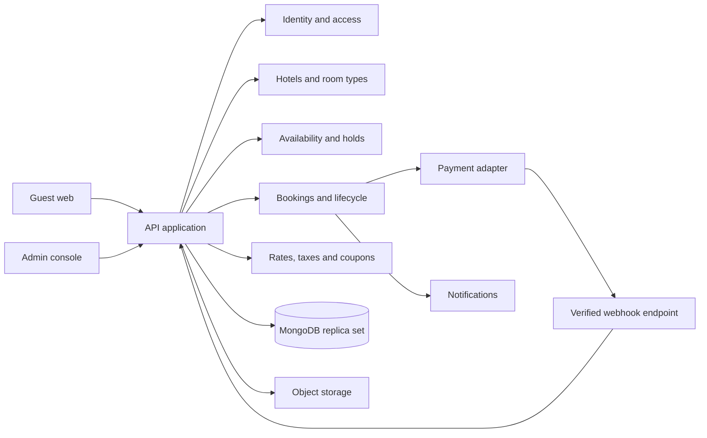

# Architecture

- **What this file covers**: the system shape, technology stack, project structure and the full decision log (ADR register) for the Staywise hotel platform.
- **Sources merged**: `02-architecture/04-architecture.md`, `02-architecture/05-tech-stack.md`, `02-architecture/06-project-structure.md`, `04-planning-and-tracking/20-decision-log.md`.
- **Related**: data model in [DATA_MODEL.md](./DATA_MODEL.md#07-database-design); API contract in [API.md](./API.md#08-api-specification).

<a id="04-architecture"></a>
## Architecture

### Shape

- **Modular monolith**: responsive React guest/admin web clients styled with Tailwind CSS call a versioned NestJS REST API.
- **Module ownership**: domain modules own their business logic and persistence.
- **Persistence stack**: MongoDB with Mongoose is the selected persistence stack.
  - Run MongoDB as a replica set to support multi-document transactions.
  - Use conditional atomic updates and unique indexes to protect inventory.
- **See also**: [tech stack](#05-tech-stack) and [decision log](#20-decision-log).
- **Component diagram** (verbatim):



### Domain modules

- **Module list**: Identity, users, hotels, room types, rates, inventory/blocks, search, pricing, holds, bookings, payments/refunds, reviews, notifications, reports, audit.

### Booking transaction boundary

- **Server derivation**: the API validates input and derives the per-night rate and total.
- **All-or-nothing claim**: in a MongoDB transaction the API claims inventory for every night or claims none.
- **Per-night documents**: persist per-night inventory documents and use conditional updates that only succeed when `held + confirmed + blocked + requested <= total`.
- **Same transaction**: create the hold and booking snapshot in the same transaction.
- **Idempotency**: a unique idempotency key prevents duplicate creation.
- **Payment outside the transaction**: payment is performed outside the database transaction; a verified callback then atomically confirms the booking if the hold remains valid.
- **Late payment**: if payment succeeds after expiry, route to reconciliation/refund; never silently oversell.
- **Replica set requirement**: multi-document transactions require a replica set (including local development).

### External service boundaries

- **Adapters**: use adapters for payment, email/SMS, and media.
- **Webhook verification**: verify webhook signatures against raw request bytes.
- **Traceability**: record gateway references and state transitions.
- **Notifications**: retriable and must not determine booking correctness.

### Scaling path

- **Start small**: start with one API service and managed database.
- **Job queue**: add a durable job queue for expiry/notifications when needed.
- **Caching**: add caches only for read data with a clear invalidation strategy; availability must not rely on stale cache as its authority.

<a id="05-tech-stack"></a>
## Technology Stack

- **Owner selection**: the product owner selected NestJS, MongoDB, React, Tailwind CSS and TypeScript.
- **Supporting libraries**: the supporting libraries below are recommended implementation choices; pin exact versions and confirm hosting compatibility during setup.

### Layers (selected / recommended, with reason)

- **Guest/admin web**: React + TypeScript + Tailwind CSS + Vite — responsive guest and admin applications with typed UI.
- **API**: NestJS + TypeScript + REST/OpenAPI — modular structure, validation, guards and documented contracts.
- **Database**: MongoDB 7+ — document persistence for hotel/catalog data; transactions support booking workflows when deployed as a replica set.
- **Data access**: Mongoose with `@nestjs/mongoose` — NestJS integration, schema validation and typed persistence.
- **Validation**: `class-validator` / `class-transformer` DTO validation — reject malformed input and protect domain services.
- **Media**: S3-compatible object storage — durable image storage; database stores metadata and URLs/keys.
- **Payments**: Razorpay or Stripe selected for launch market — provider adapter and signed webhook handling.
- **Containers**: Docker for local/dev and deployment packaging — repeatable runtime; production host selected separately.
- **Tests**: Jest/Vitest, API integration tests, Playwright — unit, concurrency/integration and guest-flow coverage.

### Stack rules

- **Versions**: use supported versions compatible with the selected provider and deployment platform.
- **Dependency hygiene**: pin dependencies, commit lockfiles, and record upgrades.
- **Secrets**: keep payment secrets and database credentials outside source control.
- **Replica set everywhere transactions are used**: MongoDB must run as a replica set in every environment where multi-document transactions are used, including local development (see the local-development exception in **ADR-012** below).
- **No premature infrastructure**: avoid adding Redis, queues, search platforms or microservices until measured requirements justify them.

<a id="06-project-structure"></a>
## Suggested Project Structure

- **Repository layout** (verbatim):

```text
hotel-platform/
  apps/
    api/                         # NestJS modular REST API
    guest-web/                   # Guest search and booking
    admin-web/                   # Operations console
  packages/
    contracts/                   # Shared API types/schemas where practical
    ui/                          # Shared visual primitives
  infra/                         # Compose, deployment templates, migrations ops
  docs/                          # This documentation set
```

- **API module layout**: API modules should group domain code rather than technical layers alone, for example:

```text
apps/api/src/modules/availability/
  availability.module.ts
  availability.controller.ts
  availability.service.ts
  inventory.repository.ts
  dto/
  entities/
  policies/
```

- **Adapters and controllers**: keep payment-provider code behind an adapter; keep controllers thin.
- **Migrations and seeds**: store migrations and seed data with the API.
- **Route separation**: separate public guest routes from admin routes and enforce authorization on the server.
- **Frontend organisation**: frontends organize by feature (`search`, `hotel`, `checkout`, `bookings`, `hotels-admin`, `inventory-admin`) with shared layout/components kept small.
- **No entity sharing**: do not share database entities directly with the browser. Share stable API contracts or generate clients from OpenAPI.
- **Frontend trust boundary**: never put secrets or authorization decisions in frontend code.

<a id="20-decision-log"></a>
## Decision log

- **Record format**: each decision records ID, date, status, context, decision, alternatives, consequences, owner.
- **Proposal rule**: items not explicitly selected by the product owner remain proposals or open decisions.

### Decisions (ID — topic: proposed default; status / validation)

- **ADR-001** — Architecture: modular monolith with REST API. Status: Proposed; validate team/hosting.
- **ADR-002** — Persistence: MongoDB with Mongoose; transactions on a replica set. Status: **DECIDED**; configure unique indexes and transactional inventory updates.
- **ADR-003** — Inventory: pooled inventory by room type and local stay night. Status: Proposed; confirm hotel operations.
- **ADR-004** — Hold duration: 10 minutes, server-expiring. Status: Proposed; validate gateway checkout timing.
- **ADR-005** — Booking access: allow guest checkout; secure retrieval link/session. Status: Proposed; security review.
- **ADR-006** — Launch region: one country/currency/time-zone policy initially. Status: Proposed; owner decision required.
- **ADR-007** — Tax: configure server-side; validate GST slabs and inclusive/exclusive treatment. Status: Open; finance/legal review required.
- **ADR-008** — Payment provider: select Razorpay or Stripe based on merchant eligibility and geography. Status: Open; business decision required.
- **ADR-009** — Cancellation: snapshot property policy on booking; refund asynchronous. Status: Proposed; define default policy.
- **ADR-010** — Staff tenancy: super admin first; hotel manager later with explicit property scope. Status: Proposed.
- **ADR-011** — Browser authentication: opaque server-managed sessions in secure HttpOnly cookies; separate guest/staff audiences; CSRF protection. Status: **STANDARD**; defaults and lifecycle defined in [`modules/authentication.md`](./modules/authentication.md).
- **ADR-012** — Standalone MongoDB in local development: permit non-transactional writes only when `NODE_ENV=development`; production and other environments continue to require a replica set. Status: **DECIDED** for local development; standalone mode does not provide atomic inventory guarantees.
- **ADR-013** — Frontend Architecture & Theme System: modular feature-driven structure (1 component = 1 file) with Tailwind CSS v4 and Staywise brand theme palette tokens. Status: **DECIDED**; migrated `apps/admin-web` to modular architecture with Tailwind v4 styling and `Button` primitive.

### Maintenance rule

- **On approval**: update related requirements, schema, API and business rules when a decision is approved.
