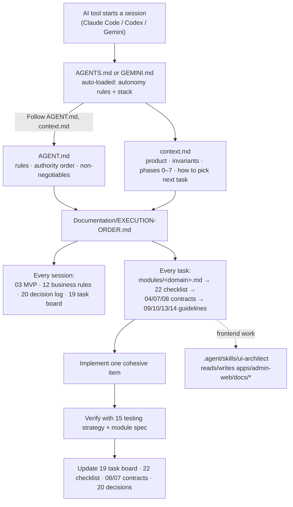
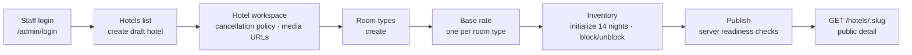

# Documentation Report — How the Docs Drive the Agent

**Date:** 2026-10-15 · **Branch:** `feat-update` · **Scope:** `Documentation/`, the former `docs/`, root agent files, `apps/api`, `apps/admin-web`

This report answers four questions:

1. How are the documents organised now?
2. How does an AI agent use them, and in what order?
3. What is actually implemented, and which documents drove it?
4. Which documents will future implementation follow, and what must be fixed first?

---

## 1. Summary

- **The docs are now in topic folders** (§2). File numbers are kept. The three business analyses moved from `docs/analysis/` into `Documentation/06-analysis/`. All 414 machine-specific `file:///c:/Users/...` links were converted to relative links that work on any machine.
- **The agent has a fixed entry chain.** The coding tool auto-loads `AGENTS.md` (or `GEMINI.md`). That file points to `AGENT.md` and `context.md`, which point to `EXECUTION-ORDER.md`. That file selects the module spec, contracts and trackers for each task (§3).
- **What is built is the Sprint 1 admin catalog:** staff login, hotels, room types, one base rate per room type, nightly inventory, publish gates and audit. Bookings, holds, guests and payments do not exist yet (§5).
- **The main problem was documentation drift, not missing documents.** Each work burst created a *new* standalone document (24, 25, 26, the fix-plan analysis, 27, the business analyses). The living contracts were not updated: task board 19, checklist 22, API spec 08 and decision log 20. That broke the agent's own rule (AGENT.md §6: "update impacted … API … task board, and decision log in the same change"). See §6.
- **Future work:** read the same core docs, and read `05-sprints-and-progress/24-…` for Sprint 2. Plan 24 conflicts with two ADRs and must be reconciled before it is built (§8).

---

## 2. New folder layout

```
hotel-Management/
├── AGENTS.md / GEMINI.md        auto-loaded by the AI tool (identical; short)
├── AGENT.md                     authoritative engineering rules  ← agent reads 1st
├── context.md                   product + invariants + phase gates ← agent reads 2nd
├── README.md                    repo README (setup, scripts)
├── .agent/skills/ui-architect/  UI skill used for frontend work
├── apps/admin-web/docs/         UI skill "project memory" (ui-decisions, components)
└── Documentation/
    ├── README.md                index
    ├── DOCUMENTATION-REPORT.md  this report
    ├── EXECUTION-ORDER.md       per-session reading order + per-task procedure ← 3rd
    ├── 01-product/              00 context · 01 requirements · 02 roadmap · 03 MVP · 12 business rules · 17 AI ideas
    ├── 02-architecture/         04 architecture · 05 stack · 06 structure · 07 database · 08 API
    ├── 03-guidelines/           09 frontend · 10 backend · 11 auth · 13 UI/UX · 14 security · 15 testing · 16 devops · 21 (superseded) · 23 UI brief
    ├── 04-planning-and-tracking/ 18 phases · 19 task board · 20 decision log · 22 checklist
    ├── 05-sprints-and-progress/ 24 Sprint-2 plan · 25 hardening log · fix-plan analysis · 26 fix-plan log
    ├── 06-analysis/             hotel · room-types · pricing business analyses
    ├── 07-guides/               QUICKSTART · 27 admin-web navigation guide
    ├── modules/                 20 module specs (unchanged)
    └── assets/                  ui-images/ · drawio/
```

### What moved

| Old location | New location |
|---|---|
| `Documentation/00,01,02,03,12,17-*.md` | `Documentation/01-product/` |
| `Documentation/04–08-*.md` | `Documentation/02-architecture/` |
| `Documentation/09,10,11,13,14,15,16,21,23-*.md` | `Documentation/03-guidelines/` |
| `Documentation/18,19,20,22-*.md` | `Documentation/04-planning-and-tracking/` |
| `Documentation/24,25,26-*.md` | `Documentation/05-sprints-and-progress/` |
| `Documentation/Staywise Full-Stack Analysis & Fix Plan.md` | `Documentation/05-sprints-and-progress/fullstack-analysis-and-fix-plan.md` (renamed; the old name had spaces and `&`) |
| `docs/analysis/*.md` | `Documentation/06-analysis/` |
| `Documentation/27-*.md`, `QUICKSTART.md` | `Documentation/07-guides/` |
| `Documentation/UI images/`, `draw io/` | `Documentation/assets/ui-images/`, `assets/drawio/` |

### Other cleanup done with the move

- **Link rewriting:** 461 links rewritten. Afterwards 504 internal links resolve. The 4 that still fail were already broken and point at things that do not exist: `LICENSE`, the skill's `../README.md#sync-script`, and `rooms/` and `bookings/` schemas cited in the hotel analysis.
- **Root agent files:** the 7 broken links in `AGENT.md` and `context.md` are fixed. They pointed to `./03-mvp-scope.md` and similar paths as if the docs sat next to them. `context.md §5` now lists folder-qualified paths.
- **Status banners added:**
  - `21-ai-agent-rules.md`: superseded by AGENT.md.
  - `fullstack-analysis-and-fix-plan.md`: historical; status lives in 26.
  - `24-sprint-2-…`: not implemented; must be reconciled with the ADRs.
- **`EXECUTION-ORDER.md §4`:** rewritten to describe the current state and the next step.
- **`08-api-specification.md`:** fixed the `/adm  in/hotels/import` typo.

Nothing was deleted. The empty `docs/analysis/` folder is left in place for you to remove.

---

## 3. How the agent uses the documentation

### 3.1 The load chain



| File | Who loads it | When | What the agent takes from it |
|---|---|---|---|
| `AGENTS.md` | Auto-loaded by Claude Code (in this setup) and Codex | Start of every session | Ask only before deleting files or committing; the stack baseline; "follow AGENT.md" |
| `GEMINI.md` | Auto-loaded by Gemini / Antigravity | Start of every session | Identical copy of AGENTS.md |
| `AGENT.md` | The agent, following the pointer | Before planning | Document authority order, 14 non-negotiable rules, delivery/checklist rules, the format of the completion report |
| `context.md` | The agent, following the pointer | Before planning | Business invariants, the Phase 0–7 gates, "how to choose the next task" |
| `EXECUTION-ORDER.md` | The agent, following the pointer | Each session and each task | Reading order, per-task procedure, current next step |
| `.agent/skills/ui-architect/SKILL.md` | Invoked for UI work | Building or changing UI | Reuse ladder, ~200-line files, use tokens only, update `apps/admin-web/docs/*` |

### 3.2 Authority when documents disagree (AGENT.md §3)

1. The latest product-owner instruction, or an approved ADR in `20-decision-log.md`
2. `AGENT.md` (engineering rules) and `context.md` (project context)
3. `01-product/12-business-rules.md`
4. `01-product/03-mvp-scope.md`
5. `modules/<domain>.md`
6. Requirements, architecture, API, DB, phases, checklist
7. Existing code. It may be stale and must not silently override the docs.

If a conflict touches money, inventory, access control, data or the API, the agent must stop that change and ask for a decision. `Documentation/README.md` used to list a different, shorter order; it now follows this one.

### 3.3 The procedure for each task (what the agent is supposed to do)

1. Check `19-task-board.md` and pick the earliest incomplete phase whose gate is still open.
2. Read the module spec from `modules/README.md`, then the matching section of `22-checklist`.
3. Before editing, identify the API, schema, index, security and audit impacts (04, 07, 08, 14).
4. Implement one cohesive item, including its failure paths.
5. Verify it, then update the task board, checklist, contracts and decision log **in the same change**.
6. Mark `[x]` only when there is evidence, and end with a completion report (files, behaviour, verification, checklist lines, blockers).

---

## 4. Timeline: how the docs were actually produced

| Date | Commit / state | Docs created or changed | Code delivered |
|---|---|---|---|
| 10-06 | `48580a4` establish platform | Full blueprint: 00–23, `modules/*`, AGENT/AGENTS/GEMINI/context | API foundation (Phase 0) |
| 10-06 | `936ae75` | 19, 20, EXECUTION-ORDER, QUICKSTART updated | Admin workspace UI |
| 10-07 | `ff9492c`, `c6dd2a1` | 08, 09, 19, 20, 22 updated; drawio added | Theme, hotel modules, media API |
| 10-12 | `5f302a7` | **24** Sprint-2 plan; ui-architect skill; `apps/admin-web/docs/*` | Catalog pages, UI components |
| 10-12 | staged | **25** hardening log; **fix-plan analysis**; **26** fix-plan log | SEC/PERF/API/FE fixes; B1–B10, F1–F12 |
| 10-13 | staged | **27** navigation guide; README and 08 edits | Admin-web refactor (auth context, `*.api.ts`, UI primitives) |
| 10-13 | untracked | **3 business analyses** (`06-analysis/`) | — |

**Pattern:** through 10-07 the agent followed the procedure and updated 19, 20 and 22 alongside the code. From 10-12 onward, each task produced a **new** document instead. Those documents never fed back into the task board, checklist, API spec or decision log. That is why the set now feels confusing.

---

## 5. What is implemented, and which docs drove it

### 5.1 Working admin flow



Publishing requires all of the following:
- a valid, effective cancellation policy;
- at least one active room type with `totalRooms ≥ 1`;
- a base rate for every active room type;
- one consistent currency;
- at least one future night with available rooms.

### 5.2 Feature status against the governing docs

| Feature | Backend (`apps/api`) | Admin UI (`apps/admin-web`) | Governing docs |
|---|---|---|---|
| Staff login, session, CSRF, logout, lockout | ✅ opaque cookie session, double-submit CSRF, 5-try lockout | ✅ login, session restore, expiry redirect | `modules/authentication.md`, ADR-011, fix B1/B9 |
| RBAC and hotel scope | ✅ 14 permissions, guard + service scope checks | ✅ `PermissionRoute`, `<Can>` | `modules/rbac-permissions.md`, SEC-01 |
| Staff / role / manager management | ❌ seed script only | ❌ | `modules/staff-user-management.md` |
| Hotel CRUD, lifecycle, bulk status | ✅ | ✅ (basic info cannot be edited in the UI) | `modules/hotel-management.md`, B3, F7 |
| Media | ⚠️ list of URLs, no upload | ⚠️ URL gallery | `modules/media-management.md` |
| Room types | ✅ create / edit / disable | ⚠️ create only | `modules/room-type-management.md` |
| Pricing | ⚠️ one flat base rate, integer minor units | ✅ | `modules/pricing-tax.md` (ADR-007 tax still open) |
| Inventory | ✅ initialize, block/unblock, batch; atomic conditional updates | ✅ 14-night grid | `modules/availability-booking.md`, `12-business-rules.md` |
| Audit log | ✅ written in the same transaction, 1-year TTL | ❌ no viewer | `modules/audit-logging.md`, B10 |
| Public search / quote | ❌ | — (no guest app) | `modules/guest-search.md` |
| Guest auth, holds, bookings | ❌ (`held`/`confirmed` counters are never written) | ❌ | **24 Sprint-2 plan**, `modules/booking-lifecycle.md` |
| Payments, refunds, cancellation | ❌ | ❌ | `modules/payments-refunds.md`, `cancellation-policies.md`, ADR-008 |
| Reports, reviews, notifications | ❌ | ❌ | respective module specs |

### 5.3 Defects found in the code while auditing (not fixed in this change)

| # | Where | Problem |
|---|---|---|
| 1 | `apps/api/src/modules/inventory/dto/inventory.dto.ts:11,19` | `reason` uses `@Min(3)`, a numeric validator, on a string. HTTP block, unblock and batch-adjust will likely fail validation; it should be `@MinLength(3)`. The unit specs call the service directly, so they miss it. |
| 2 | `apps/admin-web/src/pages/hotels/HotelsPage.tsx:~117` | An early `return` on 403 runs before several `useMemo` hooks, which breaks the Rules of Hooks. |
| 3 | `apps/admin-web/src/components/ui/Toast.tsx`, `App.tsx`, `Spinner.tsx` | They use `toast-stack`, `boot-screen`, `ui-spinner` and similar classes whose CSS was removed with `dashboard.css`. Toasts render unstyled. |
| 4 | `packages/contracts` | Nothing imports it. Its `HotelStatus` has `DISABLED`, but the API uses `SUSPENDED`. |
| 5 | `apps/admin-web/package.json` | Every dependency is pinned to `"latest"`. |
| 6 | `apps/api/src/scripts/verify-scenarios.ts` | Hard-coded test credentials. `dotenv` is used but not declared. |

---

## 6. Documentation drift: where docs and code disagree

| Doc | Drift |
|---|---|
| `02-architecture/08-api-specification.md` | Media and bulk-status are marked "Phase 2 planned" but are implemented. These endpoints are missing: `/health`, `/admin/hotels/metrics`, `inventory/batch-adjust`, `archive`, `suspend`, `room-types/:id/disable`. These error codes are missing: `HOTEL_NOT_READY`, `DUPLICATE`, `CSRF_REJECTED`, `ACCOUNT_LOCKED`, `TOO_MANY_ATTEMPTS`. |
| `04-planning-and-tracking/19-task-board.md` | Has no entries for the 25/26 work. Still titled "Initial". |
| `04-planning-and-tracking/22-checklist.md` | Covers only auth, guest profile and hotel. It has no room-type, inventory, pricing or booking sections. The throttling/lockout item is unchecked, but it is done (B9). |
| `04-planning-and-tracking/20-decision-log.md` | Missing decisions: MFA behind `MFA_ENABLED` (B1), 1-year audit retention (B10), the `SUSPENDED` label (F7), no TanStack Query, Zod env validation (B2), autoIndex off in production (B6). ADR-001 is "Proposed" but treated as approved. |
| `01-product/02`, `04-planning/18`, `context.md` | Three different phase schemes: 0–4, 0–4 and 0–7. `context.md` (0–7) is the one the agent follows. |
| `03-guidelines/11-auth-rbac.md` | Still allows access/refresh tokens, which contradicts ADR-011 (opaque sessions). |
| `03-guidelines/09-frontend-guidelines.md` | Its folder tree and hex palette are stale. `apps/admin-web/docs/ui-decisions.md` is accurate. |
| `modules/admin-ui-kit.md` | Its component names differ from the real ones (StatusBadge vs `Status`, FormField vs `Field`, Drawer vs `Modal variant="drawer"`). |
| `apps/admin-web/docs/components.md` | Missing ErrorBoundary, Loader, NotFound, Skeleton, Spinner and Toast. |
| `02-architecture/06-project-structure.md` | Describes `guest-web/`, `packages/ui` and `infra/`, none of which exist. |
| `07-guides/QUICKSTART.md` | Says sign-in is disabled until MFA exists, which changed with B1. Omits `ensure:indexes`, `verify:api` and `npm test`. |
| Root `README.md` | Lists API routes that don't exist (`/api/v1/hotels/:hotelId/rates` etc.) and a `{success,data,meta}` envelope the API doesn't return. |
| `AGENTS.md` = `GEMINI.md` = `AGENT.md §8` = `21` | The same rules appear in four places. AGENT.md is authoritative. |

---

## 7. Which documents are in use

### Active for current implementation (read on every relevant task)

| Doc | Why it's active |
|---|---|
| `AGENTS.md` → `AGENT.md`, `context.md`, `EXECUTION-ORDER.md` | The agent's entry chain |
| `01-product/03-mvp-scope.md`, `12-business-rules.md` | Scope and invariants |
| `04-planning-and-tracking/19`, `20`, `22` | Status, decisions, checklist (each needs a refresh, see §6) |
| `02-architecture/04`, `07`, `08` | Contracts (08 needs a refresh) |
| `modules/authentication`, `rbac-permissions`, `hotel-management`, `room-type-management`, `availability-booking` (inventory part), `pricing-tax`, `media-management`, `audit-logging` | Specs for the code that exists |
| `03-guidelines/09`, `10`, `14`; `apps/admin-web/docs/*`; `.agent/skills/ui-architect` | How code is written |
| `07-guides/27-…navigation-guide.md` | The most accurate description of admin-web today |
| `06-analysis/*` | Gap lists and open questions for hotel, room types and pricing |

### Reference / historical (read for background only)

`05-sprints-and-progress/25`, `26`, `fullstack-analysis-and-fix-plan.md` (completed work logs); `03-guidelines/21` (superseded); `03-guidelines/11` (superseded by the module specs); `01-product/00`, `01`, `02`, `17`; `02-architecture/05`, `06`; `03-guidelines/23` (pre-build UI brief).

### Future implementation (dormant until that phase starts)

| Next phase (context.md gates) | Docs that will drive it |
|---|---|
| Finish Phase 1–2 gaps (staff management, manager scope, room-type edit UI, hotel basics edit) | `modules/staff-user-management.md`, `rbac-permissions.md`, `06-analysis/*` |
| Phase 3: holds, expiry, atomic multi-night claims | **`05-sprints-and-progress/24`**, `modules/availability-booking.md`, `12-business-rules.md`, ADR-003/004 |
| Phase 4: guest search, quote, booking lifecycle, guest auth | `modules/guest-search.md`, `booking-lifecycle.md`, `guest-accounts.md`, `authentication.md` (guest part), `24`, `23` (guest UI) |
| Phase 5: payments, cancellation, refunds, email | `modules/payments-refunds.md`, `cancellation-policies.md`, `notifications.md`, ADR-007/008/009 |
| Phase 6–7: reports, reviews, deployment, AI | `modules/admin-dashboard-reports.md`, `reviews-ratings.md`, `deployment-operations.md`, `03-guidelines/16`, `01-product/17` |

---

## 8. Before the next implementation sprint

These items resolve conflicts that would otherwise send the agent the wrong way. Most need your decision, so they are not edited here.

1. **Reconcile plan 24 with the decision log.** Plan 24 assumes three things the approved docs don't support:
   - Mandatory guest accounts, which contradicts ADR-005 and `modules/authentication.md` (both allow guest checkout).
   - 12% GST, while ADR-007 is still open.
   - A `PAY_AT_HOTEL` mode that no ADR records.

   Decide each one and record it in `20-decision-log.md`.
2. **Record the decisions that were already implemented** in 20: B1 MFA flag, B10 retention, the F7 label, B2 Zod, B6 autoIndex.
3. **Bring 08 up to date** with the endpoint and error-code lists in §6.
4. **Make 19 + 22 the single tracker.** Add the 25/26 outcomes and the room-type, inventory, pricing and booking sections to 22. Future work should update these two, not start a new progress file.
5. **Pick one phase scheme** (context.md 0–7) and align 02 and 18.
6. **Fix the inventory DTO validator** (§5.3 #1) before relying on block/unblock over HTTP.

### Rules for keeping the docs tidy from now on

- Each new **sprint plan** goes in `05-sprints-and-progress/` with the next number. Its status is reflected in 19 and 22.
- Each new **analysis** goes in `06-analysis/`. Any decision it recommends goes into 20.
- Each new **how-to** goes in `07-guides/`.
- A change to an endpoint, schema or decision updates 08, 07 or 20 **in the same change** (AGENT.md §6).
- Do not create agent-rule files beyond AGENT.md. AGENTS.md and GEMINI.md stay as short pointers.
