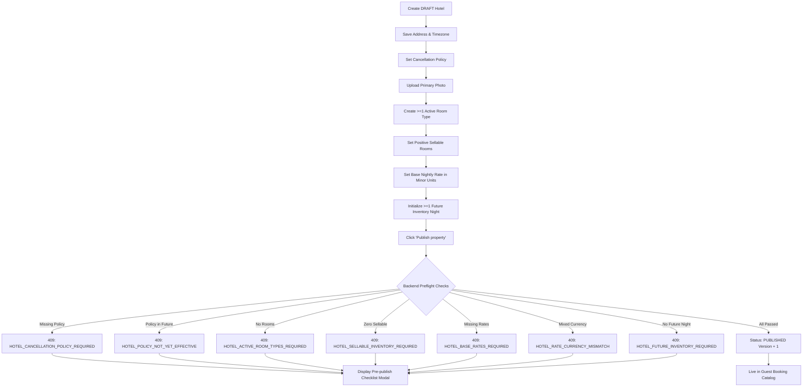
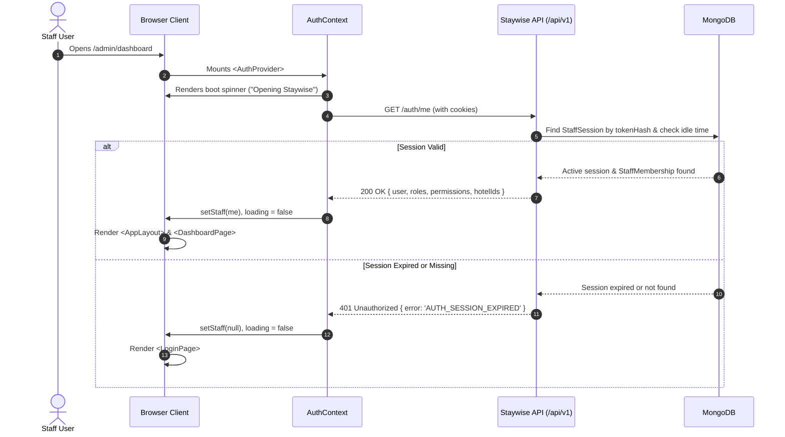
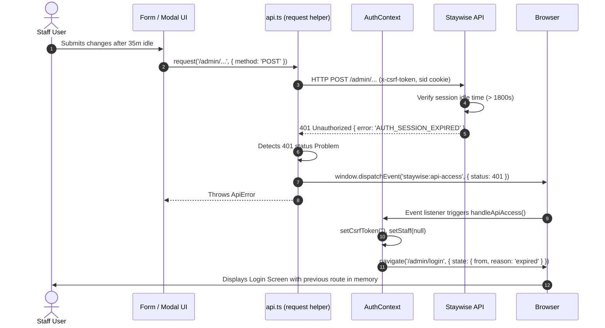
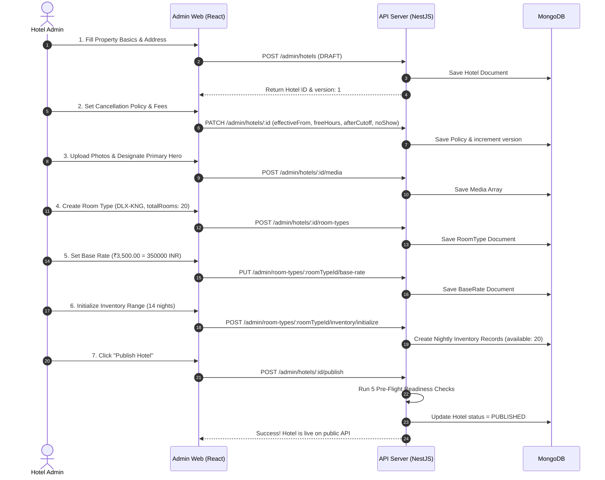

# Staywise Guides

- **Part 1: Developer Quickstart** ([jump](#quickstart)): set up your machine, start the API and the admin UI, create the first super-admin, and find the staff sign-in endpoints. Read this first if you are a developer.
- **Part 2: End-to-End Navigation & User Flow Guide for `apps/admin-web`** ([jump](#27-admin-web-end-to-end-navigation-guide)): the route map, how navigation works, roles and permissions, user journeys from start to finish, flow diagrams, the message and error reference, business rules, problems found while tracing the code, and open questions.
- **Part 3: Staywise Platform — Modules, Features & Configuration Guide** ([jump](#28-platform-modules-features-and-configuration-guide)): the platform module matrix, what each module does and how it is configured, and a step-by-step walkthrough for setting up a hotel.

---

<a id="quickstart"></a>

## Developer Quickstart

- **Status of this guide** — You can follow this guide once the application repository and environment exist. The commands are examples only. Replace them with the real scripts once the stack is final.

### Prerequisites

- **Node.js** — A supported Node.js LTS release and a package manager.
- **MongoDB** — Needed for local development.
  - Standalone mode works, but with weaker guarantees.
  - Checking transactions requires a replica set.
- **Payment provider** — You need a sandbox account only when Phase 2 starts.

### Setup outline

1. **Install** — Clone the repository and install dependencies from the root (`npm install`).
2. **Environment** — Copy `.env.example` to a local environment file. Set the database URL, the app origins and random development secrets.
3. **Start MongoDB** — Start MongoDB locally.
   - Standalone MongoDB is allowed only for local development. It runs writes without transactions, so inventory updates are not safe under concurrent use.
   - Use replica-set mode for checking transactions during development, and for every production deployment.
4. **Migrations** — Apply migrations and, if you want, seed data.
5. **Start the apps** — Start the API with `npm run start:api` and the admin UI with `npm run start:admin` (Vite at `http://localhost:5173`). Add that origin to `CORS_ORIGINS`; `.env.example` already includes it.
6. **Verify** — Open the API docs and check health/readiness. If a seeded non-production admin account exists, sign in with it.

### Initial local staff account (bootstrap super-admin)

- **Variables** — In the current shell, set `BOOTSTRAP_ADMIN_EMAIL`, `BOOTSTRAP_ADMIN_PASSWORD` (12–128 characters) and `MONGODB_URI`.
- **Command** — Run this once:
  ```
  npm.cmd --workspace=apps/api run seed:super-admin
  ```
- **Result** — Creates a super-admin with the catalog permissions.
- **Safety** — The seed command refuses to overwrite an existing account. Keep the credentials private. Do not use this bootstrap path in production.

### Staff sign-in endpoints

- **Current endpoints** — `POST /api/v1/auth/staff/login`, `GET /api/v1/auth/me`, and `POST /api/v1/auth/logout` or `/logout-all`.
- **Production sign-in** — Stays disabled until MFA is implemented.
- **Throttling limitation** — Sessions and failed-login throttling are currently held inside each process. Put shared rate limiting in front before running more than one API instance.

### Current admin UI scope

- **Included in the first admin UI** — Hotel setup, room types, explicit cancellation terms, base rates, nightly inventory setup/calendar, and publication.
- **Waiting on APIs** — Booking operations, staff management, reports and guest pages.
- **Base rates caveat** — Base rates are nightly amounts. They are not tax-inclusive stay quotes. Guest checkout stays blocked until tax and cancellation behaviour are approved.

### Build

- **Build commands** — Build the applications with `npm run build:api` and `npm run build:admin`.

### Rules before contributing

- **Secrets** — Never commit `.env` files. Never use production credentials locally.
- **Required reading** — Before contributing, read the [task board](TASKS.md#19-task-board), the [business rules](PRODUCT.md#12-business-rules) and the [AI agent rules](README.md#21-ai-agent-rules).

---

<a id="27-admin-web-end-to-end-navigation-guide"></a>

## End-to-End Navigation & User Flow Guide — apps/admin-web

- **Scope** — This guide covers how the Staywise Admin Web application (`apps/admin-web`) behaves at runtime: user interactions, routing, authorization and API contracts. It reflects the app as of Sprint 2 (after the full-stack fix plan).
- **Two layers per section**:
  - **For users** — Plain language: what you see, what you click, forms and feedback.
  - **Technical** — Routes, components, API calls, request/response bodies, permissions, state management, cache invalidation and errors.

### Part 1: Route Map

#### 1.1 Complete Route Table

- **`/admin/login`** — page `LoginPage`, layout none (split banner layout), public (auth gate), permission none, URL/query params none, sidebar entry none, lazy-loaded no (static import in `App.tsx`).
  - Users who are not signed in land here. Signed-in users are redirected to `homePath(staff)`.
- **`/`** — redirect, layout none, permission none, URL/query params none, sidebar entry none, lazy-loaded no.
  - Redirects immediately to `homePath(staff)`.
- **`/admin`** — redirect, layout none, permission none, URL/query params none, sidebar entry none, lazy-loaded no.
  - Redirects immediately to `homePath(staff)`.
- **`/admin/unauthorized`** — page `AccessPage` (`kind="unauthorized"`), layout `AppLayout`, protected, permission none, URL/query params none, sidebar entry none, lazy-loaded no.
  - Shows `403 · NO ACCESS`. Main landing page for staff who have no navigation permissions.
- **`/admin/dashboard`** — page `DashboardPage`, layout `AppLayout`, protected, permission `hotels.view`, URL/query params none, sidebar **Dashboard**, lazy-loaded no.
  - KPI overview cards, a recent hotels table and quick navigation shortcuts.
- **`/admin/hotels`** — page `HotelsPage`, layout `AppLayout`, protected, permission `hotels.view`, query `?search=` (from the Topbar search), sidebar **Property setup > Hotels**, lazy-loaded no.
  - Property directory with search/filters, pagination and bulk status changes.
  - Archived hotels are hidden by default (the Status filter defaults to "All (excluding archived)"). Choose **Archived** in the Status filter to see them.
  - The "Active Hotels" card counts draft + published + suspended.
- **`/admin/hotels/new`** — page `HotelCreatePage`, layout `AppLayout`, protected, permission `hotels.create`, URL/query params none, sidebar entry none (reached from **Add a hotel**), lazy-loaded no.
  - Add-hotel form (shared `HotelDetailsFields`: Basics, Contact, Location) plus optional photos. Creates a `DRAFT` and opens the edit page.
- **`/admin/hotels/:id/edit`** — page `HotelEditPage`, layout `AppLayout`, protected, permission `hotels.view`, query `?tab=photos|rooms|policy`, sidebar entry none (reached from a hotel row), lazy-loaded no.
  - Hotel workspace with status actions (Publish / Suspend / Reactivate / Archive) and the tabs Details, Photos, Rooms and Cancellation policy. Archived hotels are read-only.
- **`/admin/room-types`** — page `RoomTypesPage`, layout `AppLayout`, protected, permission `room_types.view`, query `?hotel=<hotelId>`, sidebar **Property setup > Room types**, lazy-loaded no.
  - Room category list, total sellable inventory counts, and a modal for creating a category.
- **`/admin/inventory`** — page `InventoryPage`, layout `AppLayout`, protected, permission `inventory.view`, query `?hotel=<hotelId>&room=<roomId>`, sidebar **Operations > Availability**, lazy-loaded no.
  - 14-day rolling availability calendar, night initialization, and a block/unblock modal.
- **`/admin/rates`** — page `RatesPage`, layout `AppLayout`, protected, permission `rates.view`, query `?hotel=<hotelId>&room=<roomId>`, sidebar **Operations > Base rates**, lazy-loaded no.
  - Base nightly pricing. Staff type rupees and the UI sends integer minor units (paise). Also shows currency rules and rate coverage.
- **`*` (catch-all)** — page `AccessPage` (`kind="not-found"`), layout `AppLayout`, protected, permission none, URL/query params none, sidebar entry none, lazy-loaded no.
  - Shows `404 · NOT FOUND` with a button that goes back to `homePath(staff)`.

#### 1.2 Routing Rules & Fallbacks

1. **Access without signing in** — If the session state in `AuthContext` has `staff === null`, every route renders `<Navigate to="/admin/login" replace />` (`App.tsx:28`).
2. **Dynamic landing page (`homePath`)** — Implemented in `route-config.ts:38`. It walks through `[dashboardNav, ...navGroups.flatMap(group => group.items)]` and picks the first route whose permission is in `staff.permissions`. If no navigation item matches, it returns `/admin/unauthorized`.
3. **Lazy loading** — No page uses `React.lazy()` or `<Suspense>` splits. Every page component and layout primitive is bundled statically into `index-[hash].js`.

### Part 2: How Navigation Works

#### 2.1 Application Boot Sequence

```
Browser loads /
  │
  ├─ index.html ──> main.tsx
  │                   │
  │                   └─ <BrowserRouter>
  │                        └─ <AuthProvider>
  │                             └─ <App>
```

- **For users** — A centered screen shows the green Staywise compass logo, a smooth circular spinner and the message *"Opening Staywise"*.
- **Technical**:
  1. `AuthProvider` starts with `loading = true`.
  2. `App.tsx:12-22` renders the `.boot-screen` loading placeholder.
  3. `useEffect` calls `checkSession()`, which sends `GET /api/v1/auth/me` with `credentials: 'include'`.
  4. **Outcome A (valid session)** — The API returns `200 OK` with a `StaffMe` payload (`{ user, roles, permissions, hotelIds }`). `setStaff(me)` runs, `loading` becomes `false`, and `<AppLayout>` mounts with `<AppRoutes>`.
  5. **Outcome B (no session / expired)** — The API returns `401 Unauthorized`. `checkSession()` catches it. `setStaff(null)` runs, `loading` becomes `false`, and `App.tsx:24-30` mounts `LoginPage`.
  6. **Outcome C (API down / network error)** — `checkSession()` catches a non-401 error, sets `apiError = "The Staywise API could not be reached. Check that it is running and try again."`, and renders `LoginPage` with a red alert banner.

#### 2.2 Login Flow & Error Codes

- **For users** — Enter your work email and password, then click **Sign in**. The button shows a spinner and *"Signing in…"*. On success a green notification appears (*"Welcome back. You are signed in."*) and you are taken to your dashboard or the first operations page you can access. If sign-in fails, a banner explains why.
- **Technical**:
  1. Submitting the form calls `POST /api/v1/auth/staff/login` with body `{ email, password }`.
  2. On success the response returns `{ csrfToken: string }`. Express sets the session cookie `staywise_staff_sid` (HttpOnly, SameSite=Lax) and `staywise_staff_csrf`.
  3. The client stores the CSRF token with `setCsrfToken(login.csrfToken)` (`api.ts:4`).
  4. The client immediately calls `GET /api/v1/auth/me` to get permissions and then calls `onLogin(me)`.
  5. `App.tsx` re-renders into `<AppLayout>` and routes through `<AppRoutes>`.
  6. **Error mapping (`LoginPage.tsx:29-35`)**:
     - **`AUTH_MFA_REQUIRED`** — *"Multi-factor sign-in is required for this account."*
     - **`ACCOUNT_LOCKED`** — *"Too many failed attempts. This account is locked for a few minutes."*
     - **`TOO_MANY_ATTEMPTS`** — The message from the backend, or *"Too many attempts. Please wait and try again."*
     - **`AUTH_INVALID_CREDENTIALS`** — *"Email or password is incorrect."*
     - **Fallback / unknown** — The raw `err.message`, or *"Email or password is incorrect."*

#### 2.3 Layout, Shell & Navigation Items

- **Sidebar (`Sidebar.tsx`)**:
  - **Brand header** — Shows the brand and a collapse toggle. The collapsed state is saved in `localStorage.staywise-admin-sidebar-collapsed`.
  - **Permission-gated items** — Each item is checked against `staff.permissions`:
    - **`hotels.view`** — **Dashboard** (`/admin/dashboard`)
    - **`hotels.view`** — group **Property setup** > **Hotels** (`/admin/hotels`)
    - **`room_types.view`** — group **Property setup** > **Room types** (`/admin/room-types`)
    - **`inventory.view`** — group **Operations** > **Availability** (`/admin/inventory`)
    - **`rates.view`** — group **Operations** > **Base rates** (`/admin/rates`)
  - **Section headers** — Collapsible. Their open/closed state is kept in memory.
  - **Footer** — A help card and a disabled *"Settings (Upcoming)"* action.
- **Topbar (`Topbar.tsx`)**:
  - **Search** — A global input. Pressing `Enter` goes to `/admin/hotels?search=<query>`.
  - **Notifications** — The bell button shows an informational toast (*"Notifications are coming soon."*).
  - **Profile menu** — Shows the staff email, an initial badge and the role name. Clicking opens a dropdown with **Sign out**.
- **Logout**:
  - **Request** — Clicking **Sign out** calls `POST /api/v1/auth/logout`.
  - **Backend** — Revokes the session in the `StaffSession` collection and clears the cookies `staywise_staff_sid` and `staywise_staff_csrf`.
  - **Frontend** — Clears the local CSRF token, sets `staff = null` and routes to `/admin/login`.

#### 2.4 Moving Between Pages & State Persistence

- **Catalog navigation and `HotelRoomPicker`**:
  - **Shared header** — The Room Types, Inventory and Rates pages share the same `HotelRoomPicker` header.
  - **Hotel selection** — Choosing a hotel sets the URL query param `?hotel=<hotelId>`.
  - **Room selection** — Choosing a room sets `?room=<roomId>`.
  - **Sync** — Both params are kept in sync with `useSearchParams()`.
  - **Page refresh** — The selection survives a full reload. On mount, `HotelRoomPicker` reads `searchParams.get('hotel')` and fetches the hotel with `getHotel(urlHotelId)`.
  - **Back/forward** — Changes are pushed into browser history, so back and forward work smoothly.
  - **Stale or deleted deep links** — If `?hotel=invalidId` is opened, `getHotel()` fails and sets `hotelNotFound = true`. The component shows `<NotFound title="Property not found" description="The property specified in the URL does not exist or has been removed." action={<Button>Choose another property</Button>} />`. Clicking the button removes the invalid params from the URL.

#### 2.5 Route Guards & Access Denials

- **`PermissionRoute`** — Checks `routePermissions[path]`. If `staff.permissions` does not contain the key, the page is not mounted. Instead it renders `<AccessPage kind="unauthorized" home={homePath(staff)} />` (`403 · NO ACCESS`).
- **Inline API 403** — If a user opens `/admin/hotels` but the backend request returns `403 FORBIDDEN` (for example, a hotel outside their tenant scope), `HotelsPage:77` catches `isApiError(hotelsQuery.error, 403)` and renders `<AccessPage kind="unauthorized" />`.

#### 2.6 Session Expiration & Idle Timeout

- **Idle limit** — Backend sessions expire after **30 minutes (1,800 seconds)** without activity (`staff-session.service.ts:35`).
- **What happens when an idle staff member acts** (for example saving rates, creating a room or publishing):
  1. The API returns `401 Unauthorized` with `{ error: 'AUTH_SESSION_EXPIRED' }`.
  2. `api.ts:31-37` intercepts the 401 and calls `window.dispatchEvent(new CustomEvent('staywise:api-access', { detail: { status: 401 } }))`.
  3. `AuthContext:72-85` receives the event, sets `staff = null`, clears `csrfToken`, and redirects to `/admin/login` with `state: { from: location.pathname, reason: 'expired' }`.
  4. **Unsaved form data** — React unmounts the active page component, so any unsaved input in forms or modals is lost.

### Part 3: Roles and What Each One Sees

#### 3.1 Backend Seeded Roles and Permissions

- **Permission source** — Staywise defines stable permissions owned by the code and versioned in the database (`seed-super-admin.ts:12-17`):
  - **Hotels** — `hotels.view`, `hotels.create`, `hotels.edit`, `hotels.publish`, `hotels.archive`
  - **Room Types** — `room_types.view`, `room_types.create`, `room_types.edit`, `room_types.archive`
  - **Inventory** — `inventory.view`, `inventory.block`, `inventory.adjust`
  - **Rates** — `rates.view`, `rates.edit`

##### Seeded Roles

1. **`SUPER_ADMIN`**:
   - System administrator with platform-wide scope (`hotelIds: []`).
   - Has all 14 permissions.
   - `AuthContext:63` checks `if (staff.roles.includes('SUPER_ADMIN')) return true;` explicitly, so missing permission keys on the client side are ignored for this role.
2. **`HOTEL_MANAGER`**:
   - Scope is limited to the assigned `hotelIds`.
   - Has operational permissions for catalog and inventory. Cannot archive or create properties unless platform permissions are assigned.
3. **`FRONT_DESK` / `OPERATIONS` (custom role)**:
   - Scope is limited to the assigned properties.
   - Usually granted `hotels.view`, `room_types.view`, `inventory.view`, `inventory.block` and `rates.view`.

#### 3.2 UI Actions & Permission Matrix

- **View Dashboard** — `SUPER_ADMIN` visible; `HOTEL_MANAGER` visible; `FRONT_DESK` visible (if `hotels.view`). Gate: `<PermissionRoute path="/admin/dashboard">`.
- **View Hotels List** — `SUPER_ADMIN` visible; `HOTEL_MANAGER` visible; `FRONT_DESK` visible. Gate: `<PermissionRoute path="/admin/hotels">`.
- **Add a Hotel button** — `SUPER_ADMIN` visible; `HOTEL_MANAGER` hidden; `FRONT_DESK` hidden. Gate: `<Can permission="hotels.create">` in `HotelsPage:305`.
- **Open Hotel Workspace** — `SUPER_ADMIN` visible; `HOTEL_MANAGER` visible; `FRONT_DESK` visible. Gate: always visible on the table row in `HotelsPage:280`.
- **Save Cancellation Policy** — `SUPER_ADMIN` visible; `HOTEL_MANAGER` visible; `FRONT_DESK` hidden. Gate: `<Can permission="hotels.edit">` in `HotelWorkspace:280`.
- **Publish Hotel** — `SUPER_ADMIN` visible; `HOTEL_MANAGER` visible (if granted); `FRONT_DESK` hidden. Gate: `<Can permission="hotels.publish">` in `HotelWorkspace:148`.
- **Archive Hotel (single)** — `SUPER_ADMIN` visible; `HOTEL_MANAGER` hidden; `FRONT_DESK` hidden. Gate: `<Can permission="hotels.archive">` in `HotelWorkspace:133`.
- **Bulk Status Action Bar** — `SUPER_ADMIN` visible; `HOTEL_MANAGER` visible; `FRONT_DESK` visible. Gate: appears when rows are checked in `HotelsPage:316`.
- **Bulk Publish button** — `SUPER_ADMIN` visible; `HOTEL_MANAGER` visible; `FRONT_DESK` visible. Gate: disabled if any checked row is `DRAFT` (`HotelBulkActionsBar:34`).
- **View Room Types** — `SUPER_ADMIN` visible; `HOTEL_MANAGER` visible; `FRONT_DESK` visible. Gate: `<PermissionRoute path="/admin/room-types">`.
- **Add Room Type** — `SUPER_ADMIN` visible; `HOTEL_MANAGER` visible; `FRONT_DESK` hidden. Gate: `<Can permission="room_types.create">` in `RoomTypesPage:44`.
- **View Availability Calendar** — `SUPER_ADMIN` visible; `HOTEL_MANAGER` visible; `FRONT_DESK` visible. Gate: `<PermissionRoute path="/admin/inventory">`.
- **Initialize 14 Nights** — `SUPER_ADMIN` visible; `HOTEL_MANAGER` visible; `FRONT_DESK` visible. Gate: button in `InventoryCalendarView:53`.
- **Block / Unblock Night** — `SUPER_ADMIN` visible; `HOTEL_MANAGER` visible; `FRONT_DESK` visible (if `inventory.block`). Gate: clicking a date cell opens `InventoryAdjustModal`.
- **View Base Rates** — `SUPER_ADMIN` visible; `HOTEL_MANAGER` visible; `FRONT_DESK` visible. Gate: `<PermissionRoute path="/admin/rates">`.
- **Edit / Save Base Rate** — `SUPER_ADMIN` enabled; `HOTEL_MANAGER` enabled; `FRONT_DESK` disabled (read-only). Gate: `canEditRates = can('rates.edit')` controls the form button in `BaseRatesView:78`.

### Part 4: End-to-End User Journeys

#### Journey A: First Login and Landing on the Dashboard

1. **Open the app**:
   - **For users** — Open `http://localhost:5173/`. The branded sign-in screen appears.
   - **Technical** — Routing for signed-out users catches `/` and replaces the path with `/admin/login`.
2. **Sign in**:
   - **For users** — Enter email `test12345@gmail.com` and the password, then click **Sign in**.
   - **Technical** — `POST /api/v1/auth/staff/login` returns `{ csrfToken }` and sets the HttpOnly cookie. Then `GET /api/v1/auth/me` runs. Toast: *"Welcome back. You are signed in."*
3. **Land on the dashboard**:
   - **For users** — The Staywise Operations Dashboard opens. It shows four KPI cards at the top (*Total properties*, *Published*, *In setup*, *Paused or archived*), a table of recent properties, and a panel of quick shortcuts on the right.
   - **Technical** — `DashboardPage` runs two queries in parallel with `Promise.all`:
     - `GET /api/v1/admin/hotels?limit=8&offset=0`
     - `GET /api/v1/admin/hotels/metrics`
   - The Refresh button at the top right makes `DashboardPage:24` reload both endpoints at the same time.

#### Journey B: Onboard a New Hotel from DRAFT to PUBLISHED

```
1. Add Property ──> 2. Cancellation Terms ──> 3. Photo Gallery
        │                      │                     │
        └──────────────────────┼─────────────────────┘
                               ▼
4. Add Room Types ──> 5. Set Base Rates ──> 6. Initialize Inventory
                                                         │
                                                         ▼
                                               7. Publish Property
                                               (Pass Pre-flight Checks)
```

##### Step 1: Create Draft Property

- **For users** — On `/admin/hotels`, click the green **Add a hotel** button. The **Add a hotel** page (`/admin/hotels/new`) opens.
  - Under **Basics**, type the Name (*"The Grand Palace"*). The **Web address** fills itself in (*"the-grand-palace"*) and can be changed.
  - Under **Contact**, enter the Email (*"desk@grandpalace.com"*) and, if you want, the Phone.
  - Under **Location**, enter Street address, City and Postal code, and pick Country (default *India*) and Time zone (default *India (IST)*) from the dropdowns.
  - Optionally add photos. Click **Create hotel**.
- **Technical**:
  - **Page / components** — `HotelCreatePage` → `HotelCreateForm` → shared `HotelDetailsFields` (the same fields block as the edit page).
  - **API** — `POST /api/v1/admin/hotels`
  - **Body**:
    ```json
    {
      "name": "The Grand Palace",
      "slug": "grand-palace",
      "timezone": "Asia/Kolkata",
      "address": { "line1": "12 Residency Rd", "city": "Bengaluru", "postalCode": "560001", "countryCode": "IN" },
      "contact": { "email": "desk@grandpalace.com" }
    }
    ```
  - **State** — Creates the hotel with `status: "DRAFT"`, `version: 0`.
  - **Photos** — If photos were added, a second call `POST /api/v1/admin/hotels/:id/media` saves them. If that call fails, the hotel is still created and a toast tells the user to add the photos again in the **Photos** tab.
  - **Cache** — Invalidates the `hotels` tag and goes to `/admin/hotels/:id/edit` (the hotel workspace).

##### Step 2: Configure Cancellation Terms

- **For users** — On the edit page (`/admin/hotels/:id/edit`), open the **Cancellation policy** tab.
  - Choose **Applies from** (today or earlier) and **Free cancellation until** (*"24"* hours before check-in).
  - Choose **Fee for late cancellation** and **Fee for no-show** (No fee / Full stay amount / Fixed amount / Percentage of stay).
  - A fixed amount is typed in rupees (e.g. *"1500.50"*). The UI sends paise (`150050`) with currency `INR` (or the currency already saved on the policy).
  - Click **Save policy**.
- **Technical**:
  - **Components** — `HotelWorkspace` (tab `?tab=policy`) → `CancellationPolicyFields` (uses the shared `MoneyInput`).
  - **API** — `PATCH /api/v1/admin/hotels/:id`
  - **Body**:
    ```json
    {
      "version": 0,
      "cancellationPolicy": {
        "effectiveFrom": "2026-10-13",
        "freeCancellationHoursBeforeCheckIn": 24,
        "afterCutoff": { "basis": "PERCENTAGE_BPS", "percentageBps": 10000 },
        "noShow": { "basis": "PERCENTAGE_BPS", "percentageBps": 10000 }
      }
    }
    ```
  - **Success toast** — *"Cancellation policy saved."* The version goes up to `1`.

##### Step 3: Add Property Photos

- **For users** — On the edit page, open the **Photos** tab (its badge shows the photo count). Upload or add photos, set captions, mark one as Primary, and click **Save photos**.
- **Technical**:
  - **Components** — `HotelWorkspace` (tab `?tab=photos`) → `HotelMediaGalleryManager`
  - **API** — `POST /api/v1/admin/hotels/:id/media`
  - **Body** — `{ "version": 1, "media": [{ "url": "https://images.unsplash.com/...", "isPrimary": true, "caption": "Facade", "displayOrder": 0 }] }`
  - **Cache** — Invalidates the `hotels` tag. The version goes up to `2`.

##### Step 4: Add Room Types

- **For users** — Go to `/admin/room-types` (or click **Add room** in the workspace modal). Pick *"The Grand Palace"* in the property picker. Click **Add room type**. Fill in Room name (*"Deluxe King"*), Room code (*"DLX-K"*), Adults (*2*), Children (*1*) and Sellable rooms (*10*). Click **Add room type**.
- **Technical**:
  - **Component** — `RoomCreateModal`
  - **API** — `POST /api/v1/admin/hotels/:hotelId/room-types`
  - **Body** — `{ "name": "Deluxe King", "code": "DLX-K", "maxAdults": 2, "maxChildren": 1, "totalRooms": 10 }`
  - **Cache** — Invalidates `room-types:<hotelId>`. Toast: *"Room type added."*

##### Step 5: Set Base Nightly Rates

- **For users** — Go to `/admin/rates`. The property and room type are already selected from the URL (`?hotel=...&room=...`).
  - Enter **Price per night** in rupees (*"4500"* or *"4500.50"*; the ₹ sign is shown in the box).
  - Keep Currency *INR* (it is locked once the hotel has a rate).
  - Enter a Reason for change (*"Initial launch rate"*).
  - Click **Set base rate** / **Save base rate**. The current rate is shown formatted, e.g. *₹4,500.00 per night, before tax*.
- **Technical**:
  - **Components** — `RatesPage.handleSaveRate` → `BaseRatesView` (the shared `MoneyInput` converts rupees to paise: 4500 → 450000).
  - **API** — `PUT /api/v1/admin/room-types/:roomTypeId/base-rate`
  - **Body** — `{ "amountMinorUnits": 450000, "currency": "INR", "reason": "Initial launch rate" }`
  - **Cache** — Invalidates `rate:<roomTypeId>`. Toast: *"Base rate saved. Tax is not included."*

##### Step 6: Initialize Inventory Range

- **For users** — Go to `/admin/inventory`. The property and room type stay selected. An amber banner says *"14 dates have not been initialized yet"*. Click the green **Initialize dates** button.
- **Technical**:
  - **Component** — `InventoryPage:74-85`
  - **API** — `POST /api/v1/admin/room-types/:roomTypeId/inventory/initialize`
  - **Body** — `{ "from": "2026-10-13", "to": "2026-10-27" }`
  - **Response** — `{ "createdNights": 14 }`
  - **Cache** — Invalidates `inventory:<roomTypeId>`. The 14-day grid fills in, showing Total: 10, Available: 10.

##### Step 7: Publish Property & Pre-Flight Validation

- **For users** — Go back to `/admin/hotels` and click **Open workspace** on *"The Grand Palace"*. Click **Publish property** at the top right.
- **Pre-flight failure case** — If a required step was skipped (for example no base rate, or a cancellation policy that starts in the future), the modal does not publish. A red alert box lists the exact blocking issues:
  - *Pre-publish requirements missing (1)*
  - *• Set a base rate for every active room type before publication*
- **Success case** — When every requirement is met, the button shows *"Publishing property…"*. The status badge turns green **PUBLISHED** and a toast confirms: *"Property published and visible in the catalog."*
- **Technical**:
  - **API** — `POST /api/v1/admin/hotels/:id/publish`
  - **Body** — `{ "version": <currentVersion> }`
  - **Errors** — If the hotel is incomplete, the backend returns HTTP 409 `{ error: "HOTEL_NOT_READY", message: "...", details: [{ code, message }] }`. Handled by `handleFormError:22`.

#### Journey C: Daily Operations — Changing Rates and Blocking Rooms

##### Scenario 1: Update Base Rate

1. Go to `/admin/rates?hotel=<id>&room=<id>`.
2. Enter the new price per night: `5000` (sent as `500000` paise), Reason: *"Weekend surge pricing"*.
3. Click **Save base rate**.
4. **Technical** — Sends `PUT /api/v1/admin/room-types/:id/base-rate` with `{ version: <currentRateVersion>, amountMinorUnits: 500000, currency: "INR", reason: "Weekend surge pricing" }`.

##### Scenario 2: Block Rooms for Maintenance

1. Go to `/admin/inventory?hotel=<id>&room=<id>`.
2. Find the target date on the calendar (e.g. `2026-10-15`) and click the day card.
3. The **Adjust Room Availability** modal opens (`InventoryAdjustModal.tsx`).
4. Pick Action: **Block rooms for maintenance**. Enter Quantity: `2`. Enter Reason: *"AC unit repair in rooms 101 & 102"*.
5. Click **Confirm Block**.
6. **Technical**:
   - **API** — `POST /api/v1/admin/room-types/:roomTypeId/inventory/2026-10-15/block`
   - **Body** — `{ "version": 0, "quantity": 2, "reason": "AC unit repair in rooms 101 & 102" }`
   - **Response** — The updated `NightInventory` object (`total: 10, available: 8, blocked: 2, version: 1`).
   - **Cache** — Invalidates `inventory:<roomTypeId>`. The grid card updates right away to Available: 8, Blocked: 2.

#### Journey D: Find Hotels — Search, Filter, and Paging

1. **Search bar**:
   - Type *"Palace"* into the table search input.
   - `useDebouncedValue` waits 300ms, resets `currentPage = 1`, and sends `GET /api/v1/admin/hotels?limit=10&offset=0&search=Palace`.
2. **Filter by status and city**:
   - Pick Status: **Published**, City: **Bengaluru**.
   - The query becomes `GET /api/v1/admin/hotels?limit=10&offset=0&status=PUBLISHED&city=Bengaluru`.
3. **Paging**:
   - Change the page size to **25** or click page **2**.
   - The query updates the offset: `offset=25`.

#### Journey E: Suspend, Reactivate, and Archive Properties

```
[ DRAFT ] ───────────► [ PUBLISHED ] ◄──────────┐
    │                        │                  │
    │                        ▼                  │
    │                 [ SUSPENDED ] ────────────┘
    │                        │
    ▼                        ▼
[ ARCHIVED (Permanent Terminal State) ]
```

##### Scenario 1: Suspend a Hotel

- **For users** — In the hotel list, check one or more published hotels. A dark floating bar appears at the top. Click **Suspend Selected**. A confirmation modal asks for a reason (e.g. *"Off-season renovation"*). Click **Confirm SUSPENDED**.
- **Technical**:
  - **Component** — `BulkStatusConfirmModal`
  - **API** — `PATCH /api/v1/admin/hotels/bulk-status`
  - **Body** — `{ "hotelIds": ["<id>"], "status": "SUSPENDED", "reason": "Off-season renovation" }`
  - **Response** — `{ "modifiedCount": 1, "status": "SUSPENDED" }`
  - **State** — The hotel is hidden from public guests immediately. No bookings can be made.

##### Scenario 2: Reactivate a Suspended Hotel

- **For users** — Check the suspended hotel in the list. Click **Publish Selected**. Confirm in the dialog.
- **Technical** — Calls `PATCH /api/v1/admin/hotels/bulk-status` with `status: "PUBLISHED"`. The backend moves the status back to `PUBLISHED`.

##### Scenario 3: Archive a Hotel (Irreversible)

- **For users**:
  - **Single** — In `HotelWorkspace`, click **Archive**. A browser prompt asks you to type **ARCHIVE**.
  - **Bulk** — Check hotels and click **Archive Selected**. In `BulkStatusConfirmModal`, a text input requires you to type **ARCHIVE** before the submit button unlocks.
- **Technical**:
  - **API** — `POST /api/v1/admin/hotels/:id/archive` with `{ "version": <version>, "reason": "..." }`
  - **Terminal state** — The backend enforces it: archived hotels can **never** be re-published, un-archived or reactivated.

##### Scenario 4: Partial Results with Skipped Hotels

- **Example** — A user selects 3 hotels (1 Suspended, 2 Drafts) and tries to bulk publish:
  - **Frontend** — `HotelBulkActionsBar:34` disables the button with the tooltip *"Drafts must be published individually from their workspace"*.
  - **Via the API** — The backend skips the drafts and returns:
    ```json
    {
      "modifiedCount": 1,
      "status": "PUBLISHED",
      "updated": ["<suspendedId>"],
      "skipped": [{ "hotelId": "<draftId>", "code": "INVALID_TRANSITION", "message": "Draft hotels cannot be bulk published" }]
    }
    ```
  - **Toast** — *"1 updated. 2 skipped (Draft hotels cannot be bulk published)."*

#### Journey F: Concurrency Conflict (`VERSION_CONFLICT`)

1. **User A and User B open the same room rate at the same time** — Both receive `version: 3`.
2. **User A submits** — `PUT /api/v1/admin/room-types/:id/base-rate` with `version: 3`. It succeeds and the database moves the rate to `version: 4`.
3. **User B submits** — Sends `version: 3`.
4. **Backend rejects it** — Detects the mismatch (`3 !== 4`) and throws `ConflictException` with code `VERSION_CONFLICT`.
5. **Frontend reaction (`RatesPage:118-123`)**:
   - The `onConflict` callback in `handleFormError` intercepts it.
   - It triggers `invalidate("rate:<roomTypeId>")` automatically.
   - A toast tells User B: *"Someone else modified this rate. Latest data has been reloaded."*
   - The form reloads the latest values and version `4` without overwriting User A's changes.

#### Journey G: Unauthorized Access Attempt

1. **Direct URL navigation** — A front desk user without `rates.view` pastes `http://localhost:5173/admin/rates` into the address bar.
2. **Permission guard** — `PermissionRoute:8` checks `staff.permissions.includes('rates.view')` -> `false`.
3. **What renders** — Instead of `RatesPage`, it renders `<AccessPage kind="unauthorized" />`:
   - **Eyebrow** — `403 · NO ACCESS`
   - **Title** — *"No access to this section"*
   - **Body** — *"Your staff account lacks permission or scope to access this property or action. If you believe this is an error, request access from your Staywise administrator."*
   - **Button** — **Return to dashboard** (links to `homePath(staff)`).

#### Journey H: Session Expiration Mid-Task

1. A staff member leaves the **Add room type** modal open for 35 minutes.
2. Back at the screen, they click **Add room type**.
3. The browser sends `POST /api/v1/admin/hotels/:id/room-types`.
4. The backend checks the session `lastSeenAt`: idle time is over 1,800s. It throws `401 Unauthorized` with `{ error: 'AUTH_SESSION_EXPIRED' }`.
5. `api.ts:35` dispatches `staywise:api-access`.
6. `AuthContext:77-80` catches the event and navigates to `/admin/login` with `state: { from: '/admin/room-types', reason: 'expired' }`.
7. The staff member signs in again.

### Part 5: System Architecture & Flow Diagrams

#### 5.1 Overall Navigation & Permission Flow

```mermaid
flowchart TD
    Start([Open Web App]) --> Boot{Auth Loaded?}
    Boot -- No --> Spinner[Display 'Opening Staywise']
    Boot -- Yes --> AuthCheck{Staff Logged In?}
    
    AuthCheck -- No --> Login[/admin/login]
    Login --> SubmitLogin[POST /auth/staff/login]
    SubmitLogin --> GetMe[GET /auth/me]
    GetMe --> HomeRedirect[Redirect to homePath]
    
    AuthCheck -- Yes --> MatchRoute{Requested Route}
    MatchRoute -- / or /admin --> HomeRedirect
    MatchRoute -- Unknown path --> Page404[404 · NOT FOUND]
    MatchRoute -- Valid Route --> Guard{PermissionRoute Check}
    
    Guard -- Missing Permission --> Page403[403 · NO ACCESS]
    Guard -- Permitted --> RenderPage[Mount Page in AppLayout]
    
    RenderPage --> D[Dashboard /admin/dashboard]
    RenderPage --> H[Hotels Directory /admin/hotels]
    RenderPage --> R[Room Types /admin/room-types]
    RenderPage --> I[Availability Calendar /admin/inventory]
    RenderPage --> P[Base Rates /admin/rates]
```

#### 5.2 Hotel Onboarding & Pre-flight Publish Checklist



#### 5.3 Sequence: App Boot & Session Verification



#### 5.4 Sequence: Mid-Task Session Expiry & Auto-Ejection



### Part 6: Comprehensive Message & Error Reference

- **`AUTH_INVALID_CREDENTIALS` (401)** — Appears on: Login Page. User sees: `Email or password is incorrect.` What to do: check caps lock and confirm the credentials with the hotel administrator.
- **`ACCOUNT_LOCKED` (401)** — Appears on: Login Page. User sees: `Too many failed attempts. This account is locked for a few minutes.` What to do: wait 5 to 15 minutes before trying to sign in again.
- **`AUTH_MFA_REQUIRED` (401)** — Appears on: Login Page. User sees: `Multi-factor sign-in is required for this account.` What to do: provide the second-factor token (once MFA is enabled).
- **`AUTH_SESSION_EXPIRED` (401)** — Appears on: any API call after 30m idle. User sees: the page ejects to the login screen. What to do: sign in again to get new authenticated cookies.
- **`CSRF_REJECTED` (401/403)** — Appears on: mutating POST/PATCH/PUT. User sees: the page ejects to the login screen. What to do: sign in again to generate a fresh CSRF cookie pair.
- **`FORBIDDEN` (403)** — Appears on: a direct route or property action. User sees: `403 · NO ACCESS` / `No access to this section`. What to do: request an explicit role or property tenant scope assignment.
- **`NOT_FOUND` (404)** — Appears on: an invalid route or stale query. User sees: `404 · NOT FOUND` / `Property not found`. What to do: click "Choose another property" or return to the dashboard.
- **`VERSION_CONFLICT` (409)** — Appears on: Rates, Inventory, Hotels. User sees: `Someone else changed this record. Please reload to see the latest version.` What to do: reopen the modal or refresh to get the updated entity version.
- **`HOTEL_NOT_READY` (409)** — Appears on: Hotel Workspace (Publish). User sees: `Property is not ready to publish. Review the checklist below.` What to do: fix every pre-publish requirement listed in the checklist modal.
- **`HOTEL_CANCELLATION_POLICY_REQUIRED` (409)** — Appears on: pre-flight publish check. User sees: `Set explicit cancellation and no-show terms before publication`. What to do: in Hotel Workspace, complete and save the Cancellation Policy section.
- **`HOTEL_POLICY_NOT_YET_EFFECTIVE` (409)** — Appears on: pre-flight publish check. User sees: `Cancellation policy starts in the future and is not yet effective`. What to do: change the policy `effectiveFrom` date to today or a past date.
- **`HOTEL_ACTIVE_ROOM_TYPES_REQUIRED` (409)** — Appears on: pre-flight publish check. User sees: `Add at least one active room type before publication`. What to do: go to Room Types and add at least one room category.
- **`HOTEL_SELLABLE_INVENTORY_REQUIRED` (409)** — Appears on: pre-flight publish check. User sees: `Every active room type needs a positive sellable room total`. What to do: make sure `totalRooms` is at least 1 in Room Types.
- **`HOTEL_BASE_RATES_REQUIRED` (409)** — Appears on: pre-flight publish check. User sees: `Set a base rate for every active room type before publication`. What to do: go to Base Rates and set nightly prices for all categories.
- **`HOTEL_RATE_CURRENCY_MISMATCH` (409)** — Appears on: pre-flight publish check. User sees: `All active room type base rates must use one hotel currency`. What to do: re-save all room base rates in the same ISO currency code (e.g. INR).
- **`HOTEL_POLICY_CURRENCY_MISMATCH` (409)** — Appears on: pre-flight publish check. User sees: `Fixed policy fees must use the hotel base-rate currency`. What to do: make the fixed cancellation penalty currency match the room rate currency.
- **`HOTEL_FUTURE_INVENTORY_REQUIRED` (409)** — Appears on: pre-flight publish check. User sees: `Every active room type needs at least one future night with available rooms`. What to do: open the Availability calendar and click "Initialize dates" for upcoming days.
- **`DUPLICATE_HOTEL_SLUG` (409)** — Appears on: Hotel Creation Modal. User sees: `A hotel with this slug already exists`. What to do: choose a unique property slug (e.g. `palace-resort-blr`).
- **`HOTEL_TIMEZONE_HAS_FUTURE_BOOKINGS` (409)** — Appears on: Hotel Workspace. User sees: `Timezone cannot change while future bookings exist`. What to do: nothing to change here; timezone changes are locked once future guest reservations exist.
- **`VALIDATION_FAILED` (400)** — Appears on: forms. User sees: field-level error messages below the inputs. What to do: fix the highlighted fields (e.g. a valid email, integer minor units).

### Part 7: Business Rules Users Need to Know

#### 7.1 Hotel Lifecycle & Allowed Transitions

- **`DRAFT`** — Setup state that can be edited. Not visible to public guests. Can only move to `PUBLISHED` (through the pre-flight check in the individual workspace) or to `ARCHIVED`. **Cannot be bulk published.**
- **`PUBLISHED`** — Publicly visible and bookable. Can move to `SUSPENDED` (temporary pause) or `ARCHIVED` (permanent decommissioning).
- **`SUSPENDED`** — Hidden from the public catalog. Existing bookings are honoured but new reservations are blocked. Can be reactivated to `PUBLISHED` or moved permanently to `ARCHIVED`.
- **`ARCHIVED`** — Terminal state. **Irreversible.** Archived properties can never be reactivated, re-published or edited.

#### 7.2 Pre-Flight Publishing Requirements

- **Rule** — To publish a hotel, all 7 backend criteria must be met:
  1. A valid cancellation and no-show policy is configured.
  2. The cancellation policy `effectiveFrom` date is $\le$ today (in the property's local timezone).
  3. At least one room type has `ACTIVE` status.
  4. Every active room type has `totalRooms > 0`.
  5. Every active room type has an active Base Rate configured.
  6. All base rates and fixed cancellation fees use the **same single ISO currency code**.
  7. Every active room type has at least one upcoming stay date with `available > 0` initialized in the inventory calendar.
- **Note** — Part 3 of this file lists a shorter, 5-item version of the publish checks taken from the platform guide; see [Publish Pre-Flight Checks](#28-platform-modules-features-and-configuration-guide). Both are kept as written in their sources.

#### 7.3 Inventory Invariants

- **Formula** — For any room type on any stay date:
  $$\text{available} = \text{total} - (\text{blocked} + \text{held} + \text{confirmed})$$
  - **$\text{total}$** — Physical sellable capacity for that room category.
  - **$\text{blocked}$** — Rooms taken out of service for maintenance or a property hold.
  - **$\text{held}$** — Temporary checkout holds (hold state machine).
  - **$\text{confirmed}$** — Completed guest reservations.
  - **$\text{available}$** — Inventory still open for booking. It cannot go below 0.

#### 7.4 Pricing & Minor Units Rule

- **Integer minor units** — All pricing is calculated and stored in **integer minor units** (e.g. ₹500.00 = `50000` paise; $100.00 = `10000` cents).
- **No decimals** — Decimal inputs are strictly not allowed, to avoid floating-point rounding errors.
- **Exclusions** — Base rates do not include taxes or extra fees.

#### 7.5 Optimistic Concurrency Control (Version Locking)

- **Version field** — Every mutable resource (`Hotel`, `RoomType`, `BaseRate`, `NightInventory`) has an integer `version` field that starts at `0`.
- **Check on write** — Every mutation sends the expected version. The database updates only if `version === expectedVersion`, and increments the version atomically.
- **Stale saves** — Rejected with HTTP 409 `VERSION_CONFLICT`.

### Part 8: Problems Found While Tracing

- **Context** — Tracing the code turned up the following inconsistencies, gaps and usability limits:
- **`state.from` return ignored after login** — Location: `LoginPage.tsx:25` & `App.tsx:28`. Severity: **Medium**.
  - When a session expires, `AuthContext:79` saves the previous route in `state: { from: location.pathname }`. But `LoginPage.tsx` never reads `location.state.from`. Instead, `App.tsx` always navigates to `homePath(staff)`, so the user goes to the dashboard instead of back to the interrupted task.
- **`logoutAll` function not exposed in the UI** — Location: `AuthContext.tsx:51` & `Topbar.tsx:113`. Severity: **Low**.
  - The backend and `AuthContext` provide a full `logoutAll()` API (`POST /auth/logout-all`) that ends every active session on all devices. The Topbar profile dropdown only wires the single-session `logout()`.
- **Bulk actions bar missing a permission gate** — Location: `HotelsPage.tsx:316`. Severity: **Medium**.
  - The bulk action bar (`HotelBulkActionsBar.tsx`) appears whenever rows are checked, whether or not the user has `hotels.publish` or `hotels.archive`. The backend API rejects unauthorized calls, but the buttons stay active in the UI instead of being gated by `<Can>`.
- **Search filter state not synced to the URL in HotelsPage** — Location: `HotelsPage.tsx:29-35`. Severity: **Low**.
  - In `HotelsPage`, `statusFilter`, `locationFilter` and pagination live in local React state, not URL search params. A browser refresh resets the filters to `ALL` and page `1`.
- **Single-hotel Suspend action missing in HotelWorkspace** — Location: `HotelWorkspace.tsx:132-161`. Severity: **Medium**.
  - In `HotelWorkspace`, staff can click **Publish property** and **Archive**, but there is no button to **Suspend** a single published hotel. Staff have to go back to the table and use the bulk actions bar to suspend one property.
- **Window prompt used for single-hotel archive** — Location: `HotelWorkspace.tsx:69`. Severity: **Low**.
  - Bulk archive uses a custom styled modal (`BulkStatusConfirmModal.tsx`), but single-hotel archive in the workspace uses the browser's native `window.prompt()`, which breaks design consistency.

### Part 9: Open Questions

1. **Redirect after login (`state.from`)** — Should `LoginPage.tsx` check `location.state?.from` and, after a successful sign-in, go straight back to the user's previous deep link (e.g. `/admin/rates?hotel=...`)?
2. **Deep links to the Hotel Workspace** — Opening a hotel's workspace currently depends on modal state (`selected: Hotel | null`). Would product prefer workspace URLs that can be shared as deep links (e.g. `/admin/hotels/:id/workspace`)?
3. **Session heartbeat / idle warning** — Would operations benefit from proactive session renewal, or a warning popup at 25 minutes of inactivity before the hard ejection at 30 minutes?

---

<a id="28-platform-modules-features-and-configuration-guide"></a>

## Staywise Platform — Modules, Features & Configuration Guide

- **Document ID** — `28-platform-modules-features-and-configuration-guide.md`
- **Audience** — Hotel operators, system administrators, product managers and full-stack developers.
- **Source verification** — Checked against the NestJS API (`apps/api`) and the React Admin UI (`apps/admin-web`).

### 1. Executive Summary & System Overview

- **What Staywise is** — A hotel booking and operations management platform where the server is the authority. Responsibilities are split cleanly:
  - **Server authority** — Inventory availability, pricing calculations, payment handling and state transitions are controlled strictly on the server.
  - **Financial precision** — Every money value (room base rates, fixed cancellation fees, deposits) is stored only as **integer minor units** (e.g. paise, cents) to avoid floating-point errors.
  - **Separate state machines** — Hotel lifecycle status (`DRAFT`, `PUBLISHED`, `SUSPENDED`, `ARCHIVED`), inventory reservations and cancellation policies work independently, each protected by optimistic concurrency (`version`).

### 2. Platform Module Matrix

- **Hotel Management** — Property catalog, metadata, addresses, contacts, photo gallery, cancellation terms and lifecycle publishing.
  - **Frontend** — [`HotelsPage.tsx`](../apps/admin-web/src/pages/hotels/HotelsPage.tsx), [`HotelDetailPage.tsx`](../apps/admin-web/src/pages/hotels/HotelDetailPage.tsx), [`HotelCreatePage.tsx`](../apps/admin-web/src/pages/hotels/HotelCreatePage.tsx), [`HotelEditPage.tsx`](../apps/admin-web/src/pages/hotels/HotelEditPage.tsx), [`HotelWorkspace.tsx`](../apps/admin-web/src/features/hotels/HotelWorkspace.tsx)
  - **Backend** — [`AdminHotelsController`](../apps/api/src/modules/hotels/hotels.controller.ts), [`HotelService`](../apps/api/src/modules/hotels/hotel.service.ts), [`HotelSchema`](../apps/api/src/modules/hotels/schemas/hotel.schema.ts)
- **Room Type Catalog** — Physical room classifications, guest capacity, bed configurations and the physical inventory ceiling.
  - **Frontend** — [`RoomTypesPage.tsx`](../apps/admin-web/src/pages/catalog/RoomTypesPage.tsx), [`RoomTypeCreatePage.tsx`](../apps/admin-web/src/pages/catalog/RoomTypeCreatePage.tsx), [`RoomTypeEditPage.tsx`](../apps/admin-web/src/pages/catalog/RoomTypeEditPage.tsx)
  - **Backend** — [`AdminRoomTypesController`](../apps/api/src/modules/hotels/room-types.controller.ts), [`RoomTypeService`](../apps/api/src/modules/hotels/room-type.service.ts), [`RoomTypeSchema`](../apps/api/src/modules/hotels/schemas/room-type.schema.ts)
- **Pricing & Base Rates** — Base nightly pricing per room type, in minor currency units.
  - **Frontend** — [`RatesPage.tsx`](../apps/admin-web/src/pages/catalog/RatesPage.tsx), [`BaseRatesView.tsx`](../apps/admin-web/src/pages/catalog/views/BaseRatesView.tsx)
  - **Backend** — [`PricingController`](../apps/api/src/modules/pricing/pricing.controller.ts), [`PricingService`](../apps/api/src/modules/pricing/pricing.service.ts), [`BaseRateSchema`](../apps/api/src/modules/pricing/schemas/base-rate.schema.ts)
- **Nightly Inventory** — Availability tracking by date, calendar initialization, manual room blocks and allocation adjustments.
  - **Frontend** — [`InventoryPage.tsx`](../apps/admin-web/src/pages/catalog/InventoryPage.tsx), [`InventoryCalendarView.tsx`](../apps/admin-web/src/pages/catalog/views/InventoryCalendarView.tsx)
  - **Backend** — [`InventoryController`](../apps/api/src/modules/inventory/inventory.controller.ts), [`InventoryService`](../apps/api/src/modules/inventory/inventory.service.ts), [`NightlyInventorySchema`](../apps/api/src/modules/inventory/schemas/night-inventory.schema.ts)
- **Staff Auth & RBAC** — Session management with secure cookies, granular role permissions and access guards.
  - **Frontend** — [`PermissionRoute.tsx`](../apps/admin-web/src/routes/PermissionRoute.tsx), [`Can.tsx`](../apps/admin-web/src/features/auth/Can.tsx)
  - **Backend** — [`AuthController`](../apps/api/src/modules/auth/auth.controller.ts), [`StaffPermissionGuard`](../apps/api/src/common/auth/staff-permission.guard.ts)
- **Audit Logging** — An immutable ledger of staff actions, entity changes and operational audit trails.
  - **Frontend** — Internal admin instrumentation.
  - **Backend** — [`AuditModule`](../apps/api/src/modules/audit/audit.module.ts), [`AuditService`](../apps/api/src/modules/audit/audit.service.ts), [`AuditEventSchema`](../apps/api/src/modules/audit/schemas/audit-log.schema.ts)

### 3. Module Details & Feature Specifications

#### Module 1: Hotel Management (`hotels`)

- **Why it helps** — It is the foundation of the platform. It keeps all identity, location and operating policies for properties in one place, and it makes sure incomplete or misconfigured properties cannot be booked by the public.

##### Key Features & Actions

- **List hotels & operational metrics**:
  - **Feature** — Live listing with a metrics breakdown and fast text search over hotel names, web slugs and cities.
  - **Actions**:
    - **Metric cards** — Total, Published, Draft, Suspended, Archived.
    - **Search** — Debounced search bar with instant URL sync.
    - **Status filter** — `ALL`, `DRAFT`, `PUBLISHED`, `SUSPENDED`, `ARCHIVED`.
    - **City filter** — Filled dynamically from active database records.
    - **Update recency filter** — `TODAY`, `THIS_WEEK`, `THIS_MONTH`.
    - **Pagination** — Bounded: 10, 25 or 50 per page.
    - **Bulk status update modal** — Change the status of selected properties; a reason must be logged.
  - **Code verification**:
    - **Frontend** — [`HotelsPage.tsx`](../apps/admin-web/src/pages/hotels/HotelsPage.tsx), [`HotelSummaryCards.tsx`](../apps/admin-web/src/pages/hotels/components/HotelSummaryCards.tsx)
    - **Backend** — `GET /api/v1/admin/hotels`, `GET /api/v1/admin/hotels/metrics`, `PATCH /api/v1/admin/hotels/bulk-status`
  - **Note** — Part 2 of this file records that HotelsPage filters and pagination are not synced to the URL ([Part 8](#27-admin-web-end-to-end-navigation-guide)); the "instant URL sync" above is stated for the search bar.
- **Add hotel (create property draft)**:
  - **Feature** — A standard draft onboarding form that captures basic identity, location and contact details.
  - **Configuration fields**:
    - **`name`** — Property name (2–140 chars).
    - **`slug`** — Web slug for the guest URL `/hotels/:slug` (lowercase letters, digits and hyphens).
    - **`description`** — Overview text (up to 5,000 chars).
    - **`contact.email`** — Operations/reservation email (RFC-compliant format).
    - **`contact.phone`** — Phone number (7–32 chars; international dialling format supported).
    - **`address.line1`** — Street address (max 240 chars).
    - **`address.line2`** — Building, suite or landmark (optional).
    - **`address.city`** — City or town name.
    - **`address.postalCode`** — PIN/postal code, validated against the country's postal pattern (e.g. a 6-digit regex for India).
    - **`address.region`** — State or administrative district.
    - **`address.countryCode`** — ISO 3166-1 alpha-2 uppercase code (e.g. `IN`, `US`, `GB`).
    - **`timezone`** — IANA time zone string (e.g. `Asia/Kolkata`). Controls check-in cut-offs and inventory dates.
  - **Code verification**:
    - **Frontend** — [`HotelCreatePage.tsx`](../apps/admin-web/src/pages/hotels/HotelCreatePage.tsx), [`HotelDetailsFields.tsx`](../apps/admin-web/src/features/hotels/HotelDetailsFields.tsx)
    - **Backend** — `POST /api/v1/admin/hotels` ([`hotels.controller.ts:60`](../apps/api/src/modules/hotels/hotels.controller.ts#L60))
- **Edit hotel & Hotel Workspace (4 dedicated tabs)**:
  - **Feature** — A single 4-tab operations cockpit for the property. The active tab is kept in the URL (`?tab=hotel|rooms|rates|cancellation`). It includes an interactive readiness progress checklist and optimistic concurrency locking.
  - **The 4 workspace tabs**:
    1. **Tab 1: Hotel & Photos** (`hotel`) — Property basics (name, slug, address, timezone, contact lines, description) together with property-wide media and hero photo gallery management (`HotelMediaGalleryManager`).
    2. **Tab 2: Room Types** (`rooms`) — List of bookable room categories, the add-room-type modal, and room-specific photo management (`RoomMediaModal`) with thumbnail badges.
    3. **Tab 3: Rates** (`rates`) — Inline pricing setup for every room type of the property, coverage status tracking, and a base rate modal editor, all without leaving the hotel workspace.
    4. **Tab 4: Cancellation Policy** (`cancellation`) — Cut-off windows and late/no-show penalty fee rules.
  - **Note on tab names** — Part 2 of this file (route table) lists the edit-page tabs as `?tab=photos|rooms|policy` (Details, Photos, Rooms, Cancellation policy). The two sources describe different snapshots of the workspace; both are kept as written.
  - **Code verification**:
    - **Frontend** — [`HotelEditPage.tsx`](../apps/admin-web/src/pages/hotels/HotelEditPage.tsx), [`HotelWorkspace.tsx`](../apps/admin-web/src/features/hotels/HotelWorkspace.tsx), [`RoomMediaModal.tsx`](../apps/admin-web/src/features/rooms/RoomMediaModal.tsx), [`HotelRatesTab.tsx`](../apps/admin-web/src/features/rates/HotelRatesTab.tsx)
    - **Backend** — `PATCH /api/v1/admin/hotels/:id`, `PATCH /api/v1/admin/room-types/:id`, `PUT /api/v1/admin/room-types/:roomTypeId/base-rate`
    - **Backend (media)** — `POST /api/v1/admin/hotels/media/upload`, `POST /api/v1/admin/hotels/:id/media`
- **Cancellation & refund policy configuration**:
  - **Feature** — Structured cancellation penalty rules that drive automatic refund calculations.
  - **Configuration fields**:
    - **`effectiveFrom`** — ISO date (`YYYY-MM-DD`). The date from which new reservations fall under this policy.
    - **`freeCancellationHoursBeforeCheckIn`** — Integer hours (0 to 8760). E.g. `24` or `48` hours before standard check-in.
    - **`afterCutoff`** — Penalty rule for late cancellations:
      - **`basis`**:
        - **`NO_FEE`** — 100% refund.
        - **`FULL_STAY`** — 0% refund (the whole reservation fee is kept).
        - **`FIXED_MINOR_UNITS`** — Fixed penalty amount (e.g. ₹500.00 entered as `50000`).
        - **`PERCENTAGE_BPS`** — Percentage penalty in basis points (`100` = 1.00%, `5000` = 50.00%).
      - **`amountMinorUnits`** — Integer amount when `FIXED_MINOR_UNITS` is chosen.
      - **`currency`** — Currency code (e.g. `INR`).
      - **`percentageBps`** — Integer between 0 and 10000 when `PERCENTAGE_BPS` is chosen.
    - **`noShow`** — Penalty rule when the guest does not arrive. Same structure as `afterCutoff`.
  - **Code verification**:
    - **Frontend** — [`CancellationPolicyFields.tsx`](../apps/admin-web/src/features/hotels/CancellationPolicyFields.tsx)
    - **Backend** — [`HotelCancellationPolicySchema`](../apps/api/src/modules/hotels/schemas/hotel.schema.ts#L83-L100)
- **Publish pre-flight checks & lifecycle transitions**:
  - **Feature** — An automatic readiness audit that stops broken listings from going live.
  - **Actions**:
    - **Publish** (`POST /admin/hotels/:id/publish`) — Checks:
      1. Complete address, contact and a valid timezone.
      2. A valid cancellation policy with an effective date `<= today`.
      3. At least one enabled room type.
      4. Room types have a configured base rate.
      5. Room types have inventory initialized for upcoming stay dates.
    - **Suspend** (`POST /admin/hotels/:id/suspend`) — Temporarily hides the property from public search (a reason is required).
    - **Archive** (`POST /admin/hotels/:id/archive`) — Closes the property permanently (read-only, immutable).
  - **Note** — The fuller 7-criteria list and the matching error codes are in Part 2 ([7.2 Pre-Flight Publishing Requirements](#27-admin-web-end-to-end-navigation-guide) and Part 6). Part 2 also notes that the workspace has no single-hotel Suspend button (Part 8).

#### Module 2: Room Type Management (`room-types`)

- **Why it helps** — Lets hotels group physical rooms into separate inventory groups with defined capacities, bed types and amenities.

##### Key Features & Actions

- **List room types** — View all room types for a hotel. An optional filter shows archived/disabled types.
- **Add room type**:
  - **`code`** — Unique alphanumeric identifier per hotel (e.g. `DLX-KNG`, `STD-TWN`).
  - **`name`** — Customer-facing title (e.g. `Deluxe King Room with Sea View`).
  - **`maxAdults`** — Maximum number of adult guests.
  - **`maxChildren`** — Maximum number of child guests.
  - **`totalRooms`** — Total physical room count (the default daily capacity cap).
  - **`bedConfiguration`** — King, Queen, Twin or Double.
  - **`amenities`** — Array of tags (Wi-Fi, Balcony, Minibar, etc.).
- **Edit room type** — Change details, or raise/lower the physical room limit.
- **Disable room type** — Soft-deletes the room type (`POST /admin/room-types/:id/disable`) with an audit reason. Future bookings are blocked and past reservations are kept.
- **Code verification**:
  - **Frontend** — [`RoomTypesPage.tsx`](../apps/admin-web/src/pages/catalog/RoomTypesPage.tsx), [`RoomTypeCreatePage.tsx`](../apps/admin-web/src/pages/catalog/RoomTypeCreatePage.tsx)
  - **Backend** — [`AdminRoomTypesController`](../apps/api/src/modules/hotels/room-types.controller.ts), [`RoomTypeService`](../apps/api/src/modules/hotels/room-type.service.ts)

#### Module 3: Pricing & Base Rates (`pricing`)

- **Why it helps** — Removes ambiguity from pricing. Sets a server-controlled base nightly rate per room type, which is the starting point for taxes, fees and discounts.

##### Key Features & Actions

- **View base rate & coverage** — The staff dashboard shows whether each room type has valid pricing.
- **Configure base rate**:
  - **`amountMinorUnits`** — Nightly rate before taxes, stored in minor units (e.g. ₹3,500.00 entered as `350000`).
  - **`currency`** — 3-letter ISO currency code (e.g. `INR`).
- **Optimistic locking** — Base rate updates check the current version number to prevent race conditions (also stated in Part 2, 7.5 and Journey F).
- **Code verification**:
  - **Frontend** — [`RatesPage.tsx`](../apps/admin-web/src/pages/catalog/RatesPage.tsx), [`BaseRatesView.tsx`](../apps/admin-web/src/pages/catalog/views/BaseRatesView.tsx)
  - **Backend** — [`PricingController`](../apps/api/src/modules/pricing/pricing.controller.ts), [`BaseRateSchema`](../apps/api/src/modules/pricing/schemas/base-rate.schema.ts)

#### Module 4: Nightly Inventory Management (`inventory`)

- **Why it helps** — Protects inventory integrity. Tracks availability per room type for each day, to prevent overbooking and allow maintenance blocks.

##### Key Features & Actions

- **Rolling calendar view** — A 14-day interactive availability calendar with a daily breakdown:
  $$\text{Available} = \max(0, \text{totalRooms} - \text{blocked} - \text{booked})$$
  - **Note** — Part 2, 7.3 gives the fuller invariant `available = total - (blocked + held + confirmed)`. Both formulas are kept as written in their sources.
- **Initialize inventory calendar** — Creates daily records for the date interval `[from, to)` using the room type's capacity ceiling.
- **Block & unblock nightly rooms**:
  - Staff can block rooms for maintenance or special allocations on a given date.
  - Single-day block/unblock endpoints: `POST :stayDate/block` and `POST :stayDate/unblock`.
- **Batch adjustments** — Blocks or unblocks rooms atomically across a whole multi-day date range.
- **Code verification**:
  - **Frontend** — [`InventoryPage.tsx`](../apps/admin-web/src/pages/catalog/InventoryPage.tsx), [`InventoryCalendarView.tsx`](../apps/admin-web/src/pages/catalog/views/InventoryCalendarView.tsx)
  - **Backend** — [`InventoryController`](../apps/api/src/modules/inventory/inventory.controller.ts), [`NightlyInventorySchema`](../apps/api/src/modules/inventory/schemas/night-inventory.schema.ts)

#### Module 5: Staff Authentication & RBAC (`auth`)

- **Why it helps** — Protects admin operations by limiting sensitive business actions (rate changes, inventory blocking, hotel publishing) to verified staff roles.

##### Key Features & Actions

- **Cookie-based sessions** — A secure, HTTP-only session cookie (`staywise_staff_sid`) (also stated in Part 2, 2.2).
- **Role-based access control (RBAC)** — Route-level permission guards enforce granular rights (same 14 permissions as Part 2, 3.1):
  - `hotels.view`, `hotels.create`, `hotels.edit`, `hotels.publish`, `hotels.archive`
  - `room_types.view`, `room_types.create`, `room_types.edit`, `room_types.archive`
  - `rates.view`, `rates.edit`
  - `inventory.view`, `inventory.adjust`, `inventory.block`
- **Frontend permission gates** — The UI renders action buttons only when allowed (`<Can permission="...">`) and protects routes with `<PermissionRoute>`.
- **Code verification**:
  - **Frontend** — [`PermissionRoute.tsx`](../apps/admin-web/src/routes/PermissionRoute.tsx), [`Can.tsx`](../apps/admin-web/src/features/auth/Can.tsx)
  - **Backend** — [`AuthController`](../apps/api/src/modules/auth/auth.controller.ts), [`StaffPermissionGuard`](../apps/api/src/common/auth/staff-permission.guard.ts)

#### Module 6: Audit Logging (`audit`)

- **Why it helps** — Creates an immutable audit trail for governance, compliance and dispute resolution.

##### Key Features & Actions

- **Automatic logging** — Admin changes are logged automatically, capturing:
  - **Actor ID** — The staff member who performed the operation.
  - **Action type** — E.g. `HOTEL_CREATE`, `HOTEL_PUBLISH`, `RATE_SET`, `INVENTORY_BLOCK`.
  - **Target** — The entity name and its MongoDB ObjectId.
  - **Details** — Metadata diffs and contextual notes.
  - **Time** — ISO timestamp.
- **Code verification**:
  - **Backend** — [`AuditService`](../apps/api/src/modules/audit/audit.service.ts), [`AuditEventSchema`](../apps/api/src/modules/audit/schemas/audit-log.schema.ts)

### 4. End-to-End Hotel Configuration Walkthrough

- **Purpose** — Follow these steps to create, configure and publish a new property. (Part 2, Journey B covers the same flow with exact API bodies and toasts.)



- **Version note** — The diagram above says the new hotel returns `version: 1`; Part 2, Journey B step 1 says the hotel is created with `version: 0`. Both are kept as written in their sources.

#### Detailed Execution Steps

1. **Create draft hotel**:
   - Go to **Hotels** → **Add Hotel**.
   - Enter the Property Name, unique Web Slug, Description, Front Desk Email, Phone, Street Address, City, PIN Code, State, Country Code and Time Zone.
   - Click **Save Draft**.
2. **Configure cancellation terms & penalty fees**:
   - Open the **Policy** tab in the Hotel Workspace.
   - Set **Applies from** to the current date or your operational launch date.
   - Set **Free cancellation until** (e.g. `24` hours before check-in).
   - Set **Fee for late cancellation**:
     - **Fixed penalty** — Pick `Fixed amount`, choose the currency and enter the price (e.g. `500.00`).
     - **Percentage of the reservation** — Pick `Percentage of stay` and enter the basis points (e.g. `5000` for 50%).
     - **Whole booking cost** — Pick `Full stay amount`.
   - Set the **Fee for no-show** with the same options.
   - Click **Save Policy**.
3. **Upload media**:
   - Open the **Photos** tab.
   - Upload JPEG/PNG/WebP photos. Turn on **Primary Hero** for your main exterior image. Click **Save Photos**.
4. **Define room types**:
   - Open the **Rooms** tab (or go to **Room Types** in the sidebar).
   - Click **Add Room Type**. Enter Code (`DLX-KNG`), Name (`Deluxe King`), Max Adults (`2`), Max Children (`1`) and Total Physical Rooms (`20`).
5. **Configure pricing (base rate)**:
   - Go to **Rates** in the navigation bar.
   - Pick your property and the room type.
   - Enter the nightly base rate in major currency units (the UI converts it to integer minor units automatically, e.g. `₹3,500.00` → `350000`). Click **Save Rate**.
6. **Initialize inventory**:
   - Go to **Inventory** in the navigation bar.
   - Pick your property and room type.
   - Set the start date and click **Initialize Inventory** to create availability records for upcoming stay dates.
7. **Publish**:
   - Go back to the **Hotels** workspace and click **Publish Hotel**.
   - The platform runs its pre-flight validation checks. Once they pass, the status becomes `PUBLISHED`.
   - The hotel and its room types can now be booked through the public guest endpoint: `GET /api/v1/hotels/:slug`.
