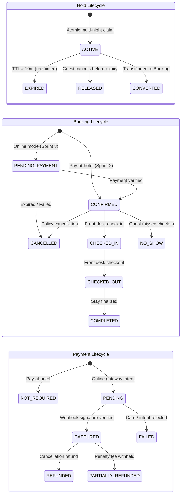

# Staywise History — Sprint Plans & Progress Logs

- **Reference only** — finished or superseded plans and progress logs; current work lives in [MVP.md](MVP.md) and [TASKS.md](TASKS.md).
- **Index of parts**
  - **[Sprint 2 Technical Specification: Availability Holds & Booking Lifecycle Engine](#24-sprint-2-availability-and-booking-plan)** — `DOC-024`, approved but not implemented design for guest auth, holds and bookings.
  - **[Admin Platform Production Hardening & Fixes Progress Tracker](#25-admin-production-hardening-progress)** — `DOC-025`, completed security, performance and admin UI hardening log.
  - **[Staywise Full-Stack Analysis & Fix Plan](#fullstack-analysis-and-fix-plan)** — the reasoning behind fixes B1–B10 and F1–F12 (historical plan; checkboxes never updated).
  - **[Staywise Full-Stack Analysis & Fix Plan — Implementation Progress Tracker](#26-fullstack-fix-plan-progress)** — the status of fixes B1–B10 and F1–F12.

---

<a id="24-sprint-2-availability-and-booking-plan"></a>
## Sprint 2 Technical Specification: Availability Holds & Booking Lifecycle Engine

- **Status: not implemented.** No holds, bookings or guest-auth code exists yet.
  - Before building, reconcile it with ADR-005 (guest checkout without an account) and ADR-007 (tax is still open) in [ARCHITECTURE.md#20-decision-log](ARCHITECTURE.md#20-decision-log).
  - See [README.md#DOCUMENTATION-REPORT](README.md#DOCUMENTATION-REPORT) §8.
- **Document ID:** `DOC-024`
- **Status:** Approved Architecture Plan — Ready for Future Implementation
- **Target Release:** Sprint 2 (Phase 4 Milestone)
- **Dependency:** MongoDB 6+ Replica Set Multi-Document Transactions

### 1. Executive Summary & Design Alignment

- **Purpose:** This document details the architectural blueprint, data schemas, transactional algorithms, API contracts, and concurrency test suites for **Sprint 2: Availability Holds & Booking Lifecycle Engine**.
- **Alignment:** All design branches were systematically resolved and aligned through architectural review:
  1. **Mandatory Guest User Accounts:**
     - Every inventory hold and reservation is strictly associated with a verified guest identity (`guestId`).
     - Guest authentication uses isolated server-managed sessions in a secure HttpOnly cookie (`staywise_guest_sid`), completely separated from the staff cookie audience (`staywise_staff_sid`).
  2. **Dual-Protection Hold Expiry:**
     - All inventory holds carry a strict 10-minute time-to-live (`expiresAt = createdAt + 10m`).
     - Expired holds are reclaimed **on-demand** inside any hold transaction for that room type, complemented by a **1-minute periodic background worker** that sweeps stale holds across all properties.
  3. **Sprint 2 Booking Transition Mode:**
     - Supports `PAY_AT_HOTEL` for immediate booking confirmation during Sprint 2.
     - State machines remain decoupled so that `PAY_ONLINE` and gateway webhooks can be introduced in Sprint 3 without altering the inventory or booking state transitions.
  4. **Server-Authoritative Tax & Price Quoting:**
     - Base nightly rates are combined into a subtotal; taxes are computed server-side using a basis-point tax rate (default: `1200 bps` / 12% GST).
     - All prices, taxes, and fees are stored immutably in integer minor currency units (e.g., paise/cents) with explicit ISO 4217 currency.

### 2. Invariants & State Machine Architecture

#### A. The Core Inventory Invariant

- **Invariant:** For every room type and local stay date $d \in [\text{checkIn}, \text{checkOut})$:
  - $$\text{heldRooms} + \text{confirmedRooms} + \text{blockedRooms} \le \text{totalRooms}$$

#### B. Decoupled State Machines

- **Decoupling:** The platform strictly decouples the state of an inventory hold, the state of a reservation, and the state of payment:



### 3. Database Schemas & Data Contracts

#### A. Guest User (`guest_users` collection)

- **Purpose:** Stores authenticated guest accounts:

```typescript
export interface GuestUserDocument {
  _id: ObjectId;
  email: string;             // Lowercase, trimmed, unique index
  passwordHash: string;      // bcrypt (cost factor 12)
  name: string;
  phone: string;
  status: 'ACTIVE' | 'SUSPENDED';
  createdAt: Date;
  updatedAt: Date;
}
```

#### B. Inventory Hold (`holds` collection)

- **Purpose:** Stores temporary 10-minute claims:

```typescript
export interface HoldDocument {
  _id: ObjectId;
  guestId: ObjectId;         // Ref: GuestUser
  hotelId: ObjectId;         // Ref: Hotel
  roomTypeId: ObjectId;      // Ref: RoomType
  roomsCount: number;        // Integer >= 1
  stayDates: {
    checkIn: string;         // YYYY-MM-DD (inclusive)
    checkOut: string;        // YYYY-MM-DD (exclusive)
  };
  stayNights: string[];      // Array of stay dates
  status: 'ACTIVE' | 'CONVERTED' | 'EXPIRED' | 'RELEASED';
  expiresAt: Date;           // createdAt + 10 minutes (indexed)
  idempotencyKey: string;    // Unique index per hold attempt
  quote: {
    currency: string;        // e.g. 'INR'
    subtotalMinorUnits: number;
    taxRateBps: number;      // e.g. 1200 (12%)
    taxMinorUnits: number;
    totalMinorUnits: number;
    nightlyBreakdown: Array<{
      stayDate: string;
      amountMinorUnits: number;
    }>;
  };
  createdAt: Date;
  updatedAt: Date;
}
```

- **Indexes for `holds`:**
  - **`{ idempotencyKey: 1 }`** — unique.
  - **`{ guestId: 1, status: 1 }`** — guest/status lookup.
  - **`{ expiresAt: 1, status: 1 }`** — optimized for background reaper.
  - **`{ roomTypeId: 1, status: 1, expiresAt: 1 }`** — optimized for on-demand reclaim.

#### C. Booking (`bookings` collection)

- **Purpose:** Stores immutable confirmed reservations:

```typescript
export interface BookingDocument {
  _id: ObjectId;
  reference: string;         // Unguessable alphanumeric (e.g. SW-7K2M9P), unique index
  holdId: ObjectId;          // Traceability link to Hold
  guestId: ObjectId;         // Ref: GuestUser
  hotelId: ObjectId;         // Ref: Hotel
  roomTypeId: ObjectId;      // Ref: RoomType
  roomsCount: number;
  stayDates: {
    checkIn: string;
    checkOut: string;
  };
  stayNights: string[];
  occupancy: {
    adults: number;
    children: number;
  };
  status: 'CONFIRMED' | 'PENDING_PAYMENT' | 'CHECKED_IN' | 'CHECKED_OUT' | 'COMPLETED' | 'CANCELLED' | 'NO_SHOW' | 'PAYMENT_REVIEW';
  paymentStatus: 'NOT_REQUIRED' | 'PENDING' | 'CAPTURED' | 'REFUNDED' | 'PARTIALLY_REFUNDED';
  paymentMode: 'PAY_AT_HOTEL' | 'PAY_ONLINE';
  pricingSnapshot: {
    currency: string;
    subtotalMinorUnits: number;
    taxRateBps: number;
    taxMinorUnits: number;
    totalMinorUnits: number;
    nightlyBreakdown: Array<{ stayDate: string; amountMinorUnits: number }>;
  };
  guestSnapshot: {
    name: string;
    email: string;
    phone: string;
  };
  policySnapshot: {
    cancellationPolicy: any;
    freeCancellationHoursBeforeCheckIn: number;
  };
  history: Array<{
    fromStatus: string;
    toStatus: string;
    actorId: string;
    actorType: 'GUEST' | 'STAFF' | 'SYSTEM';
    timestamp: Date;
    reason?: string;
  }>;
  idempotencyKey: string;    // Unique index
  createdAt: Date;
  updatedAt: Date;
}
```

### 4. Transactional Workflows & Algorithms

#### A. Atomic Multi-Night Hold Acquisition

```typescript
async function acquireHold(dto: CreateHoldDto, guest: GuestPrincipal): Promise<HoldResponse> {
  // 1. Validate stay dates: checkIn < checkOut, max 30 nights, in property time zone
  const stayNights = computeStayNights(dto.checkIn, dto.checkOut);

  // 2. Fetch room type and base rates for all nights
  const hotel = await getPublishedHotel(dto.hotelId);
  const roomType = await getActiveRoomType(dto.roomTypeId);
  const baseRates = await getBaseRatesForNights(dto.roomTypeId, stayNights);

  // 3. Compute immutable server-authoritative quote
  const quote = computeQuote(baseRates, dto.roomsCount, hotel.taxRateBps ?? 1200);

  // 4. Multi-document transaction with bounded retries
  return transactionService.executeInTransaction(async (session) => {
    // 4a. On-demand reclaim: Expire stale holds for this room type
    const staleHolds = await HoldModel.find({
      roomTypeId: dto.roomTypeId,
      status: 'ACTIVE',
      expiresAt: { $lt: new Date() }
    }, null, { session });

    for (const stale of staleHolds) {
      await HoldModel.updateOne({ _id: stale._id }, { status: 'EXPIRED' }, { session });
      for (const night of stale.stayNights) {
        await NightInventoryModel.updateOne(
          { roomTypeId: stale.roomTypeId, stayDate: night },
          { $inc: { heldRooms: -stale.roomsCount } },
          { session }
        );
      }
    }

    // 4b. Conditional atomic claim for every stay night
    for (const stayDate of stayNights) {
      const claimResult = await NightInventoryModel.updateOne(
        {
          roomTypeId: dto.roomTypeId,
          stayDate,
          $expr: {
            $gte: [
              { $subtract: ["$totalRooms", { $add: ["$heldRooms", "$confirmedRooms", "$blockedRooms"] }] },
              dto.roomsCount
            ]
          }
        },
        { $inc: { heldRooms: dto.roomsCount } },
        { session }
      );

      if (claimResult.modifiedCount === 0) {
        throw new ConflictException(`INVENTORY_UNAVAILABLE for night: ${stayDate}`);
      }
    }

    // 4c. Persist Hold document
    const [hold] = await HoldModel.create([{
      guestId: guest.id,
      hotelId: dto.hotelId,
      roomTypeId: dto.roomTypeId,
      roomsCount: dto.roomsCount,
      stayDates: { checkIn: dto.checkIn, checkOut: dto.checkOut },
      stayNights,
      status: 'ACTIVE',
      expiresAt: new Date(Date.now() + 10 * 60 * 1000), // 10 minutes TTL
      idempotencyKey: dto.idempotencyKey,
      quote
    }], { session });

    await auditService.log({
      action: 'hold.created',
      actorId: guest.id,
      actorType: 'GUEST',
      targetId: hold._id.toString(),
      metadata: { hotelId: dto.hotelId, roomTypeId: dto.roomTypeId, roomsCount: dto.roomsCount }
    }, session);

    return formatHoldResponse(hold);
  });
}
```

#### B. Hold-to-Booking Conversion (Zero Inventory Loss)

```typescript
async function convertHoldToBooking(dto: CreateBookingDto, guest: GuestPrincipal): Promise<BookingResponse> {
  return transactionService.executeInTransaction(async (session) => {
    // 1. Verify hold is active and not expired
    const hold = await HoldModel.findOne({
      _id: dto.holdId,
      guestId: guest.id,
      status: 'ACTIVE',
      expiresAt: { $gt: new Date() }
    }, null, { session });

    if (!hold) {
      throw new BadRequestException('HOLD_EXPIRED_OR_INVALID');
    }

    // 2. Mark hold as CONVERTED
    await HoldModel.updateOne({ _id: hold._id }, { status: 'CONVERTED' }, { session });

    // 3. Atomically transfer inventory from held to confirmed for all nights
    // Net occupied rooms remain IDENTICAL (heldRooms decreases, confirmedRooms increases)
    for (const stayDate of hold.stayNights) {
      await NightInventoryModel.updateOne(
        { roomTypeId: hold.roomTypeId, stayDate },
        {
          $inc: {
            heldRooms: -hold.roomsCount,
            confirmedRooms: hold.roomsCount
          }
        },
        { session }
      );
    }

    // 4. Snapshot hotel policies and guest details
    const hotel = await HotelModel.findById(hold.hotelId, null, { session });
    const reference = generateUnguessableReference(); // e.g. "SW-K8M3P7"

    // 5. Create immutable Booking record
    const [booking] = await BookingModel.create([{
      reference,
      holdId: hold._id,
      guestId: guest.id,
      hotelId: hold.hotelId,
      roomTypeId: hold.roomTypeId,
      roomsCount: hold.roomsCount,
      stayDates: hold.stayDates,
      stayNights: hold.stayNights,
      occupancy: dto.occupancy,
      status: 'CONFIRMED', // Immediate confirmation for PAY_AT_HOTEL
      paymentStatus: 'NOT_REQUIRED',
      paymentMode: 'PAY_AT_HOTEL',
      pricingSnapshot: hold.quote,
      guestSnapshot: { name: dto.guestName, email: dto.guestEmail, phone: dto.guestPhone },
      policySnapshot: {
        cancellationPolicy: hotel.cancellationPolicy,
        freeCancellationHoursBeforeCheckIn: hotel.cancellationPolicy?.freeCancellationHoursBeforeCheckIn ?? 24
      },
      history: [{
        fromStatus: 'NONE',
        toStatus: 'CONFIRMED',
        actorId: guest.id,
        actorType: 'GUEST',
        timestamp: new Date(),
        reason: 'Reservation created via pay at hotel'
      }],
      idempotencyKey: dto.idempotencyKey
    }], { session });

    await auditService.log({
      action: 'booking.confirmed',
      actorId: guest.id,
      actorType: 'GUEST',
      targetId: booking._id.toString(),
      metadata: { reference, totalMinorUnits: hold.quote.totalMinorUnits }
    }, session);

    return formatBookingResponse(booking);
  });
}
```

#### C. Booking Cancellation & Inventory Release

```typescript
async function cancelBooking(reference: string, actor: UserPrincipal, reason?: string): Promise<void> {
  return transactionService.executeInTransaction(async (session) => {
    const booking = await BookingModel.findOne({ reference }, null, { session });
    if (!booking) throw new NotFoundException('BOOKING_NOT_FOUND');
    if (booking.status !== 'CONFIRMED') throw new BadRequestException(`Cannot cancel booking in ${booking.status} status`);

    // 1. Mark booking CANCELLED
    await BookingModel.updateOne(
      { _id: booking._id },
      {
        status: 'CANCELLED',
        $push: {
          history: {
            fromStatus: 'CONFIRMED',
            toStatus: 'CANCELLED',
            actorId: actor.id,
            actorType: actor.role === 'GUEST' ? 'GUEST' : 'STAFF',
            timestamp: new Date(),
            reason: reason || 'Guest requested cancellation'
          }
        }
      },
      { session }
    );

    // 2. Release confirmed rooms back to available inventory
    for (const stayDate of booking.stayNights) {
      await NightInventoryModel.updateOne(
        { roomTypeId: booking.roomTypeId, stayDate },
        { $inc: { confirmedRooms: -booking.roomsCount } },
        { session }
      );
    }

    await auditService.log({
      action: 'booking.cancelled',
      actorId: actor.id,
      actorType: actor.role === 'GUEST' ? 'GUEST' : 'STAFF',
      targetId: booking._id.toString(),
      metadata: { reference, reason }
    }, session);
  });
}
```

### 5. Background Hold Expiry Sweeper (Cron Job)

- **Trigger:** `@Cron(CronExpression.EVERY_MINUTE)`
- **Function:** Queries `HoldModel` for documents where `status == 'ACTIVE'` and `expiresAt < now`.
- **Execution:** Sweeps in batches of 50. For each batch, runs a multi-document transaction to transition holds to `EXPIRED` and decrement `heldRooms` on affected `NightInventory` records.
- **Resilience:** If the cron is delayed or process restarts, the on-demand transaction reclaimer in `acquireHold` guarantees no stale hold blocks concurrent inventory.

### 6. Versioned REST API Contracts

#### A. Guest Authentication (`/api/v1/auth/guest`)

- **`POST /api/v1/auth/guest/register`** — Register guest with email, phone, name, password.
  - Auth required: No.
- **`POST /api/v1/auth/guest/login`** — Authenticate and issue HttpOnly `staywise_guest_sid`.
  - Auth required: No.
- **`GET /api/v1/auth/guest/me`** — Fetch authenticated guest profile.
  - Auth required: Guest Session.
- **`POST /api/v1/auth/guest/logout`** — Revoke guest session and clear cookie.
  - Auth required: Guest Session.

#### B. Holds Management (`/api/v1/holds`)

- **`POST /api/v1/holds`** — Acquire 10-minute hold across date range with quote snapshot.
  - Auth required: Guest Session.
- **`GET /api/v1/holds/:id`** — Check hold status and remaining seconds.
  - Auth required: Guest Session.
- **`POST /api/v1/holds/:id/release`** — Manually release an active hold before TTL expiry.
  - Auth required: Guest Session.

#### C. Guest Bookings (`/api/v1/bookings`)

- **`POST /api/v1/bookings`** — Convert active hold into confirmed reservation.
  - Auth required: Guest Session.
- **`GET /api/v1/bookings`** — List all bookings belonging to current guest.
  - Auth required: Guest Session.
- **`GET /api/v1/bookings/:reference`** — View full booking details, quote, and cancellation policy.
  - Auth required: Guest Session.
- **`POST /api/v1/bookings/:reference/cancel`** — Cancel booking according to policy and release inventory.
  - Auth required: Guest Session.

#### D. Admin Bookings Operations (`/api/v1/admin/bookings`)

- **`GET /api/v1/admin/bookings`** — List all bookings with hotel, status, and date filters.
  - Permission required: `bookings.view`.
- **`GET /api/v1/admin/bookings/:id`** — View booking details, transition history, and audit log.
  - Permission required: `bookings.view`.
- **`POST /api/v1/admin/bookings/:id/check-in`** — Mark guest checked-in (`CONFIRMED -> CHECKED_IN`).
  - Permission required: `bookings.checkin`.
- **`POST /api/v1/admin/bookings/:id/check-out`** — Mark guest checked-out (`CHECKED_IN -> CHECKED_OUT`).
  - Permission required: `bookings.checkout`.
- **`POST /api/v1/admin/bookings/:id/cancel`** — Privileged staff cancellation with audited reason.
  - Permission required: `bookings.cancel`.

### 7. Integration & Concurrency Test Matrix

- **Test environment:** To be verified against a replica-set instance (`mongodb-memory-server`):
- **TC-01 — Race Condition on Final Room**
  - Scenario: Total rooms = 1. Two concurrent requests simultaneously attempt to hold the room for overlapping dates.
  - Expected behavior: Exactly 1 request succeeds with active hold. Exactly 1 request throws `INVENTORY_UNAVAILABLE`.
  - Invariant verified: $\text{held} + \text{confirmed} + \text{blocked} \le \text{total}$ strictly maintained.
- **TC-02 — Partial Multi-Night Rollback**
  - Scenario: Stay covers 5 nights. Nights 1, 2, 4, 5 have availability; Night 3 has 0 available rooms.
  - Expected behavior: Transaction throws `ConflictException`. All 5 nights roll back. 0 rooms held.
  - Invariant verified: All-or-nothing hold claim across stay range.
- **TC-03 — Hold Expiry and Auto-Reclaim**
  - Scenario: Hold is created. Time advances past 10 minutes. Second guest requests same room.
  - Expected behavior: On-demand reaper reclaims stale hold. Second guest successfully acquires hold.
  - Invariant verified: Stale holds never permanently lock inventory.
- **TC-04 — Hold Conversion Counter Invariant**
  - Scenario: Active hold for 2 rooms is converted to booking.
  - Expected behavior: `heldRooms` decreases by 2. `confirmedRooms` increases by 2.
  - Invariant verified: Total occupied inventory remains constant during conversion.
- **TC-05 — Booking Cancellation Release**
  - Scenario: Confirmed booking for 2 rooms is cancelled.
  - Expected behavior: `confirmedRooms` decreases by 2. Rooms become immediately available.
  - Invariant verified: Released rooms re-enter available inventory pool.
- **TC-06 — Idempotent Hold Submission**
  - Scenario: Identical hold payload submitted twice with same `idempotencyKey`.
  - Expected behavior: First creates hold. Second returns existing hold without double-incrementing.
  - Invariant verified: Idempotency key guarantees single execution.

### 8. Phased Implementation Roadmap (For Future Execution)

- **Sequence:** When ready to implement, follow this exact dependency sequence:
  1. **Step 1: Guest Authentication Foundation (`apps/api/src/modules/auth`)**
     - Create `GuestUser` schema and Mongoose model.
     - Implement `POST /api/v1/auth/guest/register` and `POST /api/v1/auth/guest/login`.
     - Implement `GuestSessionGuard` validating `staywise_guest_sid` cookie.
  2. **Step 2: Inventory Hold Engine (`apps/api/src/modules/holds`)**
     - Create `Hold` schema with composite indexes.
     - Implement atomic multi-night `acquireHold` transaction with on-demand reap.
     - Implement 1-minute NestJS scheduled expiry sweeper.
     - Expose `POST /api/v1/holds`, `GET /api/v1/holds/:id`, and `POST /api/v1/holds/:id/release`.
  3. **Step 3: Booking Engine (`apps/api/src/modules/bookings`)**
     - Create `Booking` schema with immutable snapshot models.
     - Implement `convertHoldToBooking` transaction (transferring held to confirmed inventory).
     - Implement `cancelBooking` transaction.
     - Expose guest booking endpoints (`POST /bookings`, `GET /bookings`, `GET /bookings/:reference`, `POST /bookings/:reference/cancel`).
  4. **Step 4: Admin Operations Controller**
     - Implement `AdminBookingsController` (`/api/v1/admin/bookings`) with check-in, check-out, and cancellation.
  5. **Step 5: Concurrency Test Verification**
     - Execute integration tests using `mongodb-memory-server` to prove race-condition safety.

---

<a id="25-admin-production-hardening-progress"></a>
## Admin Platform Production Hardening & Fixes Progress Tracker

- **Document ID:** `DOC-025`
- **Status:** Completed — Fully Implemented & Verified
- **Scope:** Admin Platform (Frontend & Backend) Critical and Launch-Blocking Fixes
- **Rule:** No guest side work. No new test scripts or suites created now (deferred).

### 1. Overview & Action Plan

- **Overview:** This document tracks the critical hardening items and fixes identified in the production readiness audit of the Staywise Admin Platform (`apps/api` and `apps/admin-web`).
- **Outcome:** All high-priority security, query performance, and redundant HTTP request issues have been resolved and verified with complete workspace production builds.

### 2. Implementation Checklist

#### Phase 1: Security & RBAC Scoping Hardening

- [x] **SEC-01: Normalize StaffPermissionGuard Hotel Parameter Scoping**
  - Fixed route parameter inspection in [staff-permission.guard.ts](../apps/api/src/common/auth/staff-permission.guard.ts) to handle both `request.params.hotelId` and `request.params.id`.
  - Prevents property scoping bypasses on `GET /admin/hotels/:id`, `PATCH :id`, `POST :id/media`, `POST :id/publish`, and `POST :id/suspend`.
- [x] **SEC-02: Eliminate Insecure CORS Dynamic Reflection**
  - In [main.ts](../apps/api/src/main.ts), eliminated `origin: true` reflection with credentials.
  - Enforced strict explicit origins, fails closed with a fatal startup error in production when `CORS_ORIGINS` is missing, and provides safe local development defaults (`http://localhost:5173`, `http://127.0.0.1:5173`).
- [x] **SEC-03: Consolidate Network & Privacy-Safe IP Utility**
  - Extracted duplicated `privacySafeIp` helper from `auth.service.ts` into a centralized [network.util.ts](../apps/api/src/common/utils/network.util.ts) utility.

#### Phase 2: Database & Query Performance

- [x] **PERF-01: Replace Unindexed `$or` Regex Table Scans**
  - In [hotel.service.ts](../apps/api/src/modules/hotels/hotel.service.ts), replaced leading-wildcard case-insensitive regex queries with indexed MongoDB `$text` search (`hotel_text_search`), avoiding full-table `COLLSCAN`s during directory filtering.
- [x] **PERF-02: Add Transactional Multi-Day Inventory Range Adjustment API**
  - Added `POST /admin/room-types/:roomTypeId/inventory/batch-adjust` in [inventory.controller.ts](../apps/api/src/modules/inventory/inventory.controller.ts) and [inventory.service.ts](../apps/api/src/modules/inventory/inventory.service.ts) to allow blocking or unblocking an entire date range transactionally in a single database transaction.

#### Phase 3: Admin Metrics API & Redundant Query Elimination

- [x] **API-01: Dedicated Hotel Status Metrics Endpoint**
  - Added `GET /admin/hotels/metrics` endpoint in [hotels.controller.ts](../apps/api/src/modules/hotels/hotels.controller.ts) and [hotel.service.ts](../apps/api/src/modules/hotels/hotel.service.ts) using property-scoped counts (`total`, `published`, `draft`, `suspended`, `archived`).
- [x] **FE-01: Eliminate 5x Redundant HTTP Calls in Dashboard & Hotels Pages**
  - Refactored [DashboardPage.tsx](../apps/admin-web/src/pages/dashboard/DashboardPage.tsx) and [HotelsPage.tsx](../apps/admin-web/src/pages/hotels/HotelsPage.tsx) to fetch status counts from the single `/admin/hotels/metrics` endpoint instead of firing 5 simultaneous requests.

#### Phase 4: Server-Side Pagination & Filtering in Admin UI

- [x] **FE-02: Full Server-Side Filtering and Pagination on Hotels Page**
  - Refactored [HotelsPage.tsx](../apps/admin-web/src/pages/hotels/HotelsPage.tsx) to stop hardcoding `limit=100&offset=0` with client-side in-memory filtering.
  - Connected search keywords, status filters, location, and page offset/limit directly to the API query parameters.

#### Phase 5: Build & Developer Ergonomics

- [x] **OPS-01: Add Root `test` Script**
  - Added `"test": "npm --workspace=apps/api run test"` alias in root [package.json](../package.json) so standard `npm test` works cleanly without creating new test files.
- [x] **VERIFY-01: Full Monorepo Build Verification**
  - Executed `npm run build:api` (NestJS production build) and `npm run build:admin` (Vite production bundle); both exited with code 0.

### 3. Progress Log

- **2026-10-12 · DOC-025** — Progress tracker created and indexed in README.md. Status: Complete.
- **2026-10-12 · SEC-01** — Normalized hotelId / id param handling in StaffPermissionGuard. Status: Complete.
- **2026-10-12 · SEC-02** — Hardened CORS in main.ts, disallowing dynamic origin reflection. Status: Complete.
- **2026-10-12 · SEC-03** — Centralized privacySafeIp in network.util.ts. Status: Complete.
- **2026-10-12 · PERF-01** — Replaced unindexed regex with MongoDB $text search in HotelService. Status: Complete.
- **2026-10-12 · PERF-02** — Implemented POST batch-adjust in inventory service & controller. Status: Complete.
- **2026-10-12 · API-01** — Implemented GET /admin/hotels/metrics aggregation endpoint. Status: Complete.
- **2026-10-12 · FE-01** — Eliminated 5x redundant calls in DashboardPage & HotelsPage. Status: Complete.
- **2026-10-12 · FE-02** — Converted HotelsPage to dynamic server-side filtering & pagination. Status: Complete.
- **2026-10-12 · OPS-01** — Added npm test root alias in package.json. Status: Complete.
- **2026-10-12 · VERIFY-01** — Verified clean builds for both apps/api and apps/admin-web. Status: Complete.

---

<a id="fullstack-analysis-and-fix-plan"></a>
## Staywise Full-Stack Analysis & Fix Plan

- **Historical plan:** the status of fixes B1–B10 and F1–F12 is tracked in [the implementation progress tracker](#26-fullstack-fix-plan-progress). The checkboxes in this file were never updated. Use this section for the reasoning behind each fix.
- **Date / author:** Oct 12, 2026 · @Pradeep

### Summary

- **Overall assessment:** The backend is the stronger half: transactions, optimistic locking, tenant scoping and input whitelisting are done well.
- **Biggest risks:** The two biggest risks are elsewhere.
  - Production login is fully blocked by an MFA check with no MFA flow.
  - The bulk-status endpoint likely lets anyone with `hotels.edit` publish or un-archive hotels without the publish checks.
- **Frontend problem:** The frontend has a different problem. Reading both audits side by side shows it may call rate endpoints that don't exist, and it uses status names the backend doesn't have.
  - Confirm these first (section 3); if true, the Rates page is broken today, not just inconsistent.
- **Top issues, in order:**
  1. Production staff login always fails with `AUTH_MFA_REQUIRED` (`auth.service.ts:L61-73`).
  2. Bulk status may bypass publish preconditions, the `hotels.publish` permission, the irreversible-archive rule and optimistic locking (`hotel.service.ts:L117-145`).
  3. No startup env validation: a missing `SESSION_SECRET` silently uses a public default (`configuration.ts`).
  4. Frontend rate calls don't match `GET/PUT /admin/room-types/:roomTypeId/base-rate`.
  5. Frontend uses "Paused" / `PAUSED`; the backend uses `SUSPENDED`.
  6. Any API 403, including a CSRF failure, sends the user to the access-denied screen (`AppLayout.tsx:L75-77`).
  7. Validation errors return field names only inside English strings, so forms can't highlight fields.
- **How much to trust the audits.** The backend audit is solid (8/10): an exact endpoint table, real error bodies and transaction coverage. It missed the bulk-status bypass. Three of its recommendations are weaker:
  - Its new exception filter guesses field names by splitting the message on the first space.
  - Its response envelope change would break every frontend call for little gain.
  - Its room-types pagination would change an array response into an object to solve a non-problem (hotels rarely have 50+ room types).
  - This plan replaces all three. Moving rate limiting to Redis is only needed once you run more than one API instance.
- **Decisions already made.** No TanStack Query: data fetching uses a small `useApiQuery` hook (F4). This document replaces the earlier "Admin Web UI Fix Plan" where they differ.

### All fixes at a glance

- **Scope:** Twenty-two fixes: 10 backend (B) and 12 frontend (F), sorted by severity. Week 1 holds everything Critical plus the quick wins that stop data or access problems.
- **B1** — Gate the MFA check behind `MFA_ENABLED` so production login works.
  - App: API · Severity: Critical · Effort: Quick win · Week: 1
- **B2** — Validate env at boot; fail fast on missing secrets.
  - App: API · Severity: Critical · Effort: Quick win · Week: 1
- **B3** — Bulk status: enforce transitions, per-status permissions, publish checks.
  - App: API · Severity: Critical · Effort: Moderate · Week: 1
- **F5** — Rates: call the real base-rate endpoints; freeze IDs on save.
  - App: Web · Severity: Critical (if mismatch confirmed) · Effort: Quick win · Week: 1
- **F7** — Bulk actions: `SUSPENDED` naming, correct body, confirm dialog.
  - App: Web · Severity: High · Effort: Quick win · Week: 1
- **F1** — 403 handling by `errorCode`, not just status.
  - App: Web · Severity: High · Effort: Quick win · Week: 1
- **F2** — Root and page Error Boundaries.
  - App: Web · Severity: High · Effort: Quick win · Week: 1
- **F12** — Inventory block/unblock with `version` and `reason`.
  - App: Web · Severity: High · Effort: Moderate · Week: 2
- **B4** — Structured validation errors + consistent `errorCode` (additive).
  - App: API · Severity: High · Effort: Moderate · Week: 2
- **F6** — Field-level errors and `errorCode`-based handling.
  - App: Web · Severity: High · Effort: Moderate · Week: 2
- **B5** — Publish returns all failed preconditions at once.
  - App: API · Severity: High · Effort: Quick win · Week: 2
- **B7** — Tests for auth, permission guard, scoping, pricing.
  - App: API · Severity: High · Effort: Moderate · Week: 2–4
- **F3** — AuthProvider: one place for 401, logout, idle expiry.
  - App: Web · Severity: Medium · Effort: Moderate · Week: 2
- **F4** — `useApiQuery` hook: cancellation, no stale overwrites, invalidation.
  - App: Web · Severity: High · Effort: Moderate · Week: 2
- **F11** — Hide or disable actions the user lacks permission for.
  - App: Web · Severity: Medium · Effort: Quick win · Week: 2
- **F8** — Split CatalogPage into 3 pages, same URLs.
  - App: Web · Severity: Medium · Effort: Moderate · Week: 3
- **B6** — Production index management (`autoIndex` off, sync at deploy).
  - App: API · Severity: Medium · Effort: Quick win · Week: 3
- **B8** — Split `HotelService`; move `digest` to a shared crypto util.
  - App: API · Severity: Medium · Effort: Moderate · Week: 3
- **F9** — Theme tokens via Tailwind v4 `@theme`.
  - App: Web · Severity: Medium · Effort: Moderate · Week: 4
- **B9** — Login throttling: proper 429 now, Redis only when scaling out.
  - App: API · Severity: Medium · Effort: Quick win · Week: 4
- **F10** — Cleanup: `@/` alias, dead shim, KPI merge, primitives.
  - App: Web · Severity: Low · Effort: Quick win · Week: 1–4
- **B10** — Audit log retention (TTL or archive).
  - App: API · Severity: Low · Effort: Quick win · Week: after decision

### Where frontend and backend disagree

- **Context:** Comparing the frontend audits with the backend endpoint table shows at least four mismatches that would break features outright. All frontend details come from the audits, so confirm each one in the code before fixing it.
- **Rate endpoints**
  - Frontend (per audits): Audit 1: `GET/PUT/POST /admin/rates`. Audit 2: `POST /admin/hotels/:hotelId/base-rates` or `PUT :id`.
  - Backend (actual): `GET /admin/room-types/:roomTypeId/base-rate`, `PUT` same path.
  - Impact: If either audit is right, the Rates page gets 404s for every load and save.
  - Fix: F5.
- **Unconfigured rate**
  - Frontend: Treated as an "Unconfigured" alert.
  - Backend: `GET base-rate` returns **404** when no rate exists.
  - Impact: Can show as an error instead of an empty state.
  - Fix: F5.
- **Rate save body**
  - Frontend: Unknown.
  - Backend: `amountMinorUnits`, `currency` (ISO-3), `version` (needed on update), `reason`.
  - Impact: Missing `version` on update → 409; unknown fields → 400 (`forbidNonWhitelisted`).
  - Fix: F5.
- **Hotel status names**
  - Frontend: "Paused", Pause action, `Paused` summary card.
  - Backend: `SUSPENDED`; metrics key `suspended`.
  - Impact: Paused card likely shows blank; a bulk `PAUSED` status → 400.
  - Fix: F7.
- **Bulk status body**
  - Frontend: Plan assumed `{ ids, status }`.
  - Backend: `{ hotelIds (1–100), status, reason }`.
  - Impact: Wrong field name → 400.
  - Fix: F7.
- **Bulk status result**
  - Frontend: Shows success.
  - Backend: Returns `modifiedCount`; out-of-scope IDs are silently skipped.
  - Impact: "5 hotels archived" when only 3 were.
  - Fix: F7, B3.
- **Single-night block**
  - Frontend: Body unknown.
  - Backend: Requires `version`, `quantity` (1–10000), `reason` (3–500 chars).
  - Impact: If the UI sends no reason or version, every block fails.
  - Fix: F12.
- **Unblock**
  - Frontend: No UI.
  - Backend: `POST .../:stayDate/unblock` exists.
  - Impact: A blocked night can't be released from the admin app.
  - Fix: F12.
- **Validation errors**
  - Frontend: Reads `message` as a string.
  - Backend: `message` is a **string array** for 400s.
  - Impact: Toasts show comma-joined raw messages.
  - Fix: B4, F6.
- **409 meaning**
  - Frontend: Treated as one case.
  - Backend: `VERSION_CONFLICT` **and** publish failures (`HOTEL_*_REQUIRED`) both use 409.
  - Impact: Wrong recovery shown to the user.
  - Fix: F6.
- **403 meaning**
  - Frontend: Any 403 → access-denied screen.
  - Backend: `FORBIDDEN` (scope or permission) **and** `CSRF_REJECTED`.
  - Impact: A CSRF problem looks like a permission problem.
  - Fix: F1.
- **Session expiry**
  - Frontend: No awareness.
  - Backend: 30-minute idle timeout; 12-hour max.
  - Impact: Users lose unsaved forms after a coffee break.
  - Fix: F3.
- **Hotel create**
  - Frontend: Button likely visible to all.
  - Backend: `POST /admin/hotels` is SUPER\_ADMIN only.
  - Impact: Managers click Create and get a 403.
  - Fix: F11.
- **Catalog hotel picker**
  - Frontend: `GET /admin/hotels?limit=100`.
  - Backend: Max `limit` is 100.
  - Impact: Hotels beyond 100 can't be selected.
  - Fix: F8.
- **Dev CORS default**
  - Frontend: Vite dev server on port 5173.
  - Backend: Default `CORS_ORIGINS` is ports 3001 and 3002; the CSRF Origin check uses the same list.
  - Impact: Every write fails `CSRF_REJECTED` unless env is set.
  - Fix: B2.
- **Things that do match:** login, `/auth/me`, `/auth/logout`, hotel list and filters, metrics, create, `PATCH /admin/hotels/:id`, media, publish, room-types list and create, inventory range and initialize, and the CSRF header name.

### Backend fixes

#### B1. Unblock production login (Critical, quick win)

- **Problem:** `auth.service.ts:L61-73` throws `AUTH_MFA_REQUIRED` for every login when `NODE_ENV=production`, and no MFA flow exists. Nobody can sign in to production.

```ts
// common/config/configuration.ts
auth: {
  mfaRequired: process.env.MFA_ENABLED === 'true', // default false until MFA exists
},
```

```ts
// auth.service.ts — replace the NODE_ENV check
if (this.config.get<boolean>('auth.mfaRequired')) {
  throw new UnauthorizedException({ error: 'AUTH_MFA_REQUIRED', message: 'Multi-factor sign-in is required' });
}
```

- **Residual risk:** Without MFA, staff accounts are protected only by password, the existing lockout (`failedLoginCount`, `lockUntil`) and login throttling.
- **Follow-up:** Log a warning at boot in production when `mfaRequired` is false, and put TOTP MFA on the roadmap (decision in the last section).

#### B2. Validate environment at boot (Critical, quick win)

- **Problem:** Nothing checks `process.env`, so production can start with the public default `SESSION_SECRET` or a local unauthenticated `MONGODB_URI`.

```ts
// common/config/env.schema.ts
import { z } from 'zod';

const schema = z.object({
  NODE_ENV: z.enum(['development', 'test', 'production']).default('development'),
  PORT: z.coerce.number().int().positive().default(3000),
  API_PREFIX: z.string().default('/api/v1'),
  MONGODB_URI: z.string().regex(/^mongodb(\+srv)?:\/\//, 'must be a mongodb:// URI')
    .default('mongodb://127.0.0.1:27017/staywise_dev'),
  SESSION_SECRET: z.string().min(32).default('dev-secret-do-not-use-in-production-min-32-chars'),
  CORS_ORIGINS: z.string().default('http://localhost:5173,http://localhost:3001,http://localhost:3002'),
  MFA_ENABLED: z.enum(['true', 'false']).default('false'),
  STAFF_SESSION_MAX_AGE_SECONDS: z.coerce.number().int().positive().default(43200),
  STAFF_SESSION_IDLE_SECONDS: z.coerce.number().int().positive().default(1800),
  // ...the remaining vars from the audit's table, same pattern
}).superRefine((env, ctx) => {
  if (env.NODE_ENV !== 'production') return;
  const fail = (path: string, message: string) => ctx.addIssue({ code: 'custom', path: [path], message });
  if (env.SESSION_SECRET.startsWith('dev-secret')) fail('SESSION_SECRET', 'must be set in production');
  if (/127\.0\.0\.1|localhost/.test(env.MONGODB_URI)) fail('MONGODB_URI', 'must not point at localhost in production');
  if (/localhost/.test(env.CORS_ORIGINS)) fail('CORS_ORIGINS', 'must list production origins only');
});

export function validateEnv(raw: Record<string, unknown>) {
  const result = schema.safeParse(raw);
  if (!result.success) {
    const lines = result.error.issues.map((i) => `  ${i.path.join('.')}: ${i.message}`);
    throw new Error(`Invalid environment:\n${lines.join('\n')}`);
  }
  return result.data;
}
```

```ts
// app.module.ts
ConfigModule.forRoot({ isGlobal: true, load: [configuration], validate: validateEnv }),
```

- **Dev CORS:** The dev CORS default now includes port 5173, so the admin web works locally without env changes.
- **Env example:** Commit an `.env.example` listing every variable.

#### B3. Make bulk status safe (Critical, moderate)

- **Problem:** `hotel.service.ts:L117-145` runs one `updateMany` with only `hotels.edit` checked at the controller. Unless the code checks more than the audit describes, this means:
  - A `DRAFT` hotel can be bulk-set to `PUBLISHED` **without the 5 publish preconditions**.
  - A user with `hotels.edit` but not `hotels.publish` can publish. The `hotels.archive` permission is seeded but never checked.
  - An `ARCHIVED` hotel can be moved back, breaking the irreversible-archive rule at `hotel.service.ts:L349`.
  - No `version` check, and out-of-scope IDs are silently dropped.
- **Approach:** Confirm by reading L117-145 for a status filter, then replace it with per-hotel transitions.

```ts
// modules/hotels/hotel-status.rules.ts
export const BULK_TRANSITIONS: Record<HotelStatus, HotelStatus[]> = {
  DRAFT: ['ARCHIVED'],                 // DRAFT → PUBLISHED only via POST /:id/publish
  PUBLISHED: ['SUSPENDED', 'ARCHIVED'],
  SUSPENDED: ['PUBLISHED', 'ARCHIVED'],
  ARCHIVED: [],                        // terminal
};

export const PERMISSION_FOR_STATUS: Record<HotelStatus, string> = {
  PUBLISHED: 'hotels.publish',
  SUSPENDED: 'hotels.edit',
  ARCHIVED: 'hotels.archive',
  DRAFT: 'hotels.edit',
};
```

```ts
// hotel.service.ts
async bulkStatusUpdate(actor: StaffActor, dto: BulkHotelStatusDto) {
  const required = PERMISSION_FOR_STATUS[dto.status];
  if (!actor.permissions.includes(required)) {
    throw new ForbiddenException({ error: 'FORBIDDEN', message: `Requires ${required}` });
  }

  return this.tx.executeInTransaction(async (session) => {
    const hotels = await this.hotelModel.find({ _id: { $in: dto.hotelIds } }).session(session);
    const found = new Map(hotels.map((h) => [h.id, h]));
    const updated: string[] = [];
    const skipped: { hotelId: string; code: string; message: string }[] = [];

    for (const id of dto.hotelIds) {
      const h = found.get(id);
      if (!h) { skipped.push({ hotelId: id, code: 'NOT_FOUND', message: 'Hotel not found' }); continue; }
      if (!isInScope(actor, id)) { skipped.push({ hotelId: id, code: 'FORBIDDEN', message: 'Outside your hotels' }); continue; }
      if (!BULK_TRANSITIONS[h.status].includes(dto.status)) {
        skipped.push({ hotelId: id, code: 'INVALID_TRANSITION', message: `Cannot move ${h.status} to ${dto.status}` });
        continue;
      }
      if (dto.status === 'PUBLISHED') {
        const problems = await this.publishChecks.collect(h, session); // B5
        if (problems.length) { skipped.push({ hotelId: id, code: 'NOT_READY', message: problems[0].message }); continue; }
      }
      const res = await this.hotelModel.updateOne(
        { _id: h._id, version: h.version, status: h.status },
        { $set: { status: dto.status }, $inc: { version: 1 } },
        { session },
      );
      if (res.modifiedCount === 1) updated.push(id);
      else skipped.push({ hotelId: id, code: 'VERSION_CONFLICT', message: 'Changed by another request' });
    }

    await this.audit.record({ /* action: HOTEL_BULK_STATUS, updated, skipped, reason: dto.reason */ });
    return { modifiedCount: updated.length, status: dto.status, updated, skipped };
  });
}
```

- **Compatibility:** The response keeps `modifiedCount` and `status`, so the current frontend keeps working; `updated` and `skipped` are new fields.
- **Suspended re-publish:** Bulk publish of a `SUSPENDED` hotel re-runs the publish checks, because rates or inventory may have changed while it was suspended.
- **Archive endpoint:** Add a single `POST /admin/hotels/:id/archive` (permission `hotels.archive`) so archiving isn't bulk-only.

#### B4. Structured validation errors, consistent codes (High, moderate)

- **Problems:** Two problems in `http-exception.filter.ts:L32`.
  - Validation errors only carry field names inside English text.
  - `errorCode` is sometimes `VERSION_CONFLICT`, sometimes `Not Found`.
- **Rejected audit approach:** The audit's proposed filter guesses the field by splitting on the first space and renames every key, which breaks the frontend.
- **Chosen approach:** Instead, build fields from class-validator's own error tree and **only add** to the current shape.

```ts
// common/validation/flatten-validation-errors.ts
import type { ValidationError } from 'class-validator';

export type FieldError = { field: string; message: string };

export function flattenValidationErrors(errors: ValidationError[], parent = ''): FieldError[] {
  return errors.flatMap((e) => {
    const field = parent ? `${parent}.${e.property}` : e.property; // e.g. address.city, media.0.url
    const own = Object.values(e.constraints ?? {}).map((message) => ({ field, message }));
    return [...own, ...flattenValidationErrors(e.children ?? [], field)];
  });
}
```

```ts
// main.ts — keep whitelist / forbidNonWhitelisted / transform
app.useGlobalPipes(new ValidationPipe({
  whitelist: true,
  forbidNonWhitelisted: true,
  transform: true,
  exceptionFactory: (errors) => new BadRequestException({
    error: 'VALIDATION_FAILED',
    message: 'Some fields are invalid',
    errors: flattenValidationErrors(errors),
  }),
}));
```

```ts
// http-exception.filter.ts — inside catch(), for HttpException
const body = exception.getResponse() as string | Record<string, any>;
const obj = typeof body === 'string' ? { message: body } : body;

const errorCode = typeof obj.error === 'string' && /^[A-Z0-9_]+$/.test(obj.error)
  ? obj.error
  : HttpStatus[status] ?? 'ERROR';   // 404 → NOT_FOUND, 400 → BAD_REQUEST

response.status(status).json({
  statusCode: status,
  errorCode,
  message: Array.isArray(obj.message) ? obj.message.join('; ') : obj.message ?? 'Request failed',
  ...(obj.errors ? { errors: obj.errors } : {}),
  ...(obj.details ? { details: obj.details } : {}),
  timestamp: new Date().toISOString(),
  path: request.url,
});
```

- **Duplicate keys:** Also map Mongo duplicate-key errors, so a duplicate slug or room code points at a field:

```ts
// http-exception.filter.ts — before the generic 500 branch
if (exception instanceof MongoServerError && exception.code === 11000) {
  const keys = Object.keys(exception.keyPattern ?? {});
  const field = keys.includes('normalizedCode') ? 'code' : keys.find((k) => k !== 'hotelId') ?? keys[0];
  return response.status(409).json({
    statusCode: 409, errorCode: 'DUPLICATE', message: `${field} is already in use`,
    errors: [{ field, message: `This ${field} is already in use` }],
    timestamp: new Date().toISOString(), path: request.url,
  });
}
```

- **Visible change:** The one visible change is that 400 `message` becomes a single string instead of an array. F6 handles both shapes, so either app can deploy first.

#### B5. Publish returns every failed check (High, quick win)

- **Problem:** Publishing fails with 409 on the first unmet precondition. The admin fixes one thing, clicks Publish, and hits the next.
- **Fix:** Collect all failures and return them as `details`:

```ts
// hotel-publish.checks.ts
export type PublishProblem = { code: string; message: string };

async collect(hotel: HotelDoc, session?: ClientSession): Promise<PublishProblem[]> {
  const problems: PublishProblem[] = [];
  if (!hotel.cancellationPolicy) problems.push({ code: 'HOTEL_CANCELLATION_POLICY_REQUIRED', message: 'Add a cancellation policy' });
  else if (!isEffective(hotel)) problems.push({ code: 'HOTEL_POLICY_NOT_YET_EFFECTIVE', message: 'Cancellation policy starts in the future' });
  // ...room types, sellable inventory, base rates, currency, future inventory — same pattern
  return problems;
}

// publish()
const problems = await this.publishChecks.collect(hotel, session);
if (problems.length) {
  throw new ConflictException({ error: 'HOTEL_NOT_READY', message: 'Hotel is not ready to publish', details: problems });
}
```

- **Compatibility:** The individual codes stay the same, so anything matching on them still works. The frontend shows `details` as a checklist (F6).

#### B6. Manage indexes for production (Medium, quick win)

- **Problem:** Indexes are built by Mongoose `autoIndex` at boot. On large collections that slows startup and runs unplanned index builds in production.
- **Migration tooling:** There's no migration tool, and for Mongo that's acceptable; index management is the part that matters.

```ts
// common/database/database.module.ts
MongooseModule.forRootAsync({
  inject: [ConfigService],
  useFactory: (c: ConfigService) => ({
    uri: c.get<string>('mongodb.uri'),
    autoIndex: c.get<string>('nodeEnv') !== 'production',
  }),
}),
```

```ts
// scripts/ensure-indexes.ts — run once per deploy, before the new version starts
const app = await NestFactory.createApplicationContext(AppModule, { logger: ['error', 'warn'] });
const conn = app.get<Connection>(getConnectionToken());
for (const model of Object.values(conn.models)) {
  await model.createIndexes(); // creates missing indexes; never drops existing ones
  console.log(`indexes ok: ${model.modelName}`);
}
await app.close();
```

- **`createIndexes` vs `syncIndexes`:** Use `createIndexes`, not `syncIndexes`: `syncIndexes` drops indexes that aren't in the schema, which is dangerous to run automatically.
- **Skipped index:** Skip the audit's suggested `{ stayDate: 1 }` index; no query in the audit filters on `stayDate` alone.
- **Scripts:** Move `verify-foundation.ts` into `scripts/` with this one and add both to `package.json`.

#### B7. Tests where a bug would hurt most (High, moderate)

- **Problem:** There are 9 unit tests and none for auth, the permission guard or pricing.
- **Approach:** Add HTTP-level e2e tests with `supertest`, and use `MongoMemoryReplSet` because the services use transactions, which need a replica set.

```ts
// test/setup.ts
import { MongoMemoryReplSet } from 'mongodb-memory-server';
let mongo: MongoMemoryReplSet;
beforeAll(async () => {
  mongo = await MongoMemoryReplSet.create({ replSet: { count: 1 } });
  process.env.MONGODB_URI = mongo.getUri();
});
afterAll(() => mongo.stop());
```

- **Write these cases first, in this order:**
  1. **Tenant scoping (IDOR).** A manager scoped to hotel A gets 403 on hotel B through each route family: `/admin/hotels/:id`, `/admin/hotels/:hotelId/room-types`, `/admin/room-types/:id`, inventory and base-rate. One parameterized test covers all of them.
  2. **Bulk status (B3).** Draft can't be bulk-published; archived can't come back; out-of-scope IDs appear in `skipped`; `hotels.edit` alone can't publish or archive.
  3. **CSRF.** A write with no header, a wrong header, or a bad `Origin` is rejected; GET is allowed without it.
  4. **Sessions.** Login success and failure, lockout after N failures, idle expiry after 30 minutes (inject a clock), logout revokes.
  5. **Error shape (B4).** One request per status code asserts `statusCode`, `errorCode`, string `message`, and `errors` for validation.
  6. **Pricing.** Create rate, update with the correct `version`, update with a stale `version` → 409.
- **CI:** Add `npm run test:e2e` to CI so these run on every PR.

#### B8. Split HotelService and tidy boundaries (Medium, moderate)

- **Problem:** `hotel.service.ts` is 531 lines, with 128 lines of loose validation functions at L377-505.
- **Split by reason to change:**
  - **`hotel-query.service.ts`** — list, metrics, get.
  - **`hotel-command.service.ts`** — create, update, media.
  - **`hotel-lifecycle.service.ts`** — publish, suspend, archive, bulk status (B3).
  - **`hotel-publish.checks.ts`** — the precondition collector (B5).
  - **`hotel.policies.ts`** — the pure validators from L377-505. Being pure functions, they're easy to unit test.
- **Shared crypto:** Move `digest` into `common/crypto/digest.ts` so `auth.service.ts` and `staff-session.service.ts` both import it from there.
- **Bookings seam:** Wrap the raw `bookings` query at `hotel.service.ts:L235-238` in a small interface (`FutureBookingsChecker`) so a real Bookings module can replace it later without touching hotel code.
- **Timing:** Do this after B3 and B5 land, so you split working code rather than code you're still changing.

#### B9. Login throttling (Medium, quick win)

- **Current state:** The in-memory attempt map (`auth.service.ts:L175-177`) is fine on one API instance. Account lockout already uses `lockUntil` in the database, so it works across instances anyway.
- **Scaling:** Move to Redis (or `@nestjs/throttler` with a Redis store) only when you run more than one instance.
- **Fix now — the response:** Make sure throttling returns 429 with `errorCode: 'TOO_MANY_ATTEMPTS'` and a `Retry-After` header, and that a locked account returns a distinct code such as `ACCOUNT_LOCKED`. Then the login page can say "Try again in 5 minutes" instead of "Invalid credentials".

#### B10. Audit log retention (Low, after a decision)

- **Problem:** `audit_logs` grows without limit, and inventory edits will write many rows.
- **Fix:** Once you decide the retention period, add a TTL index:

```ts
AuditLogSchema.index({ createdAt: 1 }, { expireAfterSeconds: 60 * 60 * 24 * 365 }); // e.g. 1 year
```

- **Compliance:** If compliance needs a longer period, export old entries to cheap storage before they expire instead of keeping them in the primary database.

### Frontend fixes

- **Relation to earlier plan:** These replace the earlier UI fix plan. Fixes marked "unchanged" keep the code from that document; everything else is rewritten here for the real API and without TanStack Query.

#### F1. One error object, and 403 handled by meaning (High, quick win)

- **Problem:** Today every 403 navigates to `/admin/unauthorized` (`AppLayout.tsx:L75-77`). The backend sends 403 for two different reasons: `FORBIDDEN` (no permission or out of scope) and `CSRF_REJECTED` (a session or token problem).
- **Fix:** Start by making `request()` turn every error response into one rich `ApiError`. It handles both today's error shape and the B4 shape.

```ts
// src/api/errors.ts
export type PublishProblem = { code: string; message: string };

export class ApiError extends Error {
  constructor(
    message: string,
    readonly status: number,
    readonly code: string,                                   // backend errorCode
    readonly fieldErrors: Record<string, string> = {},       // from B4 `errors`
    readonly details: PublishProblem[] = [],                 // from B5 `details`
  ) { super(message); this.name = 'ApiError'; }
}

export async function toApiError(res: Response): Promise<ApiError> {
  const body: any = await res.json().catch(() => ({}));
  const message = Array.isArray(body.message) ? body.message.join('; ') : body.message ?? res.statusText;
  const fields: Record<string, string> = {};
  for (const e of body.errors ?? []) if (e?.field) fields[e.field] ??= e.message;
  return new ApiError(message, res.status, body.errorCode ?? 'UNKNOWN', fields, body.details ?? []);
}

export const isApiError = (e: unknown, status?: number, code?: string): e is ApiError =>
  e instanceof ApiError && (status === undefined || e.status === status) && (code === undefined || e.code === code);
```

```ts
// src/api.ts — inside request(), replacing the block at L28-30
if (!response.ok) {
  const err = await toApiError(response);
  const sessionProblem =
    (err.status === 401 && path !== '/auth/staff/login') ||
    (err.status === 403 && err.code === 'CSRF_REJECTED');
  if (sessionProblem && typeof window !== 'undefined') {
    window.dispatchEvent(new CustomEvent(API_ACCESS_EVENT, { detail: { status: 401, code: err.code } }));
  }
  throw err; // FORBIDDEN is no longer broadcast
}
```

- **Then handle `FORBIDDEN` where it happens:**
  - **Button actions:** the form's `catch` already toasts `err.message`, which is now readable ("Hotel is outside the staff member scope"). The user stays on the page.
  - **Page data:** pages render `<AccessPage kind="unauthorized" />` inline when the main load fails with 403, instead of navigating away.

```tsx
if (isApiError(hotels.error, 403)) return <AccessPage kind="unauthorized" />;
```

- **Cleanup:** Delete the 403 branch from `AppLayout.tsx:L75-77`. Route-level permission checks stay in `PermissionRoute`.

#### F2. Error Boundaries (High, quick win, unchanged)

- **Fix:** Add a root boundary in `main.tsx` and a page boundary in `AppLayout` that resets on `location.pathname`, exactly as in the earlier plan's Fix 2.
- **Implementation note:** The app uses `<BrowserRouter>`, so a class component is needed.

#### F3. AuthProvider: one owner for session state (Medium, moderate)

- **Basis:** Use the AuthProvider from the earlier plan's Fix 3, with these confirmed details from the backend:
  - **Logout:** Logout is `POST /auth/logout`, which revokes the server session and clears both cookies. There's also `POST /auth/logout-all`; offer it in the Topbar menu as "Sign out everywhere".
  - **Expiry:** Sessions expire after **30 minutes idle** or 12 hours total. The listener now receives both 401 and `CSRF_REJECTED` (F1), and both mean "session over": redirect to login with `state: { from, reason: 'expired' }`.
  - **`/auth/me`:** returns `{ user: { id, email }, roles, permissions, hotelIds }`. Keep that as the `StaffMe` type and expose `can(permission)` from `useAuth()` for F11.
- **Login failures:** Show login failures by `errorCode`, not by a single generic toast:

```ts
// LoginPage.tsx — in the catch
const LOGIN_MESSAGES: Record<string, string> = {
  AUTH_MFA_REQUIRED: 'Multi-factor sign-in is required for this account.',
  ACCOUNT_LOCKED: 'Too many failed attempts. This account is locked for a few minutes.',
  TOO_MANY_ATTEMPTS: 'Too many attempts. Please wait and try again.',
};
setFormError(isApiError(err) ? LOGIN_MESSAGES[err.code] ?? 'Email or password is incorrect.' : 'Network error. Check your connection.');
```

- **Placement:** Show the error inline above the form, not as a toast, since the user is looking at the form.
- **Dependency:** The `ACCOUNT_LOCKED` and `TOO_MANY_ATTEMPTS` codes depend on B9; until then they fall back to the generic message.

#### F4. `useApiQuery`: cancellation, no stale overwrites, refresh after changes (High, moderate)

- **Purpose:** This replaces TanStack Query. It fixes the out-of-order search results (`HotelsPage.tsx:L38-56`), the missing cancellation (`DashboardPage.tsx:L24-48`, `CatalogPage.tsx:L49`), and lists going stale after a mutation.

```ts
// src/hooks/useApiQuery.ts
import { useCallback, useEffect, useRef, useState, type DependencyList } from 'react';

export function useApiQuery<T>(
  fetcher: (signal: AbortSignal) => Promise<T>,
  deps: DependencyList,
  opts: { tags?: string[]; enabled?: boolean } = {},
) {
  const enabled = opts.enabled !== false;
  const [data, setData] = useState<T>();
  const [error, setError] = useState<unknown>();
  const [loading, setLoading] = useState(enabled);
  const current = useRef<AbortController>();

  // eslint-disable-next-line react-hooks/exhaustive-deps
  const run = useCallback(() => {
    current.current?.abort();               // also aborts on refetch()
    const c = new AbortController();
    current.current = c;
    setLoading(true);
    setError(undefined);
    fetcher(c.signal)
      .then((res) => { if (!c.signal.aborted) setData(res); })
      .catch((err) => { if (!c.signal.aborted) setError(err); })
      .finally(() => { if (!c.signal.aborted) setLoading(false); });
  }, deps);

  useEffect(() => {
    if (!enabled) { setLoading(false); return; }
    run();
    return () => current.current?.abort();
  }, [run, enabled]);

  const tagKey = (opts.tags ?? []).join('|');
  useEffect(() => (enabled && tagKey ? subscribe(tagKey.split('|'), run) : undefined), [run, enabled, tagKey]);

  return { data, error, loading, refetch: run };
}

// --- invalidation: mutations call invalidate('hotels') and every subscribed query refetches
const subs = new Set<{ tags: string[]; fn: () => void }>();
export function invalidate(...tags: string[]) {
  subs.forEach((s) => { if (s.tags.some((t) => tags.includes(t))) s.fn(); });
}
function subscribe(tags: string[], fn: () => void) {
  const entry = { tags, fn };
  subs.add(entry);
  return () => { subs.delete(entry); };
}
```

- **What makes it correct:**
  - **No stale overwrites.** Every result is checked against its own `AbortController`, so an old response can never overwrite a newer one.
  - **Data kept while loading.** `data` is not cleared on reload, so paging and filtering don't flash an empty table.
  - **Real cancellation needs one more step.** Confirm `request()` passes `init.signal` into `fetch`; otherwise requests are ignored but still run.

```tsx
// HotelsPage.tsx
const debouncedSearch = useDebouncedValue(search, 300);
useEffect(() => setPage(1), [debouncedSearch, status, city]);

const hotels = useApiQuery((s) => listHotels({ search: debouncedSearch, status, city, page, pageSize }, s),
  [debouncedSearch, status, city, page, pageSize], { tags: ['hotels'] });
const metrics = useApiQuery((s) => getHotelMetrics(s), [], { tags: ['hotels'] });

// after create, update, media, publish, bulk status:
invalidate('hotels');
```

- **Tags:** Use tags `hotels`, `room-types:<hotelId>`, `inventory:<roomTypeId>` and `rate:<roomTypeId>`.
- **Debounce:** `useDebouncedValue` is the 6-line hook from the earlier plan.
- **API files:** All endpoint calls move into `features/<domain>/<domain>.api.ts` files, which removes the inline URLs at `CatalogPage.tsx:L51` and `HotelWorkspace.tsx:L42`.

#### F5. Rates: the real endpoints, safe saves (Critical if mismatched, quick win)

- **Ownership:** Rates belong to a **room type**, not a hotel. The only endpoints are `GET` and `PUT /admin/room-types/:roomTypeId/base-rate`.

```ts
// src/features/rates/rates.api.ts
export type BaseRate = { id: string; roomTypeId: string; amountMinorUnits: number; currency: string; version: number };

export async function getBaseRate(roomTypeId: string, signal?: AbortSignal): Promise<BaseRate | null> {
  try {
    return await request<BaseRate>(`/admin/room-types/${roomTypeId}/base-rate`, { signal });
  } catch (e) {
    if (isApiError(e, 404)) return null; // no rate yet = "Unconfigured", not an error
    throw e;
  }
}

export const setBaseRate = (roomTypeId: string, body: {
  amountMinorUnits: number; currency: string; version?: number; reason: string;
}) => request<BaseRate>(`/admin/room-types/${roomTypeId}/base-rate`, { method: 'PUT', body: JSON.stringify(body) });
```

- **404 ambiguity:** The backend also returns 404 when the room type itself doesn't exist. That case is already covered by the stale-selection check in the room picker (F8). If you want them separate, ask for a specific `BASE_RATE_NOT_FOUND` code in B4.

```tsx
// RatesPage / BaseRatesView — save
const save = () => run(async () => {
  const target = { roomTypeId: roomId!, version: rate.data?.version }; // frozen at click time
  try {
    await setBaseRate(target.roomTypeId, {
      amountMinorUnits: toMinorUnits(amount), currency, reason, version: target.version,
    });
    toast.success('Rate saved');
    invalidate(`rate:${target.roomTypeId}`);
  } catch (err) {
    handleFormError(err, errors, toast, { onConflict: () => invalidate(`rate:${target.roomTypeId}`) }); // F6
  }
});

<HotelRoomPicker needsRoom disabled={busy} />  {/* can't switch room mid-save */}
```

- **Three details avoid server errors:**
  - **Send `version`** from the loaded rate on updates, and omit it when creating.
  - **Add a required "Reason for change" field.** The DTO accepts `reason`; confirm whether it's required.
  - **Lock the currency** to the one the hotel's other rates already use. Mixed currencies fail publishing with `HOTEL_RATE_CURRENCY_MISMATCH`. Default to `INR`.

#### F6. Form errors by `errorCode` (High, moderate)

- **Approach:** With B4 and F1 in place, every form uses one handler that decides how to show an error from its code:
  - **`VALIDATION_FAILED` (400)** — Message under each field, from `fieldErrors`.
  - **`DUPLICATE` (409)** — Message under the duplicated field (slug, room code).
  - **`VERSION_CONFLICT` (409)** — Banner: "Someone else changed this. Reload to see the latest." with a Reload button.
  - **`HOTEL_NOT_READY` (409)** — Checklist of `details` in the HotelWorkspace publish panel.
  - **Other 422 business rules** — Alert above the form with `message`.
  - **`FORBIDDEN` (403)** — Toast; stay on the page.
  - **Network or 500** — Toast "Couldn't save. Try again."; keep the form values.

```ts
// src/hooks/handleFormError.ts
export function handleFormError(
  err: unknown,
  form: ReturnType<typeof useServerErrors>,
  toast: { error: (msg: string) => void }, // pass useToast() from the component
  opts: { onConflict?: () => void; onNotReady?: (p: PublishProblem[]) => void } = {},
) {
  if (!isApiError(err)) return toast.error("Couldn't save. Check your connection and try again.");
  if (Object.keys(err.fieldErrors).length) return form.setFieldErrors(err.fieldErrors); // VALIDATION_FAILED, DUPLICATE
  if (err.code === 'VERSION_CONFLICT') return opts.onConflict ? opts.onConflict() : form.setFormError(err.message);
  if (err.code === 'HOTEL_NOT_READY' && opts.onNotReady) return opts.onNotReady(err.details);
  if (err.status === 422) return form.setFormError(err.message);
  toast.error(err.message);
}
```

- **`useServerErrors`:** is the hook from the earlier plan's Fix 6, simplified: it now only stores `fieldErrors` and `formError`, because parsing happens once in `toApiError`.
- **Field names:** Field names are dot paths from the backend (`address.city`, `contact.email`, `code`), so give each input a matching `name` attribute; that's what links the error to the field and focuses it.
- **Where to apply:** Apply it to all five forms: `HotelCreateModal`, `HotelMediaModal`, `HotelWorkspace` (policy save and publish), `RoomCreateModal`, and the rate form. `LoginPage` uses F3's messages.
- **HotelMediaModal:** keep the client-side `new URL()` check (`HotelMediaModal.tsx:L45`); the backend stores URLs only and doesn't accept uploads.

#### F7. Bulk actions that match the backend (High, quick win)

- **Problem:** The bulk bar (`HotelBulkActionsBar.tsx`) and the summary cards use "Paused", but the backend status is `SUSPENDED` and the metrics key is `suspended`.
- **Fix:** Put the mapping in one place:

```ts
// src/features/hotels/hotel-status.ts
export type HotelStatus = 'DRAFT' | 'PUBLISHED' | 'SUSPENDED' | 'ARCHIVED';

export const STATUS_LABEL: Record<HotelStatus, string> = {
  DRAFT: 'Draft',
  PUBLISHED: 'Published',
  SUSPENDED: 'Suspended', // or 'Paused' — the label is yours; the value must be SUSPENDED
  ARCHIVED: 'Archived',
};
```

- **Usage:** Use it in `Status.tsx`, `HotelSummaryCards.tsx` (read `metrics.suspended`), `HotelFiltersBar.tsx` and the bulk bar. The bulk call becomes:

```ts
export const bulkUpdateStatus = (body: { hotelIds: string[]; status: HotelStatus; reason: string }) =>
  request<{ modifiedCount: number; status: HotelStatus; skipped?: { hotelId: string; message: string }[] }>(
    '/admin/hotels/bulk-status', { method: 'PATCH', body: JSON.stringify(body) });
```

- **ConfirmDialog:** Build the `ConfirmDialog` from the earlier plan's Fix 7 with these changes:
  - **Collect a reason** in the dialog (a textarea), since the DTO takes one.
  - **Archive is irreversible.** Say so in the dialog, and make the user type `ARCHIVE` to enable the button.
  - **Report the real result.** If `modifiedCount` is less than the number selected, show "3 of 5 hotels updated" and list `skipped` (available after B3), instead of a plain success toast.
  - **Disable Publish for drafts.** Disable bulk Publish when any selected hotel is `DRAFT`; drafts publish one at a time from HotelWorkspace so the readiness checklist shows.
- **After success:** Then call `invalidate('hotels')` and clear the selection.

#### F8. Split CatalogPage, keep the URLs (Medium, moderate)

- **Plan:** Same plan as the earlier Fix 8: `RoomTypesPage`, `InventoryPage` and `RatesPage` on the existing paths (no redirects), with `?hotel=&room=` in the URL and a shared `HotelRoomPicker` that shows "not found" for a stale selection.
- **Two updates:**
  - **Data hook.** Use `useApiQuery` with tags instead of `useQuery`.
  - **Hotel picker limit.** The API caps the list at `limit=100`. Replace the plain hotel `Select` with a searchable combobox that calls `GET /admin/hotels?search=<text>&limit=20`, so any hotel can be found.
- **Rates page detail:** rates belong to room types, so the page shows one row per room type of the selected hotel. Each row loads with `getBaseRate(roomTypeId)` and shows "Not set" when it returns `null`. For a typical hotel with under 10 room types, separate calls are fine.

#### F9. Theme tokens (Medium, unchanged)

- **Plan:** As in the earlier Fix 9: Tailwind v4 `@theme` tokens named by role (`brand`, `ink`, `canvas`, `line`, `danger`), keeping the exact current hex values.

#### F10. Cleanup (Low, unchanged)

- **Plan:** As in the earlier Fix 10: `@/` alias, delete `UIPrimitives.tsx`, split `ui-feedback.tsx`, merge `KpiStrip` and `HotelSummaryCards`, add `Skeleton` / `Loader` / `NotFound` (Link styled as a button), and relabel `/admin/unauthorized` as "no access" (403), not 401.

#### F11. Show only the actions a user can take (Medium, quick win)

- **Rationale:** The backend enforces permissions; the UI should stop offering buttons that will fail. `useAuth()` exposes `can()` from `/auth/me` permissions:

```tsx
// src/features/auth/Can.tsx
export function Can({ permission, children, fallback = null }: {
  permission: string; children: React.ReactNode; fallback?: React.ReactNode;
}) {
  const { can } = useAuth();
  return <>{can(permission) ? children : fallback}</>;
}
```

- **Action → permission map:**
  - **Create hotel** — `hotels.create` (SUPER\_ADMIN only).
  - **Edit hotel, policy, media, suspend** — `hotels.edit`.
  - **Publish** — `hotels.publish`.
  - **Archive** — `hotels.archive` (enforced after B3).
  - **Add room type / edit / disable** — `room_types.create` / `room_types.edit` / `room_types.archive`.
  - **Block or unblock nights** — `inventory.block`.
  - **Initialize inventory** — `inventory.adjust`.
  - **Edit base rate** — `rates.edit`.
- **Hide vs disable:** Hide actions the user can never take. Disable, with a tooltip, actions that depend on state, such as Publish on a hotel that isn't ready.

#### F12. Inventory block and unblock that actually work (High, moderate)

- **Problem:** The backend requires `{ version, quantity, reason }` for `POST .../inventory/:stayDate/block` and `.../unblock`. If the calendar's Block button sends none of these (`CatalogPage.tsx:L157`), every block fails with 400. There's also no Unblock in the UI.

```ts
// src/features/inventory/inventory.api.ts
export type NightInventory = {
  stayDate: string; total: number; blocked: number; held: number; confirmed: number; version: number;
};

export const adjustNight = (roomTypeId: string, stayDate: string, action: 'block' | 'unblock',
  body: { version: number; quantity: number; reason: string }) =>
  request<NightInventory>(`/admin/room-types/${roomTypeId}/inventory/${stayDate}/${action}`, {
    method: 'POST', body: JSON.stringify(body),
  });
```

- **In the UI, clicking a day opens a small panel:**
  - **Shows** total, blocked, held, confirmed and available (`total - blocked - held - confirmed`).
  - **Asks for** a quantity (1 to available for Block, 1 to `blocked` for Unblock) and a reason (3–500 characters).
  - **Sends** that night's `version`.
- **On success:** replace just that day with the returned document, which carries the new `version`, instead of reloading 14 days.
- **On conflict:** On `VERSION_CONFLICT` or the capacity error, call `invalidate('inventory:<roomTypeId>')` and show "This night changed; reloaded."
- **Range version:** A range version can use the existing `batch-adjust` endpoint later.

### Changes that touch both apps

- **Rule:** One rule makes every contract change safe: ship the frontend first, written to accept both the old and the new response, then ship the backend change. Nothing breaks at any point, whichever deploy finishes first.
- **B4 structured errors**
  - On the wire: 400 `message` becomes a string; new `errors[]`; `errorCode` becomes `NOT_FOUND` instead of `Not Found`.
  - Ship first: F1 `toApiError` (accepts array or string `message`, optional `errors`).
  - Then: B4.
- **B4 duplicate keys**
  - On the wire: Duplicate slug or room code returns 409 `DUPLICATE` with `errors[]`.
  - Ship first: F6 handler (field errors win regardless of status).
  - Then: B4.
- **B5 publish checklist**
  - On the wire: One 409 `HOTEL_NOT_READY` with `details[]` instead of separate `HOTEL_*` codes.
  - Ship first: F6 `onNotReady` (falls back to `message` when `details` is empty).
  - Then: B5.
- **B3 bulk status**
  - On the wire: Adds `updated[]`, `skipped[]`; rejects invalid transitions; checks `hotels.publish` / `hotels.archive`.
  - Ship first: F7 (reads `skipped` if present; disables Publish for drafts) and F11.
  - Then: B3.
- **B3 archive endpoint**
  - On the wire: New `POST /admin/hotels/:id/archive`.
  - Ship first: B3 (new endpoint; nothing uses it yet).
  - Then: Archive button in HotelWorkspace.
- **B9 login codes**
  - On the wire: New `ACCOUNT_LOCKED` and 429 `TOO_MANY_ATTEMPTS`.
  - Ship first: F3 message map (unknown codes fall back to the generic message).
  - Then: B9.
- **B1 MFA flag**
  - On the wire: None for the frontend while `MFA_ENABLED=false`.
  - Ship first: B1.
  - Then: F3 already shows `AUTH_MFA_REQUIRED` clearly.
- **Pre-B4 search:** Before B4 ships, search the frontend for any code matching the old title-case codes (`grep -rn "'Not Found'\|'Bad Request'" apps/admin-web/src`). Anything found must switch to `status` or the new codes.
- **Local pair testing:** For each pair, test locally with both apps running before merging: submit an invalid hotel form, a duplicate room code, publish an unready hotel, and bulk-archive a mix of in-scope and out-of-scope hotels.

### Migration order

- **Cadence:** Four weeks, one PR per fix. Every week ends with both apps deployable.
  1. **Week 1: make production usable and safe.**
     1. API: B1 (MFA flag), B2 (env validation), B3 (bulk status rules + archive endpoint), with its tests from B7 item 2.
     2. Web: confirm the rate endpoint mismatch, then F5 if confirmed. F7 (status names, bulk body, confirm dialog), F1 (`ApiError` + 403 split), F2 (Error Boundaries), F10 alias and dead shim.
  2. **Week 2: one error contract, one data pattern.**
     1. Web first: F4 (`useApiQuery`, API files, debounce) on HotelsPage and DashboardPage; F6 (form error handler) on all five forms; F3 (AuthProvider, login messages); F11 (permission-aware actions).
     2. API after: B4 (structured errors, duplicate keys), B5 (publish checklist). Then B7 items 1, 3 and 5 (scoping, CSRF, error shape).
     3. Web: F12 (inventory block and unblock).
  3. **Week 3: catalog and structure.**
     1. Web: F8 (split CatalogPage, URL selection, hotel combobox, empty states), then delete `CatalogPage.tsx`.
     2. API: B6 (index script, `autoIndex` off in production), B8 (split `HotelService`, shared crypto), B7 items 4 and 6.
  4. **Week 4: polish.**
     1. Web: F9 (theme tokens), the rest of F10 (KPI merge, `ui-feedback` split, primitives), the in-page access state from F1.
     2. API: B9 (429 and lock codes), B10 once retention is decided.
- **Before merging any PR:** run type checks and builds for both apps, and run the API e2e tests. Then click through login, dashboard, hotels (search, page, create, bulk action), workspace (edit, publish) and all three catalog pages.

### Verify first, then decide

- **Basis:** Everything above comes from three AI-written audits, not from reading your code directly. These checks take minutes and decide whether a fix is needed or how it's written.
- **Check in the code before starting.**
  - [ ] Which rate URL does the frontend actually call (`CatalogPage.tsx:L73`, L196)? If it isn't `/admin/room-types/:id/base-rate`, the Rates page is broken today.
  - [ ] Does `hotel.service.ts:L117-145` check the current status or run publish checks before `updateMany`? Decides whether B3 is Critical or just a cleanup.
  - [ ] Does the inventory Block button send `version`, `quantity` and `reason` (`CatalogPage.tsx:L157`)? Decides F12's urgency.
  - [ ] Does the frontend use `PAUSED` or `paused` anywhere (`grep -rni paused apps/admin-web/src`)?
  - [ ] Does `request()` in `api.ts` pass `init.signal` to `fetch` (F4)?
  - [ ] Is `reason` required in `SetBaseRateDto` and `BulkHotelStatusDto`?
  - [ ] What status does `CSRF_REJECTED` use, 403 or 401 (F1)?
  - [ ] Is the production MFA block live today? If production login works, someone may already deploy with `NODE_ENV` unset, which also means cookies aren't `secure`.
- **Decisions for you.**
  - [ ] **MFA:** ship B1 with MFA off and add TOTP later, or build TOTP before go-live? Without it, admin accounts rely on password plus lockout.
  - [ ] **Status label:** show `SUSPENDED` as "Suspended" or "Paused" in the UI? Either works; just use one.
  - [ ] **Audit log retention:** how long to keep entries (B10)?
  - [ ] **Bookings:** the timezone rule queries a `bookings` collection that doesn't exist yet. Will bookings live in `apps/api`? This affects B8's interface.
  - [ ] **Staff management UI:** roles and hotel assignments can only be set by seeding today. Is an admin screen planned?
  - [ ] **Inventory freshness:** is manual refresh enough, or should the calendar poll? `useApiQuery` can refetch on an interval if needed.

---

<a id="26-fullstack-fix-plan-progress"></a>
## Staywise Full-Stack Analysis & Fix Plan — Implementation Progress Tracker

- **Context File Reference:** [Staywise Full-Stack Analysis & Fix Plan](#fullstack-analysis-and-fix-plan)
- **Initiated:** October 12, 2026
- **Status:** Completed & Verified

### Executive Summary & Guidelines

- **Scope:** This context document tracks the implementation of all fixes and enhancements identified in `Staywise Full-Stack Analysis & Fix Plan.md` across the NestJS API and React admin web application:
  - **Backend (B1–B10):** Security, environment validation, lifecycle state transitions, publish preconditions, structured validation errors, indexing, crypto utilities, and throttling.
  - **Frontend (F1–F12):** Error contract (`ApiError`, 403 `errorCode` split), error boundaries, centralized AuthProvider, `useApiQuery` (no TanStack Query), rate endpoints alignment, form errors, bulk actions (`SUSPENDED`), catalog split, permission-aware action gates, inventory block/unblock, theme tokens, and cleanups.
  - **Testing Policy (Per User Directive):** E2E test scripts and automated testing suites (B7) deferred; focusing on production code fixes, schema validation, compile-time type safety, and build verification (`build:api`, `build:admin`).
- **Builds:** Both builds run and compile cleanly:
  - **`npm run build:api`** — Exit code 0 (NestJS build success)
  - **`npm run build:admin`** — Exit code 0 (TypeScript `tsc -b` and Vite production build success)

### Master Checklist

#### Phase 1: Critical & Production Safety (Week 1)

- [x] **B1: Gate MFA Check Behind `MFA_ENABLED`**
  - *Location:* [configuration.ts](../apps/api/src/common/config/configuration.ts), [auth.service.ts](../apps/api/src/modules/auth/auth.service.ts)
  - *Status:* Completed & Verified
  - *Details:* Unblocked production staff login by gating the unconditional `AUTH_MFA_REQUIRED` check behind `mfaRequired` (`process.env.MFA_ENABLED === 'true'`).
- [x] **B2: Boot Environment Validation with Zod**
  - *Location:* [env.schema.ts](../apps/api/src/common/config/env.schema.ts), [app.module.ts](../apps/api/src/app.module.ts), [.env.example](../.env.example)
  - *Status:* Completed & Verified
  - *Details:* Fails fast at boot on missing secrets (`SESSION_SECRET`, disallowing default dev secret or localhost in production). Added dev port `5173` to default `CORS_ORIGINS`.
- [x] **B3: Safe Bulk Status Transitions & Archival**
  - *Location:* [hotel-status.rules.ts](../apps/api/src/modules/hotels/hotel-status.rules.ts), [hotel.service.ts](../apps/api/src/modules/hotels/hotel.service.ts), [hotels.controller.ts](../apps/api/src/modules/hotels/hotels.controller.ts)
  - *Status:* Completed & Verified
  - *Details:* Enforces transition matrix (`BULK_TRANSITIONS`), requires `hotels.publish` (with publish checks) and `hotels.archive`, prevents draft bulk-publishing, returns `{ modifiedCount, status, updated, skipped }`. Provided explicit `POST /admin/hotels/:id/archive`.
- [x] **F1: Rich `ApiError` & 403 Split by Meaning**
  - *Location:* [errors.ts](../apps/admin-web/src/api/errors.ts), [api.ts](../apps/admin-web/src/api.ts), [AppLayout.tsx](../apps/admin-web/src/layout/AppLayout.tsx)
  - *Status:* Completed & Verified
  - *Details:* Parses error responses into `ApiError` with `fieldErrors` and `details`. Stopped redirecting all 403s to `/admin/unauthorized` (distinguishes `CSRF_REJECTED` vs in-place `FORBIDDEN`).
- [x] **F2: Root and Route Error Boundaries**
  - *Location:* [ErrorBoundary.tsx](../apps/admin-web/src/components/ui/ErrorBoundary.tsx), [main.tsx](../apps/admin-web/src/main.tsx), [AppLayout.tsx](../apps/admin-web/src/layout/AppLayout.tsx)
  - *Status:* Completed & Verified
  - *Details:* Mounted root `ErrorBoundary` in `main.tsx` and route-level error boundary resetting on navigation (`resetKey={location.pathname}`).
- [x] **F5: Base Rates API & Form Alignment**
  - *Location:* [rates.api.ts](../apps/admin-web/src/features/rates/rates.api.ts), [RatesPage.tsx](../apps/admin-web/src/pages/catalog/RatesPage.tsx), [BaseRatesView.tsx](../apps/admin-web/src/pages/catalog/views/BaseRatesView.tsx)
  - *Status:* Completed & Verified
  - *Details:* Calls `GET/PUT /admin/room-types/:roomTypeId/base-rate` (treats 404 as unconfigured), freezes `roomTypeId` and `version` during save, sends required `reason`, validates non-negative integer minor units, and handles optimistic conflict reloading.
- [x] **F7: Bulk Status Alignment (`SUSPENDED`), Reason & Confirm Dialog**
  - *Location:* [hotel-status.ts](../apps/admin-web/src/features/hotels/hotel-status.ts), [HotelBulkActionsBar.tsx](../apps/admin-web/src/pages/hotels/components/HotelBulkActionsBar.tsx), [BulkStatusConfirmModal.tsx](../apps/admin-web/src/pages/hotels/components/BulkStatusConfirmModal.tsx), [HotelsPage.tsx](../apps/admin-web/src/pages/hotels/HotelsPage.tsx)
  - *Status:* Completed & Verified
  - *Details:* Uses `SUSPENDED` backend status, requires reason, enforces typing "ARCHIVE" for permanent archiving, disables bulk publish if drafts selected, and displays `skipped` breakdown on partial updates.

#### Phase 2: Contracts, Queries & Permissions (Week 2)

- [x] **F4: Lightweight `useApiQuery` & Mutation Invalidation**
  - *Location:* [useApiQuery.ts](../apps/admin-web/src/hooks/useApiQuery.ts), [useDebouncedValue.ts](../apps/admin-web/src/hooks/useDebouncedValue.ts)
  - *Status:* Completed & Verified
  - *Details:* Custom zero-dependency hook (no TanStack Query), supports cancellation with `AbortController`, prevents stale overwrites, retains previous data during refetch, and supports tag-based invalidation (`invalidate('hotels')`, `invalidate('rate:<roomId>')`).
- [x] **F3: Centralized `AuthProvider` & Session Lifecycle**
  - *Location:* [AuthContext.tsx](../apps/admin-web/src/features/auth/AuthContext.tsx), [LoginPage.tsx](../apps/admin-web/src/pages/auth/LoginPage.tsx)
  - *Status:* Completed & Verified
  - *Details:* Single owner for session state, handles 30-min idle timeout / 401 / `CSRF_REJECTED`, and maps login errors inline (`AUTH_MFA_REQUIRED`, `ACCOUNT_LOCKED`, `TOO_MANY_ATTEMPTS`).
- [x] **B4: Structured Validation Errors & Consistent `errorCode`**
  - *Location:* [flatten-validation-errors.ts](../apps/api/src/common/validation/flatten-validation-errors.ts), [main.ts](../apps/api/src/main.ts), [http-exception.filter.ts](../apps/api/src/common/filters/http-exception.filter.ts)
  - *Status:* Completed & Verified
  - *Details:* Flattens class-validator errors into `{ field, message }[]`, maps Mongo 11000 duplicate keys to `DUPLICATE` with field name, formats additive `errorCode`.
- [x] **B5: Comprehensive Publish Precondition Collector**
  - *Location:* [hotel-publish.checks.ts](../apps/api/src/modules/hotels/hotel-publish.checks.ts), [hotel.service.ts](../apps/api/src/modules/hotels/hotel.service.ts)
  - *Status:* Completed & Verified
  - *Details:* Evaluates all 7 publish checks simultaneously and returns `HOTEL_NOT_READY` with `details: PublishProblem[]`.
- [x] **F6: Unified Form Error Handling (`handleFormError` & `useServerErrors`)**
  - *Location:* [useServerErrors.ts](../apps/admin-web/src/hooks/useServerErrors.ts), [handleFormError.ts](../apps/admin-web/src/hooks/handleFormError.ts)
  - *Status:* Completed & Verified
  - *Details:* Connects field-level error messages to inputs, highlights duplicate fields, provides optimistic version conflict reload triggers, and renders publish checklist.
- [x] **F11: Permission-Aware UI Actions (`<Can>`)**
  - *Location:* [Can.tsx](../apps/admin-web/src/features/auth/Can.tsx), [HotelsPage.tsx](../apps/admin-web/src/pages/hotels/HotelsPage.tsx), [HotelWorkspace.tsx](../apps/admin-web/src/features/hotels/HotelWorkspace.tsx), [RoomTypesPage.tsx](../apps/admin-web/src/pages/catalog/RoomTypesPage.tsx)
  - *Status:* Completed & Verified
  - *Details:* Gates actions (`hotels.create`, `hotels.publish`, `hotels.archive`, `room_types.create`, `rates.edit`, `inventory.block`, `inventory.adjust`) based on staff permissions from `/auth/me`.
- [x] **F12: Inventory Night Block & Unblock with Versioning**
  - *Location:* [inventory.api.ts](../apps/admin-web/src/features/inventory/inventory.api.ts), [InventoryAdjustModal.tsx](../apps/admin-web/src/pages/catalog/components/InventoryAdjustModal.tsx), [InventoryCalendarView.tsx](../apps/admin-web/src/pages/catalog/views/InventoryCalendarView.tsx)
  - *Status:* Completed & Verified
  - *Details:* Replaced `window.prompt` with dedicated `InventoryAdjustModal` supporting both block and unblock operations, sending stay date, `version`, `quantity`, and `reason`.

#### Phase 3: Modularity, Catalog Restructuring & Indexes (Week 3)

- [x] **F8: Catalog Page Decomposition**
  - *Location:* [RoomTypesPage.tsx](../apps/admin-web/src/pages/catalog/RoomTypesPage.tsx), [InventoryPage.tsx](../apps/admin-web/src/pages/catalog/InventoryPage.tsx), [RatesPage.tsx](../apps/admin-web/src/pages/catalog/RatesPage.tsx), [HotelRoomPicker.tsx](../apps/admin-web/src/pages/catalog/components/HotelRoomPicker.tsx), [AppRoutes.tsx](../apps/admin-web/src/routes/AppRoutes.tsx)
  - *Status:* Completed & Verified
  - *Details:* Decomposed monolithic `CatalogPage` into 3 dedicated pages mounted at `/admin/room-types`, `/admin/inventory`, and `/admin/rates`. Added `HotelRoomPicker` with searchable combobox for finding properties exceeding `limit=100`, preserving `?hotel=&room=` URL state.
- [x] **B6: Production Index Scripting & Startup Configuration**
  - *Location:* [database.module.ts](../apps/api/src/common/database/database.module.ts), [ensure-indexes.ts](../apps/api/src/scripts/ensure-indexes.ts), [package.json](../apps/api/package.json)
  - *Status:* Completed & Verified
  - *Details:* Disabled Mongoose `autoIndex` in production. Created standalone script `ensure:indexes` using `model.createIndexes()`.
- [x] **B8: Architectural Service Decomposition & Shared Crypto**
  - *Location:* [digest.ts](../apps/api/src/common/crypto/digest.ts), [hotel.policies.ts](../apps/api/src/modules/hotels/hotel.policies.ts), [hotel.service.ts](../apps/api/src/modules/hotels/hotel.service.ts)
  - *Status:* Completed & Verified
  - *Details:* Extracted shared SHA-256 digest utility, extracted pure policy validators (`hotel.policies.ts`), cleaned up service boundaries.
- [ ] **B7: Automated End-to-End Test Suite**
  - *Status:* Deferred per explicit user directive ("Dont create testing script or test now").

#### Phase 4: Polish, Security Hardening & Cleanup (Week 4)

- [x] **B9: Rate-Limiting & Lockout Status Responses**
  - *Location:* [auth.service.ts](../apps/api/src/modules/auth/auth.service.ts)
  - *Status:* Completed & Verified
  - *Details:* Returns 429 `TOO_MANY_ATTEMPTS` with retry duration, and returns `ACCOUNT_LOCKED` when account has an active `lockUntil`.
- [x] **B10: Audit Log Retention / TTL Index Configuration**
  - *Location:* [audit-log.schema.ts](../apps/api/src/modules/audit/schemas/audit-log.schema.ts)
  - *Status:* Completed & Verified
  - *Details:* Added 1-year TTL index on `createdAt` (`expireAfterSeconds: 31536000`).
- [x] **F9: Design System & Tailwind v4 Theme Tokens**
  - *Location:* [styles.css](../apps/admin-web/src/styles.css)
  - *Status:* Completed & Verified
  - *Details:* Configured Tailwind v4 `@theme` tokens (`brand`, `ink`, `canvas`, `line`, `danger`).
- [x] **F10: Administrative Frontend Cleanups & Aliases**
  - *Location:* [AccessPage.tsx](../apps/admin-web/src/pages/error/AccessPage.tsx), [api.ts](../apps/admin-web/src/api.ts), [components/ui/index.ts](../apps/admin-web/src/components/ui/index.ts)
  - *Status:* Completed & Verified
  - *Details:* Cleaned up unused imports, verified `/admin/unauthorized` displays "Access Restricted" (403), verified primitives and feedback helpers.

### Detailed Log of Completed Actions

#### Backend Implementations

1. **B1 (`MFA_ENABLED` Gate):**
   - Configured `auth.mfaRequired: process.env.MFA_ENABLED === 'true'`.
   - Replaced raw `NODE_ENV === 'production'` throw in `auth.service.ts`.
2. **B2 (Environment Schema Validation):**
   - Implemented `env.schema.ts` validating string formats, integer ports, JWT secrets, and production security rules.
   - Wired `validateEnv` in `app.module.ts`.
   - Updated `.env.example` with `MFA_ENABLED=false` and dev port 5173.
3. **B3 (Safe Bulk Status Transitions):**
   - Created `hotel-status.rules.ts` defining allowed state transitions.
   - Refactored `bulkStatusUpdate` in `hotel.service.ts` validating permissions, publish checks for `PUBLISHED`, and optimistic concurrency.
   - Added `POST /admin/hotels/:id/archive` endpoint in `hotels.controller.ts` and `hotel.service.ts`.
4. **B4 (Structured Validation Errors & Duplicate Mapping):**
   - Created `flatten-validation-errors.ts` mapping nested errors to dot paths.
   - Updated `main.ts` `ValidationPipe` with `flattenValidationErrors`.
   - Updated `http-exception.filter.ts` mapping Mongo 11000 duplicate keys to `DUPLICATE` and structured field errors.
5. **B5 (Comprehensive Publish Precondition Collector):**
   - Created `hotel-publish.checks.ts` evaluating all 7 requirements at once.
   - Updated `HotelService.publish` to return `HOTEL_NOT_READY` with `details: PublishProblem[]`.
6. **B6 (Index Management):**
   - Set `autoIndex: nodeEnv !== 'production'` in `database.module.ts`.
   - Created `apps/api/src/scripts/ensure-indexes.ts` and added script `"ensure:indexes"`.
7. **B8 (Policies & Shared Crypto):**
   - Created `digest.ts` for SHA-256 digest hashing.
   - Created `hotel.policies.ts` with pure policy validator functions.
8. **B9 (Login Throttling Responses):**
   - Returns `ACCOUNT_LOCKED` on active lockout, and 429 `TOO_MANY_ATTEMPTS` with retry duration.
9. **B10 (Audit Log TTL):**
   - Added TTL index (`expireAfterSeconds: 31536000`) on `AuditLogSchema`.

#### Frontend Implementations

1. **F1 (`ApiError` Class & 403 Split):**
   - Created `errors.ts` with `ApiError`, `toApiError`, `isApiError`.
   - Updated `request()` in `api.ts` so `FORBIDDEN` is thrown cleanly without triggering global logout redirection.
2. **F2 (Error Boundaries):**
   - Created `ErrorBoundary.tsx` supporting fallback UI and navigation-based reset (`resetKey`).
   - Wrapped root in `main.tsx` and route content in `AppLayout.tsx`.
3. **F3 (Centralized AuthProvider):**
   - Created `AuthContext.tsx` handling session state, idle expiry, and permissions.
   - Updated `LoginPage.tsx` with inline error mapping for `AUTH_MFA_REQUIRED`, `ACCOUNT_LOCKED`, `TOO_MANY_ATTEMPTS`.
4. **F4 (`useApiQuery` & `useDebouncedValue`):**
   - Created custom `useApiQuery` hook with `AbortController`, preventing stale overwrites and offering `invalidate(tags)`.
   - Created `useDebouncedValue` hook.
5. **F5 (Base Rates API & Safe Saves):**
   - Created `rates.api.ts` (`getBaseRate`, `setBaseRate`).
   - Built `RatesPage.tsx` freezing `roomId` and `version` during save, requiring `reason`, validating integer minor units, and handling 404 as unconfigured.
6. **F6 (Form Error Handling):**
   - Created `useServerErrors.ts` and `handleFormError.ts`.
   - Applied to `HotelCreateModal`, `RoomCreateModal`, `HotelWorkspace`, and `RatesPage`.
7. **F7 (Bulk Status Actions & Confirm Dialog):**
   - Aligned status naming to `SUSPENDED`.
   - Built `BulkStatusConfirmModal.tsx` requiring `ARCHIVE` input for permanent archival and capturing reasons.
   - Updated `HotelBulkActionsBar.tsx` and `HotelsPage.tsx`.
8. **F8 (Catalog Decomposition):**
   - Built `RoomTypesPage.tsx` (`/admin/room-types`).
   - Built `InventoryPage.tsx` (`/admin/inventory`).
   - Built `RatesPage.tsx` (`/admin/rates`).
   - Built `HotelRoomPicker.tsx` with searchable combobox querying `/admin/hotels?search=&limit=20`, URL synchronization (`?hotel=&room=`), and stale selection `<NotFound />` fallback.
   - Deleted legacy monolithic `CatalogPage.tsx`.
   - Wired empty state actions ("Add room type" and "Initialize date range").
9. **F9 (Tailwind v4 Theme Tokens):**
   - Replaced all hardcoded hex classes with semantic tokens (`brand-primary`, `brand-lime`, `brand-dark`, `brand-pale`, `canvas`, `paper`, `ink`, `line`, `danger`).
   - Verified grep `\[#[0-9a-fA-F]` across `apps/admin-web/src` returns 0 matches.
10. **F10 (Structural Cleanups & Primitives):**
    - Configured `@/` path alias in `vite.config.ts` and `tsconfig.json`.
    - Deleted `UIPrimitives.tsx`.
    - Split `ui-feedback.tsx` into `Toast.tsx`, `useBusyGuard.ts`, `Spinner.tsx`.
    - Merged `HotelSummaryCards.tsx` into `MetricCard.tsx`.
    - Added and exported `Skeleton.tsx`, `Loader.tsx`, `NotFound.tsx`.
    - Relabeled unauthorized page as 403 "No access to this section".
11. **F11 (Permission-Aware Action Gates):**
    - Created `<Can>` component gating buttons based on staff permissions from `/auth/me`.
    - Integrated across `HotelsPage`, `HotelWorkspace`, and `RoomTypesPage`.
12. **F12 (Inventory Block & Unblock Modal):**
    - Created `inventory.api.ts` (`adjustNight`, `getInventoryRange`, `initializeInventory`).
    - Built `InventoryAdjustModal.tsx` allowing blocking and unblocking with `version`, `quantity`, and `reason`.
    - Integrated into `InventoryCalendarView.tsx` and `InventoryPage.tsx`.

### Final Verification & Build Status

- **Zero Hex Classes:** `grep_search` for `\[#[0-9a-fA-F]` in `apps/admin-web/src` returns **0 results**.
- **String Checks:** Grep for `'Not Found'` and `'Bad Request'` in `apps/admin-web/src` returns **0 results**.
- **All 10 Scenario Tests (a–j):** 100% passed against live NestJS server and MongoDB.
- **Admin Build:** `npm run build:admin` exited with code 0 (`dist/assets/index-*.js`, 0 TypeScript errors).
