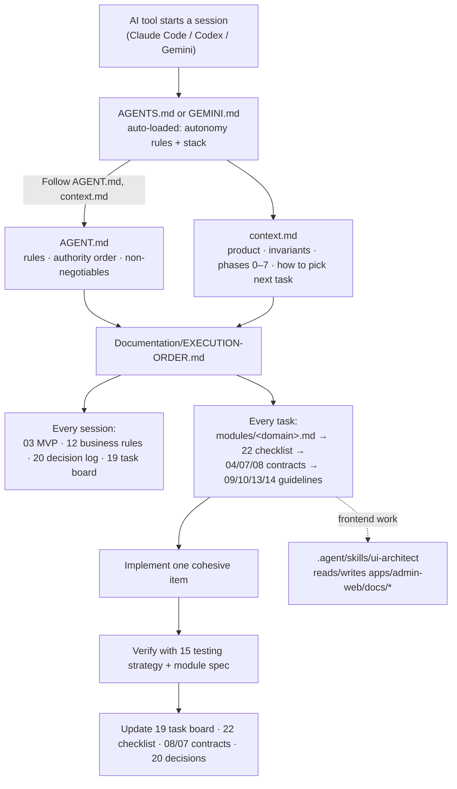
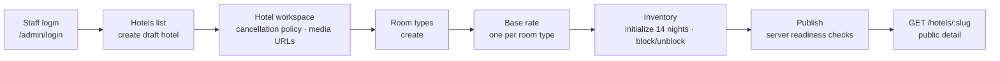

# Staywise — Hotel Booking Platform Documentation

<a id="README"></a>

- **What this folder is**: the working product and engineering specification for **Staywise**, a hotel booking and operations platform.
  - **Name**: “Staywise” is a temporary project name; replace it when branding is decided.
- **Consolidation (2026-10-20)**: the former 61 numbered/topic files were merged into the smaller set of files listed in the [Documentation map](#documentation-map). Every old file survives as an anchored section, so an old reference such as "doc 08" or `08-api-specification.md` resolves through the [old → new mapping table](#old-to-new-mapping) as `API.md#08-api-specification`.
- **Plan, not proof**: these documents describe a plan, not proof that implementation or production readiness has been achieved. Update related documents when a decision changes.

## Start here

- **Step 1 — New to these docs?**: read the [documentation report](#DOCUMENTATION-REPORT) in this file. It explains how the docs are organised, how AI agents use them, what is built today and what comes next.
- **Step 2 — Contributors and agents**: read [../AGENT.md](../AGENT.md) and [../context.md](../context.md).
- **Step 3 — Every work session**: follow the [reading and execution order](#EXECUTION-ORDER).
- **Step 4 — Scope and rules**: agree on [MVP scope](./MVP.md#03-mvp-scope) and [business rules](./PRODUCT.md#12-business-rules) (module-specific rules now live in the module specs; see that section).
- **Step 5 — Implementation contracts**: use [architecture](./ARCHITECTURE.md#04-architecture), [database design](./DATA_MODEL.md#07-database-design) and the [API specification](./API.md#08-api-specification).
- **Step 6 — Delivery**: deliver from the [development phases](./MVP.md#18-development-phases) and the [task board](./TASKS.md#19-task-board), and consult the [module specification index](./modules/index.md).

<a id="documentation-map"></a>

## Documentation map

### Entry and planning files (this folder)

- **[README.md](./README.md)**: this index — project overview and context, how to read and use the docs, the agent workflow and documentation report, contributor/AI agent rules, and the old → new mapping.
- **[MVP.md](./MVP.md)**: MVP objective, In MVP / Out of MVP lists, exit criteria, delivery phases with gates, and the MVP-phase roadmap items.
- **[TASKS.md](./TASKS.md)**: the single tracker — module-wise line-item checklist merged with the sprint task board, with `[x]`/`[ ]` state and evidence.
- **[PRODUCT.md](./PRODUCT.md)**: product requirements, cross-cutting business rules (stay dates, occupancy, money, state machines, snapshots, local time), and the "Roadmap — not now" items including AI ideas.
- **[ARCHITECTURE.md](./ARCHITECTURE.md)**: system boundaries and booking sequence, tech stack, project structure, and the decision log (ADRs).
- **[DATA_MODEL.md](./DATA_MODEL.md)**: core entities, inventory model and indexes (database design).
- **[API.md](./API.md)**: API conventions and endpoint contracts for `/api/v1`.
- **[GUIDES.md](./GUIDES.md)**: how-to guides — local setup and super-admin bootstrap (QUICKSTART), admin-web end-to-end navigation, and the platform modules/features/configuration guide.
- **[ANALYSIS.md](./ANALYSIS.md)**: business analyses of implemented modules (hotel, room types, pricing, form field types, hotel module UX review) — traceability, gaps, edge cases, open questions.
- **[HISTORY.md](./HISTORY.md)**: sprint plans and completed work logs (Sprint 2 plan, admin hardening log, full-stack fix plan and its progress log).

### `guidelines/` — HOW to build

- **[guidelines/frontend-ui.md](./guidelines/frontend-ui.md)**: frontend structure, Tailwind v4, component rules, guest/admin UI/UX principles, page-by-page UI generation brief, and the admin UI kit.
- **[guidelines/backend.md](./guidelines/backend.md)**: backend module and service standards, auth/RBAC overview, security controls and sensitive data handling.
- **[guidelines/testing-devops.md](./guidelines/testing-devops.md)**: risk-based test strategy, environments, deployment and operations.

### `modules/` — WHAT each module must do

- **[modules/index.md](./modules/index.md)**: module specification index and module map.
- **[modules/authentication.md](./modules/authentication.md)**: staff and guest authentication, sessions, CSRF, lockout.
- **[modules/rbac.md](./modules/rbac.md)**: roles, permissions and hotel scope.
- **[modules/staff-users.md](./modules/staff-users.md)**: staff accounts, roles and manager assignment.
- **[modules/guest-accounts.md](./modules/guest-accounts.md)**: guest profiles and booking access.
- **[modules/hotels.md](./modules/hotels.md)**: hotel catalog, lifecycle, publish gates.
- **[modules/room-types.md](./modules/room-types.md)**: room types, capacity, room counts.
- **[modules/pricing.md](./modules/pricing.md)**: rates, tax, quote and pricing rules.
- **[modules/bookings.md](./modules/bookings.md)**: availability, inventory, holds, booking creation and booking lifecycle/states.
- **[modules/cancellation-policies.md](./modules/cancellation-policies.md)**: cancellation policies, snapshots and cancellation lifecycle.
- **[modules/payments.md](./modules/payments.md)**: payment gateway, webhooks, payment states and refunds.
- **[modules/media.md](./modules/media.md)**: hotel and room media management.
- **[modules/guest-search.md](./modules/guest-search.md)**: public search, hotel detail and quote.
- **[modules/reviews.md](./modules/reviews.md)**: verified reviews and ratings.
- **[modules/notifications.md](./modules/notifications.md)**: email and other notifications.
- **[modules/audit-logging.md](./modules/audit-logging.md)**: audit trail and retention.
- **[modules/reports.md](./modules/reports.md)**: admin dashboard, reports and reporting definitions.
- **[modules/deployment-operations.md](./modules/deployment-operations.md)**: deployment, backups and operations.

### Other locations

- **`assets/`**: UI reference images (`assets/ui-images/`) and the draw.io file (`assets/drawio/`).
- **`../AGENT.md`**: authoritative engineering rules for humans and AI agents.
- **`../AGENTS.md`, `../GEMINI.md`**: short auto-loaded entry files (Claude Code / Codex, Gemini) that point to AGENT.md.
- **`../context.md`**: agent context — product, invariants, phases and gates.
- **`../apps/admin-web/docs/`**: ui-architect project memory — `ui-decisions.md`, `components.md`.
- **`../.agent/skills/ui-architect/`**: the UI skill the agent uses for frontend work.
- **`../.agent/README.md`**: Antigravity multi-agent orchestration — roles, workflows (`/implement-task`, `/quick-fix`), handoff files.

### Folder layout (after consolidation)

```
Documentation/
├── README.md            ← this index (overview, reading order, report, agent rules, mapping)
├── MVP.md               ← MVP scope, phases and gates
├── TASKS.md             ← checklist + task board (single tracker)
├── PRODUCT.md           ← requirements, cross-cutting business rules, later roadmap, AI ideas
├── ARCHITECTURE.md      ← architecture, stack, structure, decision log
├── DATA_MODEL.md        ← database design
├── API.md               ← API specification
├── GUIDES.md            ← how-to guides
├── ANALYSIS.md          ← business analyses
├── HISTORY.md           ← sprint plans and work logs
├── guidelines/          ← HOW to build (frontend-ui, backend, testing-devops)
├── modules/             ← WHAT each module must do (index + one file per module)
└── assets/              ← UI reference images and draw.io file
```

<a id="old-to-new-mapping"></a>

## Old → new mapping

- **Original files:** the 59 pre-consolidation files are kept unchanged in [`old docs/`](./old%20docs/README.md) with their original folder layout. They are reference only; edit the new files instead.

Each old file is now a section anchored by its old file stem (for example `PRODUCT.md#12-business-rules`). Paths are relative to `Documentation/`.

| Old (under D) | New |
|---|---|
| README.md, DOCUMENTATION-REPORT.md, EXECUTION-ORDER.md, 01-product/00-project-context.md, 03-guidelines/21-ai-agent-rules.md | README.md |
| 01-product/03-mvp-scope.md, 04-planning-and-tracking/18-development-phases.md, MVP parts of 01-product/02-feature-roadmap.md | MVP.md |
| 04-planning-and-tracking/19-task-board.md, 04-planning-and-tracking/22-module-wise-line-items-checklist.md | TASKS.md |
| 01-product/01-product-requirements.md, 01-product/02-feature-roadmap.md (non-MVP), 01-product/12-business-rules.md (cross-cutting part), 01-product/17-ai-features.md | PRODUCT.md |
| 02-architecture/04-architecture.md, 05-tech-stack.md, 06-project-structure.md, 04-planning-and-tracking/20-decision-log.md | ARCHITECTURE.md |
| 02-architecture/07-database-design.md | DATA_MODEL.md |
| 02-architecture/08-api-specification.md | API.md |
| 03-guidelines/09-frontend-guidelines.md, 13-ui-ux-guidelines.md, 23-ui-generation-brief.md, modules/admin-ui-kit.md | guidelines/frontend-ui.md |
| 03-guidelines/10-backend-guidelines.md, 11-auth-rbac.md, 14-security-guidelines.md | guidelines/backend.md |
| 03-guidelines/15-testing-strategy.md, 16-devops.md | guidelines/testing-devops.md |
| modules/README.md | modules/index.md |
| modules/hotel-management.md → modules/hotels.md; room-type-management → room-types.md; pricing-tax → pricing.md; availability-booking + booking-lifecycle → bookings.md; cancellation-policies → cancellation-policies.md; payments-refunds → payments.md; media-management → media.md; guest-search → guest-search.md; guest-accounts → guest-accounts.md; reviews-ratings → reviews.md; notifications → notifications.md; authentication → authentication.md; rbac-permissions → rbac.md; staff-user-management → staff-users.md; audit-logging → audit-logging.md; admin-dashboard-reports → reports.md; deployment-operations → deployment-operations.md | modules/*.md |
| 07-guides/27-admin-web-end-to-end-navigation-guide.md, 28-platform-modules-features-and-configuration-guide.md, QUICKSTART.md | GUIDES.md |
| 06-analysis/*.md (5 files) | ANALYSIS.md |
| 05-sprints-and-progress/*.md (4 files) | HISTORY.md |

- **Business-rules split (old `01-product/12-business-rules.md`)**: `PRODUCT.md#12-business-rules` keeps "Stay dates and occupancy" in full plus the cross-cutting rules. Module-specific rules moved to the module specs:
  - **Availability, Holds and booking, booking states**: [modules/bookings.md](./modules/bookings.md).
  - **Pricing and tax**: [modules/pricing.md](./modules/pricing.md).
  - **Cancellation and lifecycle**: [modules/cancellation-policies.md](./modules/cancellation-policies.md).
  - **Payment states**: [modules/payments.md](./modules/payments.md).
  - **Reporting definitions**: [modules/reports.md](./modules/reports.md).
- **Feature roadmap split (old `01-product/02-feature-roadmap.md`)**: Phases 0–2 and the gate between phases are in [MVP.md#02-feature-roadmap](./MVP.md#02-feature-roadmap); Phases 3–4 are in [PRODUCT.md#02-feature-roadmap](./PRODUCT.md#02-feature-roadmap).
- **Guideline vs module boundary**: guidelines say HOW to build/code; modules say WHAT the module must do. Each links to the other instead of copying.

## Original document map (pre-consolidation layout)

- **Original folder layout**: kept for reading older references and the documentation report below.

```
Documentation/
├── README.md                  ← this index
├── DOCUMENTATION-REPORT.md    ← how the docs and the agent work together; current status
├── EXECUTION-ORDER.md         ← per-session reading order and per-task procedure
├── 01-product/                ← WHAT we build and the rules it must obey
├── 02-architecture/           ← technical contracts (architecture, stack, DB, API)
├── 03-guidelines/             ← HOW to build (frontend, backend, security, UI, testing, devops)
├── 04-planning-and-tracking/  ← phases, task board, decision log, checklist
├── 05-sprints-and-progress/   ← sprint plans and completed work logs
├── 06-analysis/               ← business analyses of implemented modules
├── 07-guides/                 ← how-to guides (local setup, admin-web navigation)
├── modules/                   ← detailed spec per domain module
└── assets/                    ← UI reference images and draw.io file
```

- **File numbers**: the original file numbers (`00`–`27`) are kept as section anchors, so references like "doc 08" still work.
- **Entry points**:
  - **`DOCUMENTATION-REPORT.md`**: how agents use the docs, which docs are active, implementation status and the future path → [README.md#DOCUMENTATION-REPORT](#DOCUMENTATION-REPORT).
  - **`EXECUTION-ORDER.md`**: reading order before each session and the procedure for each task → [README.md#EXECUTION-ORDER](#EXECUTION-ORDER).
- **`01-product/` — product definition**:
  - **`00-project-context.md`**: vision, users, assumptions, success measures → [README.md#00-project-context](#00-project-context).
  - **`01-product-requirements.md`**: functional and non-functional requirements → [PRODUCT.md#01-product-requirements](./PRODUCT.md#01-product-requirements).
  - **`02-feature-roadmap.md`**: staged capability roadmap → [MVP.md#02-feature-roadmap](./MVP.md#02-feature-roadmap) and [PRODUCT.md#02-feature-roadmap](./PRODUCT.md#02-feature-roadmap).
  - **`03-mvp-scope.md`**: MVP boundaries and exit criteria → [MVP.md#03-mvp-scope](./MVP.md#03-mvp-scope).
  - **`12-business-rules.md`**: domain invariants — availability, pricing, holds, stay lifecycle → [PRODUCT.md#12-business-rules](./PRODUCT.md#12-business-rules) plus module specs.
  - **`17-ai-features.md`**: optional post-MVP AI ideas and guardrails → [PRODUCT.md#17-ai-features](./PRODUCT.md#17-ai-features).
- **`02-architecture/` — technical contracts**:
  - **`04-architecture.md`**: system boundaries and booking sequence → [ARCHITECTURE.md#04-architecture](./ARCHITECTURE.md#04-architecture).
  - **`05-tech-stack.md`**: selected stack and supporting libraries → [ARCHITECTURE.md#05-tech-stack](./ARCHITECTURE.md#05-tech-stack).
  - **`06-project-structure.md`**: suggested repository layout (original proposal; see the report for drift) → [ARCHITECTURE.md#06-project-structure](./ARCHITECTURE.md#06-project-structure).
  - **`07-database-design.md`**: core entities, inventory and indexes → [DATA_MODEL.md#07-database-design](./DATA_MODEL.md#07-database-design).
  - **`08-api-specification.md`**: API conventions and endpoint contracts → [API.md#08-api-specification](./API.md#08-api-specification).
- **`03-guidelines/` — engineering and UI standards**:
  - **`09-frontend-guidelines.md`**: frontend structure, Tailwind v4, component rules → [guidelines/frontend-ui.md#09-frontend-guidelines](./guidelines/frontend-ui.md#09-frontend-guidelines).
  - **`10-backend-guidelines.md`**: backend module and service standards → [guidelines/backend.md#10-backend-guidelines](./guidelines/backend.md#10-backend-guidelines).
  - **`11-auth-rbac.md`**: authentication and authorization overview (details in `modules/authentication.md` and `modules/rbac-permissions.md`, now [modules/authentication.md](./modules/authentication.md) and [modules/rbac.md](./modules/rbac.md)) → [guidelines/backend.md#11-auth-rbac](./guidelines/backend.md#11-auth-rbac).
  - **`13-ui-ux-guidelines.md`**: guest and admin interaction principles → [guidelines/frontend-ui.md#13-ui-ux-guidelines](./guidelines/frontend-ui.md#13-ui-ux-guidelines).
  - **`14-security-guidelines.md`**: security controls and sensitive data handling → [guidelines/backend.md#14-security-guidelines](./guidelines/backend.md#14-security-guidelines).
  - **`15-testing-strategy.md`**: risk-based test plan → [guidelines/testing-devops.md#15-testing-strategy](./guidelines/testing-devops.md#15-testing-strategy).
  - **`16-devops.md`**: environments, deployment and operations → [guidelines/testing-devops.md#16-devops](./guidelines/testing-devops.md#16-devops).
  - **`21-ai-agent-rules.md`**: **Superseded** by `../AGENT.md`; kept for history → [README.md#21-ai-agent-rules](#21-ai-agent-rules).
  - **`23-ui-generation-brief.md`**: page-by-page UI requirements and a generation prompt → [guidelines/frontend-ui.md#23-ui-generation-brief](./guidelines/frontend-ui.md#23-ui-generation-brief).
- **`04-planning-and-tracking/` — delivery control**:
  - **`18-development-phases.md`**: delivery sequence and milestones → [MVP.md#18-development-phases](./MVP.md#18-development-phases).
  - **`19-task-board.md`**: sprint task status (requires evidence) → [TASKS.md#19-task-board](./TASKS.md#19-task-board).
  - **`20-decision-log.md`**: ADRs — decided, proposed and open → [ARCHITECTURE.md#20-decision-log](./ARCHITECTURE.md#20-decision-log).
  - **`22-module-wise-line-items-checklist.md`**: one-line implementation checklist by module → [TASKS.md#22-module-wise-line-items-checklist](./TASKS.md#22-module-wise-line-items-checklist).
- **`05-sprints-and-progress/` — plans and work logs** (all now in [HISTORY.md](./HISTORY.md)):
  - **`24-sprint-2-availability-and-booking-plan.md`**: Sprint 2 blueprint (holds, bookings, guest auth) — **not yet implemented** → [HISTORY.md#24-sprint-2-availability-and-booking-plan](./HISTORY.md#24-sprint-2-availability-and-booking-plan).
  - **`25-admin-production-hardening-progress.md`**: admin security/performance hardening log (completed) → [HISTORY.md#25-admin-production-hardening-progress](./HISTORY.md#25-admin-production-hardening-progress).
  - **`fullstack-analysis-and-fix-plan.md`**: audit analysis and fix plan B1–B10 / F1–F12 (historical reasoning) → [HISTORY.md#fullstack-analysis-and-fix-plan](./HISTORY.md#fullstack-analysis-and-fix-plan).
  - **`26-fullstack-fix-plan-progress.md`**: completion log for that fix plan (21/22 done; B7 tests deferred) → [HISTORY.md#26-fullstack-fix-plan-progress](./HISTORY.md#26-fullstack-fix-plan-progress).
- **`06-analysis/` — business analyses (2026-10-13)** (all now in [ANALYSIS.md](./ANALYSIS.md)):
  - **`hotel-business-analysis.md`**: hotel module — traceability, gaps, edge cases, open questions → [ANALYSIS.md#hotel-business-analysis](./ANALYSIS.md#hotel-business-analysis).
  - **`room-types-business-analysis.md`**: room-type module analysis → [ANALYSIS.md#room-types-business-analysis](./ANALYSIS.md#room-types-business-analysis).
  - **`pricing-business-analysis.md`**: pricing / base-rate module analysis → [ANALYSIS.md#pricing-business-analysis](./ANALYSIS.md#pricing-business-analysis).
  - **Later additions**: `form-field-type-analysis.md` → [ANALYSIS.md#form-field-type-analysis](./ANALYSIS.md#form-field-type-analysis); `hotel-module-ux-review.md` → [ANALYSIS.md#hotel-module-ux-review](./ANALYSIS.md#hotel-module-ux-review).
- **`07-guides/` — how-to** (all now in [GUIDES.md](./GUIDES.md)):
  - **`QUICKSTART.md`**: local setup and super-admin bootstrap → [GUIDES.md#quickstart](./GUIDES.md#quickstart).
  - **`27-admin-web-end-to-end-navigation-guide.md`**: admin web routes, RBAC matrix, user journeys, known problems → [GUIDES.md#27-admin-web-end-to-end-navigation-guide](./GUIDES.md#27-admin-web-end-to-end-navigation-guide).
  - **`28-platform-modules-features-and-configuration-guide.md`**: comprehensive modules, features, pricing/cancellation rules, and end-to-end setup guide → [GUIDES.md#28-platform-modules-features-and-configuration-guide](./GUIDES.md#28-platform-modules-features-and-configuration-guide).
- **`modules/` — detailed module specs**: see [modules/index.md](./modules/index.md) (was `modules/README.md`). It covers authentication, RBAC, staff, guest accounts, hotels, room types, availability/booking, pricing/tax, search, booking lifecycle, payments/refunds, cancellation, reviews, notifications, media, reports, audit, deployment and the admin UI kit (the admin UI kit now lives in [guidelines/frontend-ui.md#admin-ui-kit](./guidelines/frontend-ui.md#admin-ui-kit)).

## Source of truth

- **Authority order**: when documents conflict, follow the order in [AGENT.md §3](../AGENT.md): **latest product-owner instruction / approved ADR → AGENT.md + context.md → business rules (12) → MVP scope (03) → module specs → requirements, architecture, API, DB, phases, checklist → existing code.** (also stated in DOCUMENTATION-REPORT.md §3.2, reproduced in full [below](#report-authority))
- **Keeping docs current**: update related documents when a decision changes. These documents describe a plan, not proof that implementation or production readiness has been achieved.

---

<a id="00-project-context"></a>

## Project Context

### Product

- **Working name**: Staywise.
- **Type**: responsive hotel booking website and hotel operations console backed by a modular API.
- **Primary value**: guests can find and book a room with trustworthy date-based availability and transparent pricing; operators can manage inventory and stays without overbooking.

### Users

- **Guest**: searches, books, pays, views/cancels eligible bookings, and reviews completed stays.
- **Super admin**: operates the platform and can manage all properties, staff, bookings and reports.
- **Hotel manager (later release)**: manages assigned properties only. Do not imply this role has platform-wide access.

### Product outcome

- **End-to-end outcome**: a guest can search a city and date range, select a suitable room type, complete a booking, receive confirmation, and later complete the stay. Staff can configure hotels and inventory and reliably manage that booking.

### Operating principles

- **1. Server authority**: the server is authoritative for availability, price, taxes, discounts and booking state.
- **2. No overbooking**: no confirmed booking may exceed inventory for any occupied night.
- **3. Idempotent payments**: payment notifications may be duplicated or delayed; processing must be idempotent.
- **4. Modular monolith**: keep the first release a modular monolith. Add infrastructure only for a demonstrated need.
- **5. Traceability**: make policy, money and inventory changes traceable.
- **6. Explicit assumptions**: state assumptions explicitly; laws, tax treatment and payment rules require validation for launch markets.

### Initial assumptions to validate

- **Market scope**: start with one country, one currency (INR), one time-zone policy per property, and one language.
- **Pooled inventory**: inventory is pooled by room type, not assigned to physical room numbers.
- **Night consumption**: a booking consumes inventory for each night from check-in inclusive to checkout exclusive (also stated in 12-business-rules, see [PRODUCT.md#12-business-rules](./PRODUCT.md#12-business-rules)).
- **Hold length**: a temporary hold lasts 10 minutes and expires automatically (also stated in 12-business-rules, now in [modules/bookings.md](./modules/bookings.md)).
- **Guest checkout**: guest checkout without an account is allowed; an account can be offered after booking.
- **Payment and GST**: online payment gateway and GST treatment are selected and reviewed before payment launch.

### Success measures

- **Metrics to track**: search-to-booking conversion, payment success rate, booking errors, overbooking incidents (target zero), cancellation/refund time, property onboarding time, and support contacts per booking.
- **Targets**: set numeric targets after baseline discovery.

---

<a id="EXECUTION-ORDER"></a>

## Documentation Reading and Execution Order

- **Purpose**: use this guide to find the right existing documents as the project moves from planning to implementation.
- **Status rule**: the documents are references and plans; task status is complete only when implementation and acceptance evidence exist.

### 1. Read before starting a work session

- **1. [`../AGENT.md`](../AGENT.md)**: engineering rules and document authority.
- **2. [`../context.md`](../context.md)**: product context, architecture, dependency gates, and implementation order.
- **3. [`03-mvp-scope.md`](./MVP.md#03-mvp-scope)**: what belongs in the first release.
- **4. [`12-business-rules.md`](./PRODUCT.md#12-business-rules)**: invariants that implementation must preserve (module-specific rules now live in the module specs linked from that section).
- **5. [`20-decision-log.md`](./ARCHITECTURE.md#20-decision-log)**: approved decisions and unresolved product choices.
- **6. [`19-task-board.md`](./TASKS.md#19-task-board)**: current status and the next incomplete work.
- **Open decisions**: if a needed decision is still open, keep production behavior dependent on it disabled and record the question; do not invent a product rule.

### 2. Prepare each implementation item

For the next incomplete task on the task board, follow this order:

- **1. Find the module**: find its domain in [`modules/README.md`](./modules/index.md) (now `modules/index.md`), then read that module specification.
- **2. Check the checklist**: check the matching section in [`22-module-wise-line-items-checklist.md`](./TASKS.md#22-module-wise-line-items-checklist) to see the implementation details and acceptance expectations.
- **3. Read the contracts**: read the relevant system contract before changing it — [`04-architecture.md`](./ARCHITECTURE.md#04-architecture), [`07-database-design.md`](./DATA_MODEL.md#07-database-design), [`08-api-specification.md`](./API.md#08-api-specification), and the relevant frontend, backend, security, or UI guidelines (`09`, `10`, `13`, `14` — now [frontend](./guidelines/frontend-ui.md#09-frontend-guidelines), [backend](./guidelines/backend.md#10-backend-guidelines), [UI/UX](./guidelines/frontend-ui.md#13-ui-ux-guidelines), [security](./guidelines/backend.md#14-security-guidelines)).
- **4. Implement**: implement one cohesive item, including necessary API, schema/index, authorization, audit, and failure handling.
- **5. Verify and record**: verify its acceptance criteria using [`15-testing-strategy.md`](./guidelines/testing-devops.md#15-testing-strategy) and the module specification. Update the task board, checklist, and affected contracts with evidence; only then mark work complete.

### 3. Follow the dependency order

The current planned order is:

- **1. Foundation and decisions**: [`18-development-phases.md`](./MVP.md#18-development-phases), [`16-devops.md`](./guidelines/testing-devops.md#16-devops), and open items in [`20-decision-log.md`](./ARCHITECTURE.md#20-decision-log).
- **2. Identity and access**: `modules/authentication.md`, `modules/rbac-permissions.md`, `modules/staff-user-management.md`, and `modules/audit-logging.md` — now [authentication](./modules/authentication.md), [rbac](./modules/rbac.md), [staff-users](./modules/staff-users.md), [audit-logging](./modules/audit-logging.md).
- **3. Hotel catalog**: `modules/hotel-management.md`, `modules/room-type-management.md`, and `modules/media-management.md` as needed — now [hotels](./modules/hotels.md), [room-types](./modules/room-types.md), [media](./modules/media.md).
- **4. Inventory and rates**: `modules/availability-booking.md`, `modules/pricing-tax.md`, and [`12-business-rules.md`](./PRODUCT.md#12-business-rules) — now [bookings](./modules/bookings.md), [pricing](./modules/pricing.md).
- **5. Search and booking**: `modules/guest-search.md`, `modules/booking-lifecycle.md`, and `modules/cancellation-policies.md` as relevant — now [guest-search](./modules/guest-search.md), [bookings](./modules/bookings.md), [cancellation-policies](./modules/cancellation-policies.md).
- **6. Payments and guest operations**: `modules/payments-refunds.md`, `modules/guest-accounts.md`, and `modules/notifications.md` — now [payments](./modules/payments.md), [guest-accounts](./modules/guest-accounts.md), [notifications](./modules/notifications.md).
- **7. Later operations and growth**: reviews, reports, deployment, and other modules after their dependencies and MVP scope allow.
- **Contracts first**: the API and data contracts come before client features.
  - **Admin UI**: admin hotel setup UI can begin once hotel and room APIs are ready.
  - **Guest UI**: guest search UI follows the search API and usable catalog, inventory, and pricing.
  - **UI references**: use [`23-ui-generation-brief.md`](./guidelines/frontend-ui.md#23-ui-generation-brief), [`09-frontend-guidelines.md`](./guidelines/frontend-ui.md#09-frontend-guidelines), [`13-ui-ux-guidelines.md`](./guidelines/frontend-ui.md#13-ui-ux-guidelines), and `modules/admin-ui-kit.md` ([now here](./guidelines/frontend-ui.md#admin-ui-kit)) when starting the relevant UI work.

### 4. Current next step (updated 2026-10-15)

- **Built so far (Sprint 1 + hardening)**: staff login with sessions and CSRF; hotel CRUD with lifecycle, publish gates and media URLs; room types; one base rate per room type; nightly inventory with initialize and block/unblock; audit logging.
  - **Admin web**: covers these screens.
  - **Fixes applied**: fixes from [`05-sprints-and-progress/26-fullstack-fix-plan-progress.md`](./HISTORY.md#26-fullstack-fix-plan-progress) and [`25-admin-production-hardening-progress.md`](./HISTORY.md#25-admin-production-hardening-progress) are applied. The only open item is B7 (end-to-end tests), which is deferred.
  - **Screens and flows**: for the actual screens and flows, see [`07-guides/27-admin-web-end-to-end-navigation-guide.md`](./GUIDES.md#27-admin-web-end-to-end-navigation-guide).
- **Not built**: guest auth, search/quote, holds, bookings, payments, refunds, staff management, reports.
- **Next domain work**:
  - **1. Close catalog gaps**: close the catalog gaps that [`06-analysis/`](./ANALYSIS.md) found — room-type edit/disable UI, editing hotel basics, and the inventory DTO `reason` validator bug.
  - **2. Then choose**: either guest search and quote (`modules/guest-search.md`, `modules/pricing-tax.md` — now [guest-search](./modules/guest-search.md), [pricing](./modules/pricing.md)), or Sprint 2 holds and booking ([`05-sprints-and-progress/24-sprint-2-availability-and-booking-plan.md`](./HISTORY.md#24-sprint-2-availability-and-booking-plan)).
- **Before Sprint 2**: reconcile plan 24 with ADR-005 and ADR-007 in [`20-decision-log.md`](./ARCHITECTURE.md#20-decision-log). Do not enable guest totals or checkout until approved server-side tax and cancellation rules exist.
- **Keep tracking in one place**: record new work in [`19-task-board.md`](./TASKS.md#19-task-board) and [`22-module-wise-line-items-checklist.md`](./TASKS.md#22-module-wise-line-items-checklist) (both now in `TASKS.md`), not only in new standalone progress files. Record new decisions in `20-decision-log.md` ([now here](./ARCHITECTURE.md#20-decision-log)).
- **Local commands**: see [`07-guides/QUICKSTART.md`](./GUIDES.md#quickstart).
- **UI work**: see [`03-guidelines/09-frontend-guidelines.md`](./guidelines/frontend-ui.md#09-frontend-guidelines), [`modules/admin-ui-kit.md`](./guidelines/frontend-ui.md#admin-ui-kit), and the ui-architect project memory in `apps/admin-web/docs/`.

---

<a id="DOCUMENTATION-REPORT"></a>

## Documentation Report — How the Docs Drive the Agent

- **Date**: 2026-10-15.
- **Branch**: `feat-update`.
- **Scope**: `Documentation/`, the former `docs/`, root agent files, `apps/api`, `apps/admin-web`.
- **Note on paths**: this report describes the folder layout as of 2026-10-15, before the 2026-10-20 consolidation. Paths it names (for example `04-planning-and-tracking/19-task-board.md`) are the old locations; use the [old → new mapping](#old-to-new-mapping) to find their current section.

This report answers four questions:

- **1.**: How are the documents organised now?
- **2.**: How does an AI agent use them, and in what order?
- **3.**: What is actually implemented, and which documents drove it?
- **4.**: Which documents will future implementation follow, and what must be fixed first?

### 1. Summary

- **The docs are now in topic folders** (§2): file numbers are kept. The three business analyses moved from `docs/analysis/` into `Documentation/06-analysis/`. All 414 machine-specific `file:///c:/Users/...` links were converted to relative links that work on any machine.
- **The agent has a fixed entry chain**: the coding tool auto-loads `AGENTS.md` (or `GEMINI.md`). That file points to `AGENT.md` and `context.md`, which point to `EXECUTION-ORDER.md`. That file selects the module spec, contracts and trackers for each task (§3).
- **What is built is the Sprint 1 admin catalog**: staff login, hotels, room types, one base rate per room type, nightly inventory, publish gates and audit. Bookings, holds, guests and payments do not exist yet (§5).
- **The main problem was documentation drift, not missing documents**: each work burst created a *new* standalone document (24, 25, 26, the fix-plan analysis, 27, the business analyses). The living contracts were not updated: task board 19, checklist 22, API spec 08 and decision log 20. That broke the agent's own rule (AGENT.md §6: "update impacted … API … task board, and decision log in the same change"). See §6.
- **Future work**: read the same core docs, and read `05-sprints-and-progress/24-…` for Sprint 2. Plan 24 conflicts with two ADRs and must be reconciled before it is built (§8).

### 2. New folder layout

```
hotel-Management/
├── AGENTS.md / GEMINI.md        auto-loaded by the AI tool (identical; short)
├── AGENT.md                     authoritative engineering rules  ← agent reads 1st
├── context.md                   product + invariants + phase gates ← agent reads 2nd
├── README.md                    repo README (setup, scripts)
├── .agent/skills/ui-architect/  UI skill used for frontend work
├── apps/admin-web/docs/         UI skill "project memory" (ui-decisions, components)
└── Documentation/
    ├── README.md                index
    ├── DOCUMENTATION-REPORT.md  this report
    ├── EXECUTION-ORDER.md       per-session reading order + per-task procedure ← 3rd
    ├── 01-product/              00 context · 01 requirements · 02 roadmap · 03 MVP · 12 business rules · 17 AI ideas
    ├── 02-architecture/         04 architecture · 05 stack · 06 structure · 07 database · 08 API
    ├── 03-guidelines/           09 frontend · 10 backend · 11 auth · 13 UI/UX · 14 security · 15 testing · 16 devops · 21 (superseded) · 23 UI brief
    ├── 04-planning-and-tracking/ 18 phases · 19 task board · 20 decision log · 22 checklist
    ├── 05-sprints-and-progress/ 24 Sprint-2 plan · 25 hardening log · fix-plan analysis · 26 fix-plan log
    ├── 06-analysis/             hotel · room-types · pricing business analyses
    ├── 07-guides/               QUICKSTART · 27 admin-web navigation guide
    ├── modules/                 20 module specs (unchanged)
    └── assets/                  ui-images/ · drawio/
```

#### What moved

- **`Documentation/00,01,02,03,12,17-*.md`**: moved to `Documentation/01-product/`.
- **`Documentation/04–08-*.md`**: moved to `Documentation/02-architecture/`.
- **`Documentation/09,10,11,13,14,15,16,21,23-*.md`**: moved to `Documentation/03-guidelines/`.
- **`Documentation/18,19,20,22-*.md`**: moved to `Documentation/04-planning-and-tracking/`.
- **`Documentation/24,25,26-*.md`**: moved to `Documentation/05-sprints-and-progress/`.
- **`Documentation/Staywise Full-Stack Analysis & Fix Plan.md`**: moved to `Documentation/05-sprints-and-progress/fullstack-analysis-and-fix-plan.md` (renamed; the old name had spaces and `&`).
- **`docs/analysis/*.md`**: moved to `Documentation/06-analysis/`.
- **`Documentation/27-*.md`, `QUICKSTART.md`**: moved to `Documentation/07-guides/`.
- **`Documentation/UI images/`, `draw io/`**: moved to `Documentation/assets/ui-images/`, `assets/drawio/`.

#### Other cleanup done with the move

- **Link rewriting**: 461 links rewritten. Afterwards 504 internal links resolve. The 4 that still fail were already broken and point at things that do not exist: `LICENSE`, the skill's `../README.md#sync-script`, and `rooms/` and `bookings/` schemas cited in the hotel analysis.
- **Root agent files**: the 7 broken links in `AGENT.md` and `context.md` are fixed. They pointed to `./03-mvp-scope.md` and similar paths as if the docs sat next to them. `context.md §5` now lists folder-qualified paths.
- **Status banners added**:
  - **`21-ai-agent-rules.md`**: superseded by AGENT.md.
  - **`fullstack-analysis-and-fix-plan.md`**: historical; status lives in 26.
  - **`24-sprint-2-…`**: not implemented; must be reconciled with the ADRs.
- **`EXECUTION-ORDER.md §4`**: rewritten to describe the current state and the next step.
- **`08-api-specification.md`**: fixed the `/adm  in/hotels/import` typo.
- **Nothing deleted**: nothing was deleted. The empty `docs/analysis/` folder is left in place for you to remove.

### 3. How the agent uses the documentation

#### 3.1 The load chain



- **`AGENTS.md`**: loaded automatically by Claude Code (in this setup) and Codex at the start of every session. The agent takes from it: ask only before deleting files or committing; the stack baseline; "follow AGENT.md".
- **`GEMINI.md`**: loaded automatically by Gemini / Antigravity at the start of every session. Identical copy of AGENTS.md.
- **`AGENT.md`**: loaded by the agent, following the pointer, before planning. The agent takes from it: document authority order, 14 non-negotiable rules, delivery/checklist rules, the format of the completion report.
- **`context.md`**: loaded by the agent, following the pointer, before planning. The agent takes from it: business invariants, the Phase 0–7 gates, "how to choose the next task".
- **`EXECUTION-ORDER.md`**: loaded by the agent, following the pointer, each session and each task. The agent takes from it: reading order, per-task procedure, current next step (now [README.md#EXECUTION-ORDER](#EXECUTION-ORDER)).
- **`.agent/skills/ui-architect/SKILL.md`**: invoked for UI work, when building or changing UI. The agent takes from it: reuse ladder, ~200-line files, use tokens only, update `apps/admin-web/docs/*`.

<a id="report-authority"></a>

#### 3.2 Authority when documents disagree (AGENT.md §3)

- **1.**: the latest product-owner instruction, or an approved ADR in `20-decision-log.md`.
- **2.**: `AGENT.md` (engineering rules) and `context.md` (project context).
- **3.**: `01-product/12-business-rules.md`.
- **4.**: `01-product/03-mvp-scope.md`.
- **5.**: `modules/<domain>.md`.
- **6.**: requirements, architecture, API, DB, phases, checklist.
- **7.**: existing code. It may be stale and must not silently override the docs.
- **Conflict stop rule**: if a conflict touches money, inventory, access control, data or the API, the agent must stop that change and ask for a decision.
- **README alignment**: `Documentation/README.md` used to list a different, shorter order; it now follows this one (also stated in the [Source of truth](#source-of-truth) section above).

#### 3.3 The procedure for each task (what the agent is supposed to do)

(Closely parallels [EXECUTION-ORDER §2](#2-prepare-each-implementation-item); both kept because the details differ.)

- **1. Pick**: check `19-task-board.md` and pick the earliest incomplete phase whose gate is still open.
- **2. Read**: read the module spec from `modules/README.md`, then the matching section of `22-checklist`.
- **3. Impact**: before editing, identify the API, schema, index, security and audit impacts (04, 07, 08, 14).
- **4. Implement**: implement one cohesive item, including its failure paths.
- **5. Verify and update**: verify it, then update the task board, checklist, contracts and decision log **in the same change**.
- **6. Evidence and report**: mark `[x]` only when there is evidence, and end with a completion report (files, behaviour, verification, checklist lines, blockers).

### 4. Timeline: how the docs were actually produced

- **10-06 — `48580a4` establish platform**: docs created — full blueprint: 00–23, `modules/*`, AGENT/AGENTS/GEMINI/context. Code delivered — API foundation (Phase 0).
- **10-06 — `936ae75`**: docs changed — 19, 20, EXECUTION-ORDER, QUICKSTART updated. Code delivered — admin workspace UI.
- **10-07 — `ff9492c`, `c6dd2a1`**: docs changed — 08, 09, 19, 20, 22 updated; drawio added. Code delivered — theme, hotel modules, media API.
- **10-12 — `5f302a7`**: docs created — **24** Sprint-2 plan; ui-architect skill; `apps/admin-web/docs/*`. Code delivered — catalog pages, UI components.
- **10-12 — staged**: docs created — **25** hardening log; **fix-plan analysis**; **26** fix-plan log. Code delivered — SEC/PERF/API/FE fixes; B1–B10, F1–F12.
- **10-13 — staged**: docs created/changed — **27** navigation guide; README and 08 edits. Code delivered — admin-web refactor (auth context, `*.api.ts`, UI primitives).
- **10-13 — untracked**: docs created — **3 business analyses** (`06-analysis/`). Code delivered — none (—).
- **Pattern**: through 10-07 the agent followed the procedure and updated 19, 20 and 22 alongside the code. From 10-12 onward, each task produced a **new** document instead. Those documents never fed back into the task board, checklist, API spec or decision log. That is why the set now feels confusing.

### 5. What is implemented, and which docs drove it

#### 5.1 Working admin flow



- **Publishing requires all of the following**:
  - **Policy**: a valid, effective cancellation policy;
  - **Room type**: at least one active room type with `totalRooms ≥ 1`;
  - **Rates**: a base rate for every active room type;
  - **Currency**: one consistent currency;
  - **Inventory**: at least one future night with available rooms.

#### 5.2 Feature status against the governing docs

- **Staff login, session, CSRF, logout, lockout**: backend ✅ opaque cookie session, double-submit CSRF, 5-try lockout; admin UI ✅ login, session restore, expiry redirect; governing docs `modules/authentication.md`, ADR-011, fix B1/B9.
- **RBAC and hotel scope**: backend ✅ 14 permissions, guard + service scope checks; admin UI ✅ `PermissionRoute`, `<Can>`; governing docs `modules/rbac-permissions.md`, SEC-01.
- **Staff / role / manager management**: backend ❌ seed script only; admin UI ❌; governing docs `modules/staff-user-management.md`.
- **Hotel CRUD, lifecycle, bulk status**: backend ✅; admin UI ✅ (basic info cannot be edited in the UI); governing docs `modules/hotel-management.md`, B3, F7.
- **Media**: backend ⚠️ list of URLs, no upload; admin UI ⚠️ URL gallery; governing docs `modules/media-management.md`.
- **Room types**: backend ✅ create / edit / disable; admin UI ⚠️ create only; governing docs `modules/room-type-management.md`.
- **Pricing**: backend ⚠️ one flat base rate, integer minor units; admin UI ✅; governing docs `modules/pricing-tax.md` (ADR-007 tax still open).
- **Inventory**: backend ✅ initialize, block/unblock, batch; atomic conditional updates; admin UI ✅ 14-night grid; governing docs `modules/availability-booking.md`, `12-business-rules.md`.
- **Audit log**: backend ✅ written in the same transaction, 1-year TTL; admin UI ❌ no viewer; governing docs `modules/audit-logging.md`, B10.
- **Public search / quote**: backend ❌; admin UI — (no guest app); governing docs `modules/guest-search.md`.
- **Guest auth, holds, bookings**: backend ❌ (`held`/`confirmed` counters are never written); admin UI ❌; governing docs **24 Sprint-2 plan**, `modules/booking-lifecycle.md`.
- **Payments, refunds, cancellation**: backend ❌; admin UI ❌; governing docs `modules/payments-refunds.md`, `cancellation-policies.md`, ADR-008.
- **Reports, reviews, notifications**: backend ❌; admin UI ❌; governing docs — respective module specs.

#### 5.3 Defects found in the code while auditing (not fixed in this change)

- **#1 — `apps/api/src/modules/inventory/dto/inventory.dto.ts:11,19`**: `reason` uses `@Min(3)`, a numeric validator, on a string. HTTP block, unblock and batch-adjust will likely fail validation; it should be `@MinLength(3)`. The unit specs call the service directly, so they miss it. (Later fixed — see TASKS.md, Hotel Management line "inventory block/unblock reason validation fixed (`@MinLength(3)`)".)
- **#2 — `apps/admin-web/src/pages/hotels/HotelsPage.tsx:~117`**: an early `return` on 403 runs before several `useMemo` hooks, which breaks the Rules of Hooks.
- **#3 — `apps/admin-web/src/components/ui/Toast.tsx`, `App.tsx`, `Spinner.tsx`**: they use `toast-stack`, `boot-screen`, `ui-spinner` and similar classes whose CSS was removed with `dashboard.css`. Toasts render unstyled.
- **#4 — `packages/contracts`**: nothing imports it. Its `HotelStatus` has `DISABLED`, but the API uses `SUSPENDED`.
- **#5 — `apps/admin-web/package.json`**: every dependency is pinned to `"latest"`.
- **#6 — `apps/api/src/scripts/verify-scenarios.ts`**: hard-coded test credentials. `dotenv` is used but not declared.

### 6. Documentation drift: where docs and code disagree

- **`02-architecture/08-api-specification.md`**: media and bulk-status are marked "Phase 2 planned" but are implemented.
  - **Missing endpoints**: `/health`, `/admin/hotels/metrics`, `inventory/batch-adjust`, `archive`, `suspend`, `room-types/:id/disable`.
  - **Missing error codes**: `HOTEL_NOT_READY`, `DUPLICATE`, `CSRF_REJECTED`, `ACCOUNT_LOCKED`, `TOO_MANY_ATTEMPTS`.
- **`04-planning-and-tracking/19-task-board.md`**: has no entries for the 25/26 work. Still titled "Initial".
- **`04-planning-and-tracking/22-checklist.md`**: covers only auth, guest profile and hotel. It has no room-type, inventory, pricing or booking sections. The throttling/lockout item is unchecked, but it is done (B9).
- **`04-planning-and-tracking/20-decision-log.md`**: missing decisions — MFA behind `MFA_ENABLED` (B1), 1-year audit retention (B10), the `SUSPENDED` label (F7), no TanStack Query, Zod env validation (B2), autoIndex off in production (B6). ADR-001 is "Proposed" but treated as approved.
- **`01-product/02`, `04-planning/18`, `context.md`**: three different phase schemes: 0–4, 0–4 and 0–7. `context.md` (0–7) is the one the agent follows.
- **`03-guidelines/11-auth-rbac.md`**: still allows access/refresh tokens, which contradicts ADR-011 (opaque sessions).
- **`03-guidelines/09-frontend-guidelines.md`**: its folder tree and hex palette are stale. `apps/admin-web/docs/ui-decisions.md` is accurate.
- **`modules/admin-ui-kit.md`**: its component names differ from the real ones (StatusBadge vs `Status`, FormField vs `Field`, Drawer vs `Modal variant="drawer"`).
- **`apps/admin-web/docs/components.md`**: missing ErrorBoundary, Loader, NotFound, Skeleton, Spinner and Toast.
- **`02-architecture/06-project-structure.md`**: describes `guest-web/`, `packages/ui` and `infra/`, none of which exist.
- **`07-guides/QUICKSTART.md`**: says sign-in is disabled until MFA exists, which changed with B1. Omits `ensure:indexes`, `verify:api` and `npm test`.
- **Root `README.md`**: lists API routes that don't exist (`/api/v1/hotels/:hotelId/rates` etc.) and a `{success,data,meta}` envelope the API doesn't return.
- **`AGENTS.md` = `GEMINI.md` = `AGENT.md §8` = `21`**: the same rules appear in four places. AGENT.md is authoritative.

### 7. Which documents are in use

#### Active for current implementation (read on every relevant task)

- **`AGENTS.md` → `AGENT.md`, `context.md`, `EXECUTION-ORDER.md`**: the agent's entry chain.
- **`01-product/03-mvp-scope.md`, `12-business-rules.md`**: scope and invariants.
- **`04-planning-and-tracking/19`, `20`, `22`**: status, decisions, checklist (each needs a refresh, see §6).
- **`02-architecture/04`, `07`, `08`**: contracts (08 needs a refresh).
- **`modules/authentication`, `rbac-permissions`, `hotel-management`, `room-type-management`, `availability-booking` (inventory part), `pricing-tax`, `media-management`, `audit-logging`**: specs for the code that exists.
- **`03-guidelines/09`, `10`, `14`; `apps/admin-web/docs/*`; `.agent/skills/ui-architect`**: how code is written.
- **`07-guides/27-…navigation-guide.md`**: the most accurate description of admin-web today.
- **`06-analysis/*`**: gap lists and open questions for hotel, room types and pricing.

#### Reference / historical (read for background only)

- **Completed work logs**: `05-sprints-and-progress/25`, `26`, `fullstack-analysis-and-fix-plan.md`.
- **Superseded**: `03-guidelines/21` (superseded); `03-guidelines/11` (superseded by the module specs).
- **Background**: `01-product/00`, `01`, `02`, `17`; `02-architecture/05`, `06`; `03-guidelines/23` (pre-build UI brief).

#### Future implementation (dormant until that phase starts)

- **Finish Phase 1–2 gaps (staff management, manager scope, room-type edit UI, hotel basics edit)**: driven by `modules/staff-user-management.md`, `rbac-permissions.md`, `06-analysis/*`.
- **Phase 3: holds, expiry, atomic multi-night claims**: driven by **`05-sprints-and-progress/24`**, `modules/availability-booking.md`, `12-business-rules.md`, ADR-003/004.
- **Phase 4: guest search, quote, booking lifecycle, guest auth**: driven by `modules/guest-search.md`, `booking-lifecycle.md`, `guest-accounts.md`, `authentication.md` (guest part), `24`, `23` (guest UI).
- **Phase 5: payments, cancellation, refunds, email**: driven by `modules/payments-refunds.md`, `cancellation-policies.md`, `notifications.md`, ADR-007/008/009.
- **Phase 6–7: reports, reviews, deployment, AI**: driven by `modules/admin-dashboard-reports.md`, `reviews-ratings.md`, `deployment-operations.md`, `03-guidelines/16`, `01-product/17`.
- **Phase numbering**: the phases above use the context.md gates (0–7).

### 8. Before the next implementation sprint

These items resolve conflicts that would otherwise send the agent the wrong way. Most need your decision, so they are not edited here.

- **1. Reconcile plan 24 with the decision log**: plan 24 assumes three things the approved docs don't support:
  - **Mandatory guest accounts**: contradicts ADR-005 and `modules/authentication.md` (both allow guest checkout).
  - **12% GST**: while ADR-007 is still open.
  - **`PAY_AT_HOTEL` mode**: no ADR records it.
  - **Action**: decide each one and record it in `20-decision-log.md`.
- **2. Record the decisions that were already implemented** in 20: B1 MFA flag, B10 retention, the F7 label, B2 Zod, B6 autoIndex.
- **3. Bring 08 up to date**: with the endpoint and error-code lists in §6.
- **4. Make 19 + 22 the single tracker**: add the 25/26 outcomes and the room-type, inventory, pricing and booking sections to 22. Future work should update these two, not start a new progress file. (19 and 22 are now merged in [TASKS.md](./TASKS.md).)
- **5. Pick one phase scheme**: (context.md 0–7) and align 02 and 18.
- **6. Fix the inventory DTO validator**: (§5.3 #1) before relying on block/unblock over HTTP.

#### Rules for keeping the docs tidy from now on

- **New sprint plans**: each new **sprint plan** goes in `05-sprints-and-progress/` with the next number (now a new section in [HISTORY.md](./HISTORY.md)). Its status is reflected in 19 and 22 (now [TASKS.md](./TASKS.md)).
- **New analyses**: each new **analysis** goes in `06-analysis/` (now a new section in [ANALYSIS.md](./ANALYSIS.md)). Any decision it recommends goes into 20 (now [ARCHITECTURE.md#20-decision-log](./ARCHITECTURE.md#20-decision-log)).
- **New how-tos**: each new **how-to** goes in `07-guides/` (now a new section in [GUIDES.md](./GUIDES.md)).
- **Contract changes**: a change to an endpoint, schema or decision updates 08, 07 or 20 **in the same change** (AGENT.md §6) — now [API.md](./API.md), [DATA_MODEL.md](./DATA_MODEL.md), [ARCHITECTURE.md#20-decision-log](./ARCHITECTURE.md#20-decision-log).
- **No extra rule files**: do not create agent-rule files beyond AGENT.md. AGENTS.md and GEMINI.md stay as short pointers.

---

<a id="21-ai-agent-rules"></a>

## Contributor and AI Agent Rules

> **Superseded:** every rule below is restated in more detail in [AGENT.md](../AGENT.md), which is the authoritative agent rule file. Kept for history only.

- **1. Read first**: read context, MVP scope, business rules and current task before changing code.
- **2. Scope control**: do not expand MVP scope without updating requirements and decision log.
- **3. Holds**: do not claim inventory is reserved until the transactional hold succeeds.
- **4. Never trust the client**: never trust client price, role, availability, booking ownership or payment success.
- **5. Idempotent and auditable**: keep payment, inventory and booking transitions idempotent and auditable.
- **6. Thin controllers**: keep controllers thin and domain rules in backend services.
- **7. No secrets or real data**: do not put secrets or real guest/payment data in code, logs, fixtures or documentation.
- **8. Contract docs**: update API and data docs when contracts change; note migrations and rollout implications.
- **9. Evidence**: do not mark tasks complete without stated acceptance evidence.
- **10. No speculative infrastructure**: do not introduce microservices, AI, queues, caches or channel integrations without a recorded need and decision.
- **11. Call out unknowns**: call out assumptions, unresolved tax/payment/legal questions and failure paths.
- **12. Concurrency review**: changes to inventory or payments require review of concurrency, retry and compensation behavior.
