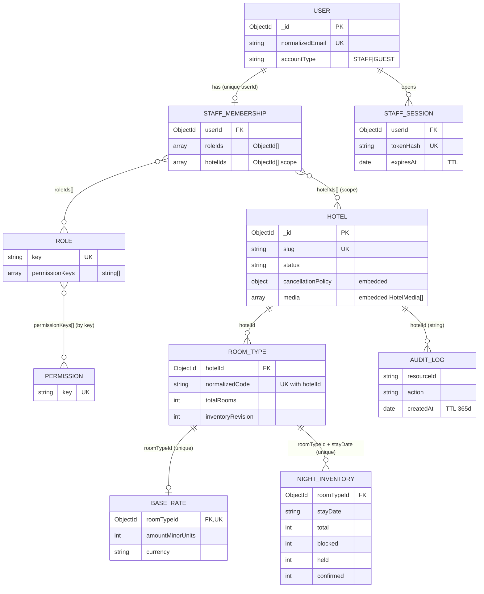
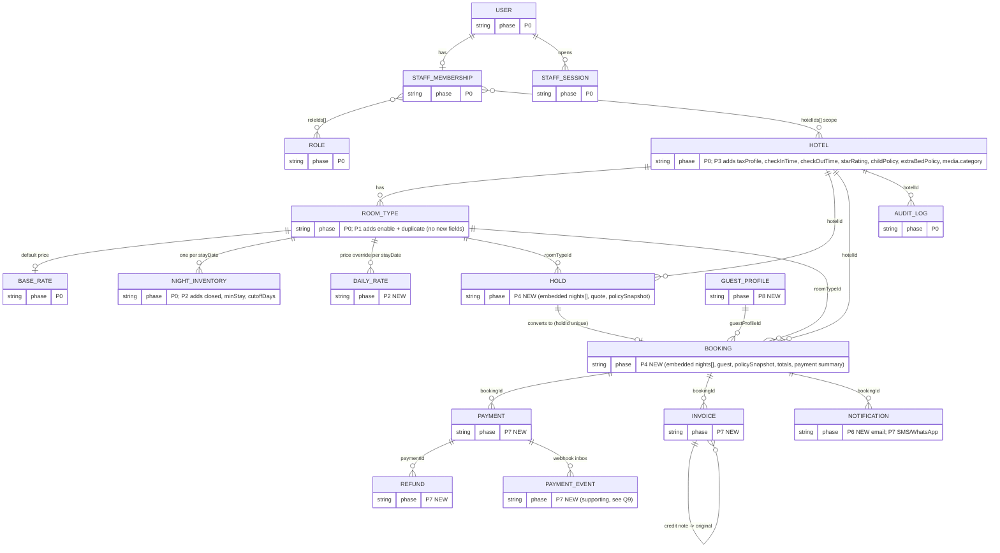
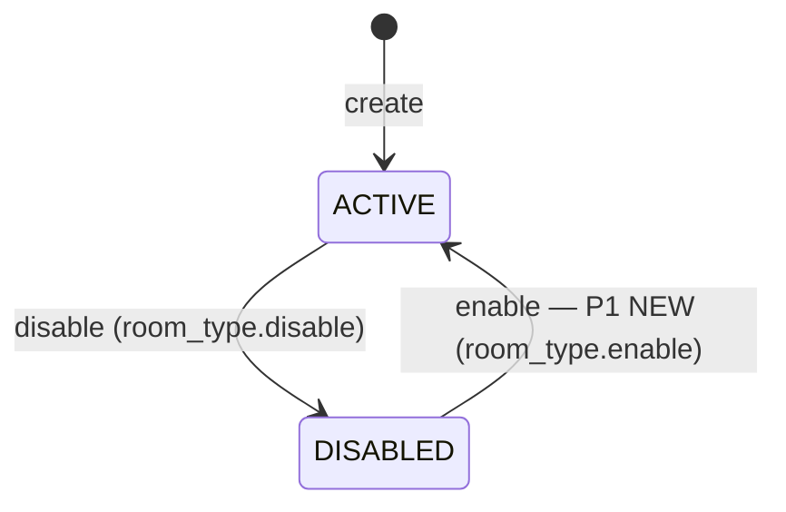
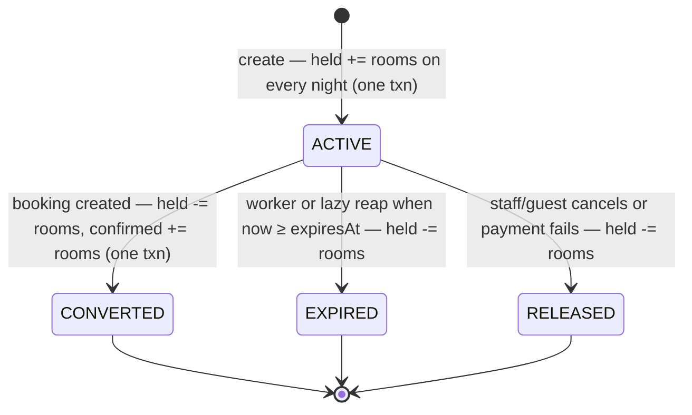
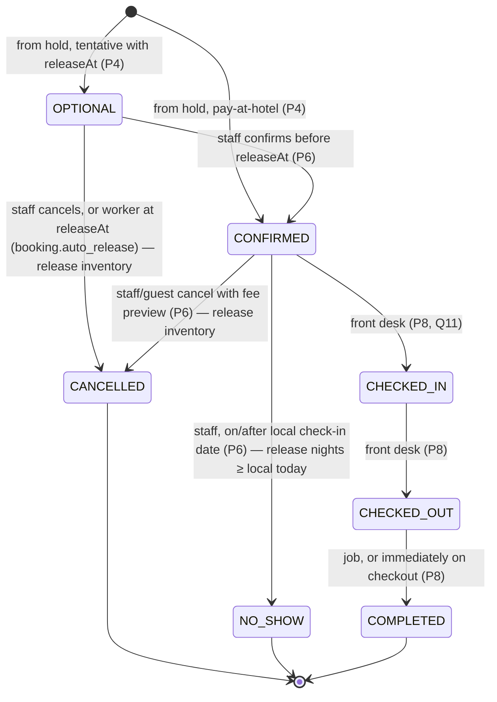
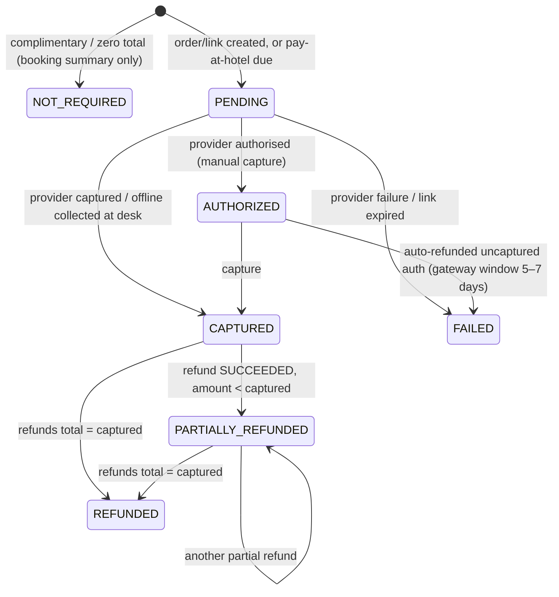
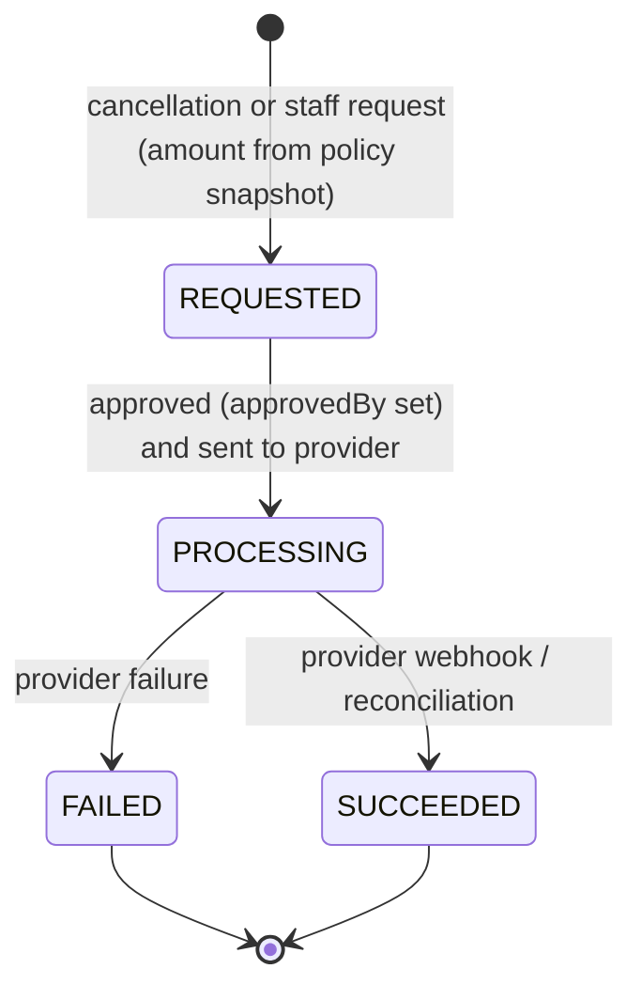
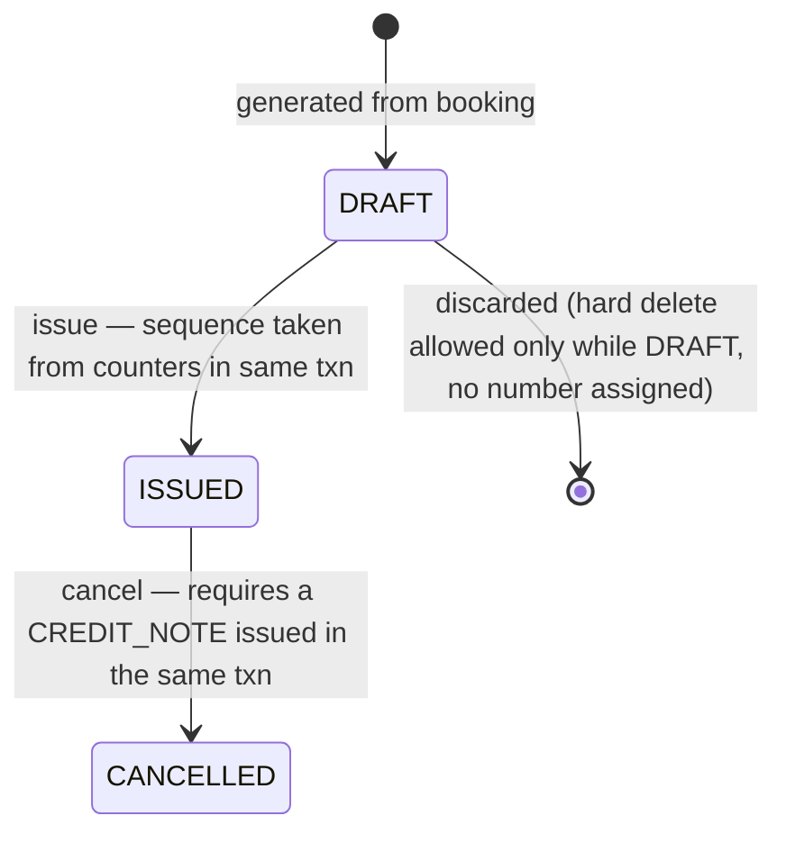

# Data model and relationships — Staywise (new plan)

- **Date:** 2026-10-20
- **Status:** proposal. It becomes the data source of truth once approved. Until then, `../DATA_MODEL.md` is still the approved version. Section 3 lists each mismatch.
- **Stack:** MongoDB 7+ replica set, Mongoose 8 through `@nestjs/mongoose` 11, NestJS 11 REST API under `/api/v1`.
- **Baseline:** [README.md](./README.md#shared-baseline-every-document-must-follow-this). Entity names, phase IDs (P0–P8), state names, India rules and the human-checkpoint format all come from there and are used exactly as written.
- **Who reads this:** backend developers, plus the smaller coding model that implements [MVP-PLAN.md](./MVP-PLAN.md) and [PHASES.md](./PHASES.md).
- **Sources read for P0 (current state):**
  - every schema in `apps/api/src/modules/*/schemas/*.ts`;
  - the DTOs;
  - `hotel.service.ts`, `room-type.service.ts`, `inventory.service.ts`, `pricing.service.ts`, `audit.service.ts`, `hotel-publish.checks.ts`, `hotel.policies.ts`, `hotel-status.rules.ts`;
  - `common/database/transaction.service.ts`, `scripts/ensure-indexes.ts`, `modules/auth/seed-super-admin.ts`.
- **How to read the tables:**
  - **P0** means the field exists in code today;
  - **Pn NEW** means phase *n* adds it;
  - **⚠ mismatch** marks a conflict with `../DATA_MODEL.md` or a module spec.

> **Rules for the coding model (apply to every task in this file)**
> - Never change a field name, collection name or index name that already exists (P0) unless a migration below says so.
> - Every new field gets a default, so existing documents stay valid.
> - Verify with `npx tsc --noEmit -p apps/api/tsconfig.json` and `npm --workspace=apps/api run test`. Never run `nest build` while the dev server may be running.
> - Do not run migration scripts against shared or production data. Each one has a 🧑 HUMAN CHECKPOINT.
> - Do not delete collections, documents or files, and do not commit or push, without human approval (`../../AGENTS.md`).

---

## Contents

1. [Conventions](#1-conventions)
2. [ER diagrams](#2-er-diagrams)
3. [Entity reference](#3-entity-reference)
4. [Relationships](#4-relationships)
5. [State machines](#5-state-machines)
6. [Key algorithms](#6-key-algorithms)
7. [Migrations per phase](#7-migrations-per-phase)
8. [Data retention, privacy and backups](#8-data-retention-privacy-and-backups)
9. [Open questions](#9-open-questions)

---

## 1. Conventions

### 1.1 Identifiers
- **Primary key:** every collection uses Mongo `_id: ObjectId`. The API exposes it as `id` (a string).
- **References:** use `Types.ObjectId` with `ref: '<Model>'` (as `RoomType.hotelId` and `NightInventory.roomTypeId` do today).
  - **Exception (P0, keep):** `AuditLog.actorId`, `resourceId` and `hotelId` are stored as **strings**. Do not convert them. New audit writes keep passing `id.toString()`.
- **Public references:** guests never see an ObjectId as a booking number. `Booking.reference` is a separate unique code (§3.13).
- **Validating input ids:** run `Types.ObjectId.isValid(id)` before any query. If it fails, return 404, as the existing `asObjectId()` helpers do.

### 1.2 Optimistic locking (`version`)
- **Field:** `version: number`, integer, `min: 0`.
- **Starting value:**
  - **0** for Hotel, RoomType, BaseRate and NightInventory (P0);
  - **1** for Role, Permission and the embedded `Hotel.cancellationPolicy.version` (P0);
  - **0** for every new entity.
- **Write pattern (required):**
  - filter on `{ _id, version: dto.version }` and include `$inc: { version: 1 }` in the update;
  - if no document matches, re-read it and return `409 VERSION_CONFLICT`, or a more specific code when the cause is known;
  - Mongoose's own `optimisticConcurrency` is **not** used (`Hotel` sets it to `false`), so do not turn it on.
- **System counter changes also bump `version`.** Holds, bookings, expiry and cancellation all change the `NightInventory` counters, and each of those updates also runs `$inc: { version: 1 }`. Admin screens must re-fetch after a 409.
  - Block/unblock already guards capacity with a `$expr` predicate, so a version bump never makes a capacity check unsafe.

### 1.3 Timestamps
- **Mongoose `timestamps: true`** gives `createdAt` and `updatedAt` as UTC `Date` values. Every entity uses it, except:
  - `AuditLog` and `StaffSession`: `createdAt` only (P0);
  - `PaymentEvent` (P7): `createdAt` only.
- **Business timestamps:** these are separate fields, all UTC `Date`, for example `expiresAt`, `releaseAt`, `cancelledAt`, `convertedAt`, `issuedAt`.

### 1.4 Money
- **Amounts:** `*MinorUnits` integer fields (paise for INR).
  - Validation: `min: 0`, `max: 9_000_000_000_000`, and `Number.isSafeInteger()` (same as `BaseRate` today).
- **Currency:** every document that holds money has a `currency` field: 3 uppercase letters, ISO 4217, `match: /^[A-Z]{3}$/`. It is `INR` for the whole MVP (multi-currency is out of scope).
- **No floats:** never multiply money by a decimal. Percentages are stored as **basis points** (`percentageBps`, `taxRateBps`, 0–10000).
  - Multiply first, then divide with the rounding helper `roundHalfUp(numerator, denominator)` (§6.7).
  - Use `BigInt` when `amount × bps` could go above `Number.MAX_SAFE_INTEGER`.
- **Tax-exclusive storage (proposed):** `BaseRate.amountMinorUnits` and `DailyRate.amountMinorUnits` are **pre-GST** room prices. GST is added on top. **Decision needed** (§9, Q1).

### 1.5 Dates and times
- **Hotel-local calendar dates** are strings in the form `YYYY-MM-DD`, validated with `match: /^\d{4}-\d{2}-\d{2}$/` plus a round-trip check: `new Date(v + 'T00:00:00.000Z').toISOString().slice(0,10) === v`.
  - Used for: `stayDate`, `checkIn`, `checkOut`, `effectiveFrom`, invoice `financialYear` boundaries.
  - Never store them as `Date`.
- **Night range:** a stay covers the nights `[checkIn, checkOut)`. The checkout date is **not** a night.
- **Local "today":** always computed with `dateInTimezone(new Date(), hotel.timezone)` from `hotel.policies.ts`. Never use the server clock's date.
- **Times of day** are local strings in the form `HH:mm`, validated with `/^([01]\d|2[0-3]):[0-5]\d$/`. Used for `checkInTime` and `checkOutTime` (P3).
- **Instants** (one moment in time) are UTC `Date` values. Turning a local date and time into an instant needs the helper `localDateTimeToUtc(date, time, timezone)` (§6.8). Add it to `apps/api/src/common/time/` in P4. Nothing in the API dependencies does this today.
- **Timezone:** the hotel's `timezone` is an IANA name (default `Asia/Kolkata`). It is locked while future bookings exist (P0 code already checks this; §3.5).

<a id="soft-delete"></a>

### 1.6 Deleting data: soft delete everywhere (decided 2026-10-20)
- **Rule:** every delete is a **soft delete**. No document is removed by an application action.
- **Fields on every collection** (added to each entity table in §3):
  - `isDeleted`: boolean, required, default `false`, indexed;
  - `deletedAt`: Date | null, default `null`;
  - `deletedBy`: ObjectId → `User` | null, default `null`;
  - `deleteReason`: string ≤ 500 | null (optional; required where the API takes a reason).
- **🧑 Naming:** camelCase `isDeleted` matches the existing fields (`normalizedEmail`, `failedLoginCount`). If the database must use `is_deleted`, decide before P0 and apply it everywhere.
- **What "delete" does:**
  - sets `isDeleted: true`, `deletedAt: now`, `deletedBy: actor` in the same update that bumps `version`;
  - writes the audit action `<entity>.delete` (with `deleteReason`).
- **Restore:** super admin only. It sets `isDeleted: false` and clears `deletedAt` and `deletedBy`. Audited as `<entity>.restore`.
- **Reads hide deleted documents by default:**
  - a shared Mongoose plugin (`common/database/soft-delete.plugin.ts`) adds `{ isDeleted: { $ne: true } }` to `find`, `findOne`, `countDocuments`, `findOneAndUpdate`, `updateMany` and the first `$match` of aggregates;
  - an explicit `withDeleted()` option is used only by restore, audit and admin "show deleted" views.
- **Unique indexes become partial** so a deleted record doesn't block a new one, e.g. hotel slug unique with `partialFilterExpression: { isDeleted: false }`. 🧑 The index rebuild is reviewed before it runs (§7).
- **Status vs delete (both exist; they mean different things):**
  - **business status** (still visible with filters, still counted in history):
    - Hotel `ARCHIVED`;
    - RoomType `DISABLED`;
    - Booking `CANCELLED`;
    - Hold `RELEASED` / `EXPIRED`;
    - Invoice `CANCELLED` + credit note.
  - **soft delete:** hidden from every normal list and search; only restorable.
- **Deletion is never allowed for these** (they keep `isDeleted`, which is always `false`, and have no delete endpoint):
  - **legal/financial records:** `Booking`, `Payment`, `PaymentEvent`, `Refund`, `Invoice` (GST record retention);
  - **the record of changes:** `AuditLog`.
  - These are cancelled or reversed instead.
- **Guards before soft delete** (no cascade, anywhere):
  - a Hotel can't be deleted while it has future non-cancelled bookings;
  - a RoomType can't be deleted while it has future bookings or ACTIVE holds;
  - children of a deleted parent stay as they are and are hidden through the parent.
- **`DailyRate` clearing** (falls back to `BaseRate`) is now a soft delete too, audited as `rate.daily.clear`.
- **Exceptions to confirm** (🧑 HUMAN CHECKPOINT, before P0):
  - **`StaffSession` TTL expiry:** expired sessions are security data, not business data. Proposal: keep the TTL hard-expiry, or replace it with soft expiry plus a cleanup job.
  - **`AuditLog` 365-day TTL in current code:** proposal: remove the TTL (audit must not disappear) or set the retention by policy.
  - **Privacy erasure (DPDP):** soft delete is **not** erasure. An erasure request must also **anonymise** personal fields in place (name, phone, email, ID data) and set `isDeleted: true`; see §8.
  - **Backups:** soft-deleted data stays in backups by design.

### 1.7 Audit on every write
- **Rule:** every create, update or state change by a STAFF, GUEST or SYSTEM actor writes one `AuditLog` row through `AuditService.log({ ..., session })`, **inside the same transaction**.
  - `AuditService.log` re-throws errors, so a failed audit write aborts the business write. Keep it that way: audit fails closed.
- **Content:**
  - `metadata.before` and `metadata.after` are *safe views*: no secrets and no guest PII beyond ids;
  - `reason` is required where the DTO requires it (inventory, rates, room count changes, cancellations).
- **One documented exception:** delivery attempts by the notification worker are recorded on the `Notification` document itself, not in `AuditLog`. Creating a notification and giving up on it (`FAILED`) are still audited.

### 1.8 Transactions
- **Use `TransactionService.executeInTransaction(session => …)`** for any write that touches:
  - more than one document (and the audit row counts as a document, so in practice **every** write);
  - or any `NightInventory` counter.
- **Inside the callback:**
  - pass `{ session }` (or `.session(session)`) on **every** read and write;
  - never call email, SMS, payment gateway or file storage;
  - throw business errors (`ConflictException`); the service retries only `TransientTransactionError` and `WriteConflict`, up to 3 attempts.
- **Standalone MongoDB (ADR-012):** transactions are skipped only when `NODE_ENV=development`. In that mode there are **no inventory guarantees**. Concurrency tests (P4) must run against a replica set, for example `mongodb-memory-server` `MongoMemoryReplSet`.
- **Indexes:**
  - `autoIndex` is on everywhere except production;
  - in production, indexes are created only by `npm --workspace=apps/api run ensure:indexes`;
  - that script loops over `conn.models`, so **a new model must be registered in some module's `MongooseModule.forFeature`, or its indexes are never created**;
  - it calls `createIndexes()`, so it never drops an index that is no longer declared.

---

## 2. ER diagrams

### 2.1 Current state (P0, built)



### 2.2 Target (P0 → P8)

- **How to read it:** each entity carries a `phase` pseudo-attribute. "P0" means it exists already; "Pn NEW" means phase *n* adds it.
- **Embedded objects:** fields added to existing entities appear in their comments. Embedded sub-documents (`nights[]`, `guest`, `taxProfile`) are not separate collections.



- **Supporting collections not drawn above:**
  - `permissions` (P0, part of RBAC);
  - `counters` (P7 NEW, invoice sequence numbers);
  - `schema_migrations` (P1 NEW, migration ledger).
  - `counters`, `schema_migrations` and `payment_events` are **not** in the README naming list. **Decision needed** (§9, Q9).

---

## 3. Entity reference

- **Owning modules today:**
  - `auth`: User, Role, Permission, StaffMembership, StaffSession;
  - `hotels`: Hotel, RoomType;
  - `pricing`: BaseRate;
  - `inventory`: NightInventory;
  - `audit`: AuditLog.
- **New modules (proposed):**
  - `pricing`: DailyRate and the quote engine;
  - `bookings`: Hold, Booking;
  - `payments`: Payment, PaymentEvent, Refund;
  - `invoices`: Invoice;
  - `notifications`: Notification;
  - `guests`: GuestProfile.

### 3.1 User (P0)
- **Purpose:** login identity for staff (and, in a later phase, guest accounts).
- **Collection:** `users`. **Module:** `auth`. **Schema:** `modules/auth/schemas/user.schema.ts`.

| Field | Type | Req | Default | Validation | Notes |
|---|---|---|---|---|---|
| normalizedEmail | string | ✅ | — | trim, lowercase, max 254 | unique |
| passwordHash | string | ✅ | — | `select: false` | bcrypt, cost 12 |
| accountType | `'STAFF' \| 'GUEST'` | ✅ | — | enum | |
| status | `UserStatus` | ✅ | `ACTIVE` | `ACTIVE \| SUSPENDED` | |
| failedLoginCount | number | ✅ | 0 | min 0 | lockout counter |
| lockUntil | Date \| null | — | null | | |
| createdAt / updatedAt | Date | auto | | | |
| isDeleted | boolean | ✅ | `false` | indexed | soft delete flag (§1.6); hidden from reads by default |
| deletedAt | Date (nullable) | — | `null` |  | set with `isDeleted: true` (§1.6) |
| deletedBy | ObjectId → User (nullable) | — | `null` |  | actor who deleted (§1.6) |
| deleteReason | string (nullable) | — | `null` | max 500 | optional reason (§1.6) |

- **Indexes:**
  - `user_normalized_email_unique`: `{ normalizedEmail: 1 }`, unique;
  - `user_type_status`: `{ accountType: 1, status: 1 }`.
- **Has no `version` field.** Staff management changes (later phase) must add `version` (default 0) before an edit API exists.
- **⚠ mismatch:** `../DATA_MODEL.md` says "normalized email/phone". There is **no phone field**.
- **Writers:** `seed-super-admin.ts`, `AuthService` (login counters).
- **Audit:** `staff.login`, `staff.login.blocked_without_mfa`, `staff.logout`, `staff.logout_all`.

### 3.2 Role and Permission (P0)
- **Collections:** `roles`, `permissions`. **Module:** `auth`. **Schema:** `role.schema.ts`.

| Role field | Type | Req | Default | Validation | Notes |
|---|---|---|---|---|---|
| key | string | ✅ | — | uppercase, trim | unique (`role_key_unique`), e.g. `SUPER_ADMIN` |
| name | string | ✅ | — | trim, max 100 | display name ("Super Administrator") |
| permissionKeys | string[] | ✅ | `[]` | | keys from `permissions.key` (string match, not ObjectId) |
| system | boolean | ✅ | false | | system roles are not deletable |
| active | boolean | ✅ | true | | inactive roles are ignored at login |
| version | number | ✅ | **1** | min 1 | the seed currently writes 2 |
| isDeleted | boolean | ✅ | `false` | indexed | soft delete flag (§1.6); hidden from reads by default |
| deletedAt | Date (nullable) | — | `null` |  | set with `isDeleted: true` (§1.6) |
| deletedBy | ObjectId → User (nullable) | — | `null` |  | actor who deleted (§1.6) |
| deleteReason | string (nullable) | — | `null` | max 500 | optional reason (§1.6) |

| Permission field | Type | Req | Default | Notes |
|---|---|---|---|---|
| key | string | ✅ | — | unique (`permission_key_unique`) |
| domain | string | ✅ | — | prefix before the first `.` |
| description | string | ✅ | — | |
| version | number | ✅ | 1 | |
| isDeleted | boolean | ✅ | `false` | soft delete flag (§1.6); hidden from reads by default |
| deletedAt | Date (nullable) | — | `null` | set with `isDeleted: true` (§1.6) |
| deletedBy | ObjectId → User (nullable) | — | `null` | actor who deleted (§1.6) |
| deleteReason | string (nullable) | — | `null` | optional reason, max 500 (§1.6) |

- **Role and permission catalogue are owned by code.** The seed catalogue today has 14 keys: `hotels.*`, `room_types.*`, `inventory.view|block|adjust`, `rates.view|edit`.
  - New phases add keys to `CATALOG_PERMISSIONS` (for example `bookings.view`, `bookings.create`, `bookings.cancel`, `bookings.no_show`, `audit.view`, `hotels.edit`, `hotels.edit_tax`) and re-run the seed.
- **⚠ mismatch:**
  - `modules/rbac.md` lists Role `normalizedName`, `description`, `status`, `createdBy` and Permission `sensitivity`. None of these exist.
  - The code uses `key` plus a boolean `active`.
- **⚠ unverified:** the README says Manager and Editor roles already exist. The seed only creates `SUPER_ADMIN`; `verify-scenarios.ts` creates `TEST_MANAGER`. 🧑 Confirm how Manager and Editor were created (manual insert?) before P1 adds permission keys to them.
- **Super admin rule:** the principal's `role` is `SUPER_ADMIN` when any active role has `key === 'SUPER_ADMIN'`; otherwise it is `HOTEL_MANAGER` (`staff-session.service.ts`).

### 3.3 StaffMembership (P0)
- **Collection:** `staff_memberships`. **Module:** `auth`.

| Field | Type | Req | Default | Validation | Notes |
|---|---|---|---|---|---|
| userId | ObjectId → User | ✅ | — | | unique (`staff_membership_user_unique`): one membership per user |
| roleIds | ObjectId[] → Role | — | `[]` | | at least one active role is needed to log in |
| hotelIds | ObjectId[] → Hotel | — | `[]` | | **hotel scope**; empty for super admins (who have global scope through their role) |
| status | `'ACTIVE' \| 'SUSPENDED'` | ✅ | `ACTIVE` | | |
| isDeleted | boolean | ✅ | `false` | indexed | soft delete flag (§1.6); hidden from reads by default |
| deletedAt | Date (nullable) | — | `null` |  | set with `isDeleted: true` (§1.6) |
| deletedBy | ObjectId → User (nullable) | — | `null` |  | actor who deleted (§1.6) |
| deleteReason | string (nullable) | — | `null` | max 500 | optional reason (§1.6) |

- **Invariants:**
  - a non-super-admin can act only on hotels in `hotelIds`;
  - the guard checks `:hotelId` or `:id` on `/hotels` routes, and every service checks again with `assertHotelScope()` against the hotel id **read from the database record**.
- **⚠ mismatch:** `rbac.md` lists `invitedAt` and `acceptedAt`. These do not exist and there is no `version`. Add both (with defaults) when the staff management screens are built (`/admin/settings/staff`). Not a P1–P8 data dependency.
- **Archive rule:** archiving a hotel does **not** remove it from `hotelIds`, so staff can still read historical data.

### 3.4 StaffSession (P0)
- **Collection:** `staff_sessions`. **Module:** `auth`. **Timestamps:** `createdAt` only.

| Field | Type | Req | Default | Notes |
|---|---|---|---|---|
| userId | ObjectId → User | ✅ | — | indexed |
| audience | `'STAFF'` | ✅ | `STAFF` | |
| tokenHash | string | ✅ | — | `select: false`; unique (`staff_session_token_hash_unique`) |
| lastSeenAt | Date | ✅ | now | idle timeout comes from `auth.staffSessionIdle` (default 1800 s) |
| expiresAt | Date | ✅ | — | absolute expiry |
| revokedAt | Date \| null | — | null | |
| revokeReason | string \| null | — | null | |
| ipAddressPrefix | string \| null | — | null | max 64; PII-reduced |
| userAgentSummary | string \| null | — | null | max 200 |
| isDeleted | boolean | ✅ | `false` | soft delete flag (§1.6); hidden from reads by default |
| deletedAt | Date (nullable) | — | `null` | set with `isDeleted: true` (§1.6) |
| deletedBy | ObjectId → User (nullable) | — | `null` | actor who deleted (§1.6) |
| deleteReason | string (nullable) | — | `null` | optional reason (§1.6) |

- **Indexes:**
  - `staff_session_user_active`: `{ userId: 1, revokedAt: 1, expiresAt: 1 }`;
  - `staff_session_expiry_ttl`: `{ expiresAt: 1 }`, `expireAfterSeconds: 0` (Mongo deletes the document once it expires).
- **No changes are planned in P1–P8.**

### 3.5 Hotel (P0, extended in P3)
- **Purpose:** the property aggregate. It holds content, location, timezone, cancellation policy, photos, publication status and (P3) tax profile.
- **Collection:** `hotels`. **Module:** `hotels`. **Schema:** `hotel.schema.ts`.

| Field | Type | Req | Default | Validation | Phase / notes |
|---|---|---|---|---|---|
| name | string | ✅ | — | trim, max 140 (DTO min 2) | P0 |
| slug | string | ✅ | — | lowercase; `normalizeSlug()` → `[a-z0-9-]` | P0; unique |
| address | HotelAddress | ✅ | — | see sub-table | P0 |
| timezone | string | ✅ | — | IANA name, checked with `Intl.DateTimeFormat` | P0; locked while future bookings exist |
| contact | HotelContact | ✅ | — | at least email or phone (service rule) | P0 |
| coordinates | `{ latitude, longitude }` | — | — | lat −90..90, lng −180..180; both or neither | **P0 already exists.** The DTO takes top-level `latitude` and `longitude`. P3 adds only the map-pin UI. |
| description | string | — | — | trim, max 5000 | P0 |
| amenities | string[] | — | `[]` | each max 80; trimmed and de-duplicated (`normalizeList`) | **P0 already exists.** P3 adds a fixed amenity catalogue (Q6). |
| primaryImage | string | — | — | max 1000 | P0, **denormalised**: the URL of the media item with `isPrimary`, otherwise `media[0]` |
| media | HotelMedia[] | — | `[]` | see sub-table | P0; P3 adds `category` |
| cancellationPolicy | HotelCancellationPolicy | — | — | see sub-table | P0; required to publish |
| status | `HotelStatus` | ✅ | `DRAFT` | `DRAFT \| PUBLISHED \| SUSPENDED \| ARCHIVED` | P0; §5.1 |
| version | number | ✅ | 0 | min 0 | P0 |
| checkInTime | string \| null | — | null | `HH:mm` | **P3 NEW.** Used by the cancellation deadline (§6.6). |
| checkOutTime | string \| null | — | null | `HH:mm` | **P3 NEW** |
| starRating | number \| null | — | null | integer 1–5; null = unrated | **P3 NEW.** ⚠ `../DATA_MODEL.md` calls it "star category". Not in code today. |
| childPolicy | HotelChildPolicy \| null | — | null | see sub-table | **P3 NEW** |
| extraBedPolicy | HotelExtraBedPolicy \| null | — | null | see sub-table | **P3 NEW** |
| taxProfile | HotelTaxProfile \| null | — | null | see sub-table | **P3 NEW**; required before invoices (P7), **not** before holds |
| createdAt / updatedAt | Date | auto | | | P0 |
| isDeleted | boolean | ✅ | `false` | indexed | soft delete flag (§1.6); hidden from reads by default |
| deletedAt | Date (nullable) | — | `null` |  | set with `isDeleted: true` (§1.6) |
| deletedBy | ObjectId → User (nullable) | — | `null` |  | actor who deleted (§1.6) |
| deleteReason | string (nullable) | — | `null` | max 500 | optional reason (§1.6) |

**HotelAddress (embedded, `_id: false`, P0)**

| Field | Type | Req | Validation |
|---|---|---|---|
| line1 | string | ✅ | trim, max 240 |
| line2 | string | — | trim, max 240 |
| city | string | ✅ | trim, max 120 |
| region | string | — | trim, max 120. Holds the **state name** for India (free text in the schema; the admin UI uses a dropdown) |
| postalCode | string | ✅ | max 80; India: `/^[1-9][0-9]{5}$/` (DTO) |
| countryCode | string | ✅ | 2 letters, uppercase, ISO 3166-1 alpha-2 |

**HotelContact (embedded, P0):** `email?` (lowercase, max 254) and `phone?` (max 32; DTO `/^\+?[0-9().\-\s]{7,32}$/`).

**HotelMedia (embedded, `_id: false`; RoomType reuses this sub-schema)**

| Field | Type | Req | Default | Validation | Phase |
|---|---|---|---|---|---|
| url | string | ✅ | — | max 1000. DTO: `^(https://\S+\|/uploads/[A-Za-z0-9._-]+)$`. The DTO also strips legacy `http(s)://host` prefixes from `/uploads/` URLs on write | P0 |
| isPrimary | boolean | ✅ | false | at most one `true` per array (service rule) | P0 |
| caption | string | — | — | max 200 | P0 |
| displayOrder | number | ✅ | 0 | min 0 | P0 |
| category | string | ✅ | `OTHER` | enum `EXTERIOR \| LOBBY \| ROOM \| BATHROOM \| DINING \| POOL \| AMENITY \| VIEW \| OTHER` | **P3 NEW.** Because the sub-schema is shared, RoomType media gets it too. The enum list needs approval (Q6). |

**HotelCancellationPolicy (embedded, P0)**

| Field | Type | Req | Default | Validation |
|---|---|---|---|---|
| effectiveFrom | string | ✅ | — | `YYYY-MM-DD`; must be ≤ local today to publish |
| freeCancellationHoursBeforeCheckIn | number | ✅ | — | integer 0–8760 |
| afterCutoff | CancellationFeeRule | ✅ | — | |
| noShow | CancellationFeeRule | ✅ | — | |
| version | number | ✅ | 1 | the service sets `previous.version + 1` on every policy edit |

**CancellationFeeRule (P0):**
- `basis` is one of `NO_FEE | FULL_STAY | FIXED_MINOR_UNITS | PERCENTAGE_BPS`.
- `amountMinorUnits` and `currency`: only when the basis is `FIXED_MINOR_UNITS`. The currency must equal the base-rate currency to publish.
- `percentageBps` (0–10000): only when the basis is `PERCENTAGE_BPS`.
- Any other combination is rejected (`normalizeFeeRule`).

**HotelChildPolicy (P3 NEW, `_id: false`)**

| Field | Type | Req | Default | Validation | Notes |
|---|---|---|---|---|---|
| childrenAllowed | boolean | ✅ | true | | |
| maxChildAge | number | ✅ | 11 | integer 0–17 | guests above this age count as adults (Q7) |
| freeStayMaxAge | number \| null | — | null | integer 0–17, ≤ maxChildAge | display only in the MVP |
| notes | string | — | — | max 500 | |

**HotelExtraBedPolicy (P3 NEW, `_id: false`)**

| Field | Type | Req | Default | Validation | Notes |
|---|---|---|---|---|---|
| available | boolean | ✅ | false | | |
| maxPerRoom | number | — | 0 | integer 0–5 | |
| chargeMinorUnits | number \| null | — | null | money rules | **display only in the MVP**: not added to quotes (Q7) |
| currency | string \| null | — | null | ISO 4217; required when a charge is set | |
| notes | string | — | — | max 500 | |

**HotelTaxProfile (P3 NEW, `_id: false`)**

| Field | Type | Req | Default | Validation | Notes |
|---|---|---|---|---|---|
| gstin | string | ✅ | — | uppercase, length 15, regex and checksum (§6.9) | **not unique** across hotels: one GSTIN can cover several premises in the same state |
| legalName | string | ✅ | — | trim, 2–200 | must match the GST registration |
| tradeName | string | — | — | max 200 | optional (research note) |
| stateCode | string | ✅ | — | `/^\d{2}$/`, in the state-code table (§6.9) | must equal `gstin.slice(0,2)` |
| specifiedPremises | boolean | ✅ | false | | affects restaurant GST only; room GST is unaffected |
| sacCode | string | — | `996311` | `/^\d{6}$/` | **P7.** Verify with a tax professional. |
| invoicePrefix | string \| null | — | null | `/^[A-Z0-9-]{1,8}$/` | **P7** (§3.17) |
| version | number | ✅ | 1 | | incremented on every tax-profile edit |

- **Indexes:**
  - `hotel_slug_unique`: `{ slug: 1 }`, unique (P0);
  - `hotel_status_city`: `{ status: 1, 'address.city': 1 }` (P0; also used by guest search in P5);
  - `hotel_text_search`: text index on `name`, `slug`, `address.city` with weights 10/5/3 (P0). It is the only text index allowed on this collection;
  - `hotel_tax_gstin`: `{ 'taxProfile.gstin': 1 }`, non-unique, `partialFilterExpression: { 'taxProfile.gstin': { $type: 'string' } }` (P3 NEW; admin lookups).
- **Relationships:**
  - 1–N RoomType;
  - 1–N Hold and Booking (P4);
  - N–M StaffMembership (scope);
  - 1–N AuditLog (by `hotelId` string).
- **Invariants:**
  - `slug` is unique; duplicates are mapped to `409 DUPLICATE_HOTEL_SLUG`;
  - `timezone` cannot change while `bookings.countDocuments({ hotelId, checkOut: { $gt: localToday } }) > 0`. **This P0 code already reads `bookings.hotelId` and `bookings.checkOut`, so P4 must use exactly those field names and types** (`hotelId: ObjectId`, `checkOut: 'YYYY-MM-DD'`);
  - publishing requires every check in `HotelPublishChecks.collect()`:
    - a cancellation policy that exists, is valid and is already effective;
    - at least one ACTIVE room type with `totalRooms ≥ 1`;
    - a base rate for every active room type, all in one currency;
    - fixed fees in that same currency;
    - at least one future night with stock for every active room type;
  - P3 adds **warnings** (not blockers) to the Overview: missing check-in/out times, fewer than 5 photos, no tax profile. **Decision needed** on whether `checkInTime` blocks publishing (Q5);
  - an `ARCHIVED` hotel cannot be published or reactivated.
- **Writers:** `HotelService` (`create`, `update`, `updateMedia`, `publish`, `setStatus`, `bulkStatusUpdate`). P3 adds `updateContent` and `updateTaxProfile`, both following the same version and audit pattern.
- **Audit actions:**
  - P0: `hotel.create`, `hotel.update`, `hotel.media_update`, `hotel.publish`, `hotel.suspended`, `hotel.archived` (made from `hotel.${status.toLowerCase()}`), `hotel.bulk_status_update` (resourceId `'bulk'`, no hotelId);
  - P3 NEW: `hotel.content_update`, `hotel.tax_profile_update`. The tax-profile audit stores the full GSTIN; it is business data, not personal data.
- **⚠ observations (P0 code, not bugs to fix silently):**
  - `setStatus` allows `DRAFT → SUSPENDED`; the bulk rules do not (§5.1). 🧑 Decide whether to block it.
  - `safeAuditView` leaves out `media`, `amenities` and `description`, so their before/after values are not in the audit.
  - Audit action names mix tenses (`hotel.publish` vs `hotel.suspended`). Keep the existing strings, because the audit viewer filters on them.

### 3.6 RoomType (P0, P1 behaviour only)
- **Purpose:** the sellable inventory unit (rooms are pooled; there is no physical room number).
- **Collection:** `room_types`. **Module:** `hotels`. **Schema:** `room-type.schema.ts`.

| Field | Type | Req | Default | Validation | Notes |
|---|---|---|---|---|---|
| hotelId | ObjectId → Hotel | ✅ | — | indexed | immutable after create |
| name | string | ✅ | — | trim, max 120 (DTO min 2) | |
| code | string | ✅ | — | uppercase, max 32, DTO `/^[A-Za-z0-9]+(-[A-Za-z0-9]+)*$/` | e.g. `DLX-K` |
| normalizedCode | string | ✅ | — | lowercase copy of `code` | **denormalised**, for the case-insensitive unique index |
| description | string | — | — | max 3000; an empty string removes the field (`$unset`) | |
| maxAdults | number | ✅ | — | integer 1–30 | per room |
| maxChildren | number | ✅ | 0 | integer 0–30 | per room |
| beds | `{ type, quantity }[]` | — | `[]` | type max 40; quantity 1–20 | |
| amenities | string[] | — | `[]` | each max 80; de-duplicated | |
| media | HotelMedia[] | — | `[]` | same sub-schema as Hotel | P3 `category` applies |
| totalRooms | number | ✅ | — | integer 0–10000 | **source of `NightInventory.total`** |
| status | `RoomTypeStatus` | ✅ | `ACTIVE` | `ACTIVE \| DISABLED` | §5.2 |
| version | number | ✅ | 0 | | |
| inventoryRevision | number | ✅ | 0 | | bumped by `InventoryService.initialize` as a lock (it conditions on `version` + ACTIVE). It is **not** a user-visible version. |
| isDeleted | boolean | ✅ | `false` | indexed | soft delete flag (§1.6); hidden from reads by default |
| deletedAt | Date (nullable) | — | `null` |  | set with `isDeleted: true` (§1.6) |
| deletedBy | ObjectId → User (nullable) | — | `null` |  | actor who deleted (§1.6) |
| deleteReason | string (nullable) | — | `null` | max 500 | optional reason (§1.6) |

- **Indexes:**
  - `room_type_hotel_code_unique`: `{ hotelId: 1, normalizedCode: 1 }`, unique;
  - `room_type_hotel_status`: `{ hotelId: 1, status: 1 }`;
  - `hotelId_1` (from `index: true`).
- **Invariants:**
  - changing `totalRooms` needs a `reason`, and it rewrites `total` on **every** initialized night (past ones too) **only if** `blocked + held + confirmed ≤ newTotal` on every night; otherwise `409 INVENTORY_CAPACITY_CONFLICT`. It runs in the same transaction;
  - you cannot create a room type under an ARCHIVED hotel;
  - a DISABLED room type cannot have inventory initialized and is excluded from public detail, quotes and holds; existing bookings are kept.
- **P1 changes (no new fields):**
  - **enable:** `DISABLED → ACTIVE`, same pattern as `disable`, audit `room_type.enable`;
  - **duplicate:** creates a new RoomType with a new `code` (user input), copies content and media, sets `version: 0` and `inventoryRevision: 0`, audit `room_type.duplicate` with `metadata.sourceRoomTypeId`. It does **not** copy NightInventory or DailyRate. Copying BaseRate is **Decision needed** (Q8).
- **Writers:** `RoomTypeService` (`create`, `update`, `disable`; P1: `enable`, `duplicate`).
- **Audit:** `room_type.create`, `room_type.update`, `room_type.disable`; P1 `room_type.enable`, `room_type.duplicate`.
- **⚠ mismatch:**
  - `room-types.md` mentions a "default base price reference" field. The price is in the separate `BaseRate` collection, joined by `roomTypeId`.
  - Permission `room_types.archive` exists, but the action is called "disable".

### 3.7 BaseRate (P0)
- **Purpose:** the default nightly price for a room type (one per room type).
- **Collection:** `base_rates`. **Module:** `pricing`.

| Field | Type | Req | Default | Validation | Notes |
|---|---|---|---|---|---|
| roomTypeId | ObjectId → RoomType | ✅ | — | | unique |
| amountMinorUnits | number | ✅ | — | integer 0–9e12, safe integer | **pre-GST** (Q1) |
| currency | string | ✅ | — | `/^[A-Z]{3}$/`, ISO 4217 | one currency per hotel, enforced at publish |
| version | number | ✅ | 0 | | create needs `dto.version` absent or 0 |
| isDeleted | boolean | ✅ | `false` | indexed | soft delete flag (§1.6); hidden from reads by default |
| deletedAt | Date (nullable) | — | `null` |  | set with `isDeleted: true` (§1.6) |
| deletedBy | ObjectId → User (nullable) | — | `null` |  | actor who deleted (§1.6) |
| deleteReason | string (nullable) | — | `null` | max 500 | optional reason (§1.6) |

- **Index:** `base_rate_room_type_unique`: `{ roomTypeId: 1 }`, unique (duplicates are mapped to `409 BASE_RATE_CONFLICT`).
- **No `hotelId` field.** Hotel scope comes from `RoomType.hotelId`.
- **Writers:** `PricingService.setBaseRate` (an upsert with a version check; `reason` required).
- **Audit:** `rate.base.create`, `rate.base.update` (resourceType `BASE_RATE`, metadata before/after amount and currency).
- **P2 rule:** the zero/suspicious-rate check also applies here (§3.9).

### 3.8 NightInventory (P0, extended in P2)
- **Purpose:** authoritative counters for one room type on one local night.
- **Collection:** **`night_inventory`** (singular, as in code). ⚠ It is not `night_inventories`; do not rename it.
- **Module:** `inventory`. **Schema:** `night-inventory.schema.ts`.

| Field | Type | Req | Default | Validation | Phase / notes |
|---|---|---|---|---|---|
| roomTypeId | ObjectId → RoomType | ✅ | — | | P0 |
| stayDate | string | ✅ | — | `YYYY-MM-DD`, hotel local | P0 |
| total | number | ✅ | — | integer 0–10000 | P0; copied from `RoomType.totalRooms` at initialize time (**denormalised**) |
| blocked | number | ✅ | 0 | 0–10000 | P0; staff blocks (maintenance) |
| held | number | ✅ | 0 | 0–10000 | P0; changed only by Hold create, expire, release and convert (P4) |
| confirmed | number | ✅ | 0 | 0–10000 | P0; changed only by Booking convert and release (P4/P6) |
| version | number | ✅ | 0 | | P0; bumped on **every** change, including counter changes |
| closed | boolean | ✅ | false | | **P2 NEW** stop-sell. Blocks new holds for this night; existing holds and bookings are untouched |
| minStay | number | ✅ | 1 | integer 1–30 | **P2 NEW.** Checked on the **arrival night only** (Q3) |
| cutoffDays | number | ✅ | 0 | integer 0–365 | **P2 NEW.** A stay arriving on this date must be booked at least `cutoffDays` before it, in the hotel's local calendar. 0 = same-day allowed |
| isDeleted | boolean | ✅ | `false` | indexed | soft delete flag (§1.6); hidden from reads by default |
| deletedAt | Date (nullable) | — | `null` |  | set with `isDeleted: true` (§1.6) |
| deletedBy | ObjectId → User (nullable) | — | `null` |  | actor who deleted (§1.6) |
| deleteReason | string (nullable) | — | `null` | max 500 | optional reason (§1.6) |

- **Indexes:**
  - `night_inventory_room_date_unique`: `{ roomTypeId: 1, stayDate: 1 }`, unique;
  - `night_inventory_date_room`: `{ stayDate: 1, roomTypeId: 1 }`.
  - The P2 grid queries `{ roomTypeId: { $in: ids }, stayDate: { $gte, $lt } }`, which the unique index covers.
  - **No `hotelId` is added** (decision: avoids a backfill; resolve room types first).
- **Invariants (must always hold):**
  - **I-1:** `blocked + held + confirmed ≤ total`. Every increment uses a `$expr` capacity filter in the same update.
  - **I-2:** every counter ≥ 0. Every decrement filters on `<counter>: { $gte: qty }`.
  - **I-3:** `held` = Σ `rooms` of Holds in `ACTIVE` status whose `nights[]` include this date. This may temporarily include ACTIVE holds past `expiresAt` that have not been reaped yet.
  - **I-4:** `confirmed` = Σ `rooms` of Bookings with `inventory.claimed = true`, `inventory.releasedAt = null` (or this night not in `inventory.releasedNights`) whose `nights[]` include this date.
  - **I-5:** a night that does not exist is **not sellable**. Holds never create inventory documents.
  - **I-6:** `closed`, `minStay` and `cutoffDays` never change counters.
- **Writers:**
  - `InventoryService`: `initialize`, `block`, `unblock`, `batchAdjust`, `adjustExistingNightsForTotal`; P2 adds `updateRestrictions` and `bulkUpdate` for the grid;
  - `HoldService` and `BookingService` (P4): counters only.
- **Audit:**
  - P0: `inventory.initialize`, `inventory.block`, `inventory.unblock`, `inventory.batch_block`, `inventory.batch_unblock`, `inventory.total_change`;
  - P2 NEW: `inventory.restrictions_update` (metadata: `from`, `to`, `roomTypeId`, changed fields, `nightCount`);
  - counter changes from holds and bookings are audited under the hold or booking action, not as separate inventory rows.
- **⚠ observation:** `batchAdjust` checks capacity in a read-then-`updateMany` without a per-document `$expr` filter. Inside a transaction, a concurrent write causes a WriteConflict and a retry, so it is safe on a replica set. On standalone dev it is not. 🧑 When P2 rewrites bulk operations for the grid, use per-night conditional updates (§6.3 pattern).

### 3.9 DailyRate (P2 NEW)
- **Purpose:** a price override for one room type on one local night. The effective price is `DailyRate ?? BaseRate` (§6.1).
- **Collection:** `daily_rates`. **Module:** `pricing`. Register it in `PricingModule` **and** `HotelsModule` `forFeature` (publish checks and public detail read it).

| Field | Type | Req | Default | Validation | Notes |
|---|---|---|---|---|---|
| hotelId | ObjectId → Hotel | ✅ | — | must equal `RoomType.hotelId` | **denormalised**, for hotel-wide grid reads and scope checks |
| roomTypeId | ObjectId → RoomType | ✅ | — | | |
| stayDate | string | ✅ | — | `YYYY-MM-DD` | |
| amountMinorUnits | number | ✅ | — | integer 0–9e12, safe integer | pre-GST (Q1) |
| currency | string | ✅ | — | must equal the room type's `BaseRate.currency` | a base rate must exist before any daily rate |
| version | number | ✅ | 0 | | |
| updatedBy | string | ✅ | — | staff user id | quick display; the audit holds the full history |
| isDeleted | boolean | ✅ | `false` | indexed | soft delete flag (§1.6); hidden from reads by default |
| deletedAt | Date (nullable) | — | `null` |  | set with `isDeleted: true` (§1.6) |
| deletedBy | ObjectId → User (nullable) | — | `null` |  | actor who deleted (§1.6) |
| deleteReason | string (nullable) | — | `null` | max 500 | optional reason (§1.6) |

- **Indexes:**
  - `daily_rate_room_date_unique`: `{ roomTypeId: 1, stayDate: 1 }`, unique;
  - `daily_rate_hotel_date`: `{ hotelId: 1, stayDate: 1 }`.
- **Invariants:**
  - at most one override per room type and night;
  - bulk-set across a range of at most 366 nights, in one transaction, with an upsert per date;
  - **zero/suspicious-rate check (P2):** the server rejects `amountMinorUnits === 0`, or a value below 50% or above 300% of the BaseRate, unless the request carries `confirmUnusualRate: true`. The audit records `metadata.unusualRateConfirmed: true`. 🧑 The thresholds need product approval (Q4).
- **Clearing:** hard delete with `deleteMany({ roomTypeId, stayDate: { $in } })` in a transaction, audit `rate.daily.clear` with the removed amounts in metadata.
- **Writers:** `PricingService.setDailyRates`, `PricingService.clearDailyRates`.
- **Audit:** `rate.daily.set` (resourceType `DAILY_RATE`, resourceId = roomTypeId for range writes, metadata `{ from, to, amountMinorUnits, nightCount, replaced: [...] }`), `rate.daily.clear`.
- **⚠ mismatch:** `../DATA_MODEL.md` describes `RatePlan / NightlyRate` with priority and overlap resolution, and `pricing.md` adds priority, status and restrictions. **The new plan has no rate plans and no priority.** Restrictions live on NightInventory. Update `pricing.md` after approval.

### 3.10 AuditLog (P0)
- **Purpose:** append-only history of writes.
- **Collection:** `audit_logs`. **Module:** `audit`. **Timestamps:** `createdAt` only.

| Field | Type | Req | Default | Validation | Notes |
|---|---|---|---|---|---|
| actorId | string \| null | — | null | | user id string; null for SYSTEM |
| actorType | string | ✅ | — | `STAFF \| GUEST \| SYSTEM` | |
| action | string | ✅ | — | | dotted key (lists per entity) |
| resourceType | string | ✅ | — | | `HOTEL`, `ROOM_TYPE`, `NIGHT_INVENTORY`, `BASE_RATE`; new: `DAILY_RATE`, `HOLD`, `BOOKING`, `PAYMENT`, `REFUND`, `INVOICE`, `NOTIFICATION`, `GUEST_PROFILE` |
| resourceId | string | ✅ | — | | `'bulk'` for bulk hotel status |
| hotelId | string \| null | — | null | | scope filter for the viewer (P1) |
| outcome | string | ✅ | — | `SUCCESS \| FAILURE` | |
| reason | string \| null | — | null | | |
| metadata | object | — | `{}` | top-level keys containing password/token/secret/cardNumber/cvv/authorization are redacted | **shallow redaction only.** Never put PII in nested objects |
| ipAddressPrefix | string \| null | — | null | | |
| userAgent | string \| null | — | null | | |
| isDeleted | boolean | ✅ | `false` | indexed | always `false`: deletion not allowed (§1.6); cancel/reverse instead |
| deletedAt | Date (nullable) | — | `null` |  | set with `isDeleted: true` (§1.6) |
| deletedBy | ObjectId → User (nullable) | — | `null` |  | actor who deleted (§1.6) |
| deleteReason | string (nullable) | — | `null` | max 500 | optional reason (§1.6) |

- **Indexes (P0):**
  - `{ resourceType: 1, resourceId: 1 }`;
  - `{ actorId: 1, createdAt: -1 }`;
  - `{ hotelId: 1, createdAt: -1 }`;
  - `{ action: 1, createdAt: -1 }`;
  - TTL `{ createdAt: 1 }` with `expireAfterSeconds: 31_536_000` (365 days).
  - The P0 indexes have **no explicit names**; Mongo generated them.
- **P1 NEW index:** `audit_hotel_resource_created`: `{ hotelId: 1, resourceType: 1, createdAt: -1 }`, for the hotel-scoped viewer filtered by resource type.
- **Invariants:**
  - no update or delete API exists or may be added;
  - the viewer (P1) needs `audit.view`, and non-super-admins are always filtered with `hotelId: { $in: actor.hotelIds }`;
  - rows with `hotelId: null` (bulk, login) are super-admin-only.
- **⚠ mismatch with `audit-logging.md`:** the spec lists `eventId`, correlation/request ID, effective role, source channel and schema version. None exist.
  - Proposal: add `requestId` (string, default null) and `schemaVersion` (number, default 1) in P1. They are optional, so no backfill is needed.
  - The 365-day TTL conflicts with dispute and tax needs for booking and payment actions (§8, Q12).

### 3.11 Hold (P4 NEW)
- **Purpose:** a short reservation of inventory across all nights of a stay, carrying a price quote and the policy shown to the guest.
- **Collection:** `holds`. **Module:** `bookings`.

| Field | Type | Req | Default | Validation | Notes |
|---|---|---|---|---|---|
| hotelId | ObjectId → Hotel | ✅ | — | the hotel must be `PUBLISHED` when the hold is created | denormalised from the room type |
| roomTypeId | ObjectId → RoomType | ✅ | — | must be `ACTIVE` and belong to `hotelId` | one room type per hold (MVP) |
| checkIn | string | ✅ | — | `YYYY-MM-DD`, ≥ local today, ≤ local today + 365 | |
| checkOut | string | ✅ | — | > checkIn; nights ≤ 30 | |
| rooms | number | ✅ | — | integer 1–9 | quantity claimed on every night |
| adults | number | ✅ | — | integer ≥ 1, ≤ `maxAdults × rooms` | total across rooms (Q7) |
| children | number | ✅ | 0 | integer ≥ 0, ≤ `maxChildren × rooms` | |
| nights | HoldNight[] | ✅ | — | length = number of nights, sorted by stayDate | see sub-table |
| totals | PriceTotals | ✅ | — | | §3.13 sub-table |
| policySnapshot | PolicySnapshot | ✅ | — | | §3.13 sub-table, copied from the hotel **when the hold is created** |
| status | string | ✅ | `ACTIVE` | `ACTIVE \| CONVERTED \| EXPIRED \| RELEASED` | §5.3 |
| channel | string | ✅ | — | `STAFF \| GUEST_WEB \| PAYMENT_LINK` | `PAYMENT_LINK` from P7 |
| expiresAt | Date | ✅ | — | createdAt + TTL for the channel (STAFF 10 min, GUEST_WEB 10 min, PAYMENT_LINK 30–60 min) | config `holds.ttlMinutes.<channel>` |
| idempotencyScope | string | ✅ | — | `staff:<userId>` or `guest:<guestSessionId>` | |
| idempotencyKey | string | ✅ | — | 8–100 chars, `[A-Za-z0-9_-]` | from the `Idempotency-Key` header |
| requestFingerprint | string | ✅ | — | SHA-256 hex of canonical JSON of the request body (`common/crypto/digest.ts`) | same key + different fingerprint → `409 IDEMPOTENCY_KEY_REUSED` |
| guest | GuestSnapshot \| null | — | null | | P5: the guest web collects details at the hold step |
| createdBy | `{ actorType, actorId }` | ✅ | — | | |
| convertedBookingId | ObjectId \| null | — | null | | set on CONVERTED |
| convertedAt / releasedAt | Date \| null | — | null | | |
| releaseReason | string \| null | — | null | `EXPIRED \| STAFF_RELEASED \| GUEST_ABANDONED \| PAYMENT_FAILED` | |
| purgeAfter | Date \| null | — | null | set to `now + 30 days` when the hold becomes terminal | TTL target (§8) |
| version | number | ✅ | 0 | | |
| isDeleted | boolean | ✅ | `false` | indexed | soft delete flag (§1.6); hidden from reads by default |
| deletedAt | Date (nullable) | — | `null` |  | set with `isDeleted: true` (§1.6) |
| deletedBy | ObjectId → User (nullable) | — | `null` |  | actor who deleted (§1.6) |
| deleteReason | string (nullable) | — | `null` | max 500 | optional reason (§1.6) |

**HoldNight / BookingNight (embedded, `_id: false`; the Booking copies it unchanged)**

| Field | Type | Req | Notes |
|---|---|---|---|
| stayDate | string | ✅ | `YYYY-MM-DD` |
| unitAmountMinorUnits | number | ✅ | effective pre-GST price per room for this night |
| rateSource | string | ✅ | `BASE \| DAILY` |
| rateId | ObjectId | ✅ | `_id` of the BaseRate or DailyRate used |
| rateVersion | number | ✅ | version of that rate document when the quote was made |
| quantity | number | ✅ | = `rooms` |
| lineAmountMinorUnits | number | ✅ | `unit × quantity` |
| taxCategory | string | ✅ | `GST_ROOM_5_NO_ITC \| GST_ROOM_18` (or `NONE` outside India) |
| taxRateBps | number | ✅ | 500 or 1800 |
| cgstMinorUnits | number | ✅ | §6.7 |
| sgstMinorUnits | number | ✅ | §6.7 |
| igstMinorUnits | number | ✅ | always 0 for room supply (place of supply = hotel) |
| taxMinorUnits | number | ✅ | cgst + sgst + igst |

- **Indexes:**
  - `hold_idempotency_unique`: `{ idempotencyScope: 1, idempotencyKey: 1 }`, unique;
  - `hold_status_expiry`: `{ status: 1, expiresAt: 1 }` (expiry worker);
  - `hold_room_status`: `{ roomTypeId: 1, status: 1, checkIn: 1 }` (lazy reaping before a claim);
  - `hold_hotel_created`: `{ hotelId: 1, createdAt: -1 }`;
  - `hold_purge_ttl`: `{ purgeAfter: 1 }`, `expireAfterSeconds: 0`.
  - ⚠ **Never put a TTL index on `expiresAt`.** Mongo would delete ACTIVE holds without releasing `held`, which breaks I-3.
- **Invariants:**
  - a hold moves out of ACTIVE **exactly once**, through a compare-and-set on `status: 'ACTIVE'` (§6.4);
  - the claim and the hold insert happen in one transaction;
  - a hold never changes `confirmed`;
  - `totals` and `nights[]` are immutable after insert.
- **Writers:** `HoldService` (`create`, `release`, `expire`) and `BookingService` (convert).
- **Audit:**
  - `hold.create` (STAFF or GUEST);
  - `hold.release` (STAFF or GUEST);
  - `hold.expire` (SYSTEM, `actorId: null`);
  - `hold.convert` (written together with `booking.create`).
- **⚠ mismatch:**
  - `../DATA_MODEL.md` has separate `InventoryHold` + `HoldNight` collections. Nights are now **embedded**.
  - `bookings.md` uses the state `CONSUMED`. The baseline uses **`CONVERTED`**.

### 3.12 Notification (P6 NEW; P7 adds channels)
- **Purpose:** an outbox and delivery record for guest and staff messages. It never decides booking correctness.
- **Collection:** `notifications`. **Module:** `notifications`.

| Field | Type | Req | Default | Validation | Notes |
|---|---|---|---|---|---|
| hotelId | ObjectId → Hotel | ✅ | — | | |
| bookingId | ObjectId → Booking \| null | — | null | | |
| channel | string | ✅ | — | `EMAIL` (P6); `SMS \| WHATSAPP` (P7) | |
| templateKey | string | ✅ | — | e.g. `booking.confirmed`, `booking.cancelled` | |
| recipient | string | ✅ | — | email or E.164 phone | **PII**; erased by `purgeAfter` |
| payload | object | ✅ | `{}` | template variables; no ID documents or payment data | |
| dedupeKey | string | ✅ | — | `<templateKey>:<bookingId>:<channel>[:<n>]` | unique; makes the outbox insert idempotent |
| status | string | ✅ | `QUEUED` | `QUEUED \| SENDING \| SENT \| FAILED` | |
| attempts | number | ✅ | 0 | max 5 | |
| nextAttemptAt | Date | ✅ | now | | backoff 1, 5, 15, 60, 240 min |
| lastError | string \| null | — | null | max 500 | |
| providerMessageId | string \| null | — | null | | |
| sentAt | Date \| null | — | null | | |
| purgeAfter | Date | ✅ | createdAt + 180 days | | TTL |
| version | number | ✅ | 0 | | |
| isDeleted | boolean | ✅ | `false` | indexed | soft delete flag (§1.6); hidden from reads by default |
| deletedAt | Date (nullable) | — | `null` |  | set with `isDeleted: true` (§1.6) |
| deletedBy | ObjectId → User (nullable) | — | `null` |  | actor who deleted (§1.6) |
| deleteReason | string (nullable) | — | `null` | max 500 | optional reason (§1.6) |

- **Indexes:**
  - `notification_dedupe_unique`: `{ dedupeKey: 1 }`, unique;
  - `notification_due`: `{ status: 1, nextAttemptAt: 1 }`;
  - `notification_booking`: `{ bookingId: 1, createdAt: -1 }`;
  - `notification_purge_ttl`: `{ purgeAfter: 1 }`, `expireAfterSeconds: 0`.
- **Invariants:**
  - created **inside** the booking transaction (outbox pattern), and sent **after** commit by a worker;
  - the worker claims a message with `findOneAndUpdate({ _id, status: 'QUEUED', nextAttemptAt: { $lte: now } }, { status: 'SENDING', $inc: { attempts: 1 } })`;
  - a send failure never rolls back a booking.
- **Audit:** `notification.create` is covered by the booking audit metadata (`notificationIds`); `notification.failed` (SYSTEM) is written when attempts are exhausted.
- **⚠ mismatch:** `../DATA_MODEL.md` calls it `NotificationAttempt`. The baseline name is `Notification`.

### 3.13 Booking (P4 NEW)
- **Purpose:** a guest stay with frozen prices, tax, policy and guest details.
- **Collection:** **`bookings`**. P0 `HotelService.update` already queries this name.
- **Module:** `bookings`.

| Field | Type | Req | Default | Validation | Notes |
|---|---|---|---|---|---|
| reference | string | ✅ | — | `/^SW-[0-9A-HJKMNP-TV-Z]{6}$/` (e.g. `SW-7K3M9Q`; Crockford base32, no I/L/O/U) | unique; random, regenerated on duplicate (up to 3 tries) |
| hotelId | ObjectId → Hotel | ✅ | — | | **must be named `hotelId`** (P0 timezone check) |
| roomTypeId | ObjectId → RoomType | ✅ | — | | |
| holdId | ObjectId → Hold | ✅ | — | | unique: one booking per hold |
| guestProfileId | ObjectId → GuestProfile \| null | — | null | | **P8** |
| checkIn | string | ✅ | — | `YYYY-MM-DD` | |
| checkOut | string | ✅ | — | `YYYY-MM-DD` | **must be named `checkOut`** (P0 timezone check) |
| nightCount | number | ✅ | — | = `nights.length` | denormalised for lists |
| rooms / adults / children | number | ✅ | — | copied from the hold | |
| status | string | ✅ | — | `OPTIONAL \| CONFIRMED \| CHECKED_IN \| CHECKED_OUT \| COMPLETED \| CANCELLED \| NO_SHOW` | §5.4 |
| releaseAt | Date \| null | — | null | required when status is `OPTIONAL`; must be > now and < the check-in instant | auto-cancel time for a tentative booking |
| channel | string | ✅ | — | `STAFF \| GUEST_WEB` | |
| guest | GuestSnapshot | ✅ | — | see sub-table | PII |
| roomTypeSnapshot | `{ name, code, maxAdults, maxChildren, beds }` | ✅ | — | | for historical display |
| hotelSnapshot | `{ name, timezone, address, checkInTime, checkOutTime, gstin, legalName, stateCode }` | ✅ | — | gstin, legalName and stateCode may be null | for vouchers and invoices |
| nights | BookingNight[] | ✅ | — | same structure as HoldNight | **embedded**, copied from the hold |
| totals | PriceTotals | ✅ | — | | copied from the hold |
| policySnapshot | PolicySnapshot | ✅ | — | | copied from the hold |
| taxRuleVersion | string | ✅ | — | e.g. `IN-GST-ROOM-2025-09-22` | which tax rule set produced the lines |
| payment | BookingPaymentSummary | ✅ | — | see sub-table | **denormalised summary**; payment state stays separate from booking status |
| inventory | `{ claimed: boolean, releasedAt: Date \| null, releasedNights: string[] }` | ✅ | `{ claimed: true, releasedAt: null, releasedNights: [] }` | | guarantees release happens exactly once |
| cancellation | CancellationRecord \| null | — | null | | set on CANCELLED or NO_SHOW |
| statusHistory | StatusChange[] | ✅ | `[]` | append only (`$push`) | `{ from, to, at, actorType, actorId, reason, ref }` |
| checkedInAt / checkedOutAt | Date \| null | — | null | | P8 front desk (Q11) |
| checkInRecord | CheckInRecord \| null | — | null | | **P8** (§8): ID document and Form-III |
| guestAccess | `{ tokenHash, expiresAt }` \| null | — | null | `tokenHash` has `select: false` | **P5**: secure guest retrieval link (ADR-005) |
| idempotencyScope / idempotencyKey / requestFingerprint | string | ✅ | — | same rules as Hold | |
| createdBy | `{ actorType, actorId }` | ✅ | — | | |
| privacy | `{ retainUntil: Date, anonymisedAt: Date \| null }` | ✅ | `retainUntil` = checkOut + 8 years (Q12) | | §8 |
| version | number | ✅ | 0 | | |
| isDeleted | boolean | ✅ | `false` | indexed | always `false`: deletion not allowed (§1.6); cancel/reverse instead |
| deletedAt | Date (nullable) | — | `null` |  | set with `isDeleted: true` (§1.6) |
| deletedBy | ObjectId → User (nullable) | — | `null` |  | actor who deleted (§1.6) |
| deleteReason | string (nullable) | — | `null` | max 500 | optional reason (§1.6) |

**GuestSnapshot (embedded, `_id: false`)**

| Field | Type | Req | Validation |
|---|---|---|---|
| firstName | string | ✅ | trim, 1–80 |
| lastName | string | ✅ | trim, 1–80 |
| email | string \| null | one of email/phone | lowercase, max 254 |
| phone | string \| null | one of email/phone | E.164 `/^\+[1-9]\d{7,14}$/` (India `+91XXXXXXXXXX`) |
| nationality | string | ✅ | ISO 3166-1 alpha-2, default `IN` (Form-III needs it later) |
| specialRequests | string | — | max 500 |
| billingGstin | string \| null | — | §6.9 validation; B2B guest |
| billingLegalName | string \| null | required if billingGstin is set | max 200 |

**PriceTotals (embedded)**

| Field | Type | Notes |
|---|---|---|
| currency | string | must equal every night's rate currency |
| roomSubtotalMinorUnits | number | Σ `lineAmountMinorUnits` |
| cgstMinorUnits / sgstMinorUnits / igstMinorUnits | number | Σ over nights |
| taxTotalMinorUnits | number | Σ `taxMinorUnits` |
| feesMinorUnits | number | 0 in the MVP |
| discountMinorUnits | number | 0 in the MVP (no coupons) |
| grandTotalMinorUnits | number | subtotal + tax + fees − discount |
| pricesIncludeTax | boolean | false (Q1) |

**PolicySnapshot (embedded):** a full copy of `Hotel.cancellationPolicy` (`effectiveFrom`, `freeCancellationHoursBeforeCheckIn`, `afterCutoff`, `noShow`, `version`), plus:
- `timezone`, copied from the hotel;
- `checkInTime`, copied from the hotel, or null;
- `freeCancellationDeadline`: a UTC `Date` computed when the hold is created (§6.6), stored so the UI can show the exact local deadline.

**BookingPaymentSummary (embedded)**

| Field | Type | Default | Notes |
|---|---|---|---|
| method | string | `PAY_AT_HOTEL` | `PAY_AT_HOTEL \| ONLINE` (P7) |
| status | string | `PENDING` | Payment states (§5.5): `NOT_REQUIRED \| PENDING \| AUTHORIZED \| CAPTURED \| FAILED \| PARTIALLY_REFUNDED \| REFUNDED` |
| amountDueMinorUnits | number | grand total | |
| amountPaidMinorUnits | number | 0 | P7: Σ captured − Σ refunded |
| currency | string | booking currency | |

- In the MVP, `BookingService` writes this summary (pay-at-hotel). From P7, **only** `PaymentService` writes it, in the same transaction as the Payment change. It is never derived from booking status.

**CancellationRecord (embedded)**
- `kind`: `CANCEL | NO_SHOW`;
- `at`: Date;
- `actorType` and `actorId`;
- `reason`: string, 3–500 characters;
- `withinFreeWindow`: boolean;
- `ruleApplied`: a copy of the fee rule used;
- `feeBaseMinorUnits`;
- `feeMinorUnits`;
- `currency`.

- **Indexes:**
  - `booking_reference_unique`: `{ reference: 1 }`, unique;
  - `booking_hold_unique`: `{ holdId: 1 }`, unique;
  - `booking_idempotency_unique`: `{ idempotencyScope: 1, idempotencyKey: 1 }`, unique;
  - `booking_hotel_checkin`: `{ hotelId: 1, checkIn: 1, status: 1 }` (list and calendar);
  - `booking_hotel_checkout`: `{ hotelId: 1, checkOut: 1 }` (the P0 timezone guard, departures);
  - `booking_hotel_created`: `{ hotelId: 1, createdAt: -1 }`;
  - `booking_status_release`: `{ status: 1, releaseAt: 1 }`, `partialFilterExpression: { status: 'OPTIONAL' }` (auto-release worker);
  - `booking_room_type_checkin`: `{ roomTypeId: 1, checkIn: 1 }` (reconciliation);
  - `booking_guest_email`: `{ 'guest.email': 1 }` and `booking_guest_phone`: `{ 'guest.phone': 1 }`, both partial on `$type: 'string'` (P6 search);
  - `booking_profile`: `{ guestProfileId: 1, checkIn: -1 }`, partial (P8).
- **Invariants:**
  - created only from an ACTIVE, unexpired hold, in one transaction with the hold → CONVERTED change and `held → confirmed` on every night (§6.5);
  - `nights`, `totals`, `policySnapshot`, `roomTypeSnapshot` and `taxRuleVersion` are **immutable**: no update path may `$set` them (modification is out of scope);
  - `inventory.releasedAt` goes from null to a value at most once (compare-and-set) → I-4;
  - a status change is a conditional update on `{ _id, version, status: <allowed from> }` that also `$push`es to `statusHistory`;
  - a CANCELLED booking is never reopened.
- **Writers:** `BookingService` (`createFromHold`, `confirm`, `cancel`, `markNoShow`, `autoRelease`; P8: `checkIn`, `checkOut`, `complete`) and `PaymentService` (the `payment` summary, P7).
- **Audit:**
  - `booking.create`;
  - `booking.confirm`;
  - `booking.cancel`;
  - `booking.no_show`;
  - `booking.auto_release` (SYSTEM);
  - `booking.guest_update` (contact correction only; fields listed in metadata, no values);
  - P8: `booking.check_in`, `booking.check_out`, `booking.complete`.
- **⚠ mismatch:**
  - `../DATA_MODEL.md` has a separate `BookingNight` collection. Nights are now **embedded**.
  - `bookings.md` states `PENDING_PAYMENT` and `PAYMENT_REVIEW`. The baseline states `OPTIONAL` with `releaseAt`. A late payment after expiry is handled on the **Payment** (`needsReview`, §3.14), not as a booking status (Q10).

### 3.14 Payment (P7 NEW)
- **Purpose:** one payment attempt or collection against a booking.
- **Collection:** `payments`. **Module:** `payments`.

| Field | Type | Req | Default | Validation | Notes |
|---|---|---|---|---|---|
| bookingId | ObjectId → Booking | ✅ | — | | |
| hotelId | ObjectId → Hotel | ✅ | — | | denormalised for scope |
| provider | string | ✅ | — | `RAZORPAY \| CASHFREE \| OFFLINE` | provider choice: ADR-008 |
| method | string | ✅ | — | `UPI \| CARD \| NETBANKING \| PAYMENT_LINK \| CASH \| UPI_QR_AT_DESK \| CARD_AT_DESK` | |
| purpose | string | ✅ | — | `PREPAYMENT \| DEPOSIT \| BALANCE` | |
| amountMinorUnits | number | ✅ | — | > 0, ≤ booking amount still due | |
| currency | string | ✅ | — | = booking currency | |
| status | string | ✅ | `PENDING` | `PENDING \| AUTHORIZED \| CAPTURED \| FAILED \| PARTIALLY_REFUNDED \| REFUNDED` | `NOT_REQUIRED` exists only on the booking summary |
| capturedMinorUnits | number | ✅ | 0 | | |
| refundedMinorUnits | number | ✅ | 0 | ≤ captured | Σ SUCCEEDED refunds |
| providerOrderId / providerPaymentId / providerLinkId | string \| null | — | null | | unique when present |
| idempotencyKey | string | ✅ | — | | unique; also sent to the provider |
| needsReview | boolean | ✅ | false | | set when a capture arrives for a cancelled booking or an expired hold (late payment) |
| failureCode | string \| null | — | null | | |
| recordedBy | `{ actorType, actorId }` | ✅ | — | | OFFLINE: the staff member collecting at the desk |
| version | number | ✅ | 0 | | |
| isDeleted | boolean | ✅ | `false` | indexed | always `false`: deletion not allowed (§1.6); cancel/reverse instead |
| deletedAt | Date (nullable) | — | `null` |  | set with `isDeleted: true` (§1.6) |
| deletedBy | ObjectId → User (nullable) | — | `null` |  | actor who deleted (§1.6) |
| deleteReason | string (nullable) | — | `null` | max 500 | optional reason (§1.6) |

- **Indexes:**
  - `payment_idempotency_unique`: `{ idempotencyKey: 1 }`, unique;
  - `payment_provider_order_unique`: `{ provider: 1, providerOrderId: 1 }`, unique, partial `providerOrderId: { $type: 'string' }`;
  - `payment_provider_payment_unique`: same pattern on `providerPaymentId`;
  - `payment_booking`: `{ bookingId: 1, createdAt: -1 }`;
  - `payment_review`: `{ needsReview: 1, hotelId: 1 }`, partial `needsReview: true`.
- **No card data is ever stored.** Do not store a UPI VPA either. Keep only provider references.
- **Writers:** `PaymentService` (create order, apply a webhook event, record an offline payment). Each one updates `Booking.payment` in the same transaction.
- **Audit:** `payment.create`, `payment.status_change` (metadata `{ from, to, providerEventId }`), `payment.review_flagged`.
- **⚠ mismatch:** `payments.md` lists `CREATED` and `EXPIRED`. The baseline list (used here) has no `CREATED` (it starts at `PENDING`). An expired link is `FAILED` with `failureCode: 'EXPIRED'`.

### 3.15 PaymentEvent (P7 NEW, supporting; see Q9)
- **Purpose:** webhook inbox, so events are deduplicated and kept even when they cannot be matched.
- **Collection:** `payment_events`. **Timestamps:** `createdAt` only.
- **Fields:**
  - `provider`;
  - `providerEventId`;
  - `type`;
  - `signatureValid` (boolean; invalid events are stored with `processed: false` and never applied);
  - `paymentId` (nullable);
  - `bookingId` (nullable);
  - `payloadRedacted` (object: no card or VPA data);
  - `processedAt` (nullable);
  - `outcome` (`APPLIED | DUPLICATE | UNMATCHED | REJECTED`).
  - `isDeleted` (boolean, default `false`; always `false`: deletion not allowed, §1.6), `deletedAt`, `deletedBy`, `deleteReason` (null).
- **Indexes:**
  - `payment_event_unique`: `{ provider: 1, providerEventId: 1 }`, unique (from `../DATA_MODEL.md`);
  - `{ outcome: 1, createdAt: -1 }`.

### 3.16 Refund (P7 NEW)
- **Collection:** `refunds`. **Module:** `payments`.

| Field | Type | Req | Default | Validation | Notes |
|---|---|---|---|---|---|
| paymentId | ObjectId → Payment | ✅ | — | | |
| bookingId | ObjectId → Booking | ✅ | — | | |
| hotelId | ObjectId → Hotel | ✅ | — | | |
| amountMinorUnits | number | ✅ | — | > 0; ≤ payment.captured − payment.refunded − Σ refunds in REQUESTED or PROCESSING | |
| currency | string | ✅ | — | = payment currency | |
| status | string | ✅ | `REQUESTED` | `REQUESTED \| PROCESSING \| SUCCEEDED \| FAILED` | §5.6 |
| calculation | object | ✅ | — | | snapshot of the §6.6 output (fee, base, rule) |
| reason | string | ✅ | — | 3–500 | |
| requestedBy | `{ actorType, actorId }` | ✅ | — | | |
| approvedBy / approvedAt | string / Date \| null | — | null | | approval is a **field, not a state** (Q13) |
| overrideAmount | boolean | ✅ | false | needs `refunds.approve` | |
| providerRefundId | string \| null | — | null | | unique when present |
| idempotencyKey | string | ✅ | — | | unique |
| failureCode | string \| null | — | null | | |
| version | number | ✅ | 0 | | |
| isDeleted | boolean | ✅ | `false` | indexed | always `false`: deletion not allowed (§1.6); cancel/reverse instead |
| deletedAt | Date (nullable) | — | `null` |  | set with `isDeleted: true` (§1.6) |
| deletedBy | ObjectId → User (nullable) | — | `null` |  | actor who deleted (§1.6) |
| deleteReason | string (nullable) | — | `null` | max 500 | optional reason (§1.6) |

- **Indexes:**
  - `refund_idempotency_unique`;
  - `refund_provider_unique` (partial);
  - `{ paymentId: 1 }`;
  - `{ status: 1, updatedAt: 1 }` (finds stuck PROCESSING refunds).
- **Audit:** `refund.request`, `refund.approve`, `refund.status_change`.
- **⚠ mismatch:** `payments.md` includes an `APPROVED` state. The baseline does not.

### 3.17 Invoice (P7 NEW)
- **Purpose:** a GST tax invoice (or credit note) with one line per night.
- **Collection:** `invoices`. **Module:** `invoices`.

| Field | Type | Req | Default | Validation | Notes |
|---|---|---|---|---|---|
| hotelId | ObjectId → Hotel | ✅ | — | hotel must have a `taxProfile` | |
| bookingId | ObjectId → Booking | ✅ | — | | |
| type | string | ✅ | `TAX_INVOICE` | `TAX_INVOICE \| CREDIT_NOTE` | |
| originalInvoiceId | ObjectId \| null | — | null | required for CREDIT_NOTE | |
| financialYear | string | ✅ | — | `/^\d{4}-\d{2}$/`, e.g. `2026-27` (April–March, hotel local date) | |
| sequence | number | ✅ | — | from the `counters` collection | |
| invoiceNumber | string | ✅ | — | `<invoicePrefix>/<FY>/<sequence padded to 5>`, ≤ 16 characters (Rule 46) | 🧑 format approval |
| status | string | ✅ | `DRAFT` | `DRAFT \| ISSUED \| CANCELLED` | §5.7 |
| supplier | object | ✅ | — | snapshot of the taxProfile + address | |
| recipient | `{ name, gstin?, legalName?, address?, stateCode? }` | ✅ | — | address and state are required when unregistered and taxable value ≥ ₹50,000 | |
| placeOfSupplyStateCode | string | ✅ | — | = supplier.stateCode | |
| sacCode | string | ✅ | `996311` | | |
| lines | `{ stayDate, description, quantity, taxableMinorUnits, taxRateBps, cgstMinorUnits, sgstMinorUnits }[]` | ✅ | — | copied from `booking.nights` | |
| totals | PriceTotals | ✅ | — | | |
| issuedAt | Date \| null | — | null | | |
| pdfStorageKey | string \| null | — | null | | object storage key |
| version | number | ✅ | 0 | | |
| isDeleted | boolean | ✅ | `false` | indexed | always `false`: deletion not allowed (§1.6); cancel/reverse instead |
| deletedAt | Date (nullable) | — | `null` |  | set with `isDeleted: true` (§1.6) |
| deletedBy | ObjectId → User (nullable) | — | `null` |  | actor who deleted (§1.6) |
| deleteReason | string (nullable) | — | `null` | max 500 | optional reason (§1.6) |

- **Indexes:**
  - `invoice_number_unique`: `{ hotelId: 1, financialYear: 1, sequence: 1, type: 1 }`, unique;
  - `{ bookingId: 1 }`.
- **Counter document:** `counters` `{ _id: 'invoice:<hotelId>:<FY>:<type>', seq: number }`. Increment it with `findOneAndUpdate({ _id }, { $inc: { seq: 1 } }, { upsert: true, new: true, session })` in the **same transaction** that issues the invoice, so numbers have no gaps.
- **Invariants:**
  - ISSUED invoices are immutable; corrections are made only through a CREDIT_NOTE;
  - invoices are kept for the legal retention period even after guest erasure (§8).
- **Audit:** `invoice.issue`, `invoice.cancel`, `invoice.credit_note`.

### 3.18 GuestProfile (P8 NEW)
- **Purpose:** a repeat-guest record per hotel, used for history and front-desk lookup. Guest checkout stays account-free.
- **Collection:** `guest_profiles`. **Module:** `guests`.

| Field | Type | Req | Default | Notes |
|---|---|---|---|---|
| hotelId | ObjectId → Hotel | ✅ | — | **per hotel** (Q14) |
| normalizedEmail | string \| null | — | null | |
| phoneE164 | string \| null | — | null | |
| firstName / lastName | string | ✅ | — | most recent booking wins |
| nationality | string | ✅ | `IN` | |
| userId | ObjectId → User \| null | — | null | link to a guest account (later phase) |
| stats | `{ bookingCount, stayNights, lastStayDate }` | ✅ | zeros | **denormalised**; rebuilt by a job |
| marketingConsent | `{ granted: boolean, at: Date \| null, source: string \| null }` | ✅ | `{ granted: false }` | DPDP notice and consent |
| erasure | `{ requestedAt, completedAt }` \| null | — | null | §8 |
| version | number | ✅ | 0 | |
| isDeleted | boolean | ✅ | `false` | soft delete flag (§1.6); hidden from reads by default |
| deletedAt | Date (nullable) | — | `null` | set with `isDeleted: true` (§1.6) |
| deletedBy | ObjectId → User (nullable) | — | `null` | actor who deleted (§1.6) |
| deleteReason | string (nullable) | — | `null` | optional reason (§1.6) |

- **Indexes:**
  - `guest_profile_hotel_email_unique`: `{ hotelId: 1, normalizedEmail: 1 }`, unique, partial on string;
  - `guest_profile_hotel_phone`: `{ hotelId: 1, phoneE164: 1 }`, partial.
- **Audit:** `guest_profile.create`, `guest_profile.merge`, `guest_profile.erase`.

---

## 4. Relationships

### 4.1 Cardinalities
- **Hotel 1–N RoomType:** `RoomType.hotelId`. The code is unique within the hotel.
- **RoomType 1–0..1 BaseRate:** `BaseRate.roomTypeId` is unique. It is "0..1" because a room type can exist before its price is set; publishing requires it.
- **RoomType 1–N NightInventory:** at most one per `stayDate` (unique pair).
- **RoomType 1–N DailyRate (P2):** at most one per `stayDate` (unique pair).
- **Hold N–1 RoomType, N–1 Hotel (P4):** each hold claims `rooms` units on each of its N nights.
- **Hold 1–0..1 Booking (P4):** `Booking.holdId` is unique. Expired and released holds have no booking.
- **Booking 1–N nights (embedded):** exactly `nightCount` lines, one per stay date.
- **Booking 1–N Payment (P7):** for example a deposit plus the balance.
- **Payment 1–N Refund (P7):** Σ succeeded refunds ≤ captured.
- **Booking 1–N Invoice (P7):** normally one TAX_INVOICE plus zero or more CREDIT_NOTEs.
- **Booking 1–N Notification (P6).**
- **GuestProfile 1–N Booking (P8):** `Booking.guestProfileId`, within one hotel.
- **User 1–0..1 StaffMembership:** unique userId.
- **StaffMembership N–M Role:** through `roleIds`.
- **StaffMembership N–M Hotel:** through `hotelIds`. This is the **scope**: a manager sees, and the Global hotel switcher lists, exactly these hotels. Empty + SUPER_ADMIN means all hotels.
- **Hotel 1–N AuditLog:** by the `hotelId` string. Bulk and auth rows have no hotel.

### 4.2 Referential rules
- **No cascade delete.**
  - Archiving a hotel leaves its room types, rates, inventory, bookings and audit untouched.
  - Disabling a room type leaves its inventory and bookings untouched.
- **Check parents on write:**
  - room type create needs a non-archived hotel;
  - inventory initialize needs an ACTIVE room type;
  - a hold needs a PUBLISHED hotel and an ACTIVE room type;
  - a daily rate needs an existing BaseRate in the same currency;
  - an invoice needs `hotel.taxProfile`.
- **Scope is resolved from the database record,** never from a body field (`assertHotelScope(actor, record.hotelId)`).
- **Ids are immutable:** `RoomType.hotelId`, `Booking.hotelId`, `Booking.roomTypeId` and `Hold.*Id` are never updated.

### 4.3 Denormalised fields and why

| Field | Source | Why | Kept in sync by |
|---|---|---|---|
| `Hotel.primaryImage` | `media[isPrimary]` | list cards without loading the media array | `updateMedia` |
| `RoomType.normalizedCode` | `code` | case-insensitive unique index | `create`/`update` |
| `NightInventory.total` | `RoomType.totalRooms` | the capacity check must be a single-document `$expr` | `adjustExistingNightsForTotal` (same transaction) |
| `DailyRate.hotelId`, `Hold.hotelId`, `Booking.hotelId`, `Payment.hotelId`, `Refund.hotelId` | RoomType → Hotel | scope filters and hotel-wide lists without joins | immutable after insert |
| `Booking.nights/totals/policySnapshot/roomTypeSnapshot/hotelSnapshot` | rates, hotel, room type at hold time | **must not change** when configuration changes later (legal and price promise) | never synced, on purpose |
| `Booking.payment` | Payment rows | booking list shows payment status without a join | `PaymentService`, same transaction |
| `Booking.nightCount` | `nights.length` | list sorting | insert only |
| `GuestProfile.stats` | bookings | P8 lists | rebuild job (eventual consistency is acceptable) |

---

## 5. State machines

> **🧑 HUMAN CHECKPOINT — state transitions**: before coding, review each transition table below against product intent, especially Booking `OPTIONAL` auto-release and NO_SHOW inventory release. "Approved" means each arrow below is signed off or edited in this file.

### 5.1 Hotel (P0)

```mermaid
stateDiagram-v2
  [*] --> DRAFT : create (hotel.create)
  DRAFT --> PUBLISHED : POST /publish, all checks pass (hotel.publish)
  DRAFT --> SUSPENDED : POST /suspend (allowed by setStatus; not by bulk) ⚠
  DRAFT --> ARCHIVED : archive (hotel.archived)
  PUBLISHED --> SUSPENDED : suspend (hotel.suspended)
  SUSPENDED --> PUBLISHED : publish or bulk, checks pass
  PUBLISHED --> ARCHIVED : archive
  SUSPENDED --> ARCHIVED : archive
  ARCHIVED --> [*]
```



- **Triggered by:** staff with `hotels.publish`, `hotels.edit` (suspend) or `hotels.archive`.
- **Side effects:**
  - only PUBLISHED hotels appear publicly and accept new holds (P4);
  - SUSPENDED and ARCHIVED keep existing bookings manageable;
  - no inventory changes.
- **Audit:** one row per transition (bulk: one row for the whole batch).

### 5.2 RoomType (P0 + P1)



- **Side effects:**
  - DISABLED blocks inventory initialize, quotes and holds, and hides the room type from public detail;
  - existing holds and bookings continue;
  - counters are untouched.

### 5.3 Hold (P4)



- **Exactly once:** every exit from ACTIVE is a single `findOneAndUpdate({ _id, status: 'ACTIVE', … })`. Only the caller that wins this update changes counters.
- **Audit:** `hold.create`, `hold.convert`, `hold.expire` (SYSTEM), `hold.release`.

### 5.4 Booking (P4; transitions in P4, P6, P8)



- **Inventory effect, exactly once:**
  - entering CANCELLED or NO_SHOW sets `inventory.releasedAt` with a compare-and-set on `inventory.releasedAt: null`, then decrements `confirmed` on the released nights (§6.6);
  - CHECKED_OUT and COMPLETED never change counters. Early checkout is out of scope (Q11).
- **Payment state is untouched by booking transitions.** Cancelling a P7 prepaid booking creates a Refund (REQUESTED); the Payment status changes only when the refund succeeds.
- **Audit:** one row per transition, plus a `statusHistory` entry.

### 5.5 Payment (MVP summary on the booking; P7 collection)



- **Triggered by:** verified webhooks (SYSTEM), or staff for OFFLINE payments.
- **Monotonic:** an event that would move backwards (for example CAPTURED → PENDING) is stored with `outcome: 'REJECTED'` and not applied.
- **Side effects:**
  - updates `Booking.payment`;
  - a capture on a CANCELLED booking or a CONVERTED-then-cancelled hold sets `needsReview: true`, and never re-claims inventory.

### 5.6 Refund (P7)



- **Retrying a failure** creates a **new** Refund with a new idempotency key, after reconciliation confirms the provider did not pay out.
- **SUCCEEDED** adds the amount to `Payment.refundedMinorUnits` and moves the Payment to PARTIALLY_REFUNDED or REFUNDED, in one transaction.

### 5.7 Invoice (P7)



> **🧑 HUMAN CHECKPOINT — invoice rules**: a tax professional confirms the invoice number format, when an invoice is issued (at checkout vs at booking), credit-note handling and the Rule 46 fields before P7 code is written. "Approved" means a written sign-off recorded in Q15.

---

## 6. Key algorithms

### 6.1 Effective nightly price

```ts
// pricing.service.ts (P2). Reads only; pass session when called inside a transaction.
async resolveNightlyPrices(roomTypeId: ObjectId, dates: string[], session?) {
  const base = await BaseRate.findOne({ roomTypeId }).session(session);
  if (!base) throw Conflict('BASE_RATE_NOT_SET');
  const overrides = await DailyRate.find({ roomTypeId, stayDate: { $in: dates } }).session(session);
  const byDate = new Map(overrides.map(o => [o.stayDate, o]));
  return dates.map(stayDate => {
    const d = byDate.get(stayDate);
    const src = d ?? base;
    if (src.currency !== base.currency) throw Conflict('RATE_CURRENCY_MISMATCH');
    if (src.amountMinorUnits === 0) throw Conflict('RATE_ZERO', { stayDate });   // Q4: complimentary stays
    return { stayDate, unitAmountMinorUnits: src.amountMinorUnits, currency: src.currency,
             rateSource: d ? 'DAILY' : 'BASE', rateId: src._id, rateVersion: src.version };
  });
}
```

### 6.2 Availability and restrictions

```ts
// nights = dates in [checkIn, checkOut); localToday = dateInTimezone(now, hotel.timezone)
function checkSellable(invDocs, { checkIn, nights, rooms, localToday }) {
  if (invDocs.length !== nights.length) return fail('INVENTORY_NOT_INITIALIZED');      // I-5
  const byDate = indexBy(invDocs, 'stayDate');
  const arrival = byDate[checkIn];
  if (nights.length < arrival.minStay) return fail('MIN_STAY_NOT_MET', { minStay: arrival.minStay });
  if (daysBetween(localToday, checkIn) < arrival.cutoffDays) return fail('BOOKING_CUTOFF_PASSED');
  for (const d of nights) {
    const n = byDate[d];
    if (n.closed) return fail('NIGHT_CLOSED', { stayDate: d });
    const available = n.total - n.blocked - n.held - n.confirmed;
    if (available < rooms) return fail('INVENTORY_UNAVAILABLE', { stayDate: d, available });
  }
  return ok();
}
// daysBetween(a, b) = (Date.parse(b+'T00:00:00Z') - Date.parse(a+'T00:00:00Z')) / 86_400_000
```

- **Search (P5) uses this read-only.** The result may be stale; the hold (§6.3) is the authoritative check.
- **`held` may include expired holds that have not been reaped yet.** Search shows them as unavailable for at most one worker interval (60 s).

### 6.3 Hold creation (atomic across nights)

```ts
async createHold(dto, actor, idemKey) {
  const scope = actor.type === 'STAFF' ? `staff:${actor.id}` : `guest:${actor.guestSessionId}`;
  const fingerprint = digest(canonicalJson(dto));
  const prior = await Hold.findOne({ idempotencyScope: scope, idempotencyKey: idemKey });
  if (prior) return prior.requestFingerprint === fingerprint ? prior : conflict('IDEMPOTENCY_KEY_REUSED');
  validateStay(dto);                              // dates, ≤30 nights, ≤365 days ahead, rooms 1..9

  try {
    return await tx.executeInTransaction(async (session) => {
      const roomType = await RoomType.findById(dto.roomTypeId).session(session);
      const hotel = await Hotel.findById(roomType.hotelId).session(session);
      assert(hotel.status === 'PUBLISHED' && roomType.status === 'ACTIVE', 'NOT_BOOKABLE');
      assertOccupancy(roomType, dto);              // adults ≤ maxAdults*rooms, children ≤ maxChildren*rooms
      const nights = dateRange(dto.checkIn, dto.checkOut);
      const localToday = dateInTimezone(new Date(), hotel.timezone);

      await reapExpiredHolds(session, roomType._id, nights);           // §6.4 per hold, same session
      const inv = await NightInventory.find({ roomTypeId: roomType._id, stayDate: { $in: nights } }).session(session);
      checkSellable(inv, { checkIn: dto.checkIn, nights, rooms: dto.rooms, localToday }).orThrow();

      const prices = await pricing.resolveNightlyPrices(roomType._id, nights, session);
      const lines = prices.map(p => taxLine(p, dto.rooms, hotel));     // §6.7
      const totals = sumTotals(lines);

      for (const d of nights) {                    // conditional claim, per night
        const r = await NightInventory.updateOne(
          { roomTypeId: roomType._id, stayDate: d, closed: false,
            $expr: { $gte: [{ $subtract: ['$total', { $add: ['$blocked', '$held', '$confirmed'] }] }, dto.rooms] } },
          { $inc: { held: dto.rooms, version: 1 } }, { session });
        if (r.modifiedCount !== 1) throw new ConflictException({ errorCode: 'INVENTORY_UNAVAILABLE', stayDate: d });
      }                                            // any throw aborts the WHOLE transaction → no partial claim

      const [hold] = await Hold.create([{ hotelId: hotel._id, roomTypeId: roomType._id, ...stay(dto),
        nights: lines, totals, policySnapshot: snapshotPolicy(hotel, dto.checkIn),       // §6.6
        status: 'ACTIVE', channel: dto.channel, expiresAt: addMinutes(new Date(), ttlFor(dto.channel)),
        idempotencyScope: scope, idempotencyKey: idemKey, requestFingerprint: fingerprint,
        createdBy: { actorType: actor.type, actorId: actor.id }, version: 0 }], { session });
      await audit.log({ action: 'hold.create', resourceType: 'HOLD', resourceId: hold.id, hotelId: hotel.id,
        metadata: { roomTypeId, checkIn, checkOut, rooms, grandTotal: totals.grandTotalMinorUnits }, session });
      return hold;
    });
  } catch (e) {
    if (e?.code === 11000) {                       // lost a race on the same idempotency key
      const winner = await Hold.findOne({ idempotencyScope: scope, idempotencyKey: idemKey });
      return winner.requestFingerprint === fingerprint ? winner : conflict('IDEMPOTENCY_KEY_REUSED');
    }
    throw e;
  }
}
```

> **🧑 HUMAN CHECKPOINT — hold concurrency**: before merging P4, a human runs the concurrency tests on a **replica set** (`MongoMemoryReplSet`):
> - 20 parallel holds for the last room produce exactly 1 success;
> - a multi-night stay with one full night produces zero claims on any night;
> - the same idempotency key with the same body returns the same hold;
> - the same key with a different body returns 409;
> - after every test, the counters equal the sum of active holds (§6.10).
>
> "Approved" means all of these pass and the counter check shows zero mismatches.

### 6.4 Hold expiry and release (exactly once)

```ts
async finishHold(holdId, to: 'EXPIRED' | 'RELEASED', reason, actor, session) {
  const filter: any = { _id: holdId, status: 'ACTIVE' };
  if (to === 'EXPIRED') filter.expiresAt = { $lte: new Date() };
  const hold = await Hold.findOneAndUpdate(filter,
    { $set: { status: to, releasedAt: new Date(), releaseReason: reason, purgeAfter: addDays(new Date(), 30) },
      $inc: { version: 1 } }, { new: true, session });
  if (!hold) return null;                          // someone else already finished it → no counter change
  for (const n of hold.nights) {
    const r = await NightInventory.updateOne(
      { roomTypeId: hold.roomTypeId, stayDate: n.stayDate, held: { $gte: hold.rooms } },
      { $inc: { held: -hold.rooms, version: 1 } }, { session });
    if (r.modifiedCount !== 1) throw new InternalServerErrorException('INVENTORY_COUNTER_MISMATCH'); // abort + alert
  }
  await audit.log({ actorType: actor?.type ?? 'SYSTEM', actorId: actor?.id ?? null,
    action: to === 'EXPIRED' ? 'hold.expire' : 'hold.release', resourceType: 'HOLD', resourceId: hold.id,
    hotelId: hold.hotelId.toString(), reason, session });
  return hold;
}
// Worker (every 60 s): Hold.find({ status: 'ACTIVE', expiresAt: { $lte: now } }).sort({ expiresAt: 1 }).limit(100)
//   → for each: tx.executeInTransaction(s => finishHold(id, 'EXPIRED', 'EXPIRED', null, s))
// reapExpiredHolds(session, roomTypeId, nights): same query, filtered to roomTypeId and to holds whose
//   nights overlap the requested dates; runs inside the caller's transaction.
```

### 6.5 Booking conversion

```ts
async createFromHold(holdId, dto /* guest, initialStatus, releaseAt */, actor, idemKey) {
  // Idempotency: same pattern as §6.3 (scope + key + fingerprint), plus booking_hold_unique.
  return tx.executeInTransaction(async (session) => {
    const hold = await Hold.findOneAndUpdate(
      { _id: holdId, status: 'ACTIVE', expiresAt: { $gt: new Date() } },
      { $set: { status: 'CONVERTED', convertedAt: new Date(), purgeAfter: addDays(new Date(), 30) }, $inc: { version: 1 } },
      { new: true, session });
    if (!hold) {
      const existing = await Booking.findOne({ holdId }).session(session);
      if (existing) return existing;                  // replay
      throw new ConflictException({ errorCode: 'HOLD_NOT_ACTIVE' });   // expired/released → re-quote
    }
    for (const n of hold.nights) {
      const r = await NightInventory.updateOne(
        { roomTypeId: hold.roomTypeId, stayDate: n.stayDate, held: { $gte: hold.rooms } },
        { $inc: { held: -hold.rooms, confirmed: hold.rooms, version: 1 } }, { session });
      if (r.modifiedCount !== 1) throw new InternalServerErrorException('INVENTORY_COUNTER_MISMATCH');
    }
    const status = dto.initialStatus;                 // 'CONFIRMED' (pay-at-hotel) | 'OPTIONAL' (needs releaseAt)
    const [booking] = await Booking.create([{ reference: newReference(), holdId: hold._id,
      hotelId: hold.hotelId, roomTypeId: hold.roomTypeId, checkIn: hold.checkIn, checkOut: hold.checkOut,
      nightCount: hold.nights.length, rooms: hold.rooms, adults: hold.adults, children: hold.children,
      nights: hold.nights, totals: hold.totals, policySnapshot: hold.policySnapshot, guest: dto.guest,
      status, releaseAt: status === 'OPTIONAL' ? dto.releaseAt : null,
      payment: { method: 'PAY_AT_HOTEL', status: hold.totals.grandTotalMinorUnits === 0 ? 'NOT_REQUIRED' : 'PENDING',
                 amountDueMinorUnits: hold.totals.grandTotalMinorUnits, amountPaidMinorUnits: 0, currency: hold.totals.currency },
      inventory: { claimed: true, releasedAt: null, releasedNights: [] },
      statusHistory: [{ from: null, to: status, at: new Date(), actorType: actor.type, actorId: actor.id }],
      /* snapshots, taxRuleVersion, idempotency, createdBy, privacy */ version: 0 }], { session });
    await Hold.updateOne({ _id: hold._id }, { $set: { convertedBookingId: booking._id } }, { session });
    await Notification.create([confirmationEmail(booking)], { session });   // P6 outbox; P4 skips this line
    await audit.log({ action: 'booking.create', resourceType: 'BOOKING', resourceId: booking.id, ... , session });
    await audit.log({ action: 'hold.convert', resourceType: 'HOLD', resourceId: hold.id, ... , session });
    return booking;
  });   // on E11000 for booking_reference_unique: retry with a new reference (max 3)
}
```

### 6.6 Cancellation fee and release

```ts
// Computed when the hold is created and stored in policySnapshot.freeCancellationDeadline
function freeCancellationDeadline(snap, checkIn): Date {
  const time = snap.checkInTime ?? DEFAULT_CHECK_IN_TIME;          // Q5: proposed '12:00'
  const checkInInstant = localDateTimeToUtc(checkIn, time, snap.timezone);   // §6.8
  return new Date(checkInInstant.getTime() - snap.freeCancellationHoursBeforeCheckIn * 3_600_000);
}

function cancellationFee(booking, now: Date, kind: 'CANCEL' | 'NO_SHOW') {
  const snap = booking.policySnapshot;
  const withinFree = kind === 'CANCEL' && now.getTime() < snap.freeCancellationDeadline.getTime(); // at deadline → fee
  const rule = kind === 'CANCEL' ? snap.afterCutoff : snap.noShow;
  const base = booking.totals.grandTotalMinorUnits;                 // Q2: grand total vs room subtotal
  let fee = 0;
  if (!withinFree) switch (rule.basis) {
    case 'NO_FEE': fee = 0; break;
    case 'FULL_STAY': fee = base; break;
    case 'FIXED_MINOR_UNITS': assert(rule.currency === booking.totals.currency); fee = Math.min(rule.amountMinorUnits, base); break;
    case 'PERCENTAGE_BPS': fee = roundHalfUp(BigInt(base) * BigInt(rule.percentageBps), 10_000n); break;
  }
  return { kind, withinFreeWindow: withinFree, ruleApplied: withinFree ? null : rule,
           feeBaseMinorUnits: base, feeMinorUnits: fee, currency: booking.totals.currency };
}

// Release, inside the cancel/no-show transaction:
const b = await Booking.findOneAndUpdate(
  { _id, version, status: { $in: allowedFrom }, 'inventory.releasedAt': null },
  { $set: { status: to, cancellation: calc, 'inventory.releasedAt': now, 'inventory.releasedNights': toRelease },
    $push: { statusHistory: entry }, $inc: { version: 1 } }, { new: true, session });
if (!b) → re-read: already in `to` ? return it (idempotent) : VERSION_CONFLICT / INVALID_TRANSITION
// toRelease = b.nights.map(n => n.stayDate).filter(d => d >= localToday)   (CANCEL before arrival = all nights)
for (const d of toRelease) {
  const r = await NightInventory.updateOne({ roomTypeId: b.roomTypeId, stayDate: d, confirmed: { $gte: b.rooms } },
                                           { $inc: { confirmed: -b.rooms, version: 1 } }, { session });
  if (r.modifiedCount !== 1) throw new InternalServerErrorException('INVENTORY_COUNTER_MISMATCH');
}
```

- **Deadline boundary:** cancelling **before** the deadline is free; cancelling **at** or after it incurs the fee. Test 1 ms before, exactly at, and 1 ms after.
- **In the MVP (pay-at-hotel)** the fee is **recorded, not collected**. P7 turns it into `refund = captured − fee` (capped at ≥ 0).

> **🧑 HUMAN CHECKPOINT — cancellation money rules**: product and finance approve:
> - the fee base (Q2);
> - the default check-in time (Q5);
> - whether GST applies to the retained cancellation fee;
> - which nights a no-show releases.
>
> "Approved" means Q2 and Q5 are answered in §9 and the boundary tests use those answers.

### 6.7 Per-night GST (India, from 22 Sep 2025)

```ts
const SLAB_THRESHOLD_MINOR = 750_000;            // ₹7,500.00 in paise
function taxLine(p, quantity, hotel) {
  if (hotel.address.countryCode !== 'IN') return noTax(p, quantity);
  const unit = p.unitAmountMinorUnits;           // actual pre-GST price per room per night (after discounts)
  const rateBps = unit <= SLAB_THRESHOLD_MINOR ? 500 : 1800;     // ≤ ₹7,500 → 5% no ITC; > ₹7,500 → 18%
  const line = unit * quantity;
  const halfBps = rateBps / 2;                   // 250 or 900
  const cgst = roundHalfUp(BigInt(line) * BigInt(halfBps), 10_000n);
  const sgst = cgst;                             // equal halves by construction (rounding rule TBD, Q1)
  return { ...p, quantity, lineAmountMinorUnits: line,
           taxCategory: rateBps === 500 ? 'GST_ROOM_5_NO_ITC' : 'GST_ROOM_18', taxRateBps: rateBps,
           cgstMinorUnits: cgst, sgstMinorUnits: sgst, igstMinorUnits: 0, taxMinorUnits: cgst + sgst };
}
function roundHalfUp(n: bigint, d: bigint): number { return Number((n + d / 2n) / d); }  // n ≥ 0 only
```

- **Worked examples (quantity 1):**

| Unit price | Paise | Rate | CGST | SGST | Tax | Night total |
|---|---|---|---|---|---|---|
| ₹2,499.50 | 249,950 | 5% | 249,950×250/10000 = 6,248.75 → **6,249** | 6,249 | 12,498 | 262,448 |
| ₹7,500.00 | 750,000 | 5% (≤ threshold) | 18,750 | 18,750 | 37,500 | 787,500 |
| ₹7,500.01 | 750,001 | 18% | 67,500.09 → **67,500** | 67,500 | 135,000 | 885,001 |

- **Rules:**
  - the slab test uses the **per-unit** price, never `unit × quantity`;
  - each night is tested on its own, so a stay can mix 5% and 18% nights;
  - place of supply is the hotel's state, so the tax is always CGST + SGST, even for B2B guests from another state;
  - `taxRuleVersion = 'IN-GST-ROOM-2025-09-22'` is stored on the booking.

> **🧑 HUMAN CHECKPOINT — tax rules**: a tax professional confirms:
> - the ₹7,500 threshold and its inclusive/exclusive basis (Q1);
> - the rounding rule: per half per line (shown above) vs per invoice;
> - whether stays under ₹1,000 are exempt;
> - the SAC `996311`.
>
> Until then, quotes show tax labelled "estimated". "Approved" means written sign-off in Q1 and an unchanged or updated example table.

### 6.8 Local date and time to UTC (no extra dependency)

```ts
// Returns the UTC instant whose wall-clock time in `timeZone` is date+time. Two-pass offset correction.
function localDateTimeToUtc(date: string, time: string, timeZone: string): Date {
  const guess = Date.parse(`${date}T${time}:00.000Z`);
  const offset1 = tzOffsetMs(guess, timeZone);
  const t1 = guess - offset1;
  const offset2 = tzOffsetMs(t1, timeZone);
  return new Date(offset1 === offset2 ? t1 : guess - offset2);
}
function tzOffsetMs(utcMs: number, timeZone: string): number {
  const p = Object.fromEntries(new Intl.DateTimeFormat('en-US', { timeZone, hourCycle: 'h23',
    year: 'numeric', month: '2-digit', day: '2-digit', hour: '2-digit', minute: '2-digit', second: '2-digit' })
    .formatToParts(new Date(utcMs)).map(x => [x.type, x.value]));
  return Date.UTC(+p.year, +p.month - 1, +p.day, +p.hour, +p.minute, +p.second) - utcMs;
}
// Test: localDateTimeToUtc('2026-12-24', '12:00', 'Asia/Kolkata').toISOString() === '2026-12-24T06:30:00.000Z'
```

### 6.9 GSTIN validation

- **Format regex:** `/^(0[1-9]|[1-2][0-9]|3[0-8]|97|99)[A-Z]{5}[0-9]{4}[A-Z][1-9A-Z]Z[0-9A-Z]$/`. In order: state code, PAN (5 letters, 4 digits, 1 letter), entity number, `Z`, check character.
- **State match:**
  - `gstin.slice(0, 2) === taxProfile.stateCode`;
  - `taxProfile.stateCode` must map to the hotel's state (`address.region`) using the table below. The UI region dropdown stores the state name; a mismatch returns `GSTIN_STATE_MISMATCH`.
- **State codes:**
  - 01 Jammu & Kashmir, 02 Himachal Pradesh, 03 Punjab, 04 Chandigarh, 05 Uttarakhand, 06 Haryana, 07 Delhi, 08 Rajasthan;
  - 09 Uttar Pradesh, 10 Bihar, 11 Sikkim, 12 Arunachal Pradesh, 13 Nagaland, 14 Manipur, 15 Mizoram, 16 Tripura;
  - 17 Meghalaya, 18 Assam, 19 West Bengal, 20 Jharkhand, 21 Odisha, 22 Chhattisgarh, 23 Madhya Pradesh, 24 Gujarat;
  - 25 Daman & Diu (legacy), 26 Dadra & Nagar Haveli and Daman & Diu, 27 Maharashtra, 28 Andhra Pradesh (old), 29 Karnataka, 30 Goa;
  - 31 Lakshadweep, 32 Kerala, 33 Tamil Nadu, 34 Puducherry, 35 Andaman & Nicobar, 36 Telangana, 37 Andhra Pradesh, 38 Ladakh;
  - 97 Other Territory, 99 Centre Jurisdiction (reject both for hotels).
  - 🧑 Verify the list with a tax professional.
- **Check character (mod 36):**

```ts
const CHARS = '0123456789ABCDEFGHIJKLMNOPQRSTUVWXYZ';
function gstinCheckChar(first14: string): string {
  let sum = 0;
  for (let i = 0; i < 14; i++) {
    const value = CHARS.indexOf(first14[i]);
    const product = value * (i % 2 === 0 ? 1 : 2);     // factor 1 at odd positions (1st, 3rd…), 2 at even
    sum += Math.floor(product / 36) + (product % 36);
  }
  return CHARS[(36 - (sum % 36)) % 36];
}
const isValidGstin = (g: string) => FORMAT.test(g) && gstinCheckChar(g.slice(0, 14)) === g[14];
```

- **Worked example:** `27AAPFU0939F1ZV` (Maharashtra; a widely published sample).

| Pos | Char | Value | Factor | Product | ⌊p/36⌋ | p mod 36 | Adds |
|---|---|---|---|---|---|---|---|
| 1 | 2 | 2 | 1 | 2 | 0 | 2 | 2 |
| 2 | 7 | 7 | 2 | 14 | 0 | 14 | 14 |
| 3 | A | 10 | 1 | 10 | 0 | 10 | 10 |
| 4 | A | 10 | 2 | 20 | 0 | 20 | 20 |
| 5 | P | 25 | 1 | 25 | 0 | 25 | 25 |
| 6 | F | 15 | 2 | 30 | 0 | 30 | 30 |
| 7 | U | 30 | 1 | 30 | 0 | 30 | 30 |
| 8 | 0 | 0 | 2 | 0 | 0 | 0 | 0 |
| 9 | 9 | 9 | 1 | 9 | 0 | 9 | 9 |
| 10 | 3 | 3 | 2 | 6 | 0 | 6 | 6 |
| 11 | 9 | 9 | 1 | 9 | 0 | 9 | 9 |
| 12 | F | 15 | 2 | 30 | 0 | 30 | 30 |
| 13 | 1 | 1 | 1 | 1 | 0 | 1 | 1 |
| 14 | Z | 35 | 2 | 70 | 1 | 34 | 35 |

  - The sum is 221; 221 mod 36 = 5; (36 − 5) mod 36 = 31, and `CHARS[31]` is **`V`**. That matches the 15th character, so the GSTIN is **valid**.
  - **Test vectors:**
    - valid: `27AAPFU0939F1ZV`, `29AAGCB7383J1Z4`;
    - invalid checksum: `27ABCDE1234F1Z5`. The example in `research_notes/…/india_market_mvp.md` is **not** checksum-valid; its correct check character is `0`, so use it as a negative test;
    - format errors: lowercase input (uppercase before validating), length 14 or 16, `00` state code.

### 6.10 Counter reconciliation (P4 script, run in P6 ops)
- **What it computes:** for every `night_inventory` document in a date window:
  - `expectedHeld` = Σ `rooms` of ACTIVE holds covering the night;
  - `expectedConfirmed` = Σ `rooms` of bookings with `inventory.claimed` whose night is not released.
- **What it reports:** any document where `held ≠ expectedHeld`, `confirmed ≠ expectedConfirmed`, or I-1 fails.
- **Read-only by default.** A `--repair` flag requires 🧑 approval for each run and writes `inventory.reconcile_repair` audit rows.

---

## 7. Migrations per phase

### 7.0 How every migration works
- **Location:** `apps/api/src/scripts/migrations/<YYYYMMDD>-<phase>-<name>.ts`. Run it with `ts-node -r tsconfig-paths/register <file> [--apply]`.
  - **The default mode is a dry run:** print counts and 5 sample `_id`s, write nothing.
- **Ledger:** `schema_migrations` `{ _id: '<file name>', appliedAt, appliedBy, dryRunCounts, appliedCounts, notes }` (supporting collection, Q9).
  - A script refuses to run with `--apply` if its `_id` is already present.
- **Backup first:** before `--apply`, take a `mongodump` of the affected collections, or copy each changed document's `before` state into `_migration_backup_<id>`.
- **Writes go through the native driver** (`Model.collection.updateMany`). This avoids Mongoose `timestamps`, so `updatedAt` stays as it was. Backfills **do not bump `version`**, because the business data has not changed.
- **Indexes:** after the code is deployed, run `npm --workspace=apps/api run ensure:indexes`. Build large indexes during low traffic. MongoDB 4.2+ builds do not block the collection for long.
- **Route changes never touch data.** Audit rows store ids, not URLs, so the P1 route and redirect changes need no data migration.

> **🧑 HUMAN CHECKPOINT — before ANY `--apply` on shared, staging or production data**:
> - a human reviews the dry-run output;
> - confirms a backup exists and was restore-tested within the last 30 days;
> - confirms the target `MONGODB_URI`;
> - approves the run.
>
> The coding model may run dry runs on a local database only. "Approved" means the human types the apply command themselves or gives explicit written approval in the chat.

### 7.1 P1: Admin foundations

| Step | Action | Rollback |
|---|---|---|
| 1 | Add the `schema_migrations` model (registered in a new `MigrationsModule` or `DatabaseModule`). | Leave the empty collection; dropping it needs approval. |
| 2 | **Data fix: legacy upload URLs.** In `hotels.media[].url`, `hotels.primaryImage` and `room_types.media[].url`, replace `^https?://[^/\s]+(/uploads/[A-Za-z0-9._-]+)$` with `$1` (for example `http://localhost:3000/uploads/a.jpg` → `/uploads/a.jpg`). Use an aggregation-pipeline update with `$map` + `$regexFind`, or a cursor with per-document `$set`. Do not change URLs that do not match. | Restore from `_migration_backup_20261020-p1-upload-urls` (`{ _id, collection, media, primaryImage }`). |
| 3 | Verify: `countDocuments({ 'media.url': /^https?:\/\/[^/]+\/uploads\// })` returns 0 on both collections. | — |
| 4 | Optional AuditLog fields `requestId` and `schemaVersion` (defaults; no backfill). New index `audit_hotel_resource_created`. | Remove the fields from the schema; drop the index (needs approval). |
| 5 | RBAC: add `audit.view` and `room_types.edit` (for enable/duplicate) to the catalogue; re-run the seed for SUPER_ADMIN; 🧑 assign them to Manager/Editor manually. | Remove keys from the role's `permissionKeys`. |

> **🧑 HUMAN CHECKPOINT — URL fix**: check the dry-run sample. Every rewritten URL must still load in the admin at `/uploads/...`.

### 7.2 P2: Inventory and rates grid

| Step | Action | Rollback |
|---|---|---|
| 1 | Schema: add `closed` (false), `minStay` (1), `cutoffDays` (0) to NightInventory. | Remove the schema fields; the data can stay. |
| 2 | **Backfill (required).** `.lean()` reads and filters such as `{ closed: false }` do **not** see Mongoose defaults: `db.night_inventory.updateMany({ closed: { $exists: false } }, { $set: { closed: false, minStay: 1, cutoffDays: 0 } })`. No `version` bump. | `updateMany({}, { $unset: { closed: '', minStay: '', cutoffDays: '' } })` (only if the code is also rolled back). |
| 3 | Verify: `countDocuments({ closed: { $exists: false } }) === 0`. | — |
| 4 | New `daily_rates` collection and model, registered in `PricingModule` + `HotelsModule`; indexes `daily_rate_room_date_unique` and `daily_rate_hotel_date` through `ensure:indexes`. | Old code ignores the collection. Dropping it needs approval. |
| 5 | Permissions: reuse `rates.edit` (prices) and `inventory.adjust` (restrictions). | — |

> **🧑 HUMAN CHECKPOINT — grid writes**: review the bulk price and restriction endpoints for per-night conditional updates and one transaction per request (≤ 366 nights × room types). Approve the unusual-rate thresholds (Q4).

### 7.3 P3: Hotel content, Overview and tax

| Step | Action | Rollback |
|---|---|---|
| 1 | Schema: add Hotel `checkInTime`, `checkOutTime`, `starRating`, `childPolicy`, `extraBedPolicy`, `taxProfile` (all default null). `coordinates` and `amenities` **already exist**, so no change. | Remove the schema fields. |
| 2 | Backfill nulls (optional, for consistent lean reads): `updateMany({ checkInTime: { $exists: false } }, { $set: { checkInTime: null, checkOutTime: null, starRating: null, childPolicy: null, extraBedPolicy: null, taxProfile: null } })`. | `$unset` the same fields. |
| 3 | **Media category backfill** on both `hotels` and `room_types`: `updateMany({ 'media.0': { $exists: true } }, { $set: { 'media.$[m].category': 'OTHER' } }, { arrayFilters: [{ 'm.category': { $exists: false } }] })`. | `$unset: { 'media.$[].category': '' }`. |
| 4 | Index `hotel_tax_gstin` (partial). | Drop it (needs approval). |
| 5 | Add `safeAuditView` fields for the new content and taxProfile, so the audit captures before/after values. | Code revert. |

> **🧑 HUMAN CHECKPOINT — tax profile**: a tax professional reviews the GSTIN validation (§6.9), the state table and the field list before the Tax & billing tab ships. Product approves the amenity and photo-category lists (Q6) and the child/extra-bed fields (Q7).

### 7.4 P4: Holds and booking core

| Step | Action | Rollback |
|---|---|---|
| 1 | **Pre-check (must pass):** `db.night_inventory.countDocuments({ $or: [{ held: { $ne: 0 } }, { confirmed: { $ne: 0 } }] }) === 0`. No holds or bookings existed before P4, so any non-zero value is leftover test data. 🧑 Investigate it before go-live; do not auto-reset. | — |
| 2 | New `holds` and `bookings` models and all their indexes. Confirm the `bookings` field names `hotelId` (ObjectId) and `checkOut` (string) match the existing P0 timezone guard query. | Old code ignores the collections. Dropping needs approval. |
| 3 | Add `localDateTimeToUtc` and the tax helpers, with unit tests (§6.7, §6.8, §6.9 vectors). | Code revert. |
| 4 | Start the expiry worker (in-process interval, 60 s). | Stop the worker: holds then expire only through the lazy reap. |
| 5 | Permissions: `bookings.view`, `bookings.create` (staff New booking). | — |

- **Rollback warning:** once real holds or bookings exist, rolling back the code leaves `held` and `confirmed` counters that the old code still subtracts in `available`. That is correct behaviour, because those rooms really are taken. **Never zero the counters on rollback.**

### 7.5 P5: Guest booking web
- **No schema migration.**
- **New fields:** `Booking.guestAccess` (default null) and the `Hold.guest` snapshot are already defined in P4.
- **Index check:** confirm `hotel_status_city` serves `{ status: 'PUBLISHED', 'address.city': /^city$/i }`. A case-insensitive regex cannot use the index efficiently. 🧑 Decide whether to add `address.cityNormalized` (lowercase) with a backfill (Q16).

### 7.6 P6: Booking management and MVP launch

| Step | Action | Rollback |
|---|---|---|
| 1 | New `notifications` model and indexes (including the TTL). | Stop the worker; the collection stays. |
| 2 | Booking search indexes `booking_guest_email` and `booking_guest_phone` (partial). | Drop (needs approval). |
| 3 | Auto-release worker for `OPTIONAL` bookings past `releaseAt` (§5.4). | Stop the worker; staff cancel manually. |
| 4 | Reconciliation script (§6.10) scheduled daily; alert on mismatch. | — |
| 5 | **Launch hardening:** see §8.4 backups. Run `ensure:indexes` on production. Record that `NODE_ENV=production` refuses standalone Mongo (already enforced by `TransactionService`). | — |

> **🧑 HUMAN CHECKPOINT — MVP launch data**: before the first real guest booking:
> - a restore drill is done on a copy of production;
> - the reconciliation script shows 0 mismatches;
> - the audit TTL decision (Q12) is applied.

### 7.7 P7: Payments, refunds, invoices

| Step | Action | Rollback |
|---|---|---|
| 1 | New models: `payments`, `payment_events`, `refunds`, `invoices`, `counters`, with their indexes. | Disable the payment routes by feature flag; keep the data. |
| 2 | Hotel `taxProfile.sacCode` (default `996311`) and `invoicePrefix` (default null): `updateMany({ taxProfile: { $type: 'object' }, 'taxProfile.sacCode': { $exists: false } }, { $set: { 'taxProfile.sacCode': '996311', 'taxProfile.invoicePrefix': null } })`. | `$unset` both. |
| 3 | **No backfill of Payment rows** for existing pay-at-hotel bookings. Their `Booking.payment` summary stays authoritative. New desk collections create `OFFLINE` Payment rows. | — |
| 4 | Notification channels `SMS` and `WHATSAPP` added to the enum. | Remove from the enum after the queue is drained. |
| 5 | Permissions: `payments.view`, `refunds.request`, `refunds.approve`, `refunds.execute`, `invoices.issue`. | — |

> **🧑 HUMAN CHECKPOINT — payments**: review the webhook signature verification on raw bytes, the dedupe on `payment_event_unique`, the late-payment `needsReview` path and the refund cap, with provider sandbox evidence, before connecting live keys.

### 7.8 P8: Operations and insight

| Step | Action | Rollback |
|---|---|---|
| 1 | New `guest_profiles` model and indexes. Add `Booking.guestProfileId` (null), `checkInRecord` (null), `checkedInAt` and `checkedOutAt` (null). | Remove the fields; profiles stay. |
| 2 | **Backfill profiles:** per hotel, group bookings by `guest.email` (lowercase) or else `guest.phone`; create one profile per group; set `Booking.guestProfileId`. Dry run reports group counts and ambiguous merges (same phone, different emails). | `updateMany({}, { $set: { guestProfileId: null } })`; the profiles collection drop needs approval. |
| 3 | Audit retention change if Q12 is decided: `db.runCommand({ collMod: 'audit_logs', index: { keyPattern: { createdAt: 1 }, expireAfterSeconds: <new> } })`, and update the schema to match. | `collMod` back to `31536000`. |
| 4 | Privacy jobs (§8.2): ID-document purge, booking anonymisation. | Jobs are disabled by flag. Erased data **cannot** be restored, so a checkpoint is required. |

> **🧑 HUMAN CHECKPOINT — guest data**: legal reviews the profile merge rules, ID-document storage, Form-III fields and the erasure job before P8 data migrations or jobs run.

---

## 8. Data retention, privacy and backups

### 8.1 PII inventory

| Collection | PII fields | Sensitivity |
|---|---|---|
| users | normalizedEmail | medium |
| staff_sessions | ipAddressPrefix, userAgentSummary | low (already reduced) |
| audit_logs | actorId, ipAddressPrefix, userAgent; **must not** contain guest name, email, phone or ID data | low |
| hotels | contact.email/phone (business contact; may be the owner's personal number) | low |
| holds | guest.* (P5) | medium; purged 30 days after terminal |
| bookings | guest.* (name, email, phone, nationality, billing GSTIN), specialRequests | medium |
| bookings.checkInRecord (P8) | ID document type, **masked** number (Aadhaar: last 4 only), storage key of the scan, Form-III reference | **high** |
| notifications | recipient, payload | medium; TTL 180 days |
| payments / payment_events | provider references only; **no card or VPA** | low |
| invoices | recipient name, GSTIN, address | medium; legal retention |
| guest_profiles | name, email, phone, nationality, consent | medium |

### 8.2 Rules (DPDP Act 2023; Rules notified Nov 2025, main obligations around May 2027)
- **Collect at booking only:** name, email and/or phone, nationality, and optional billing GSTIN. **No ID documents at booking.**
- **ID documents (P8): captured at check-in only.**
  - Store the scan in object storage under a key, **never** in Mongo.
  - Mask Aadhaar to the last 4 digits.
  - `checkInRecord.idDocument.retainUntil` = checkOut + 1 year, the minimum Form-III electronic record (verify).
  - A daily job deletes scans past `retainUntil` and sets `idDocument.purgedAt`.
- **Booking anonymisation:** after `privacy.retainUntil`, proposed as checkOut + 8 years for GST record keeping (Q12):
  - replace `guest.firstName` and `lastName` with `"Erased"`;
  - set `email`, `phone` and `specialRequests` to null;
  - set `privacy.anonymisedAt`;
  - keep the financial fields and nights.
- **Erasure request (guest):**
  - anonymise the GuestProfile and the bookings that are past their legal retention;
  - for bookings still inside retention, restrict access (staff with `guests.view` only) and record the request in `GuestProfile.erasure`;
  - invoices are kept (legal exemption).
- **Consent:** marketing consent is separate from booking (default false); the notice text is versioned in the UI copy (UX-PLAN).
- **Logs:** never log the guest's email, phone or ID in application logs.

### 8.3 TTL and retention summary

| Data | Mechanism | Period |
|---|---|---|
| Staff sessions | TTL on `expiresAt` | at expiry |
| Terminal holds | TTL on `purgeAfter` | 30 days |
| Notifications | TTL on `purgeAfter` | 180 days |
| Audit logs | TTL on `createdAt` | 365 days today; Q12 proposes ≥ 3 years for booking/payment actions |
| Bookings, payments, refunds, invoices | none (anonymisation job only) | ≥ 8 years (verify with a tax professional) |
| ID document scans | purge job | checkOut + 1 year |

### 8.4 Backups
- **Production:** managed MongoDB with continuous backup / point-in-time recovery (oplog). Daily snapshots, kept for 35 days.
- **Restore drill:** monthly, into an isolated environment. Afterwards run the reconciliation script (§6.10) and spot-check 10 bookings. Record the date; the 7.0 checkpoint needs a drill within the last 30 days.
- **Erasure vs backups:** erased data can survive in backups until they age out (≤ 35 days). Document this in the privacy notice. After any restore, re-apply erasures from `GuestProfile.erasure` and the anonymisation job.
- **Before each migration:** `mongodump --collection` for the affected collections (§7.0).

---

## 9. Open questions

1. **Q1: Tax-inclusive or exclusive prices, and rounding.** **Decision needed:**
   - are `BaseRate` and `DailyRate` stored pre-GST (proposed), and is the ₹7,500 slab tested on the pre-GST unit price?
   - is GST rounded per half per night line (proposed) or per invoice?
   - are stays under ₹1,000 exempt?
2. **Q2: Cancellation and no-show fee base.** **Decision needed:** should `FULL_STAY` and `PERCENTAGE_BPS` apply to `grandTotalMinorUnits` (proposed) or to `roomSubtotalMinorUnits`? Is GST due on the retained fee?
3. **Q3: Restriction semantics.** **Decision needed:**
   - is `minStay` checked on the arrival night only (proposed) or the maximum over all nights?
   - is `cutoffDays` checked on the arrival date only (proposed)?
   - can staff override `closed`, `minStay` or `cutoffDays` with `inventory.override`?
4. **Q4: Zero and unusual rates.** **Decision needed:** the thresholds (proposed: below 50% or above 300% of the base, or 0, needs a confirm flag), and whether complimentary (₹0) stays are bookable by staff only.
5. **Q5: Check-in time.** **Decision needed:** the default when `checkInTime` is null (proposed `12:00`), and whether `checkInTime` becomes a publish blocker from P4.
6. **Q6: Catalogues.** **Decision needed:** a fixed amenity list (hotel and room) vs free text (today: free text, max 80 characters each); the photo category enum.
7. **Q7: Occupancy, children and extra beds.** **Decision needed:**
   - is occupancy checked per room (`adults ≤ maxAdults × rooms`, proposed) or with an explicit per-room allocation?
   - the child age limit;
   - do extra-bed charges enter the quote (proposed: display only in the MVP)?
8. **Q8: Duplicating a room type.** **Decision needed:** copy its BaseRate (proposed yes), or leave the price empty?
9. **Q9: Supporting collections not in the README naming list:** `payment_events`, `counters`, `schema_migrations`. **Decision needed:** approve them, or name alternatives.
10. **Q10: Late payment.** `bookings.md` has a `PAYMENT_REVIEW` booking state; the baseline does not. **Decision needed:** confirm `Payment.needsReview` (proposed) instead of a booking status.
11. **Q11: Check-in/check-out timing and early checkout.** **Decision needed:** are `CHECKED_IN` and `CHECKED_OUT` transitions in P6 or P8 (proposed P8)? Does early checkout release future nights?
12. **Q12: Retention periods.** **Decision needed:**
    - the audit log TTL (365 days today; proposed 3 years, or split booking/payment audit into a longer-lived collection);
    - booking/invoice retention (proposed 8 years);
    - ID scans (proposed 1 year).
13. **Q13: Refund approval.** `payments.md` has an `APPROVED` refund state; the baseline does not. **Decision needed:** confirm approval as fields (`approvedBy`, `approvedAt`) inside `REQUESTED → PROCESSING`.
14. **Q14: GuestProfile scope.** **Decision needed:** per hotel (proposed, simpler privacy) or platform-wide with per-hotel visibility.
15. **Q15: Invoice issuing.** **Decision needed:** when an invoice is issued (checkout vs payment), the number format and prefix rules, the e-invoicing (IRN) threshold, and credit-note flows. Needs tax-professional sign-off.
16. **Q16: City search.** **Decision needed:** add `address.cityNormalized` with a backfill for exact, case-insensitive guest search in P5, or rely on the text index.
17. **Q17: P0 inconsistencies.** **Decision needed:**
    - block `DRAFT → SUSPENDED` in `setStatus`?
    - add `media`, `amenities` and `description` to the hotel audit view?
    - confirm how the Manager and Editor roles were created.
