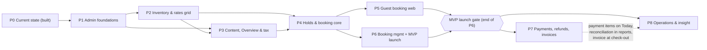

# Phases — Staywise roadmap P0–P8

- **Date:** 2026-10-20
- **Status:** proposal; becomes the source of truth for phase order and gates once approved (see [README.md](./README.md)).
- **What this file holds:**
  - the phase map, dependencies, critical path and parallel tracks;
  - the gate rules every phase must pass, the definition of done and the rollback rule;
  - a section per phase (P0–P8): goal, scope, outcome, entry/exit criteria, risks, decisions, docs to update;
  - **detailed, step-by-step tasks for the post-MVP phases P7 and P8**, written for a smaller coding model with 🧑 human checkpoints;
  - an effort estimate per phase and a ranked risk register.
- **What it does not hold:** task-level detail for P1–P6. That lives in [MVP-PLAN.md](./MVP-PLAN.md) (one anchor per phase: `#p1` … `#p6`). This file only gives summaries, gates and dependencies for those phases.
- **Baseline:** phase IDs, entity names, routes, state machines, India rules and the human-in-the-loop (HITL) format all come from [README.md — Shared baseline](./README.md#shared-baseline-every-document-must-follow-this). If this file and the baseline disagree, the baseline wins; raise it at the next gate.
- **Inputs:** [admin-ux-plan.md](./admin-ux-plan.md), [reports/Hotel admin UX plan evaluation.md](./reports/Hotel%20admin%20UX%20plan%20evaluation.md), `research_notes/` (`india_market_mvp.md`, `pms_admin_design.md`), [../MVP.md](../MVP.md), [../TASKS.md](../TASKS.md), [../HISTORY.md](../HISTORY.md) (Sprint 2 spec), [../API.md](../API.md), [../DATA_MODEL.md](../DATA_MODEL.md), [../modules/payments.md](../modules/payments.md), [../modules/bookings.md](../modules/bookings.md), [../modules/reports.md](../modules/reports.md), [../modules/notifications.md](../modules/notifications.md), [../modules/guest-accounts.md](../modules/guest-accounts.md), [../../AGENTS.md](../../AGENTS.md), and the code in `apps/api` and `apps/admin-web` as of this date.

---

## Contents

1. [Overview](#1-overview)
2. [Gate rules, definition of done, rollback](#2-gate-rules)
3. [Phase sections P0–P8](#3-phases)
4. [Detailed post-MVP tasks: P7](#p7-tasks) and [P8](#p8-tasks)
5. [Effort summary](#5-effort)
6. [Risk register](#6-risks)

---

## 1. Overview

### 1.1 Phase map

| ID | Name | Goal (one line) | MVP? | Depends on | Rough size |
|---|---|---|---|---|---|
| **P0** | Current state (built) | Catalogue setup tool: hotels, room types, base rates, nightly inventory, policy, publish gate | ✅ done | — | S |
| **P1** | Admin foundations | Hotel in the URL + global switcher, Rooms & rates table, room lifecycle, audit log viewer, theme fixes | ✅ | P0 | L |
| **P2** | Inventory & rates grid | Room type × date grid with range bulk price, stop-sell, min stay, cut-off | ✅ | P1 | L |
| **P3** | Hotel content, Overview & tax | Overview + setup health, richer content, Tax & billing (GSTIN) | ✅ | P1 (P2 for health inputs from `DailyRate`/restrictions) | M |
| **P4** | Holds & booking core | Quote engine (per-night GST), holds, bookings with snapshots, pay-at-hotel, staff New booking | ✅ | P2, P3 | L |
| **P5** | Guest booking web (MVP) | `apps/guest-web`: search → hotel → room → hold → confirmation | ✅ | P4 | L |
| **P6** | Booking management + MVP launch | Bookings list/detail, cancel / no-show with fee preview, calendar, email, launch hardening | ✅ | P4 (P5 for launch) | L |
| **P7** | Payments, refunds, invoices | Payment links + UPI, webhooks, refunds, per-night GST invoices, SMS/WhatsApp, reconciliation | ❌ post-MVP | P6 | L |
| **P8** | Operations & insight | Today dashboard, guest profiles, check-in + Form-III, DPDP fields, reports + CSV, portfolio view | ❌ post-MVP | P6 (P7 for payment items) | L |

- **Size key (likely person-days, conventional development):** S ≤ 10 · M 11–25 · L 26–40 · XL > 40. Numbers are in [§5](#5-effort), aligned with MIGRATION-PLAN §7.

### 1.2 Dependency diagram

- **Solid arrows** are hard dependencies: the later phase cannot start its main work until the earlier gate is approved.
- **The dotted arrow** is soft: P8 can start without P7, and the payment-related parts of P8 (pending payments on Today, revenue by captured amount, invoice at check-out) are switched on once P7 passes its gate.

### 1.3 Critical path

- **MVP critical path:** P0 → P1 → P2 → P4 → P6 (launch gate).
  - **P2 is on the path** because the quote engine in P4 reads `DailyRate` and the restrictions on `NightInventory` (`closed`, `minStay`, `cutoffDays`).
  - **P3 joins before P4** because the quote needs the hotel's `taxProfile.stateCode` (CGST+SGST split) and check-in/out times. Only the tax and policy parts of P3 are on the path; content-completeness scoring is not.
  - **P5 is needed for launch, not for P6 work.** It runs in parallel with P6.
- **Post-MVP critical path:** launch gate → P7 → P8 payment items. P8 core (Today, guests, check-in, reports) is not blocked by P7.

### 1.4 What can run in parallel

- **P2 and P3 (content/Overview part):** after P1, one person on the grid, another on content fields and Overview. The tax part of P3 must be done before P4 starts.
- **P5 alongside P6, after P4:** guest web and admin booking management both consume the P4 API (`Hold`, `Booking`, quote). Agree the P4 response shapes in `packages/contracts` first so the two tracks don't drift.
- **P7 alongside P8, after launch:** different modules (`payments`, `invoices`, `notifications` vs `today`, `guests`, `reports`). Shared touch points (booking detail page, booking schema, Today needs-attention list) are listed in each task's "Depends on".
- **Never in parallel:** two tasks that both write to the `NightInventory` transaction code or to the `Booking` state transition service. Serialize those and review each one (🧑 concurrency checkpoint).

---

## 2. Gate rules, definition of done, rollback

### 2.1 Gate between phases

- **One gate per phase boundary** (G0→1, G1→2, … G8→done). A phase is not "done" until its exit gate is approved by a human.
- **Entry criteria (checked before the first task of a phase):**
  - the previous phase's exit gate is approved and recorded;
  - every **Decision needed** listed for this phase has an answer recorded in the phase section or in [../ARCHITECTURE.md](../ARCHITECTURE.md) decision log;
  - required credentials or accounts exist (only P7: gateway test keys, SMS/WhatsApp sandbox);
  - the phase's tasks are copied into [../TASKS.md](../TASKS.md) as unchecked lines.
- **Exit criteria (checked at the end):**
  - every task's acceptance criteria are met and its 🧑 checkpoints are approved;
  - the measurable exit criteria in the phase section are met;
  - verification commands pass with no new errors:
    - `npx tsc --noEmit -p apps/api/tsconfig.json`
    - `cd apps/admin-web && npx tsc -b`
    - `npm --workspace=apps/api run test`
    - (from P5) `cd apps/guest-web && npx tsc -b`
  - docs listed under "Docs to update" are updated;
  - a security review of the changed surfaces is done (from [../MVP.md — Phase exit rule](../MVP.md#18-development-phases));
  - known failure recovery is written down (what to do if the new feature breaks in production).
- **Evidence required at the gate (one folder per phase):** `.agent/work/<yyyymmdd>-<phase-id>-gate/verify.md` (same pattern as existing evidence folders referenced in [../TASKS.md](../TASKS.md)) containing:
  - command outputs of the verification commands (exit codes);
  - list of new or changed endpoints, with a sample request/response each;
  - list of tests added, and which acceptance criteria each covers;
  - screenshots of changed screens (desktop and 375 px wide) where UI changed;
  - the answers to every **Decision needed**;
  - open issues carried forward, each with an owner.
- **Who approves:** the project lead (product + engineering). Tax items also need the tax professional's note; legal items (Form-III, DPDP, ID capture) need the legal adviser's note; gateway items need whoever owns the gateway account.

> **🧑 HUMAN CHECKPOINT — Phase gate (applies to every gate G0→1 … G8→done)**: the lead reads `verify.md`, runs the app and walks the phase's user-visible outcome end to end, and checks the exit criteria one by one. "Approved" = the lead writes "Gate Gx→y approved, <date>, <name>" in `verify.md` and ticks the phase line in [../TASKS.md](../TASKS.md). The coding model never ticks a gate itself.

### 2.2 Definition of done (per task)

- **Code:** follows existing structure (NestJS module per domain under `apps/api/src/modules/<domain>/` with `dto/`, `schemas/`, `*.controller.ts`, `*.service.ts`, `*.module.ts`; admin features under `apps/admin-web/src/features/<domain>/` and pages under `apps/admin-web/src/pages/<area>/`).
- **API rules:** `/api/v1` prefix; DTO validation (`whitelist`, `forbidNonWhitelisted`); `@UseGuards(StaffPermissionGuard)` + `@RequirePermission('<key>')` on every admin route; hotel scope checked in the service, not only in the UI; optimistic `version` on updates (`409 VERSION_CONFLICT`); errors as `{ errorCode, message, errors: [{ field, message }] }`.
- **Money:** integer minor units (paise) + ISO currency, computed on the server only. No floats in stored money.
- **State:** hold, booking, payment and refund statuses stay separate fields/collections; transitions go through one rules file per machine and are audited.
- **Audit:** every state-changing admin action writes an `AuditLog` row via `AuditService` (same transaction where inventory or money changes).
- **Tests:** unit tests for rules/calculations; integration tests on the replica-set test DB (`mongodb-memory-server`, as in `hotel-lifecycle.integration.spec.ts`) for anything transactional.
- **Docs:** the task's "Docs to update" are changed in the same piece of work.
- **Checks:** the three verification commands pass. Never run `nest build` while the dev server may be running (use `tsc --noEmit`).
- **Approvals:** all 🧑 checkpoints in the task are approved. No commit, push or file deletion without explicit human approval ([../../AGENTS.md](../../AGENTS.md)).

### 2.3 Rollback rule

- **Every phase must be reversible to the previous gate's release** without data loss.
- **Schema changes are additive** within a phase: new collections, new optional fields, new indexes. Renames or removals need a two-step migration (add + backfill, later remove) and a 🧑 data-migration checkpoint.
- **Risky features ship behind an environment flag** read in `apps/api/src/common/config/configuration.ts` and validated in `env.schema.ts`:
  - P4: `FEATURE_BOOKINGS` (staff New booking);
  - P5: `FEATURE_GUEST_BOOKING` (public holds and bookings);
  - P7: `FEATURE_ONLINE_PAYMENTS`, `FEATURE_INVOICES`, `FEATURE_SMS`, `FEATURE_WHATSAPP`;
  - P8: `FEATURE_TODAY_LIVE`, `FEATURE_CHECKIN`, `FEATURE_REPORTS`.
- **Rollback steps:** (1) set the flag to `false` and restart; (2) if that is not enough, redeploy the previous gate's release; (3) never delete `Payment`, `Refund`, `Invoice`, `Booking` or `AuditLog` records during rollback — mark them and reconcile.
- **Money rollback:** turning off online payments falls back to pay-at-hotel for new bookings. Existing `PENDING` payment links stay valid at the gateway until they expire; webhooks keep being accepted and processed (the webhook route is not behind the flag).
- **Rollback rehearsal:** done once before MVP launch (P6) and once before P7 goes live with real money.

> **🧑 HUMAN CHECKPOINT — Production data**: any rollback, backfill or migration that touches production data needs the lead's explicit go-ahead, a fresh backup that has been restore-tested, and a written plan of the exact commands. "Approved" = the lead replies "run it" to the written plan.

---

## 3. Phase sections

### P0 — Current state (built)

- **Goal:** record what exists, verified by reading the code, so later phases build on facts.
- **Scope in:** everything in `apps/api`, `apps/admin-web` and `packages/contracts` as of 2026-10-20.
- **Scope out:** anything not in the code (holds, bookings, guest auth, payments, guest web).
- **User-visible outcome (today):** a super admin signs in, creates a hotel draft, adds photos, room types (with photos), base rates, opens nightly inventory, blocks/unblocks dates, sets a cancellation/no-show policy, and publishes once the readiness check passes. Hotels list has list/cards view, filters, bulk status, and archived hotels are hidden.

#### Built — API (`apps/api/src`)

- **Platform:** `main.ts` (global prefix, `ValidationPipe`, helmet, cookies), `common/config/env.schema.ts` (boot-time env validation incl. `HOLD_EXPIRY_MINUTES`, guest session settings, `DEFAULT_CURRENCY=INR`, `DEFAULT_TIMEZONE=Asia/Kolkata`), `common/database/transaction.service.ts` (replica-set transactions with retry), `common/filters/http-exception.filter.ts` + `common/validation/flatten-validation-errors.ts` (per-field error shape), `common/auth/staff-permission.guard.ts` (`RequirePermission`, `StaffPrincipal` with `permissions` and `hotelIds`).
- **Modules registered in `app.module.ts`:** `HealthModule`, `AuditModule`, `AuthModule`, `HotelsModule` (which imports `InventoryModule` and `PricingModule`).
- **Auth (`modules/auth`):** `POST /auth/staff/login`, `GET /auth/me`, `POST /auth/logout`, `POST /auth/logout-all`; schemas `User`, `Role` + `Permission`, `StaffMembership`, `StaffSession`; `seed-super-admin.ts` seeds catalogue permissions: `hotels.view|create|edit|publish|archive`, `room_types.view|create|edit|archive`, `inventory.view|block|adjust`, `rates.view|edit`.
- **Hotels (`modules/hotels`):** `GET/POST /admin/hotels`, `GET /admin/hotels/cities`, `GET /admin/hotels/metrics`, `PATCH /admin/hotels/bulk-status`, `POST /admin/hotels/media/upload`, `GET/PATCH /admin/hotels/:id`, `GET /admin/hotels/:id/readiness`, `POST /admin/hotels/:id/media|publish|suspend|archive`, public `GET /hotels/:slug`. `Hotel` schema has address, contact, coordinates, description, `amenities[]`, media, embedded `cancellationPolicy` (fee rules for cancellation and no-show), status, `version`. Publish rules in `hotel-publish.checks.ts`, status rules in `hotel-status.rules.ts`.
- **Room types:** `GET/POST /admin/hotels/:hotelId/room-types`, `GET /admin/room-types/names`, `GET/PATCH /admin/room-types/:id`, `POST /admin/room-types/:id/disable`. `RoomType` has code, capacity, `beds[]`, `amenities[]`, media, total rooms, status `ACTIVE | DISABLED`, `version`.
- **Inventory (`modules/inventory`):** `GET /admin/room-types/:roomTypeId/inventory`, `POST …/initialize`, `POST …/batch-adjust` (range block/unblock), `POST …/:stayDate/block|unblock`. `NightInventory` has `total`, `blocked`, `held`, `confirmed`, `version`, unique `(roomTypeId, stayDate)`.
- **Pricing (`modules/pricing`):** `GET/PUT /admin/room-types/:roomTypeId/base-rate`; `BaseRate` (amount minor units + currency + version).
- **Audit:** `AuditLog` schema (`audit_logs`) and `AuditService` with metadata redaction. **No read endpoint yet.**
- **Tests:** 4 spec files, 17 cases: `transaction.service.spec.ts`, `catalog-setup.service.spec.ts`, `hotel-lifecycle.integration.spec.ts`, `inventory.service.spec.ts`. Scripts: `verify-scenarios.ts` (10 live RBAC/scope scenarios), `ensure-indexes.ts`, `verify-foundation.ts`.

#### Built — Admin web (`apps/admin-web/src`)

- **Shell:** `layout/AppLayout.tsx`, `Sidebar.tsx`, `Topbar.tsx`; routes in `routes/AppRoutes.tsx` + `routes/route-config.ts` (`/admin/dashboard`, `/admin/hotels`, `/admin/hotels/new`, `/admin/hotels/:id`, `/admin/hotels/:id/edit`, `/admin/room-types`, `/admin/room-types/new`, `/admin/room-types/:id/edit`, `/admin/inventory`, `/admin/rates`); `PermissionRoute`, `features/auth/Can.tsx`.
- **Hotel workspace:** `features/hotels/HotelWorkspace.tsx` with tabs (Details & photos, Rooms, Rates, Availability, Cancellation policy), `HotelSetupChecklist.tsx` (5 steps from server readiness), `PublishBlockersInfo.tsx`, photo upload/edit modals.
- **Catalogue pages:** `pages/catalog/RoomTypesPage.tsx`, `RatesPage.tsx`, `InventoryPage.tsx` (each re-picks the hotel via `HotelRoomPicker.tsx`), `InventoryCalendarView.tsx` (14-night calendar).
- **Shared UI:** `components/ui/*` (Button, DataTable, Modal, ConfirmDialog, MoneyInput, DatePicker, Combobox, Status, Tabs, KpiStrip, MetricCard, Toast, …), hooks `useApiQuery`, `useServerErrors`, `handleFormError`, `utils/money.ts`.
- **Dashboard:** `pages/dashboard/DashboardPage.tsx` shows counts and recent hotels from `/admin/hotels/metrics` (not operational).

#### Known gaps carried forward

- **No holds, bookings, guest auth, quote or payment code.** The Sprint 2 spec in [../HISTORY.md](../HISTORY.md) is a design only; two of its assumptions are overridden by the baseline: flat 12% GST (now per-night 5%/18%) and mandatory guest accounts (guest checkout per ADR-005).
- **No scheduler** (`@nestjs/schedule` not installed). MVP-PLAN P4 uses a simple interval job (`modules/bookings/hold-expiry.job.ts`) for the hold sweeper; P7/P8 jobs may introduce `@nestjs/schedule` (🧑 decide at P7-T01).
- **No raw request body** capture in `main.ts` — needed for P7 webhook signatures.
- **No audit read endpoint or viewer** (P1).
- **No `DailyRate`; `NightInventory` lacks `closed`, `minStay`, `cutoffDays`** (P2).
- **`Hotel` lacks `taxProfile`, check-in/out times, child/extra-bed policy, star rating, photo categories** (P3).
- **No enable endpoint for room types; no duplicate** (P1). Status badge shows "active" in draft colour (P1 theme quick win).
- **Permissions:** only catalogue keys exist; booking, payment, report and guest keys must be added to `seed-super-admin.ts` per phase.
- **Admin web has no test runner**, and its `package.json` pins core dependencies to `latest` (risk of surprise breakage; P1 decision).
- **Automated tests were deferred (fix-plan item B7);** coverage is thin outside inventory and lifecycle.
- **Docs drift:** [../TASKS.md](../TASKS.md) has stale ticks (e.g. throttling done but unticked); old phase schemes (0–4, 0–7) coexist — this file's P0–P8 replaces them for planning.

- **Entry criteria:** none (baseline).
- **Exit criteria (G0→1):** this inventory reviewed against the code by the lead; gaps above accepted as P1+ inputs.
- **Main risks:** the inventory goes stale while P1 starts — re-check `app.module.ts` and the route list at the start of each phase.
- **Key decisions:**
  - **Decision needed:** pin `apps/admin-web` dependencies to exact versions now (recommended) or at P6 hardening.
  - **Decision needed:** add a frontend test runner (Vitest) in P1, or keep UI verification manual until P6.
- **Docs to update:** [../TASKS.md](../TASKS.md) (fix stale ticks; add P1–P8 sections pointing here), [../MVP.md](../MVP.md) (point phase list to this file).

> **🧑 HUMAN CHECKPOINT — P0 inventory review**: the lead confirms the list above matches the running app and code. "Approved" = G0→1 recorded.

---

### P1 — Admin foundations (MVP)

- **Goal:** turn the setup tool into a hotel-scoped workspace that is quick to move around.
- **Scope in:** hotel-scoped routes `/admin/hotels/:hotelId/{overview,details,photos,rooms,inventory,policies,tax,bookings}` (stubs where later phases fill them), global hotel switcher (URL is the source, last-used is only the default, hidden for single-hotel users, searchable with recents, unsaved-edit confirm), redirects from old routes, Rooms & rates table with health badges and side panel (Details · Photos · Price · Availability), enable/disable/duplicate room type, audit log API + viewer (`/admin/audit`), theme quick wins.
- **Scope out:** the date grid (P2), Overview content (P3), anything booking-related.
- **User-visible outcome:** staff pick a hotel once; every hotel page shares one URL scheme; each room type shows price, free tonight and a health badge with the fix next to it; "who changed this" is answerable from the audit page.
- **Entry criteria:** G0→1 approved; switcher and route decisions answered.
- **Exit criteria (measurable):**
  - 100% of old routes listed in the baseline redirect to the new ones (tested per route);
  - no editing screen renders without exactly one `:hotelId`;
  - room type enable/disable/duplicate each write an `AuditLog` row;
  - `GET /admin/audit` is filterable by hotel, resource, actor, date and enforces hotel scope (scope test passes).
- **Main risks:** broken bookmarks if redirects miss a query form; "wrong hotel" edits if switcher state leaks into URLs.
- **Key decisions:** **Decision needed:** approve the navigation change and Overview as default tab for published hotels (from [admin-ux-plan.md — Decisions needed](./admin-ux-plan.md#decisions-needed-from-product)). **Decision needed:** which fields "Duplicate" copies (explicit field choice, warn before overwrite).
- **Tasks:** [MVP-PLAN.md#p1](./MVP-PLAN.md#p1).
- **Docs to update:** [../API.md](../API.md) (audit, room-type enable/duplicate), [UX-PLAN.md](./UX-PLAN.md), [UI-PLAN.md](./UI-PLAN.md), [../TASKS.md](../TASKS.md).

### P2 — Inventory & rates grid (MVP)

- **Goal:** match what Indian owners already get on MakeMyTrip Connect: change prices and close dates in bulk, by range.
- **Scope in:** `DailyRate` (per room type per date override of `BaseRate`), `NightInventory.closed|minStay|cutoffDays`, room type × date grid at `/admin/hotels/:hotelId/inventory` with range select, bulk price, open/close (stop-sell), min stay, cut-off, block/unblock; zero/suspicious-rate check; Today/7/14/30-day windows; phone-usable layout; replaces `/admin/rates` and `/admin/inventory`.
- **Scope out:** closed-to-arrival/departure, rate plans, channel sync.
- **User-visible outcome:** an owner selects 1–31 Dec for Deluxe, sets ₹4,200, closes 24–25 Dec, sets min stay 2 for New Year — in one screen, each change audited.
- **Entry criteria:** G1→2 approved (grid lives under hotel-scoped routes).
- **Exit criteria (measurable):** a 90-night × 5 room type bulk edit commits atomically (all or nothing) in one request; the invariant `held + confirmed + blocked <= total` holds in integration tests after every grid write; zero rates cannot be saved without an explicit confirm; old pages redirect.
- **Main risks:** partial range writes; grid performance on phones; rate override precedence bugs.
- **Key decisions:** **Decision needed:** maximum range per bulk edit (proposal 366 nights, same as inventory initialize). **Decision needed:** "suspicious rate" threshold (proposal: < 30% or > 300% of base rate).
- **Tasks:** [MVP-PLAN.md#p2](./MVP-PLAN.md#p2).
- **Docs to update:** [DATA-MODEL.md](./DATA-MODEL.md), [../API.md](../API.md), [../modules/pricing.md](../modules/pricing.md).

### P3 — Hotel content, Overview & tax (MVP)

- **Goal:** make live hotels easy to monitor and collect the tax profile early.
- **Scope in:** Overview tab (status, setup health / needs attention from existing data, content-completeness score weighted to photos); check-in/out times, amenities (yes/no/not answered), child & extra-bed policy, star rating, map pin, photo categories; `Hotel.taxProfile` (`gstin`, `legalName`, `stateCode`, `specifiedPremises`) with GSTIN format + state match + mod-36 check digit; `/admin/today` shows setup health only.
- **Scope out:** invoices (P7), live arrivals (P8).
- **User-visible outcome:** a manager opens a live hotel and sees "⚠ Suite: no dates after 30 Nov → Open dates"; GSTIN is entered and validated once.
- **Entry criteria:** G1→2 approved; option lists approved.
- **Exit criteria (measurable):** GSTIN validator passes a fixture set of valid and invalid GSTINs (including wrong check digit and wrong state); completeness score is deterministic from a documented formula; GSTIN does **not** block publish or holds.
- **Main risks:** wrong GSTIN rules; option lists churn.
- **Key decisions:** **Decision needed:** option lists for amenities, house rules, bed types, star rating, check-in/out defaults. **Decision needed:** completeness weights.
- **Tasks:** [MVP-PLAN.md#p3](./MVP-PLAN.md#p3).
- **Docs to update:** [DATA-MODEL.md](./DATA-MODEL.md), [../modules/hotels.md](../modules/hotels.md), [../API.md](../API.md).

### P4 — Holds & booking core (MVP)

- **Goal:** sell a room safely: no overbooking, server totals with per-night GST, pay-at-hotel.
- **Scope in:** quote engine (per-night price from `BaseRate`/`DailyRate`, restrictions, per-night GST 5%/18% at the ₹7,500 boundary, CGST+SGST split, minor units); `Hold` (`ACTIVE → CONVERTED | EXPIRED | RELEASED`, 10-minute default TTL, transaction across all nights, idempotency key, on-demand reaping + sweeper job); `Booking` with embedded `nights[]`, guest/policy/tax snapshots, booking status machine, `paymentStatus` `NOT_REQUIRED | PENDING` with method `PAY_AT_HOTEL`; staff New booking page `/admin/hotels/:hotelId/bookings/new` (own page, accessible hold timer).
- **Scope out:** online payments, refunds, invoices, guest web UI (P5).
- **User-visible outcome:** front desk creates a confirmed pay-at-hotel booking in 3 steps with the itemised total and cancellation terms shown before confirm.
- **Entry criteria:** G2→3 and G3→4 tax part approved; GST rule confirmed by tax professional.
- **Exit criteria (measurable):** Sprint 2 test matrix TC-01…TC-06 ([../HISTORY.md](../HISTORY.md)) pass on the replica-set test DB; 50 parallel hold attempts on the last room produce exactly 1 hold; per-night GST fixture table (₹7,500 and ₹7,501 nights, mixed stays) passes; duplicate idempotency key returns the original result.
- **Main risks:** overbooking; wrong tax; hold timer accessibility.
- **Key decisions:** **Decision needed:** booking reference format (proposal `SW-` + 6–8 base32 chars). **Decision needed:** whether staff can override price (permission + reason). **Decision needed:** GST rounding rule (per night, half-up to the paisa; CGST = floor(tax/2), SGST = remainder).
- **Tasks:** [MVP-PLAN.md#p4](./MVP-PLAN.md#p4).
- **Docs to update:** [DATA-MODEL.md](./DATA-MODEL.md), [../modules/bookings.md](../modules/bookings.md), [../modules/pricing.md](../modules/pricing.md), [../API.md](../API.md), [../ARCHITECTURE.md](../ARCHITECTURE.md) (close ADR-007 tax).

### P5 — Guest booking web (MVP)

- **Goal:** a guest can search, hold and book without calling the hotel.
- **Scope in:** new `apps/guest-web` (React + Tailwind): search (city/dates/guests), hotel page, room choice with itemised total, hold + guest details (guest checkout, no account required), confirmation with booking reference; secure booking access link.
- **Scope out:** online payment (P7), guest accounts beyond access links, reviews.
- **User-visible outcome:** a guest books a pay-at-hotel stay on a phone and receives a reference.
- **Entry criteria:** G4 approved; P4 API shapes frozen in `packages/contracts`.
- **Exit criteria (measurable):** search returns only room types available for every night with valid occupancy (test fixtures); booking reference alone does not grant access (test); mobile 375 px walkthrough passes; accessibility review passed.
- **Main risks:** search/hold mismatch; booking access by guessing references.
- **Key decisions:** **Decision needed:** guest-web domain and whether it shares the API origin (CORS/CSRF). **Decision needed:** what the guest must verify (email or phone) before confirmation.
- **Tasks:** [MVP-PLAN.md#p5](./MVP-PLAN.md#p5).
- **Docs to update:** [../modules/guest-search.md](../modules/guest-search.md), [../modules/guest-accounts.md](../modules/guest-accounts.md), [../API.md](../API.md).

### P6 — Booking management + MVP launch (MVP)

- **Goal:** staff find and manage bookings; launch safely.
- **Scope in:** `/admin/bookings` (all accessible hotels, search) and `/admin/hotels/:hotelId/bookings`; booking detail with price breakdown, policy snapshot, separate status badges; cancel / no-show with server fee preview ("Cancel booking — fee ₹X"); booking calendar reusing the P2 grid (room type × night: sold/held/free); email confirmation via `Notification`; launch hardening (backups + restore test, monitoring, rollback rehearsal, security review, load baseline).
- **Scope out:** refunds (no money was taken), check-in/out (P8), SMS/WhatsApp (P7).
- **User-visible outcome:** the MVP objective from [../MVP.md](../MVP.md): publish → search → hold → book with no overbooking → staff manage.
- **Entry criteria:** G4 approved (P5 may still be running).
- **Exit criteria (measurable):** all [../MVP.md — MVP exit criteria](../MVP.md#03-mvp-scope) pass; backup restore and rollback rehearsed and timed; cancel releases each night exactly once (integration test); email outage does not block booking (test).
- **Main risks:** launching without restore-tested backups; cancellation double release.
- **Key decisions:** **Decision needed:** email provider. **Decision needed:** launch hotels and go-live date. **Decision needed:** monitoring/alerting tool.
- **Tasks:** [MVP-PLAN.md#p6](./MVP-PLAN.md#p6).
- **Docs to update:** [../modules/notifications.md](../modules/notifications.md), [../modules/deployment-operations.md](../modules/deployment-operations.md), [../TASKS.md](../TASKS.md) §10, [../MVP.md](../MVP.md).

> **🧑 HUMAN CHECKPOINT — MVP launch decision (G6)**: the lead, with the hotel owner(s), walks the full MVP flow on production-like data, reviews the restore and rollback timings, and decides go / no-go. "Approved" = signed launch decision in `verify.md` and TB S4-4 ticked.

---

### P7 — Payments, refunds, invoices (post-MVP)

- **Goal:** take money online safely (full or partial prepayment by payment link or UPI), refund it correctly, issue GST-correct invoices, and message guests on SMS/WhatsApp.
- **Scope in:**
  - payment gateway abstraction with one Indian gateway (Razorpay or Cashfree) plus a fake gateway for tests;
  - payment links + UPI (QR/intent) for deposits, full prepayment and balance; offline payment recording (cash/UPI/card at desk);
  - webhooks with signature verification, durable inbox, idempotent processing and replay protection;
  - `Payment` and `Refund` collections with their own state machines, separate from `Booking`;
  - partial deposits per hotel payment settings;
  - channel-based hold TTL (10 min desk/guest web; 30–60 min payment link) and `OPTIONAL` bookings with `releaseAt`;
  - refunds computed from the cancellation snapshot, with "5–7 working days" messaging and the UPI T+1 failed-debit note;
  - per-night GST invoices with an invoice series per financial year, CGST/SGST, guest GSTIN on B2B invoices (Rule 46);
  - SMS and WhatsApp notifications through a provider, with template approval;
  - reconciliation report and alerts.
- **Scope out:** card authorise-and-hold "guarantees" (card holds lapse in 5–7 days), multi-currency, e-invoicing (IRN) unless the tax review says it applies, OTA/ECO tax collection, marketing messages, channel managers, automated tax advice.
- **User-visible outcome:**
  - staff send a ₹2,000 deposit link by WhatsApp; the guest pays by UPI; the booking turns from *Optional · release 20 Oct 18:30* to *Confirmed · Deposit paid*;
  - a cancellation shows "Cancel and refund ₹3,150 — refunds take about 5–7 working days" and the refund timeline updates on its own;
  - at check-out staff issue a GST invoice `BH/26-27/000123` with per-night lines and CGST/SGST.
- **Entry criteria:**
  - MVP launch gate (G6) approved and the MVP stable in production for at least 2 weeks with no open P1 incidents;
  - gateway decision made and a **test-mode** merchant account available;
  - tax professional engaged for the invoice review;
  - SMS/WhatsApp provider chosen and sandbox available (templates can be approved during the phase).
- **Exit criteria (measurable):**
  - the duplicate-webhook test sends each event 5 times → exactly one state change per event;
  - invalid signature → `401`, no state change, event recorded as rejected;
  - refund cap test: total `SUCCEEDED + PROCESSING` refunds never exceed captured amount;
  - late payment after hold expiry → payment marked for review, no booking confirmed without inventory;
  - invoice numbers are gap-free and unique per hotel per financial year under 20 parallel issue requests;
  - per-night GST on invoices equals the booking snapshot to the paisa for every fixture;
  - reconciliation run on test-mode data shows zero unexplained differences;
  - end-to-end test-mode run (link → UPI payment → webhook → confirmed → cancel → refund → refund webhook) recorded in `verify.md`;
  - security review of webhook, payment and invoice endpoints done.
- **Main risks:** webhook spoofing or replay; double capture/refund; money confirmed without inventory; wrong GST on invoices; invoice number gaps; WhatsApp/SMS template rejection delaying go-live; DLT registration (SMS) lead time.
- **Key decisions (each also a checkpoint in the tasks):**
  - **Decision needed:** Razorpay vs Cashfree (P7-T01).
  - **Decision needed:** deposit options offered to hotels: percentage, first night, fixed amount (P7-T04).
  - **Decision needed:** payment-link hold TTL inside 30–60 min (P7-T05).
  - **Decision needed:** late success after expiry — auto-refund vs re-hold if inventory is free (P7-T08).
  - **Decision needed:** when an invoice is issued (at check-out vs at full payment) and how advances are documented (receipt voucher) (P7-T13/T14).
  - **Decision needed:** credit notes for post-invoice changes in P7 or later (P7-T14).
  - **Decision needed:** SMS/WhatsApp provider and template wording (P7-T16).
- **Tasks:** [P7 detailed tasks](#p7-tasks) (P7-T01…P7-T20).
- **Docs to update:** [../modules/payments.md](../modules/payments.md) (align state lists with the baseline; currently two lists disagree), [../modules/notifications.md](../modules/notifications.md), [../modules/cancellation-policies.md](../modules/cancellation-policies.md), [DATA-MODEL.md](./DATA-MODEL.md), [../API.md](../API.md), [../ARCHITECTURE.md](../ARCHITECTURE.md) (ADR for gateway and webhook design), [../TASKS.md](../TASKS.md) §8–§9, runbooks in [../modules/deployment-operations.md](../modules/deployment-operations.md).

### P8 — Operations & insight (post-MVP)

- **Goal:** make the admin the front desk's daily tool and give owners trustworthy numbers.
- **Scope in:**
  - Today dashboard `/admin/today`: arrivals / departures (total and remaining), in-house, occupancy, needs attention ranked by severity, clickable counts, fixed layout, 7/14-day strip;
  - `GuestProfile` separate from booking snapshots; Guests list and profile;
  - check-in / check-out flow with minimal ID capture and a Form-III reminder for foreign guests (due within 24 h of arrival);
  - DPDP retention and erasure fields and an erasure workflow ahead of the ~May 2027 obligations;
  - reports: occupancy, revenue (with written definitions), cancellations / no-shows; CSV export;
  - portfolio "All hotels" read-only view on Today, Bookings and Reports;
  - physical room assignment (optional, behind a go/no-go).
- **Scope out:** filing Form-III to the government portal automatically (staff file it; we remind and record), housekeeping, configurable dashboard tiles, accounting "recognised revenue", BI tools.
- **User-visible outcome:** at 8 am the manager opens Today: "Arrivals 12 (9 remaining) · Departures 9 (4 remaining) · In-house 41 · Occupancy 78%", with "⚠ 1 foreign guest — Form-III due by 14:20" at the top; clicking "Arrivals" opens the filtered bookings list.
- **Entry criteria:** G6 approved and at least 2 weeks of real bookings (so dashboards show real data); legal adviser engaged for Form-III and DPDP; P7 gate needed only for payment-related items.
- **Exit criteria (measurable):**
  - Today counts match a hand-counted fixture for 3 hotels and 3 dates, including the hotel time zone day boundary;
  - every Today count links to a list whose row count equals the number shown;
  - editing a `GuestProfile` changes no past `Booking` snapshot (test);
  - check-in of a foreign national creates a Form-III reminder due at arrival + 24 h (test), visible on Today;
  - report totals reconcile with CSV export row sums (test); CSV cells starting with `= + - @` are escaped (test);
  - "All hotels" mode never shows an edit action (UI test / manual check) and the API rejects writes without one hotel;
  - erasure job anonymises an eligible profile and keeps records under legal hold (test).
- **Main risks:** wrong day boundaries (UTC vs hotel time); storing ID data unlawfully (Aadhaar, DPDP); metric definitions disputed; portfolio view leaking hotels outside scope.
- **Key decisions:**
  - **Decision needed:** `GuestProfile` scope — per hotel (recommended for privacy) or platform-wide (P8-T03).
  - **Decision needed:** which ID fields are stored at check-in; whether ID images are stored at all (P8-T05).
  - **Decision needed:** retention periods per data type (P8-T07).
  - **Decision needed:** revenue definitions shown in reports (P8-T08).
  - **Decision needed:** go / no-go for physical room assignment (P8-T12).
- **Tasks:** [P8 detailed tasks](#p8-tasks) (P8-T01…P8-T13).
- **Docs to update:** [../modules/reports.md](../modules/reports.md), [../modules/guest-accounts.md](../modules/guest-accounts.md), [../modules/bookings.md](../modules/bookings.md) (check-in/out), [DATA-MODEL.md](./DATA-MODEL.md), [../API.md](../API.md), [UX-PLAN.md](./UX-PLAN.md), [UI-PLAN.md](./UI-PLAN.md), [../TASKS.md](../TASKS.md), privacy notice text (new, owned by legal).

---

## 4. Detailed post-MVP tasks

### How to use these tasks (coding model)

- **Do tasks in order** unless "Depends on" allows otherwise. Stop at every 🧑 checkpoint and wait for the human's answer; do not guess.
- **Inputs from the MVP:** these tasks assume P4–P6 created (check before starting; if MVP-PLAN used different paths, follow the real code and note the difference in `verify.md`):
  - `apps/api/src/modules/bookings/` (holds live here per MVP-PLAN P4) — `Hold` schema, hold service (acquire / convert / release), `hold-expiry.job.ts` interval sweeper;
  - `apps/api/src/modules/bookings/` — `Booking` schema with `nights[]`, `status`, `paymentStatus`, `paymentMethod`, `guest` snapshot, `policySnapshot`, `taxSnapshot`, `releaseAt`; `booking-status.rules.ts`; `AdminBookingsController`;
  - `apps/api/src/modules/bookings/quote.service.ts` (per MVP-PLAN P4) and its GST helper (per-night slab, CGST/SGST split);
  - `apps/api/src/modules/notifications/` — `Notification` schema, email adapter, outbox worker;
  - `apps/api/src/common/gst/gstin.ts` (or wherever P3 put the GSTIN validator);
  - a job runner: the P4 interval job pattern, or `@nestjs/schedule` if adopted at P7-T01 (🧑 decide);
  - admin pages `apps/admin-web/src/pages/bookings/BookingsPage.tsx`, `BookingDetailPage.tsx`, `NewBookingPage.tsx`; guest app `apps/guest-web/`.
- **Verification commands (every task):**
  - `npx tsc --noEmit -p apps/api/tsconfig.json`
  - `cd apps/admin-web && npx tsc -b`
  - `cd apps/guest-web && npx tsc -b` (tasks touching guest web)
  - `npm --workspace=apps/api run test`
  - never `nest build` while `npm run dev` may be running; never commit, push or delete files without approval.
- **Error codes:** add new codes to the shared list in `packages/contracts/src/index.ts` so both apps use the same strings.

---

### P7 tasks — Payments, refunds, invoices

#### P7-T01 — Gateway decision, accounts and configuration

- **Goal:** choose the gateway, set up test-mode credentials, and add validated configuration, so later tasks have a fixed target.
- **Depends on:** G6 approved.
- **Files to create/modify:**
  - modify `apps/api/src/common/config/env.schema.ts`, `apps/api/src/common/config/configuration.ts`, `.env.example`
  - modify `Documentation/ARCHITECTURE.md` (new ADR "Payment gateway and webhook design")
- **Steps:**
  1. Prepare a one-page comparison for the human (do not decide): payment links API, UPI intent/QR support, partial capture/refund support, webhook signing (headers, algorithm, timestamp), test mode, settlement report API, refund speed messaging, pricing. Use the provider's current docs; mark anything not confirmed.
  2. After the decision, add env vars (validated at boot; required only when `FEATURE_ONLINE_PAYMENTS=true`):
     - `FEATURE_ONLINE_PAYMENTS` (`true|false`, default `false`), `PAYMENT_PROVIDER` (`razorpay|cashfree|fake`, default `fake` outside production);
     - `PAYMENT_KEY_ID`, `PAYMENT_KEY_SECRET`, `PAYMENT_WEBHOOK_SECRET` (min 16 chars; never logged);
     - `PAYMENT_WEBHOOK_TOLERANCE_SECONDS` (default 300);
     - `HOLD_TTL_DESK_MINUTES` (10), `HOLD_TTL_GUEST_WEB_MINUTES` (10), `HOLD_TTL_PAYMENT_LINK_MINUTES` (default 45, allowed 30–60).
  3. In production, refuse to boot if `PAYMENT_PROVIDER=fake` with `FEATURE_ONLINE_PAYMENTS=true`.
  4. Write the ADR: chosen provider, why, mapping table provider status → our `Payment`/`Refund` status (filled in P7-T03).
- **Acceptance criteria:** app boots with defaults; boot fails with a clear message if online payments are on and secrets are missing; secrets never appear in logs or `/health`.
- **Tests:** `apps/api/src/common/config/env.schema.spec.ts` — missing secret with flag on → error; flag off → OK; TTL 70 → error.
- **Verification commands:** baseline set.
- **Docs to update:** [../ARCHITECTURE.md](../ARCHITECTURE.md), `.env.example`, [../modules/payments.md](../modules/payments.md) (provider section).

> **🧑 HUMAN CHECKPOINT — Gateway choice (product + money)**: the lead picks Razorpay or Cashfree from the comparison, creates the test-mode account, and puts keys in the local `.env` (never in chat or git). "Approved" = decision written in the ADR, keys present, `PAYMENT_PROVIDER` set.

#### P7-T02 — `Payment` and `Refund` schemas, state rules and permissions

- **Goal:** create the money records and their state machines, separate from `Booking`.
- **Depends on:** P7-T01.
- **Files to create/modify:**
  - create `apps/api/src/modules/payments/payments.module.ts`
  - create `apps/api/src/modules/payments/schemas/payment.schema.ts`, `schemas/refund.schema.ts`, `schemas/payment-event.schema.ts`
  - create `apps/api/src/modules/payments/payment-status.rules.ts`, `refund-status.rules.ts` (+ `.spec.ts` for each)
  - modify `apps/api/src/app.module.ts` (register `PaymentsModule`)
  - modify `apps/api/src/modules/auth/seed-super-admin.ts` (new permission keys)
  - modify `apps/api/src/scripts/ensure-indexes.ts`
- **Steps:**
  1. `Payment` (`payments` collection): `hotelId`, `bookingId`, `purpose` (`DEPOSIT | BALANCE | FULL | FEE`), `method` (`PAYMENT_LINK | UPI | PAY_AT_HOTEL_CASH | PAY_AT_HOTEL_UPI | PAY_AT_HOTEL_CARD`), `provider` (`razorpay | cashfree | fake | offline`), `providerOrderId`, `providerPaymentId`, `providerLinkId`, `linkUrl`, `linkExpiresAt`, `amountMinor`, `capturedMinor`, `refundedMinor`, `currency`, `status`, `statusHistory[] { from, to, at, source, eventId?, actorId? }`, `review { required: boolean, reason?: 'LATE_SUCCESS' | 'AMOUNT_MISMATCH' | 'UNMATCHED' , resolvedAt?, resolvedBy? }`, `idempotencyKey`, `createdBy`, `version`, timestamps.
     - Indexes: unique `(provider, providerPaymentId)` sparse; unique `(provider, providerLinkId)` sparse; unique `(bookingId, idempotencyKey)`; `(hotelId, status, createdAt)`.
  2. `Refund` (`refunds`): `hotelId`, `bookingId`, `paymentId`, `amountMinor`, `currency`, `status` (`REQUESTED | PROCESSING | SUCCEEDED | FAILED`), `reason`, `basis` (`POLICY | OVERRIDE`), `requestedBy`, `providerRefundId`, `failureCode?`, `expectedBy` (date shown to guest), `statusHistory[]`, `idempotencyKey`, `version`. Unique `(provider, providerRefundId)` sparse; unique `(paymentId, idempotencyKey)`.
  3. `PaymentEvent` (`payment_events`, the webhook inbox): `provider`, `eventId`, `eventType`, `receivedAt`, `signatureValid`, `payloadHash` (sha256), `payload` (redacted: no card/VPA details beyond last 4 / masked), `status` (`RECEIVED | PROCESSED | IGNORED | UNMATCHED | REJECTED | FAILED`), `attempts`, `lastError`. Unique `(provider, eventId)`. TTL index is **not** used (keep for audit; retention decided in P8-T07).
  4. Payment transitions (baseline states) in `payment-status.rules.ts`:
     - `PENDING → AUTHORIZED | CAPTURED | FAILED`; `AUTHORIZED → CAPTURED | FAILED`; `CAPTURED → PARTIALLY_REFUNDED | REFUNDED`; `PARTIALLY_REFUNDED → PARTIALLY_REFUNDED | REFUNDED`; `NOT_REQUIRED` is terminal for pay-at-hotel records created in P4.
     - Export `assertPaymentTransition(from, to)` that throws `409 PAYMENT_INVALID_TRANSITION`. Transitions only move forward; an older event never moves a payment backwards.
  5. Refund transitions: `REQUESTED → PROCESSING | FAILED`; `PROCESSING → SUCCEEDED | FAILED`; `FAILED` may create a **new** refund, never reopen.
  6. `Booking.paymentStatus` remains the summary shown in lists. Derive it in one function `summarizePaymentStatus(payments, refunds, totalMinor)` in `apps/api/src/modules/payments/payment-summary.ts`, called inside the same transaction that changes a payment. Add `Booking.paidMinor` and `Booking.balanceDueMinor` (P4 schema, additive fields).
  7. Permissions to seed: `payments.view`, `payments.create`, `payments.record_offline`, `payments.review`, `refunds.create`, `refunds.override`, `invoices.view`, `invoices.issue`, `reports.reconciliation`, `notifications.view`, `notifications.retry`.
- **Acceptance criteria:** every allowed and disallowed transition is covered by a test; indexes are created by `ensure:indexes`; no change to booking status rules.
- **Tests:** `payment-status.rules.spec.ts`, `refund-status.rules.spec.ts`, `payment-summary.spec.ts` (deposit only → `PENDING` with balance; full capture → `CAPTURED`; partial refund → `PARTIALLY_REFUNDED`).
- **Verification commands:** baseline set; `npm --workspace=apps/api run ensure:indexes` against the local DB.
- **Docs to update:** [DATA-MODEL.md](./DATA-MODEL.md), [../modules/payments.md](../modules/payments.md) (replace the two disagreeing state lists with the baseline list).

> **🧑 HUMAN CHECKPOINT — Money state machines**: review the transition tables and the summary function against the baseline. Check that nothing lets a booking change status because of a payment except through P7-T08. "Approved" = lead signs off the rules files and specs.

> **🧑 HUMAN CHECKPOINT — Permissions (security)**: review which roles get the new keys (proposal: Super Administrator all; Manager `payments.view|create|record_offline`, `refunds.create`, `invoices.view|issue`; Editor none). `refunds.override` only for Super Administrator. "Approved" = role mapping written in [../modules/rbac.md](../modules/rbac.md).

#### P7-T03 — Gateway adapter abstraction

- **Goal:** one interface for all gateway calls, so business code never imports a provider SDK.
- **Depends on:** P7-T02.
- **Files to create/modify:**
  - create `apps/api/src/modules/payments/gateways/payment-gateway.interface.ts`
  - create `apps/api/src/modules/payments/gateways/fake.gateway.ts`
  - create `apps/api/src/modules/payments/gateways/razorpay.gateway.ts` **or** `cashfree.gateway.ts` (only the chosen one)
  - create `apps/api/src/modules/payments/gateways/gateway.provider.ts` (Nest factory provider keyed by `PAYMENT_PROVIDER`)
  - create `apps/api/src/modules/payments/gateways/*.spec.ts`
- **Steps:**
  1. Interface `PaymentGateway`:
     - `createPaymentLink({ internalPaymentId, amountMinor, currency, description, customer: { name, phone?, email? }, expiresAt, notify: { sms: boolean, email: boolean } }) → { providerLinkId, linkUrl, expiresAt }`;
     - `createUpiOrder({ internalPaymentId, amountMinor, currency }) → { providerOrderId, upiIntentUrl?, qrImageUrl?, expiresAt }`;
     - `cancelPaymentLink(providerLinkId)`;
     - `fetchPayment(providerPaymentId)` and `fetchLink(providerLinkId)` (for reconciliation and uncertain outcomes);
     - `createRefund({ providerPaymentId, amountMinor, idempotencyKey, notes }) → { providerRefundId, status }`;
     - `verifyWebhook({ rawBody: Buffer, headers }) → { valid: boolean, eventId?: string, timestamp?: Date }`;
     - `parseWebhook(rawBody) → NormalizedEvent { eventId, type: 'PAYMENT_AUTHORIZED' | 'PAYMENT_CAPTURED' | 'PAYMENT_FAILED' | 'LINK_PAID' | 'LINK_EXPIRED' | 'LINK_CANCELLED' | 'REFUND_PROCESSED' | 'REFUND_FAILED' | 'UNKNOWN', providerPaymentId?, providerLinkId?, providerRefundId?, amountMinor?, currency?, occurredAt }`;
     - `listSettlements({ from, to })` for P7-T18.
  2. Use the provider's REST API with Node `fetch` (no SDK unless the human approves adding one). Every request has a timeout (10 s) and sends the provider idempotency/reference field set to our `internalPaymentId` / refund idempotency key.
  3. Pass `reference_id` (or the provider equivalent) = our `Payment._id` so webhooks can be matched even if our DB write after the API call fails.
  4. Map provider statuses to ours in one table in the adapter file and copy it into the ADR.
  5. Signature verification uses `crypto.createHmac('sha256', secret)` over the exact raw bytes as the provider specifies and `crypto.timingSafeEqual` to compare. Never parse JSON before verifying.
  6. `FakeGateway`: deterministic, in-memory, can emit signed fake webhooks for tests (`fake.signEvent(event)`).
  7. Never call the gateway inside a Mongo transaction.
- **Acceptance criteria:** unit tests prove signature verification with a provider sample payload (from the provider docs, saved as a fixture under `apps/api/src/modules/payments/gateways/__fixtures__/`); wrong secret or one changed byte → invalid; amounts are always integers.
- **Tests:** `fake.gateway.spec.ts`, `<provider>.gateway.spec.ts` (signature fixtures, status mapping, request body built with paise and our reference id; HTTP mocked).
- **Verification commands:** baseline set.
- **Docs to update:** [../ARCHITECTURE.md](../ARCHITECTURE.md) ADR (status mapping table).

> **🧑 HUMAN CHECKPOINT — Gateway integration review**: the reviewer compares the adapter's endpoints, headers, signature algorithm and status mapping with the provider's current documentation, and confirms no secrets are logged. "Approved" = reviewer notes "adapter matches docs as of <date>".

#### P7-T04 — Hotel payment settings and deposits

- **Goal:** each hotel chooses which prepayment options it offers.
- **Depends on:** P7-T02.
- **Files to create/modify:**
  - modify `apps/api/src/modules/hotels/schemas/hotel.schema.ts` (embedded `paymentSettings`)
  - create `apps/api/src/modules/hotels/dto/payment-settings.dto.ts`
  - modify `apps/api/src/modules/hotels/hotels.controller.ts`, `hotel.service.ts`
  - create `apps/api/src/modules/payments/deposit.calculator.ts` (+ `.spec.ts`)
  - create `apps/admin-web/src/features/hotels/workspace/HotelPaymentSettingsSection.tsx`; modify the hotel `policies` tab page from P1 to include it
- **Steps:**
  1. `Hotel.paymentSettings`: `{ payAtHotelAllowed: boolean (default true), prepayment: 'NONE' | 'OPTIONAL' | 'REQUIRED', depositRule: { type: 'NONE' | 'PERCENT' | 'FIRST_NIGHT' | 'FIXED', percentBps?: number (1000–10000), fixedMinor?: number }, paymentLinkTtlMinutes?: number (30–60) }`.
  2. Endpoints:
     - `GET /api/v1/admin/hotels/:hotelId/payment-settings` — `hotels.view`; response `{ paymentSettings, version }`.
     - `PUT /api/v1/admin/hotels/:hotelId/payment-settings` — `hotels.edit`; DTO `{ paymentSettings, version }`; errors `400 VALIDATION_FAILED`, `409 VERSION_CONFLICT`, `403 FORBIDDEN` (scope). Audited `hotel.payment_settings.updated`.
  3. `calculateDeposit(booking.nights, totalMinor, rule)` → integer paise: `PERCENT` = round half-up of `total × bps / 10000`; `FIRST_NIGHT` = first night's price **incl. its GST**; `FIXED` = min(fixed, total). Never exceeds total.
  4. Admin UI section with radio options, live example ("For a ₹7,000 stay the deposit is ₹2,100"), save with version.
- **Acceptance criteria:** deposit is computed only on the server; settings respect hotel scope; existing hotels default to pay-at-hotel only (no behaviour change until edited).
- **Tests:** `deposit.calculator.spec.ts` (each rule, rounding, mixed 5%/18% nights, cap at total); controller scope test in `hotel-lifecycle.integration.spec.ts` style.
- **Verification commands:** baseline set.
- **Docs to update:** [../modules/payments.md](../modules/payments.md), [../modules/hotels.md](../modules/hotels.md), [../API.md](../API.md).

> **🧑 HUMAN CHECKPOINT — Deposit options (product + money)**: approve the rule types, default values, rounding and the example copy. "Approved" = options and copy recorded in the phase decisions list.

#### P7-T05 — Channel-based hold TTL and `OPTIONAL` bookings

- **Goal:** payment-link bookings keep their rooms for 30–60 minutes without breaking the 10-minute guard elsewhere.
- **Depends on:** P7-T01, P4 hold engine.
- **Files to create/modify:**
  - modify `apps/api/src/modules/holds/schemas/hold.schema.ts` (`channel`)
  - modify `apps/api/src/modules/holds/hold.service.ts` (TTL by channel)
  - modify `apps/api/src/modules/bookings/booking.service.ts`, `booking-status.rules.ts` (use `OPTIONAL` + `releaseAt`)
  - create `apps/api/src/modules/bookings/jobs/optional-release.job.ts`
  - integration spec `apps/api/src/modules/bookings/optional-booking.integration.spec.ts`
- **Steps:**
  1. `Hold.channel`: `STAFF_DESK | GUEST_WEB | PAYMENT_LINK`. TTL from config (`HOLD_TTL_*`), overridable by `hotel.paymentSettings.paymentLinkTtlMinutes` for `PAYMENT_LINK`, clamped to 30–60.
  2. Staff flow "Send payment link": the hold converts immediately to a `Booking` with status `OPTIONAL` and `releaseAt = now + paymentLinkTtl` (inventory moves `held → confirmed` as in the normal conversion, so the room stays protected even after the hold is gone). The payment link's `expiresAt` = `releaseAt`.
  3. Release job (every minute, batches of 50, transaction per booking): `OPTIONAL` with `releaseAt < now` and no captured payment → `CANCELLED` with reason `PAYMENT_NOT_RECEIVED`, release each night once, cancel the link at the gateway **after** commit. Use a conditional update on `{ status: 'OPTIONAL', version }` so two workers can't both release.
  4. On-demand check: any read that decides availability treats overdue `OPTIONAL` bookings exactly as the job would (same as holds in P4).
  5. Staff can extend `releaseAt` once by up to 60 min (`POST /api/v1/admin/bookings/:bookingId/extend-release`, permission `payments.create`, body `{ minutes: 15|30|60, version }`, errors `409 BOOKING_NOT_OPTIONAL`, `409 VERSION_CONFLICT`); the gateway link expiry is updated if the provider supports it, otherwise a new link is created and the old one cancelled.
- **Acceptance criteria:** TC-01…TC-06 still pass; an overdue `OPTIONAL` booking releases inventory exactly once even with two job runs and a concurrent hold attempt; link-paid webhook arriving after release goes to review (P7-T08), never re-confirms silently.
- **Tests:** `optional-booking.integration.spec.ts` — release once; double job run; concurrent new hold on the released last room succeeds exactly once; extend.
- **Verification commands:** baseline set.
- **Docs to update:** [../modules/bookings.md](../modules/bookings.md) (OPTIONAL, `releaseAt`, channel TTL), [DATA-MODEL.md](./DATA-MODEL.md).

> **🧑 HUMAN CHECKPOINT — Concurrency (holds and inventory)**: a reviewer reads the release job and conversion code for transaction boundaries, conditional updates and "release exactly once", and runs the integration spec 10 times in a row. "Approved" = 10/10 green and reviewer sign-off.

> **🧑 HUMAN CHECKPOINT — Hold length (product)**: pick the payment-link TTL default inside 30–60 min and whether staff may extend. "Approved" = value set in `.env.example` and recorded.

#### P7-T06 — Create payment links, UPI orders and offline payments

- **Goal:** staff (and guests, P7-T12) can request money; staff can record money taken at the desk.
- **Depends on:** P7-T03, P7-T04, P7-T05.
- **Files to create/modify:**
  - create `apps/api/src/modules/payments/payments.service.ts`, `admin-payments.controller.ts`
  - create `apps/api/src/modules/payments/dto/create-payment.dto.ts`, `record-offline-payment.dto.ts`
  - create `apps/api/src/modules/payments/payments.integration.spec.ts`
- **Steps:**
  1. `POST /api/v1/admin/bookings/:bookingId/payments` — permission `payments.create`; header `Idempotency-Key` (required, 16–64 chars).
     - DTO: `{ purpose: 'DEPOSIT' | 'BALANCE' | 'FULL', method: 'PAYMENT_LINK' | 'UPI', notify: { sms?: boolean, email?: boolean, whatsapp?: boolean } }`. **No amount field** — the server computes it (deposit calculator, `balanceDueMinor`, or total).
     - Flow: (a) transaction: check booking in scope and status `OPTIONAL | CONFIRMED`, no other `PENDING` payment for the same purpose, insert `Payment{status: PENDING}`; commit. (b) call gateway outside the transaction. (c) update payment with provider ids and link; if the gateway call fails, mark `FAILED` with `failureCode: GATEWAY_UNAVAILABLE` and return `502 PAYMENT_GATEWAY_UNAVAILABLE`.
     - Response `201 { paymentId, status, amountMinor, currency, linkUrl?, upiIntentUrl?, qrImageUrl?, expiresAt }`.
     - Errors: `409 PAYMENT_ALREADY_PENDING`, `409 BOOKING_NOT_PAYABLE`, `409 IDEMPOTENCY_CONFLICT` (same key, different body), `422 NOTHING_DUE`, `403 FEATURE_DISABLED` when `FEATURE_ONLINE_PAYMENTS=false`.
  2. `POST /api/v1/admin/bookings/:bookingId/payments/offline` — permission `payments.record_offline`; DTO `{ method: 'PAY_AT_HOTEL_CASH' | 'PAY_AT_HOTEL_UPI' | 'PAY_AT_HOTEL_CARD', amountMinor: int > 0, reference?: string (≤ 64), note?: string, version }`; amount ≤ `balanceDueMinor` (else `422 AMOUNT_EXCEEDS_DUE`). Creates `Payment{provider: 'offline', status: CAPTURED}` and updates the booking summary in one transaction. Audited. Works even when the online flag is off.
  3. `GET /api/v1/admin/bookings/:bookingId/payments` — `payments.view`; returns payments and refunds with history, amounts, masked provider references.
  4. `POST /api/v1/admin/payments/:paymentId/cancel` — `payments.create`; cancels a `PENDING` link (gateway call after marking `cancelRequestedAt`); final state comes from the webhook or a fetch.
  5. Every response hides provider secrets; `linkUrl` is only returned to staff with `payments.view`.
- **Acceptance criteria:** client cannot set the amount for online payments; retries with the same key return the same payment; gateway failure never leaves an untracked payment; offline payment updates `paidMinor`/`balanceDueMinor` atomically.
- **Tests:** `payments.integration.spec.ts` with `FakeGateway` — idempotent create; gateway down → `FAILED` record + `502`; second pending → `409`; offline over-due → `422`; scope violation → `403`.
- **Verification commands:** baseline set.
- **Docs to update:** [../API.md](../API.md) (Payments section), [../modules/payments.md](../modules/payments.md).

> **🧑 HUMAN CHECKPOINT — Payment initiation (money + gateway)**: run the flow in test mode with the real gateway: create a deposit link, open it, pay with the provider's test UPI/card, confirm the record. "Approved" = screenshots + payment ids in `verify.md`.

#### P7-T07 — Webhook endpoint: verify, store, acknowledge

- **Goal:** accept provider events safely and durably before doing anything with them.
- **Depends on:** P7-T03.
- **Files to create/modify:**
  - modify `apps/api/src/main.ts` (`NestFactory.create(AppModule, { rawBody: true })`)
  - create `apps/api/src/modules/payments/webhooks.controller.ts`, `webhook-inbox.service.ts`
  - create `apps/api/src/modules/payments/webhooks.integration.spec.ts`
- **Steps:**
  1. `POST /api/v1/payments/webhooks/:provider` — public (no staff guard, no CSRF), excluded from the `Origin` check, rate-limited (e.g. 600/min per IP), body limit 256 KB. Not behind `FEATURE_ONLINE_PAYMENTS` (late events must still land).
  2. Order of operations:
     1. `:provider` must equal the configured provider, else `404`.
     2. Read `req.rawBody` (Buffer). Verify signature with the adapter. Invalid → store `PaymentEvent{status: REJECTED, signatureValid: false}` with payload hash only (not the body), audit `payment.webhook.rejected`, respond `401`.
     3. **Replay protection:** if the provider sends a timestamp, reject events older than `PAYMENT_WEBHOOK_TOLERANCE_SECONDS` (`401 WEBHOOK_STALE`). Always dedupe by unique `(provider, eventId)`: insert; on duplicate-key error respond `200` with no further work. If the provider has no event id header, use `sha256(rawBody)` as the id.
     4. Store the redacted payload with `status: RECEIVED`, respond `200` quickly (target < 500 ms).
  3. Processing happens in P7-T08 (worker polling `RECEIVED` events every 5–10 s, plus an immediate in-process trigger after insert). The HTTP handler never changes payments or bookings.
  4. Log only event id, type, status — never the full payload, phone, email or VPA.
- **Acceptance criteria:** invalid signature never changes state; the same event delivered 5 times creates one inbox row; a body re-serialised by JSON parsing would fail verification (prove raw bytes are used); endpoint works with the staff session cookie absent.
- **Tests:** `webhooks.integration.spec.ts` — valid fake event → `200` + `RECEIVED`; tampered byte → `401` + `REJECTED`; duplicate → one row; stale timestamp → `401`; wrong provider path → `404`.
- **Verification commands:** baseline set.
- **Docs to update:** [../modules/payments.md](../modules/payments.md) (Webhooks), [../API.md](../API.md), [../ARCHITECTURE.md](../ARCHITECTURE.md) ADR.

> **🧑 HUMAN CHECKPOINT — Webhook security**: a reviewer (not the author) checks raw-body use, constant-time compare, replay window, dedupe index, CSRF/Origin exemption limited to this one route, rate limit, redaction, and that secrets come from env. Then the human triggers real test-mode webhooks from the provider dashboard (including a resend). "Approved" = review checklist ticked in `verify.md` and resend shown as deduplicated.

#### P7-T08 — Event processor: apply payments, confirm bookings, handle late success

- **Goal:** turn verified events into payment and booking changes, exactly once, in order-safe way.
- **Depends on:** P7-T05, P7-T06, P7-T07.
- **Files to create/modify:**
  - create `apps/api/src/modules/payments/webhook-processor.service.ts`, `jobs/webhook-processor.job.ts`
  - modify `apps/api/src/modules/bookings/booking.service.ts` (method `confirmFromPayment(bookingId, paymentId, session)`)
  - create `apps/api/src/modules/payments/admin-payment-review.controller.ts`
  - create `apps/api/src/modules/payments/webhook-processor.integration.spec.ts`
- **Steps:**
  1. Claim events with a conditional update (`status: RECEIVED → PROCESSING`, `attempts+1`) so two workers never process the same event.
  2. Match: by `providerPaymentId`, else `providerLinkId`, else our reference id in the payload. No match → `UNMATCHED` (kept for reconciliation, alert).
  3. In **one transaction**: apply the payment transition via `assertPaymentTransition` (ignore events that would move backwards → `IGNORED`); check `amountMinor` and `currency` equal the payment (mismatch → `review.required = true, reason: AMOUNT_MISMATCH`, no booking change); update `paidMinor`/`balanceDueMinor` and `Booking.paymentStatus`; if booking is `OPTIONAL` and `releaseAt` not passed and the payment is captured → `confirmFromPayment` (`OPTIONAL → CONFIRMED`, clears `releaseAt`); write `AuditLog` (actor `SYSTEM`); insert `Notification` outbox rows (payment received / booking confirmed).
  4. **Late success** (booking already `CANCELLED` because `releaseAt` passed): set payment `CAPTURED` + `review.required = true, reason: LATE_SUCCESS`; never re-confirm automatically; show on the review queue and (P8) Today needs-attention.
  5. Review queue: `GET /api/v1/admin/payments/review?hotelId=` (`payments.review`) and `POST /api/v1/admin/payments/:paymentId/resolve` with `{ action: 'REFUND_FULL' | 'REBOOK' | 'MARK_RESOLVED', note, version }`. `REBOOK` runs a new hold+booking for the same stay if inventory is free (normal P4 transaction), links the payment, else `409 INVENTORY_UNAVAILABLE`. `REFUND_FULL` creates a refund via P7-T10.
  6. Failures: transient error → back to `RECEIVED` with backoff (1 min, 5 min, 30 min, then `FAILED` + alert). Mark `PROCESSED` only after commit.
- **Acceptance criteria:** duplicate, out-of-order (refund event before capture event) and late events all end in the correct state; no booking is confirmed without its inventory; each event produces at most one notification.
- **Tests:** `webhook-processor.integration.spec.ts` — capture confirms OPTIONAL; capture after release → review; duplicate → no second effect; out-of-order → `IGNORED` then correct; amount mismatch → review; two workers in parallel → one effect.
- **Verification commands:** baseline set.
- **Docs to update:** [../modules/payments.md](../modules/payments.md), [../modules/bookings.md](../modules/bookings.md) (confirm from payment; late success path).

> **🧑 HUMAN CHECKPOINT — Late success policy (money + product)**: decide the default resolution for late payments (refund in full vs try to rebook when rooms are free) and who resolves them. "Approved" = rule recorded; review queue walkthrough done.

> **🧑 HUMAN CHECKPOINT — Concurrency (payment + booking transaction)**: reviewer checks that gateway calls are outside transactions, event claim is conditional, and booking confirmation and payment update commit together. "Approved" = reviewer sign-off + spec run 10/10.

#### P7-T09 — Payment-link expiry and cleanup

- **Goal:** expired or cancelled links end cleanly at the gateway and in our records.
- **Depends on:** P7-T05, P7-T08.
- **Files to create/modify:**
  - create `apps/api/src/modules/payments/jobs/payment-link-expiry.job.ts` (+ spec)
- **Steps:**
  1. Every 5 min: `PENDING` payments with `linkExpiresAt < now - 5 min` → `fetchLink` at the gateway. Paid → process as a synthetic event through the same processor path (dedupe id `poll:<providerLinkId>:<status>`). Expired/cancelled → `FAILED` with `failureCode: LINK_EXPIRED`.
  2. When a booking is released (P7-T05) cancel its pending links at the gateway; mark `cancelRequestedAt`.
  3. Never mark a payment `FAILED` without asking the gateway first (avoids losing a payment whose webhook was missed).
- **Acceptance criteria:** a missed `link.paid` webhook is recovered by polling; an expired link moves to `FAILED`; job is safe to run twice.
- **Tests:** job spec with `FakeGateway` (missed webhook recovered; expired; double run).
- **Verification commands:** baseline set.
- **Docs to update:** [../modules/payments.md](../modules/payments.md) (reconciliation of missed events).

#### P7-T10 — Refunds

- **Goal:** refund the right amount, once, with clear timing.
- **Depends on:** P7-T02, P7-T03, P7-T08; P6 cancel flow.
- **Files to create/modify:**
  - create `apps/api/src/modules/payments/refunds.service.ts`, `admin-refunds.controller.ts`, `refund.calculator.ts` (+ specs)
  - create `apps/api/src/modules/payments/dto/create-refund.dto.ts`
  - modify `apps/api/src/modules/bookings/booking.service.ts` (cancel preview includes refund)
  - modify the P6 cancel preview endpoint response
- **Steps:**
  1. `refund.calculator.ts`: `refundableMinor = capturedMinor_total − feeMinor(policySnapshot, cancelledAt, hotel time zone) − refundedOrProcessingMinor`, floored at 0. The fee comes from the existing cancellation policy logic (reuse what P6 uses; do not write a second fee calculator). Split across payments newest-first.
  2. Cancel preview (`GET …/bookings/:bookingId/cancel-preview` from P6) adds `{ feeMinor, refundMinor, refundExpectedBy, refundMessage }`. `refundExpectedBy` = 7 working days (Mon–Fri, no holiday calendar in P7) from today in hotel time zone.
  3. Cancel with refund: `POST …/bookings/:bookingId/cancel` (P6) gains `{ refund: true }`. Order: (a) transaction: booking `→ CANCELLED`, release nights once, create `Refund{REQUESTED}` rows; commit. (b) outside: call `createRefund` per refund with idempotency key = refund id → `PROCESSING` (or `FAILED`). Booking cancellation is never rolled back because a refund is slow or fails.
  4. Manual refund: `POST /api/v1/admin/bookings/:bookingId/refunds` — `refunds.create`; header `Idempotency-Key`; DTO `{ paymentId, basis: 'POLICY' | 'OVERRIDE', amountMinor?: int, reason: string (≥ 3) }`. `amountMinor` allowed only with `basis: OVERRIDE` and permission `refunds.override` (else `403 REFUND_OVERRIDE_FORBIDDEN`). Cap: `≤ captured − refunded − processing` (`422 REFUND_EXCEEDS_CAPTURED`). Offline payments → refund recorded as `SUCCEEDED` with `method` cash/UPI and a reference (no gateway call).
  5. Refund webhooks (`REFUND_PROCESSED` / `REFUND_FAILED`) update the refund and the payment (`PARTIALLY_REFUNDED` / `REFUNDED`) in P7-T08's processor.
  6. Uncertain outcome (timeout): keep `PROCESSING`, `fetch` before any retry; never send a second refund for the same refund id.
  7. Guest-facing copy (email/SMS/WhatsApp and booking page): "Refund of ₹X started on <date>. Refunds usually reach your account in 5–7 working days." For UPI payments that **failed** but debited the guest: "If money left your account for a failed UPI payment, your bank reverses it automatically, normally by the next working day (T+1)." Show this note on failed-payment screens only, not on refunds.
- **Acceptance criteria:** refunds never exceed captured; retries never double-refund; cancellation releases inventory even if the gateway is down; override needs the extra permission and is audited with reason.
- **Tests:** `refund.calculator.spec.ts` (free cancel window, fee window, no-show, multiple payments, offline + online mix); `refunds.integration.spec.ts` (cap, idempotency, gateway down, override permission, webhook success/failure).
- **Verification commands:** baseline set.
- **Docs to update:** [../modules/payments.md](../modules/payments.md) (Refunds), [../modules/cancellation-policies.md](../modules/cancellation-policies.md), [../API.md](../API.md).

> **🧑 HUMAN CHECKPOINT — Refund rules and copy (money + product)**: approve the calculator against 6 worked examples prepared by the coding model (table in `verify.md`), the "5–7 working days" and T+1 texts, and who may override. "Approved" = examples signed off, copy final.

#### P7-T11 — Admin UI: payments and refunds on the booking

- **Goal:** staff see and act on money without leaving the booking.
- **Depends on:** P7-T06, P7-T08, P7-T10.
- **Files to create/modify:**
  - create `apps/admin-web/src/features/payments/payments.api.ts`
  - create `apps/admin-web/src/features/payments/PaymentTimeline.tsx`, `RequestPaymentModal.tsx`, `RecordOfflinePaymentModal.tsx`, `RefundModal.tsx`, `PaymentStatusBadge.tsx`, `RefundStatusBadge.tsx`
  - create `apps/admin-web/src/pages/payments/PaymentReviewPage.tsx` (route `/admin/payments/review`, permission `payments.review`)
  - modify `apps/admin-web/src/pages/bookings/BookingDetailPage.tsx`, the P6 cancel dialog, `routes/AppRoutes.tsx`, `routes/route-config.ts`
- **Steps:**
  1. Booking header shows three separate badges: booking status, payment summary, refund status (e.g. *Cancelled* · *Paid* · *Refund pending*). Never one combined colour; text + icon, not colour alone.
  2. Timeline: each payment/refund with amount (₹ from paise via `utils/money.ts`), method, status history, masked reference, "Copy link" / "Resend" for pending links, expiry countdown as quiet text.
  3. Request payment modal: purpose radio; the amount shown is fetched from a server preview (`GET …/payments/preview?purpose=`), not computed in the browser; notify checkboxes; confirm button names the hotel and amount ("Send ₹2,100 link for Bell Hotel booking SW-10234").
  4. Cancel dialog: show fee and refund from the server preview; button text "Cancel and refund ₹X" (or "Cancel booking — no refund due"); show "Refunds usually take 5–7 working days".
  5. Refund modal for manual refunds; override amount field only rendered when the user has `refunds.override` (use `features/auth/Can.tsx`).
  6. Optional bookings show "Optional · releases at 18:30" and an Extend action.
  7. Reuse `components/ui` (Modal, ConfirmDialog, MoneyInput, Status, Toast); follow [UI-PLAN.md](./UI-PLAN.md).
- **Acceptance criteria:** no money math in the browser except formatting; all actions permission-gated in UI and API; works at 375 px; keyboard reachable; screen reader reads status text.
- **Tests:** manual test script in `verify.md` (no frontend runner unless P0 decision added one).
- **Verification commands:** baseline set.
- **Docs to update:** [UX-PLAN.md](./UX-PLAN.md), [UI-PLAN.md](./UI-PLAN.md).

> **🧑 HUMAN CHECKPOINT — Visual design sign-off**: designer/lead reviews screenshots (desktop + 375 px) of booking detail with each payment state, the cancel dialog and the review page. "Approved" = sign-off note.

> **🧑 HUMAN CHECKPOINT — Accessibility review**: keyboard-only and screen-reader pass over the modals and timeline (focus trap, labels, no per-second announcements). "Approved" = checklist in `verify.md`.

#### P7-T12 — Guest web: prepay and payment status

- **Goal:** guests can pay a required/optional prepayment during booking and see the result.
- **Depends on:** P7-T06, P7-T08; P5.
- **Files to create/modify:**
  - create `apps/api/src/modules/payments/guest-payments.controller.ts`
  - modify guest-web booking flow pages created in P5 (e.g. `apps/guest-web/src/pages/checkout/*`, `pages/booking/*`), add `apps/guest-web/src/features/payments/`
- **Steps:**
  1. If the hotel's `prepayment` is `REQUIRED` or the guest chooses to prepay: guest hold uses channel `GUEST_WEB` (10 min) while details are entered; on submit the booking is created `OPTIONAL` with `releaseAt = now + 15 min` (**Decision needed** inside the checkpoint) and a UPI order/payment link is created.
  2. `POST /api/v1/bookings/:reference/payments` — guest booking-access token required (P5 mechanism); body `{ purpose: 'DEPOSIT' | 'FULL', method: 'UPI' | 'PAYMENT_LINK' }`; same server-side amount rules; `Idempotency-Key` required.
  3. `GET /api/v1/bookings/:reference/payment-status` — returns booking status, payment summary, `releaseAt`; the page polls every 3 s up to 2 min after redirect back from the gateway.
  4. **Never trust the browser redirect** as proof of payment; only webhook/fetch results change state.
  5. Show accessible "Room held · 9:32" quiet text with an extend button (WCAG 2.2.1) during details entry; on expiry keep the form filled.
  6. Failed payment page shows the T+1 UPI reversal note (P7-T10 copy).
- **Acceptance criteria:** booking confirms only after the webhook; closing the browser after paying still confirms the booking; reference alone cannot create payments.
- **Tests:** API integration spec for guest payment endpoints (token required; amount server-side); manual mobile walkthrough in test mode.
- **Verification commands:** baseline set incl. `cd apps/guest-web && npx tsc -b`.
- **Docs to update:** [../modules/guest-accounts.md](../modules/guest-accounts.md), [UX-PLAN.md](./UX-PLAN.md).

> **🧑 HUMAN CHECKPOINT — Guest payment flow (product + accessibility)**: approve the guest TTL after submit, walk the flow on a phone with the provider's test UPI, including closing the tab mid-payment. "Approved" = walkthrough notes + screenshots.

#### P7-T13 — Invoice prerequisites: tax profile extension and invoice series per financial year

- **Goal:** gap-free, unique invoice numbers per hotel per financial year, and the hotel data an invoice needs.
- **Depends on:** P3 `taxProfile`.
- **Files to create/modify:**
  - modify `apps/api/src/modules/hotels/schemas/hotel.schema.ts` (`taxProfile` additions)
  - modify the P3 tax DTO and `apps/admin-web/src/features/hotels/workspace/HotelTaxSection.tsx` (or the P3 equivalent)
  - create `apps/api/src/modules/invoices/invoices.module.ts`, `schemas/invoice-series.schema.ts`, `invoice-number.service.ts` (+ `.spec.ts`, `.integration.spec.ts`), `financial-year.ts` (+ spec)
- **Steps:**
  1. Add to `taxProfile`: `tradeName?`, `registeredAddress` (lines, city, PIN, `stateCode`), `invoicePrefix` (1–6 chars, `[A-Z0-9]`), `sac` (default `996311`, editable), `specifiedPremisesFy?` (e.g. `2026-27`).
  2. `financialYear(date, timeZone)` → `"2026-27"` (FY runs 1 April–31 March, computed in the hotel's time zone).
  3. `InvoiceSeries` (`invoice_series`): `hotelId`, `financialYear`, `prefix`, `nextNumber` (starts 1), unique `(hotelId, financialYear)`.
  4. `nextInvoiceNumber(hotelId, date, session)`: `findOneAndUpdate({hotelId, financialYear}, {$inc: {nextNumber: 1}, $setOnInsert: {prefix}}, {upsert: true, new: true, session})` **inside the same transaction that inserts the invoice**, so an aborted invoice does not consume a number. Format `PREFIX/YY-YY/NNNNNN` (e.g. `BH/26-27/000123`), must be ≤ 16 characters and use only letters, digits, `-` and `/` (Rule 46(b) — verify).
  5. Invoices are blocked (`422 TAX_PROFILE_INCOMPLETE`) until GSTIN, legal name, registered address and prefix are present. Holds and bookings are never blocked.
- **Acceptance criteria:** 20 parallel issue transactions produce numbers 1–20 with no gaps or duplicates; FY rollover at 31 Mar 23:59 vs 1 Apr 00:00 IST uses the right series; number length ≤ 16.
- **Tests:** `financial-year.spec.ts` (boundaries, time zones); `invoice-number.integration.spec.ts` (parallel, aborted transaction does not consume a number).
- **Verification commands:** baseline set.
- **Docs to update:** [DATA-MODEL.md](./DATA-MODEL.md), [../modules/hotels.md](../modules/hotels.md) (tax profile).

> **🧑 HUMAN CHECKPOINT — Tax: invoice numbering**: the tax professional confirms format, length limit, per-FY reset, SAC code, and whether e-invoicing (IRN) applies to the launch hotels' turnover. "Approved" = written note attached to `verify.md`.

#### P7-T14 — Per-night GST invoices with CGST/SGST and B2B guest GSTIN

- **Goal:** issue a correct tax invoice from the booking snapshot, never by recalculating.
- **Depends on:** P7-T13; P4 tax snapshot.
- **Files to create/modify:**
  - create `apps/api/src/modules/invoices/schemas/invoice.schema.ts`, `invoices.service.ts`, `admin-invoices.controller.ts`, `dto/issue-invoice.dto.ts`, `dto/billing-details.dto.ts`, `invoice-builder.ts` (+ spec), `invoices.integration.spec.ts`
  - modify `apps/api/src/modules/bookings/schemas/booking.schema.ts` (`billingDetails`)
  - modify `apps/api/src/modules/bookings/admin-bookings.controller.ts` (billing details endpoint)
- **Steps:**
  1. Guest GSTIN capture (booking-time, optional): `Booking.billingDetails = { gstin?, legalName?, address?: { line1, city, pin, stateCode }, email? }`.
     - `PATCH /api/v1/admin/bookings/:bookingId/billing-details` — `invoices.issue`; DTO validated with the P3 GSTIN validator (format, mod-36 check digit; state code taken from GSTIN); `legalName` required when `gstin` present; `409 INVOICE_ALREADY_ISSUED` if an invoice exists.
     - Guest web: optional "Need a GST invoice for your company?" fields on the details step (P5 page), same validation.
  2. `Invoice` (`invoices`): `hotelId`, `bookingId`, `number`, `financialYear`, `issuedAt`, `type` (`TAX_INVOICE`; `CREDIT_NOTE` reserved), `supplier { legalName, tradeName, gstin, address, stateCode }`, `recipient { name, gstin?, legalName?, address?, stateCode? }`, `placeOfSupply { stateCode, stateName }` (= hotel state), `lines[] { stayDate, description, sac, quantity, unitPriceMinor, taxableMinor, gstRateBps (500|1800), cgstMinor, sgstMinor }`, `totals { taxableMinor, cgstMinor, sgstMinor, totalMinor }`, `amountInWords`, `payments[] { paymentId, amountMinor, method }` (for display), `status` (`ISSUED | VOID`), `voidReason?`, `version`. Unique `(hotelId, number)`; unique `(bookingId, type)` where `status = ISSUED`.
  3. `invoice-builder.ts` maps `booking.nights[]` and `taxSnapshot` **as stored** to lines. It must not call the quote engine. Assert that line totals equal the booking total to the paisa; mismatch → `500 INVOICE_SNAPSHOT_MISMATCH` and an alert (never "fix" numbers).
  4. Recipient rules (Rule 46 — verify): if guest GSTIN present → print GSTIN, legal name and address; if no GSTIN and taxable value ≥ ₹50,000 → name, address and state required (`422 RECIPIENT_DETAILS_REQUIRED`); below ₹50,000 → name only unless provided.
  5. Endpoints:
     - `POST /api/v1/admin/bookings/:bookingId/invoice` — `invoices.issue`; DTO `{ version }`; allowed when the decision rule says (see checkpoint; proposal: booking `CHECKED_OUT` or `COMPLETED`, or `CONFIRMED` and fully paid); errors `422 TAX_PROFILE_INCOMPLETE`, `409 INVOICE_ALREADY_ISSUED`, `409 BOOKING_NOT_INVOICEABLE`, `403 FEATURE_DISABLED`. Number allocation + insert + audit in one transaction.
     - `GET /api/v1/admin/invoices?hotelId=&financialYear=&from=&to=&search=` — `invoices.view`; paginated.
     - `GET /api/v1/admin/invoices/:invoiceId` — `invoices.view`.
     - `POST /api/v1/admin/invoices/:invoiceId/void` — `invoices.issue` + Super Administrator only in P7; `{ reason }`; number is **not** reused.
  6. Cancellation fee / no-show fee invoices: same builder with a single `FEE` line taxed per the tax professional's answer (**Decision needed** in checkpoint).
  7. Deposits before the stay: record as payments only; show "Advance received" on the invoice. Whether a receipt voucher is required for advances is a tax decision (checkpoint).
- **Acceptance criteria:** invoice lines equal booking nights; CGST + SGST = tax per line; mixed 5%/18% stays show both rates; B2B invoice shows guest GSTIN; numbers are unique and sequential; an issued invoice is immutable (only void).
- **Tests:** `invoice-builder.spec.ts` (fixtures: all ≤ ₹7,500; all > ₹7,500; mixed; ₹7,500 exactly; odd-paisa split; B2B; ≥ ₹50,000 unregistered); `invoices.integration.spec.ts` (issue twice → `409`; incomplete profile → `422`; void keeps number used; scope).
- **Verification commands:** baseline set.
- **Docs to update:** [DATA-MODEL.md](./DATA-MODEL.md), [../API.md](../API.md), [../modules/payments.md](../modules/payments.md) (invoice/receipt), new section in [../modules/hotels.md](../modules/hotels.md) or a new `../modules/invoices.md` (human decides).

> **🧑 HUMAN CHECKPOINT — Tax: invoice content and timing**: the tax professional reviews 5 sample invoices (generated from the fixtures, attached as JSON + printed view) and answers: when to issue (check-out vs full payment), receipt voucher for advances, tax on cancellation/no-show fees, credit notes for post-invoice changes, rounding, mandatory fields. "Approved" = written answers; any change is applied before the gate.

#### P7-T15 — Invoice print/PDF and admin invoice pages

- **Goal:** staff can print or download an invoice and find past invoices.
- **Depends on:** P7-T14.
- **Files to create/modify:**
  - create `apps/api/src/modules/invoices/invoice-render.service.ts` (HTML template) and `GET /api/v1/admin/invoices/:invoiceId/document?format=html|pdf`
  - create `apps/admin-web/src/features/invoices/invoices.api.ts`, `InvoiceView.tsx`, `IssueInvoiceButton.tsx`
  - create `apps/admin-web/src/pages/invoices/InvoicesPage.tsx` (routes `/admin/hotels/:hotelId/invoices`, `/admin/invoices/:invoiceId`)
  - modify `BookingDetailPage.tsx`, `routes/AppRoutes.tsx`, `routes/route-config.ts`
- **Steps:**
  1. Server renders HTML from the stored invoice only (escaped; no user HTML). PDF: **Decision needed** — browser print-to-PDF of the HTML view (no new dependency, recommended for P7) or a server PDF library.
  2. Guest download link via the booking-access token: `GET /api/v1/bookings/:reference/invoice` (P5 token; only `ISSUED`).
  3. Admin list with FY filter and search by number/guest; booking detail shows "Issue invoice" (permission-gated) or the issued invoice.
  4. Every document request is audited (`invoice.document.viewed`).
- **Acceptance criteria:** printed invoice shows every field from P7-T14; renders on A4; guest cannot fetch another booking's invoice.
- **Tests:** render spec (snapshot of HTML for one fixture; escaping test); guest access spec.
- **Verification commands:** baseline set.
- **Docs to update:** [../API.md](../API.md), [UI-PLAN.md](./UI-PLAN.md).

> **🧑 HUMAN CHECKPOINT — Invoice layout sign-off (visual + tax)**: lead and tax professional approve the printed layout. "Approved" = signed sample PDF in the evidence folder.

#### P7-T16 — SMS and WhatsApp channels

- **Goal:** send transactional messages on SMS and WhatsApp alongside email, without making them a condition for booking correctness.
- **Depends on:** P6 `Notification` + email outbox.
- **Files to create/modify:**
  - create `apps/api/src/modules/notifications/channels/sms.channel.ts`, `whatsapp.channel.ts`, `channel.interface.ts` (if P6 did not create it), `providers/<provider>.client.ts`
  - create `apps/api/src/modules/notifications/templates/templates.registry.ts` (template ids per channel/event/version)
  - modify `apps/api/src/modules/notifications/schemas/notification.schema.ts` (channel enum, provider message id, template id/version)
  - modify `env.schema.ts` (`FEATURE_SMS`, `FEATURE_WHATSAPP`, provider keys, sender id, DLT entity id)
- **Steps:**
  1. `Notification.channel`: `EMAIL | SMS | WHATSAPP`; unique `(eventId, channel, recipientHash)`; `status` `PENDING | SENT | DELIVERED | FAILED | DEAD`; `attempts`, `nextAttemptAt`, `providerMessageId`, `safeErrorCode`.
  2. Templates are fixed, pre-approved texts with numbered variables; the registry maps `(event, channel)` → provider template id + DLT template id (SMS) + version. No free-text messages.
  3. Events: `BOOKING_CONFIRMED`, `PAYMENT_LINK_SENT` (contains the link), `PAYMENT_RECEIVED`, `BOOKING_RELEASED_UNPAID`, `CANCELLATION_CONFIRMED`, `REFUND_STARTED`, `REFUND_SUCCEEDED`, `REFUND_FAILED` (staff only).
  4. Delivery status webhooks from the messaging provider: `POST /api/v1/notifications/webhooks/:provider` — signature verified like P7-T07, deduped.
  5. Phone numbers normalised to E.164 (+91 default); WhatsApp sent only if the guest gave the number for WhatsApp (checkbox on booking forms, stored as consent with timestamp). Transactional only — no marketing.
  6. Retry with backoff (1, 5, 30 min, 2 h), then `DEAD` + visible in admin; permanent errors (invalid number, template rejected) not retried.
  7. Never log message bodies or full phone numbers (mask to last 4).
- **Acceptance criteria:** outage of the SMS/WhatsApp provider does not affect booking/payment state; no duplicate sends on retry; templates match approved text exactly.
- **Tests:** channel specs with mocked HTTP (send, permanent failure, transient retry, dedupe); template registry test (every event has a template for every enabled channel).
- **Verification commands:** baseline set.
- **Docs to update:** [../modules/notifications.md](../modules/notifications.md), `.env.example`.

> **🧑 HUMAN CHECKPOINT — Messaging provider and templates (product + legal)**: choose the provider; register the sender and SMS templates on the DLT platform (TRAI rules for commercial SMS in India) and submit WhatsApp templates for approval; approve every template's wording (English first; languages later). "Approved" = provider chosen, template ids returned approved, ids entered in the registry.

#### P7-T17 — Wire notifications to payment and refund events; admin notification log

- **Goal:** the right message goes out at the right moment, and staff can see failures.
- **Depends on:** P7-T08, P7-T10, P7-T16.
- **Files to create/modify:**
  - modify `webhook-processor.service.ts`, `refunds.service.ts`, `payments.service.ts`, `optional-release.job.ts` (insert outbox rows in the same transaction as the state change)
  - create `apps/api/src/modules/notifications/admin-notifications.controller.ts`
  - create `apps/admin-web/src/features/notifications/NotificationLog.tsx` (shown on booking detail)
- **Steps:**
  1. Outbox rows are written inside the business transaction; sending happens after commit by the worker.
  2. `GET /api/v1/admin/bookings/:bookingId/notifications` — `notifications.view`; masked recipients.
  3. `POST /api/v1/admin/notifications/:notificationId/retry` — `notifications.retry`; only for `FAILED | DEAD`; audited.
  4. "Resend payment link" on the booking uses a new event id (explicit resend), not a retry.
- **Acceptance criteria:** each state change produces at most one message per channel; failures are visible with a retry button.
- **Tests:** integration — capture event → one `PAYMENT_RECEIVED` per enabled channel; duplicate webhook → none extra.
- **Verification commands:** baseline set.
- **Docs to update:** [../modules/notifications.md](../modules/notifications.md), [../API.md](../API.md).

#### P7-T18 — Reconciliation report and alerts

- **Goal:** prove every rupee: our records match the gateway's.
- **Depends on:** P7-T03, P7-T08, P7-T10.
- **Files to create/modify:**
  - create `apps/api/src/modules/payments/reconciliation/reconciliation.service.ts`, `reconciliation.job.ts`, `schemas/reconciliation-run.schema.ts`, `admin-reconciliation.controller.ts` (+ integration spec)
  - create `apps/admin-web/src/pages/reports/ReconciliationPage.tsx` (route `/admin/reports/reconciliation`, permission `reports.reconciliation`)
- **Steps:**
  1. Daily job at 06:00 Asia/Kolkata (and on demand): fetch provider payments/refunds/settlements for the previous day (`listSettlements`, `fetchPayment` as needed) and compare with `Payment`/`Refund` records.
  2. `ReconciliationRun`: `date`, `provider`, `status`, `counts`, `exceptions[] { type, paymentId?, refundId?, providerRef, ourAmountMinor?, providerAmountMinor?, note }`.
  3. Exception types: `CAPTURED_WITHOUT_CONFIRMED_BOOKING`, `CONFIRMED_WITHOUT_REQUIRED_CAPTURE` (prepayment `REQUIRED` hotels), `DUPLICATE_CAPTURE`, `AMOUNT_MISMATCH`, `MISSING_LOCALLY`, `MISSING_AT_PROVIDER`, `REFUND_AGED` (`PROCESSING` > 7 working days), `UNMATCHED_EVENT`.
  4. `GET /api/v1/admin/reports/reconciliation?from=&to=&hotelId=` — `reports.reconciliation`; scope-filtered; `POST /api/v1/admin/reports/reconciliation/run` (Super Administrator) for a date.
  5. Alerts: log at `error` level with a stable code (`RECON_EXCEPTION`) for the monitoring tool chosen in P6; P8 Today shows counts.
  6. The job never changes payments; resolution goes through the review queue (P7-T08).
- **Acceptance criteria:** on seeded test-mode data with one of each exception type, the run reports exactly those; a clean day reports zero.
- **Tests:** `reconciliation.integration.spec.ts` with `FakeGateway` settlement fixtures.
- **Verification commands:** baseline set.
- **Docs to update:** [../modules/payments.md](../modules/payments.md) (Reconciliation), [../modules/reports.md](../modules/reports.md), runbook in [../modules/deployment-operations.md](../modules/deployment-operations.md).

> **🧑 HUMAN CHECKPOINT — Reconciliation runbook (money + operations)**: the lead reviews one week of test-mode runs and the runbook ("what to do for each exception type"), and names the owner who checks it daily. "Approved" = owner named, runbook merged.

#### P7-T19 — Security hardening for money surfaces

- **Goal:** close gaps before real money.
- **Depends on:** P7-T01…P7-T18.
- **Files to create/modify:** as found; checklist in `.agent/work/<date>-p7-security/verify.md`.
- **Steps:**
  1. Check every new admin route has `@RequirePermission` and service-level hotel scope; extend `apps/api/src/scripts/verify-scenarios.ts` with: manager of hotel A cannot create payments/refunds/invoices for hotel B; Editor gets `403` on money routes.
  2. Check redaction: `PaymentEvent.payload`, logs and `AuditLog.metadata` contain no full phone, email, VPA or card data.
  3. Check rate limits on webhook and guest payment endpoints; body size limits.
  4. Check secrets are only in env; rotate the webhook secret procedure documented.
  5. Run `npm audit --workspace=apps/api` and report (do not auto-fix).
- **Acceptance criteria:** all new scope scenarios pass; checklist complete.
- **Tests:** `npm run verify:api` (new scenarios).
- **Verification commands:** baseline set + `npm run verify:api` against a local server.
- **Docs to update:** [../guidelines/backend.md](../guidelines/backend.md) (payment data handling), [../modules/rbac.md](../modules/rbac.md).

> **🧑 HUMAN CHECKPOINT — Security review (money)**: an independent reviewer goes through the checklist and the diff of `modules/payments`, `modules/invoices`, webhook routes. "Approved" = reviewer sign-off with no open high findings.

#### P7-T20 — Go-live with real money

- **Goal:** switch on live payments for the first hotel(s) safely.
- **Depends on:** P7-T19 and all P7 checkpoints approved.
- **Files to create/modify:** `.env` (production, by the human), [../modules/deployment-operations.md](../modules/deployment-operations.md) (runbook), `verify.md`.
- **Steps:**
  1. End-to-end run in test mode recorded (link → UPI → webhook → confirmed → cancel → refund → refund webhook → reconciliation clean → invoice at check-out).
  2. Rollback rehearsal: turn `FEATURE_ONLINE_PAYMENTS=false`, confirm pay-at-hotel still works and webhooks still process.
  3. Human switches production keys and webhook URL in the gateway dashboard; enable for one pilot hotel (per-hotel `paymentSettings.prepayment`).
  4. Pilot: a ₹1 or smallest-allowed live payment and full refund by the lead.
  5. First 7 days: daily reconciliation reviewed by the named owner.
- **Acceptance criteria:** live pilot payment and refund reconcile; no reconciliation exceptions unexplained after 7 days.
- **Tests:** the recorded runs.
- **Verification commands:** baseline set.
- **Docs to update:** [../TASKS.md](../TASKS.md) §8–§10, [../HISTORY.md](../HISTORY.md) (P7 progress log), this file (status).

> **🧑 HUMAN CHECKPOINT — Live money switch (production data)**: only the lead enters live keys and enables the pilot hotel; the coding model never handles live secrets. "Approved" = pilot payment and refund ids recorded and G7 gate signed.

---

### P8 tasks — Operations & insight

#### P8-T01 — Today API: counts, strip and needs attention

- **Goal:** one endpoint that answers "what's happening today" for one hotel or all accessible hotels.
- **Depends on:** G6; P3 setup health; P6 bookings. Payment items need P7 (return them only when `FEATURE_ONLINE_PAYMENTS` is on).
- **Files to create/modify:**
  - create `apps/api/src/modules/today/today.module.ts`, `today.controller.ts`, `today.service.ts`, `dto/today-query.dto.ts`, `attention.rules.ts` (+ specs, `today.integration.spec.ts`)
  - modify `apps/api/src/app.module.ts`, `seed-super-admin.ts` (permission `today.view`)
- **Steps:**
  1. `GET /api/v1/admin/today?hotelId=<id>|all&date=YYYY-MM-DD` — permission `today.view`; `date` defaults to "today" **in each hotel's time zone**; `all` only returns hotels in the user's scope.
  2. Response per hotel: `{ hotelId, hotelName, date, arrivals: { total, remaining }, departures: { total, remaining }, inHouse, occupancy: { soldRoomNights, sellableRoomNights, pct }, strip: [{ date, free, sellable }] (14 days), attention: [{ severity: 'HIGH'|'MEDIUM'|'LOW', type, message, count, link }] }`; for `all` also a `totals` object, every item labelled with its hotel.
  3. Definitions (write them in the response docs and the UI tooltip):
     - arrivals = bookings with `checkIn = date` and status `CONFIRMED | CHECKED_IN` (remaining = still `CONFIRMED`);
     - departures = `checkOut = date` and status `CHECKED_IN | CHECKED_OUT` (remaining = still `CHECKED_IN`); before P8-T05 ships, use `CONFIRMED` stays ending that day;
     - in-house = `CHECKED_IN` (before P8-T05: `CONFIRMED` stays covering last night);
     - occupancy = sold room-nights / sellable room-nights for that night, sellable = `total − blocked` (closed nights count as sellable — **Decision needed**).
  4. `attention.rules.ts` — ranked list: HIGH: Form-III due < 6 h or overdue (P8-T06), late-success payments (P7), reconciliation exceptions (P7), sold-out tonight with arrivals unassigned (P8-T12 only); MEDIUM: optional bookings releasing in < 1 h, aged refunds, unpaid balance for today's arrivals, setup health problems (P3); LOW: no open dates after 30 days, content completeness < 60%. Each item has a `link` to the filtered list or fix page.
  5. Read-only aggregation; no writes; respond < 500 ms for 20 hotels (add indexes `(hotelId, checkIn, status)`, `(hotelId, checkOut, status)` on bookings via `ensure-indexes.ts`).
- **Acceptance criteria:** fixture counts for 3 hotels × 3 dates match hand counts, including a hotel in a non-IST time zone at the day boundary; scope enforced in the aggregation (not only by UI).
- **Tests:** `attention.rules.spec.ts`; `today.integration.spec.ts` (counts, time zone boundary, scope, `all`).
- **Verification commands:** baseline set.
- **Docs to update:** [../modules/reports.md](../modules/reports.md) (Dashboard widgets → definitions), [../API.md](../API.md).

> **🧑 HUMAN CHECKPOINT — Metric definitions (product)**: approve the arrival/departure/in-house/occupancy definitions and the attention ranking. "Approved" = definitions copied into [../modules/reports.md](../modules/reports.md).

#### P8-T02 — Today page (fixed layout, clickable counts)

- **Goal:** the front desk home page.
- **Depends on:** P8-T01; P1 switcher.
- **Files to create/modify:**
  - create `apps/admin-web/src/features/today/today.api.ts`, `TodayCounts.tsx`, `AttentionList.tsx`, `AvailabilityStrip.tsx`, `ArrivalsPreview.tsx`
  - create `apps/admin-web/src/pages/today/TodayPage.tsx` (route `/admin/today`); modify `routes/AppRoutes.tsx`, `route-config.ts` (make Today the home for users with `today.view`; keep `/admin/dashboard` redirecting to `/admin/today`)
  - modify `apps/admin-web/src/pages/bookings/BookingsPage.tsx` to accept the filter query params used by the links
- **Steps:**
  1. Fixed layout (no configurable tiles): row of 4 counts (each shows total and "N remaining"), Needs attention (left), Arrivals today preview (right), 14-day strip (bottom). Matches [admin-ux-plan.md §3.1](./admin-ux-plan.md#31-today-home) with the evaluation's fixes.
  2. Every count is a link: e.g. Arrivals → `/admin/hotels/:hotelId/bookings?checkIn=<date>&status=CONFIRMED,CHECKED_IN`. The list row count must equal the number shown.
  3. Attention items: severity shown with icon + text (not colour alone); "Bookable/OK" states visually quiet.
  4. "All hotels" mode (P8-T11): counts grouped by hotel name; no edit actions.
  5. States: loading skeleton, empty ("No arrivals today"), error with retry, "Updated 2 min ago" + refresh; auto-refresh every 5 min, no flashing.
  6. Reuse `KpiStrip`, `MetricCard`, `EmptyState`, `Skeleton` from `components/ui`.
- **Acceptance criteria:** counts and links match; usable at 375 px; keyboard reachable.
- **Tests:** manual script in `verify.md` (fixture hotel with known numbers).
- **Verification commands:** baseline set.
- **Docs to update:** [UX-PLAN.md](./UX-PLAN.md), [UI-PLAN.md](./UI-PLAN.md).

> **🧑 HUMAN CHECKPOINT — Visual design + accessibility (Today)**: screenshots desktop/375 px; keyboard and screen-reader pass; front-desk user (real, if possible) tries 3 tasks: find today's remaining arrivals, open the top attention item, see tomorrow's free rooms. "Approved" = sign-off + notes.

#### P8-T03 — `GuestProfile` separate from booking snapshots

- **Goal:** a guest record that can be edited without rewriting history.
- **Depends on:** P6 bookings.
- **Files to create/modify:**
  - create `apps/api/src/modules/guests/guests.module.ts`, `schemas/guest-profile.schema.ts`, `guests.service.ts`, `admin-guests.controller.ts`, `dto/*.ts`, `guest-matching.ts` (+ specs, `guests.integration.spec.ts`)
  - modify `apps/api/src/modules/bookings/schemas/booking.schema.ts` (`guestProfileId`, optional)
  - modify `apps/api/src/modules/bookings/booking.service.ts` (link or create profile on booking create, **after** the snapshot is written)
  - create `apps/api/src/scripts/backfill-guest-profiles.ts`
- **Steps:**
  1. `GuestProfile` (`guest_profiles`): `hotelId` (if per-hotel scope is chosen), `name`, `phoneE164?`, `emailNormalized?`, `nationality?` (ISO alpha-2), `companyGstin?`, `companyLegalName?`, `notes?` (≤ 1000), `tags[]`, `stayCount`, `lastStayAt`, privacy block (P8-T07), `version`. Indexes: `(hotelId, phoneE164)`, `(hotelId, emailNormalized)`, text index on name.
  2. Matching on booking create: exact normalized phone or email within scope → link; else create. Never merge automatically on name alone.
  3. Booking snapshot stays the source for the booking: editing the profile never updates `Booking.guest`. A test proves this.
  4. Endpoints (permission `guests.view` / `guests.edit`): `GET /api/v1/admin/guests?hotelId=&search=&limit=&offset=`; `GET /api/v1/admin/guests/:guestId` (profile + bookings list); `PATCH /api/v1/admin/guests/:guestId` (`version`; `409 VERSION_CONFLICT`); `POST /api/v1/admin/guests/:guestId/merge` `{ intoGuestId, version }` (Super Administrator or Manager; audited; moves booking links only).
  5. Backfill script for existing bookings (dry-run by default, prints counts; `--apply` flag).
- **Acceptance criteria:** profile edits do not change any booking snapshot; matching never crosses hotel scope (if per-hotel); backfill is idempotent.
- **Tests:** `guest-matching.spec.ts`; `guests.integration.spec.ts` (snapshot immutability, scope, merge).
- **Verification commands:** baseline set; backfill dry-run on local data.
- **Docs to update:** [../modules/guest-accounts.md](../modules/guest-accounts.md), [DATA-MODEL.md](./DATA-MODEL.md), [../API.md](../API.md).

> **🧑 HUMAN CHECKPOINT — Profile scope (product + privacy)**: decide per-hotel profiles (recommended; chains see guests only per hotel) vs platform-wide. "Approved" = decision recorded before schema is written.

> **🧑 HUMAN CHECKPOINT — Backfill (production data)**: review dry-run counts on a production copy; run `--apply` only after a restore-tested backup. "Approved" = lead says "run it" to the written plan.

#### P8-T04 — Guests UI

- **Goal:** find a guest and see their stays.
- **Depends on:** P8-T03.
- **Files to create/modify:**
  - create `apps/admin-web/src/features/guests/guests.api.ts`, `GuestProfilePanel.tsx`, `GuestMergeDialog.tsx`
  - create `apps/admin-web/src/pages/guests/GuestsPage.tsx` (route `/admin/hotels/:hotelId/guests`), `GuestDetailPage.tsx` (`/admin/hotels/:hotelId/guests/:guestId`)
  - modify `BookingDetailPage.tsx` (link "Guest profile"), `Sidebar.tsx`/`route-config.ts` (Guests entry, permission `guests.view`)
- **Steps:**
  1. List with search (name, phone, email), columns name, phone (masked except last 4 unless `guests.edit`), stays, last stay.
  2. Detail: profile fields (side panel edit), stays list (from bookings, read-only snapshots), notes.
  3. Banner on edit: "Changes apply to future bookings. Past bookings keep the details used at the time."
- **Acceptance criteria:** permission-gated; masked data for view-only users; 375 px usable.
- **Tests:** manual script.
- **Verification commands:** baseline set.
- **Docs to update:** [UX-PLAN.md](./UX-PLAN.md).

#### P8-T05 — Check-in and check-out with minimal ID capture

- **Goal:** staff check guests in and out; the system records what the law needs and nothing more.
- **Depends on:** P8-T03; P6 booking detail; P7 invoices (optional: issue on check-out).
- **Files to create/modify:**
  - create `apps/api/src/modules/bookings/dto/check-in.dto.ts`, `check-out.dto.ts`
  - create `apps/api/src/modules/bookings/schemas/stay-record.schema.ts` (`stay_records`: per-guest arrival record)
  - modify `apps/api/src/modules/bookings/admin-bookings.controller.ts`, `booking.service.ts`, `booking-status.rules.ts`
  - create `apps/api/src/modules/bookings/check-in.integration.spec.ts`
  - create `apps/admin-web/src/features/bookings/CheckInDialog.tsx`, `CheckOutDialog.tsx`; modify `BookingDetailPage.tsx`
- **Steps:**
  1. `POST /api/v1/admin/bookings/:bookingId/check-in` — permission `bookings.manage`; DTO `{ arrivedAt?: ISO (default now), guests: [{ name, nationality: ISO-2, isForeignNational: boolean, idType: 'PASSPORT' | 'DRIVING_LICENCE' | 'VOTER_ID' | 'AADHAAR' | 'OTHER', idNumberLast4: string (4 chars), passportNumber?: string, visaNumber?: string, visaType?: string, arrivedFrom?: string, nextDestination?: string }], version }`.
     - Rules: booking `CONFIRMED`; local date in hotel TZ is `checkIn` or later (earlier → `409 TOO_EARLY_FOR_CHECKIN`, override with permission `bookings.check_in_override` + reason); at least one guest; foreign nationals require passport + visa fields.
     - Effects (one transaction): booking `CONFIRMED → CHECKED_IN`; insert one `StayRecord` per guest (`hotelId`, `bookingId`, `guestProfileId?`, fields above, `arrivedAt`, `retentionUntil` from P8-T07); for foreign nationals create the Form-III reminder (P8-T06); audit.
     - **Never store full Aadhaar numbers or ID images** in P8 (see checkpoint).
  2. `POST /api/v1/admin/bookings/:bookingId/check-out` — `bookings.manage`; DTO `{ departedAt?, version }`; booking `CHECKED_IN → CHECKED_OUT`; sets `StayRecord.departedAt`; if P7 invoices are on and the decision says "issue at check-out", offer issue (UI) — do not auto-issue silently. Unpaid balance → warning (`balanceDueMinor > 0` returns `409 BALANCE_DUE` unless `{ allowBalanceDue: true, reason }`).
  3. `CHECKED_OUT → COMPLETED`: nightly job after `checkOut + 1 day` (hotel TZ) when balance is zero.
  4. UI dialog: guest rows, nationality combobox, "foreign national" toggle reveals passport/visa fields, clear note "Only the last 4 digits of the ID are stored".
- **Acceptance criteria:** invalid transitions return stable codes; foreign national check-in creates a reminder; stored ID data limited to the approved fields.
- **Tests:** `check-in.integration.spec.ts` (happy path, too early, foreign national fields required, double check-in → `409`, check-out with balance).
- **Verification commands:** baseline set.
- **Docs to update:** [../modules/bookings.md](../modules/bookings.md) (Walk-in and operations), [DATA-MODEL.md](./DATA-MODEL.md), [../API.md](../API.md).

> **🧑 HUMAN CHECKPOINT — ID capture (legal)**: the legal adviser approves exactly which ID fields are stored, confirms full Aadhaar numbers and ID images are not stored (or approves a lawful storage design), and approves the on-screen notice. Local police orders (e.g. state guest-register apps) are out of scope unless the adviser says otherwise. "Approved" = field list signed off before the DTO is written.

#### P8-T06 — Form-III reporting reminder (foreign guests, within 24 h)

- **Goal:** never miss the 24-hour Form-III reporting for a foreign guest.
- **Depends on:** P8-T05, P8-T01.
- **Files to create/modify:**
  - create `apps/api/src/modules/compliance/compliance.module.ts`, `schemas/form-iii-record.schema.ts`, `form-iii.service.ts`, `admin-form-iii.controller.ts`, `jobs/form-iii-reminder.job.ts` (+ specs)
  - create `apps/admin-web/src/features/compliance/FormIIIList.tsx`, `MarkFiledDialog.tsx`; page `apps/admin-web/src/pages/compliance/FormIIIPage.tsx` (route `/admin/hotels/:hotelId/compliance/form-iii`)
- **Steps:**
  1. `FormIIIRecord`: `hotelId`, `bookingId`, `stayRecordId`, `guestName`, `nationality`, `arrivedAt`, `dueAt = arrivedAt + 24 h`, `status` (`PENDING | FILED | NOT_REQUIRED`), `filedAt?`, `filedBy?`, `portalReference?` (≤ 64), `departureReportedAt?`, `notes`. Index `(hotelId, status, dueAt)`.
  2. `GET /api/v1/admin/compliance/form-iii?hotelId=&status=` — permission `compliance.view`; `POST /api/v1/admin/compliance/form-iii/:id/filed` — `compliance.file`; DTO `{ filedAt, portalReference, version }`; `POST …/:id/not-required` with reason (Manager+).
  3. Reminder job every 15 min: notify hotel staff (email + in-app via Today attention) at `dueAt − 12 h` and `dueAt − 2 h`, and "OVERDUE" after `dueAt`. Uses `Notification` (staff recipients), deduped by `(recordId, stage)`.
  4. Today attention (P8-T01): HIGH when < 6 h left or overdue, MEDIUM otherwise.
  5. We do **not** submit to the government portal; the UI links to the official portal URL configured in env (`FORM_III_PORTAL_URL`), entered by the human.
- **Acceptance criteria:** reminders fire once per stage; overdue items stay on Today until filed; filing is audited.
- **Tests:** `form-iii.service.spec.ts` (due time, stages, time zones); job spec (dedupe).
- **Verification commands:** baseline set.
- **Docs to update:** new `../modules/compliance.md` (human approves creating it) or a section in [../modules/bookings.md](../modules/bookings.md); [../API.md](../API.md).

> **🧑 HUMAN CHECKPOINT — Form-III rules (legal)**: the legal adviser confirms the 24-hour rule, whether departure must also be reported, record retention (at least 1 year electronic), the official portal, and the reminder copy. "Approved" = written confirmation; portal URL set by the human.

#### P8-T07 — DPDP retention and erasure fields and workflow

- **Goal:** be ready for the DPDP Rules' retention/erasure obligations (expected from ~13–14 May 2027) without breaking tax or police record duties.
- **Depends on:** P8-T03, P8-T05, P8-T06.
- **Files to create/modify:**
  - modify `guest-profile.schema.ts`, `stay-record.schema.ts`, `form-iii-record.schema.ts`, `booking.schema.ts` (privacy block)
  - create `apps/api/src/modules/privacy/privacy.module.ts`, `retention.policy.ts` (+ spec), `erasure.service.ts`, `admin-privacy.controller.ts`, `jobs/retention.job.ts`, `privacy.integration.spec.ts`
  - modify `apps/api/src/common/config/env.schema.ts` (`FEATURE_ERASURE_JOB`, default `false`)
- **Steps:**
  1. Privacy block on personal-data records: `consent: [{ purpose: 'BOOKING' | 'WHATSAPP' | 'MARKETING', givenAt, withdrawnAt?, source }]`, `retentionUntil: Date`, `legalHold?: { reason: 'GST_RECORDS' | 'FORM_III' | 'DISPUTE' | 'OTHER', until: Date }`, `erasureRequestedAt?`, `erasedAt?`.
  2. `retention.policy.ts`: one table of periods per record type (values from the legal checkpoint; placeholders: stay records/Form-III ≥ 1 year after departure; invoices and booking money data for the GST record period — commonly cited as 72 months, verify; guest profile = last stay + N months).
  3. `POST /api/v1/admin/guests/:guestId/erasure-request` — `privacy.manage`; records the request; `GET /api/v1/admin/privacy/requests`; `POST /api/v1/admin/privacy/requests/:id/complete` runs erasure.
  4. Erasure = anonymise in place (`name → "Erased guest"`, phone/email/ID last-4/passport/visa → null, notes cleared) on records **without** an active legal hold; records under hold get `erasureRequestedAt` and are erased by the job when the hold ends. Booking money fields and invoice tax data stay (law requires them); guest identity on them is reduced to the minimum the tax professional approves.
  5. Retention job (daily, off by default via `FEATURE_ERASURE_JOB`): anonymise records past `retentionUntil` without hold. Dry-run mode logs counts only.
  6. Backups: document that erased data ages out of backups by backup retention (no backup rewriting); record backup retention in the runbook.
  7. Audit every erasure (`privacy.erasure.completed`, no personal data in metadata).
- **Acceptance criteria:** erasure leaves no personal fields on eligible records; held records untouched until hold ends; job is idempotent; dry-run changes nothing.
- **Tests:** `retention.policy.spec.ts`; `privacy.integration.spec.ts` (erase eligible, skip held, job twice, dry run).
- **Verification commands:** baseline set.
- **Docs to update:** [../modules/guest-accounts.md](../modules/guest-accounts.md) (Deletion/export), [DATA-MODEL.md](./DATA-MODEL.md), [../guidelines/backend.md](../guidelines/backend.md), privacy notice (legal).

> **🧑 HUMAN CHECKPOINT — Retention and erasure (legal)**: the legal adviser sets the retention periods, legal-hold reasons, what stays on invoices after erasure, and the privacy notice text; confirms the timeline to the May 2027 obligations. "Approved" = signed table pasted into `retention.policy.ts` comments and `verify.md`.

> **🧑 HUMAN CHECKPOINT — Enabling the erasure job (production data)**: run the job in dry-run on production for one week; review counts; enable only after a restore-tested backup. "Approved" = lead enables `FEATURE_ERASURE_JOB`.

#### P8-T08 — Reports API: occupancy, revenue, cancellations / no-shows

- **Goal:** numbers owners can trust, with definitions on the page.
- **Depends on:** P6 bookings; P7 for "captured" revenue basis.
- **Files to create/modify:**
  - create `apps/api/src/modules/reports/reports.module.ts`, `reports.controller.ts`, `reports.service.ts`, `dto/report-query.dto.ts`, `metrics/occupancy.ts`, `metrics/revenue.ts`, `metrics/cancellations.ts` (+ specs, `reports.integration.spec.ts`)
  - modify `app.module.ts`, `seed-super-admin.ts` (`reports.view`, `reports.export`)
- **Steps:**
  1. Common query DTO (required): `hotelId` (id or `all`), `from`, `to` (local dates, max 366 days), `dateBasis` (`STAY_DATE | BOOKING_DATE | PAYMENT_DATE` — allowed values per report), `groupBy` (`day | week | month`), currency fixed `INR` (multi-currency rejected).
  2. `GET /api/v1/admin/reports/occupancy` — per night: sold room-nights (`confirmed` from bookings with status `CONFIRMED | CHECKED_IN | CHECKED_OUT | COMPLETED`), sellable (`total − blocked`), occupancy %, ADR (room revenue excl. GST / sold room-nights), RevPAR (room revenue excl. GST / sellable room-nights).
  3. `GET /api/v1/admin/reports/revenue` — two clearly named measures, never just "revenue": **Gross booking value** (sum of booking-night prices excl. GST, by stay date, statuses as above; cancellation/no-show fees separate line) and **Collected** (captured payments − successful refunds, by payment date; P7). GST shown separately (CGST, SGST).
  4. `GET /api/v1/admin/reports/cancellations` — cancellations and no-shows: counts and room-nights, by booking date or stay date, rate = cancelled / bookings created in cohort (denominator stated in response), fees charged.
  5. Every response includes `definitions` (text) and `generatedAt`, `timeZone`.
  6. Scope enforced in the aggregation `$match` (hotel ids from the principal), not in the UI.
  7. Exclude test bookings (`isTest` flag if P4 has one; else **Decision needed**).
- **Acceptance criteria:** fixture month with known bookings gives exact expected numbers (hand-computed table in the spec); month-end and FY boundaries correct in hotel TZ; scope test.
- **Tests:** metric unit specs; `reports.integration.spec.ts`.
- **Verification commands:** baseline set.
- **Docs to update:** [../modules/reports.md](../modules/reports.md) (definitions final), [../API.md](../API.md) (replace "Phase 3 planned" revenue line).

> **🧑 HUMAN CHECKPOINT — Report definitions (product + finance)**: approve every metric definition and label text; confirm "recognised revenue" is not shown. "Approved" = definitions table signed and copied into [../modules/reports.md](../modules/reports.md).

#### P8-T09 — CSV export

- **Goal:** owners can take the numbers to Excel safely.
- **Depends on:** P8-T08.
- **Files to create/modify:**
  - create `apps/api/src/modules/reports/csv.ts` (+ spec), extend `reports.controller.ts`
- **Steps:**
  1. `GET /api/v1/admin/reports/:report/export.csv?<same query>` — permission `reports.export`; synchronous stream up to 50,000 rows (`413 EXPORT_TOO_LARGE` above; async exports **Decision needed** later).
  2. Escape formula injection: prefix `'` to cells starting with `=`, `+`, `-`, `@`, tab or CR; quote per RFC 4180; UTF-8 with BOM for Excel; money as rupees with 2 decimals plus a header note "Amounts in INR"; dates as `YYYY-MM-DD`.
  3. Columns exclude personal data unless the report needs it (bookings export: masked phone).
  4. Audit each export (`report.exported` with report, filters, row count — no data).
  5. Totals row reconciles with the on-screen totals.
- **Acceptance criteria:** CSV sums equal API totals; injection test passes; audited.
- **Tests:** `csv.spec.ts`; integration (sums, scope, audit row).
- **Verification commands:** baseline set.
- **Docs to update:** [../modules/reports.md](../modules/reports.md) (Exports).

> **🧑 HUMAN CHECKPOINT — Export security**: reviewer checks escaping, scope, audit and that no unneeded personal data is exported. "Approved" = reviewer sign-off.

#### P8-T10 — Reports UI

- **Goal:** `/admin/reports` with the three reports and export.
- **Depends on:** P8-T08, P8-T09.
- **Files to create/modify:**
  - create `apps/admin-web/src/features/reports/reports.api.ts`, `ReportFilters.tsx`, `OccupancyReport.tsx`, `RevenueReport.tsx`, `CancellationsReport.tsx`, `DefinitionsPanel.tsx`
  - create `apps/admin-web/src/pages/reports/ReportsPage.tsx` (route `/admin/reports`, tabs per report); modify routes and sidebar (permission `reports.view`)
- **Steps:**
  1. Filters: hotel (or All hotels, P8-T11), date range presets (This month, Last month, This FY, Custom), date basis, group by.
  2. Each report: summary numbers, a simple chart (follow the project's chart guidance; one chart per report), table, "Definitions" panel always visible, "Export CSV" button (permission-gated).
  3. Loading/empty/error states; last generated time.
- **Acceptance criteria:** numbers equal API; definitions visible; 375 px usable (table scrolls inside its container, not the page).
- **Tests:** manual script.
- **Verification commands:** baseline set.
- **Docs to update:** [UX-PLAN.md](./UX-PLAN.md), [UI-PLAN.md](./UI-PLAN.md).

> **🧑 HUMAN CHECKPOINT — Visual design + accessibility (Reports)**: screenshots, chart colour/labels check (not colour alone), keyboard pass. "Approved" = sign-off.

#### P8-T11 — Portfolio "All hotels" read-only view

- **Goal:** multi-hotel users see combined Today, Bookings and Reports without any risk of editing the wrong hotel.
- **Depends on:** P8-T02, P8-T10; P1 switcher.
- **Files to create/modify:**
  - modify `apps/admin-web/src/layout/Topbar.tsx` (switcher "All hotels" option only on `/admin/today`, `/admin/bookings`, `/admin/reports`)
  - create `apps/admin-web/src/routes/RequireSingleHotel.tsx` (guard for editing routes)
  - modify `TodayPage.tsx`, `BookingsPage.tsx`, `ReportsPage.tsx`
  - modify API services from P8-T01/T08 and P6 bookings list to accept `hotelId=all`; add a guard helper `apps/api/src/common/auth/hotel-scope.util.ts` (`resolveHotelIds(principal, hotelIdParam)`) if P1 did not create one
- **Steps:**
  1. "All hotels" appears only for users with 2+ hotels; hidden for single-hotel users.
  2. In All-hotels mode every row/count carries the hotel name; there are no edit, create, cancel or payment buttons; clicking a row opens that hotel's page (switching the URL to the hotel).
  3. If a user lands on an editing route without a hotel, `RequireSingleHotel` shows "Choose a hotel to continue" with the recent hotels list.
  4. API: every write endpoint already needs one hotel; add a test that `hotelId=all` on any write returns `400 HOTEL_REQUIRED`.
- **Acceptance criteria:** no write action is reachable in All-hotels mode (manual check of every page); API tests pass; scope respected (manager with 2 of 5 hotels sees only 2).
- **Tests:** API scope tests in `today.integration.spec.ts`, `reports.integration.spec.ts`; manual UI checklist.
- **Verification commands:** baseline set.
- **Docs to update:** [UX-PLAN.md](./UX-PLAN.md) (switcher rules), [../modules/rbac.md](../modules/rbac.md).

> **🧑 HUMAN CHECKPOINT — Permissions and wrong-hotel risk (security)**: reviewer walks every page in All-hotels mode as a 2-hotel manager and a super admin and confirms no edit path exists and no out-of-scope hotel appears. "Approved" = checklist signed.

#### P8-T12 — Physical room assignment (optional, later)

- **Goal:** let hotels that want it assign room numbers to bookings, without changing room-type inventory rules.
- **Depends on:** P8-T05; go/no-go decision.
- **Files to create/modify (only if "go"):**
  - create `apps/api/src/modules/rooms/rooms.module.ts`, `schemas/room.schema.ts`, `rooms.service.ts`, `admin-rooms.controller.ts`, `room-assignment.service.ts` (+ specs)
  - modify `booking.schema.ts` (`nights[].roomId?`)
  - create `apps/admin-web/src/features/rooms/RoomNumbersSection.tsx`, `AssignRoomDialog.tsx`; extend the P6 booking calendar with an unassigned panel
- **Steps:**
  1. `Room`: `hotelId`, `roomTypeId`, `number` (unique per hotel), `floor?`, `status` (`ACTIVE | OUT_OF_ORDER`), `version`. Count of active rooms per type must equal `RoomType.totalRooms` to enable assignment for that type (warning otherwise).
  2. `POST /api/v1/admin/bookings/:bookingId/assign-room` — `bookings.assign_room`; `{ roomId, nights: 'ALL' | [dates], version }`; checks same room type (upgrades only with `allowUpgrade` + reason; never downgrade; in-house guests cannot move type), no overlap with another booking's assignment (unique index on `(roomId, stayDate)` in a `room_assignments` collection), price unchanged unless confirmed.
  3. "Assign room" is a dialog action (non-drag alternative, WCAG 2.5.7); drag-and-drop on the calendar only after the dialog exists.
  4. Inventory counters stay per room type; assignment never changes `NightInventory`.
- **Acceptance criteria:** no double assignment under concurrency; downgrade blocked; inventory untouched.
- **Tests:** `room-assignment.integration.spec.ts` (parallel assign same room/night → one wins).
- **Verification commands:** baseline set.
- **Docs to update:** [DATA-MODEL.md](./DATA-MODEL.md), [../modules/room-types.md](../modules/room-types.md), [../MVP.md](../MVP.md) (moves out of "explicitly out").

> **🧑 HUMAN CHECKPOINT — Go / no-go for room assignment (product)**: decide based on pilot hotel feedback whether to build this in P8 or defer. "Approved" = decision recorded; if "no-go", skip this task and note it in [../TASKS.md](../TASKS.md).

#### P8-T13 — P8 hardening and gate

- **Goal:** close P8 safely.
- **Depends on:** P8-T01…P8-T11 (P8-T12 if built).
- **Files to create/modify:** `apps/api/src/scripts/verify-scenarios.ts` (scope scenarios for today, guests, reports, compliance, privacy), `apps/api/src/scripts/ensure-indexes.ts`, gate `verify.md`.
- **Steps:**
  1. Add scope scenarios: manager of hotel A gets `403`/filtered results for hotel B on Today, Guests, Reports, Form-III, privacy routes; Editor has no access to guests/compliance.
  2. Performance check: Today for 20 hotels < 500 ms, 1-year occupancy report < 2 s on seeded data; add indexes if not.
  3. Redaction check: logs and audit metadata contain no ID numbers, phones or emails.
  4. Docs updated per task; [../TASKS.md](../TASKS.md) lines ticked only after gate approval.
- **Acceptance criteria:** all P8 exit criteria met; evidence complete.
- **Tests:** `npm run verify:api` + full jest run.
- **Verification commands:** baseline set + `npm run verify:api`.
- **Docs to update:** [../TASKS.md](../TASKS.md), [../HISTORY.md](../HISTORY.md), this file (status).

> **🧑 HUMAN CHECKPOINT — Security and privacy review (P8)**: independent review of guest, compliance, privacy and export surfaces. "Approved" = sign-off with no open high findings; G8 gate recorded.

---

## 5. Effort summary (estimate)

- **These are estimates**, not commitments. If [MIGRATION-PLAN.md](./MIGRATION-PLAN.md) gives different numbers, that file wins for planning and this table is updated at the next gate.
- **Assumptions:**
  - one full-stack developer using a coding model, plus a reviewer for 🧑 checkpoints (review time included at ~20%);
  - existing patterns are reused (guards, transaction service, `components/ui`, `useApiQuery`);
  - external waits are **not** included: gateway KYC/activation, DLT and WhatsApp template approval, tax and legal reviews (allow 1–3 weeks calendar time in P7 and P8);
  - no channel manager, no multi-currency.

- **Aligned with [MIGRATION-PLAN.md §7](./MIGRATION-PLAN.md#7-effort-estimate) on 2026-10-20.** That file has the per-workstream breakdown; the numbers below are copied from it (person-days, low / likely / high, conventional development including tests, QA, docs and design review).
- **Earlier draft figure (64–88 for P1–P6)** assumed a developer pairing with a coding model and excluded P0 prep, most QA/ops and design review; it is replaced by the table below and by MIGRATION-PLAN §7.3 ("smaller coding model + human reviewer": ~117.5 human days likely for P0–P6).

| Phase | Person-days (L / likely / H) | Main cost drivers |
|---|---|---|
| P0 | 3 / 4 / 6 | Prep: pin dependencies, admin-web test setup, seed Manager/Editor roles |
| P1 | 27 / 36 / 49 | Route migration + redirects, switcher, Rooms & rates side panel, audit viewer |
| P2 | 20 / 27 / 39 | Grid component, bulk transactional writes, `DailyRate`, restrictions |
| P3 | 17 / 22.5 / 30 | Content fields, Overview + completeness score, GSTIN validator |
| P4 | 24 / 32.5 / 48 | Quote/GST engine, hold transactions + sweeper, booking snapshots, staff booking page, concurrency tests |
| P5 | 21 / 28 / 42 | New app scaffold, search, hold flow, mobile + accessibility |
| P6 | 26 / 35 / 50 | Bookings list/detail, cancel/no-show, calendar reuse, email, launch hardening |
| **MVP subtotal (P0–P6)** | **138 / 185 / 264** | ~11 months for 1 developer, ~6–6.5 months for 2 |
| P7 | 30 / 40 / 55 | Gateway adapter + webhooks, refunds, invoices, SMS/WhatsApp, reconciliation |
| P8 | 25 / 35 / 50 | Today, guests, check-in + Form-III, DPDP, reports + CSV, portfolio; room assignment adds 5–7 if "go" |
| **Total P0–P8** | **193 / 260 / 369** | excluding optional room assignment and external waits |

---

## 6. Risk register (ranked, most serious first)

1. **Overbooking** from a hold/booking/release race, or late date blocking against OTA sales
   - **Phase:** P2, P4, P6, P7-T05 · **Likelihood:** Medium · **Impact:** Critical · **Owner:** Backend lead
   - **Mitigation:** One transaction across all nights with capacity predicate; TC-01…06 + 10× runs; release-once conditional updates; grid ships before bookings
2. **Webhook spoofing, replay or double processing** leading to false confirmations or double refunds
   - **Phase:** P7 · **Likelihood:** Medium · **Impact:** Critical · **Owner:** Backend lead + reviewer
   - **Mitigation:** Raw-body HMAC + constant-time compare; unique event ids; forward-only transitions; independent security review
3. **Money confirmed without inventory** (late payment after release)
   - **Phase:** P7 · **Likelihood:** Medium · **Impact:** High · **Owner:** Ops owner
   - **Mitigation:** `LATE_SUCCESS` review queue; never auto-confirm; reconciliation alerts
4. **Wrong GST** (slab per night, CGST/SGST split, rounding) or invoice number gaps
   - **Phase:** P4, P7 · **Likelihood:** Medium · **Impact:** High · **Owner:** Lead + tax professional
   - **Mitigation:** Per-night engine with fixtures; invoices built from snapshots only; series via `$inc` in the invoice transaction; tax professional sign-off
5. **Unlawful ID or personal data storage** (Aadhaar, ID images) or missing DPDP erasure by May 2027
   - **Phase:** P8 · **Likelihood:** Medium · **Impact:** High · **Owner:** Lead + legal adviser
   - **Mitigation:** Minimal ID fields; no images in P8; retention table + erasure workflow; legal sign-off
6. **Edits applied to the wrong hotel** via switcher/"All hotels"
   - **Phase:** P1, P8 · **Likelihood:** Low–Medium · **Impact:** High · **Owner:** Frontend lead
   - **Mitigation:** Hotel in URL; editing routes require one hotel; portfolio read-only; API rejects `all` on writes
7. **Missed Form-III within 24 h** for foreign guests
   - **Phase:** P8 · **Likelihood:** Medium · **Impact:** High (legal) · **Owner:** Hotel manager
   - **Mitigation:** Reminders at −12 h/−2 h/overdue; HIGH on Today; filing audited
8. **Smaller coding model drifts** from baseline names, state machines or rules
   - **Phase:** All · **Likelihood:** High · **Impact:** Medium · **Owner:** Lead
   - **Mitigation:** Baseline in README; HITL checkpoints; gate evidence; rules files with specs
9. **External approvals delay P7** (gateway activation, DLT, WhatsApp templates, tax review)
   - **Phase:** P7 · **Likelihood:** High · **Impact:** Medium · **Owner:** Lead
   - **Mitigation:** Start approvals at P6 gate; email remains the fallback channel; flags allow partial go-live
10. **Silent hold expiry / accessibility failure** in booking flows
   - **Phase:** P4, P5, P7-T12 · **Likelihood:** Medium · **Impact:** Medium · **Owner:** Frontend lead
   - **Mitigation:** WCAG 2.2.1 timer rules (warn, extend, keep form); longer TTL for payment links
11. **Disputed report numbers** (definitions, time zones)
   - **Phase:** P8 · **Likelihood:** Medium · **Impact:** Medium · **Owner:** Lead
   - **Mitigation:** Definitions in responses and UI; fixtures at month/FY boundaries; finance sign-off
12. **Unpinned frontend dependencies** (`latest`) break builds unexpectedly
   - **Phase:** P1–P8 · **Likelihood:** Medium · **Impact:** Medium · **Owner:** Frontend lead
   - **Mitigation:** Pin versions (P0 decision); lockfile reviewed at each gate
13. **Thin automated test coverage** (B7 deferred, no frontend runner) hides regressions
   - **Phase:** All · **Likelihood:** High · **Impact:** Medium · **Owner:** Lead
   - **Mitigation:** Integration specs required in every money/inventory task; manual scripts in `verify.md`; consider Vitest
14. **Notification outage** blocks or duplicates messages
   - **Phase:** P6, P7 · **Likelihood:** Medium · **Impact:** Low–Medium · **Owner:** Backend lead
   - **Mitigation:** Outbox after commit; dedupe key; retries with dead-letter; outage never rolls back bookings
15. **Docs drift** (TASKS ticks, old phase schemes, payments.md conflicting states)
   - **Phase:** All · **Likelihood:** High · **Impact:** Low · **Owner:** Lead
   - **Mitigation:** Docs to update per task; gate checks docs; this file replaces old phase schemes
