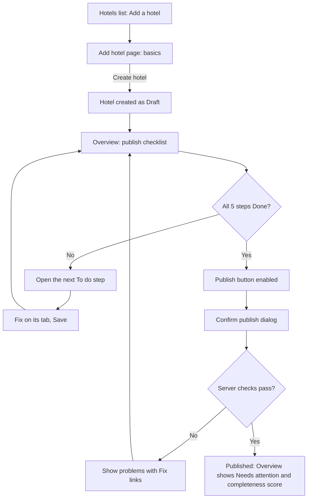
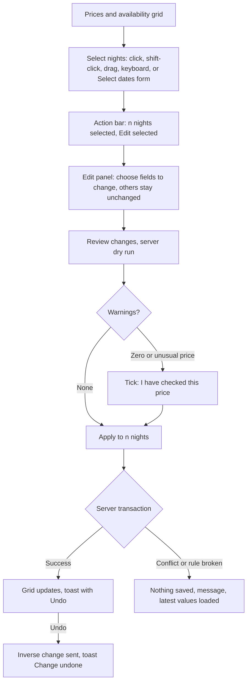
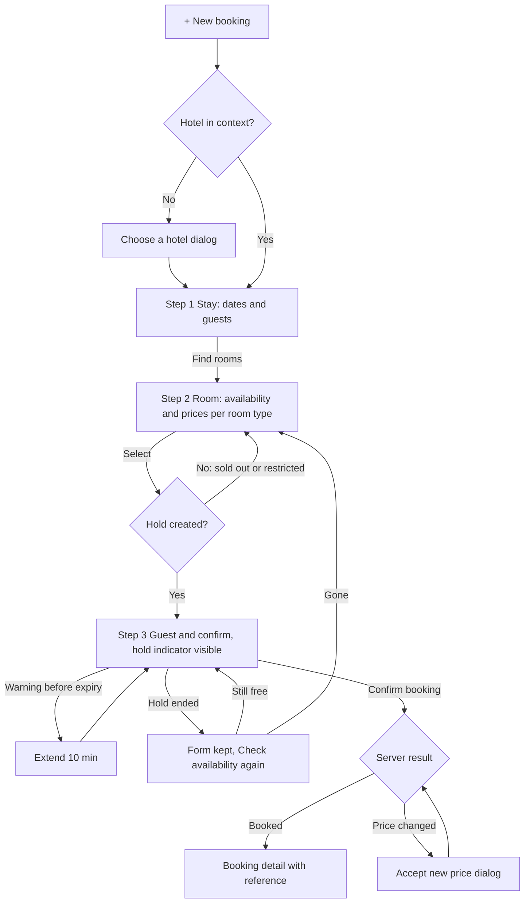
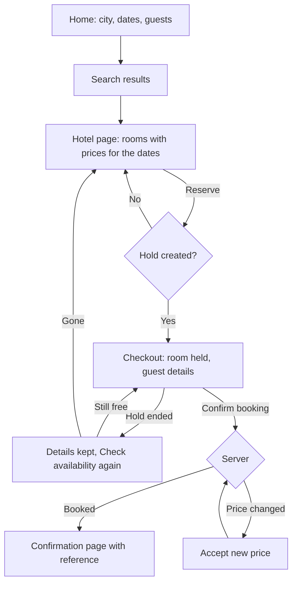
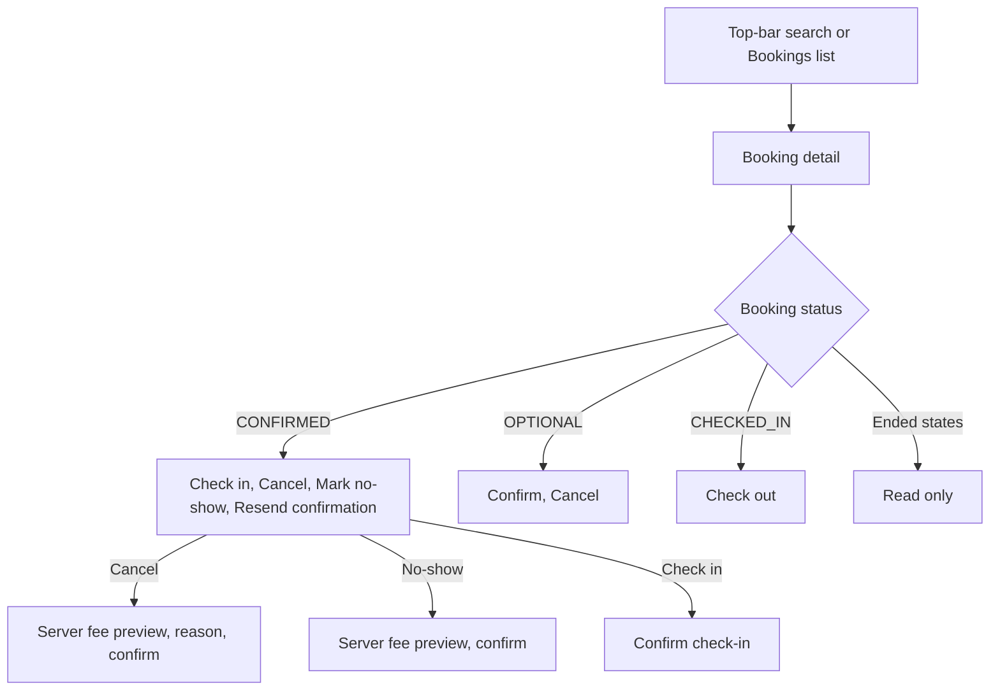

# UX plan — Staywise admin and guest web

- **Date:** 2026-10-20
- **Status:** proposal; follows the shared baseline in [README.md](./README.md) (phases, routes, names, statuses, switcher rules, HITL convention). Where this file and the baseline disagree, the baseline wins and this file must be corrected.
- **Inputs:**
  - [admin-ux-plan.md](./admin-ux-plan.md) (UX lead proposal);
  - [reports/Hotel admin UX plan evaluation.md](./reports/Hotel%20admin%20UX%20plan%20evaluation.md) (five fixes);
  - `research_notes/Hotel admin UX plan evaluation/` (`ux_patterns_evidence.md`, `pms_admin_design.md`, `ota_extranet_setup.md`);
  - `../ANALYSIS.md` (`#hotel-module-ux-review`, `#ui-theme-consistency-audit`, `#form-field-type-analysis`);
  - `../GUIDES.md` (End-to-End Navigation & User Flow Guide);
  - `../guidelines/frontend-ui.md`;
  - the current code in `apps/admin-web/src` (routes, pages, `features/hotels|rooms|rates|inventory`, `components/ui`).
- **Companion files:** visual tokens, component anatomy and per-screen layout live in [UI-PLAN.md](./UI-PLAN.md); tasks and acceptance tests live in [MVP-PLAN.md](./MVP-PLAN.md) and [PHASES.md](./PHASES.md); entities and state machines live in [DATA-MODEL.md](./DATA-MODEL.md).

## How a coding model uses this file

- **Scope of this file:** *behaviour* — what appears, when, in what order, what each control does, what text is shown, and what happens on error. It does not pick colours or pixel sizes beyond accessibility minimums (see UI-PLAN).
- **Copy in quotes is exact.** Text in "double quotes" or in `copy:` bullets is the string to render. `{braces}` are placeholders filled from data. Do not reword copy; if copy is missing for a state you need, stop and raise it at checkpoint **CP-02**.
- **Phase tags:** every screen, control and rule carries the phase that delivers it (**P1**–**P8**, baseline IDs). Build only what belongs to the phase you are working on. Items tagged **P7** or **P8** are described only so that MVP screens leave room for them; do not build them in the MVP.
- **Statuses:** enum values (`CONFIRMED`, `PAY_AT_HOTEL`, …) are code names from the baseline. Staff and guests never see them; they see the words in §9.3.
- **Money:** the server sends integer minor units (paise). The UI formats them with `formatMoney` as rupees (`₹3,500` — no decimals when the paise part is zero, otherwise `₹3,500.50`). The UI never calculates prices, tax, fees or availability; it displays what the server returns.
- **Dates:** stay dates are hotel-local calendar dates (`YYYY-MM-DD`) in the hotel's time zone (default `Asia/Kolkata`). Display format: `Tue 20 Oct` in grids, `20 Oct 2026` in text, `21–23 Oct` for ranges in the same month, `30 Oct – 2 Nov` across months. Times: `2:00 pm` (12-hour, lower-case am/pm).
- **Human checkpoints:** marked in the baseline format. All of them are listed with approval criteria in §11. When a task hits a checkpoint, build behind a feature flag or with the proposed default, and do not mark the task done until the human approves.

> **🧑 HUMAN CHECKPOINT — CP-01 UX plan sign-off**: product lead and UX reviewer read §1–§6 and confirm the IA, the switcher behaviour and the journey list before P1 work starts. Approved = written "approved" (or a list of changes) in the PR or task tracker.

---

## 1. UX principles

- **Organise by daily work, not by data tables.** Navigation answers four questions: "What needs attention?" (Today), "Can guests book my hotel?" (Rooms & rates, Prices & availability), "Help this guest" (Bookings), "Set up a hotel" (Hotels → Overview checklist). Every new screen must name which question it answers.
- **Pick the hotel once.** The hotel is part of the URL (`/admin/hotels/:hotelId/...`). The global switcher in the top bar shows it and changes it. No page has its own hotel picker. The last-used hotel is only a default for pages that have no hotel yet.
- **Status in words, with the fix next to it.** Every status shows icon + text (never colour alone) and, when something is wrong, a button or link that opens the exact place to fix it: "⚠ Missing price · Set price".
- **Healthy is quiet.** "Bookable", "Done" and "Published" use plain text with a small check icon and no coloured background, so problems stand out (GOV.UK task list, Carbon).
- **Side panels for single-record edits; full pages for multi-step flows.**
  - Side panel (non-modal, list stays visible): edit a room type, edit selected nights in the grid, view an audit entry.
  - Full page with its own URL: add a hotel, New booking, booking detail, Tax & billing.
  - Centred dialog: only for confirmations and short choices (≤3 fields).
  - Never put a multi-step wizard inside a panel or dialog.
- **Show the money impact before confirming.** Any action that changes what a guest pays or what the hotel earns (bulk price change, cancel, no-show, room-count change, check-out early) shows the server-calculated amounts and names the hotel and the record in the dialog and on the button ("Cancel booking — fee ₹3,500").
- **Prefer undo to confirmation for frequent, reversible actions** (grid edits). Use confirmation for rare, costly or irreversible ones (archive, cancel, no-show). Do not confirm low-risk saves.
- **Same screens for setup and running.** A draft hotel and a live hotel use the same tabs. The Overview tab shows the publish checklist while the hotel is a draft and "Needs attention" plus a completeness score once published.
- **Mobile for inventory.** Prices & availability, Rooms & rates (read + quick edits) and Booking detail work on a 360 px wide phone. Desktop is the primary density for everything else, but no MVP screen may break on mobile.
- **Truthful UI.** Never show "Confirmed", "Paid", a price or an availability count that the server has not returned. Search results are quotes; the hold is the first moment availability is guaranteed.
- **Remove dead ends.** No "coming soon" buttons, no fake numbers, no disabled features without a reason. If a feature is not built, its control is hidden.
- **Accessibility:** WCAG 2.2 AA is a release requirement, not a polish item (§8).
- **Server authority (project rule):** the UI may pre-validate formats for speed, but the server decides availability, price, tax, permission and state transitions, and its per-field errors (`{ errorCode, message, errors: [{ field, message }] }`) are shown on the matching field.

---

## 2. Information architecture

### 2.1 App shell

```
┌──────────────┬───────────────────────────────────────────────────────────────────────┐
│ STAYWISE  ≡  │ [Hotel: Bell Hotel ▾]  [🔍 Search bookings, guests, hotels…]  [+ New booking] [PK ▾] │
│              ├───────────────────────────────────────────────────────────────────────┤
│ ◉ Today      │ Hotels / Bell Hotel / Rooms & rates                     (breadcrumb)  │
│ 📅 Bookings  │ Bell Hotel  ● Published  staywise.in/hotels/bell-hotel  [ⓘ] [Suspend] [⋯] │
│ 🏨 Hotels    │ Overview | Details | Photos | Rooms & rates | Prices & availability |  │
│ 🧾 Audit log │ Policies | Tax & billing | Bookings                    (hotel tab bar) │
│              │                                                                       │
│ (P8) Reports │   page content                                                         │
│ (later)      │                                                                       │
│  Staff       │                                                                       │
└──────────────┴───────────────────────────────────────────────────────────────────────┘
```

- **Sidebar (global sections only, in this order):**
  1. **Today** → `/admin/today` (**P3**; until P3 ships, the existing **Dashboard** `/admin/dashboard` stays in this slot).
  2. **Bookings** → `/admin/bookings` (**P6**; hidden before P6).
  3. **Hotels** → `/admin/hotels` (**P0**). For a user with access to exactly one hotel and without `hotels.create`, the label is "My hotel" and the link goes to `/admin/hotels/:hotelId`.
  4. **Audit log** → `/admin/audit` (**P1**).
  5. **Reports** → `/admin/reports` (**P8**; hidden in MVP).
  6. **Staff** → `/admin/settings/staff` (not scheduled in P1–P8; hidden until a phase is assigned at **CP-03**).
  - The old sidebar items **Room types**, **Availability** and **Base rates** are removed in **P1** (their routes redirect, §2.4). The disabled "Settings (Upcoming)" footer button and the help card are removed (dead end).
  - Each item is shown only if the user has its view permission (§3.7). Items keep the collapse behaviour and `localStorage.staywise-admin-sidebar-collapsed`.
- **Top bar (left to right):**
  - **Hotel switcher** (§3). On phones (<768 px) it moves to the first row of the page header area, full width.
  - **Global search** (**P1** hotels; **P6** adds bookings and guests).
    - Placeholder: P1 "Search hotels…"; from P6 "Search bookings, guests, hotels…".
    - Typing ≥2 characters shows a dropdown (debounced 250 ms) with up to 5 results per group: "Bookings" (reference, guest name, phone, email; scoped to accessible hotels) and "Hotels" (name, city). Each booking row: `SW-10234 · R. Kumar · 21–23 Oct · Bell Hotel`.
    - Enter with an exact booking reference (case-insensitive `SW-` + digits) opens that booking. Enter otherwise opens `/admin/bookings?q={query}` (P6) or `/admin/hotels?search={query}` (P1–P5).
    - Keyboard: `/` focuses search when focus is not in a text field; Arrow keys move through results; Escape clears the dropdown.
    - No results: "No bookings or hotels match "{query}"."
  - **"+ New booking"** button (**P4**; hidden before P4 and for users without `bookings.create`). Behaviour in §4 J4 step 0.
  - **Profile menu:** email, role name in words ("Hotel manager"), "Sign out", "Sign out of all devices" (wires the existing `logoutAll`).
  - The notifications bell is removed until notifications exist (it only shows a "coming soon" toast today).
- **Hotel header (all `/admin/hotels/:hotelId/*` pages):** hotel name (h1), hotel status badge, guest web address (P5: link "View on guest site" opens the guest hotel page in a new tab, only when Published), the ⓘ "what's still needed" button for drafts (`PublishBlockersInfo`), the one primary status action allowed for the status (Publish / Reactivate), and a "⋯" menu with Suspend and Archive (each shown only if allowed by status and permission).
- **Hotel tab bar:** Overview · Details · Photos · Rooms & rates · Prices & availability · Policies · Tax & billing · Bookings. Each tab is a route (not a `?tab=` parameter). Tabs not yet built in the current phase are hidden. On phones the tab bar scrolls horizontally with the active tab scrolled into view; a fade on the right edge shows there are more tabs.

### 2.2 Route map

- **Legend:** phase that delivers it · purpose · MVP or later. All admin routes are protected (signed-in staff). "Top-level" means not under a hotel.

- **Top-level routes**
  - **`/admin/login`** — P0 · staff sign-in · MVP. After sign-in, go to `location.state.from` if present and still permitted (fixes GUIDES Part 8), otherwise `homePath`.
  - **`/admin/today`** — P3 (setup health) / P8 (live operations) · "what needs attention" across the hotels in scope · MVP (setup health only). Accepts `?hotel=:hotelId`; "All hotels" allowed.
  - **`/admin/hotels`** — P0 (P1 updates) · hotel list with status, setup progress, needs-attention count · MVP.
  - **`/admin/hotels/new`** — P0 · add a hotel (basics) · MVP.
  - **`/admin/bookings`** — P6 · find bookings across all accessible hotels · MVP. Accepts `?q=`, filters in the query string. "All hotels" allowed.
  - **`/admin/audit`** — P1 · who changed what, when · MVP.
  - **`/admin/settings/staff`** — unscheduled · staff and hotel access · later (CP-03).
  - **`/admin/reports`** — P8 · reports and CSV · later. "All hotels" allowed.
  - **`/admin/unauthorized`**, **`*`** — P0 · 403 and 404 pages · MVP.
- **Per-hotel routes** (all under `/admin/hotels/:hotelId/`)
  - **`/admin/hotels/:hotelId`** — P1 · no page of its own; redirects (replace) to the default tab: `overview` from P3, `details` in P1–P2.
  - **`overview`** — P3 · status, publish checklist (draft) or needs attention + completeness (published), tonight's rooms · MVP.
  - **`details`** — P1 (P3 adds star rating, amenities, map pin) · name, web address, description, contact, address, time zone · MVP.
  - **`photos`** — P1 (P3 adds categories) · hotel photo gallery and cover photo · MVP.
  - **`rooms`** — P1 · Rooms & rates table + room side panel · MVP. Query: `?room={roomTypeId|new}&panel={details|photos|price|availability}`.
  - **`inventory`** — P2 (P1 interim) · Prices & availability grid (room type × date) · MVP. Query: `?from=YYYY-MM-DD&days=7|14|30&roomType={id}` (`roomType` scrolls to and highlights that row). In **P1** this route hosts the existing availability summary (`HotelAvailabilityTab`) and the 14-night calendar (`InventoryCalendarView`) as an interim; P2 replaces both with the grid.
  - **`policies`** — P1 (moves the existing cancellation policy) / P3 (check-in/out times, child & extra-bed policy, house rules) · MVP.
  - **`tax`** — P3 · Tax & billing (GSTIN, legal name, state, specified premises) · MVP.
  - **`bookings`** — P6 · this hotel's bookings: list and calendar view · MVP. Query: `?view=list|calendar` plus filters.
  - **`bookings/new`** — P4 · staff New booking (3 steps) · MVP. Query (optional pre-fill): `?checkIn=&checkOut=&adults=&children=&roomType=`.
  - **`bookings/:bookingId`** — P6 · booking detail and actions · MVP. (P4 ships a minimal read-only version so New booking has somewhere to land; see §5.12.)
- **Guest web routes** (`apps/guest-web`, **P5**, from `../guidelines/frontend-ui.md` §4)
  - **`/`** — search home (city, dates, guests).
  - **`/search`** — results. Query: `?city=&checkIn=&checkOut=&adults=&children=&rooms=`.
  - **`/hotels/:slug`** — hotel page with room choice. Same query keys as `/search`.
  - **`/checkout/:holdId`** — held room + guest details + confirm.
  - **`/booking/:reference/confirmation`** — booking result.
  - Account routes (`/account`, `/auth/*`) are not in the MVP. The MVP guest flow is guest checkout without an account.

> **🧑 HUMAN CHECKPOINT — CP-03 Unscheduled routes and labels**: product decides (a) the phase for `/admin/settings/staff`, (b) the tab labels "Rooms & rates" and "Prices & availability" (route `inventory`), (c) "My hotel" for single-hotel users, (d) guest web routes above. Approved = each item marked keep / change-to in the tracker.

### 2.3 Navigation rules

- **Breadcrumbs** (shown on every page below a section root; not on `/admin/today`, `/admin/hotels`, `/admin/bookings`, `/admin/audit`):
  - Hotel pages: "Hotels / {Hotel name} / {Tab label}". "Hotels" → `/admin/hotels`; "{Hotel name}" → `/admin/hotels/:hotelId` (default tab). For single-hotel users the "Hotels" crumb is omitted.
  - Booking detail: "Bookings / {SW-ref}" when opened from `/admin/bookings`; "Hotels / {Hotel} / Bookings / {SW-ref}" when opened from the hotel. Decide by the `from` value in router state; default to the hotel form.
  - New booking: "Hotels / {Hotel} / Bookings / New booking".
  - Last crumb is plain text with `aria-current="page"`.
- **Page title** (`document.title`): "{Page} · {Hotel} · Staywise Admin" on hotel pages, "{Page} · Staywise Admin" elsewhere. Example: "Prices & availability · Bell Hotel · Staywise Admin".
- **Back behaviour:**
  - Moving between hotel tabs pushes a history entry (each tab is a route).
  - Opening a side panel pushes a history entry (browser Back closes the panel). Switching tabs inside the panel and changing grid date windows *replace* the entry.
  - Changing list filters, search text, sort and pagination *replace* the entry and are kept in the query string (frontend rule: filter state must be in the URL).
  - In-page "Back to …" buttons go to a fixed parent, not `history.back()`: booking detail → bookings list (keeping its last query string from session storage), New booking → hotel bookings list (or the page that opened it, from router state).
- **Deep links:** every state a colleague might share is in the URL: hotel, tab, open room panel and its tab, grid window, list filters, booking. Opening a deep link without access shows the 403 page; a removed record shows 404 copy (§5.0). Never fall back silently to another hotel.
- **Unsaved changes:** one shared guard covers hotel tab changes, sidebar links, breadcrumb links, switcher changes, panel close, browser Back and tab close (`beforeunload`). Copy in §5.0. This requires moving from `BrowserRouter` to a data router (`createBrowserRouter`) so `useBlocker` is available (the current limitation noted in `ANALYSIS.md` status update).
- **After save:** stay on the same page and keep scroll position; show a toast; refresh dependent data (checklist, health badges).
- **Session expiry:** see §7.4 for the idle warning; after re-login return to the interrupted URL. Unsaved form data cannot be recovered after expiry, which is why the warning exists.

### 2.4 Redirects from old routes (P1)

- All redirects use `replace` so Back does not loop. Each redirect keeps unrelated query keys only when listed below.
- **`/admin/hotels/:id/edit`** → `/admin/hotels/:id/{tab}` where `?tab=` maps as:
  - missing, `hotel`, `general` → `details`;
  - `photos` → `photos`;
  - `rooms` → `rooms`;
  - `rates` → `rooms`;
  - `availability` → `inventory`;
  - `cancellation`, `policy` → `policies`;
  - any other value → default tab.
- **`/admin/hotels/:id`** (old read-only detail page) → default tab (the old `HotelDetailPage` is retired; its useful content moves to Overview in P3).
- **`/admin/room-types?hotel=:id`** → `/admin/hotels/:id/rooms`.
- **`/admin/room-types/new?hotel=:id`** → `/admin/hotels/:id/rooms?room=new&panel=details`.
- **`/admin/room-types/:roomTypeId/edit`** → fetch the room type, then `/admin/hotels/{its hotelId}/rooms?room=:roomTypeId&panel=details`. Not found → 404 copy "This room type no longer exists."
- **`/admin/rates?hotel=:id[&room=:roomId]`** and **`/admin/inventory?hotel=:id[&room=:roomId]`** → `/admin/hotels/:id/inventory[?roomType=:roomId]`.
- **Old routes with no hotel** (`/admin/room-types`, `/admin/rates`, `/admin/inventory` without `?hotel`): single-hotel user → that hotel's target page; multi-hotel user → the hotel chooser (§3.4) titled "Choose a hotel" with the subtitle "{Rooms & rates | Prices & availability} is managed per hotel."; after choosing, go to the target page.
- **`/admin/dashboard`** → `/admin/today` (from P3).

> **🧑 HUMAN CHECKPOINT — CP-04 Route change and redirects**: a human opens every old URL in the list above (including bookmarks with extra query keys and an inaccessible hotel id) and confirms it lands on the right page with no loop and no flash of the wrong hotel. Approved = checklist of URLs ticked in the PR.

---

## 3. Global hotel switcher

### 3.1 Where the hotel comes from

- **Rule 1 — the URL is the truth.** On `/admin/hotels/:hotelId/*` the switcher shows `:hotelId`. On top-level pages that allow a hotel filter (`/admin/today`, `/admin/reports`) the hotel comes from `?hotel=:hotelId`; no parameter means "All hotels". On `/admin/bookings`, choosing a hotel navigates to `/admin/hotels/:hotelId/bookings` (the canonical per-hotel list); `/admin/bookings?hotel=:hotelId` redirects there.
- **Rule 2 — last-used hotel is only a default.** Stored per user in `localStorage` key `staywise-admin-last-hotel:{userId}` whenever a per-hotel page loads successfully. Used only to pre-select a hotel in the chooser (§3.4) and for old-route redirects. Never used to override a URL. Read inside try/catch; if missing or no longer accessible, ignore it.
- **Rule 3 — recents.** Up to 5 most recently opened hotels, per user, key `staywise-admin-recent-hotels:{userId}`, newest first, de-duplicated, filtered against the user's current access list on every open.

### 3.2 States

- **Loading (first load of the hotel list):** static text "Loading hotels…" with a small spinner; the control is not interactive. If the current page already knows the hotel name, show the name immediately.
- **Single hotel (user can access exactly one hotel):** static text "{Hotel name}" with its status badge. Not a button, no chevron, no popover. "All hotels" never appears.
- **Multi-hotel, per-hotel page:** a button labelled "Hotel: {Hotel name}" + chevron (accessible name "Hotel: {Hotel name}. Change hotel").
- **Multi-hotel, top-level page that allows "All hotels"** (`/admin/today`, `/admin/bookings`, `/admin/reports`): button shows "All hotels" or "Hotel: {name}".
- **Multi-hotel, other top-level pages** (`/admin/hotels`, `/admin/hotels/new`, `/admin/audit`, `/admin/settings/staff`): button shows "Choose a hotel". Choosing navigates to that hotel's default tab. The page's own filters (e.g. Audit log's Hotel filter) are independent of the switcher.
- **Open popover (multi-hotel):**

```
┌ Change hotel ──────────────────────────────┐
│ [🔍 Search hotels by name or city      ]   │
│ ─ All hotels ─────────────── (only on Today/Bookings/Reports)
│ RECENT                                      │
│  ✓ Bell Hotel · Bengaluru        Published  │
│    Sea Breeze · Goa              Draft      │
│ ALL HOTELS (12)                             │
│    Amber Inn · Jaipur            Published  │
│    …                                        │
│ [Manage hotels →]                           │
└────────────────────────────────────────────┘
```

  - Search input receives focus on open. Filters as you type (case-insensitive, matches name or city, accent-insensitive). When search text is present, the "Recent" group is hidden and one flat filtered list is shown.
  - Rows: name · city, and the hotel status word on the right. Archived hotels are not listed (they are reachable from the Hotels list with the Archived filter). The current hotel has a check icon and `aria-selected="true"`.
  - "All hotels" row appears first, only on the three allowed pages.
  - Footer link "Manage hotels" → `/admin/hotels`.
  - More than 200 hotels: the list loads the first 50 alphabetically and searches the server for the rest (debounced 250 ms).
- **Empty search result:** "No hotels match "{query}"." plus a "Clear search" button.
- **No accessible hotels (multi-hotel role but 0 hotels assigned):** switcher shows "No hotels"; every hotel page shows the 403 page with "You don't have access to any hotels yet. Ask an administrator to give you access."
- **Error loading the list:** button text "Hotels unavailable"; popover shows "Couldn't load your hotels." and a "Try again" button. The current page keeps working with the hotel from the URL.

### 3.3 Choosing a hotel

- **On a per-hotel page:** navigate to the same sub-route for the new hotel and drop record-specific parts:
  - `/admin/hotels/A/inventory?from=…&days=14` → `/admin/hotels/B/inventory?from=…&days=14` (keeps window, drops `roomType`);
  - `/admin/hotels/A/rooms?room=x&panel=price` → `/admin/hotels/B/rooms` (panel closed);
  - `/admin/hotels/A/bookings/:bookingId` → `/admin/hotels/B/bookings`;
  - `/admin/hotels/A/bookings/new` → `/admin/hotels/B/bookings/new` only if no hold is active; with an active hold, see §3.5;
  - list filters that refer to A's records (room type filter) are dropped; date filters are kept.
- **On a top-level page with "All hotels":** sets or clears `?hotel=` (Today, Reports) or navigates to `/admin/hotels/:hotelId/bookings` (Bookings).
- **After choosing:** popover closes, focus moves to the page `h1`, and a polite announcement says "Now viewing {Hotel name}." The new hotel is added to recents.

### 3.4 Arriving at a page that needs one hotel without one ("chooser")

- **When:** "+ New booking" pressed while "All hotels" or "Choose a hotel" is shown; an old route without `?hotel`; a needs-attention item on Today that targets a page type rather than a specific hotel (should not happen — every item carries its hotel).
- **Single-hotel users never see the chooser;** they go straight to their hotel.
- **Chooser dialog (centred dialog):**
  - Title: "Choose a hotel"; subtitle by context: "New bookings are made for one hotel at a time." / "{Page name} is managed per hotel."
  - Content: the same searchable list as the switcher (recents + all), last-used hotel pre-selected.
  - Buttons: "Continue" (primary, disabled until a hotel is selected) and "Cancel". Double-click or Enter on a row = Continue.
  - Cancel returns to the previous page (or `/admin/hotels` if there is none).
- **Never** render an editing page with "All hotels". If code reaches an editing page without a hotel id, redirect to the chooser.

### 3.5 Unsaved-change and hold guard

- **Unsaved changes:** if the current page or open panel is dirty, choosing another hotel opens the discard dialog before navigating:
  - Title: "Discard unsaved changes?"
  - Body: "You have unsaved changes to {Section} at {Current hotel}. If you switch to {New hotel}, they will be lost."
  - Buttons: "Keep editing" (focused by default) · "Discard and switch" (danger).
- **Active hold on New booking:** body "You are holding {Room type} at {Current hotel} for this booking. Switching hotels releases the room." Buttons: "Stay on this booking" (default) · "Release room and switch". Choosing release calls the release endpoint (`Hold` → `RELEASED`) before navigating; if the call fails, navigate anyway (the hold expires on its own) and show toast "The room hold will end on its own in a few minutes."
- **Dirty means** the form value differs from the last saved value after trimming whitespace (avoid false positives — Atlassian pitfall). Saving clears dirty state.

### 3.6 Keyboard behaviour (WAI-ARIA combobox/listbox pattern)

- Switcher button: Enter, Space or ArrowDown opens the popover and focuses the search input.
- In the search input: typing filters; ArrowDown/ArrowUp move the active option (`aria-activedescendant`, active option scrolled into view); Home/End jump to first/last option; Enter chooses the active option; Escape closes and returns focus to the switcher button; Tab closes and moves focus forward.
- Group labels ("Recent", "All hotels") are not focusable (`role="group"` with `aria-label`).
- Optional shortcut proposal: Alt+Shift+H opens the switcher (not fired while typing in a field). Shortcuts are decided at **CP-05**.

### 3.7 Permission scoping

- The switcher lists only hotels in `staff.hotelIds` (super admin: all non-archived hotels). The list comes from the server, never filtered only on the client.
- Opening `/admin/hotels/:hotelId/*` for a hotel outside scope: the server returns 403; show the 403 page with "You don't have access to this hotel." and a "Choose another hotel" button (opens the chooser). Do not reveal the hotel's name.
- Hotel ids that don't exist: 404 page "Hotel not found. It may have been archived or the link is wrong." with "Go to hotels".
- Every write call includes the hotel id from the URL; the server checks it. A server 403 on a write shows the toast "You don't have permission to do that at {Hotel name}." and leaves the form as it was.
- **Proposed new permission keys** (names are a proposal; existing keys are kept): `bookings.view`, `bookings.create`, `bookings.cancel`, `bookings.manage` (covers check-in, check-out, no-show), `audit.view`, `hotels.tax` (edit Tax & billing). See **CP-06**.

> **🧑 HUMAN CHECKPOINT — CP-05 Keyboard shortcuts**: decide whether to ship shortcuts (`/` for search, Alt+Shift+H switcher, Alt+Shift+N New booking) and confirm they don't clash with Chrome/Edge on Windows or with screen-reader keys (NVDA, JAWS). Approved = list of shipped shortcuts tested in Chrome + NVDA.

> **🧑 HUMAN CHECKPOINT — CP-06 Permissions**: security reviewer approves the new permission keys, which roles get them (Super Administrator, Manager, Editor), and that every new action is checked on the server per hotel. Approved = role × permission matrix signed off and server tests for 403 per action.

---

## 4. Key journeys

- **Format:** numbered steps; **◆** marks a decision point. Copy for dialogs and toasts is in the screen specs (§5) unless given here.

### J1 — Add a hotel and publish it (P0 + P1 + P3)



1. **Start:** Hotels list → "Add a hotel" (needs `hotels.create`). Opens `/admin/hotels/new`.
2. **Basics:** name, web address (auto-filled from the name), description (optional), email/phone, address, time zone (defaults India / `Asia/Kolkata`), optional photos. "Create hotel".
   - ◆ Validation error → errors on fields; focus moves to the first invalid field; nothing is created.
   - ◆ Web address taken (`DUPLICATE_HOTEL_SLUG`) → field error "Another hotel already uses this web address. Try adding the city, for example {slug}-{city}."
3. **Lands on** `/admin/hotels/:hotelId/overview` (P3; `details` before P3) with toast "Draft hotel created. Next: add your room types." The switcher now shows this hotel.
4. **Checklist (Overview, draft):** five steps in fixed order (semantics in §6.3):
   1. Hotel details → `details`
   2. Room types → `rooms`
   3. Prices → `rooms` (opens the first unpriced room's Price tab)
   4. Open dates → `inventory` (P1 interim: availability summary; P2: the grid)
   5. Cancellation terms → `policies`
   - Steps 3 and 4 show "Cannot start yet" (grey, not linked) until at least one room type exists.
5. **Each step's link** goes straight to the fix (for a specific room, the side panel opens on the right tab). After any save, the checklist and the header ⓘ refresh from `GET /admin/hotels/:id/readiness`.
6. **◆ All steps Done?**
   - No → the header "Publish" button is shown with `aria-disabled="true"` (still focusable) and visible text next to it: "{n} steps left before you can publish" (link scrolls to the checklist).
   - Yes → "Publish" enabled.
7. **Publish confirm dialog:** title "Publish {Hotel name}?"; body "Guests will be able to find and book {Hotel name} on the Staywise guest site. You can suspend it at any time."; buttons "Publish hotel" / "Cancel".
8. **◆ Server result:**
   - Success → toast "{Hotel name} is published. Guests can book it now."; status badge "Published"; Overview switches to the published layout (§5.2).
   - `HOTEL_NOT_READY` (something changed in another session) → dialog closes; Overview shows an error summary "{Hotel name} can't be published yet:" listing each problem with its "Fix" link (§6.3 mapping); focus moves to the summary.
   - `VERSION_CONFLICT` → toast "Someone else changed this hotel. Reload to see the latest version." with a "Reload" action.
9. **After publish:** the soft completeness score (§6.4) appears on Overview with its to-do list. It never blocks anything. Missing Tax & billing (P3) shows as a Medium "needs attention" item; it does not block publishing (baseline: GSTIN blocks invoices in P7, not holds).

> **🧑 HUMAN CHECKPOINT — CP-07 Publish gate contents**: product decides whether photos join the hard gate (research suggests at most 5 hotel photos + 1 per room type in the gate; bigger targets stay in the soft score) and whether Tax & billing should gate publishing. Default until approved: gate = the 5 server checks that exist today; photos and tax only in the soft score and needs attention. Approved = gate list written into DATA-MODEL / MVP-PLAN and the server publish checks updated to match.

### J2 — Daily price and availability changes in the grid (P2)



1. **Open** `/admin/hotels/:hotelId/inventory`. Default window: today (hotel time) + 14 days on desktop (≥1024 px), 7 days on tablets; phones use the list layout (§5.6).
2. **Move through dates:** "Today", "‹ Previous" / "Next ›" (moves by the window length), window size 7 / 14 / 30 days, "Go to date" (DatePicker). Updates `?from=&days=` (replace).
3. **Select nights** — every method gives the same selection model (a set of room type × date cells):
   - click one cell; Shift+click another cell to select the rectangle between them; Ctrl/Cmd+click adds or removes single cells;
   - press-and-drag across cells (pointer);
   - click a room type's row header to select its visible nights; click a date header to select that date for all room types;
   - keyboard (§8.2);
   - "Select dates…" button → small dialog: room types (checkboxes, default all active), from date, to date (may go beyond the visible window; max 366 nights), days of week (Mon–Sun checkboxes, default all) → "Select". This is the required non-drag alternative and the way to select long ranges.
4. **Action bar** (sticky at the bottom of the grid while ≥1 cell is selected): "{n} nights selected · {r} room types · {date range}" · "Edit selected" (primary) · "Clear selection". Escape also clears.
5. **Edit panel** (non-modal side panel, title "Edit {n} nights"): selection summary at the top ("Deluxe King, Suite · 20–31 Oct · Mon–Sun") with "Change selection" (opens the Select dates form pre-filled). Every field starts at "Leave unchanged":
   - **Price per night (before tax):** "Leave unchanged" / "Set price" (MoneyInput, ₹) / "Use base price" (removes the `DailyRate` override; hint "{room type}: ₹{base}").
   - **Sale status:** "Leave unchanged" / "Open for sale" / "Close dates (stop selling)".
   - **Blocked rooms:** "Leave unchanged" / "Block rooms" (number, with required reason code: Maintenance, Renovation, Out of order, House use, Group allotment, Other + note) / "Unblock all blocked rooms".
   - **Minimum stay:** "Leave unchanged" / number of nights (1–30) / "No minimum".
   - **Stop selling before arrival:** "Leave unchanged" / days (0–365; hint "0 means guests can book on the day") / "No cut-off".
   - **Nights not set up yet:** shown only when the selection contains nights with no `NightInventory` row: checkbox "Also open {k} nights that aren't set up yet (uses each room type's room count)".
   - Buttons: "Review changes" (primary; disabled until at least one field is not "Leave unchanged") · "Cancel".
6. **Review step (same panel):** plain-language list grouped by room type, e.g. "Deluxe King: price ₹3,500 → ₹4,200 on 12 nights · closed on Sat 25 Oct and Sun 26 Oct." The server dry-runs the change and returns counts and warnings:
   - **◆ Zero price:** "⚠ The price is ₹0. Guests could book these nights for free." → requires ticking "I have checked this price".
   - **◆ Unusual price** (server rule, CP-08): "⚠ ₹{x} is much {lower|higher} than the usual ₹{base} for {room type}." → same tick box.
   - **◆ Nights with bookings:** "{k} of these nights already have bookings. Those guests keep the price they booked." (information only).
   - **◆ Blocking more rooms than are free:** "On {date} you can block at most {m} rooms for {room type}: {b} are booked or held." → error; "Apply" disabled until fixed.
   - Buttons: "Apply to {n} nights" (primary) · "Back".
7. **◆ Apply result** (one Mongo transaction, all-or-nothing):
   - Success → panel closes, the selection stays, changed cells show a "changed" outline until the next selection, toast "Updated {n} nights at {Hotel name}." with "Undo". This toast stays until dismissed or until the next grid change (toasts with actions never auto-dismiss — WCAG 2.2.1).
   - `VERSION_CONFLICT` → panel alert "Some of these nights were changed by someone else while you were editing. Nothing was saved. The grid now shows the latest values — check them and try again." Grid reloads; the panel keeps the user's choices.
   - Rule violation → field error in the panel.
8. **Undo:** sends the server-provided inverse change (previous values with their versions). Success toast "Change undone at {Hotel name}." Conflict → "Couldn't undo because these nights changed again. Check the grid and edit them directly."
9. **Every change is audited** (who, when, hotel, room types, dates, before → after, reason) and visible in the Audit log (J7).

> **🧑 HUMAN CHECKPOINT — CP-08 Suspicious-price rule and restriction ranges**: product approves the unusual-price thresholds (proposal: below 50% or above 300% of the base price), zero price = warn (not block), minimum stay 1–30, cut-off 0–365, the block reason list, and the 366-night selection cap. Approved = values recorded in MVP-PLAN P2 and enforced on the server.

### J3 — Manage a room type (P1)

1. **Open** Rooms & rates (`/admin/hotels/:hotelId/rooms`). Each row shows photo, name, code, guests, rooms, base price, rooms free tonight, health badge (§6.2) with its fix action, and a "⋯" row menu.
2. **Add:** "+ Add room type" → side panel `?room=new&panel=details`. Fields: name, code, max adults, max children, sellable rooms, description, beds (P3 option list). "Add room type" → the panel switches to the new room's Price tab and shows toast "{Room type} added. Next: set its price."
3. **Edit:** click a row (or its name, or "Edit" in the menu) → side panel on Details; tabs Details · Photos · Price · Availability. A health badge's fix action opens its tab directly ("Set price" → Price, "Open dates" → Availability).
4. **Change sellable rooms:** when the number changes, an impact line appears under the field (server preview, debounced 400 ms): "This changes {n} open nights from {date}." If some nights can't go that low: "On {k} nights, {b} rooms are already booked or held, so the lowest you can set is {b}." A reason code is required (Rooms added, Rooms removed, Renovation, Correction, Other). Saving below the limit shows the field error "You can't set fewer rooms than are booked or held ({b} on {date})."
5. **Disable** (row menu; needs `room_types.archive`):
   - ◆ Only active room type of a Published hotel → dialog "Can't disable {Room type}"; body "{Room type} is the only bookable room type at {Hotel}. Add another room type first, or suspend the hotel."; button "OK".
   - Otherwise → dialog "Disable {Room type} at {Hotel}?"; body "Guests won't be able to book {Room type}. {u} upcoming bookings are kept and still need to be served. Prices and open dates are kept, so you can enable it again later."; reason code (Renovation, Seasonal closure, No longer offered, Duplicate, Other); buttons "Disable room type" (danger) / "Cancel". Toast "{Room type} disabled at {Hotel}."
   - Disabled rows move to the bottom of the table, show the "Disabled" badge and the fix action "Enable".
6. **Enable:** no dialog (reversible, low risk). Toast "{Room type} enabled. Check its price and open dates." The badge then shows its real health.
7. **Duplicate** (row menu; needs `room_types.create`): dialog "Duplicate {Room type}":
   - name (pre-filled "{Name} (copy)"), code (pre-filled "{CODE}-2"; must be unique in the hotel);
   - "Also copy" checkboxes: Description (on), Capacity and beds (on), Photos (off), Base price (on);
   - fixed note "Daily prices, open dates and bookings are never copied. The copy starts disabled so guests can't book it until you've checked it."
   - Buttons "Create copy" / "Cancel". Result: new room type with status `DISABLED`; the panel opens on it; toast "Copy created as disabled. Check it, open dates, then enable it."
8. **History:** every panel has "View change history" → `/admin/audit?hotel={hotelId}&entity=RoomType&entityId={roomTypeId}`.

> **🧑 HUMAN CHECKPOINT — CP-09 Room lifecycle rules**: product confirms (a) disabling the last active room type of a published hotel is blocked, (b) duplicates start disabled, (c) which fields Duplicate may copy, (d) the reason code lists, (e) the server endpoint for Enable (none exists today). Approved = rules recorded and enforced on the server.

### J4 — Staff New booking (P4)



0. **Start points:** top-bar "+ New booking"; "+ New booking" on the hotel Bookings list; (P6) an empty cell in the booking calendar (pre-fills `checkIn`, `checkOut` = next day, `roomType`); keyboard shortcut if approved (CP-05).
   - ◆ Hotel in context (per-hotel page, or Today with `?hotel=`) → `/admin/hotels/:hotelId/bookings/new`.
   - ◆ "All hotels" / no hotel → chooser (§3.4), then the page. Single-hotel users skip the chooser.
1. **Step 1 — Stay.** One page with a stepper "1 Stay · 2 Room · 3 Guest & confirm"; completed steps collapse to a summary line with an "Edit" link.
   - Fields: check-in and check-out (DateRangePicker; earliest = today in hotel time; maximum stay 30 nights, CP-10), adults (1 to the largest room capacity), children (0+), rooms (1–9, default 1).
   - "{n} nights" appears next to the dates as soon as both are set.
   - Validation copy: "Choose a check-out date after check-in." · "Check-in can't be in the past." · "Stays can be up to 30 nights." · "Add at least 1 adult."
   - "Find rooms" (primary).
   - Editing step 1 after a hold exists → dialog "Change the stay?" body "Changing dates or guests releases the room you're holding." buttons "Change stay" / "Keep current stay".
2. **Step 2 — Room.** Room types for those dates (server quote; no hold yet):
   - Each card: name, capacity, beds, availability ("{k} left" only when k ≤ 5, otherwise "Available"), price per night (or "from ₹x per night" when nights differ), total before tax, "Select".
   - Unavailable types stay visible, greyed, with the reason in words: "Sold out on {date}" · "Closed on {date}" · "Minimum stay {m} nights" · "Stops selling {d} days before arrival" · "Too many guests for this room (max {a} adults, {c} children)". No "Select" button.
   - Empty: "No rooms are available for {dates}. Try other dates or fewer rooms." with "Change dates".
   - ◆ "Select" → server creates the `Hold` (10 minutes; idempotency key per click). Button shows "Holding room…".
     - Success → step 3 opens; the hold indicator appears; focus moves to the step 3 heading.
     - Sold out meanwhile → the card changes to "Sold out on {date}"; inline alert "Someone just booked the last {Room type} for these dates. Choose another room."; focus moves to the alert.
3. **Step 3 — Guest & confirm** (hold `ACTIVE`):
   - **Hold indicator** at the top of step 3 (sticky on small screens): "Room held · 9:32 left" + "Extend 10 min". Behaviour in §7.1.
   - **Guest:** full name (required, 2–120 characters), mobile (PhoneInput, +91 default, required), email (optional; hint "Add an email to send the booking confirmation."), special requests (optional, max 500), business GSTIN (optional; only if approved at CP-15).
   - **Price breakdown:** server quote, per night with GST (§7.3).
   - **Cancellation terms** in one sentence from the policy snapshot: "Free cancellation until {date}, {time}. After that the fee is {fee}. No-show fee: {fee}."
   - **Payment:** text "Payment: the guest pays at the hotel." (only option in the MVP; not a one-item radio). Saved as payment status `PENDING`, method `PAY_AT_HOTEL`.
   - **Tentative booking (CP-14, hidden unless approved):** checkbox "Book as tentative — release the room on {date, time} if not confirmed" with a date-time field → booking status `OPTIONAL` with `releaseAt`.
   - "Confirm booking" (primary). While submitting: "Confirming…", disabled; double clicks ignored; retries reuse the same idempotency key.
4. **◆ Confirm result:**
   - Success → navigate to `/admin/hotels/:hotelId/bookings/:bookingId`; toast "Booking {SW-ref} confirmed for {Guest} at {Hotel}." (tentative: "Tentative booking {SW-ref} saved. The room is released on {date} unless confirmed.").
   - Price changed (server re-quote differs) → dialog "The price has changed"; body "The total for this stay is now {new} (it was {old}). {reason from server}"; buttons "Confirm at {new}" / "Go back".
   - Hold ended → §7.1 expiry flow.
   - Network error or time-out → inline alert "We couldn't reach Staywise. Checking whether the booking was saved…"; the client re-sends the same idempotent request up to 3 times: found → success path; still failing → "The booking was not saved. Your details are still here — try again." with "Try again".
   - Field errors → shown on fields; the hold keeps running.
5. **Leaving the page** with an active hold → guard dialog (§3.5 hold copy); confirming releases the hold.

> **🧑 HUMAN CHECKPOINT — CP-10 New booking flow sign-off**: product and a front-desk lead walk through J4 in a prototype (step order, fields, required/optional, maximum stay, rooms per booking, one room type per booking, pay-at-hotel wording) and the usability round (§10) confirms it before P4 is locked. Approved = sign-off note plus test results meeting the §10 targets.

### J5 — Guest booking on the guest web (P5)



1. **Home `/`:** the search form comes first on mobile (above any marketing content): city (Combobox of cities with published hotels), check-in, check-out, guests (adults, children, rooms). "Search". Validation copy as in J4 step 1, plus "Choose a city."
2. **Results `/search`:** editable search summary at the top; "{n} hotels in {city}"; cards (photo, name, area, star rating if set, up to 3 amenities, "from ₹{x} per night", stay total "+ GST", cancellation summary). Sort: "Recommended" / "Price: low to high". Footnote "Prices and availability are confirmed when you reserve." Empty: "No hotels have rooms in {city} for these dates. Try different dates."
3. **Hotel page `/hotels/:slug`:** photos, name, address, check-in/out times, amenities, policies, and room types for the chosen dates (price per night, stay total, GST note, capacity, beds, cancellation summary, "Reserve"). Without dates: "Add your dates to see prices" with the date fields inline.
4. **Reserve** → hold (10 minutes) → `/checkout/:holdId`. ◆ Sold out → inline "This room was just booked by someone else. Choose another room."
5. **Checkout:** summary (hotel, dates, guests, room); hold indicator "We're holding this room for you · 9:32" with "Need more time?" (§7.1); guest details (name, mobile and email all required on guest web); special requests; per-night price and GST breakdown (§7.3); cancellation terms; payment "Pay at the hotel when you arrive."; checkbox "I agree to the hotel's cancellation policy and the booking terms" (error "Please accept the cancellation policy to continue."); "Confirm booking".
6. **Confirmation `/booking/:reference/confirmation`:** "Your booking is confirmed", reference `SW-10234` (large, with "Copy"), hotel, dates, room, guests, total including GST, "Pay at the hotel: {amount}", cancellation terms, hotel contact, and (P6) "We've emailed your confirmation to {email}." Never shown before the server returns `CONFIRMED`.
7. **Refreshing** the confirmation page re-fetches by reference; it never creates a second booking.

> **🧑 HUMAN CHECKPOINT — CP-11 Guest-facing copy and terms**: product/legal approve guest copy: booking terms checkbox, cancellation sentence pattern, "Pay at the hotel" wording, GST note, confirmation page text, and the data shown on a page reachable by reference only (privacy). Approved = guest copy deck signed off.

### J6 — Find and manage a booking (P6)



1. **Find:** type a reference, guest name, phone or email in the top-bar search (an exact reference opens the booking), or open Bookings (all hotels) / the hotel's Bookings tab and filter: stay dates (arrival from–to; quick chips "Arriving today", "Arriving tomorrow", "Staying tonight"), booking status, payment status, room type (hotel list only).
2. **Open** a booking (row click or reference link) → booking detail.
3. **◆ Actions by booking status** (each also needs its permission):
   - `OPTIONAL` (Tentative): "Confirm booking", "Cancel booking". Banner "Tentative — the room is released on {releaseAt} unless you confirm it."
   - `CONFIRMED`: "Check in" (enabled from the arrival date in hotel time; before that it is `aria-disabled` with visible text "Check-in opens on {date}"), "Cancel booking", "Mark as no-show" (enabled from the arrival date until the departure date), "Resend confirmation" (P6; needs a guest email).
   - `CHECKED_IN`: "Check out".
   - `CHECKED_OUT`, `COMPLETED`, `CANCELLED`, `NO_SHOW`: read only.
4. **Cancel:** dialog with the server fee preview (exact copy §7.2), required reason code, outcome-named button. Success → badge "Cancelled", rooms go back on sale, timeline entry, toast "Booking {SW-ref} cancelled at {Hotel}."
5. **No-show:** dialog with fee preview (§7.2). Success → badge "No-show"; toast "Booking {SW-ref} marked as no-show."
6. **Check in:** dialog "Check in {Guest}?"; body "{Room type} × {rooms} · {dates} · {nights} nights at {Hotel}. To collect at the hotel: {amount}."; buttons "Check in" / "Cancel". Toast "{Guest} checked in at {Hotel}."
7. **Check out:** on the departure date → dialog "Check out {Guest}?" with "Check out" / "Cancel". Before the departure date → dialog "Check out early?"; body "{Guest} is booked until {departure}. Checking out today does not change the price or refund anything automatically."; buttons "Check out early" / "Cancel" (rules at CP-13).
8. **Errors:** a transition rejected because the booking changed elsewhere → page alert "This booking was changed by someone else. It is now {status in words}." and the booking reloads.

> **🧑 HUMAN CHECKPOINT — CP-13 Booking operation rules**: product decides when check-in, no-show and early check-out are allowed (date windows above are proposals), whether no-show releases the remaining nights, how a cancellation fee on a pay-at-hotel booking is recorded (amount owed vs nothing), and the cancel/no-show reason code lists. Approved = rules recorded in DATA-MODEL state machine notes and enforced on the server.

### J7 — Review the audit log (P1)

1. **Open** Audit log from the sidebar, or a "View change history" link (room panel, booking timeline, Overview "Last updated by") which pre-fills filters.
2. **Filter:** hotel (multi-select of accessible hotels; default all), person, area (Hotel, Room type, Price, Availability, Policy, Tax, Booking), date range (default last 7 days), text search on the summary.
3. **Read** rows: when ("Today, 2:14 pm", "Yesterday, 6:02 pm", then "18 Oct 2026, 9:30 am"; the full timestamp with time zone is in a tooltip that also shows on keyboard focus), who (name + role in words), hotel, summary sentence (e.g. "Changed the price of Deluxe King on 20–31 Oct from ₹3,500 to ₹4,200"), reason.
4. **Open a row** → side panel "Change details": before → after per field (money formatted, enums in words), reason and note, affected dates, link to the record ("Open Deluxe King").
5. **◆ No results:** "No changes match these filters." with "Clear filters".
6. **Read only:** entries can't be edited or deleted. No export in the MVP (P8).

> **🧑 HUMAN CHECKPOINT — CP-12 Audit log scope**: product and security decide which actions are logged from P1 (minimum: hotel status, details, policies, room type create/edit/disable/enable, room count, base price, daily price, open/close/block, tax profile, booking create/cancel/no-show/check-in/check-out), retention, who may view (`audit.view`), and masking of guest personal data in summaries. Approved = list recorded in DATA-MODEL `AuditLog` and tests listed in MVP-PLAN.

### J8 — Tax & billing setup (P3)

1. **Open** `/admin/hotels/:hotelId/tax` from the tab bar or from the Overview item "Add your GST details".
2. **Fill:** GSTIN (15 characters; upper-cased and spaces removed as typed), legal name ("as on your GST registration"), state (read-only, derived from the GSTIN's first two digits, e.g. "29 · Karnataka"), "Is this hotel a specified premises?" (Yes / No, with approved help text, CP-16).
3. **Validate** on blur and on save (the server is final): exact messages in §5.8.
4. **◆ State mismatch:** GSTIN state ≠ hotel address state → GSTIN error "This GSTIN is registered in {GST state}, but {Hotel} is in {address state}. Use the GSTIN for {address state}."
5. **Save** → toast "Tax details saved for {Hotel}." The Overview item disappears.
6. **GST preview** (read-only box under the form): "How GST is added to room prices" with the approved per-night rule text and an example table (§7.3). Tax rules are server-side and not editable here.
7. **No gate in the MVP:** missing tax details never block publishing, holds or bookings. From P7 they block invoice generation with "Add your GST details in Tax & billing before creating invoices."

> **🧑 HUMAN CHECKPOINT — CP-16 Tax copy and rules**: a tax professional approves the GST explanation, the 5% / 18% per-night slab wording, the specified-premises question and help text, and the GSTIN rules (format, state code list, check digit). Approved = written confirmation attached to the task; copy pasted verbatim into the code.

---

## 5. Screen-by-screen behaviour (MVP screens)

- **Template per screen:** Route · phase · view permission → Purpose → Data → Actions → Interactions → Validation & errors → States → Permissions → Confirmations → Toasts.
- **Copy rule:** all copy below is exact (CP-02). Sentence case for titles, buttons and headings.

> **🧑 HUMAN CHECKPOINT — CP-02 Microcopy approval**: product approves every user-facing string in §4, §5, §7 and §9 (English, Indian usage: "₹", "PIN code", "mobile"), plus any string the coding model had to add. Approved = copy deck reviewed; new strings added by the coding model are listed in the PR description for review.

### 5.0 Shared behaviour (applies to every admin screen)

- **Loading:**
  - First load of a page: skeleton matching the layout (table rows, cards) — not a full-page spinner. Under 300 ms show nothing (avoid flashes).
  - Refresh after a save: keep current content visible; show a small inline spinner on the changed area only.
  - Never show "missing" or warning states while data is still loading (fixes `ANALYSIS.md` P3: "No price configured" flash).
- **Empty:** `EmptyState` with a title, one sentence and at most one primary action. Distinguish "nothing yet" from "no matches" (filtered-empty always offers "Clear filters").
- **Errors:**
  - Field errors from the server (`errors[]`) → shown under the matching field; an error summary at the top of the form lists them as links ("There are 2 problems:" + list) when there are 2 or more; focus moves to the summary (or the single invalid field).
  - Page load failure → `Alert tone="error"`: "We couldn't load {thing}. Check your connection and try again." + "Try again". Do not treat a load error as "empty" (fixes P4).
  - Network failure on save → toast "Couldn't save — Staywise can't be reached. Your changes are still here; try again."
  - `VERSION_CONFLICT` (409) → alert in the form: "Someone else changed this {record} while you were editing. Your changes are not saved. Reload to see the latest version, then make your change again." + "Reload" (reload discards local edits after a second confirm if dirty).
  - 403 on load → 403 page (§3.7). 403 on write → toast "You don't have permission to do that at {Hotel name}."
  - 404 → `NotFound` with "This {record} no longer exists." + a link to its list.
  - 500 → toast "Something went wrong on our side. Try again in a moment. If it keeps happening, contact support with code {correlationId}."
- **Unsaved changes guard** (§2.3): dialog "Discard unsaved changes?" body "You have unsaved changes to {Section}. If you leave, they will be lost." buttons "Keep editing" (default focus) / "Discard changes". Browser close/reload uses the native `beforeunload` prompt (custom text is ignored by browsers).
- **Unsaved indicator:** next to the Save button: "Unsaved changes" with a dot icon (not grey-on-grey small text — Atlassian pitfall).
- **Save buttons:** one Save per form/section, right-aligned in the footer; label names the thing ("Save details", "Save policies"); busy label "Saving…"; disabled when nothing changed (with `aria-disabled` and tooltip "No changes to save").
- **Read-only (archived hotel or no edit permission):** forms render as read-only text, not disabled inputs. Banner for archived: "{Hotel} is archived. You can view it but not change it." Banner for no permission: "You can view this page but not change it. Ask a hotel manager if you need edit access."
- **Toasts:** top-right stack, polite live region; success toasts auto-dismiss after 6 s unless they contain an action (then they stay until dismissed); error toasts stay until dismissed. Pausing on hover/focus.
- **Reasons:** where a reason is required, use the shared `ReasonField` = reason code `Select` (required) + optional note (max 500); "Other" makes the note required ("Add a short note when you choose Other.").

### 5.1 Hotels list — `/admin/hotels` · P0 (P1/P3 updates) · `hotels.view`

- **Purpose:** find a hotel and see which hotels need work.
- **Data per row:** hotel name + city, status badge (§6.3), setup ("{done} of 5 steps done" / "Ready to publish" for drafts; "Published" hotels show the completeness score "Content {score}%" from P3), needs-attention count with highest severity ("2 need attention" with the severity icon) from P3, last updated ("Updated 18 Oct" — "—" when unknown; never a fake date).
- **Summary cards:** total, published, drafts ("Setting up"), suspended. Each is a filter link. No invented trend text (remove "↑ 2 this month").
- **Actions:** primary "Add a hotel" (`hotels.create`, shared `Button`); row click opens the hotel (default tab). The separate "Manage" button and the read-only detail page are removed (one place per hotel). Bulk select → "Suspend" / "Archive" / "Publish" (each shown only with its permission; "Publish" disabled with reason "Draft hotels must be published one at a time from their Overview." when any selected hotel is a draft). Remove "Import".
- **Interactions:** search (name, city, web address), status filter (default "All except archived"), city filter (Combobox), sort by name / updated; list and card views. All in the query string (fixes GUIDES Part 8 local-state filters).
- **States:** first-run empty (no hotels, no filters): "Add your first hotel" / "Set up a hotel in a few minutes, then add rooms and prices." + "Add a hotel". Filtered empty: "No hotels match your filters." + "Clear filters". Error: shared.
- **Single-hotel user without `hotels.create`:** `/admin/hotels` redirects to their hotel.
- **Confirmations:** bulk Suspend: "Suspend {n} hotels?" body "Guests won't be able to find or book: {names, max 5, then "and {k} more"}. Existing bookings stay." + reason · "Suspend {n} hotels". Bulk Archive: "Archive {n} hotels?" body "Archived hotels are hidden and can't be published again. This can't be undone. Existing bookings stay." + reason · "Archive {n} hotels" (danger).
- **Toasts:** "{n} hotels suspended." · "{n} hotels archived." · partial: "{k} of {n} hotels updated. {m} couldn't be changed: {reason}."

### 5.1a Add hotel — `/admin/hotels/new` · P0 · `hotels.create`

- **Purpose:** create a draft in about a minute.
- **Fields (existing `HotelDetailsFields`):** name (2–140), web address (`staywise.in/hotels/` prefix shown; lower-case letters, numbers and dashes), description (optional, counter, max 5000), email, mobile (PhoneInput +91), address line 1, address line 2 (optional — must exist so edits don't wipe it), city (Combobox with existing cities), state (Select for India), PIN code (6 digits), country (default India), time zone (filtered by country; India auto-selects `Asia/Kolkata`).
- **Validation copy:** "Enter the hotel name (2–140 characters)." · "Use lower-case letters, numbers and dashes only." · "Enter a valid email address." · "Enter a 10-digit mobile number." · "Enter a 6-digit PIN code." · "Choose a state." · "Add an email or a mobile number so guests can reach the hotel." (server rule: email or phone).
- **Actions:** "Create hotel" (primary) · "Cancel" (back to list; guarded if dirty). Help text left of the buttons: "You'll add rooms, prices and policies next."
- **Toast:** "Draft hotel created. Next: add your room types."

### 5.2 Overview — `/admin/hotels/:hotelId/overview` · P3 · `hotels.view`

- **Purpose:** one glance answers "can guests book this hotel, and what should I fix first?"
- **Draft layout:**

```
┌ Get {Hotel} ready to publish ── 3 of 5 done ─────────────────────┐
│ 1 Hotel details            Done                                    │
│ 2 Room types               Done (2)                                │
│ 3 Prices                   To do · 1 room type has no price  [Set price]│
│ 4 Open dates               To do · Suite has no open dates  [Open dates]│
│ 5 Cancellation terms       Problem · Starts on 1 Nov — must start today or earlier [Fix]│
└─────────────────────────────── [Publish] (2 steps left) ─────────┘
┌ Guest preview (card as guests will see it) ┐ ┌ Last updated ─────────┐
```

- **Published / suspended layout:** status card ("Published since {date}" / "Suspended on {date} · {reason}" + "Reactivate"); **Needs attention** list (§6.5) for this hotel; **Tonight** strip (per room type: "{free} of {total} free tonight", or "Closed tonight"); **Content score** "{score}% complete" with the top 3 missing items and "See all" (§6.4); guest preview card; "Last updated by {name}, {when}" linking to the audit log.
- **Actions:** status actions live in the hotel header (Publish / Reactivate / Suspend / Archive). Every checklist and attention item has exactly one fix link.
- **States:** loading skeleton; readiness load error: "We couldn't check whether {Hotel} is ready. Try again." (checklist hidden; Publish still works — the server checks anyway); all clear: "Nothing needs attention. Guests can book {Hotel}."
- **Confirmations:** Publish (J1 step 7). Suspend: "Suspend {Hotel}?" body "Guests won't be able to find or book {Hotel} until you reactivate it. {u} upcoming bookings stay and still need to be served." + reason · "Suspend hotel". Reactivate: "Reactivate {Hotel}?" body "Guests will be able to find and book {Hotel} again." · "Reactivate hotel". Archive: "Archive {Hotel}?" body "Archived hotels are hidden and can never be published again. This can't be undone. {u} upcoming bookings stay." + reason · "Archive hotel" (danger). (Replaces the native `window.prompt` used today.)
- **Toasts:** "{Hotel} is published. Guests can book it now." · "{Hotel} suspended. Guests can no longer book it." · "{Hotel} reactivated. Guests can book it again." · "{Hotel} archived."

### 5.3 Details — `/admin/hotels/:hotelId/details` · P1 (P3 additions) · `hotels.view`, edit `hotels.edit`

- **Purpose:** basic facts guests and staff rely on.
- **Sections (each its own form and Save; small section menu on the left on desktop, stacked on mobile):**
  - **Property details:** name, web address, description, star rating (P3: 1–5 or "Not rated").
  - **Contact & location:** email, mobile, address (line 1, line 2, city, state, PIN, country), map pin (P3: latitude and longitude number fields + link "Check on Google Maps" opening a new tab; no embedded live map), time zone.
  - **Amenities** (P3): grouped list; each amenity is a three-way choice "Yes / No / Not answered" (Agoda model) shown as a segmented control; a search box filters the list.
- **Special rules:**
  - **Web address of a Published hotel:** on change, an inline warning appears under the field: "Changing the web address breaks links guests have saved or shared. Old: staywise.in/hotels/{old} → New: staywise.in/hotels/{new}." Saving opens a confirm dialog "Change the web address?" with the same text · "Change web address" / "Cancel".
  - **Time zone locked** when future bookings exist: field shown read-only with "Locked because {Hotel} has upcoming bookings." (instead of failing on save).
- **Validation copy:** as 5.1a, plus "Latitude must be between -90 and 90." · "Longitude must be between -180 and 180." · `DUPLICATE_HOTEL_SLUG` → "Another hotel already uses this web address."
- **Toasts:** "Property details saved." · "Contact and location saved." · "Amenities saved."

> **🧑 HUMAN CHECKPOINT — CP-19 Option lists**: product approves the lists proposed in `ANALYSIS.md#form-field-type-analysis` "Fixed option lists": hotel amenities, room amenities, bed types, star rating, check-in/out defaults (14:00 / 12:00), photo categories (§5.4), all reason-code lists (status change, room count, rate change, inventory block, room disable, cancel, no-show), Indian states list. Approved = final lists (labels as shown to users) recorded in DATA-MODEL; code uses them verbatim.

> **🧑 HUMAN CHECKPOINT — CP-26 Live web-address change**: product decides whether changing a published hotel's web address keeps the old address as a redirect on the guest web, and whether the change needs `hotels.publish` permission. Approved = decision recorded; warning copy adjusted to match.

### 5.4 Photos — `/admin/hotels/:hotelId/photos` · P1 (P3 categories) · `hotels.view`, edit `hotels.edit`

- **Purpose:** manage the hotel gallery and its cover photo.
- **Data:** grid of photos with caption, category (P3), cover badge "Cover". P3 adds a "To be categorised" group at the top for uploads without a category.
- **Actions:** "Add photos" (upload or URL, existing `PhotoModal`), per photo: "Set as cover", "Edit caption", "Change category" (P3), "Remove". Reorder: drag **and** "Move earlier" / "Move later" buttons in each photo's menu (non-drag alternative). Single "Save photos" for the tab (changes are local until saved; unsaved indicator).
- **Guidance (P3):** tip box "Guests look at photos first. Aim for at least 10 hotel photos, including the outside, reception and every room type." Missing categories shown as chips: "No exterior photo yet". No conversion-uplift numbers in copy.
- **Validation copy:** "Use a JPG, PNG or WebP image." · "Images must be 10 MB or smaller." (size: CP-19) · "Image links must start with https://." · "Captions can be up to 200 characters."
- **States:** empty "No photos yet" / "Add photos of the outside, reception and rooms." + "Add photos".
- **Confirmations:** none for Remove (it is undone by not saving; after Save it's audited). Leaving with unsaved photos → shared guard.
- **Toasts:** "Photos saved."
- **Room-type photos** are managed in the room side panel (Photos tab), not here.

### 5.5 Rooms & rates — `/admin/hotels/:hotelId/rooms` · P1 · `room_types.view` (+ `rates.view` for prices)

- **Purpose:** one place per room type: what it is, what it costs, whether it can be sold.
- **Table columns:** photo · room type (name + code below) · guests ("2 adults · 1 child") · rooms (sellable count) · base price ("₹3,500 / night" or "—") · tonight ("4 free" / "Sold out" / "Closed" / "—") · health (§6.2 badge + fix button) · "⋯" menu. Sorted: active first by name, disabled last. Above the table: "{a} active · {d} disabled" and "+ Add room type".
- **Row menu:** Edit · Photos · Set price · Open dates (→ panel Availability tab) · Duplicate · Disable/Enable · View change history.
- **Mobile:** rows become cards (photo, name, price, health, "Edit"); menu stays.
- **Side panel** (`?room=:id|new&panel=details|photos|price|availability`; width ~480 px on desktop, full-screen sheet below 768 px; non-modal on desktop — the table remains readable but row clicks while the panel is dirty trigger the guard):
  - **Header:** room name, code, status, health badge; close button "Close" (✕ with accessible name "Close room panel").
  - **Details tab:** name (Combobox of names used in the user's other hotels, free text allowed — label "Room type name", not "Room category name"), code (upper-cased as typed, pattern letters/digits/dashes, ≤32), max adults (1–20), max children (0–10), sellable rooms (0–999; hint "0 means guests can't book this room type"), description (≤2000, counter), beds (P3: repeater of bed type + quantity), room amenities (P3), and when sellable rooms changes: impact line + reason (J3 step 4). Save: "Save room type". Validation: "Enter a room type name." · "Use capital letters, numbers and dashes, e.g. DLX-K." · "This code is already used by another room type at {Hotel}." · "Enter a number from 1 to 20." · "Choose a reason for changing the room count."
  - **Photos tab:** same pattern as hotel photos; "Main photo" instead of cover; tip "Add at least one photo so guests can see the room."
  - **Price tab:** base price per night before tax (MoneyInput, ₹, whole rupees or paise; hint "Before tax. Guests see GST added per night."), reason code (pre-selected "Initial setup" and hidden when no price exists yet — fixes P7), Save "Save price". P2 adds a read-only list "Upcoming daily prices" (next 5 overrides) + link "Change prices for specific dates" → grid filtered to this room type. Validation: "Enter a price, e.g. 3500 or 3500.50." · "The price can't be negative." · zero → warning "A price of ₹0 means guests can book for free." with confirm tick "I have checked this price".
  - **Availability tab:** "{n} open nights in the next {30|90|180|365} days" (window select), "{k} free tonight", "Open dates until…" (DatePicker, default today + 90) → "Open dates" (idempotent initialise; toast "Opened dates for {Room type} until {date}."), link "Edit specific dates in Prices & availability" → grid with `roomType`.
- **States:** empty (no room types): "No room types yet" / "Add the kinds of rooms you sell, like Deluxe King or Family Suite." + "Add room type". Loading: skeleton rows; prices and health show skeletons until loaded. Error per column: if prices fail to load, the price column shows "Couldn't load" with "Retry" and health badges that depend on price show "—" (never "Missing price" on error).
- **Permissions:** without `room_types.edit` the panel is read-only; without `rates.edit` the Price tab is read-only with the banner text; without `rates.view` the price column is hidden.
- **Toasts:** "{Room type} added. Next: set its price." · "{Room type} saved." · "Price saved for {Room type}." · "{Room type} disabled at {Hotel}." · "{Room type} enabled. Check its price and open dates." · "Copy created as disabled. Check it, open dates, then enable it."

### 5.6 Prices & availability grid — `/admin/hotels/:hotelId/inventory` · P2 (P1 interim) · `inventory.view`; edit price `rates.edit`, open/close/restrictions `inventory.adjust`, block `inventory.block`

- **Purpose:** change prices and sale status for many dates quickly; see what is free.
- **Desktop layout:**

```
[Today] [‹ Previous] [Next ›]  20 Oct – 2 Nov 2026 (IST)   View: [7] [14] [30] days   [Go to date]  [Select dates…]  [☐ Show restrictions]
┌────────────────────┬─────────┬─────────┬─────────┬─────────┐
│ Room type          │ Tue 20  │ Wed 21  │ … Sat 25│ Sun 26  │
├────────────────────┼─────────┼─────────┼─────────┼─────────┤
│ Deluxe King  (10)  │         │         │         │         │
│   Price            │ ₹3,500  │ ₹3,500  │ ₹4,200• │ ₹4,200• │
│   Rooms to sell    │ 4 of 10 │ 6 of 10 │ 0 of 10 │ 2 of 10 │
│   Status           │ Open    │ Open    │ Sold out│ ⊘ Closed│
│   Min stay (opt)   │ —       │ —       │ 2       │ 2       │
│   Cut-off (opt)    │ —       │ —       │ —       │ —       │
├────────────────────┼─────────┼─────────┼─────────┼─────────┤
│ Suite  (2)  …      │         │         │         │         │
└────────────────────┴─────────┴─────────┴─────────┴─────────┘
• = price differs from the base price   Rooms to sell = rooms − booked − held − blocked
```

- **Cell meaning (always text, never colour alone):**
  - Price: formatted rupees; a dot "•" + tooltip "Daily price (base ₹3,500)" when a `DailyRate` overrides the base; "Not set" when no price at all (High problem).
  - Rooms to sell: "{available} of {total}"; tooltip/expanded detail "Booked {c} · Held {h} · Blocked {b}". "Not set up" when no `NightInventory` row exists.
  - Status: "Open", "⊘ Closed" (stop-sell), "Sold out" (available = 0 while open), "Not set up".
  - Weekend date headers show "Sat"/"Sun" in bold text (shading optional); today's column header says "Today".
  - Past dates are not shown (window starts at today at the earliest).
- **Selection and editing:** J2 steps 3–8 (selection methods, action bar, edit panel, review, apply, undo). Single cell: select + Enter or "Edit selected". No inline typing in cells.
- **Restrictions rows** (Min stay, Cut-off) are hidden by default; "Show restrictions" toggles them (remembered per user in localStorage).
- **Row header:** room name, room count, health badge icon; disabled room types are hidden by default, toggle "Show disabled room types".
- **Sticky:** room column and date header stay visible while scrolling; horizontal scroll inside the grid only (page never scrolls sideways).
- **Mobile (<768 px) list layout:** room type Select at the top (remembers `roomType`), then one card per night: "Tue 20 Oct · ₹3,500 · 4 of 10 free · Open". Tap a card → bottom sheet editing that one night (same fields as the edit panel). "Select dates…" opens the same form for ranges. Cards are ≥44 px tall.
- **P1 interim:** this route shows the existing availability summary (open dates per room type, "Open dates" action) and the 14-night calendar with full words instead of "tot/held/book/blk", "Previous/Next 14 nights" buttons, a legend that matches the cells, and date-range block via the batch API. P2 replaces it.
- **States:** no room types → "Add a room type first" + link to Rooms & rates. No nights set up in the window → each row shows "Not set up" cells and a row action "Open dates". Load error → shared error with "Try again"; partial (one room fails) → that row shows "Couldn't load this room type" + "Retry".
- **Permissions:** fields the user can't change are not offered in the edit panel; with no edit permission at all, selection still works (to read details) and "Edit selected" is hidden, with the text "You can view prices and availability but not change them."
- **Toasts:** "Updated {n} nights at {Hotel name}." (+ Undo) · "Change undone at {Hotel name}." · "Opened dates for {Room type} until {date}."
- **Booking calendar mode (P6):** the hotel Bookings tab "Calendar" view reuses this grid with rows "Booked / Held / Free" per room type; clicking a cell lists that night's bookings in a side panel; an empty cell offers "+ New booking for {date}" (pre-fills J4).

> **🧑 HUMAN CHECKPOINT — CP-20 Grid and mobile layout sign-off**: UX reviewer tests the grid on a 1366×768 laptop, a tablet and a 360 px phone with real data (2–8 room types, 30 days) and approves density, default window, which rows show by default, and the mobile list layout. Approved = screenshots + sign-off in the P2 PR.

### 5.7 Policies — `/admin/hotels/:hotelId/policies` · P1 (P3 additions) · `hotels.view`, edit `hotels.edit`

- **Purpose:** rules guests agree to.
- **Sections (each its own Save):**
  - **Cancellation and no-show terms** (P1, existing fields): starts from (DatePicker; warning if in the future: "These terms start on {date}. Until then {Hotel} can't be published." for drafts / "Until {date} the current terms still apply." for published), free cancellation until {hours} hours before check-in, fee after that (No fee / Full stay / Fixed amount ₹ / Percentage of the stay %), no-show fee (same choices). Percentages are typed as percent with up to 2 decimals (never "bps").
  - **Live summary sentence** under the fields, updating as the user types: "Free cancellation until {hours} hours before check-in. After that, {fee phrase}. If the guest doesn't arrive, {no-show phrase}." Fee phrases: "no fee" · "the full stay is charged" · "a fee of ₹{x} is charged" · "{p}% of the stay is charged".
  - **Check-in and check-out** (P3): check-in from (TimePicker, default 2:00 pm), check-out by (default 12:00 pm).
  - **Children and extra beds** (P3): "Children allowed" Yes/No; "Children up to age {n} stay free" (0–17); "Extra beds available" Yes/No; extra bed price ₹ (if yes); cots available Yes/No.
  - **House rules** (P3): pets (Allowed / Not allowed / On request), smoking (Allowed / Not allowed / In designated areas), ID required at check-in (fixed text "Government photo ID required for all adults" — on/off), couple-friendly (Yes/No), free-text extra rules (≤1000).
- **Validation copy:** "Enter hours from 0 to 720." · "Enter a fee amount." · "Enter a percentage from 0.01 to 100." · "Check-out time must be earlier in the day than check-in time." (warn only).
- **Note under cancellation:** "Changes apply to new bookings only. Existing bookings keep the terms they were booked with."
- **Toasts:** "Cancellation terms saved." · "Check-in and check-out times saved." · "Children and extra bed rules saved." · "House rules saved."

### 5.8 Tax & billing — `/admin/hotels/:hotelId/tax` · P3 · `hotels.view`, edit `hotels.tax` (proposed)

- **Purpose:** GST identity for correct tax on bookings and (P7) invoices.
- **Fields:** see J8. Status line at the top: "GST details: Not added" (Medium icon) / "GST details: Added" (quiet).
- **Validation copy (client checks mirror the server):**
  - empty on save when any field is filled: "Enter your 15-character GSTIN."
  - length ≠ 15: "A GSTIN has 15 characters. You entered {n}."
  - pattern fails: "This doesn't look like a GSTIN. It should look like 29ABCDE1234F1Z5."
  - unknown state code: "The first two digits ({dd}) aren't a valid state code."
  - check digit fails: "The last character doesn't match the rest of the GSTIN. Check it for typos."
  - state mismatch: J8 step 4 copy.
  - legal name empty: "Enter the legal name exactly as on your GST registration."
- **GST preview box:** approved text (CP-16) + example: a two-night stay with one night at ₹7,000 and one at ₹8,000, each night's GST rate and amount, CGST/SGST split.
- **Toasts:** "Tax details saved for {Hotel}."

### 5.9 Today — `/admin/today` · P3 (setup health) / P8 (live) · `hotels.view`

- **Purpose (MVP):** what needs attention across my hotels, ranked.
- **Layout (P3):** title "Today", date "{weekday} {d} {Mon}" in the user's time zone; scope = switcher ("All hotels" or one hotel).
  - **Needs attention** (§6.5): grouped by severity (High, Medium, Low), each item: severity icon + word, hotel name (always shown when scope is All hotels), sentence, fix button. Max 5 per severity, then "Show {k} more".
  - **Hotels being set up:** drafts with "{done} of 5 steps done" and "Continue setup".
  - **Hotels at a glance:** counts by status, each linking to the filtered hotels list. Hidden for single-hotel users.
- **P8 adds** arrivals, departures, in-house, occupancy (clickable to filtered lists, with "remaining" counts). Do not build these before bookings data exists; no placeholder tiles.
- **States:** all clear "Nothing needs your attention. All your hotels can take bookings." Error shared.
- **Toasts:** none (read-only page).

### 5.10 Bookings list — `/admin/bookings` (all hotels) and `/admin/hotels/:hotelId/bookings` · P6 · `bookings.view`

- **Purpose:** find any booking in seconds.
- **Columns:** reference · guest (name, masked mobile "98•••••210") · stay ("21–23 Oct · 2 nights") · room ("Deluxe King × 1") · total ("₹16,790") · booking status badge · payment badge · (all-hotels list only) hotel. Booking, payment and refund statuses are separate badges, never merged.
- **Controls:** search (reference, name, mobile, email), quick chips "Arriving today" · "Arriving tomorrow" · "Staying tonight" · "Tentative", filters: arrival date range, booking status (multi), payment status (multi), room type (hotel list only). Sort: arrival (default ascending from today), created. Pagination 25 per page. All in the query string.
- **Actions:** "+ New booking" (`bookings.create`); hotel list toggle "List | Calendar" (`?view=`); row click → detail. Per-hotel page shows the link "See bookings for all hotels" for multi-hotel users.
- **States:** no bookings yet (hotel): "No bookings yet" / "Bookings made by guests or staff will appear here." + "+ New booking". Filtered empty: "No bookings match your search." + "Clear filters". Error shared.

### 5.11 Booking detail — `/admin/hotels/:hotelId/bookings/:bookingId` · P6 (P4 minimal) · `bookings.view`

- **Purpose:** everything about one booking and the next action.
- **Layout:**

```
Bookings / SW-10234
SW-10234   [Confirmed] [Pay at hotel · ₹16,790 to collect]          [Check in] [⋯ Cancel · No-show · Resend]
┌ Guest ──────────────┐ ┌ Stay ──────────────────────────┐ ┌ Price (snapshot) ─────────┐
│ R. Kumar            │ │ Bell Hotel · Deluxe King × 1    │ │ per-night table with GST  │
│ +91 98765 43210     │ │ Thu 21 Oct → Sat 23 Oct · 2 nts │ │ Total ₹16,790             │
│ r.kumar@…           │ │ 2 adults · 1 child              │ └───────────────────────────┘
└─────────────────────┘ └────────────────────────────────┘ ┌ Cancellation terms (snapshot)┐
┌ Timeline: created by Priya (staff) 20 Oct 3:02 pm · confirmation emailed · … ┐
```

- **Data:** reference (copy button), booking status, payment status (+ method), refund status (P7, only when one exists), guest (from the booking snapshot — editing a future guest profile in P8 never changes this), stay, room lines, price snapshot per night with GST, policy snapshot, created by/channel ("Staff · Priya" / "Guest web"), special requests, timeline (status changes, emails, with who and when).
- **Actions:** J6 step 3 (status-dependent). Primary button = the most likely next action (CONFIRMED on arrival date: "Check in"; CHECKED_IN: "Check out"; OPTIONAL: "Confirm booking"); others in "⋯".
- **P4 minimal version:** read-only header, guest, stay, price, terms; no actions except "Back to bookings" — enough to land after J4.
- **States:** loading skeleton; 404 "This booking doesn't exist or belongs to a hotel you can't access."; error shared.
- **Confirmations & toasts:** J6 and §7.2. "Resend confirmation" → no dialog; toast "Confirmation sent to {email}." / error "Couldn't send the email. Check the address and try again."
- **Guest contact edits** (name, mobile, email on the booking): "Edit guest details" opens a side panel; saved changes are audited; toast "Guest details updated."

### 5.12 New booking — `/admin/hotels/:hotelId/bookings/new` · P4 · `bookings.create`

- **Behaviour:** J4 in full.
- **States:** step 2 loading "Checking availability…" (skeleton cards); quote error "We couldn't check availability. Try again." + "Try again"; hotel not published: page alert "{Hotel} isn't published. You can still make staff bookings." (proposal, CP-14) or blocked; suspended hotel: "{Hotel} is suspended. New bookings are paused." (no form).
- **Toasts:** J4 step 4.

> **🧑 HUMAN CHECKPOINT — CP-14 Tentative bookings and draft hotels**: product decides (a) whether staff can create `OPTIONAL` (tentative) bookings with a release date in the MVP, (b) default and maximum release period, (c) whether staff bookings are allowed for draft or suspended hotels. Default until approved: no tentative option; draft and suspended hotels block New booking. Approved = decisions recorded in DATA-MODEL and MVP-PLAN P4.

> **🧑 HUMAN CHECKPOINT — CP-15 Guest business GSTIN on bookings**: product and tax adviser decide whether the MVP collects an optional guest company GSTIN and company name (needed later for B2B invoices, Rule 46). Default until approved: field hidden. Approved = decision recorded; field added to DATA-MODEL `Booking` if yes.

### 5.13 Audit log — `/admin/audit` · P1 · `audit.view` (proposed)

- **Behaviour:** J7.
- **Columns:** when · who · hotel · area · summary · reason. Newest first; 50 per page; filters in the query string.
- **Side panel:** "Change details" (before/after list).
- **States:** empty for a new install: "No changes recorded yet."; filtered empty: J7 step 5; error shared.
- **Privacy:** guest names in summaries are shortened to initial + surname ("R. Kumar"); phone and email never shown in the list (CP-12).

### 5.14 Guest web pages — `apps/guest-web` · P5 · public

- **Shared:** mobile-first; header with logo and "Help"; footer with contact, terms, privacy, cancellation info; search criteria always visible or one tap away; prices always say what they include; no account required in the MVP.
- **Home `/`:** J5 step 1. States: city list fails → free-text city input still works.
- **Results `/search`:** J5 step 2. Loading: skeleton cards; error: "We couldn't load hotels. Try again." + "Try again"; invalid query (dates in the past) → form shows the error, no results request.
- **Hotel page `/hotels/:slug`:** J5 step 3. Unknown or unpublished slug → 404 "This hotel isn't available on Staywise."; suspended → "This hotel isn't taking bookings right now."
- **Checkout `/checkout/:holdId`:** J5 step 5; hold behaviour §7.1. Opening an expired or converted hold id: expired → "Your hold on this room has ended." + "Check availability again" (keeps search); converted → redirect to its confirmation.
- **Confirmation `/booking/:reference/confirmation`:** J5 step 6. Status wording distinguishes "Your booking is confirmed" (CONFIRMED) from "Your booking is pending" (if ever not confirmed) — never "confirmed" for anything else.
- **Validation copy (guest):** "Enter your full name." · "Enter a 10-digit mobile number." · "Enter a valid email address so we can send your booking confirmation." · "Please accept the cancellation policy to continue."
- **Price display rules:** cards "from ₹{x} per night" + "+ GST"; hotel room cards and checkout show the stay total including GST from the server quote; checkout shows the per-night breakdown (§7.3).

---

## 6. Health badges, statuses and checklist semantics

### 6.1 Visual rule for every status (colour + icon + text)

- **Never colour alone.** Every status = icon + word(s); colour is the third cue. Icons from lucide-react only. Icon contrast ≥3:1, text ≥4.5:1 (exact tokens in UI-PLAN).
- **Severity styles (max 6 visual types in the whole app):**
  - **Healthy / done** — check-circle icon (`CircleCheck`), plain text, **no background** (quiet).
  - **High** — red, octagon icon (`OctagonAlert`), tinted background. Means guests can't book something, or money could be wrong.
  - **Medium** — amber, triangle icon (`TriangleAlert`). Will become a problem soon or blocks a later step.
  - **Low** — blue, info icon (`Info`). Improvement, not a problem.
  - **Neutral / inactive** — grey, minus-circle icon (`CircleMinus`) or pause icon (`CirclePause`). Disabled, draft, archived.
  - **In progress** — blue, clock icon (`Clock`). Held, tentative, processing.
- **Fix next to the status:** any High/Medium/Low badge in a table or list is followed by one fix button with a verb ("Set price"). Healthy and neutral badges have no fix button except "Enable" for disabled room types.
- **Badges are computed on the server** (`health` object per room type, `readiness` per hotel, attention items per scope). The UI renders them; it never recomputes rules.

### 6.2 Room type health (Rooms & rates, grid row headers, Overview)

| Badge text | Condition (server) | Severity | Fix action → target |
|---|---|---|---|
| "Bookable" | Active, has a price for its open nights, has open nights with rooms free in the next 30 days, no other issue | Healthy | — |
| "Missing price" | Active and no base price (and, from P2, no daily price on any open night in the next 30 days) | High | "Set price" → panel Price tab |
| "No open dates" | Active and no future night that is open with rooms to sell | High | "Open dates" → panel Availability tab |
| "Check price" | Active and an open night in the next 90 days has price ₹0 (High) or an unusual price per CP-08 (Medium) (P2) | High / Medium | "Review prices" → grid `?roomType={id}&from={first affected date}` |
| "Open until {d Mon}" | Active and the last open night is within the next 30 days | Medium | "Open more dates" → panel Availability tab |
| "Disabled" | Status `DISABLED` | Neutral | "Enable" (no dialog) |

- **Precedence when several apply:** Disabled > Missing price > No open dates > Check price (₹0) > Check price (unusual) > Open until > Bookable. Show the top badge only, followed by a "+{n}" chip; the chip opens a small popover listing the other issues, each with its fix link.
- **Fixes the existing bug:** active room types must never show the amber "draft" pill (`Status.tsx` has no `ACTIVE`/`DISABLED` entries today).

### 6.3 Hotel status and publish checklist

- **Hotel status words:** `DRAFT` "Draft" (neutral; tooltip "Not visible to guests"), `PUBLISHED` "Published" (healthy, quiet), `SUSPENDED` "Suspended" (Medium amber, pause icon), `ARCHIVED` "Archived" (neutral). Use the same words in cards, filters, pills and toasts (fixes "Paused"/"Needs setup" mismatch).
- **Checklist step statuses (four only, GOV.UK pattern):**
  - **"Done"** — quiet text with check icon; the step name stays a link (users can always go back and change).
  - **"To do"** — blue tag; step name links to the fix; one line saying what's missing.
  - **"Cannot start yet"** — grey text, **not a link**; line "Add a room type first."
  - **"Problem"** — red tag; used only when saved data exists but is invalid (e.g. policy starts in the future, currency mismatch); line says what to change.
- **Publish problem codes → step, text, fix link** (server `readiness` codes; text replaces the server's developer wording):

| Code | Step | Text shown | Fix link |
|---|---|---|---|
| `HOTEL_ACTIVE_ROOM_TYPES_REQUIRED` | 2 Room types | "Add at least one room type." | "Add room type" → `rooms?room=new` |
| `HOTEL_SELLABLE_INVENTORY_REQUIRED` | 2 Room types | "{Room type} has 0 sellable rooms. Set at least 1." | "Edit {Room type}" → panel Details |
| `HOTEL_BASE_RATES_REQUIRED` | 3 Prices | "Set a price for {names}." | "Set price" → first unpriced room, Price tab |
| `HOTEL_RATE_CURRENCY_MISMATCH` | 3 Prices | "All room prices must be in rupees (INR)." | "Review prices" → `rooms` |
| `HOTEL_FUTURE_INVENTORY_REQUIRED` | 4 Open dates | "Open dates for {names}." | "Open dates" → `inventory` |
| `HOTEL_CANCELLATION_POLICY_REQUIRED` | 5 Cancellation terms | "Set your cancellation and no-show terms." | "Set terms" → `policies` |
| `HOTEL_CANCELLATION_POLICY_INVALID` | 5 Cancellation terms | "Your cancellation terms need a fix: {server field message}." | "Fix terms" → `policies` |
| `HOTEL_POLICY_NOT_YET_EFFECTIVE` | 5 Cancellation terms | "Your terms start on {date}. Change the start date to today or earlier to publish now." | "Fix terms" → `policies` |
| `HOTEL_POLICY_CURRENCY_MISMATCH` | 5 Cancellation terms | "Fixed cancellation fees must be in rupees (INR), like your room prices." | "Fix terms" → `policies` |

- **Step 1 "Hotel details"** is Done when the server's hotel step has no problems (photos do not count unless CP-07 adds them).
- **Unknown code** (new server rule not in the table): show the server message and link to Overview; log a console warning so the table gets updated.
- **Header summary:** "Setup {done} of 5" / "Ready to publish". The Hotels list column uses the same numbers from `setup: { done, total, ready }`.

### 6.4 Content completeness score (P3, published and draft hotels; never a gate)

- **Shown as** "{score}% complete" with a progress bar (bar has text, not colour alone) and a to-do list: each missing item = sentence + points + fix link, ordered by points (highest first).
- **Proposed weights (100 points; photo-heavy following Agoda):**
  - Hotel photos: 2 points per photo up to 10 photos (20)
  - Every room type has a main photo (20; proportional)
  - Photos categorised (no photos left in "To be categorised") (10)
  - Exterior and reception photos present (5)
  - Description of at least 300 characters (10)
  - Amenities: no "Not answered" left (10; proportional)
  - Check-in and check-out times set (5)
  - Children and extra bed rules set (5)
  - Map pin set (5)
  - Star rating chosen (including "Not rated") (5)
  - Tax & billing added (5)
- **Calculated on the server** and returned with item codes; the UI only renders.

> **🧑 HUMAN CHECKPOINT — CP-18 Completeness score weights**: product approves the items, the weights and the wording of each to-do line. Approved = table recorded in DATA-MODEL / MVP-PLAN P3 and server tests for the score.

### 6.5 "Needs attention" ranking (Overview per hotel, Today across hotels)

- **Severity definitions:**
  - **High** — guests cannot book something they should be able to, or money could be wrong: room type Missing price, No open dates, Check price ₹0, published hotel with zero bookable room types, (P6) tentative booking past its release time, (P7) payment failed.
  - **Medium** — will become a problem soon or blocks a later step: Open until {date} (≤30 days), Check price unusual, cancellation terms starting in the future (published hotel with an upcoming change is Low), Tax & billing not added, hotel suspended for more than 30 days.
  - **Low** — content improvements from the completeness to-do list (top 3 only on Today; all on Overview).
- **Sort order:** severity (High → Low), then soonest date affected (e.g. a room with no price whose first open night is tomorrow comes before one opening next month), then hotel name, then room type name.
- **Item format:** "{severity icon + word} · {Hotel} · {sentence} · [{fix}]", e.g. "High · Bell Hotel · Suite has no price, so guests can't book it. [Set price]". Hotel name is omitted on the per-hotel Overview.
- **No dismiss or snooze in the MVP:** items disappear only when fixed (server recomputes after each save; the list refreshes when the page regains focus).
- **Counts:** Hotels list and Today show "{n} need attention" with the highest severity icon.

> **🧑 HUMAN CHECKPOINT — CP-17 Status words, badges and ranking**: product + UX approve the badge set in §6.2, hotel status words, checklist statuses, the publish-code texts in §6.3, severity definitions and sort order in §6.5. Approved = tables accepted as written or with listed edits; server returns codes that match.

---

## 7. Holds, money confirmations and GST display

### 7.1 Hold timer (staff New booking and guest checkout) — WCAG 2.2.1 Timing Adjustable

- **Parameters (server-owned, CP-21):** hold length 10 minutes (baseline); warning at **2:00** remaining (≥20 seconds required); "Extend" adds 10 minutes; **at least 10 extensions** allowed per hold (proposal: exactly 10; server enforces); P7 payment-link channels use 30–60 minutes and the same UI.
- **Clock:** the server returns `expiresAt`; the client computes remaining time with the server-time offset (from the response `Date` header) and recomputes when the browser tab becomes visible again. Never trust only the client clock.
- **Display (quiet):**
  - Staff: "Room held · {m:ss} left" + link-button "Extend 10 min". Guest: "We're holding this room for you · {m:ss}" + "Need more time?".
  - The ticking text updates every second visually but is **not** in a live region (screen readers read it when the user navigates to it).
  - A visually hidden `role="status"` region announces only these moments: hold start "Room held for 10 minutes."; 5:00 left "5 minutes left on the room hold."; extension "Hold extended. 10 minutes left."
- **Warning at 2:00 left:**
  - The indicator becomes a non-modal warning alert (`role="alert"`, announced once): staff "The room hold ends in 2 minutes. Extend it to keep the room." + button "Extend 10 min"; guest "Your hold ends in 2 minutes. Need more time?" + button "Hold for 10 more minutes".
  - Focus is **not** moved (the user may be typing); the button is reachable by Tab within the step and by the shortcut Alt+Shift+E if CP-05 approves.
  - One click extends; success restores the quiet indicator and announces "Hold extended. 10 minutes left."; failure (room no longer holdable) → expiry flow.
- **After the last allowed extension:** "Extend" is replaced by the text "This hold can't be extended again. Confirm the booking or start again."
- **Expiry (0:00 or server says `EXPIRED`):**
  - Never clear the form. All step 1–3 inputs stay as typed.
  - Replace the indicator with an alert (`role="alert"`): title "Room no longer held"; body "Your hold on {Room type} for {dates} has ended, so the room may have been booked by someone else. Everything you've entered is still here."; button "Check availability again". "Confirm booking" is disabled with visible text "Hold the room again to confirm."
  - "Check availability again" requests a new hold with the same selections:
    - Available → new hold; alert "Room held again · 10:00 left"; focus returns to the element that had focus before expiry (store its id).
    - Not available → move to step 2 with alert "{Room type} is no longer available for {dates}. Choose another room." and focus on the alert; step 3 inputs are kept for when another room is selected.
  - Guest web copy: title "Your hold has ended"; body "We couldn't keep this room any longer. Your details are saved on this page."; button "Check availability again".
- **Release:** leaving the flow, changing step 1, or switching hotel releases the hold (`RELEASED`) after the confirm in §3.5; the server also expires it automatically.
- **Do not** show the countdown anywhere else (no global timers), and do not use panic language ("Hurry!").

> **🧑 HUMAN CHECKPOINT — CP-21 Hold timing parameters**: product approves hold length per channel (staff 10, guest web 10, payment link 30–60 in P7), warning time (2:00), extension size (10 min), extension cap (10), and the announcement texts; accessibility reviewer confirms the behaviour with NVDA + Chrome. Approved = parameters configured on the server per channel and the screen-reader test recorded.

### 7.2 Cancellation, no-show and refund confirmations

- **Always** fetch a server fee preview before showing the confirm button. While loading: "Calculating the fee…" (confirm disabled). On error: "We couldn't work out the cancellation fee, so the booking can't be cancelled right now. Try again." + "Try again" (no cancelling without a preview).
- **Dialog structure:** title names the booking; first line names guest, room, dates and **hotel**; money lines; consequence line; reason code (required); outcome-named buttons with no default on the destructive one (initial focus on the reason field, or on "Keep booking" if there is no field).
- **MVP (pay-at-hotel, no payment taken):**
  - **Free:** title "Cancel booking {SW-ref}?"; lines "{Guest} · {Room type} × {rooms} · {dates} · {Hotel}" / "Free cancellation — the deadline is {deadline}." / "Fee: none." / "The rooms go back on sale."; buttons "Cancel booking — no fee" (danger) · "Keep booking".
  - **With fee:** lines "{Guest} · …" / "Cancellation fee: ₹{fee}" / "{rule sentence}, e.g. Cancelled after the free cancellation deadline ({deadline}). The policy charges 1 night." / "No payment was taken for this booking. The fee is recorded on the booking." (wording depends on CP-13) / "The rooms go back on sale."; buttons "Cancel booking — fee ₹{fee}" (danger) · "Keep booking".
- **No-show:** title "Mark {SW-ref} as no-show?"; lines "{Guest} was due to arrive on {date} at {Hotel}." / "No-show fee: ₹{fee} ({rule sentence})." / remaining-nights line per CP-13 (e.g. "The remaining {k} nights go back on sale."); buttons "Mark as no-show — fee ₹{fee}" (danger) · "Cancel".
- **Fee changed between preview and confirm** (deadline passed while the dialog was open): server rejects; dialog updates in place: "The fee changed because the free cancellation deadline has passed. New fee: ₹{fee}." and the button label updates.
- **P7 prepaid (design only, do not build in MVP):** lines "Paid: ₹{paid}" / "Cancellation fee: ₹{fee}" / "Refund to guest: ₹{refund} to the original payment method" / "Refunds usually take 5–7 working days to reach the guest."; button "Cancel and refund ₹{refund}" or, when the refund is ₹0, "Cancel — no refund". The refund then appears as its own badge ("Refund requested" → "Refund processing" → "Refunded" / "Refund failed"), separate from the booking status.
- **Fee overrides** (waive or change a fee) are not in the MVP (server authority). P7 may add them as a separate, permissioned, audited action.

> **🧑 HUMAN CHECKPOINT — CP-22 Money confirmation copy**: product (and, for P7, finance) approve every cancel / no-show / refund line above, the rule sentences generated from each fee basis, and the refund-time statement. Approved = copy deck signed off; server returns the rule sentence parts the UI needs.

### 7.3 GST display (per-night breakdown)

- **Rule source:** the server classifies each night by its final price (baseline: ≤ ₹7,500 → 5%, > ₹7,500 → 18%), splits CGST/SGST equally, and returns per-night lines and totals in paise. The UI never calculates or rounds tax.
- **Table (New booking step 3, booking detail, guest checkout, confirmation):**

| Night | Room price | GST rate | GST | Night total |
|---|---|---|---|---|
| Thu 21 Oct | ₹7,000 | 5% | ₹350 | ₹7,350 |
| Fri 22 Oct | ₹8,000 | 18% | ₹1,440 | ₹9,440 |
| **Total** | **₹15,000** | | **₹1,790** | **₹16,790** |

  - Under the total: "GST ₹1,790 = CGST ₹895 + SGST ₹895."
  - Note line (approved copy, CP-16): "GST is charged per night: 5% when a night's room price is ₹7,500 or less, 18% when it is more."
  - When rooms > 1: add a "Rooms" column and label the price column "Price per room"; the slab applies per room per night (server).
  - Stays longer than 7 nights: consecutive nights with the same price and rate are grouped ("21–24 Oct · 3 nights × ₹3,500"), with a "Show each night" toggle.
- **Guest web mobile:** collapsed by default: "Total ₹16,790 (includes ₹1,790 GST)" + "See price details" (expands the table).
- **Admin grid and Rooms & rates** always show prices **before tax** with the column label "Price per night (before tax)" or hint text; they never show GST.
- **Snapshots:** booking detail shows the saved tax snapshot, labelled "Tax as calculated when booked." Later rule or price changes never change it.

### 7.4 Session time-out warning (admin)

- **Server idle limit:** 30 minutes. At 28 minutes without an API call, show a modal alert dialog: title "You'll be signed out soon"; body "For security, you'll be signed out in {m:ss} because you haven't been active. Unsaved changes will be lost."; buttons "Stay signed in" (calls a keep-alive endpoint; default focus) · "Sign out".
- **On sign-out by time-out:** login page shows "You were signed out after 30 minutes without activity. Sign in to continue." and returns to the same URL after sign-in.

> **🧑 HUMAN CHECKPOINT — CP-25 Session time-out**: security approves the 2-minute warning, the keep-alive endpoint and whether the idle limit stays at 30 minutes for front-desk use. Approved = decision recorded; endpoint added to MVP-PLAN P1.

---

## 8. Accessibility requirements (WCAG 2.2 AA)

### 8.1 General

- [ ] Every page has one `h1`, landmarks (`header`, `nav`, `main`), a "Skip to main content" link as the first focusable element.
- [ ] Route change moves focus to the page `h1` and updates `document.title`.
- [ ] All functionality works with keyboard only, in a logical tab order, with a visible focus ring (≥2 px, 3:1 contrast) on every interactive element.
- [ ] Focused elements are never fully hidden by the sticky top bar, sticky grid header, sticky action bar or side panel (SC 2.4.11): set `scroll-padding-top`/`scroll-padding-bottom` to their heights.
- [ ] Works at 200% zoom and 320 px width without loss of content (SC 1.4.10); only the inventory grid may scroll horizontally, inside its own container.
- [ ] Respects `prefers-reduced-motion` (no slide/fade animations; changed-cell highlight uses an outline, not a flash).

### 8.2 Inventory grid keyboard model (P2)

- [ ] `role="grid"` with `aria-rowcount`, `aria-colcount`, `aria-multiselectable="true"`; column headers `role="columnheader"` with the full date ("Tuesday 20 October 2026"); row headers `role="rowheader"` ("Deluxe King — Price").
- [ ] One tab stop for the whole grid (roving `tabindex`); Tab leaves the grid.
- [ ] Arrow keys move one cell; Home/End go to the first/last cell in the row; Ctrl+Home/Ctrl+End go to the first/last cell in the grid; Page Up/Page Down load the previous/next date window and announce the new range.
- [ ] Space selects the focused cell (new anchor); Shift+Arrow extends the selection from the anchor; Ctrl/Cmd+Space toggles the focused cell without clearing others; Shift+Space selects the whole room type row; Ctrl+Shift+Space selects the date column; Ctrl/Cmd+A selects all visible cells.
- [ ] Enter opens the edit panel for the selection (or the focused cell); Escape clears the selection.
- [ ] The selection unit is the room type × date pair: selecting a cell in any metric row selects that pair; all its metric cells show as selected (`aria-selected="true"`).
- [ ] Each cell's accessible name: "{Room type}, {Weekday d Month}, price ₹{x}{, daily price}, {a} of {t} rooms to sell, {Open|Closed|Sold out}{, minimum stay {m} nights}".
- [ ] The "Select dates…" form and the mobile list layout provide every grid operation without a pointer or drag.

### 8.3 Non-drag alternatives (SC 2.5.7)

- [ ] Grid range selection: Shift+click, keyboard, "Select dates…" form.
- [ ] Photo reordering: "Move earlier" / "Move later" in each photo's menu.
- [ ] (P6+) booking calendar: no drag-to-move in the MVP; any later drag action gets an equivalent button ("Move booking…").

### 8.4 Focus management

- [ ] **Side panel (desktop, non-modal):** on open, focus the panel heading (`tabindex="-1"`); focus is not trapped; Escape closes (with the dirty guard); on close, focus returns to the element that opened it (row or button), or to the table heading if that element is gone.
- [ ] **Side panel on phones** becomes a full-screen modal sheet: focus trapped, `aria-modal="true"`, same return rule.
- [ ] **Dialogs:** `role="dialog"` (or `alertdialog` for destructive/time-out), `aria-labelledby` the title, focus trapped; initial focus on the first field, otherwise on the non-destructive button; Escape = cancel (disabled while submitting); focus returns to the trigger. Backdrop clicks never close form dialogs (`closeOnBackdrop={false}`).
- [ ] **Error summary** receives focus after a failed submit; each item links to its field.
- [ ] **Stepper (New booking):** moving to a step focuses that step's heading.
- [ ] **Toasts** never take focus. Any toast action is also available on the page (grid action bar shows "Undo last change" while the Undo toast exists).

### 8.5 Targets and density

- [ ] Every pointer target ≥24×24 CSS px or spaced so 24 px circles don't overlap (SC 2.5.8); this includes table row menus, chips, checkbox hit areas and calendar days.
- [ ] Primary actions, mobile controls, grid cells on touch devices and the switcher ≥44×44 px.
- [ ] Icon-only buttons have an accessible name and a tooltip with the same text.

### 8.6 Colour and status

- [ ] Text contrast ≥4.5:1 (≥3:1 for 18 px+ bold); status icons, focus rings, input borders ≥3:1.
- [ ] No information by colour alone: statuses (icon + text), weekend columns (text "Sat"/"Sun"), selected cells (outline + background + `aria-selected`), changed cells (dashed outline + visually hidden "changed"), required fields ("*" + "required" in the label's accessible name).

### 8.7 Screen-reader announcements

| Event | Message | Politeness |
|---|---|---|
| Hotel switched | "Now viewing {Hotel}." | polite |
| Grid selection changed (debounced 500 ms) | "{n} nights selected, {r} room types, {range}." | polite |
| Grid window changed | "Showing {range}." | polite |
| Grid change applied | toast text | polite |
| Save succeeded | toast text | polite |
| Save failed (form) | focus moves to error summary (no extra announcement) | — |
| Hold started / 5 min left / extended | §7.1 texts | polite |
| Hold 2 min warning / hold ended | §7.1 texts | assertive (`role="alert"`) |
| Session time-out warning | dialog title + body | alertdialog |
| Search results loaded | "{n} results." | polite |
| List filtered | "{n} bookings found." / "{n} hotels found." | polite |

### 8.8 Forms

- [ ] Every input has a visible `<label>` linked with `htmlFor`/`id` (fixes `Field` S1); hints and errors linked with `aria-describedby`; invalid fields have `aria-invalid="true"`.
- [ ] Errors are text next to the field, start with what's wrong and say how to fix it.
- [ ] Guest web uses `autocomplete` (`name`, `tel`, `email`) and `inputmode="numeric"` for mobile, PIN and amounts; admin uses `inputmode="decimal"` for money.
- [ ] No placeholder-only labels; placeholders show examples only.
- [ ] DatePicker: focus moves into the calendar on open; arrow keys move days; Page Up/Down change month; Escape closes and returns focus (fixes S4).

### 8.9 Review

> **🧑 HUMAN CHECKPOINT — CP-23 Accessibility review**: before P1, P2, P4, P5 and P6 are marked done, an accessibility reviewer runs axe (0 serious/critical issues), tests keyboard-only and NVDA + Chrome on the phase's screens (and TalkBack on the guest web for P5), and checks this §8 list. Approved = checklist ticked with notes, issues fixed or ticketed with a date.

---

## 9. Content and microcopy guide

### 9.1 Tone

- **Plain, calm, specific.** Short sentences. Say what happened and what to do next. Name the hotel, the room type, the dates and the money when they matter.
- **Front-desk vocabulary**, Indian English ("mobile", "PIN code", "₹", "GST"). Avoid developer words.
- **Errors:** "{What's wrong}. {How to fix}." — never blame ("You entered an invalid…"), never only "Error" or "Something went wrong" without a next step.
- **Buttons:** verb + object ("Save price", "Open dates", "Cancel booking — fee ₹3,500"). Never "OK/Yes/No" for consequential actions. "Cancel" means "close without doing anything" only in non-booking dialogs; in booking dialogs use "Keep booking" to avoid two meanings of "cancel".
- **Sentence case** everywhere except table headers and eyebrows (CAPS by style, not by typing capitals).
- **Numbers:** Indian grouping (₹1,00,000) via `Intl.NumberFormat('en-IN')`; no decimals for whole rupees.

### 9.2 Glossary (use these words; avoid the others)

| Use | Meaning | Avoid in UI |
|---|---|---|
| Hotel | One property | Property (except "Add a hotel" legacy copy), listing, tenant |
| Room type | A kind of room sold with a count (Deluxe King × 10) | Room category, category, SKU |
| Sellable rooms / rooms to sell | Rooms of a type guests can book on a night | Inventory, allotment, total |
| Base price | Default price per night for a room type (before tax) | Base rate, rate (alone), BAR |
| Daily price | Price for a specific date that replaces the base price | Rate override, `DailyRate` |
| Rate | Only in the section name "Rooms & rates" | "rate plan" (not in MVP) |
| Open dates | Make nights available for sale | Initialise, initialize inventory |
| Close dates | Stop selling a room type on dates | Stop-sell, close-out |
| Block rooms | Take some rooms out of sale (maintenance, house use) | Adjust, blk |
| Minimum stay | Fewest nights a guest must book | Min LOS, MLOS |
| Stop selling {n} days before arrival | Booking cut-off | Cut-off days, advance purchase |
| Hold / room held | Room reserved for a few minutes while a booking is completed | Lock, TTL |
| Tentative booking | Booking that blocks the room until a release date (`OPTIONAL`) | Optional, provisional |
| No-show | Guest didn't arrive | NS |
| Check in / check out (verbs); check-in / check-out (nouns) | Arrival / departure actions | Checkin |
| Pay at hotel | Guest pays on arrival or departure | PAH, offline payment |
| Booking reference | `SW-10234` | Booking ID, PNR, `_id` |
| Web address | Guest-site address of the hotel | Slug, URL slug |
| Cancellation terms | Free cancellation window and fees | Policy object, rules engine |
| Percentage of the stay | Percent fee | bps, basis points |
| ₹ amounts | Rupees with paise when needed | Minor units, paise (in UI), integer amounts |
| GST, GSTIN, CGST, SGST | Indian tax terms (keep) | Tax code, VAT |
| Publish / suspend / reactivate / archive | Hotel lifecycle actions | Activate, deactivate, delete |
| Disable / enable (room type) | Stop / restart selling a room type | Archive (for rooms), deactivate |

### 9.3 Status words (enum → what users see)

- **Hotel:** `DRAFT` Draft · `PUBLISHED` Published · `SUSPENDED` Suspended · `ARCHIVED` Archived.
- **Room type:** `ACTIVE` (show health badge instead, e.g. "Bookable") · `DISABLED` Disabled.
- **Hold:** `ACTIVE` Room held · `CONVERTED` Booked · `EXPIRED` Hold ended · `RELEASED` Released.
- **Booking:** `OPTIONAL` Tentative · `CONFIRMED` Confirmed · `CHECKED_IN` Checked in · `CHECKED_OUT` Checked out · `COMPLETED` Completed · `CANCELLED` Cancelled · `NO_SHOW` No-show.
- **Payment:** `NOT_REQUIRED` No payment needed · `PENDING` + method `PAY_AT_HOTEL` "Pay at hotel" (badge adds the amount on detail: "Pay at hotel · ₹16,790 to collect") · `PENDING` (other) Payment pending · `AUTHORIZED` Authorised · `CAPTURED` Paid · `FAILED` Payment failed · `PARTIALLY_REFUNDED` Partly refunded · `REFUNDED` Refunded.
- **Refund (P7):** `REQUESTED` Refund requested · `PROCESSING` Refund processing · `SUCCEEDED` Refunded · `FAILED` Refund failed.
- **Severity:** High · Medium · Low (always the word, next to the icon).

> **🧑 HUMAN CHECKPOINT — CP-27 Terminology and status words**: product approves the glossary (§9.2) and status words (§9.3), including "Tentative" for `OPTIONAL` and "Close dates" for stop-sell. Approved = glossary marked final; a single `STATUS_LABEL` map in code uses these words.

### 9.4 Formats

- **Money:** `₹3,500`, `₹3,500.50`, `₹1,00,000`; "per night" or "/ night" always written next to nightly prices; stay totals labelled "total for {n} nights".
- **Dates:** grids `Tue 20 Oct`; text `20 Oct 2026`; ranges `21–23 Oct`, `30 Oct – 2 Nov`; relative only in the audit log and timeline ("Today, 2:14 pm").
- **Times:** `2:00 pm`; admin scheduling views show the hotel time zone when it differs from the user's ("2:00 pm IST").
- **Phone:** `+91 98765 43210`; masked in lists as `98•••••210`.
- **Counts:** "1 night" / "2 nights", "1 room type" / "3 room types" (pluralise correctly).

---

## 10. Usability testing plan

> **🧑 HUMAN CHECKPOINT — CP-24 Usability test sessions**: a human researcher runs the sessions below with Indian front-desk staff and hotel owners, and P4 (New booking) and P6 (booking management) are not locked until round 2 meets the targets. Round 1 (grid) gates P2 sign-off. Approved = session notes, metrics table and a list of changes accepted by product.

- **Who:** 5–6 participants per round, from 3+ independent Indian hotels or homestays (10–60 rooms): front-desk staff (at least 3 per round), owners/managers (at least 2). Mix of Hindi-first and English-first speakers (sessions in the participant's preferred language; UI stays in English). At least 2 participants who mainly use a phone for MakeMyTrip/Booking.com extranets. Include at least 1 participant who uses a screen magnifier or large text, if possible.
- **Format:** moderated, 45 minutes, think-aloud, in person at the hotel or remote with screen share; clickable prototype (round 0) or staging build with realistic sample data (2 hotels, 4 room types, 60 days of prices, 20 bookings).
- **Rounds:**
  - **Round 1 — before P2 sign-off (grid):** tasks G1–G4 on laptop and phone.
  - **Round 2 — before locking P4 and P6:** tasks B1–B6 (+ S1 switcher) on laptop.
  - **Round 3 — before P5 launch (guest web):** tasks W1–W3 on phones with 5 people who book hotels online.
- **Tasks (success criteria in brackets):**
  - **G1** "Diwali week is busy. Raise the Deluxe King price to ₹4,500 for 30 Oct – 3 Nov." [correct room, dates and price applied; no other nights changed]
  - **G2** "The Suite has a leak. Stop selling it on 25 and 26 Oct." [Suite closed or blocked on exactly those nights]
  - **G3** "Weekends need a 2-night minimum stay in November." [min stay 2 on Sat (and Fri if participant intends) nights only]
  - **G4** (phone) "You're away from the desk. Check how many Deluxe rooms are free on Saturday and close Saturday if there's 1 left." [correct reading + action]
  - **S1** "Switch to Sea Breeze and check its prices for tomorrow." (multi-hotel participants) [right hotel, no edits on the wrong hotel]
  - **B1** "A caller wants a room for 2 adults and 1 child from Thursday to Saturday. Book the cheapest suitable room; they'll pay at the hotel." [booking created with correct dates, guests, room, guest details]
  - **B2** "While you're booking, the guest puts you on hold for 12 minutes. Finish the booking." [participant extends or recovers after expiry without losing details]
  - **B3** "Find Mr Kumar's booking — you only have his mobile number." [opened within 60 s]
  - **B4** "He wants to cancel. Tell him what he'll be charged, then cancel." [states the fee correctly before confirming]
  - **B5** "It's 11 pm and the guest for SW-10240 hasn't arrived. Mark it as a no-show." [correct action and booking]
  - **B6** "Mrs Shah has arrived. Check her in." [correct booking checked in]
  - **W1** "Find a hotel in Jaipur for next weekend for 2 adults." · **W2** "Book the cheapest room and pay at the hotel." · **W3** "What will you pay, and how much of it is tax?" [correct totals read from the page]
- **Metrics and targets:**
  - Task success (unaided): ≥80% per task; 100% for "wrong hotel / wrong dates / wrong booking" avoidance (any such error is critical and must be fixed before lock).
  - Time on task (median, after first exposure): G1 ≤90 s, G2 ≤60 s, B1 ≤3 min, B3 ≤60 s, B4 ≤90 s.
  - Errors: count of wrong-cell edits, mis-selected dates, confirmations misread.
  - Single Ease Question (1–7) after each task: median ≥5.5.
  - SUS at the end of rounds 1 and 2: ≥70.
  - Comprehension checks: participant can explain the hold indicator, the GST lines and the fee in the cancel dialog in their own words (≥4 of 5).
- **Also test:** labels "Rooms & rates" vs "Prices & availability", "Close dates", "Tentative"; whether staff prefer entering guest details before choosing a room (W3C suggests moving data entry out of the timed step) — if ≥3 of 5 prefer it, raise a change at CP-10.
- **Output:** findings ranked High/Medium/Low with a proposed change each; product accepts or rejects each in writing.

---

## 11. Human-in-the-loop list (UX)

- **How to use:** each checkpoint below is also marked inline where it applies. The coding model builds the proposed default behind a flag when blocked, lists the open checkpoint in the PR description, and never marks the task done until the named approver signs off.

| ID | Where | Decision / review | Approver | Phase gate | Approved when |
|---|---|---|---|---|---|
| CP-01 | Top | Overall UX plan sign-off (IA, switcher, journeys) | Product lead + UX reviewer | Before P1 | Written approval or change list in tracker |
| CP-02 | §5 | All user-facing copy, plus any string the model added | Product | Each phase | Copy deck reviewed; new strings listed in PR and accepted |
| CP-03 | §2.2 | Phase for staff settings; tab labels; "My hotel"; guest routes | Product | Before P1 | Each item marked keep / change-to |
| CP-04 | §2.4 | Route change and every redirect | Lead + QA | P1 | All old URLs tested, no loops, no wrong-hotel flash |
| CP-05 | §3.6 | Keyboard shortcuts and clashes | UX + accessibility reviewer | P1 / P4 | Shipped list tested in Chrome/Edge + NVDA |
| CP-06 | §3.7 | New permission keys, role matrix, server checks per hotel | Security reviewer | P1, P4, P6 | Matrix signed; 403 tests per action pass |
| CP-07 | J1 | Publish gate contents (photos? tax?) | Product | P1 / P3 | Gate list in DATA-MODEL; server checks match |
| CP-08 | J2 | Unusual/zero price rule; restriction ranges; block reasons; selection cap | Product | P2 | Values in MVP-PLAN P2; enforced server-side |
| CP-09 | J3 | Room disable/enable/duplicate rules; reason lists; Enable endpoint | Product | P1 | Rules recorded and enforced server-side |
| CP-10 | J4 | New booking flow (steps, fields, max stay, rooms per booking) | Product + front-desk lead | P4 lock | Sign-off + §10 round 2 targets met |
| CP-11 | J5 | Guest-facing copy, terms checkbox, privacy of confirmation page | Product + legal | P5 | Guest copy deck signed |
| CP-12 | J7 | Audit scope, retention, viewers, PII masking | Product + security | P1 | List in DATA-MODEL `AuditLog`; tests listed |
| CP-13 | J6 | Check-in/no-show/early check-out windows; no-show releases nights?; fee recording on pay-at-hotel | Product | P6 | Rules in DATA-MODEL; enforced server-side |
| CP-14 | §5.12 | Tentative (`OPTIONAL`) bookings in MVP; staff bookings for draft/suspended hotels | Product | P4 | Decision recorded; default = off / blocked |
| CP-15 | §5.12 | Optional guest business GSTIN on bookings | Product + tax adviser | P4 | Decision recorded; field in DATA-MODEL if yes |
| CP-16 | J8, §7.3 | GST wording, slabs, specified premises, GSTIN validation | Tax professional | P3 (and P4 for breakdown) | Written confirmation; copy pasted verbatim |
| CP-17 | §6 | Badge set, status words, checklist statuses, publish-code texts, severity and sort | Product + UX | P1 / P3 | Tables accepted; server codes match |
| CP-18 | §6.4 | Completeness score items and weights | Product | P3 | Table in DATA-MODEL; server tests |
| CP-19 | §5.3 | Option lists (amenities, beds, star rating, times, photo categories, reasons, states, image limits) | Product | P1 / P3 | Final lists recorded; code uses them verbatim |
| CP-20 | §5.6 | Grid density, default window and rows, mobile list layout | UX reviewer | P2 | Screenshots on laptop/tablet/phone approved |
| CP-21 | §7.1 | Hold length per channel, warning time, extension size and cap, announcements | Product + accessibility reviewer | P4 / P5 | Server config set; NVDA test recorded |
| CP-22 | §7.2 | Cancel / no-show / refund dialog copy and rule sentences | Product (+ finance for P7) | P6 (P7) | Copy deck signed; server returns rule parts |
| CP-23 | §8 | Accessibility review per phase | Accessibility reviewer | P1, P2, P4, P5, P6 | axe 0 serious; keyboard + NVDA (+ TalkBack) checks ticked |
| CP-24 | §10 | Usability test sessions with Indian front-desk staff | UX researcher + product | P2 sign-off; P4 & P6 lock; P5 launch | Metrics meet targets; changes accepted in writing |
| CP-25 | §7.4 | Session time-out warning and keep-alive | Security | P1 | Decision recorded; endpoint planned |
| CP-26 | §5.3 | Live web-address change: redirect old address? permission? | Product | P1 | Decision recorded; copy adjusted |
| CP-27 | §9 | Glossary and status words | Product | P1 | Glossary final; single `STATUS_LABEL` map |

- **Also always a checkpoint (baseline rules) even if not listed above:** visual design sign-off (UI-PLAN), anything touching production data, concurrency and transactions for holds and inventory (MVP-PLAN), payment gateway work (P7).
- **Total UX checkpoints in this file:** 27 (CP-01 to CP-27).
